الجمهورية العربية السورية\
وزارة التربية\
المركز الوطني لتطوير المناهج التربوية

# الرياضيات — الجزء الأول

الصف الثالث الثانوي العلمي

العام الدراسي 2021-2022 م\
1442-1443 هـ

## حقوق النشر

حقوق التأليف والنشر محفوظة\
لوزارة التربية في الجمهورية العربية السورية

حقوق الطبع والتوزيع محفوظة\
للمؤسسة العامة للطباعة

طبع أول مرة للعام الدراسي 2016-2017 م

## تأليف

فئة من المختصين

## خطة توزيع منهاج الرياضيات

يخصّص أربع حصص أسبوعياً لكتاب الرياضيات الجزء الأول

| الشهر | الأسبوع الأول | الأسبوع الثاني | الأسبوع الثالث | الأسبوع الرابع |
| --- | --- | --- | --- | --- |
| أيلول |  |  | عموميات عن المتتاليات المتتالية الحسابية والمتتالية الهندسية | البرهان بالتدريج تمرينات ومسائل لنتعلم البحث |
| تشرين أول | تمرينات ومسائل قدماً إلى الأمام نهاية تابع عند اللانهاية | نهاية تابع عند عدد حقيقي العمليات على النهايات | مبرهنات المقارنة نهاية تابع مركّب المقارب المائل | الاستمرار التوابع المستمرة وحلّ المعادلات – أنشطة |
| تشرين ثاني | أنشطة تمرينات ومسائل الاشتقاق (تعاريف) | مشتقات بعض التوابع المألوفة تطبيقات الاشتقاق | تطبيقات الاشتقاق اشتقاق تابع مركب | مشتقات من مراتب عليا أنشطة |
| كانون أول | مسائل: لنتعلم البحث مسائل: قدماً إلى الأمام | نهاية متتالية مبرهنات تخصّ النهايات | تقارب المتتاليات المطّردة متتاليات متجاورة | أنشطة تمرينات ومسائل: لنتعلّم البحث |
| كانون ثاني | امتحان الفصل الأول و العطلة الانتصافية |  |  |  |
| شباط | مسائل: قدماً إلى الأمام | التابع اللوغاريتمي النيبيري لوغاريتم جداء ضرب | دراسة التابع اللوغاريتمي | اشتقاق تابع مركّب نهايات تتعلق بالتابع اللوغاريتمي |
| آذار | أنشطة تمرينات مسائل | البحث وقدماً إلى الأمام تعريف التابع الأسي النيبيري | خواص التابع الأسي دراسة التابع الأسي | نهايات تتعلق بالتابع الأسي دراسة التابع $x \mapsto a^x$ |
| نيسان | أنشطة | التوابع الأصلية قواعد حساب التوابع الأصلية | التكامل المحدّد وخواصه | التكامل المحدّد وحساب المساحة |
| أيار | أنشطة ، تمرينات ومسائل | تمرينات ومسائل |  |  |

## مقدمة

يأتي منهاج الرياضيات في الصف الثالث الثانوي العلمي متمماً لمنهاج الرياضيات في الصفين الأول والثاني الثانويين الذي جرى إعداده في المركز الوطني لتطوير المناهج التربوية وفق المعايير الوطنية، معتمداً في بنائه على التراكم الحلزوني للمفاهيم والمهارات وتكاملها، إذ تتطور المفاهيم والمهارات في بناء مترابط، فتقترن المعارف بالحياة العملية وتقدّم المادة العلمية بطرائق سهلة ومتنوعة ومدعمة بمواقف حياتية وتتكامل مع المواد الدراسية الأخرى.

يشتمل كتاب الرياضيات الجزء الأول على سبع وحدات متضمنة تسعة وعشرين درساً وينتهي كل درس بعدد من التدريبات تهدف إلى تقويم الطالب وتمكنه من المعارف والمهارات التي تعلّمها في الدرس، وليتابع بقية دروس الوحدة، ونجد في كل وحدة عدداً من الفقرات المميزة التي نجملها فيما يأتي:

- المقدمة: وهي مقدمة تحفيزية تهدف إلى تنمية اتجاهات إيجابية نحو الرياضيات واحترام ما قدمه العلماء من إسهامات في ميادين العلوم المختلفة.
- انطلاقة نشطة: تهدف إلى تعزيز المهارات الأساسية التي يحتاجها المتعلم مزودة بأسئلة وشروحات وتوضيحات كمدخل للوحدة والإضاءة على مفاهيمها.
- أمثلة: تتضمن مختلف الفقرات الموجودة في الدرس وهي في أغلب الأحيان تعرض حلولاً نموذجية جرى صوغها صياغة لغوية سليمة وبأسلوب منهجي علمي لتكون نماذج يجب اتباعها عند حلّ الأنشطة والتدريبات والمسائل.
- تكريساً للفهم: تطرح سؤالاً هاماً للمناقشة يتعلق بفكرة الدرس الأساسية في مادة التعلّم والإجابة عنه بطرائق متعددة موضحة بالأمثلة المناسبة لتكريس الفهم عند المتعلّم حيث تتم إعادة طرح أفكار الدرس بأساليب مختلفة.
- أفكار يجب تمثلها: وهي فقرة يجري فيها التنويه إلى قضايا ومفاهيم أساسية في الوحدة حيث تعاد صياغتها بأسلوب مختصر ومبسّط.
- منعكسات يجب امتلاكها: وهي فقرة تتضمن إرشادات للمتعلم على كيفية التفكير قبل البدء بالإجابة عن سؤال، وما هو المنعكس السريع الذي يجب أن يتبادر إلى ذهنه وكيفية استعمال القضايا والمفاهيم الأساسية في أمثلة توضيحية.
- أخطاء يجب تجنبها: حيث جرت الإشارة إلى بعض الأخطاء الشائعة التي يقع فيها الطلاب عادة، أو المفاهيم التي يستعملها الطلاب في غير مكانها، أو بأسلوب منقوص.
- أنشطة: في نهاية كل وحدة مجموعة من التمرينات والتطبيقات الحياتية صيغت على شكل أنشطة تفاعلية.
- لنتعلم البحث: وهي فقرة تدرّب المتعلّم على طرائق حلّ المشكلات وتشجّع التعلّم الذاتي عن طريق تزويد الطالب بمنهجية التفكير الاستقصائي وجعله يطرح على نفسه الأسئلة الصحيحة بهدف الوصول إلى حلول المسائل ثم صياغة هذه الحلول بلغة سليمة.
- قدماً إلى الأمام: وهي تمارين ومسائل متنوعة ومتدرجة في صعوبتها تشمل في بعض الأحيان مواقف حياتية تتيح للمتعلّم فرص تعلم كثيرة وتعزز مهارات حلّ المسائل والتفكير الناقد لديه.

- وهكذا كانت الوحدة الأولى (تذكرة بالمتتاليات الإثبات بالتدريج أو الاستقراء الرياضي) وهي مراجعة ومتممة لما تعلّمه الطالب في بحث المتتاليات في منهاج الثاني الثانوي.
- الوحدة الثانية (التوابع: النهايات والاستمرار) متضمنة عدداً من الدروس الأساسية لتكون تمهيداً لوحدة نهاية متتالية ودراسة التوابع، بدءاً من نهاية تابع والعمليات على النهايات ومن ثم المقاربات والتوابع المستمرة وحلّ المعادلات والذي يجد الطلاب بوجه عام صعوبة في استيعابه عند عرضه للمرة الأولى.
- ثم تأتي الوحدة الثالثة (الاشتقاق) لتضم مراجعة لما تعلمه الطالب في الثاني الثانوي واشتقاق تابع مركب ومشتقات من مراتب عليا، وعدداً من تطبيقات الاشتقاق في دراسة اطراد التوابع وفي تعيين القيم الحدّية محلياً والتمهيد لدراسة التوابع.
- وندرس في الوحدة الرابعة مفهوم (نهاية متتالية) ليستفيد الطالب من الخبرات السابقة لتطبيق ما تعلّمه في دراسة تقارب المتتاليات المطّردة والتعرف على المتتاليات المتجاورة.
- ونتعرّف في الوحدة الخامسة (التابع اللوغاريتمي النيبيري) وفي الوحدة السادسة (التابع الأسي)، الخواص والمشتقات ونهايات تتعلّق بكل منهما، ودراسة توابع تشتمل على توابع أسية ولوغاريتمية.
- وأخيراً نتعرف أداة رياضياتية فائقة الأهمية تفيد في العديد من المجالات التطبيقية والبحتة وفي الميكانيك وهي (التكامل والتوابع الأصلية).

وهنا نريد التأكيد على أن تحقيق الأهداف المرجوّة من الكتاب في تنمية مهارات التفكير المختلفة وخاصة مهارات التفكير الناقد والتفكير الإبداعي، يتطلّب من المدرّس أن يؤدي دور الميسّر والموجّه للعملية التعليمية، فيطرح التساؤلات المناسبة، ويختار المناسب من الأمثلة، ويرتب الأفكار ترتيباً منطقياً، ويوجّه ممهداً الطريق لحلّ المسائل، ويصوغ الحلول صياغة لغوية سليمة على السبورة.

وفي النهاية، نريد أن نتوجه بالشكر إلى عدد من الزملاء الذين قدّموا إلينا أشكالاً مختلفة من المساعدة، فمنهم من أبدى ملاحظاته على المسودات الأولى من الوحدات، ومنهم من حلّ المسائل أو تحقّق من صحّتها، ومنهم من ساهم في إعادة صياغة بعض الفقرات.

وأخيراً نأمل من زملائنا الإسهام معنا في إنجاح هذه التجربة الجديدة وتزويدنا بمقترحاتهم البنّاءة المتعلقة بهذا الكتاب متعاونين معاً لتطوير الكتاب المدرسي باستمرار.

المُعدّون

## المحتوى

### 1. تذكرة بالمتتاليات، والإثبات بالتدريج — 13

1. عموميات عن المتتاليات — 14
2. البرهان بالتدريج أو بالاستقراء الرياضي — 19

تمرينات ومسائل — 22

### 2. التوابع: النهايات والاستمرار — 27

1. نهاية تابع عند اللانهاية — 31
2. نهاية تابع عند عدد حقيقي — 35
3. العمليات على النهايات — 39
4. مبرهنات المقارنة — 43
5. نهاية تابع مركّب — 47
6. المقارب المائل — 50
7. الاستمرار — 52
8. التوابع المستمرة وحل المعادلات — 55

أنشطة — 64

تمرينات ومسائل — 67

### 3. التوابع: الاشتقاق — 77

1. تعاريف (تذكرة) — 79
2. مشتقات بعض التوابع المألوفة (تذكرة) — 82
3. تطبيقات الاشتقاق — 85
4. اشتقاق تابع مركّب — 90
5. المشتقات من مراتب عليا — 95

أنشطة — 98

تمرينات ومسائل — 104

### 4. نهاية متتالية — 113

1. نهاية متتالية: تذكرة — 115
2. مبرهنات تخصّ النهايات — 120
3. تقارب المتتاليات المطّردة — 124
4. متتاليات متجاورة — 129

أنشطة — 135

تمرينات ومسائل — 137

### 5. التابع اللوغاريتمي النيبيري — 147

1. التابع اللوغاريتمي النيبيري — 151
2. لوغاريتم جداء ضرب — 155
3. دراسة التابع اللوغاريتمي $\ln$ — 159
4. مشتق التابع المركّب $\ln \circ u$ — 163
5. نهايات مهمّة تتعلّق بالتابع اللوغاريتمي — 163

أنشطة — 168

تمرينات ومسائل — 171

### 6. التابع الأسي — 181

1. التابع الأسي النيبيري — 183
2. خواص التابع الأسي — 187
3. دراسة التابع الأسي — 191
4. نهايات مهمّة تتعلّق بالتابع الأسي — 195
5. دراسة توابع من النمط $x \mapsto a^x$ $(a > 0)$ — 200
6. معادلات تفاضلية بسيطة — 204

أنشطة — 208

تمرينات ومسائل — 209

### 7. التكامل والتوابع الأصلية — 217

1. التوابع الأصلية — 219
2. بعض قواعد حساب التوابع الأصلية — 223
3. التكامل المحدّد وخواصه — 228
4. التكامل المحدّد وحساب المساحة — 237

أنشطة — 242

تمرينات ومسائل — 244

### مسرد المصطلحات العلمية — 251

## 1. تذكرة بالمتتاليات، والإثبات بالتدريج

1. عموميات عن المتتاليات
2. الإثبات بالتدريج أو الاستقراء الرياضي

لنتأمّل أحجية بسيطة تسمّى برج هانوي، وهي أحجية اخترعها عام 1883 عالم الرياضيات Eduard Lucas. نعطى برجاً من ثمانية أقراص مثقوبة المراكز، مكدّس بعضها فوق بعض تبعاً لتناقص قياساتها، أي بحيث يكون الصغير فوق الكبير، ويخترقها جميعاً واحد من ثلاثة أعمدة كما يبيّن الشكل:

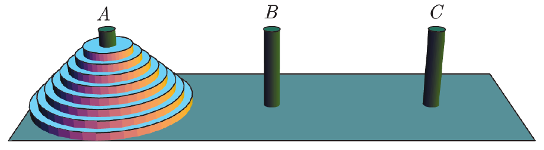

الهدف هو نقل كامل البرج إلى أحد العمودين الآخرين مع الالتزام بالشرطين الآتيين:

- يُسمح بنقل قرص واحد فقط في النقلة الواحدة.
- لا يسمح بوضع قرص فوق قرص أصغر منه.

عرض Lucas لعبته، وذكر أسطورة تحكي قصة برج أكبر، يسمّى برج براهما، مكوّن من أربعة وستين قرصاً مصنوعاً من الذهب الخالص، وثلاثة أعمدة من الألماس. في البدء وُضعت هذه الأقراص الذهبية مرتّبة تبعاً لقياسها فوق أحد الأعمدة، وأُمرت مجموعة من الرهبان بنقل البرج إلى العمود الثالث مع الالتزام بالقواعد التي سبق ذكرها. وانطلق الرهبان يعملون ليل نهار لأداء هذه المهمّة معتقدين أن نهاية العالم ستقع عند انتهائهم من نقل البرج!

من غير الواضح أن يكون لهذه الأحجية حلّ. ولكنّ القليل من التفكير، وربما بعض التجريب، يمكن أن يقنعانا بإمكان الحلّ. والسؤال المطروح: «ما هو أفضل ما نستطيع تحقيقه؟»، أي ما هو عدد النقلات اللازم والكافي لأداء المهمّة؟

### انطلاقة نشطة

**نشاط: التجربة والملاحظة والاستقراء.**

كثيراً ما يوجّه الانتقاد إلى علم الرياضيات بأنه لا يتضمّن في جنباته شيئاً من الملاحظة والتجربة والاستقراء كما تُفهم هذه التعابير في العلوم الطبيعية.

ولكن من المؤكّد أن عمل الباحثين الذين عملوا ويعملون في مجال الرياضيات يتضمّن الكثير من الملاحظة والتجربة والاستقراء. الاستقراء في المعجم هو استخلاص نتائج عامة من النظر في حالات خاصة. لا تتطلّب الملاحظة والتجربة في الرياضيات تجهيزات مكلّفة كما في علوم الفيزياء أو الفلك أو غيرها، بل مجرّد قلم وورقة نكتب عليها.

لنتأمّل مثلاً الأعداد الطبيعية الفردية: $\{1,3,5,7,9,\ldots\}$ وليكن $S_n$ مجموع أول $n$ عدداً منها. ننشئ جدولاً يضمّ القيم التي يأخذها المقدار $S_n$ بدلالة $n$:

| $n$ | 1 | 2 | 3 | 4 |
| --- | --- | --- | --- | --- |
| $S_n$ | 1 | $1+3=4$ | $1+3+5=9$ | $1+3+5+7=16$ |

أنشئ جدولاً في دفترك تستكمل فيه الجدول السابق بحساب قيم $S_n$ الموافقة في حالة $n=5,6,7,\ldots$، أتلاحظ نمطاً؟ اقترح صيغة تعطي عبارة $S_n$ بدلالة $n$.

ها أنت قد أجريت تجربة رياضياتية ولاحظت نتائجها واستقرأت صيغة تعطي عبارة مجموع أول $n$ عدد طبيعي فردي بدلالة $n$. ولكن كيف تثبت صحة استقرائك إثباتاً رياضياتياً؟ هذا ما سنتعلمه في هذه الوحدة.

### 1. عموميات عن المتتاليات

المتتالية هي تابع مجموعة تعريفه هي مجموعة الأعداد الطبيعية $\mathbb{N}$، أو أية مجموعة جزئية غير منتهية منها من النمط $\{n_0,n_0+1,n_0+2,\ldots\}$ حيث $n_0$ عدد طبيعي معطى (يمكن أن يتغير من متتالية إلى أخرى). نرمز إلى المتتالية بالرمز $(u_n)_{n\geq 0}$ أو $(u_n)_{n\geq n_0}$. ونسمي $u_n$ حدّ المتتالية ذا الدليل $n$.

للمتتالية عدد لا نهائي من الحدود بقطع النظر عن قيم هذه الحدود. فحدود المتتالية $(u_n)_{n\geq 0}$ المعرّفة بالعلاقة $u_n=(-1)^n$ تأخذ فقط القيمتين $+1$ و $-1$. كما إن $(\frac{1}{n})_{n\geq 1}$ و $(\frac{1}{n^2-1})_{n\geq 2}$ متتاليتان فيهما $n_0=1$ و $n_0=2$ بالترتيب.

#### 1.1. تعريف متتالية

① بتعريف صريح للحدّ ذي الدليل $n$.

أي يُعرّف الحدّ ذو الدليل $n$ بصيغة تتبع العدد $n$ تفيد في حسابه. مثل $u_n=\frac{(-1)^n}{n+1}$، أو $u_n=f(n)$ حيث $f$ هو تابع معرّف على $[0,+\infty[$ مثل $f(x)=\sqrt{x^2+x+1}$ مثلاً.

② بالتدريج.

أي أن يُحسب الحدّ ذو الدليل $n$ بدلالة الحدود التي سبقته. كأن نعرّف المتتالية $(u_n)_{n\geq 0}$ بأن نُعطى الحدّ $u_0$ ثم نعطي علاقة، تسمّى علاقة تدريجية، تفيد في حساب كل حدّ من حدود المتتالية بدلالة الحدّ أو الحدود التي سبقته.

**مثال**

لنتأمّل مثلاً المتتالية $(u_n)_{n\geq 0}$ المعرّفة انطلاقاً من حدّ البدء $u_0=3$ والعلاقة التدريجية $u_{n+1}=u_n^2-2$، تسمح هذه المعطيات بحساب حدود المتتالية $(u_n)_{n\geq 0}$ واحداً إثر آخر.

$$u_1=u_0^2-2=7,\quad u_2=u_1^2-2=47,\quad u_3=u_2^2-2=2207,\ldots$$

ونلاحظ في هذا المثال: أنّه يمكن التعبير عن الحدّ $u_{n+1}$ تابعاً للحدّ $u_n$ الذي سبقه أي $u_{n+1}=f(u_n)$، والتابع $f$ هو التابع $x\mapsto x^2-2$.

بوجه عام، إذا كان $f$ تابعاً معرّفاً على المجموعة $D$، وتحقّق الشرط

مهما يكن العدد $x$ من $D$ يكن $f(x)$ عنصراً من $D$ أيضاً

أمكننا تعريف متتالية $(u_n)_{n\geq 0}$، بإعطاء حدّ البدء $u_0$ من المجموعة $D$، والعلاقة التدريجية $u_{n+1}=f(u_n)$.

**فكّر**

أصحيح أنّ آحاد جميع حدود المتتالية التي دليلها أكبر من 1 تساوي 7 في في المثال السابق؟

#### 1.2. جهة اطراد متتالية

**تعريف 1**

نقول إن المتتالية $(u_n)_{n\geq n_0}$ متزايدة تماماً إذا وفقط إذا تحقّق الشرط مهما تكن $n_0\leq n$ يكن $u_n<u_{n+1}$.

ونقول إن المتتالية $(u_n)_{n\geq n_0}$ متناقصة تماماً إذا وفقط إذا تحقّق الشرط مهما تكن $n_0\leq n$ يكن $u_n>u_{n+1}$.

وتكون المتتالية $(u_n)_{n\geq n_0}$ متزايدة إذا وفقط إذا تحقّق الشرط مهما تكن $n_0\leq n$ يكن $u_n\leq u_{n+1}$.

كما تكون المتتالية $(u_n)_{n\geq n_0}$ متناقصة إذا وفقط إذا تحقّق الشرط مهما تكن $n_0\leq n$ يكن $u_n\geq u_{n+1}$.

وأخيراً تكون المتتالية $(u_n)_{n\geq n_0}$ ثابتة إذا وفقط إذا تحقّق الشرط مهما تكن $n_0\leq n$ يكن $u_n=u_{n+1}$.

نطلق على المتتاليات التي تحقّق أحد الشروط السابقة اسم متتاليات مطّردة، ويبيّن لنا مثال المتتالية $(u_n)_{n\geq 0}$ المعرّفة بالعلاقة $u_n=(-1)^n$ أنّه توجد متتاليات غير مطّردة.

لدراسة اطراد متتالية $(u_n)_{n\geq 0}$، نقارن، أيّاً كان العدد الطبيعي $n$، العددين $u_n$ و $u_{n+1}$ وذلك بدراسة إشارة الفرق $u_{n+1}-u_n$، أو بمقارنة النسبة $\frac{u_{n+1}}{u_n}$ والعدد 1 في حال كون حدود المتتالية موجبة تماماً.

#### 1.3. المتتالية الحسابية

**تعريف 2**

نقول إن المتتالية $(u_n)_{n\geq 0}$ متتالية حسابية إذا وُجد عدد حقيقي $r$ وتحقّقت العلاقة التدريجية $u_{n+1}=u_n+r$ أيّاً كان العدد الطبيعي $n$. نسمّي العدد $r$ أساس المتتالية الحسابية $(u_n)_{n\geq 0}$. إذن في متتالية حسابية ننتقل من حدّ إلى الحدّ الذي يليه بإضافة العدد الحقيقي نفسه.

وفي هذه الحالة، أيّاً كان العددان الطبيعيان $m$ و $p$، كان

$$u_m=u_p+(m-p)r$$

وإذا كان $S$ مجموع $n$ حدّاً متتالياً أوّلها $a$ وآخرها $\ell$ من حدود متتالية حسابية، كان

$$S=\frac{n(a+\ell)}{2}$$

وبوجه خاصّ

$$1+2+3+\cdots+n=\frac{n(n+1)}{2}$$

#### 1.4. المتتالية الهندسية

**تعريف 3**

نقول إن المتتالية $(u_n)_{n\geq 0}$ متتالية هندسية إذا وُجد عدد حقيقي $q$ وتحقّقت العلاقة التدريجية $u_{n+1}=q\times u_n$ أيّاً كان العدد الطبيعي $n$. نسمّي العدد $q$ أساس المتتالية الهندسية $(u_n)_{n\geq 0}$. إذن في متتالية هندسية ننتقل من حدّ إلى الحدّ الذي يليه بالضرب بالعدد الحقيقي ذاته.

عندئذٍ: أيّاً كان العددان الطبيعيان $m$ و $p$، كان

$$u_m=u_pq^{m-p}$$

وإذا كان $S$ مجموع $n$ حدّاً متتالياً أوّلها $a$ من حدود متتالية هندسية أساسها $q\ne 1$، كان

$$S=a\frac{1-q^n}{1-q}$$

وبوجه خاصّ

$$1+q+q^2+\cdots+q^{n-1}=\frac{1-q^n}{1-q}$$

**مطابقة مفيدة:**

$$x^n-a^n=(x-a)(x^{n-1}+x^{n-2}a+x^{n-3}a^2+\cdots+a^{n-1})$$

أي إن $x^n-a^n$ هو جداء ضرب $(x-a)$ بمجموع جميع الأعداد $x^\alpha a^\beta$ حيث $\alpha$ و $\beta$ عددان طبيعيان مجموعهما يساوي $n-1$. فنجد مثلاً

$$x^5-a^5=(x-a)(x^4+x^3a+x^2a^2+xa^3+a^4)$$

في الحقيقة، المساواة واضحة في حالة $x=a$ أو $x=0$. وفيما عدا ذلك، نعوّض $q=\frac{a}{x}$ في

$$1+q+q^2+\cdots+q^{n-1}=\frac{1-q^n}{1-q}$$

فنحصل على

$$1+\frac{a}{x}+\frac{a^2}{x^2}+\cdots+\frac{a^{n-1}}{x^{n-1}}=\frac{x^n-a^n}{x^{n-1}(x-a)}$$

ونجد المطابقة المرجوّة عندما نضرب طرفي المساواة الأخيرة بالعدد $x^{n-1}(x-a)$.

#### تكريساً للفهم

كيف ندرس جهة اطراد متتالية $(u_n)_{n\geq 0}$؟

ثمّة ثلاث طرائق:

① دراسة إشارة الفرق $u_{n+1}-u_n$.

**مثال**

لنتأمّل المتتالية $(u_n)_{n\geq 1}$ المعرّفة وفق الصيغة $u_n=\frac{n^2+1}{2n}$ في حالة $n\geq 1$. لدينا

$$u_{n+1}-u_n=\frac{(n+1)^2+1}{2(n+1)}-\frac{n^2+1}{2n}=\frac{n^2+n-1}{2n(n+1)}$$

إشارة $u_{n+1}-u_n$ تماثل إشارة $n^2+n-1$. ولأن $n\geq 1$، فإن $n-1\geq 0$ و $n^2>0$ إذن $n^2+n-1$ موجب تماماً في حالة $n\geq 1$. إذن $(u_n)_{n\geq 1}$ متتالية متزايدة تماماً.

② كتابة $u_n=f(n)$، إن أمكن، ثم دراسة اطراد التابع $f$. فإذا كان التابع $f$ مطّرداً على المجال $[n_0,+\infty[$ كانت جهة اطراد $(u_n)_{n\geq n_0}$ هي نفسها جهة اطراد $f$.

**مثال**

لنتأمّل المتتالية $(v_n)_{n\geq 0}$ المعرّفة بالصيغة $v_n=(n-1)^2$ في حالة $n\geq 0$. نرمز بالرمز $f$ إلى التابع المعرّف على $\mathbb{R}$ وفق $x\mapsto(x-1)^2$. عندئذٍ $f'(x)=2(x-1)$. ولأن $f'(x)>0$ في حالة $x>1$، استنتجنا أن $f$ متزايد تماماً على $[1,+\infty[$. فالمتتالية $(v_n)_{n\geq 1}$ متزايدة تماماً بدءاً من الحدّ ذي الدليل $n_0=1$.

③ عندما تكون المتتالية $(u_n)_{n\geq 0}$ ذات حدود موجبة تماماً، يمكن أن نقارن بين $\frac{u_{n+1}}{u_n}$ والعدد 1.

**مثال**

لنتأمّل المتتالية $(w_n)_{n\geq 0}$ المعرّفة على $\mathbb{N}$ وفق $w_n=\left(\frac{2}{3}\right)^n$. جميع حدودها $w_n$ موجبة تماماً، ولدينا $\frac{w_{n+1}}{w_n}=\frac{2}{3}$ أيّاً كان العدد الطبيعي $n$. إذن، أيّاً كان العدد الطبيعي $n$، كان $\frac{w_{n+1}}{w_n}<1$ أو $w_{n+1}<w_n$. فالمتتالية $(w_n)_{n\geq 0}$ متناقصة تماماً.

#### تدرّب

① ليكن $u_n=\frac{2^n}{3^{n+1}}$ في حالة $n\in\mathbb{N}$. أثبت أن المتتالية $(u_n)_{n\geq 0}$ متتالية هندسية وجد أساسها.

② الأسئلة الآتية تتعلّق بمتتاليات حسابية أو هندسية:

1. $(u_n)_{n\geq 0}$ متتالية حسابية فيها $u_2=41$ و $u_5=-13$. احسب $u_{20}$.
2. $(u_n)_{n\geq 0}$ متتالية هندسية فيها $u_7=\frac{1}{1080}$ و $u_{10}=\frac{25}{2197}$. احسب $u_{30}$.
3. $(u_n)_{n\geq 0}$ متتالية حسابية أساسها 3 وفيها $u_1=-2$. احسب $u_n$ بدلالة $n$، واستنتج قيمة المجموعين $u_{30}+u_{31}+u_{32}$ و $u_1+u_2+\cdots+u_{20}$.
4. $(u_n)_{n\geq 0}$ متتالية هندسية أساسها 3 وفيها $u_1=-2$. احسب $u_n$ بدلالة $n$، واستنتج قيمة المجموعين $u_1+u_2+\cdots+u_7$ و $u_2+u_4+u_6+\cdots+u_{2n}$.
5. $(u_n)_{n\geq 0}$ متتالية حسابية أساسها $-2$ وفيها $u_0=-3$. احسب $u_{25}+u_{26}+\cdots+u_{125}$.
6. $(u_n)_{n\geq 0}$ متتالية هندسية أساسها 2 وفيها $u_0=1$. احسب $u_3+u_4+\cdots+u_{10}$.
7. احسب المجموع $S=\frac12+1+\frac32+2+\frac52+3+\cdots+10$.
8. $a$ و $b$ و $c$ ثلاثة حدود متوالية من متتالية هندسية. احسبها علماً أن $a+b+c=36.75$ و $abc=343$.

③ $(v_n)_{n\geq 0}$ متتالية معرّفة تدريجياً وفق $v_0=1$ و $v_{n+1}=\frac{v_n}{1+v_n}$.

1. تحقّق أن $v_n>0$ أيّاً كان العدد الطبيعي $n$.
2. أثبت أن المتتالية $(u_n)_{n\geq 0}$ المعرّفة بالعلاقة $u_n=\frac1{v_n}$ متتالية حسابية.
3. استنتج عبارة $v_n$ بدلالة $n$.

④ ادرس جهة اطراد كلّ من المتتاليات الآتية.

1. $u_n=\frac{3}{n^2}$
2. $u_n=\sqrt{3n+1}$
3. $u_n=\frac{2n-1}{n+4}$
4. $u_n=\frac{1}{n^2+1}$
5. $u_n=\frac{3n+1}{n-2}$
6. $u_n=\frac{n}{10^n}$
7. $\begin{cases}u_0=2,\\u_{n+1}=u_n-3\end{cases}$
8. $\begin{cases}u_0=1,\\u_{n+1}=\frac12u_n\end{cases}$
9. $\begin{cases}u_0=1,\\u_{n+1}=2u_n\end{cases}$

### 2. البرهان بالتدريج، أو بالاستقراء الرياضي

#### 2.1. أهمية الإثبات بالتدريج

في حالة عدد طبيعي موجب تماماً $n$ نرمز بالرمز $E(n)$ إلى المساواة:

$$E(n)\quad «1^3+2^3+\cdots+n^3=(1+2+\cdots+n)^2»$$

من الواضح أن $E(1)$ صحيحة لأن $1^3=1^2$. و $E(2)$ صحيحة، لأن $1^3+2^3=(1+2)^2$. كما إن $E(3)$ صحيحة، لأن $1^3+2^3+3^3=(1+2+3)^2$.

ولكن، أتكون $E(n)$ صحيحة أيّاً كان العدد $n$؟ وفي حالة الإيجاب، كيف يكون الإثبات ونحن لا نمتلك القدرة على التحقّق عدداً غير منتهٍ من المرات؟

#### 2.2. مبدأ الإثبات بالتدريج

الإثبات بالتدريج أو الاستقراء الرياضي ينصّ على أنّه كي نتمكن من صعود السّلّم والوصول إلى أيّة درجة دليلها $n$ يحقّق $n\geq n_0$، يكفي أن نتمكن من الصعود إلى الدرجة القاعدية التي دليلها $n_0$، وأن يكون بإمكانك الصعود من أيّة درجة دليلها $p$ إلى الدرجة التي دليلها $p+1$ التي تعلوها مباشرة.

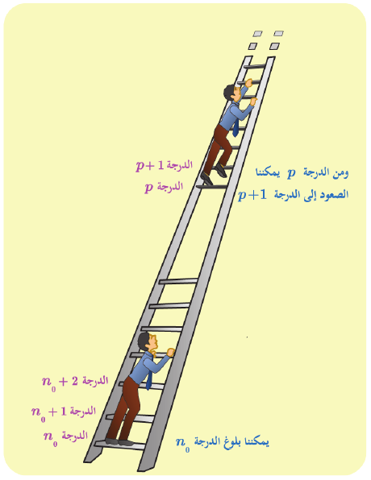

وبصياغة رياضياتية، لإثبات صحّة خاصّة $E(n)$ تتعلّق بالعدد الطبيعي $n$ في حالة $n\geq n_0$.

① نثبت صحّة هذه الخاصّة في الحالة القاعدية $n=n_0$.

② نثبت في حالة $p\geq n_0$ أن صحّة $E(p)$ تقتضي صحّة $E(p+1)$.

وعندها نستنتج صحّة الخاصّة $E(n)$ أيّاً كانت قيمة $n$ أكبر أو تساوي $n_0$.

#### تكريساً للفهم

**متى نستعمل الإثبات بالتدريج؟**

نستعمل البرهان بالتدريج عندما نريد إثبات صحّة خاصّة تتبع متحوّلاً طبيعياً $n$ يتحوّل في $\mathbb{N}$ أو في مجموعة من النمط $\{n\in\mathbb{N}:n\geq n_0\}$.

**كيف نستعمل الإثبات بالتدريج استعمالاً صحيحاً؟**

يجري الإثبات بالبرهان بالتدريج وفق الخطوات الآتية:

⓪ أولاً يجب أن نكتب وبوضوح الخاصّة $E(n)$ التي تتعلّق بالعدد الطبيعي $n$ والتي نرغب بإثبات صحّتها في حالة $n\geq n_0$. وفي أغلب الأحيان يكون $n_0=0$ أو $n_0=1$.

① نثبت صحّة هذه الخاصّة في الحالة القاعدية $n=n_0$، أي صحّة $E(n_0)$.

② نفترض صحّة $E(p)$ في حالة عدد $p$ أكبر أو يساوي $n_0$ ونبرهن صحّة $E(p+1)$.

**مثال**

أثبت أنه مهما كان العدد الطبيعي الموجب تماماً $n$ كان

$$1^3+2^3+\cdots+n^3=\frac{n^2(n+1)^2}{4}$$

**الحل**

⓪ الخاصّة المطلوبة $E(n)$ هي المساواة:

$$E(n)\quad «1^3+2^3+\cdots+n^3=\frac{n^2(n+1)^2}{4}»$$

ونريد إثبات صحّتها في حالة $n\geq 1(=n_0)$.

① الخاصّة $E(1)$ صحيحة لأنها تنصّ على المساواة الواضحة $1^3=\frac{1^2(1+1)^2}{4}$.

② نفترض أنّ $E(n)$ صحيحة، أي $1^3+2^3+\cdots+n^3=\frac{n^2(n+1)^2}{4}$. عندئذٍ

$$\begin{aligned}
1^3+2^3+\cdots+n^3+(n+1)^3
&=\underbrace{1^3+2^3+\cdots+n^3}+(n+1)^3\\
&=\frac{n^2(n+1)^2}{4}+(n+1)^3\\
&=\frac{(n+1)^2}{4}(n^2+4n+4)\\
&=\frac{(n+1)^2(n+2)^2}{4}
\end{aligned}$$

وهذه هي تحديداً الخاصّة $E(n+1)$، فنكون إذن قد أثبتنا صحّتها اعتماداً على صحّة $E(n)$. إذن $E(n)$ صحيحة مهما كان العدد الطبيعي الموجب تماماً $n$.

لقد رأينا عند دراسة المتتاليات الحسابية أن

$$1+2+\cdots+n=\frac{n(n+1)}{2}$$

إذن

$$(1+2+\cdots+n)^2=\frac{n^2(n+1)^2}{4}$$

فإذا استفدنا من المثال السابق استنتجنا أن

$$1^3+2^3+\cdots+n^3=(1+2+\cdots+n)^2$$

في حالة أيّ عدد طبيعي موجب تماماً $n$.

**مثال**

أثبت أنه مهما كان العدد الطبيعي $n$ كان $4^n+2$ مضاعفاً للعدد 3.

**الحل**

⓪ الخاصّة $E(n)$ المطلوبة هي

$$E(n)\quad «4^n+2\text{ مضاعف للعدد }3»$$

① الخاصّة $E(0)$ صحيحة لأنها تنصّ على أن $4^0+2=1+2=3$، مضاعف للعدد 3.

② نفترض أن $E(n)$ صحيحة، أي إن $4^n+2$ مضاعف للعدد 3. ثم نلاحظ أن

$$4^{n+1}+2=4^n\times4+2=(4^n+2)\times4-8+2=4(4^n+2)-6$$

بحسب افتراضنا، $4^n+2$ مضاعف للعدد 3، إذن $4(4^n+2)$ مضاعف للعدد 3، ومن ثم يكون $4(4^n+2)-6$ مضاعفاً للعدد 3 لأنه مجموع مضاعفين للعدد 3. فالقضيّة $E(n+1)$ صحيحة. إذن $E(n)$ صحيحة مهما كان العدد الطبيعي $n$.

#### تدرّب

① نعرّف في حالة عدد طبيعي $n\geq1$ المقدار $S_n=1^2+2^2+3^2+\cdots+n^2$،

1. احسب $S_1$ و $S_2$ و $S_3$ و $S_4$. ثم عبّر عن $S_{n+1}$ بدلالة $S_n$ و $n$.
2. أثبت بالتدريج أنه في حالة أيّة عدد طبيعي $n\geq1$ لدينا: $S_n=\frac{n(n+1)(2n+1)}6$.

② ليكن $x>-1$. في حالة عدد طبيعي $n$ نرمز $E(n)$ إلى المتراجحة $(1+x)^n\geq1+nx$. أثبت أن المتراجحة $E(n)$ محقّقة أيّاً كان العدد الطبيعي $n$.

### تمرينات ومسائل

#### 1

بيّن أيّ المتتاليات $(u_n)_{n\geq0}$ الآتية مطّردة (ربما بدءاً من حدّ معين $n_0$).

1. $u_n=-3n+1$
2. $u_n=\frac{n+1}{n+2}$
3. $u_n=2^n$
4. $u_n=\left(-\frac1n\right)^n$
5. $u_n=1+\frac1{n^2}$
6. $u_n=\frac{n^2}{n!}$
7. $u_n=1+\frac12+\cdots+\frac1{2^n}$
8. $\begin{cases}u_0=8,\\u_{n+1}=\frac34u_n+2\end{cases}$
9. $\begin{cases}u_0=2,\\u_{n+1}=\frac34u_n+2\end{cases}$

تذكّر أن $n!=n\times(n-1)\times\cdots\times1$ في حالة عدد طبيعي $n$ موجب تماماً وأن $0!=1$.

#### 2

المتتالية $(u_n)_{n\geq0}$ معرّفة وفق $u_0=2$ و $u_{n+1}=2u_n-3$ في حالة أيّ عدد طبيعي $n$.

① احسب $u_1$، $u_2$، $u_3$، $u_4$، $u_5$ ثم خمّن عبارة $u_n$ بدلالة $n$.

② بحساب عبارة $u_n-3$ عند كل $n\geq0$، عبّر عن $u_n$ بدلالة $n$.

#### 3

المتتالية $(u_n)_{n\geq0}$ معرّفة وفق $u_0=3$ و $u_{n+1}=-u_n+4$ في حالة عدد طبيعي $n$.

احسب $u_1$، $u_2$، $u_3$، $u_4$، $u_5$ وخمّن عبارة $u_n$ بدلالة $n$ ثم حدّد $u_n$ بدلالة $n$.

#### 4

أثبت بالتدريج صحّة الخاصّتين الآتيتين:

① $1+2\times2!+3\times3!+\cdots+n\times n!=(n+1)!-1$.

② $n!\geq2^{n-1}$.

#### 5

في حالة عدد طبيعي $n\geq1$، ليكن $u_n=1+\frac12+\frac13+\cdots+\frac1n$ و $v_n=u_{2n}-u_n$. أثبت أن المتتالية $(v_n)$ متزايدة تماماً.

#### 6

$a$ و $b$ و $c$ ثلاثة أعداد حقيقية و $a\ne0$. نعلم أن $a$ و $b$ و $c$ هي ثلاثة حدود متعاقبة من متتالية هندسية، نرمز إلى أساسها بالرمز $q$. كما نعلم أن $3a$ و $2b$ و $c$ هي ثلاثة حدود متوالية من متتالية حسابية. احسب $q$.

### لنتعلّم البحث معاً

#### 7. ضع افتراضاً ثم تحقّق من صحته

نتأمّل المتتالية $(u_n)_{n\geq0}$ المعرّفة تدريجياً وفق $u_0=7$ و $u_{n+1}=10u_n-18$ عند كلّ عدد طبيعي $n$. نهدف في هذا التمرين إلى التعبير عن $u_n$ بدلالة $n$.

**نحو الحلّ**

نعلم أنه في حالة متتالية معرّفة بعلاقة تدريجية، يمكننا حساب $u_n$ بشرط أن نكون قد عرفنا الحدود التي تسبقه. والمطلوب هنا هو إيجاد طريقة لحساب $u_n$ مباشرة بدلالة $n$. في هذا النمط من المسائل، نحسب حدوداً أولى من المتتالية ثم نحاول في كل حالة الربط بين قيمة الحدّ ودليله.

احسب $u_1$، $u_2$، $u_3$، $u_4$، $u_5$ ...

نجد أن كلّ حدّ من الحدود المحسوبة يبدأ من اليسار بالرقم 5 وينتهي بالرقم 2، ويوجد بينهما عدد من الأصفار يتعلّق بقيمة $n$، أي بدليل هذا الحدّ. بالتأكيد، سيسمح لك هذا بالتعبير عن $u_n$ بدلالة $n$.

1. عيّن عدد الأصفار المشار إليه أعلاه عندما تأخذ $n$ القيم 1، 2، 3، 4 و 5.
2. ما عدد الأصفار بدلالة $n$.
3. تحقّق أن $u_k=5\times10^k+2$ في حالة $k$ من $\{1,2,3,4,5\}$.
4. اقترح صيغة للحدّ $u_n$ بدلالة $n$. ثم أثبت صحّة اقتراحك أيّاً كانت $n$.

أنجز الحلّ واكتبه بلغة سليمة.

#### 8. متتالية هندسية مخفيّة

نتأمّل المتتالية $(u_n)_{n\geq0}$ المعرّفة تدريجياً وفق

$$u_0=s\qquad\text{و}\qquad u_{n+1}=\frac12u_n+n^2+n\qquad(*)$$

① عيّن كثير حدود من الدرجة الثانية $P$ بحيث تحقّق المتتالية $(t_n)_{n\geq0}$ التي حدّها العام $t_n=P(n)$ العلاقة التدريجية $(*)$ نفسها أي $t_{n+1}=\frac12t_n+n^2+n$ أيّاً كانت $n$.

② أثبت أن المتتالية $(v_n)_{n\geq0}$ التي حدّها العام $v_n=u_n-t_n$ هي متتالية هندسية.

③ اكتب عبارة $v_n$ ثم $u_n$ بدلالة $n$ و $s$.

**نحو الحلّ**

نبحث عن كثير حدود من الدرجة الثانية $P$. لنكتبه إذن بالصيغة $P(n)=an^2+bn+c$.

لتعيين الأمثال $a$ و $b$ و $c$ نستفيد من كون المتتالية التي حدّها العام $t_n=P(n)$ تحقّق العلاقة التدريجية.

1. بيّن أن $(t_n)_{n\geq0}$ تحقّق العلاقة التدريجية $(*)$ إذا وفقط إذا كان

   $$\left(\frac a2-1\right)n^2+\left(2a+\frac b2-1\right)n+\left(a+b+\frac c2\right)=0$$

   أيّاً كان العدد الطبيعي $n$.

2. استنتج من ذلك جملة بسيطة من المعادلات تحقّقها $a$ و $b$ و $c$. ثم عيّن هذه الأعداد.

لإثبات أن المتتالية $(v_n)_{n\geq0}$ هندسية، يكفي أن نجد عدداً $q$ بحيث تتحقّق المساواة $v_{n+1}=qv_n$، عيّن $q$.

بمعرفة $v_0$ و $q$ يمكننا استنتاج $v_n$، ثم لأننا نعرف $t_n$ يمكننا إنجاز المطلوب.

أنجز الحلّ واكتبه بلغة سليمة.

### قدماً إلى الأمام

#### 9

نُعطى عددين حقيقيين $a$ و $b$ ونفترض أن $a\ne1$. نتأمّل المتتالية $(v_n)_{n\geq0}$ التي تحقّق $v_{n+1}=av_n+b$، أيّاً كان العدد الطبيعي $n$.

① عيّن تابعاً $f$ يحقّق $v_{n+1}=f(v_n)$ أيّاً كانت قيمة $n\geq0$.

② احسب $\ell$ حلّ المعادلة $f(x)=x$.

③ نعرّف المتتالية $(u_n)_{n\geq0}$ حيث $u_n=v_n-\ell$. أثبت أن $(u_n)_{n\geq0}$ متتالية هندسية، واستنتج $u_n$ بدلالة $n$ و $a$ و $b$ و $v_0$. ثم استنتج $v_n$ بدلالة هذه المعاملات.

#### 10

نتأمّل متتالية $(u_n)_{n\geq0}$ معرّفة بالتدريج وفق:

$$\begin{cases}u_0=1,\quad u_1=4,\\u_{n+1}=5u_n-6u_{n-1}\qquad(n\geq1)\end{cases}$$

① عيّن عددين حقيقيين $a$ و $b$ يحقّقان $a+b=5$ و $ab=6$.

② لتكن $(v_n)_{n\geq0}$ المتتالية $v_n=u_{n+1}-au_n$. أثبت أن $(v_n)_{n\geq0}$ متتالية هندسية أساسها $b$.

③ لتكن $(w_n)_{n\geq0}$ المتتالية $w_n=u_{n+1}-bu_n$. أثبت أن $(w_n)_{n\geq0}$ متتالية هندسية أساسها $a$.

④ عبّر عن $v_n$ و $w_n$ بدلالة $n$. ثم استنتج عبارة $u_n$ بدلالة $n$.

#### 11. متراجحة تدرّجية

① أثبت، أيّاً كان العدد الطبيعي $n$، $n\geq2$، أن: $3\times n^2\geq(n+1)^2$.

② نرمز بالرمز $E(n)$ إلى القضيّة «$3^n\geq2^n+5\times n^2$».

1. ما أصغر عدد طبيعي غير معدوم $n$، تكون $E(n)$ صحيحة عنده؟
2. أثبت أن $E(n)$ صحيحة، أيّاً كان العدد الطبيعي $n$ الذي يحقّق الشرط $n\geq5$.

#### 12

نرمز بالرمز $E(n)$ إلى القضيّة «$3^n\geq(n+2)^2$».

① أتكون القضايا $E(0)$ و $E(1)$ و $E(3)$ و $E(4)$ صحيحة؟

② أثبت بالتدريج أن القضيّة $E(n)$ صحيحة عند كل عدد طبيعي $n$ يحقّق الشرط $n\geq3$.

#### 13

أثبت بالتدريج، صحّة كلّ من الخواصّ الآتية أيّاً كان العدد الطبيعي $n$.

① «$4^n+5$ مضاعف للعدد 3».

② «$2^{3n}-1$ مضاعف للعدد 7».

③ «$n^3+2n$ مضاعف للعدد 3».

④ «$3^{2n+1}+2^{n+2}$ مضاعف للعدد 7».

#### 14

نرمز إلى القضيّة «يقسم العدد 9 العدد $10^n+1$» بالرمز $E(n)$، في حالة $n\in\mathbb{N}$.

① أثبت أنه إذا كانت $E(n)$ صحيحة عند قيمة للعدد $n$، كانت عندئذٍ $E(n+1)$ صحيحة.

② أتكون القضيّة $E(n)$ صحيحة على $\mathbb{N}$؟ برّر إجابتك.

#### 15

$(u_n)_{n\geq0}$ متتالية معرّفة وفق $u_0=1$ و $u_{n+1}=\sqrt{2+u_n}$ عند كلّ $n\geq0$.

① أثبت أن $0\leq u_n\leq2$، أيّاً كان العدد الطبيعي $n$.

② أثبت أن المتتالية $(u_n)_{n\geq0}$ متزايدة تماماً.

#### 16

$(u_n)_{n\geq0}$ متتالية معرّفة وفق $u_0=1$ و $u_{n+1}=\frac{3u_n+2}{2u_n+6}$ عند كلّ $n\geq0$.

① أثبت أن التابع $x\mapsto\frac{3x+2}{2x+6}$ متزايد تماماً واستنتج أن $\frac12<u_n\leq1$، أيّاً كان العدد $n$.

② أثبت أن المتتالية $(u_n)_{n\geq0}$ متناقصة تماماً.

#### 17

ليكن $\theta$ عدد حقيقي من المجال $]0,\frac\pi2[$. ثم نعرّف المتتالية $(u_n)_{n\geq0}$ وفق $u_0=2\cos\theta$ و $u_{n+1}=\sqrt{2+u_n}$ في حالة $n\in\mathbb{N}$.

① احسب $u_1$ و $u_2$.

② أثبت بالتدريج، أن $u_n=2\cos\left(\frac{\theta}{2^n}\right)$.

**مساعدة:** تذكّر أن $1+\cos2\theta=2\cos^2\theta$.

#### 18

في مستوٍ $\mathcal P$، محدّث بمعلم متجانس، $\mathcal H$ هي مجموعة النقط $M(x,y)$ التي تحقّق إحداثياتها المعادلة $x^2-5y^2=1$. ليكن $f$ التابع الذي يقرن بكل نقطة $M(x,y)$ من المستوي $\mathcal P$ النقطة $M'(9x+20y,4x+9y)$، أي $f(M)=M'$. لتكن $S_0$ النقطة التي إحداثيّاتها $(1,0)$، ثم لنتأمّل في المستوي $\mathcal P$ متتالية النقاط $(S_n)_{n\geq0}$ المعرّفة وفق: $S_{n+1}=f(S_n)$. أثبت أن $S_n$ نقطة من المجموعة $\mathcal H$ وأن إحداثيّاتها أعداد صحيحة.

#### 19

يرمز $x$ إلى عدد حقيقي ويرمز $n$ إلى عدد طبيعي غير معدوم. نضع

$$S_n=\cos x+\cos(3x)+\cos(5x)+\cdots+\cos((2n-1)x)$$

① باستعمال دساتير مثلثاتية تعرفها، أثبت أن:

$$\sin a\cdot\cos b=\frac12\bigl(\sin(a+b)+\sin(a-b)\bigr)\qquad\text{و}\qquad\sin(2a)=2\sin a\cos a$$

② حوّل كلاًّ من العبارتين الآتيتين من جداء نسبتين مثلثيتين إلى مجموع نسبتين مثلثيتين.

$$\sin x\cdot\cos((2n+1)x)\qquad\text{و}\qquad\sin nx\cdot\cos nx$$

③ أثبت أن $S_n=\cos(nx)\times\frac{\sin(nx)}{\sin x}$، أيّاً يكن $n\geq1$ و $x\ne k\pi\ (k\in\mathbb Z)$.

## 2. التوابع: النهايات والاستمرار

1. نهاية تابع عند اللانهاية
2. نهاية تابع عند عدد حقيقي
3. العمليات على النهايات
4. مبرهنات المقارنة
5. نهاية تابع مركّب
6. المقارب المائل
7. الاستمرار
8. التوابع المستمرة وحل المعادلات

يسكن عدنان سفح جبل عالٍ، وأراد يوماً زيارة جدّه الذي يقيم في بيت يتربّع على قمة الجبل. هناك طريق واحدة من بيت عدنان إلى بيت جدّه والرحلة تستغرق نهاراً كاملاً من شروق الشمس إلى غروبها.

أعدّ عدنان عدّته وانطلق في رحلته في الصباح الباكر مع أوّل أشعة الشمس البازغة، وكان في رحلة صعوده يستريح من وقت إلى آخر ويستمتع بالمناظر الخلّابة، وفي بعض الأحيان يرجع على أعقابه ليقطف زهرة أو ثمرة من شجرة.

وصل عدنان إلى بيت جدّه عند الغروب كما كان متوقّعاً، فالتقى جدّه وتسامرا وجهّز نفسه لرحلة العودة في اليوم التالي. انطلق عدنان عائداً إلى منزله مع بزوغ الشمس، كانت رحلة النزول أسهل، فراح يسرع أحياناً ويبطئ أحياناً أخرى، ويتوقّف لتناول الطعام. وصل عدنان إلى منزله مع غروب الشمس.

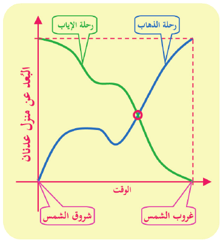

أتعلم أنّه يوجد موقع على الطريق أشارت عنده ساعة عدنان إلى الوقت نفسه في رحلة الذهاب وفي رحلة العودة؟

هذه نتيجة من مبرهنة القيمة الوسطى التي سندرسها في هذه الوحدة.

### انطلاقة نشطة

#### نشاط 1: حلّ المعادلات

الأشكال الآتية هي الخطوط البيانية لتوابع $f$ معرّفة على $\mathbb R$.

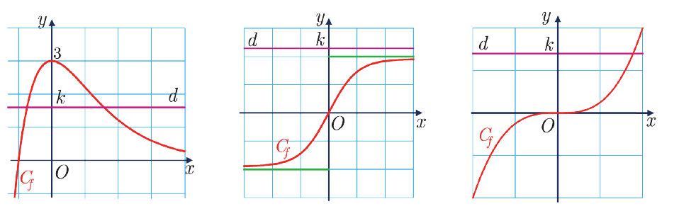

الحلّ الهندسي للمعادلة $f(x)=k$ هو البحث عن وجود نقاط مشتركة بين الخط البياني $C_f$ للتابع $f$ والمستقيم $d$ الذي معادلته $y=k$. في حالة كثير حدود من الدرجة الثانية، نعلم أنه يمكن حلّ المعادلة $f(x)=k$ حلاً جبرياً. ولكن قد يستحيل حلها في الحالة العامة. عندها نرسم الخطّ البياني $C_f$ للتابع $f$ ونرسم المستقيم $d$ الذي معادلته $y=k$، فتكون فواصل النقاط المشتركة بين $C_f$ و $d$ حلولاً للمعادلة $f(x)=k$ إن كان لها حلول.

رسمنا في الشكل المجاور الخطّ البياني لتابع $f$ معرّف على المجال $[0,4]$. أيّاً كان العدد الحقيقي $k$ المحصور بين العددين 1 و 5، كان للمعادلة $f(x)=k$ حلول. لأنّ الخط البياني للتابع $f$ مكوّن من «قطعة واحدة». نقول في هكذا حالة إن التابع مستمرّ على المجال $[0,4]$.

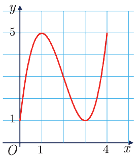

أمّا في الشكل المجاور فنجد أيضاً الخطّ البياني لتابع $f$ معرّف على المجال $[0,4]$. ولكن ليس للمعادلة $f(x)=k$ حلول عندما تكون $3<k\leq4$. لاحظ أن الخطّ البياني ليس قطعة واحدة. نقول في هكذا حالة إن التابع $f$ غير مستمرّ على المجال $[0,4]$. (هو، بالتحديد غير مستمر عند 2)

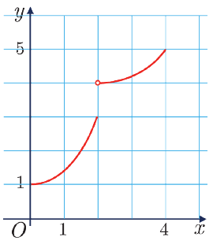

الأشكال المرسومة أدناه، هي الخطوط البيانية لتوابع $f$ معرّفة على المجال $[-3,+3]$.

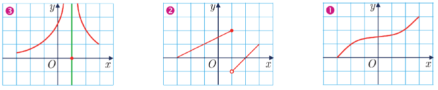

① أيّ التوابع الثلاثة مستمرّ على المجال $[-3,+3]$ وأيّها غير مستمرّ عليه.

② اذكر، في كل حالة، عدد حلول المعادلة $f(x)=k$، تبعاً لقيم $k$.

#### نشاط 2: استمرار ونهايات ومجالات

##### ❶ تابع الجزء الصحيح

أيّاً يكن العدد الحقيقي $x$، يوجد عدد صحيح وحيد $n$ يحقّق $n\leq x<n+1$. يسمّى العدد $n$ الجزء الصحيح للعدد الحقيقي $x$، ويرمز إليه بالرمز $E(x)$. على سبيل المثال:

$E(\pi)=3$، لأن $3\leq\pi<3+1$ و $E(-3.5)=-4$، لأن $-4\leq-3.5<-3$.

في الشكل المرافق، ما رُسم باللون الأحمر هو الخطّ البياني لتابع معرّف على المجال $[0,2[$.

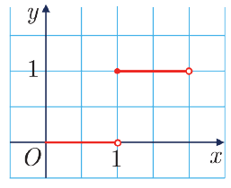

① تحقّق أن التابع هو $E:x\mapsto E(x)$. احسب $E(1)$.

② هل $E(1)$ نهاية للتابع $E$ في النقطة 1؟

مع أن التابع $E$ معرّف في النقطة 1، ($E(1)=1$) ولكن قيم $E(x)$ لا تتجمّع حول قيمة محدّدة (نهاية) عند اقتراب $x$ من 1، فليس لهذا التابع نهاية عند 1. نقول إنه غير مستمرّ في النقطة 1.

لاحظ أن الخطّ البياني لهذا التابع على المجال $[0,2[$ يتألّف من قطعتين، فهو يعاني انقطاعاً عند $x=1$. نقول إن $E$ غير مستمرّ على المجال $[0,2[$.

③ ارسم الخطّ البياني للتابع $E$ على المجال $[2,5[$.

- a. في أيّة نقاط من المجال $[2,5[$ التابع $E$ غير مستمرّ؟
- b. هل $E$ مستمرّ على المجال $]3,5[$؟ علّل إجابتك.

##### ❷ صورة مجال

صورة مجال $I$ وفق تابع $f$ هي مجموعة الأعداد $f(x)$ عندما تتحوّل $x$ في $I$ آخذة جميع القيم فيه. نرمز إلى هذه المجموعة بالرمز $f(I)$.

① ارسم الخطّ البياني للتابع $f:x\mapsto x^2$. لاحظ أن $f$ مستمرّ على $\mathbb R$ فهو مستمرّ على كل مجال.

② عيّن، وفق $f$، صورة كل من المجالات $[0,2]$ و $[-2,2]$ و $[-2,4]$ و $]-\infty,2]$ و $\mathbb R$.

لاحظ أنه في كل حالة كانت المجموعة $f(I)$ مجالاً.

### 1. نهاية تابع عند اللانهاية

#### 1.1. النهاية الحقيقية (أو المنتهية) عند $+\infty$ (أو $-\infty$)، والمقارب الأفقي

ليكن $f$ تابعاً معرّفاً في جوار اللانهاية الموجبة $+\infty$، هذا يعني أن مجموعة تعريف $f$ تحوي مجالاً من الشكل $]a,+\infty[$ حيث $a\in\mathbb R$.

**تعريف 1**

نقول إن نهاية $f$ عند $+\infty$ هي $\ell$ إذا كانت قيم $f(x)$ تصبح قريبة من القيمة $\ell$، أو تتجمّع حول $\ell$، عندما تصبح $x$ كبيرة بما يكفي. ونكتب $\displaystyle\lim_{x\to+\infty}f(x)=\ell$.

بصياغة أدقّ مهما اخترنا العدد $\varepsilon>0$ فإن قيم $f(x)$ ستقع داخل المجال $]\ell-\varepsilon,\ell+\varepsilon[$ بدءاً من قيمة معيّنة $A$، وذلك كما هو موضّح في الشكل المجاور.

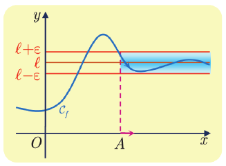

في هذه الحالة نقول إن المستقيم الذي معادلته $y=\ell$ مستقيم مقارب أفقي عند $+\infty$ للمنحني $C_f$، لأن المنحني يقترب من هذا المستقيم عندما تزداد قيم $x$.

ونعرّف بالمثل $\displaystyle\lim_{x\to-\infty}f(x)=\ell$ في حالة تابع $f$ معرّف في جوار اللانهاية السالبة $-\infty$. وعندئذٍ يكون المستقيم الذي معادلته $y=\ell$ مستقيماً مقارباً أفقياً عند $-\infty$ للمنحني $C_f$.

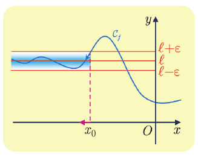

تذكّر أن نهاية كلّ من التوابع الآتية هي $\ell=0$ عند $+\infty$:

$$x\mapsto\frac1x\quad\text{و}\quad x\mapsto\frac1{x^2}\quad\text{و}\quad x\mapsto\frac1{x^n}\ \text{(في حالة عدد طبيعي غير معدوم }n\text{)}\quad\text{و}\quad x\mapsto\frac1{\sqrt{x}}$$

فالمستقيم المنطبق على محور الفواصل الذي معادلته $y=0$ مستقيم مقارب أفقي للخطّ البياني لكلّ منها في جوار $+\infty$. وكذلك يكون المستقيم نفسه مستقيماً مقارباً أفقياً في جوار $-\infty$ لكلّ من التوابع

$$x\mapsto\frac1x\quad\text{و}\quad x\mapsto\frac1{x^2}\quad\text{و}\quad x\mapsto\frac1{x^n}\ \text{(في حالة عدد طبيعي غير معدوم }n\text{)}.$$

#### 1.2. النهاية اللانهائية عند $+\infty$ (أو $-\infty$)

ليكن $f$ تابعاً معرّفاً في جوار اللانهاية الموجبة $+\infty$، أي أن مجموعة تعريف $f$ تحوي مجالاً من الشكل $]a,+\infty[$ حيث $a\in\mathbb R$.

**تعريف 2**

نقول إن نهاية $f$ عند $+\infty$ هي $+\infty$ إذا كانت قيم $f(x)$ تتجاوز (أي تصبح أكبر) أيّ عدد حقيقي $M$ عندما تكون $x$ كبيرة بما يكفي. ونكتب ذلك $\displaystyle\lim_{x\to+\infty}f(x)=+\infty$. يكافئ هذا التعريف القول:

أيّاً كان العدد الحقيقي $M$، وُجد عدد حقيقي $A$ يحقّق:

إذا كان $x>A$ كان $f(x)>M$.

في الشكل المجاور نرى أن قيم التابع تتجاوز العدد $M$ عندما تصبح $x$ أكبر من حدّ معيّن $A$.

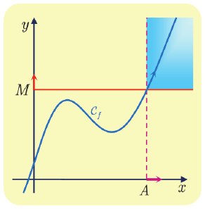

نعرّف بالمثل كلاًّ من $\displaystyle\lim_{x\to+\infty}f(x)=-\infty$ و $\displaystyle\lim_{x\to-\infty}f(x)=+\infty$ و $\displaystyle\lim_{x\to-\infty}f(x)=-\infty$.

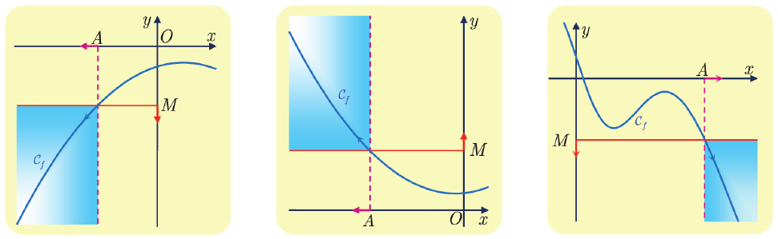

$$\lim_{x\to-\infty}f(x)=-\infty\qquad\lim_{x\to-\infty}f(x)=+\infty\qquad\lim_{x\to+\infty}f(x)=-\infty$$

- تذكّر أن نهاية التوابع الآتية هي $+\infty$ عند $+\infty$:

  $$x\mapsto x,\quad x\mapsto x^2,\quad x\mapsto x^3,\quad x\mapsto\sqrt{x}$$

- وأن نهاية التوابع الآتية هي $+\infty$ عند $-\infty$:

  $$x\mapsto x^2\quad\text{و}\quad x\mapsto x^n\ \text{(في حالة عدد طبيعي زوجي غير معدوم }n\text{)}$$

- وأن نهاية التوابع الآتية هي $-\infty$ عند $-\infty$:

  $$x\mapsto x\quad\text{و}\quad x\mapsto x^n\ \text{(في حالة عدد طبيعي فردي }n\text{)}$$

#### تكريساً للفهم

**لماذا ليس لتابع الجيب $\sin$ نهاية عند $+\infty$؟**

لنفترض على سبيل الجدل أن هذه النهاية موجودة، ولنرمز إليها بالرمز $\ell$. ولأن $-1\leq\sin x\leq+1$ أيّاً كان $x$ من $\mathbb R$، فلا بدّ أن تنتمي النهاية $\ell$ إلى المجال $I=[-1,+1]$.

لنتأمّل مجالاً مفتوحاً $J$ مركزه $\ell$ ونصف قطره $\frac13$. لما كان طول المجال $J$ يساوي $\frac23$، وهو أصغر تماماً من 2 (المسافة بين العددين 1 و $-1$)، فإن هذا المجال لن يحتوي على العددين 1 و $-1$ في آن معاً، وإذا افترضنا مثلاً أن $-1\notin J$ كانت قيم $\sin x$ عند جميع الأعداد $x=2\pi k-\frac\pi2$ خارج المجال $J$. إذن لا يوجد حدّ $A$ يجعل $\sin x\in J$ في حالة $x>A$، وهذا يناقض الافتراض $\displaystyle\lim_{x\to\infty}\sin x=\ell$. وعليه ليس للتابع $\sin$ نهاية عند $+\infty$.

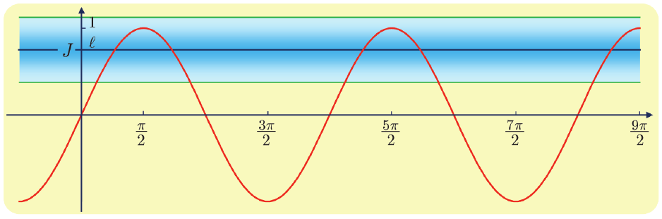

**مثال: استعمال «$x$ في غاية الكبر»**

لنتأمّل التابع $f$ المعرّف على $\mathbb R\setminus\{-3/2\}$ وفق الصيغة $f(x)=\frac{4x-5}{2x+3}$. من المعلوم أن $\displaystyle\lim_{x\to+\infty}f(x)=2$. عيّن عدداً $A$ يحقّق الشرط: إذا كان $x>A$ انتمى $f(x)$ إلى المجال المفتوح $I$ الذي مركزه 2 ونصف قطره 0.05.

**الحل**

ينتمي $f(x)$ إلى المجال المفتوح $I$ الذي مركزه 2 ونصف قطره 0.05 إذا تحقّقت المتراجحة

$$|f(x)-2|<\frac1{20}$$

ولكن

$$f(x)-2=\frac{4x-5}{2x+3}-2=\frac{-11}{2x+3}$$

إذن تكافئ المتراجحة السابقة الشرط

$$\frac{11}{|2x+3|}<\frac1{20}$$

أو $|2x+3|>220$. وإذ ينصب اهتمامنا على القيم الكبيرة للمتحوّل $x$، يمكننا افتراض أن $x>0$، إذن $2x+3>0$ ومن ثم $220<2x+3$، أو $x>108.5$. ينتج عن ذلك أنه إذا كان $x>108.5$، انتمى $f(x)$ إلى المجال $I=]2-0.05,2+0.05[$. ويمكن أن نختار $A$ أيّ عدد أكبر من 108.5.

**مثال: الوضع النسبي للخط البياني لتابع ومقاربه الأفقي**

في المثال السابق. لما كان $\displaystyle\lim_{x\to+\infty}f(x)=2$، كان المستقيم $\Delta$ الذي معادلته $y=2$ مقارباً أفقياً للخط البياني $C_f$ التابع $f$. ادرس، بالاعتماد على إشارة $f(x)-2$، وضع الخط البياني $C_f$ بالنسبة إلى المستقيم المقارب $\Delta$.

**الحل**

تؤول دراسة الخط البياني $C_f$ بالنسبة إلى المستقيم $\Delta$، إلى دراسة إشارة المقدار $f(x)-2$ ولقد وجدنا

$$f(x)-2=\frac{-11}{2x+3}$$

ومن الواضح أن $f(x)-2$ موجب على المجال $I_1=]-\infty,-\frac32[$ وسالب على المجال $I_2=]-\frac32,+\infty[$. وبهذا يقع $C_f$ فوق $\Delta$ في المجال $I_1$ وتحته في المجال $I_2$.

#### تدرّب

❶ احسب نهايات التوابع الآتية عند $+\infty$ وعند $-\infty$.

① $f(x)=-x^3+x^2-x+1$

② $f(x)=-3x^4+1$

③ $f(x)=8x^4-12x^3+5x^2-x$

④ $f(x)=5x^3-3x-1$

⑤ $f(x)=7x^3+2x^2-5x-1$

⑥ $f(x)=-2x^4+100x^3$

❷ احسب نهاية التابع $f$ المعطى بالعلاقة $f(x)=\frac{5x-1}{x-1}$ عند $+\infty$، ثم أعطِ عدداً $A$ يحقّق الشرط: إذا كان $x>A$، كان $f(x)$ في المجال $]4.9,5.1[$.

### 2. نهاية تابع عند عدد حقيقي

نذكّر أن منطلق أي تابع $f$ مما سندرسه هو مجال غير تافه أو اجتماع عدة مجالات، وأننا نرمز إليه بالرمز $D_f$. وعند دراسة نهاية هذا التابع عند نقطة $a$ فإما أن تنتمي $a$ إلى منطلق هذا التابع أو تكون طرفاً لأحد مجالات هذا المنطلق.

#### 2.1. النهاية اللانهائية عند عدد حقيقي، المقارب الشاقولي

**تعريف 3**

نقول إن نهاية $f$ عند $a$ هي $+\infty$ إذا تجاوزت قيم $f(x)$ أي عدد حقيقي $M$ حين تقترب $x$ بما يكفي من العدد $a$. ونكتب ذلك $\displaystyle\lim_{x\to a}f(x)=+\infty$.

في الشكل المجاور نرى أن قيم التابع تتجاوز العدد $M$ عندما يصبح بُعد $x$ عن $a$ أصغر من حدّ معيّن $\alpha$، حيث $\alpha$ عدد حقيقي موجب تماماً.

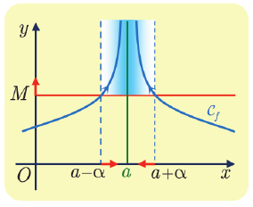

يكافئ التعريف السابق القول مهما كبر العدد الحقيقي $M$ فيوجد مجال مفتوح $I$ مركزه $a$ يحقّق: «إذا كان $x$ من $I\cap D_f$، كان $f(x)>M$».

نقول إن المستقيم الذي معادلته $x=a$ هو مستقيم مقارب شاقولي لمنحني التابع.

ونعرّف بالمماثلة $\displaystyle\lim_{x\to a}f(x)=-\infty$، إذا صارت قيم $f(x)$ سالبة وأصغر من أي عدد حقيقي $M$ معطى سابقاً عندما تكون $x$ قريبة بما يكفي من العدد $a$. أو مهما صغر العدد الحقيقي السالب $M$ فيوجد مجال مفتوح $I$ مركزه $a$ يحقّق:

«إذا كان $x$ من $I\cap D_f$، كان $f(x)<M$».

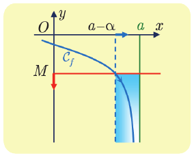

نقول أيضاً في هذه الحالة إن المستقيم الذي معادلته $x=a$ هو مستقيم مقارب شاقولي لمنحني التابع.

**مثال**

التابع $f:x\mapsto\frac1{\sqrt{x}}$ معرّف على المجال $D_f=]0,+\infty[$. والنقطة $a=0$ لا تنتمي إلى المجال $D_f$ ولكنها أحد طرفي هذا المجال، يمكننا إذن دراسة نهاية التابع عند النقطة $a=0$.

عندما تقترب الأعداد $x$ من 0 فإن القيم $\frac1{\sqrt{x}}$ تصبح كبيرة أكثر فأكثر. إذا كان $M$ عدداً حقيقياً موجباً تجاوزت قيم التابع العدد $M$، مهما كان $M$ كبيراً، عندما تصغر قيمة $x$ بحيث يصبح $0<x<\frac1{M^2}$.

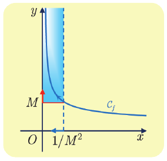

نقول في هذه الحالة إن نهاية التابع $f$ عند الصفر تساوي $+\infty$. ونكتب عندئذٍ

$$\lim_{x\to0}\frac1{\sqrt{x}}=+\infty\quad\text{أو}\quad\lim_{x\to0^+}\frac1{\sqrt{x}}=+\infty$$

ويكون محور التراتيب الذي معادلته $x=0$ مقارباً شاقولياً لمنحني التابع.

#### 2.2. النهاية عند $a$ هي عدد حقيقي $\ell$

**تعريف 4**

نقول إن نهاية $f$ عند $a$ هي $\ell$ إذا تجمّعت القيم $f(x)$ قرب القيمة $\ell$ عندما تصبح $x$ قريبة بما يكفي من $a$. ونكتب ذلك $\displaystyle\lim_{x\to a}f(x)=\ell$.

**صياغة دقيقة:**

- مهما كان $\varepsilon>0$ فإن القيم $f(x)$ ستقع داخل المجال $]\ell-\varepsilon,\ell+\varepsilon[$ عندما يصبح المتحوّل $x$ من $D_f$ قريباً من $a$، أي عندما يصبح بعده عن $a$ أصغر من حدّ معيّن $\delta$ (يتعلّق بالعدد $\varepsilon$).

  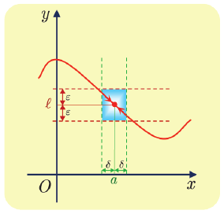

- أو مهما كان $\varepsilon>0$ فإن مجموعة حلول المتراجحة $|f(x)-\ell|<\varepsilon$ تحوي مجموعة من النمط $D_f\cap]a-\delta,a+\delta[$ حيث $\delta>0$.
- أو مهما كان $\varepsilon>0$ فتوجد مجموعة من النمط $D_f\cap]a-\delta,a+\delta[$ حيث $\delta>0$ تحقّق عناصرها المتراجحة $|f(x)-\ell|<\varepsilon$.

**مثال: تعيين مجال**

نعلم أن العدد 3 نهاية للتابع $f:x\mapsto\sqrt{4x+1}$ عند 2. عيّن مجالاً $I$ مركزه 2 يحقّق الشرط: إذا كان $x$ من المجال $I$، كان $f(x)$ من المجال $J=]2.99,3.01[$.

**الحل**

يكافئ القول «$f(x)$ من المجال $]2.99,3.01[$» القول «$2.99<\sqrt{4x+1}<3.01$»، إذن $2.99^2<4x+1<3.01^2$ وأخيراً $\frac{2.99^2-1}{4}<x<\frac{3.01^2-1}{4}$، وهذه المتراجحة تؤول بعد الاختزال إلى $1.985025<x<2.015025$. فمثلاً يمكننا أخذ المجال $I=]1.99,2.01[$ لينتمي $f(x)$ إلى المجال $]2.99,3.01[$ أيّاً كان $x$ من $I$.

وكان بالإمكان أيضاً أن نلاحظ أن

$$\sqrt{4x+1}-3=\frac{4(x-2)}{3+\sqrt{4x+1}}$$

ومنه، في حالة $x>0$ لدينا

$$\left|\sqrt{4x+1}-3\right|=\frac{4|x-2|}{3+\sqrt{4x+1}}<\frac{4|x-2|}{3+\sqrt{4\times0+1}}=|x-2|$$

فالشرط $|x-2|<0.01$ يقتضي $|\sqrt{4x+1}-3|<0.01$ أو المتراجحة $x\in]1.99,2.01[$ تقتضي $2.99<\sqrt{4x+1}<3.01$.

#### تكريساً للفهم

**لماذا لا يكون لتابع $f$، بالضرورة، نهاية عند كل نقطة من $D_f$؟**

لنتأمّل مثلاً الخطّ البياني للتابع $f$ المعرّف على المجال $I=[0,5]$ وفق:

$$f(x)=\begin{cases}1,&x\in[0,2[,\\3,&x\in[2,5].\end{cases}$$

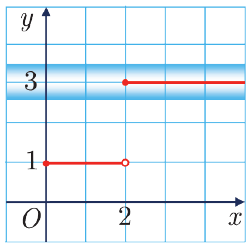

$f(2)=3$، ولكن 3 ليس نهاية للتابع $f$ عندما تسعى $x$ إلى 2. في حقيقة الأمر، إذا تأمّلنا المجال المفتوح $]2.5,3.5[$ الذي مركزه 3 ونصف قطره 0.5، لوجدنا أنه لا يحتوي جميع القيم $f(x)$ الموافقة لقيم $x$ التي تنتمي إلى أيّ مجال مفتوح $J$ مركزه 2. فعندما تقترب $x$ ضمن $J$ بقيم أصغر من 2 (من اليسار) يكون $f(x)=1$ والقيمة 1 لا تنتمي إلى $]2.5,3.5[$. هذا إثبات أن ليس للتابع $f$ نهاية عند 2.

**لماذا نتحدّث عن نهاية من اليمين ونهاية من اليسار؟**

لأننا قد نجد أنفسنا أمام تابع $f$ ليس له نهاية عند $a$ (لا حقيقية ولا لانهائية)، ولكن إذا قصرنا مجموعة تعريفه على المجموعة $]a,+\infty[\cap D_f$ وكانت هذه الأخيرة غير خالية، وأصبح للتابع الجديد (الذي يختلف عن السابق فقط في منطلقه)، نهاية $\ell$ (حقيقية أو لانهائية)، قلنا عندئذٍ إن التابع يقبل نهاية من اليمين عند $a$ ونعبّر عن ذلك بالكتابة:

$$\lim_{x\to a^+}f(x)=\ell\quad\text{أو}\quad\lim_{x\to a,\,x>a}f(x)=\ell$$

وبالمماثلة، إذا كانت المجموعة $]-\infty,a[\cap D_f$ غير خالية، وإذا قصرنا مجموعة تعريف التابع على المجموعة $]-\infty,a[\cap D_f$، فأصبح للتابع الجديد (الذي يختلف عن السابق فقط في منطلقه)، نهاية $\ell$ (حقيقية أو لانهائية)، قلنا عندئذٍ إن التابع يقبل نهاية من اليسار عند $a$ ونعبّر عن ذلك بالكتابة:

$$\lim_{x\to a^-}f(x)=\ell\quad\text{أو}\quad\lim_{x\to a,\,x<a}f(x)=\ell$$

**مثال**

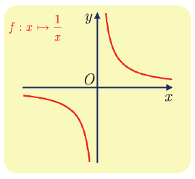

$$\lim_{x\to0^+}\frac1x=+\infty\quad\text{و}\quad\lim_{x\to0^-}\frac1x=-\infty$$

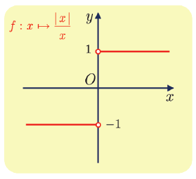

$$\lim_{x\to0^+}\frac{|x|}{x}=+1\quad\text{و}\quad\lim_{x\to0^-}\frac{|x|}{x}=-1$$

#### تدرّب

❶ احسب نهايات التوابع الآتية عند $+\infty$ وعند $-\infty$ وعند النقطة $a$ المعطاة، ويمكن في حالة عدم وجود النهاية حساب النهاية من اليمين والنهاية من اليسار عند $a$.

① $f(x)=\frac{x-3}{x-1}$، $a=1$

② $f(x)=\frac{x^2+2}{x-2}$، $a=2$

③ $f(x)=\frac{2x-1}{x+1}$، $a=-1$

④ $f(x)=\frac{5x+1}{x+1}$، $a=-1$

⑤ $f(x)=\frac{x+2}{(x-2)^2}$، $a=2$

⑥ $f(x)=3x-5+\frac2{x+2}$، $a=-2$

❷ جد نهاية التابع $f$ المعيّن بالعلاقة $f(x)=\frac{5x-1}{(x-1)^2}$ عند 1، ثم عيّن عدداً $\alpha$ يحقّق الشرط: إذا كان $x$ عنصراً من المجال $]1-\alpha,1+\alpha[$ مختلفاً عن 1، كان $f(x)>10^3$.

### 3. العمليات على النهايات

تفيد المبرهنات الآتية، التي سنعرضها في جداول، في حساب نهايات التوابع $f+g$ و $fg$ و $\frac fg$ إذا كنا نعرف نهاية $f$ و $g$. هذه النهايات مأخوذة إما عند $+\infty$ أو عند $-\infty$ أو عند نقطة ما $a$ من $\mathbb R$.

في الجداول أدناه $\ell$ و $\ell'$ هي أعداد حقيقية. الخانات ذات اللون الأحمر تدلّ على الحالات التي تتطلّب دراسة إضافية لاستنتاج النهاية ونسميها حالات عدم التعيين. في بقية الحالات، نقبل النتائج المبينة وهي سهلة التوقّع حدسياً، فمثلاً إذا كان $\displaystyle\lim_{x\to1}f(x)=+\infty$ وكان $\displaystyle\lim_{x\to1}g(x)=3$ فإننا ندرك أن $\displaystyle\lim_{x\to1}(f+g)(x)=+\infty$.

#### 3.1. نهاية المجموع

| نهاية $f$ | $\ell$ | $\ell$ | $\ell$ | $+\infty$ | $-\infty$ | $+\infty$ |
| --- | --- | --- | --- | --- | --- | --- |
| نهاية $g$ | $\ell'$ | $+\infty$ | $-\infty$ | $+\infty$ | $-\infty$ | $-\infty$ |
| نهاية $f+g$ | $\ell+\ell'$ | $+\infty$ | $-\infty$ | $+\infty$ | $-\infty$ | 🟥 |

#### 3.2. نهاية الجداء

| نهاية $f$ | $\ell$ | $\ell>0$ | $\ell>0$ | $\ell<0$ | $\ell<0$ | $+\infty$ | $+\infty$ | $-\infty$ | $0$ |
| --- | --- | --- | --- | --- | --- | --- | --- | --- | --- |
| نهاية $g$ | $\ell'$ | $+\infty$ | $-\infty$ | $+\infty$ | $-\infty$ | $+\infty$ | $-\infty$ | $-\infty$ | $+\infty$ أو $-\infty$ |
| نهاية $fg$ | $\ell\cdot\ell'$ | $+\infty$ | $-\infty$ | $-\infty$ | $+\infty$ | $+\infty$ | $-\infty$ | $+\infty$ | 🟥 |

#### 3.3. نهاية الكسر

##### 3.3.1. نهاية $g$ لا تساوي الصفر

| نهاية $f$ | $\ell$ | $\ell$ | $+\infty$ | $+\infty$ | $-\infty$ | $-\infty$ | $+\infty$ أو $-\infty$ |
| --- | --- | --- | --- | --- | --- | --- | --- |
| نهاية $g$ | $\ell'\ne0$ | $+\infty$ أو $-\infty$ | $\ell'>0$ | $\ell'<0$ | $\ell'>0$ | $\ell'<0$ | $+\infty$ أو $-\infty$ |
| نهاية $\frac fg$ | $\frac{\ell}{\ell'}$ | $0$ | $+\infty$ | $-\infty$ | $-\infty$ | $+\infty$ | 🟥 |

##### 3.3.2. نهاية $g$ تساوي الصفر

| نهاية $f$ | $\ell>0$ أو $+\infty$ | $\ell>0$ أو $+\infty$ | $\ell<0$ أو $-\infty$ | $\ell<0$ أو $-\infty$ | $0$ |
| --- | --- | --- | --- | --- | --- |
| نهاية $g$ | $0$ وقيم $g$ موجبة | $0$ وقيم $g$ سالبة | $0$ وقيم $g$ موجبة | $0$ وقيم $g$ سالبة | $0$ |
| نهاية $\frac fg$ | $+\infty$ | $-\infty$ | $-\infty$ | $+\infty$ | 🟥 |

#### 3.4. صيغ عدم التعيين

عندما نكون بصدد حالة عدم تعيين فإننا لا نستطيع أن نحدّد النهاية اعتماداً على الجداول السابقة، وتلزم دراسة أكثر تفصيلاً في هذه الحالة. هذه الحالات الأربع هي

$$«\frac00»\qquad«\frac{\pm\infty}{\pm\infty}»\qquad«0\times\pm\infty»\qquad«+\infty-\infty»$$

هذه الكتابة هي رموز لتسهيل كتابة حالات عدم التعيين وليس لها معنى رياضي إذ لا يجوز مثلاً أن يكون المقام معدوماً في الكسر الأول.

**مثال: كيف نستفيد من المبرهنات السابقة؟**

احسب نهاية التابع $h:x\mapsto\frac{x^2-x}{\sin x}$ عند الصفر.

**الحل**

ينتج $h$ من قسمة تابعين، إذ إن $h=\frac fg$ وقد عرّفنا $f:x\mapsto x^2-x$ و $g:x\mapsto\sin x$. ونلاحظ أن $\displaystyle\lim_{x\to0}f(x)=0$ و $\displaystyle\lim_{x\to0}g(x)=0$. إن العمليات على النهايات لا تجيب عن مثل هذه الحالة، نحاول إذن البحث عن صيغة أخرى للتابع $h$ تكون أكثر ملاءمة لحساب النهاية، فنكتب

$$f(x)=\frac{x(x-1)}{\sin x}=\frac{x}{\sin x}\times(x-1)=\frac{u(x)}{v(x)}$$

حيث $v(x)=\frac{\sin x}{x}$ و $u(x)=x-1$، وهنا نعلم من دراستنا السابقة أن

$$\lim_{x\to0}v(x)=\lim_{x\to0}\frac{\sin x}{x}=1\quad\text{و}\quad\lim_{x\to0}u(x)=\lim_{x\to0}(x-1)=-1$$

إذن نستنتج من العمليات على النهايات أن $\displaystyle\lim_{x\to0}f(x)=-1$.

**مثال: إزالة عدم تعيين**

احسب نهاية التابع $f:x\mapsto\frac{\sqrt{x+1}-1}{x}$ عند 0.

**الحل**

لا تمكن الاستفادة من مبرهنات العمليات على النهايات مباشرة، لأن نهاية كل من البسط والمقام تساوي الصفر. لذلك نكتب

$$f(x)=\frac{(\sqrt{x+1}-1)(\sqrt{x+1}+1)}{x(\sqrt{x+1}+1)}=\frac{x+1-1}{x(\sqrt{x+1}+1)}=\frac1{\sqrt{x+1}+1}.$$

ولما كان $\displaystyle\lim_{x\to0}(\sqrt{x+1}+1)=2$، استنتجنا أن $\displaystyle\lim_{x\to0}f(x)=\frac12$.

**مثال: إزالة عدم تعيين**

احسب نهاية التابع $f:x\mapsto\frac{x+\sqrt{x}}{x+1}$ عند $+\infty$.

**الحل**

نكتب

$$f(x)=\frac{x\left(1+\frac{\sqrt{x}}x\right)}{x\left(1+\frac1x\right)}=\frac{1+\frac1{\sqrt{x}}}{1+\frac1x}\qquad\text{(في جوار }+\infty\text{، }x>0\text{)}.$$

ولدينا $\displaystyle\lim_{x\to+\infty}\frac1x=0$ و $\displaystyle\lim_{x\to+\infty}\frac1{\sqrt{x}}=0$، إذن $\displaystyle\lim_{x\to+\infty}f(x)=1$.

#### تكريساً للفهم

**كيف نجد نهايات توابع كثيرات حدود صحيحة ونهايات توابع كسرية عند $+\infty$ أو $-\infty$؟**

- عند $+\infty$ وكذلك عند $-\infty$، نهاية تابع كثير الحدود هي نفسها نهاية حدّه المسيطر، أي الذي له أعلى درجة. لإثبات هذه الخاصّة نضع الحدّ الأعلى درجة خارج قوسين.

**مثال**

لدراسة نهاية التابع $f:x\mapsto x^3-2x^2+x-1$ عند $+\infty$، نرى أن الحدّ المسيطر هو $x^3$، فنكتب

$$f(x)=x^3\left(1-\frac2x+\frac1{x^2}-\frac1{x^3}\right)$$

ولما كان

$$\lim_{x\to+\infty}\left(1-\frac2x+\frac1{x^2}-\frac1x\right)=1\quad\text{و}\quad\lim_{x\to+\infty}x^3=+\infty$$

استنتجنا أن $\displaystyle\lim_{x\to+\infty}f(x)=+\infty$.

- عند $+\infty$ أو $-\infty$، تساوي نهاية تابع كسري (كلّ من بسطه ومقامه تابع كثير الحدود) نهاية خارج قسمة الحدّ المسيطر في البسط على الحدّ المسيطر في المقام. لإثبات ذلك نخرج الحدّ المسيطر، في كلّ من البسط والمقام خارج قوسين ونختصر النتيجة ثم نبحث عن النهاية المطلوبة.

**مثال**

لندرس نهاية التابع $f:x\mapsto\frac{2x+6}{x^2-3x+1}$ عند $-\infty$. إن الحدّ المسيطر في البسط هو $2x$ والحدّ المسيطر في المقام هو $x^2$. إذن نكتب في حالة $x$ سالبة وصغيرة بقدر كافٍ:

$$f(x)=\frac{2x\left(1+\frac3x\right)}{x^2\left(1-\frac3x+\frac1{x^2}\right)}=\frac2x\cdot\frac{1+\frac3x}{1-\frac3x+\frac1{x^2}}$$

ولكن

$$\lim_{x\to-\infty}\left(1-\frac3x+\frac1{x^2}\right)=1\quad\text{و}\quad\lim_{x\to-\infty}\left(1+\frac3x\right)=1\quad\text{و}\quad\lim_{x\to-\infty}\frac2x=0$$

إذن نهاية التابع $f$ عند $-\infty$ تساوي 0 أو $\displaystyle\lim_{x\to-\infty}f(x)=0$.

#### تدرّب

❶ احسب نهايات التوابع الآتية عند $+\infty$ وعند $-\infty$ وعند النقط $a$ المعطاة، ويمكن عند الحاجة حساب النهاية من اليمين ومن اليسار عند $a$.

① $f(x)=\frac{2x^2}{(x-1)(2-x)}$، $a=1,2$

② $f(x)=\frac{2x+1}{x^2-4}$، $a=2,-2$

③ $f(x)=x^2-2+\frac1{(1-x)^2}$، $a=1$

④ $f(x)=x+\frac1{1-x}-\frac1{x-2}$، $a=1,2$

❷ عيّن فيما يأتي مجموعة تعريف التابع $f$، ثم ادرس في كل حالة نهاية $f$ عند أطراف مجموعة تعريفه، وادرس، عند اللزوم، النهاية من اليمين والنهاية من اليسار.

① $f(x)=\frac{x+1}{\sqrt{x}-1}$

② $f(x)=x^2+\sqrt{x}-1$

③ $f(x)=\sqrt{x}+\frac1x$

④ $f(x)=\frac{x+\sqrt{x}}{x+1}$

⑤ $f(x)=\frac{x^2+x-\sqrt{x}}{x^2+1}$

⑥ $f(x)=\sqrt{x-1}-\sqrt{x}$

❸ أوجد نهاية التابع $f$ المعيّن بالعلاقة $f(x)=\frac{-2x+1}{x+3}$ عند $+\infty$، ثم أوجد عدداً $A$ يحقّق الشرط: إذا كان $x>A$، كان $f(x)$ في المجال $]-2.05,-1.95[$.

❹ أوجد نهاية التابع $f$ المعيّن بالعلاقة $f(x)=\frac{x+3}{x-3}$ عند 5، ثم أوجد مجالاً $I$ مركزه 5 يحقّق الشرط إذا انتمى $x$ إلى المجال $I$، انتمى $f(x)$ إلى المجال $]3.95,4.05[$.

### 4. مبرهنات المقارنة

#### 4.1. مبرهنة الإحاطة

**مبرهنة 1**

لتكن $f$ و $g$ و $h$ ثلاثة توابع معرّفة على مجال من النمط $I=]b,+\infty[$ ولنفترض أنه عند كلّ $x$ من $I$ تتحقّق المتراجحة $g(x)\leq f(x)\leq h(x)$. ثم لنفترض أن للتابعين $g$ و $h$ النهاية $\ell$ ذاتها عند $+\infty$، عندئذٍ $\displaystyle\lim_{x\to+\infty}f(x)=\ell$.

**الإثبات**

استناداً إلى الفرض، كل مجال مفتوح $J$ مركزه $\ell$ يحوي جميع قيم $g(x)$ و $h(x)$ الموافقة لقيم $x$ من مجال $]A,+\infty[$. ويمكننا أن نفترض أن $A>b$. عندها، لأن $g(x)\leq f(x)\leq h(x)$ على المجال $I$، وقعت جميع $f(x)$ الموافقة لقيم $x$ من المجال $]A,+\infty[$ في المجال $J$. إذن $\displaystyle\lim_{x\to+\infty}f(x)=\ell$ استناداً إلى التعريف 1.

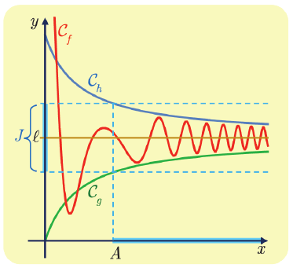

**مثال**

احسب نهاية التابع $f:x\mapsto\frac{\sin x}{x}$ عند $+\infty$.

**الحل**

عند كل $x$ من $]0,+\infty[$ تتحقّق المتراجحة $-1\leq\sin x\leq+1$ ومنها نستنتج أن

$$-\frac1x\leq\frac{\sin x}{x}\leq+\frac1x.$$

ولأن $\displaystyle\lim_{x\to+\infty}\left(-\frac1x\right)=\lim_{x\to+\infty}\left(+\frac1x\right)=0$ استنتجنا استناداً إلى المبرهنة 1 أن $\displaystyle\lim_{x\to+\infty}f(x)=0$.

**مبرهنة 2**

ليكن $f$ و $g$ تابعين معرّفين على مجال $I=]b,+\infty[$ ولنفترض أنه عند كلّ $x$ من $I$ تتحقّق المتراجحة $|f(x)-\ell|\leq g(x)$. ثم لنفترض أن $\displaystyle\lim_{x\to+\infty}g(x)=0$، عندئذٍ $\displaystyle\lim_{x\to+\infty}f(x)=\ell$.

**الإثبات**

تعني المتراجحة $|f(x)-\ell|\leq g(x)$ أن $\ell-g(x)\leq f(x)\leq\ell+g(x)$. وإذ $\displaystyle\lim_{x\to+\infty}g(x)=0$، فإن

$$\lim_{x\to+\infty}(\ell-g(x))=\lim_{x\to+\infty}(\ell+g(x))=\ell.$$

وعليه، استناداً إلى المبرهنة 1، نجد $\displaystyle\lim_{x\to+\infty}f(x)=\ell$.

تبقى نتائج المبرهنتين 1 و 2 صحيحة عندما تؤخذ النهايات عند $-\infty$. إذ يكفي أن نستبدل المجال $]-\infty,b[$ بالمجال $]b,+\infty[$. أو تؤخذ النهايات عند عدد $a$ حيث نستبدل بالمجال $I$ مجالاً من مجالاً من النمط $]a,B[$ أو $]A,a[$ أو بمجموعة من النمط $]A,a[\cup]a,B[=]A,B[\setminus\{a\}$.

#### 4.2. مبرهنة المقارنة عند اللانهاية

**مبرهنة 3**

ليكن $f$ و $g$ تابعين معرّفين على مجال $I=]b,+\infty[$.

① إذا كان $f(x)\geq g(x)$، عند كلّ $x$ من $I$، وكان $\displaystyle\lim_{x\to+\infty}g(x)=+\infty$، كان $\displaystyle\lim_{x\to+\infty}f(x)=+\infty$.

② إذا كان $f(x)\leq g(x)$، عند كلّ $x$ من $I$، وكان $\displaystyle\lim_{x\to+\infty}g(x)=-\infty$، كان $\displaystyle\lim_{x\to+\infty}f(x)=-\infty$.

**الإثبات**

استناداً إلى الفرض، كل مجال من النمط $]M,+\infty[$ يحوي جميع قيم $g(x)$، عندما $x>A$، ولأننا يمكن أن نأخذ $A>b$، فتحقّق المتراجحة $f(x)\geq g(x)$، نستنتج أن هذا المجال سيحوي أيضاً جميع قيم $f(x)$، عندما $x>A$. إذن $\displaystyle\lim_{x\to+\infty}f(x)=+\infty$ بناءً على التعريف 2. ويجري بالمثل إثبات الفقرة الثانية من المبرهنة.

**مثال**

احسب نهاية التابع $f:x\mapsto x+\cos x$ عند $+\infty$.

**الحل**

مهما كانت $x$ كان $\cos x\geq-1$ ومنه $f(x)=x+\cos x\geq x-1$، ولكن $\displaystyle\lim_{x\to+\infty}(x-1)=+\infty$، فاستناداً إلى المبرهنة 3 ينتج أن $\displaystyle\lim_{x\to+\infty}f(x)=+\infty$.

**مثال: مع تابع الجزء الصحيح**

ادرس نهاية التابع $f:x\mapsto\frac{E(x)}x$ عند $+\infty$. ($E$ هو تابع الجزء الصحيح).

**الحل**

$E(x)$ هو العدد الصحيح الوحيد الذي يحقّق $E(x)\leq x<E(x)+1$، أو $x-1<E(x)\leq x$. وعند قيم $x$ من المجال $]0,+\infty[$ تتحقّق المتراجحة

$$\frac{x-1}{x}\leq\frac{E(x)}x\leq1.$$

ولما كان $\displaystyle\lim_{x\to+\infty}\left(\frac{x-1}{x}\right)=1$، فإن مبرهنة الإحاطة تفيد باستنتاج أن $\displaystyle\lim_{x\to+\infty}f(x)=1$.

**مثال: في جوار الصفر**

ادرس نهاية التابع $f:x\mapsto x\sin\frac1x$ عند الصفر.

**الحل**

لاحظ أن $|f(x)-0|=|x|\times|\sin\frac1x|$، ولأن $|\sin\frac1x|\leq1$، أيّاً تكن $x$ من $\mathbb R\setminus\{0\}$، فإن $|f(x)-0|\leq|x|$. ولكن $\displaystyle\lim_{x\to0}|x|=0$، فاستناداً إلى المبرهنة 2 نجد $\displaystyle\lim_{x\to0}f(x)=0$.

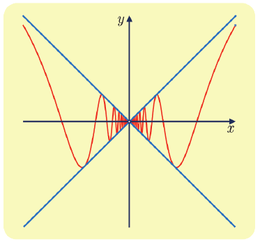

#### تكريساً للفهم

**ما المعلومات الإضافية التي تزوّدنا بها مبرهنة الإحاطة؟**

إضافة إلى معرفة نهاية تابع، تفيد هذه المبرهنة في:

- معرفة القيم التقريبية لتابع عند قيم المتحول التي هي في غاية الكبر.
- معرفة سلوك الفرع اللانهائي للخط البياني للتابع.

**مثال**

ادرس سلوك التابع $f:x\mapsto\frac x2+2\sin x$ في جوار $+\infty$.

**الحل**

مهما كانت $x$ من $\mathbb R$، كان $-1\leq\sin x\leq1$ ومنه

$$\frac x2-2\leq\frac x2+2\sin x\leq\frac x2+2$$

إذن $\frac x2-2\leq f(x)\leq\frac x2+2$.

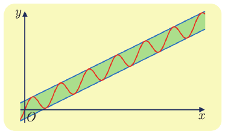

ولكن $\displaystyle\lim_{x\to+\infty}\left(\frac x2-2\right)=+\infty$، فاستناداً إلى المبرهنة 3 نستنتج أن $\displaystyle\lim_{x\to+\infty}f(x)=+\infty$.

إضافة إلى معرفة نهاية $f$ عند $+\infty$، لدينا المعلومتان الآتيتان:

① إن $\frac x2$ هي قيمة تقريبية للعدد $f(x)$ بخطأ يساوي 2 زيادة أو نقصاناً. فمثلاً $\frac{1000}{2}-2\leq f(1000)\leq\frac{1000}{2}+2$، أي $498\leq f(10000)\leq502$.

② الخطّ البياني للتابع $f$ محدّد بالمستقيمين اللذين معادلتاهما $y=\frac x2-2$ و $y=\frac x2+2$.

#### تدرّب

❶ أجب عن الأسئلة الآتية:

① $f$ تابع يحقّق $\frac{3x+\cos x}{x}\leq f(x)\leq\frac{3x+7}{x-1}$، أيّاً كان $x>1$. ما نهاية $f$ عند $+\infty$؟

② أثبت أن $-\frac1{x+1}\leq\frac{\cos x}{x+1}\leq\frac1{x+1}$ أيّاً يكن $x>-1$. استنتج نهاية $f:x\mapsto\frac{\cos x}{x+1}$ عند $+\infty$. ثم ادرس بالمثل نهاية التابع ذاته عند $-\infty$.

③ $f$ تابع يحقّق $|f(x)-3|\leq\frac1{x+1}$، أيّاً كان $x\geq0$. ما نهاية $f$ عند $+\infty$؟

④ $f$ تابع يحقّق $f(x)\geq\frac14x^2$، أيّاً كان $x<0$. ما نهاية $f$ عند $-\infty$؟

⑤ أثبت أن $x^2-5\sin x\geq x^2-5$، أيّاً كان العدد الحقيقي $x$. استنتج من المتراجحة السابقة نهاية $x\mapsto x^2-5\sin x$ عند $+\infty$ وعند $-\infty$.

❷ ليكن $f$ التابع المعرّف على المجال $[0,+\infty[$ وفق $f(x)=\sqrt{1+x}-\sqrt{x}$.

① تحقّق أن $f(x)=\frac1{\sqrt{1+x}+\sqrt{x}}$ أيّاً يكن $x\geq0$.

② استنتج أن $\frac1{2\sqrt{1+x}}\leq f(x)\leq\frac1{2\sqrt{x}}$ في حالة $x>0$.

③ ما نهاية $f$ عند $+\infty$؟

### 5. نهاية تابع مركّب

سنقبل دون إثبات صحّة المبرهنة المهمّة الآتية:

**مبرهنة 4**

نتأمّل ثلاثة توابع $f$ و $g$ و $h$ ونفترض أن $f(x)=g\circ h(x)=g(h(x))$. إذا كان

$$\lim_{x\to a}h(x)=b\quad\text{و}\quad\lim_{t\to b}g(t)=c$$

فعندئذٍ $\displaystyle\lim_{x\to a}f(x)=c$، وذلك سواء كانت المقادير $a$ و $b$ و $c$ أعداداً حقيقية منتهية أو مقادير لانهائية.

عند استعمال هذه المبرهنة في إيجاد نهاية تابع مركب $f:x\mapsto g(h(x))$، عند $a$، نبحث بداية عن $b=\displaystyle\lim_{x\to a}h(x)$، ثم نبحث عن نهاية $g$ عند $b$.

**مثال**

① ابحث عن نهاية التابع $f:x\mapsto\sqrt{x^2-x+1}$ عند $+\infty$.

② نتأمّل التابع المعطى على المجال $]\frac13,+\infty[$ بالعلاقة $f(x)=\frac1{\sqrt{3x-1}}$. ما نهاية هذا التابع عندما تسعى $x$ إلى $\frac13$؟

**الحل**

① نضع $X=h(x)=x^2-x+1$، عندئذٍ $f(x)=\sqrt X$، ومعلوم لدينا أن $\displaystyle\lim_{x\to+\infty}h(x)=+\infty$ وأن $\displaystyle\lim_{X\to+\infty}\sqrt X=+\infty$، إذن $\displaystyle\lim_{x\to+\infty}f(x)=+\infty$.

② نضع $X=h(x)=3x-1$ على $]\frac13,+\infty[$، عندئذٍ $X>0$ و $f(x)=\frac1{\sqrt X}$. ومعلوم لدينا أن $\displaystyle\lim_{x\to\frac13}h(x)=0$ و $\displaystyle\lim_{X\to0}\left(\frac1{\sqrt X}\right)=+\infty$، إذن $\displaystyle\lim_{x\to\frac13}f(x)=+\infty$.

عندما نكتب $X=h(x)$ و $f(x)=g(X)=(g\circ h)(x)$، نقول إننا غيّرنا المتحوّل. وفي الحقيقة نحن بذلك نكون قد ركّبنا تابعين.

#### تكريساً للفهم

**كيف ننقل دراسة النهاية عند $+\infty$ إلى دراسة النهاية عند الصفر؟**

بإجراء تغيير للمتحوّل وفق $X=\frac1x$.

**مثال**

لنتأمّل، عند $+\infty$، سلوك التابع $f$ المعرّف على $\mathbb R^*$ وفق $f(x)=x\sin\frac1x$. لا يفيدنا استخدام قواعد العمليات على النهايات، لأن $\displaystyle\lim_{x\to+\infty}(\sin\frac1x)=0$. لذا نجري تغيير المتحول، بوضع $X=h(x)=\frac1x$، عندئذٍ يكون $f(x)=\frac{\sin X}{X}$ و $\displaystyle\lim_{x\to+\infty}h(x)=0$. إذن $\displaystyle\lim_{x\to+\infty}f(x)=\lim_{X\to0}\frac{\sin X}{X}=1$.

يساعد تغيير المتحول وفق $X=\frac1x$، أيضاً، في:

- الانتقال من دراسة النهاية عند الصفر، من اليمين، إلى دراسة النهاية عند $+\infty$.
- الانتقال من دراسة النهاية عند الصفر، من اليسار، إلى دراسة النهاية عند $-\infty$.
- الانتقال من دراسة النهاية عند $+\infty$ إلى دراسة النهاية عند الصفر، من اليمين.
- الانتقال من دراسة النهاية عند $-\infty$ إلى دراسة النهاية عند الصفر، من اليسار.

**لماذا يكون العدد المشتقّ لتابع اشتقاقي $f$ نهاية عند $a$ للتابع $g:x\mapsto\frac{f(x)-f(a)}{x-a}$؟**

تذكّر أن القول «$f$ اشتقاقي عند $a$» يكافئ القول «للتابع $h\mapsto t(h)=\frac{f(a+h)-f(a)}{h}$ نهاية حقيقية $\ell$ عند الصفر». وعندها يكون $\ell=f'(a)$.

لنتأمّل التابع المدروس $g$، ولنلاحظ أن $t(x-a)=g(x)$، إذن نحن أمام نهاية تابع مركّب، فإذا وضعنا $h(x)=x-a$، كان

$$g(x)=t(h(x))$$

ولأن

$$\lim_{x\to a}h(x)=0\quad\text{و}\quad\lim_{h\to0}t(h)=f'(a)$$

استنتجنا أن $\displaystyle\lim_{x\to a}g(x)=f'(a)$، أي

$$\lim_{x\to a}\frac{f(x)-f(a)}{x-a}=f'(a).$$

#### تدرّب

❶ فيما يأتي، نُعطى تابعاً $f$ معرّفاً على مجموعة $D$ ويُطلب حساب نهاية $f$ عند $a$.

① $a=5$، $f(x)=\sqrt{\frac{x+3}{x-5}}$، $D=]5,+\infty[$.

② $a=-\infty$، $f(x)=\sqrt{-x^3+x^2+x}$، $D=]-\infty,\frac{1-\sqrt5}{2}]$.

③ $a=-\infty$، $f(x)=\sqrt{\frac{-x+1}{x^2+1}}$، $D=]-\infty,1[$.

④ $a=1$، $f(x)=\frac1{\sqrt{1-x^2}}$، $D=]-1,+1[$.

⑤ $a=1$، $f(x)=\cos\pi x+\frac1{(x-1)^2}$، $D=\mathbb R\setminus\{1\}$.

⑥ $a=+\infty$، $f(x)=\cos\left(\frac{\pi x+1}{x+2}\right)$، $D=\mathbb R\setminus\{-2\}$.

⑦ $a=1,-\infty$، $f(x)=\sqrt{\frac{2x^2}{1-x}}$، $D=]-\infty,1[$.

⑧ $a=+\infty$، $f(x)=\sin\left(\frac1{\sqrt{x}}\right)$، $D=]0,+\infty[$.

⑨ $a=+\infty$، $f(x)=\left(x-\sqrt{x}+\frac1x\right)^2$، $D=]0,+\infty[$.

⑩ $a=+\infty$، $f(x)=\cos^2\left(\pi\times\sqrt{\frac{x-1}{x+1}}\right)$، $D=]-\infty,-1[\cup]1,+\infty[$.

❷ ليكن $f$ التابع المعرّف على المجال $]-5,+\infty[$ وفق $f(x)=\frac{x-3}{x+5}$.

① احسب $\displaystyle\lim_{x\to+\infty}f(x)$، واستنتج $\displaystyle\lim_{x\to+\infty}f(f(x))$.

② أعد حساب $\displaystyle\lim_{x\to+\infty}f(f(x))$ بعد كتابة $f(f(x))$ بدلالة $x$.

### 6. المقارب المائل

**تعريف 5**

ليكن $f$ تابعاً معرّفاً على مجال من النمط $I=]b,+\infty[$. وليكن $C_f$ الخطّ البياني للتابع $f$ في معلم معطى، وكذلك ليكن $\Delta$ المستقيم الذي معادلته $y=ax+b$. نقول إن المستقيم $\Delta$ مقارب للخطّ البياني $C_f$ في جوار $+\infty$، إذا وفقط إذا كان:

$$\lim_{x\to+\infty}\bigl(f(x)-(ax+b)\bigr)=0$$

ونعرّف، بأسلوب مماثل، المقارب المائل في جوار $-\infty$.

**هندسياً:** ليكن $x$ عدداً من مجموعة تعريف $f$، ولتكن $M$ نقطة من $C_f$ و $P$ نقطة من $\Delta$ تساوي فاصلة كلّ منهما $x$. عندئذٍ $PM=|f(x)-(ax+b)|$. واستناداً إلى التعريف كلما كبر العدد $x$ صغرت المسافة $PM$، أي اقترب الخطّ البياني $C_f$ من المستقيم $\Delta$.

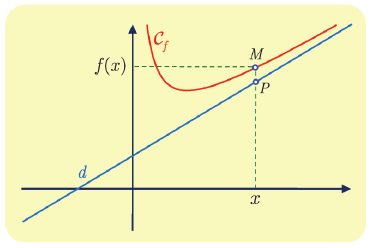

إضافة إلى ذلك، تمكّننا معرفة إشارة $f(x)-(ax+b)$ من تعيين وضع الخطّ البياني $C_f$ بالنسبة إلى مقاربه $\Delta$.

**مثال: مقارب مائل**

ليكن $C_f$ الخطّ البياني للتابع $f$ المعطى بالعلاقة $f(x)=\frac{x^2+3x+1}{x+2}$. وليكن $\Delta$ المستقيم الذي معادلته $y=x+1$.

① أثبت أن المستقيم $\Delta$ مقارب للخط $C_f$ في جوار $+\infty$.

② ادرس وضع $C_f$ بالنسبة إلى $\Delta$.

**الحل**

① لاحظ أن

$$f(x)-(x+1)=\frac{x^2+3x+1-(x^2+3x+2)}{x+2}=\frac{-1}{x+2}.$$

إذن $\displaystyle\lim_{x\to+\infty}(f(x)-(x+1))=\lim_{x\to+\infty}\frac{-1}{x+2}=0$. فالمستقيم $\Delta$ مستقيم مقارب للخط البياني $C_f$ في جوار $+\infty$.

② تعاكس إشارة $f(x)-(x+1)$ إشارة $x+2$ إذن:

- على المجال $]-2,+\infty[$، $f(x)-(x+1)<0$ فجزء الخطّ البياني $C_f$ الموافق لقيم $x>-2$ يقع تحت $\Delta$.
- على المجال $]-\infty,-2[$، $f(x)-(x+1)>0$ فجزء الخطّ البياني $C_f$ الموافق لقيم $x<-2$ يقع فوق $\Delta$.

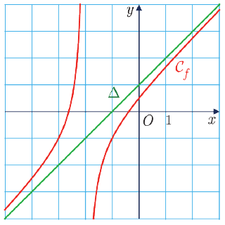

#### تدرّب

❶ فيما يأتي بيّن معلّلاً إجابتك إذا كان المستقيم $\Delta$ مقارباً مائلاً للخط البياني $C_f$ للتابع $f$، عند $+\infty$ أو عند $-\infty$. ادرس بعدئذٍ الوضع النسبي للخط $C_f$ ومقاربه $\Delta$.

① $\Delta:y=2x+3$، $f(x)=2x+3+\frac{10}{x+1}$.

② $\Delta:y=-x+1$، $f(x)=-x+1-\frac1{x^2}$.

③ $\Delta:y=x$، $f(x)=x+\frac{\sin x}{x}$.

④ $\Delta:y=3x+7$، $f(x)=3x+7-\frac5{\sqrt{|x|}}$.

⑤ $\Delta:y=2x+1$، $f(x)=\frac{2x^2-7x-3}{x-4}$.

⑥ $\Delta:y=x-2$، $f(x)=\frac{x^3-3x-5}{(x+1)^2}$.

⑦ $\Delta:y=-x-4$، $f(x)=\frac{-x^2-4x+\sin x}{x}$.

⑧ $\Delta:y=\frac12x+1$، $f(x)=\frac{x^2+\frac52x+\sqrt{x}+1}{2x+1}$.

### 7. الاستمرار

#### 7.1. الاستمرار عند نقطة أو على مجموعة

فيما يأتي $f$ تابع معرّف على مجموعة $D_f$، مؤلّفة من مجال أو من اجتماع مجالات غير مقتصرة على نقطة واحدة.

**تعريف 6**

لتكن $a$ نقطة من $D_f$. نقول إن التابع $f$ مستمرّ عند $a$، إذا وفقط إذا تحقّق الشرط $\displaystyle\lim_{x\to a}f(x)=f(a)$.

ونقول إن التابع $f$ مستمرّ على مجموعة $D$ محتواة في $D_f$، إذا وفقط إذا كان $f$ مستمراً عند كلّ نقطة من نقاط $D$.

نستنتج من هذا التعريف، ومن المبرهنات المتعلّقة بالعمليات على نهايات التوابع، أن مجموع تابعين مستمرّين عند نقطة (أو على مجموعة) مستمرّ أيضاً عندها (أو عليها). وكذلك يكون جداء ضربهما، أو خارج قسمتهما شريطة كونه معرّفاً عند النقطة المدروسة. كما نستنتج من خاصّة نهاية التابع المركّب أن مركّب تابعين مستمرّين مستمرّ أيضاً.

ليس لدراسة استمرار تابع، عند نقطة لا تنتمي إلى مجموعة تعريف التابع، أيّ معنى.

#### 7.2. الاستمرار والاشتقاق

**مبرهنة 5**

① إذا كان التابع $f$ اشتقاقياً في نقطة $a$، كان مستمراً في $a$.

② إذا كان التابع $f$ اشتقاقياً على مجال $I$، كان مستمراً على $I$.

**الإثبات**

لنفترض أن التابع $f$ اشتقاقي عند $a$، إذن للتابع $g$ المعرّف بالعلاقة $g(x)=\frac{f(x)-f(a)}{x-a}$ نهاية منتهية عند $a$ هي $f'(a)$. نستنتج من ذلك أنه في حالة $x$ من $D_f$ مختلف عن $a$ يكون

$$f(x)-f(a)=(x-a)g(x)$$

ولأن $\displaystyle\lim_{x\to a}g(x)=f'(a)$ و $\displaystyle\lim_{x\to a}(x-a)=0$، استنتجنا أن $\displaystyle\lim_{x\to a}f(x)=f(a)$.

#### 7.3. استمرار التوابع المرجعية

① وجدنا في الصفّ الثاني الثانوي أن تابع «الجذر التربيعي» أي $x\mapsto\sqrt{x}$ اشتقاقي على المجال المفتوح $]0,+\infty[$، فهو مستمرّ على $]0,+\infty[$. ثم إن $\displaystyle\lim_{x\to0}\sqrt{x}=0=f(0)$، أي إن هذا التابع مستمرّ أيضاً عند الصفر، فهو مستمرّ على كامل المجال $[0,+\infty[$.

② التوابع «كثيرات الحدود» اشتقاقية على $\mathbb R$، فهي مستمرّة على $\mathbb R$.

③ التوابع «الكسرية» اشتقاقية على مجموعة تعريفها $D$، فهي مستمرّة على $D$.

④ التابعان $x\mapsto\sin x$ و $x\mapsto\cos x$ اشتقاقيان على $\mathbb R$، فهما مستمرّان على $\mathbb R$.

نستنتج مما سبق أن جميع التوابع التي نحصل عليها من التوابع المألوفة سابقة الذكر، بإجراء عمليات جبرية أو عمليات تركيب هي توابع مستمرة على مجموعات تعريفها.

#### تكريساً للفهم

**كيف نتعرّف استمرار تابع اعتماداً على خطّه البياني؟**

في الشكلين ❶ و ❷ الآتيين، $C_f$ و $C_g$ هما، بالترتيب، الخطّان البيانيان للتابعين $f$ و $g$ المعرّفين على المجال $I=[-2,6]$.

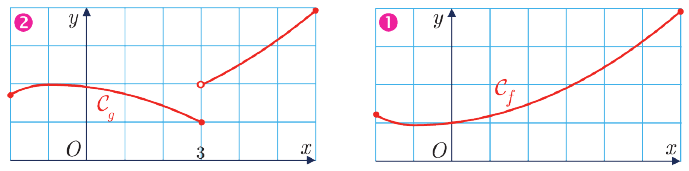

التابع $f$ مستمرّ على $I$ لأن خطّه البياني مكوّن من «قطعة واحدة» أو لأن $C_f$ يُرسم «دون رفع القلم» عن الورقة. أمّا التابع $g$ فهو غير مستمرّ على $I$ لأن

$$\lim_{x\to3,\,x<3}g(x)=1\quad\text{و}\quad\lim_{x\to3,\,x>3}g(x)=2$$

إذن ليس للتابع $g$ نهاية عند $x=3$.

**لماذا إذا كان تابع مستمراً على مجال $I$ لا يكون بالضرورة اشتقاقياً على $I$؟**

من المعلوم أن تابعاً اشتقاقياً على مجال $I$، يكون بالضرورة مستمراً على $I$، لكن العكس ليس بالضرورة صحيحاً، فقد يكون تابع مستمراً على مجال دون أن يكون اشتقاقياً عليه.

**مثال: تابع مستمرّ على مجال وغير اشتقاقي عليه**

تابع «الجذر التربيعي» مستمرّ عند الصفر لكنه غير اشتقاقي عند الصفر، لأن

$$\frac{f(x)-f(0)}{x-0}=\frac{\sqrt{x}}x=\frac1{\sqrt{x}}$$

إذن $\displaystyle\lim_{x\to0}\frac{f(x)-f(0)}{x-0}=+\infty$.

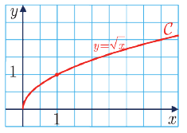

يقبل الخط البياني لهذا التابع مماساً «شاقولياً» في المبدأ.

**ما هي نتائج الاستمرار المتعلّقة بنهايات التوابع المألوفة وتركيبها؟**

**مثال: تركيب توابع مستمرّة**

التابع $f:x\mapsto\sqrt{x^2+4x+5}$ معرّف على $\mathbb R$ لأن $x^2+4x+5>0$ على $\mathbb R$. وإذا رمزنا بالرمز $g$ إلى التابع $x\mapsto x^2+4x+5$ وبالرمز $h$ إلى تابع الجذر التربيعي $x\mapsto\sqrt{x}$، كان $f(x)=h(g(x))$ على $\mathbb R$.

التابع $f$ مثال عن تابع مألوف، لأنه مركّب من تابعين مرجعيين «كثير حدود» و «الجذر التربيعي». التابع $g$ مستمرّ على $\mathbb R$ و $h$ مستمرّ على مجموعة تعريفه، فالتابع $f$ مستمرّ على مجموعة تعريفه $\mathbb R$.

بالمثل، التابع

$$f:x\mapsto\sin x+\cos x$$

تابع مستمرّ على $\mathbb R$ لأنه مجموع تابعين مستمرّين على $\mathbb R$.

#### تدرّب

❶ نتأمّل التابع $f$ المعطى وفق $f(x)=\sqrt{1-\cos x}$.

① ما مجموعة تعريف $f$؟

② أيكون $f$ مستمراً على مجموعة تعريفه؟

③ بيّن أن التابع $f$ زوجي ويقبل العدد $2\pi$ دوراً له.

④ ليكن $g$ مقصور التابع $f$ على المجال $[0,\pi]$. أثبت أن $g$ اشتقاقي وارسم خطّه البياني.

⑤ استنتج الخطّ البياني للتابع $f$ على المجال $[-2\pi,2\pi]$. ما مجموعة تعريف $f'$؟

### 8. التوابع المستمرة وحلّ المعادلات

#### 8.1. مبرهنة القيمة الوسطى

سنقبل دون إثبات المبرهنة المهمّة الآتية التي تصف خاصّة أساسية من خواص التوابع المستمرّة على مجال.

**مبرهنة 6**

إذا كان $f$ تابعاً مستمراً على مجال $[a,b]$. عندئذٍ أيّاً يكن العدد الحقيقي $y$ المحصور بين $f(a)$ و $f(b)$، يوجد -على الأقل- عدد حقيقي $c$ محصور بين $a$ و $b$ يحقّق $f(c)=y$.

بافتراض $f(a)\leq f(b)$ وبوضع $I=[a,b]$، يمكن عرض هذه المبرهنة بطرائق عدّة، منها:

- أيّاً يكن $y$ من المجال $[f(a),f(b)]$، فللمعادلة $f(x)=y$، بالمجهول $x$، حل واحد على الأقل في المجال $I$.
- كل عدد حقيقي $y$ من المجال $[f(a),f(b)]$، هو صورة عدد $c$ من المجال $I$. ويدلّ الشكل المرافق على أن العدد $c$ ليس وحيداً بالضرورة.

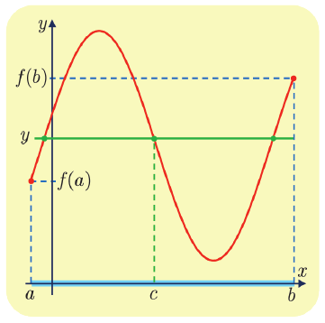

- إذا رمزنا بالرمز $f(I)$ إلى مجموعة الصّور $f(x)$ عندما تأخذ $x$ جميع القيم في $I$، أمكننا التعبير عن هذه المبرهنة بالقول: إن المجال $[f(a),f(b)]$ محتوى في $f(I)$.

**ملاحظة**

عموماً، نرمز إلى مجموعة صور عناصر المجموعة $A$ وفق تابع $f$ معرّف على $A$ بالرمز $f(A)$ ونسميها صورة المجموعة $A$ وفق $f$.

#### 8.2. حالة تابع مستمرّ ومطّرد تماماً على مجال مغلق $[a,b]$

**مبرهنة 7**

إذا كان $f$ تابعاً مستمراً ومتزايداً تماماً على مجال $I=[a,b]$.

① صورة المجال $[a,b]$ وفق $f$ هو المجال $[f(a),f(b)]$.

② أيّاً كان $y$ من $[f(a),f(b)]$، فللمعادلة $f(x)=y$، بالمجهول $x$، حل واحد وواحد فقط في $I$.

**الإثبات**

① لما كان $f$ متزايداً تماماً على $I$ كان $f(a)\leq f(x)\leq f(b)$ مهما كانت $x$ من $I$. إذن كل عدد من $f(I)$، ينتمي إلى المجال $[f(a),f(b)]$.

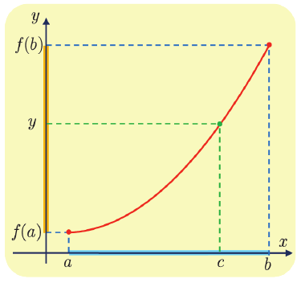

بالعكس، إذا كان $y$ عنصراً من المجال $[f(a),f(b)]$، كان $y$ صورة عدد $c$، من $I$ (بناءً على المبرهنة 6)، إذن ينتمي $y$ إلى $f(I)$. وهكذا نرى أن للمجموعتين $f(I)$ و $[f(a),f(b)]$ العناصر نفسها، أي $f(I)=[f(a),f(b)]$.

② إضافة إلى ما سبق، ليس للمعادلة $f(x)=y$ أكثر من حلّ، لأن لكلّ عددين مختلفين صورتين مختلفتين، بسبب التزايد التامّ للتابع $f$.

تبقى المبرهنة السابقة صحيحة في حالة تابع $f$ متناقص تماماً على أن نستبدل المجال $[f(b),f(a)]$ بالمجال $[f(a),f(b)]$.

**نتيجة**

إذا كان $f$ مستمراً ومطّرداً على المجال $I=[a,b]$ وكان $f(a)\times f(b)<0$، كان للمعادلة $f(x)=0$، بالمجهول $x$، حل وحل وحيد في $I$.

**الإثبات**

في الحقيقة، تقتضي الفرضية «$f(a)\times f(b)<0$» أن $f(a)\ne0$ و $f(b)\ne0$ وأن الصفر 0 يقع في المجال الذي طرفيه $f(a)$ و $f(b)$. فهذه إذن حالة خاصة من المبرهنة 7.

إذا كان $f$ مستمراً على مجال مغلق $[a,b]$ وكنّا نعلم بطريقة ما أنه مطّرد تماماً على المجال المفتوح $]a,b[$ فإن استمرار $f$ يقتضي أن يكون $f$ في الحقيقة مطّرداً تماماً على $[a,b]$.

**مثال: حلّ معادلة**

ليكن $f$ التابع المعرّف على $\mathbb R$ وفق $f(x)=x^3-2x^2-1$.

① أثبت أن المعادلة $f(x)=0$ تقبل حلاً وحيداً $c$ في المجال $[2,3]$.

② اكتب معادلة المماس $T$ للخط البياني للتابع $f$ في النقطة $M$ التي فاصلتها 2 وعيّن $\alpha$ فاصلة نقطة تقاطع $T$ مع محور الفواصل.

③ اكتب معادلة للمستقيم $S$ المار بالنقطة $M$ والنقطة $N(\alpha,f(\alpha))$. ثم عيّن $\beta$ فاصلة نقطة تقاطع $S$ مع محور الفواصل.

④ رتّب الأعداد $\alpha$ و $\beta$ و $c$ تصاعدياً، واستنتج مجالاً يحصر الحلّ $c$.

لإثبات أن للمعادلة $f(x)=0$ حلاً وحيداً في مجال $[a,b]$، نتيقّن أن $f$ مستمرّ وأنه مطّرد تماماً على $[a,b]$ وأن $f(a)$ و $f(b)$ من إشارتين مختلفتين.

**الحل**

① تقودنا دراسة التابع $f$ إلى جدول تغيّراته الآتي:

| $x$ | $-\infty$ |  | $0$ |  | $\frac43$ |  | $2$ |  | $3$ |  | $+\infty$ |
| --- | --- | --- | --- | --- | --- | --- | --- | --- | --- | --- | --- |
| $f'(x)$ |  | $+$ | $0$ | $-$ | $0$ | $+$ |  | $+$ |  | $+$ |  |
| $f(x)$ | $-\infty$ | ↗ | $-1$ | ↘ | $-\frac{59}{27}$ | ↗ | $-1$ | ↗ | $8$ | ↗ | $+\infty$ |

ونلاحظ من الجدول أن التابع المستمرّ $f$ متزايد تماماً على المجال $[2,3]$، وأن $f(2)=-1$ و $f(3)=8$، أي $f(2)\times f(3)<0$. إذن للمعادلة $f(x)=0$ حل وحيد $c$ في المجال $[2,3]$.

يبيّن الجدول بوضوح أيضاً أن $f(x)<0$ على المجال $]-\infty,2]$ و $f(x)>0$ على المجال $[3,+\infty[$. إذن، لا تقبل المعادلة $f(x)=0$ سوى الحل $x=c$ في $\mathbb R$.

② معادلة المماس $T$ في النقطة $M(2,-1)$ هي: $y=f'(2)(x-2)+f(2)=4x-9$، وهو يقطع محور الفواصل في النقطة التي فاصلتها $\alpha=\frac94$.

③ معادلة المستقيم $S$ المارّ بالنقطة $M(2,-1)$ والنقطة $N(\frac94,\frac{17}{64})$، إذ $f(\frac94)=\frac{17}{64}$، هي

$$y=\frac{f(\frac94)-f(2)}{\frac94-2}(x-2)+f(2)=\frac{81}{16}x-\frac{89}{8}$$

وهو يقطع محور الفواصل في النقطة التي فاصلتها $\beta=\frac{178}{81}$.

④ لاحظ أن $f(\alpha)=\frac{17}{64}>0$ و $f(\beta)=-\frac{24497}{(81)^3}<0$ إذن $\beta<c<\alpha$، وعليه $c\in]\beta,\alpha[$.

في الحقيقة، يمكن تعميم المبرهنة 7 إلى حالة مجال لا على التعيين $I$ وتابع $f$ مطّرد عليه، إذ يكون في جميع الأحوال $J=f(I)$ مجالاً، توضّح المبرهنة الآتية الحالات المختلفة للمجالين $I$ و $J$ وذلك تبعاً لجهة اطراد التابع $f$:

**مبرهنة 8**

فيما يأتي $a$ و $b$ عنصران من المجموعة $\mathbb R\cup\{-\infty,+\infty\}$، ونفترض أن $a<b$. ونفترض أن التابع $f$ تابع مستمرّ ومطّرد تماماً على المجال $I$ وأن $J=f(I)$.

| $I$ | $f$ متزايد تماماً | $f$ متناقص تماماً |
| --- | --- | --- |
| $I=[a,b]$ | $f(I)=[f(a),f(b)]$ | $f(I)=[f(b),f(a)]$ |
| $I=]a,b]$ | $f(I)=]\lim_{x\to a}f(x),f(b)]$ | $f(I)=[f(b),\lim_{x\to a}f(x)[$ |
| $I=[a,b[$ | $f(I)=[f(a),\lim_{x\to b}f(x)[$ | $f(I)=]\lim_{x\to b}f(x),f(a)]$ |
| $I=]a,b[$ | $f(I)=]\lim_{x\to a}f(x),\lim_{x\to b}f(x)[$ | $f(I)=]\lim_{x\to b}f(x),\lim_{x\to a}f(x)[$ |

**مثال: حلّ معادلة**

تأمّل جدول تغيّرات $f$ المعرّف والمستمرّ على $\mathbb R$. ما عدد حلول المعادلة $f(x)=0$ في $\mathbb R$؟

| $x$ | $-\infty$ |  | $-1$ |  | $2$ |  | $+\infty$ |
| --- | --- | --- | --- | --- | --- | --- | --- |
| $f(x)$ | $+\infty$ | ↘ | $-2$ | ↗ | $4$ | ↘ | $3$ |

**الحل**

انطلاقاً من جدول التغيّرات، سنهتم بتحديد قيم $f$ في كلّ من المجالات

$$I_1=]-\infty,-1[\quad\text{و}\quad I_2=[-1,2]\quad\text{و}\quad I_3=]2,+\infty[.$$

استناداً إلى المبرهنة 8. لما كان $f$ مستمراً ومتناقصاً تماماً على كلّ من $I_1$ و $I_3$ ومستمراً ومتزايداً تماماً على $I_2$ استنتجنا أن

$$J_1=f(I_1)=]-2,+\infty[\quad\text{و}\quad J_2=f(I_2)=[-2,4]\quad\text{و}\quad J_3=f(I_3)=]3,4[.$$

- $f$ متناقص تماماً على المجال $I_1$ وينتمي الصفر إلى المجال $J_1$، فيوجد إذن في $I_1$ عدد حقيقي وحيد $\alpha$ يحقّق $f(\alpha)=0$.
- $f$ متزايد تماماً على المجال $I_2$ وينتمي الصفر إلى المجال $J_2$، فيوجد إذن في $I_2$ عدد حقيقي وحيد $\beta$ يحقّق $f(\beta)=0$.
- ليس للمعادلة $f(x)=0$ حلول في المجال $I_3$، لأن الصفر لا ينتمي إلى المجال $J_3$.

نستنتج مما سبق أن للمعادلة $f(x)=0$ حلّين في $\mathbb R$.

#### تكريساً للفهم

**هل صورة مجال $[a,b]$ وفق تابع مستمرّ هي دوماً مجال $[m,M]$؟**

نعم حتى لو لم يكن $f$ مطّرداً. عندما $I=[a,b]$، يكون $f(I)$ مجالاً مغلقاً $[m,M]$ وأيّاً كانت $x$ من $I$ كان $m\leq f(x)\leq M$. إذن، أيّاً كانت $y$ من $[m,M]$ وُجد على الأقل عدد حقيقي $c$ من المجال $[a,b]$ يحقّق $f(c)=y$.

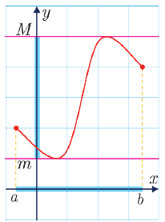

**كيف يفسّر وجود ووحدانية حل المعادلة $f(x)=y$؟**

- يتأكّد لنا وجود الحل عندما يكون التابع مستمراً وتقع $y$ بين $f(a)$ و $f(b)$. أمّا في حالة تابع غير مستمرّ، فإن وجود الحل غير مضمون بالضرورة.

ففي الشكل المرافق، التابع المرسوم خطّه البياني معرّف على $[1,4]$ ولكنه غير مستمرّ. ونرى أن المعادلة $f(x)=4$ قابلة للحلّ. في حين لا حلول للمعادلة $f(x)=2$.

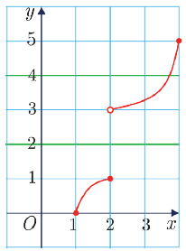

- ويضمن لنا الاطراد التام للتابع وحدانية الحلّ. أمّا في حالة الاطراد غير التامّ، فقد نجد للمعادلة أكثر من حلّ.

في الشكل المرافق، التابع مطّرد (متزايد)، ولكنه ليس متزايداً تماماً. ونرى أن جميع قيم المجال $[2,3]$ حلول للمعادلة $f(x)=1$.

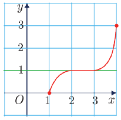

#### 8.3. مفهوم التابع العكسي

لنتأمّل تابعاً $f$ مستمراً ومطّرداً تماماً على مجال ما $I$، ولنضع $f(I)=J$. المجموعة $J$، كما نعلم، هي مجال. عندئذٍ:

- أيّاً يكن العدد الحقيقي $x$ من $I$، ينتمي $f(x)$ إلى $J$.
- أيّاً يكن العدد الحقيقي $y$ من $J$، يوجد عدد، واحد فقط، $x$ من $I$ يحقّق $f(x)=y$.

عندما يتحقّق هذان الشرطان، نقول إن $f$ تقابل من $I$ إلى $J$.

يمكننا الآن أن نعرّف تابعاً $g$ على $J$ كما يأتي: إذا كان $y$ عدداً من $J$ وكان $x$ الحل الوحيد للمعادلة $f(x)=y$، عرّفنا $g(y)=x$. نقول إن $g$، المعرّف على $J=f(I)$، هو التابع العكسي للتابع $f$ المعرّف على $I$. كما نسميه التقابل العكسي للتقابل $f$، ونرمز إليه بالرمز $f^{-1}$.

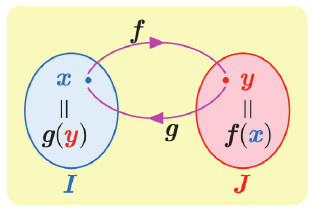

وعليه، أيّاً كان $x$ من $I$، كان $g(f(x))=x$. وأيّاً كان $y$ من $J$، كان $f(g(y))=y$.

مثلما $g$ هو التابع العكسي للتابع $f$ ($f^{-1}=g$)، فإن $f$ هو التابع العكسي للتابع $g$ ($g^{-1}=f$). وتكتب العلاقتان $g(f(x))=x$ و $f(g(y))=y$ بالشكل $f^{-1}(f(x))=x$ و $f(f^{-1}(y))=y$.

#### تكريساً للفهم

**لماذا يكون الخطّان البيانيان لتقابل وتقابله العكسي متناظرين؟**

ليكن $f$ تقابلاً مستمراً من مجال $I$ إلى مجال $J$، وليكن $g$ التقابل العكسي للتابع $f$. عندئذٍ أيّاً كانت $x$ من $I$ وأيّاً كانت $y$ من $J$، كانت العبارتان $f(x)=y$ و $g(y)=x$ متكافئتين.

في معلم متجانس، نرمز إلى الخطّين البيانيين للتابعين $f$ و $g$ على التوالي بالرمزين $C_f$ و $C_g$، عندئذٍ $C_f$ و $C_g$ متناظران بالنسبة إلى المستقيم $d$ الذي معادلته $y=x$.

في الحقيقة، تكون نقطتان $M\begin{bmatrix}x\\y\end{bmatrix}$ و $M'\begin{bmatrix}x'\\y'\end{bmatrix}$ متناظرتين بالنسبة إلى المستقيم الذي معادلته $y=x$ إذا وفقط إذا كان $x'=y$ و $y'=x$.

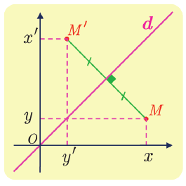

فإذا كانت $M\begin{bmatrix}x\\y=f(x)\end{bmatrix}$ نقطة من $C_f$ كانت نظيرتها $M'\begin{bmatrix}y\\x=g(y)\end{bmatrix}$ فهي إذن نقطة من $C_g$. ونجد بالمثل أنه إذا كانت $M$ نقطة من $C_g$، كانت نظيرتها $M'$ نقطة من $C_f$.

**مثال**

التابعان $f:x\mapsto x^2$ و $g:x\mapsto\sqrt{x}$ مستمرّان ومتزايدان تماماً على $I=[0,+\infty[$. وإذا وضعنا $f(x)=y$ وجدنا $g(y)=x$، وبالعكس، إذا كان $g(y)=x$ كان $f(x)=y$. إذن يمثّل كلّ من $f$ و $g$ تقابلاً وتقابله العكسي، وفي معلم متجانس يكون خطّاهما البيانيان متناظرين بالنسبة إلى المستقيم $d$ الذي معادلته $y=x$.

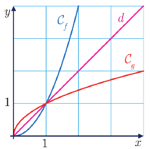

#### تدرّب

❶ التابع $f$ معرّف على $\mathbb R$ وفق $f(x)=x^3-x^2+x-2$. علّل لماذا يكون للمعادلة $f(x)=0$ حل وحيد في المجال $]1,2[$؟

❷ التابع $f$ معرّف على $\mathbb R$ وفق $f(x)=x^3-3x^2+1$. علّل لماذا يكون للمعادلة $f(x)+1=0$ ثلاثة وفقط ثلاثة حلول حقيقية؟

❸ ليكن $f$ التابع المعرّف على المجال $I=[-3,2]$ وفق $f(x)=x^2+1$.

① ارسم خطّه البياني $C_f$. واحسب $f(I)$.

② ما عدد حلول المعادلة $f(x)=4$ في المجال $I$؟

❹ ليكن $f$ التابع المعرّف على المجال $I=[2,3]$ وفق $f(x)=\frac1{x-1}$.

① ارسم خطّه البياني $C_f$. واحسب $f(I)$.

② ما عدد حلول المعادلة $f(x)=\frac34$ في المجال $I$؟

❺ ليكن $f$ التابع المعرّف على المجال $\mathbb R$ وفق $f(x)=4x^3-3x-\frac12$.

① احسب $f(-1)$ و $f(-\frac12)$ و $f(0)$ و $f(1)$.

② استنتج أن المعادلة $f(x)=0$ تقبل ثلاثة حلول في المجال $[-1,1]$.

❻ ليكن $f$ التابع المعرّف على المجال $\mathbb R$ وفق $f(x)=1+3x-x^3$.

① ادرس نهاية $f$ عند $-\infty$ وعند $+\infty$.

② احسب $f'(x)$ وادرس إشارته، ثم نظّم جدولاً بتغيّرات $f$.

③ أثبت أن المعادلة $f(x)=0$ تقبل ثلاثة جذور فقط، ينتمي كل واحد منها إلى واحد من المجالات: $[-2,-1]$ و $[-1,1]$ و $[1,2]$.

❼ نتأمّل التابع $f$ المعرّف على $\mathbb R$ وفق $f(x)=x-\cos x$.

① احسب $f(0)$ و $f(\frac\pi2)$ واستنتج أنه يوجد عدد حقيقي $\alpha$ يحقّق $f(\alpha)=0$.

② اشرح لماذا كل حلّ للمعادلة $f(x)=0$ يجب أن ينتمي إلى المجال $[-1,1]$.

③ استنتج أن كل حلّ للمعادلة $f(x)=0$ يجب أن ينتمي إلى المجال $]0,1[$.

④ برهن أن التابع $x\mapsto x-\cos x$ متزايد تماماً على المجال $]0,1[$، واستنتج أن للمعادلة $f(x)=0$ حلاً حقيقياً وحيداً $\alpha$ ينتمي إلى $]0,1[$.

### أفكار يجب تمثّلها

- تفيد العمليات على النهايات في إيجاد نهاية ناتج مجموع تابعين أو جداء ضربهما أو خارج قسمتهما، إلا أن هذه العمليات قد تقودنا إلى حالات عدم التعيين وهي:

  $$+\infty-\infty،\quad 0\times\pm\infty،\quad\frac00،\quad\frac{\pm\infty}{\pm\infty}.$$

- إذا كان تابع $f$ أكبر من تابع ينتهي إلى $+\infty$، انتهى $f$ نفسه إلى $+\infty$.
- وإذا كان تابع $f$ أصغر من تابع ينتهي إلى $-\infty$، انتهى $f$ نفسه إلى $-\infty$.
- إذا كان تابع $f$ محصوراً بين تابعين ينتهي كلّ منهما إلى $\ell$، انتهى $f$ نفسه إلى $\ell$. سواء كان $\ell$ عدداً حقيقياً أو كان $+\infty$ أو $-\infty$.
- عندما نبحث عن نهاية تابع مركّب $x\mapsto g(h(x))$، عند $a$، نبحث أولاً عن نهاية $h$ عند $a$، فإذا كان $\displaystyle\lim_{x\to a}h(x)=b$ بحثنا عن نهاية $g$ عند $b$.
- تسمح المبرهنة المتعلّقة بنهاية تابع مركّب، بتغيير المتحوّل. فعندما نبحث، على سبيل المثال، عن نهاية التابع

  $$f:x\mapsto\left(\frac{4x+1}{x-1}\right)^{5/2}-3\left(\frac{4x+1}{x-1}\right)^{3/2}$$

  عند $+\infty$، يمكن أن نضع $u(x)=\sqrt{\frac{4x-1}{x+1}}$، فيكون $\displaystyle\lim_{x\to+\infty}u(x)=2$ ويكون من ثمّ $\displaystyle\lim_{x\to+\infty}f(x)=\lim_{u\to2}(u^5-3u^3)=32-24=8$.

- لدراسة استمرار $f$ عند $a$، نحسب $\displaystyle\lim_{x\to a}f(x)$ ونحسب $f(a)$.
- التوابع الاشتقاقية هي توابع مستمرّة.

### منعكسات يجب امتلاكها

- عند البحث عن نهاية تابع، فكّر في استعمال التوابع المرجعية: $x\mapsto x$، $x\mapsto x^2$، $x\mapsto x^3$، $x\mapsto\sqrt{x}$، $x\mapsto\frac1x$، $x\mapsto\frac1{x^2}$، $x\mapsto\frac1{x^3}$، $x\mapsto\frac1{\sqrt{x}}$. ثم اكتب $f(x)$ بدلالة تلك التوابع بشكل ناتج مجموع أو جداء ضرب أو خارج قسمة.
- تذكّر أن نهاية تابع كثير الحدود عند $+\infty$ أو $-\infty$ تساوي نهاية حدّه المسيطر.
- تذكّر أن نهاية تابع كسري (بسطه ومقامه كثيرا حدود) عند $+\infty$ أو $-\infty$ تساوي نهاية خارج قسمة الحدّ المسيطر في البسط على الحدّ المسيطر في المقام.
- عندما تقودنا مبرهنات النهايات إلى الحالة $+\infty-\infty$ أو $\frac\infty\infty$، تذكّر أن تضع الحدّ الأعلى درجة خارج قوسين.
- عندما لا تفيد مبرهنات النهايات، فكر بالاستفادة من مبرهنة الإحاطة.
- لإثبات أن المستقيم الذي معادلته $y=ax+b$ مقارب للخطّ البياني $C_f$ في جوار $+\infty$، يكفي إثبات أن $\displaystyle\lim_{x\to+\infty}(f(x)-(ax+b))=0$. (الأمر ذاته عند $-\infty$).
- إن تغيير المتحوّل وفق $X=\frac1x$ ينقل حساب النهاية عند الصفر إلى حساب النهاية عند $+\infty$ أو عند $-\infty$، وبالعكس. مما قد يسهّل حساب النهاية.
- فكّر في أن الاستمرار والاطراد التامّ، لتابع $f$ يقودان إلى معرفة وجود حلّ المعادلة $f(x)=k$ في مجال من مجموعة تعريف $f$ ووحدانية هذا الحلّ.

### أخطاء يجب تجنّبها

- استمرار تابع عند $a$ لا يعني بالضرورة قابلية اشتقاقه في $a$. فمثلاً التابعان $x\mapsto\sqrt{x}$ و $x\mapsto|x|$ مستمران عند الصفر، وغير اشتقاقيين عنده.
- لتعيين صورة المجال $[a,b]$ وفق تابع $f$، لا يكفي حساب $f(a)$ و $f(b)$.

### أنشطة

#### نشاط 1: البحث عن مقاربات مائلة

##### ❶ أمثلة

1. $f$ هو التابع المعرّف على $]0,+\infty[$ وفق $f(x)=x-\frac12+\frac1x$.

   ① لماذا يمكن تأكيد أن المستقيم $\Delta$ الذي معادلته $y=x-\frac12$ مقارب للخط $C_f$ في جوار $+\infty$؟

   ② بيّن الوضع النسبي للخطّين $\Delta$ و $C_f$.

2. $f$ هو التابع المعرّف على $[0,+\infty[$ وفق $f(x)=\frac{2x^2+1}{x+3}$.

   بإعطاء $x$ قيماً كبيرة، تكون قيم $f(x)$ قريبة من $\frac{2x^2}{x}=2x$. فيمكن إذن أن يكون مستقيم معادلته من النمط $y=2x+b$ مقارباً للخطّ البياني $C_f$. سنسعى إذن إلى كتابة $f(x)$ بالصيغة:

   $$f(x)=2x+b+\frac c{x+3}$$

   ① عيّن عددين $b$ و $c$ يحقّقان $f(x)=2x+b+\frac c{x+3}$ أيّاً كان $x\geq0$.

   ② استنتج أن $C_f$ يقبل مقارباً مائلاً $\Delta$، وبيّن وضعه بالنسبة إلى $C_f$.

##### ❷ الحالة العامة

نتأمّل تابعاً $f$ تابع يحقّق $\displaystyle\lim_{x\to+\infty}f(x)=+\infty$.

1. $\Delta$ مستقيم معادلته $y=ax+b$ ($a\ne0$). نفترض أن

   $$\lim_{x\to+\infty}\bigl(f(x)-(ax+b)\bigr)=0.$$

   أثبت أن $a=\displaystyle\lim_{x\to+\infty}\frac{f(x)}x$ و $b=\displaystyle\lim_{x\to+\infty}(f(x)-ax)$. **مساعدة:** اكتب $f(x)=ax+b+(f(x)-(ax+b))$.

2. وبالعكس، أثبت أنه إذا كان

   $$\lim_{x\to+\infty}\frac{f(x)}x=a\quad(a\text{ عدد حقيقي غير معدوم})\quad\text{و}\quad\lim_{x\to+\infty}(f(x)-ax)=b\quad(b\text{ عدد حقيقي})$$

   كان المستقيم الذي معادلته $y=ax+b$ مقارباً للخط $C_f$.

##### ❸ تطبيق

ليكن $f$ التابع المعرّف على $[0,+\infty[$ وفق $f(x)=\sqrt{x^2+1}$. بالاستفادة من ❷، أثبت أن $C_f$ يقبل مقارباً مائلاً في جوار $+\infty$.

**ملاحظة:** يُبحث عن المقارب المائل في جوار $-\infty$ بطريقة مماثلة لما هو في جوار $+\infty$.

#### نشاط 2: نهايات جديرة بالاهتمام

الهدف من هذا النشاط هو حساب النهايتين $\displaystyle\lim_{x\to0}\frac{\sin x}{x}$ و $\displaystyle\lim_{x\to0}\frac{\cos x-1}{x^2}$.

##### ❶ عموميات

ليكن التابع $f$ المعرّف على $\mathbb R\setminus\{0\}$ بالصيغة $f(h)=\frac{\sin h}{h}$. في الجدول الآتي نجد بعض الأعداد القريبة من العدد 0 وقيم التابع $f$ المقابلة لها.

| $h$ | $\pm2^0$ | $\pm2^{-1}$ | $\pm2^{-2}$ | $\pm2^{-3}$ | $\pm2^{-4}$ | $\pm2^{-5}$ | $\pm2^{-6}$ | $\cdots\to0$ |
| --- | --- | --- | --- | --- | --- | --- | --- | --- |
| $f(h)$ | 0.84147 | 0.95885 | 0.98962 | 0.99740 | 0.99935 | 0.99948 | 0.99996 | $\cdots\to1$ |

نلاحظ من الجدول أنه عندما تقترب قيمة $h$ من العدد 0 تقترب قيمة $f(h)$ من العدد 1 وذلك مع كون التابع $f$ غير معرّف عند $h=0$. ويوضّح ذلك الشكل الآتي.

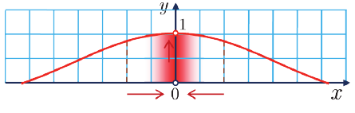

إذن من الطبيعي القول إن التابع $f$ يسعى إلى العدد 1 عند الصفر: $\displaystyle\lim_{h\to0}f(h)=1$.

##### ❷ حالة $h$ من المجال $]0,\frac\pi2[$

لتكن $C$ الدائرة المثلثاتية التي مركزها $O$. ولتكن $M$ تلك النقطة من $C$ بحيث يكون $h$ التعيين الأساسي بالراديان للزاوية الموجّهة $(\overrightarrow{OA},\overrightarrow{OM})$.

$h$ هو أيضاً قياس الزاوية الهندسية $\widehat{AOM}$ بالراديان. وفق هذه الشروط ومع الأخذ بدلالات الشكل المرافق، نعلم أن $OA=1$ و $OM'=\cos h$ و $MM'=\sin h$ وطول القوس $\widehat{AM}$ يساوي $h$.

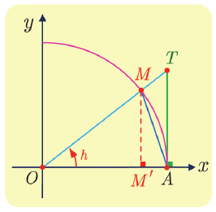

$$(*)\qquad\text{مساحة المثلّث }OAM\leq\text{مساحة القطاع الدائري }OAM\leq\text{مساحة المثلّث }OAT$$

1. لماذا مساحة القطاع الدائري $OAM$ تساوي $\frac h2$؟
2. لماذا مساحة المثلّث $OAM$ تساوي $\frac12\sin h$؟
3. لماذا مساحة المثلّث $OAT$ تساوي $\frac12\times\frac{\sin h}{\cos h}$؟
4. استنتج من $(*)$ أن $\sin h\leq h\leq\frac{\sin h}{\cos h}$.
5. استنتج أن $\cos h\leq\frac{\sin h}{h}\leq1$ أيّاً يكن $h$ من $]0,\frac\pi2[$.

##### ❸ حالة $h$ من المجال $]-\frac\pi2,0[$

نضع $h'=-h$، فيكون $\frac\pi2>h'>0$ واستناداً إلى الدراسة السابقة $\cos h'\leq\frac{\sin h'}{h'}\leq1$.

1. استنتج أنه أيّاً كان $h\ne0$ و $h$ من المجال $]-\frac\pi2,\frac\pi2[$، كان $\cos h\leq\frac{\sin h}{h}\leq1$.
2. نهاية التابع المألوف $x\mapsto\cos x$ عند الصفر تساوي 1. استنتج أن $\displaystyle\lim_{h\to0}\frac{\sin h}{h}=1$.

##### ❹ النهاية الثانية المتعلّقة بتابع جيب التمام

يقودنا البحث عن نهاية $\frac{\cos h-1}{h^2}$ عند الصفر، بحساب نهاية البسط ونهاية المقام، إلى حالة عدم تعيين، لأن نهاية كلّ من البسط والمقام تساوي الصفر عند $h=0$.

1. بملاحظة أن $\cos h=1-2\sin^2\frac h2$، أثبت أن

   $$\frac{\cos h-1}{h^2}=-\frac{2\sin^2(h/2)}{4\times(h/2)^2}=-\frac12\left(\frac{\sin(h/2)}{h/2}\right)^2.$$

2. استنتج أن $\displaystyle\lim_{h\to0}\frac{\cos h-1}{h^2}=-\frac12$.

##### ❺ تطبيق

لنتأمّل التابع المعرّف في $D=[-\pi,\pi]\setminus\{0\}$ بالصيغة

$$f(x)=\frac{\cos(3x)-\cos x}{x\sin x}$$

استعمل أسلوب الفقرة ❹ ونتائج هذا النشاط لتحسب $\displaystyle\lim_{x\to0}f(x)$.

### تمرينات ومسائل

#### 1

ادرس في كل حالة نهاية التابع $f$ عند أطراف مجموعة تعريفه، وعند اللزوم ادرس النهاية من اليمين ومن اليسار.

① $f(x)=\frac{x^3}{x^2+1}$

② $f(x)=2-\frac4{x^2}$

③ $f(x)=x^2+3x-\frac1{x+3}$

④ $f(x)=x+\frac1{1+x}-\frac1{x+2}$

⑤ $f(x)=(2x-3)(5-\sqrt{x})$

⑥ $f(x)=\cos x+\frac1x$

⑦ $f(x)=2x+\sin x$

⑧ $f(x)=x^2+2x-\frac1x$

⑨ $f(x)=x-2\sqrt{x}+3$

⑩ $f(x)=\sqrt{x^2+1}+x$

#### 2

أوجد نهاية التابع $f$ المعيّن بالعلاقة $f(x)=\frac{2x+1}{x-1}$ عند 1 وعند $-\infty$ وعند $+\infty$، ثم أوجد معادلات المستقيمات المقاربة لخطّه البياني وبيّن وضع الخط البياني بالنسبة إلى مقارباته الأفقية.

#### 3

أوجد نهاية التابع $f$ المعيّن بالعلاقة $f(x)=\frac{-2x}{x+1}$ عند $-\infty$ وعند $+\infty$ وعند $-1$. ثم أوجد معادلات المستقيمات المقاربة لخطّه البياني وبيّن وضع الخطّ البياني بالنسبة إلى مقارباته الأفقية.

#### 4

$f$ هو التابع المعرّف على المجال $]1,+\infty[$ وفق $f(x)=\frac{2x+\sin x}{x-1}$.

① أثبت أن $\frac{2x-1}{x-1}\leq f(x)\leq\frac{2x+1}{x-1}$ أيّاً يكن $x>1$.

② استنتج نهاية $f$ عند $+\infty$.

#### 5

ليكن $f$ التابع المعرّف على $\mathbb R$ وفق $f(x)=2x^3-3x^2-1$ وليكن $C$ خطّه البياني المبيّن في الشكل المرافق.

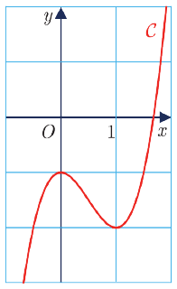

① ادرس نهاية $f$ عند $-\infty$ وعند $+\infty$.

② احسب $f'(x)$ وادرس إشارته، ثم نظّم جدولاً بتغيّرات $f$.

③ أثبت أن المعادلة $f(x)=0$ تقبل جذراً واحداً فقط. وإذا رمزنا إلى هذا الجذر بالرمز $\alpha$، أثبت أن $\alpha$ ينتمي إلى المجال $]1.6,1.7[$.

### لنتعلّم البحث معاً

#### 6. تغيير المتحوّل

نتأمّل التابع $f$ المعرّف على $\mathbb R^*$ بالعلاقة $f(x)=\frac{\sin(3x)}x$. ادرس نهاية $f$ عند الصفر.

**نحو الحلّ**

نحن أمام صيغة عدم تعيين، لماذا؟

**بحثاً عن طريق**

الطريقة الأولى: تذكّرنا عبارة $f(x)$ بالتابع $x\mapsto\frac{\sin x}x$ الذي تساوي نهايته 1 عند الصفر. وهذا يقودنا إلى التفكير بتغيير للمتحوّل. أجرِ التغيير $X=3x$، ثم أنجز الحلّ.

الطريقة الثانية: تمكن كتابة $f(x)$ بالصيغة $f(x)=\frac{\sin(3x)-\sin0}{x-0}$، وهذه العبارة هي معدّل تغيّر التابع $x\mapsto\sin3x$. استفد من ذلك لإيجاد نهاية $f$ عند الصفر.

أنجز الحلّ واكتبه بلغة سليمة.

#### 7. التابع $x\mapsto\sqrt{ax^2+bx+c}$

ليكن $f$ التابع المعرّف على $\mathbb R$ وفق $f(x)=\sqrt{2x^2+x+1}$. وليكن $C$ خطّه البياني. المطلوب هو إثبات أن الخطّ $C$ يقبل مقارباً مائلاً في جوار $+\infty$، وكذلك الأمر في جوار $-\infty$.

**نحو الحلّ**

**فهم السؤال**

- الحدّ المسيطر في كثير الحدود $2x^2+x+1$ هو $2x^2$، فيمكن أن نخمّن أنه، عند القيم الكبيرة للمتحوّل $x$، يكون $f(x)$ من مرتبة $\sqrt{2x^2}=\sqrt2\,x$.

**بحثاً عن طريق**

① أثبت أن $\displaystyle\lim_{x\to+\infty}(\sqrt{2x^2+x+1}-\sqrt2\,x)=\frac{\sqrt2}{4}$.

② استنتج قيمة $\displaystyle\lim_{x\to+\infty}\left(f(x)-(\sqrt2\,x+\frac{\sqrt2}{4})\right)$.

③ أعد الدراسة السابقة في جوار $-\infty$.

أنجز الحلّ واكتبه بلغة سليمة.

#### 8. كثير الحدود ذي الدرجة الفردية

من المعلوم أن كثير حدود $P$ من الدرجة $n$ يكتب بالصيغة $P(x)=a_nx^n+a_{n-1}x^{n-1}+\cdots+a_0$ حيث $a_n\ne0$.

نهدف إلى إثبات أنه إذا كان $n$ عدداً فردياً، قبل $P$ جذراً حقيقياً على الأقلّ.

**نحو الحلّ**

**فهم السؤال:** يتعلّق الأمر بإثبات أن للمعادلة $P(x)=0$ حلاً على الأقل في حالة $n$ فردي. يتبادر إلى الذهن أن ندرس تغيّرات التابع $x\mapsto P(x)$. ولأن التابع $P$ مستمرّ، يمكن التفكير في إيجاد عددين $a$ و $b$ يحقّقان $P(a)\times P(b)<0$. أيّة مبرهنة تفيد في تحقيق ما خطر لنا.

**بحثاً عن طريق:** لنفترض أولاً أن $a_n>0$.

- احسب $\displaystyle\lim_{x\to+\infty}P(x)$ و $\displaystyle\lim_{x\to-\infty}P(x)$ مستفيداً من كون العدد $n$ فردياً.
- استنتج أنه يوجد عددان حقيقيان $a$ و $b$ يحقّقان $P(a)>0$ و $P(b)<0$.
- استنتج وجود عدد حقيقي $c$ يحقّق $P(c)=0$.
- ادرس بالمثل حالة $a_n<0$.

أنجز الحلّ واكتبه بلغة سليمة.

### قدماً إلى الأمام

#### 9

ادرس في كل حالة نهاية التابع $f$ عند $a$، وادرس عند الضرورة النهاية من اليمين ومن اليسار.

① $a=-\infty,1,5,+\infty$، $f(x)=\frac{x-4}{x^2-6x+5}$

② $a=-\infty,-2,2,+\infty$، $f(x)=\frac{x^2-4x-12}{x^2-4}$

③ $a=-\infty,-2,1,+\infty$، $f(x)=\frac{2x^3-x^2-1}{x^2+x-2}$

④ $a=-\infty,-3,3,+\infty$، $f(x)=\frac1{x-3}-\frac2{x^2-9}$

⑤ $a=-\infty,1,+\infty$، $f(x)=\frac{x^4-1}{x^3-1}$

⑥ $a=-\infty,+\infty$، $f(x)=2x+\sin^2x$

⑦ $a=-\infty,+\infty$، $f(x)=x^3(2+\cos x)$

⑧ $a=1,+\infty$، $f(x)=\frac{\sqrt{x-1}}{x-1}$

#### 10

ليكن $g$ التابع المعرّف على $\mathbb R$ وفق $g(x)=\frac1{3+2\sin x}$.

① أثبت أن $g$ محدود.

② استنتج كلاً من النهايتين $\displaystyle\lim_{x\to+\infty}\left(\frac{x^2}{3+2\sin x}\right)$ و $\displaystyle\lim_{x\to+\infty}\left(\frac{x+\sin x}{3+2\sin x}\right)$.

#### 11

ليكن $f$ التابع المعيّن بالعلاقة $f(x)=\frac{3x^2+6x}{x^2-x-2}$.

① عيّن $D_f$ مجموعة تعريف $f$.

② أوجد الأعداد $a$ و $b$ و $c$ التي تحقّق $f(x)=a+\frac b{x+1}+\frac c{x-2}$، أيّاً تكن $x$ من $D_f$.

③ ادرس نهاية $f$ عند حدود المجالات الثلاثة التي تؤلّف $D_f$.

#### 12

ليكن $f$ التابع المعيّن بالعلاقة $f(x)=\frac{x}{(x-1)^2}$.

① ادرس نهاية $f$ في جوار 1.

② أوجد مجالاً $I$ مركزه 1 ويحقّق $f(x)>10^6$، أيّاً تكن $x$ من $I\setminus\{1\}$.

#### 13

ادرس في كل حالة نهاية التابع $f$، عند $a$.

① $a=+\infty$، $f(x)=\sqrt{x^2+2x}-x$

② $a=-\infty$، $f(x)=\sqrt{4x^2+x}+2x$

③ $a=3$، $f(x)=\frac{\sqrt{x+1}-2}{x-3}$

④ $a=0$، $f(x)=\frac{2x}{\sqrt{x+1}-1}$

⑤ $a=1,+\infty$، $f(x)=\frac{-x+\sqrt{x}}{x-1}$

⑥ $a=-1,+\infty$، $f(x)=\frac{x+1}{\sqrt{x^2-1}}$

#### 14

ادرس في كل حالة نهاية التابع $f$.

① $a=0,+\infty$، $f(x)=\frac{\sin x}{\sqrt{x}}$

② $a=0$، $f(x)=\frac{1-\cos x}{\sin x}$

③ $a=0$، $f(x)=\frac{x\sin x}{1-\cos x}$

④ $a=2$، $f(x)=\frac{2-\sqrt{3x-2}}{\sqrt{2x+5}-3}$

#### 15

ليكن $g$ التابع المعرّف على المجال $]3,+\infty[$ وفق $g(x)=\frac{3x-1}{x-3}$.

① احسب $\displaystyle\lim_{x\to+\infty}g(x)$ واستنتج $\displaystyle\lim_{x\to+\infty}g(g(x))$.

② أعد حساب $\displaystyle\lim_{x\to+\infty}g(g(x))$ بعد كتابة $g(g(x))$ بدلالة $x$.

#### 16

ليكن $C$ الخطّ البياني للتابع $f$ المعرّف بالعلاقة $f(x)=ax+b+\frac c{x-d}$. جد الأعداد الحقيقية $a$ و $b$ و $c$ و $d$ علماً أن الخواص الآتية محقّقة:

- المستقيم الشاقولي الذي معادلته $x=3$ مقارب للخطّ $C$.
- المستقيم المائل الذي معادلته $y=2x-5$ مقارب للخطّ $C$ عند $+\infty$ وعند $-\infty$.
- تنتمي النقطة $A(1,2)$ إلى الخطّ $C$.

#### 17

فيما يأتي $C$ هو الخطّ البياني للتابع $f$ الذي ندرسه على مجموعة تعريفه $D_f$. بيّن، في كلّ حالة، إن كان ثمّة مستقيمات مقاربة (أفقية أو شاقولية أو مائلة) للخطّ $C$.

① $f(x)=\frac{x+1}{x-3}$

② $f(x)=-x+3+\frac2{x^2+1}$

③ $f(x)=1-\frac2x+\frac x2$

④ $f(x)=1-x+\frac{3x}{x^2+2}$

⑤ $f(x)=\frac{2x^2+5x-4}{x}$

⑥ $f(x)=\frac{x^2+2+\sin x}{x}$

⑦ $f(x)=\frac{x^2+6x+1}{x^2-1}$

⑧ $f(x)=\frac{x^2-3x+1}{x-1}$

⑨ $f(x)=\frac{x^3+1}{x^2+2}$

⑩ $f(x)=\frac{3x^3+2x-1}{x^2+1}$

**مساعدة:** في ⑧ و ⑨ و ⑩ فكّر باستعمال القسمة الإقليدية لكثيرات الحدود.

#### 18

ليكن $f$ التابع المعرّف على $\mathbb R$ وفق $f(x)=\sqrt{x^2+2x+4}$.

① أ. احسب $\displaystyle\lim_{x\to+\infty}f(x)$ ثم $\displaystyle\lim_{x\to+\infty}(f(x)-(x+1))$.

ب. استنتج وجود مقارب مائل $\Delta$ للخطّ البياني $C$ للتابع $f$ في جوار $+\infty$.

ج. ادرس الوضع النسبي للمقارب $\Delta$ والخطّ $C$.

② أ. احسب $\displaystyle\lim_{x\to-\infty}f(x)$.

ب. أثبت وجود عدد حقيقي $a$ يحقّق $\displaystyle\lim_{x\to-\infty}\frac{f(x)}x=a$ وأن نهاية $x\mapsto f(x)-ax$ عند $-\infty$ عدد حقيقي $b$.

ج. استنتج وجود مقارب مائل $\Delta'$ للخط البياني $C$ للتابع $f$ في جوار $-\infty$.

#### 19

ليكن $C$ الخط البياني للتابع $f$ المعرّف على $\mathbb R$ وفق $f(x)=\sqrt{x^2+4x+5}$.

① احسب $\displaystyle\lim_{x\to+\infty}f(x)$.

② أ. اكتب ثلاثي الحدود $x^2+4x+5$ بالصيغة القانونية، (متمّماً إلى مربع كامل).

ب. استنتج وجود مقارب مائل للخطّ البياني $C$ للتابع $f$ في جوار $+\infty$. اكتب معادلته.

#### 20

ليكن $C$ الخطّ البياني للتابع $f$ المعرّف على $\mathbb R$ وفق $f(x)=x+\sqrt{x^2+1}$.

① ادرس نهاية $f$ عند $-\infty$. اشرح التأويل الهندسي لهذه النتيجة.

② أثبت أن المستقيم $\Delta$ الذي معادلته $y=2x$ مقارب للخطّ $C$ في جوار $+\infty$.

③ ادرس الوضع النسبي للمقارب $\Delta$ والخطّ $C$.

#### 21

ليكن $C$ الخطّ البياني للتابع $f$ المعرّف على $\mathbb R$ وفق $f(x)=x+\sqrt{|4x^2-1|}$.

① ادرس نهاية $f$ عند $-\infty$ وعند $+\infty$.

② أ. احسب $\displaystyle\lim_{x\to+\infty}(f(x)-3x)$.

ب. احسب $\displaystyle\lim_{x\to-\infty}(f(x)+x)$.

③ أ. استنتج أن الخطّ $C$ يقبل مستقيمين مقاربين مائلين $\Delta_1$ و $\Delta_2$ يُطلب إيجاد معادلتيهما.

ب. ادرس الوضع النسبي للخطّ $C$ وكلّ من المقاربين $\Delta_1$ و $\Delta_2$.

#### 22

ليكن $C$ الخطّ البياني للتابع $f$ المعرّف على $\mathbb R$ وفق $f(x)=\sqrt{4x^2-4x+3}$.

① ادرس نهاية $f$ عند $+\infty$ وعند $-\infty$.

② أ. اكتب $4x^2-4x+3$ بالشكل القانوني.

ب. ادرس نهاية التابع $h$ المعرّف وفق $h(x)=f(x)-\sqrt{(2x-1)^2}$ عند $-\infty$ وعند $+\infty$.

ج. استنتج أن الخطّ $C$ يقبل مستقيمين مقاربين مائلين يُطلب إيجاد معادلتيهما.

③ أثبت أن الخطّ $C$ يقع فوق كلّ من هذين المقاربين.

#### 23

ليكن $C$ الخط البياني للتابع $f$ المعرّف على $\mathbb R$ وفق $f(x)=x+\frac{x}{\sqrt{x^2+9}}$.

① أ. أثبت أن المستقيم $\Delta$ الذي معادلته $y=x+1$ مقارب للخطّ $C$ في جوار $+\infty$.

ب. ادرس الوضع النسبي للمقارب $\Delta$ والخطّ $C$.

② أصحيح أن المستقيم $\Delta'$ الذي معادلته $y=x-1$ مقارب للخطّ $C$ في جوار $-\infty$؟

#### 24

ليكن $f$ التابع المعرّف على $\mathbb R$ وفق $f(x)=x^3+x+1$. احسب $f(-1)$ و $f(0)$ ثم أثبت وجود عدد حقيقي وحيد $c$ من المجال $]-1,0[$ يحقّق $f(c)=0$.

#### 25

ليكن $f$ التابع المعرّف على $\mathbb R\setminus\{-1\}$ وفق $f(x)=\frac{x^3}{x+1}$.

① أثبت أن $f$ متزايد تماماً على المجال $[-\frac32,-1[$.

② نظّم جدولاً بتغيّرات $f$ على المجال $[-\frac32,-1[$.

③ أوجد $f([-\frac32,-1[)$ وأثبت أن للمعادلة $f(x)=10$ حلاً وحيداً في المجال $[-\frac32,-1[$.

#### 26

ليكن $f$ التابع المعرّف على $I=[0,3]$ وفق $f(x)=x^2-2x-3$.

① ادرس تغيّرات $f$ ونظّم جدولاً بها.

② استنتج قيم $x$ التي تحقّق $f(x)=0$.

③ عيّن $f([0,3])$.

#### 27

ليكن $f$ التابع المعرّف على $\mathbb R$ وفق $f(x)=1-\frac1{x^2+1}$. أثبت أن $f$ مستمرّ على $\mathbb R$ وعيّن $f(\mathbb R)$.

#### 28

ليكن $f$ التابع المعرّف على $\mathbb R$ وفق:

$$f(x)=\begin{cases}x^2\cos\left(\frac1x\right)&:x\ne0\\0&:x=0\end{cases}$$

① احسب نهاية $f$ عند الصفر.

② هل $f$ مستمرّ عند الصفر؟ هل هو مستمرّ على $\mathbb R$؟ علّل إجابتك.

#### 29

ليكن $f$ التابع المعرّف على $\mathbb R$ وفق:

$$f(x)=\begin{cases}\frac{1-\sqrt{x^2+1}}x&:x\ne0\\m&:x=0\end{cases}$$

ما قيمة $m$ التي تجعل $f$ مستمراً على $\mathbb R$؟

#### 30

يرمز $E(x)$ إلى الجزء الصحيح للعدد الحقيقي $x$. ليكن $f$ التابع المعرّف على المجال $[0,2]$ وفق $f(x)=x-E(x)$.

① ارسم الخطّ البياني للتابع $f$ على المجال $[0,2]$.

② هل $f$ مستمرّ على المجال $[0,2]$؟

#### 31

يرمز $E(x)$ إلى الجزء الصحيح للعدد الحقيقي $x$. ليكن $f$ التابع المعرّف على المجال $[0,2]$ وفق $f(x)=E(x)+(x-E(x))^2$.

① اكتب $f(x)$ بعبارة مستقلّة عن $E(x)$ (لا تحوي $E(x)$).

② أثبت أن $f$ مستمرّ على المجال $[0,2]$؟

#### 32

في معلم متجانس، $C$ هو الخط البياني للتابع $f$ المعرّف على $[0,\pi]$ وفق $f(x)=\sin x$. و $d$ هو المستقيم الذي معادلته $y=\frac12x$.

① أ. ارسم كلاًّ من $C$ و $d$.

ب. يبدو أن للمعادلة $\sin x=\frac12x$ حلاً وحيداً $\alpha$ في المجال $]0,\pi]$. استفد من الرسم لإيجاد مجال صغير ينتمي إليه $\alpha$.

② نرمز بالرمز $g$ إلى التابع المعرّف على $[0,\pi]$ وفق $g(x)=\sin x-\frac12x$.

أ. احسب $g'(x)$ وأثبت أن $g'(x)$ ينعدم عند $x=\frac\pi3$.

ب. نظّم جدولاً بتغيّرات $g$.

③ استنتج مما سبق أن المعادلة $\sin x=\frac12x$ تقبل حلاً وحيداً $\alpha$ في المجال $]0,\pi]$.

#### 33

ليكن $f$ تابعاً مستمراً ومعرّفاً على المجال $I=[0,1]$ ويحقّق $f(x)\in I$، أيّاً يكن $x$ من $I$. نرمز بالرمز $k$ إلى التابع المعرّف على $I$ وفق $k(x)=f(x)-x$. بتطبيق مبرهنة القيمة الوسطى على التابع $k$، أثبت وجود عدد حقيقي $a$ من $I$ يحقّق $f(a)=a$.

#### 34. مجموعة توابع مستمرّة

ليكن $m$ عدداً حقيقياً، وليكن $C_m$ الخطّ البياني للتابع $f_m$ المعرّف على $\mathbb R$ وفق:

$$f_m(x)=x^3+mx^2-8x-m$$

① أ. أثبت أن الخطّين البيانيين $C_0$ و $C_1$ يتقاطعان في نقطتين $A$ و $B$. أوجد إحداثيّات هاتين النقطتين.

ب. استنتج أن جميع الخطوط البيانية $C_m$ تمرّ بالنقطتين $A$ و $B$.

② أوجد نهاية $f_m$ عند $+\infty$ و عند $-\infty$.

③ استنتج مما سبق أن للمعادلة $f_m(x)=0$ ثلاثة حلول متمايزة في $\mathbb R$، أيّاً يكن العدد $m$.

#### 35

ليكن $f$ تابعاً مستمراً واشتقاقياً على المجال $I=[0,1]$ ويحقّق الشرطين:

- أيّاً كان $x$ من $I$ كان $f(x)$ من $I$.
- وأيّاً كان $x$ من $]0,1[$ كان $f'(x)<1$.

أثبت أن للمعادلة $f(x)=x$ حلاً وحيداً في $I$.

#### 36

ليكن $f$ التابع المعرّف على $\mathbb R$ وفق $f(x)=\sqrt{1+x^2}$. وليكن $C$ خطّه البياني في معلم متجانس $(O;\vec i,\vec j)$.

① أثبت أن للخطّ $C$ محور تناظر.

② ادرس نهاية $f$ عند $+\infty$ وعند $-\infty$.

③ أثبت أن $f(x)-x=\frac1{x+\sqrt{1+x^2}}$، أيّاً يكن $x$ من $\mathbb R$. استنتج أن $C$ يقبل مقارباً مائلاً $d$ في جوار $+\infty$. عيّن الوضع النسبي للخطّ $C$ ومقاربه $d$.

④ ليكن $C'$ الخطّ البياني للتابع $g$ المعرّف على $\mathbb R$ وفق $g(x)=-f(x)$، وليكن $\mathcal H=C\cup C'$. أثبت أن معادلة $\mathcal H$ هي $y^2-x^2=1$.

⑤ نعتمد معلماً جديداً $(O;\vec u,\vec v)$ حيث $\vec u=\frac{\sqrt2}{2}(\vec i+\vec j)$ و $\vec v=\frac{\sqrt2}{2}(-\vec i+\vec j)$. لتكن $M$ نقطة إحداثيّاتها $(x,y)$ في المعلم $(O;\vec i,\vec j)$ وإحداثيّاتها $(X,Y)$ في المعلم $(O;\vec u,\vec v)$. أوجد $x$ و $y$ بدلالة $X$ و $Y$. ارسم الخطّ $\mathcal H$ في المعلم $(O;\vec u,\vec v)$.

#### 37. تابع القيمة المطلقة: تغيّرات. حل معادلة

ليكن $C$ الخطّ البياني للتابع $f$ المعرّف على $D_f=\mathbb R\setminus\{-1,+1\}$ وفق:

$$f(x)=|x+1|+\frac{x}{x^2-1}$$

① أ. اكتب $f(x)$ بصيغة لا تحوي قيمة مطلقة.

ب. ادرس نهاية $f$ عند حدود مجالات $D_f$. ثم أوجد $f'(x)$ وادرس إشارته على كلّ من مجالات $D_f$.

② ادرس تغيّرات $f$ ونظّم جدولاً بها.

③ أ. تحقّق من أن المستقيمين اللذين معادلتاهما $y=x+1$ و $y=-x-1$ هما، بالترتيب، مقاربان مائلان للخطّ البياني $C$ عند $+\infty$ وعند $-\infty$. ادرس وضع $C$ بالنسبة إلى هذين المقاربين.

ب. أوجد معادلة للمماس $T$ للخطّ البياني $C$ في النقطة $A$ منه علماً أن فاصلة $A$ تساوي الصفر.

ج. ارسم $T$ ومقاربي $C$ ثم ارسم $C$.

④ أثبت أن للمعادلة $f(x)=0$ حلاً وحيداً $\alpha$ في المجال $]-1,1[$ وأوجد مجالاً طوله $10^{-1}$ تنتمي إليه $\alpha$.

#### 38

في معلم متجانس $(O;\vec i,\vec j)$، لدينا النقطتان الثابتتان $A(-3,4)$ و $B(2,1)$ والنقطة المتحوّلة $M(x,0)$. نقرن بالنقطة $M$ النقطة $M'$ التي نعرّفها كما يلي:

- يقطع المستقيم $(AM)$ المحور $(O;\vec j)$ في $m$.
- يقطع المستقيم $(Bm)$ المحور $(O;\vec i)$ في $M'$.

نرمز إلى فاصلة $M'$ بالرمز $f(x)$.

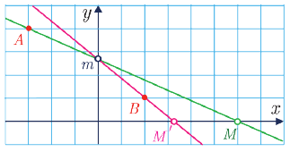

① بدون حساب، خمّن نهاية $f$ عند $+\infty$.

② أثبت أن $f(x)=\frac{8x}{3x-3}$ عندما تختلف $x$ عن 1 وعن $-3$، ثم استنتج نهاية $f$ عند $+\infty$.

③ أ. ادرس نهاية $f$ عند $-\infty$. ما التأويل الهندسي لهذه النتيجة؟

ب. ادرس نهاية $f$ عند $x=1$. ما التأويل الهندسي لهذه النتيجة؟

④ عندما $x=-3$، يكون المستقيم $(AM)$ موازياً $(O,\vec j)$ وتكون $m$ «في اللانهاية». يمكن أن نقول في هذه الحالة أن $(Bm)$ يوازي $(O,\vec j)$ وأن $M'$ تقع في $(2,0)$. نعرّف عندئذٍ التابع $g$ وفق $g(x)=f(x)$ عندما تختلف $x$ عن 1 وعن $-3$، و $g(-3)=2$. لماذا يكون $g$ مستمراً عند $-3$؟

**ملاحظة:** نقول في هكذا حالة إننا مدّدنا استمرار $g$ ليشمل $x=-3$.

## 3. التوابع: الاشتقاق

1. تعاريف (تذكرة)
2. مشتقات بعض التوابع المألوفة (تذكرة)
3. تطبيقات الاشتقاق
4. اشتقاق تابع مركّب
5. المشتقات من مراتب عليا

### البابليون وحساب الجذر التربيعي

كانت مسألة حساب الجذر التربيعي $\sqrt A$ لعدد موجب $A$ تُعدّ مسألة مهمّة منذ القدم.

المطلوب إذن حساب الحلّ الموجب للمعادلة $f(x)=0$ حيث $f(x)=x^2-A$، وفي غالب الأحيان لا نعرف إلا قيمة تقريبية $x^*$ لهذا الحل نفترض أنها أكبر من $\sqrt A$، ولكن هل يمكننا انطلاقاً من $x^*$ تعيين قيمة تقريبية أخرى $x^{**}$ تكون أقرب إلى $\sqrt A$ من سابقتها $x^*$؟

نرى من الشكل أن المماس $T$ في $M(x^*,f(x^*))$ للخط البياني $C_f$ يقطع محور الفواصل في نقطة فاصلتها $x^{**}$ تكون أقرب إلى $\sqrt A$ من $x^*$.

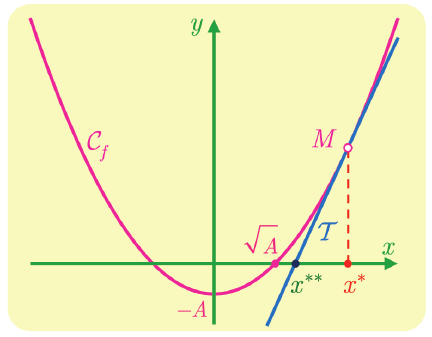

معادلة المماس $T$ في $M$ هي

$$y=2xx^*-x^{*2}-A$$

وهو يتقاطع محور الفواصل في النقطة التي فاصلتها

$$x^{**}=\frac12\left(x^*+\frac A{x^*}\right)$$

وعليه يكون $x^{**}$ المحسوب هكذا تقريباً أفضل للجذر التربيعي $\sqrt A$ من $x^*$.

في حالة $A=2$ يمكننا انطلاقاً من $x^*=2$ حساب تقريبات متتالية للعدد $\sqrt2$ كما يأتي:

| $x^*$ | $2$ | $\frac32$ | $\frac{17}{12}$ | $\frac{577}{408}$ |
| --- | --- | --- | --- | --- |
| $x^{**}$ | $\frac32$ | $\frac{17}{12}$ | $\frac{577}{408}$ | $\frac{665857}{470832}$ |
| $x^{**}-\sqrt2\approx$ | 0.0858 | 0.00245 | 0.000002 | 0.000000000002 |

هذه الطريقة كانت معروفة للبابليين منذ حوالي ثلاثة آلاف سنة، وتسمّى الخوارزمية البابلية، ونجد في الشكل المجاور رُقْماً حجرياً بابلياً رمزه YBC–7289 نُقش عليه $\sqrt2$ و $1/\sqrt2$ بالكتابة المسمارية بالأساس الستيني وهو ما كان معتمداً في ذلك الحين.

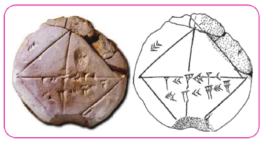

### 1. تعاريف (تذكرة)

في كلّ هذه الوحدة سنرمز بالرمز $D_f$ إلى مجموعة تعريف تابع $f$ وبالرمز $C_f$ إلى الخطّ البياني للتابع $f$ في معلم متجانس.

#### 1.1. العدد المشتقّ والتابع المشتقّ

**تعريف 1**

ليكن $f$ تابعاً معرّفاً على مجال $I$ محتوى في $D_f$، ولتكن $a$ نقطة من $I$. نقول إن $\ell$ هو العدد المشتقّ للتابع $f$ عند $a$ إذا وفقط إذا تحقّق واحد من الشرطين الآتيين:

- العدد $\ell$ هو نهاية التابع $h\mapsto\frac{f(a+h)-f(a)}h$ عندما تسعى $h$ إلى الصفر مع بقاء $a+h$ في $I$.
- العدد $\ell$ هو نهاية التابع $x\mapsto\frac{f(x)-f(a)}{x-a}$ عندما تسعى $x$ إلى $a$ مع بقائها في $I\setminus\{a\}$.

يُرمز إلى العدد المشتق للتابع $f$ في $a$ بالرمز $f'(a)$.

- عندما يقبل $f$ عدداً مشتقاً في $a$، نقول إن $f$ اشتقاقيّ في $a$.
- عندما يكون $f$ اشتقاقياً عند كلّ نقطة من مجال $I$، نقول إن $f$ اشتقاقيّ على $I$.

**تعريف 2**

ليكن $f$ تابعاً اشتقاقياً على مجال $I$. التابع المشتقّ للتابع $f$ على $I$ هو التابع $f'$ الذي يقرن بكل $a$ من $I$، العدد المشتق $f'(a)$.

يمكن أن يُعرّف $f'$ على اجتماع مجالات وليس على مجال واحد فحسب. فمثلاً: التابع المشتق للتابع $f:x\mapsto\frac1x$ المعرّف على $D=]-\infty,0[\cup]0,+\infty[$، هو التابع $f'$ المعرّف على $D$ نفسها وفق $f'(x)=-\frac1{x^2}$.

#### 1.2. المماس والتقريب التآلفي المحلي

ليكن $C$ الخطّ البياني لتابع $f$ اشتقاقيّ عند النقطة $a$، وليكن $T$ المماس للمنحني $C$ في النقطة $A(a,f(a))$، إن $T$ هو المستقيم المارّ بالنقطة $A$ و ميله يساوي $f'(a)$. (انظر الشكل المجاور) وتكون $y=f'(a)(x-a)+f(a)$ معادلة للمماس $T$.

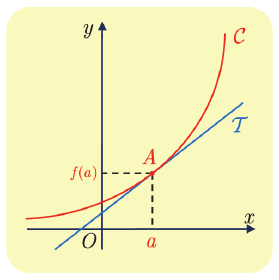

يظهر من الرسم أن المستقيم $T$ قريب من المنحني $C$ في جوار النقطة $A$، ويمكننا إذن أن نستبدل بالمنحني $C$ المستقيم $T$ بقرب النقطة $A$. بعبارة أخرى نستبدل محلياً بالتابع $x\mapsto f(x)$ التابع التآلفي $x\mapsto f(a)+f'(a)(x-a)$ أي إننا نستبدل بالعدد الحقيقي $f(a+h)$ العدد الحقيقي $f(a)+hf'(a)$ عندما تكون $h$ قريبة من الصفر.

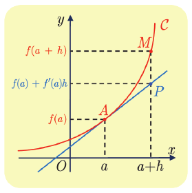

#### تكريساً للفهم

**ما فائدة التقريب التآلفي المحلي؟**

- في الحالة العامة، حساب $f(a)+h\times f'(a)$ أسهل من حساب $f(a+h)$، لأن المقدار $f(a)+h\times f'(a)$ كثير حدود من الدرجة الأولى بالمتحوّل $h$، فالحساب يتطلّب فقط عملية ضرب وعملية جمع.

**مثال**

فعلى سبيل المثال، التابع $f:x\mapsto\sin x$ اشتقاقي على $\mathbb R$، و $f(0)=\sin0=0$ و $f'(0)=\cos(0)=1$. إذن لحساب قيمة التقريبية للعدد $\sin(h)$ في حالة قيمة صغيرة للعدد $h$ نستعمل $f(a+h)\approx f(a)+h\times f'(a)$ فنجد $\sin(h)\approx h$. إذن

$$\sin(0.1)\approx0.1$$

أمّا الآلة الحاسبة فتعطي: $\sin(0.1)=0.099833$!

عندما يكون $f$ اشتقاقياً عند $a$، يمكن أن نكتب $f(a+h)=f(a)+hf'(a)+h\varepsilon(h)$ و $h\mapsto\varepsilon(h)$ هو تابع للمتحوّل $h$ يحقّق $\displaystyle\lim_{h\to0}\varepsilon(h)=0$.

في الحقيقة يكفي أن نضع

$$\varepsilon(h)=\frac{f(a+h)-f(a)}h-f'(a)$$

ثم نستفيد من تعريف العدد المشتقّ.

وبالعكس، إذا أمكن كتابة $f(a+h)=f(a)+h\ell+h\varepsilon(h)$ حيث $\ell$ عدد حقيقي و $\displaystyle\lim_{h\to0}\varepsilon(h)=0$، عندئذٍ يكون $\ell$ العدد المشتق للتابع $f$ عند $a$.

**مثال: إحدى صفات القطع المكافئ**

ليكن $\mathcal P$ الخطّ البياني للتابع $f$ المعرّف على $\mathbb R$ وفق $f(x)=x^2$ ولتكن $A$ و $B$ نقطتين من $\mathcal P$ فاصلتاهما بالترتيب $u$ و $v$، ($u\ne v$)، ولتكن $D$ النقطة من $\mathcal P$ التي فاصلتها $\frac{u+v}{2}$. أثبت أن المماس $T$ المارّ بالنقطة $D$ للقطع $\mathcal P$ يوازي المستقيم $(AB)$.

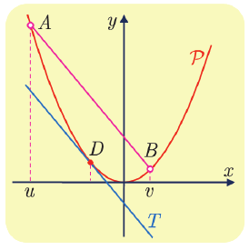

علينا إثبات توازي مستقيمين. ولأنهما لا يوازيان محور التراتيب، يكفي إثبات تساوي ميليهما، أو إثبات الارتباط الخطي للشعاعين الموجّهين لهما.

**الحل**

ليكن $m_1$ ميل المستقيم $(AB)$ عندئذٍ $m_1=\frac{y_B-y_A}{x_B-x_A}=\frac{v^2-u^2}{v-u}=v+u$. وليكن $m_2$ ميل المماس $T$. لأن $f'(x)=2x$ استنتجنا $m_2=f'(\frac{u+v}2)=u+v$. إذن $m_1=m_2$ فالمستقيمان $(AB)$ و $T$ متوازيان، وهي النتيجة المطلوبة.

### 2. مشتقّات بعض التوابع المألوفة (تذكرة)

#### 2.1. عمليات على المشتقات

**مبرهنة 1**

ليكن $u$ و $v$ تابعين اشتقاقيّين على $D$ ($D$ هي مجال أو اجتماع مجالات)، وليكن $k$ عدداً حقيقياً. عندئذٍ يكون كلّ من $ku$ و $u+v$ و $uv$ اشتقاقياً على $D$ ويكون:

$$(ku)'=ku'\quad\text{و}\quad(u+v)'=u'+v'\quad\text{و}\quad(uv)'=u'v+uv'.$$

وعندما لا ينعدم $v$ في $D$ يكون $\frac1v$ و $\frac uv$ تابعين اشتقاقيّين على $D$ ويكون:

$$\left(\frac1v\right)'=-\frac{v'}{v^2}\quad\text{و}\quad\left(\frac uv\right)'=\frac{u'v-uv'}{v^2}.$$

وعلى الخصوص، التوابع كثيرات الحدود اشتقاقية على $\mathbb R$. والتوابع الكسرية اشتقاقية على مجموعة تعريفها.

#### 2.2. مشتقّات توابع مرجعية

| التابع | المشتقّ | ملاحظات |
| --- | --- | --- |
| $x\mapsto mx+p$ | $x\mapsto m$ |  |
| $x\mapsto x^n$ | $x\mapsto nx^{n-1}$ | $n\in\mathbb N^*$ |
| $x\mapsto\frac1{x^n}$ | $x\mapsto-\frac n{x^{n+1}}$ | $n\in\mathbb N^*,x\ne0$ |
| $x\mapsto\sqrt{x}$ | $x\mapsto\frac1{2\sqrt{x}}$ | $x\in]0,+\infty[$ |
| $x\mapsto\sin x$ | $x\mapsto\cos x$ | $x\in\mathbb R$ |
| $x\mapsto\cos x$ | $x\mapsto-\sin x$ | $x\in\mathbb R$ |

#### 2.3. مشتقّات كثيرات الحدود

ليكن $P$ هو كثير حدود معرّف على $\mathbb R$ وفق $P(x)=a_nx^n+a_{n-1}x^{n-1}+\cdots+a_1x+a_0$. لحساب $P'(x)$، نشتقّ كلّ حدّ على حدته ثم نجمع الحدود الناتجة. فنجد

$$P'(x)=na_nx^{n-1}+(n-1)a_{n-1}x^{n-2}+\cdots+a_1$$

**مثال: حساب مشتقّات**

عيّن مجموعة تعريف كل من التوابع الآتية، والمجموعة التي يقبل عليها الاشتقاق، ثم احسب تابعه المشتقّ.

❶ $f(x)=\frac{x^3-5x^2+x-1}{4}$

❷ $g(x)=\frac1{x^2+x+1}$

❸ $h(x)=\frac{x^2+x+2}{x^2+x}$

❹ $k(x)=x^2\cos x$

**الحل**

❶ التابع $f$ كثير حدود، فهو معرّف على $\mathbb R$ واشتقاقيّ على $\mathbb R$ و $f'(x)=\frac14(3x^2-10x+1)$.

❷ أيّاً يكن العدد الحقيقي $x$ يكن $x^2+x+1\ne0$، فالتابع $g$ تابع كسري معرّف على $\mathbb R$ وهو من ثمّ اشتقاقي عليها. $g$ هو من الصيغة $\frac1v$ فمشتقّه هو من الصيغة $-\frac{v'}{v^2}$، إذن

$$g'(x)=-\frac{2x+1}{(x^2+x+1)^2}.$$

❸ التابع $h$ تابع كسري، وهو معرّف (ومن ثمّ اشتقاقي) على $\mathbb R\setminus\{-1,0\}$. ولأن له الصيغة $\frac uv$ فلمشتقّه الصيغة $\frac{u'v-uv'}{v^2}$، إذن:

$$h'(x)=\frac{(2x+1)(x^2+x)-(x^2+x+2)(2x+1)}{(x^2+x)^2}=-\frac{2(2x+1)}{(x^2+x)^2}$$

❹ التابع $k$ هو جداء ضرب تابعين: $u:x\mapsto x^2$ و $v:x\mapsto\cos x$ وكلّ منهما اشتقاقي على $\mathbb R$، فالتابع $k$ اشتقاقي على $\mathbb R$ ومشتقّه من الصيغة $u'v+uv'$، إذن:

$$k'(x)=2x\times\cos x+x^2(-\sin x)=2x\cos x-x^2\sin x.$$

#### تكريساً للفهم

**لماذا تكون المبرهنة 1 غير مجدية أحياناً عندما ندرس قابلية الاشتقاق في نقطة؟**

- لأنها لا تعطي سوى شروطاً كافية. على سبيل المثال، لإيجاد مشتقّ $uv$، تنصّ المبرهنة على أنه إذا كان $u$ و $v$ اشتقاقيين على $D$، كان $uv$ اشتقاقياً على $D$. لكنها لا تقول: إذا لم يكن $u$ أو $v$ اشتقاقياً على $D$، فلن يكون $uv$ اشتقاقياً على $D$.

وعليه، قد يكون الجداء $uv$ اشتقاقياً عند نقطة دون أن يكون $u$ أو $v$ اشتقاقياً في تلك النقطة.

**مثال**

لنتأمّل التابع $f$ المعرّف على $[0,+\infty[$ وفق $f(x)=x\sqrt{x}$. إن $f$ هو جداء ضرب التابعين: $x\mapsto x$ الاشتقاقي على $\mathbb R$ و $x\mapsto\sqrt{x}$ الاشتقاقي على $]0,+\infty[$. إذن $f$ اشتقاقي على $]0,+\infty[$ ولدينا $f'(x)=1\times\sqrt{x}+x\times\frac1{2\sqrt{x}}=\frac{3\sqrt{x}}2$.

تؤكّد المبرهنة على وجود $f'$ على $]0,+\infty[$، لكنها لا تنفي قابلية الاشتقاق عند الصفر. لدراسة الاشتقاق عند الصفر، نعود إلى تعريف العدد المشتقّ: فنلاحظ أن

$$\frac{f(h)-f(0)}h=\frac{h\sqrt h}{h}=\sqrt h$$

إذن $\displaystyle\lim_{h\to0}\frac{f(h)-f(0)}h=0$ والتابع $f$ اشتقاقي عند الصفر و $f'(0)=0$.

#### تدرّب

① فيما يأتي $C_f$ هو الخطّ البياني لتابع $f$. اكتب معادلة لمماس $C_f$ في النقطة $A$ من $C_f$ التي فاصلتها 4.

❶ $f(x)=\frac1x$

❷ $f(x)=x^2$

❸ $f(x)=\sqrt{2x+1}$

❹ $f(x)=\frac1{x+1}$

② في الشكل المرافق، $C_f$ هو الخط البياني لتابع $f$. تأمّل الشكل وأجب عن الأسئلة الآتية:

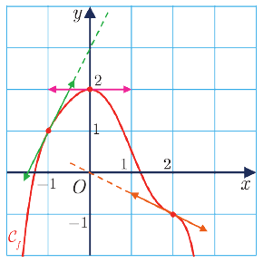

❶ عيّن كلاًّ من $f(0)$ و $f(2)$ و $f(-1)$ و $f'(0)$ و $f'(2)$ و $f'(-1)$.

❷ ما عدد حلول المعادلة $f(x)=0$؟ أعطِ عددين صحيحين متتاليين يحصران كلاًّ من حلول المعادلة $f(x)=0$.

③ فيما يأتي، احسب التابع المشتقّ للتابع $f$ مبيّناً المجموعة التي تحسب المشتقّ عليها.

1. $f(x)=\frac23x^3-\frac12x^2+x-\frac{\sqrt2}{3}$
2. $f(x)=\frac{x^2+3x-1}{4}$
3. $f(x)=x^4-2x\sqrt{x}$
4. $f(x)=\frac2{x+1}-x$
5. $f(x)=\frac{x-1}{x^2-4}$
6. $f(x)=\frac{x+1}{\sqrt{x}}$
7. $f(x)=x\cos x$
8. $f(x)=\frac{\sin x}{x}$
9. $f(x)=\frac{\sin x}{\cos x}$
10. $f(x)=\sin x\cos x$
11. $f(x)=\frac{\cos x}{\sin x-1}$
12. $f(x)=\frac{1+\sin x}{2+\cos x}$

### 3. تطبيقات الاشتقاق

#### 3.1. اطراد تابع اشتقاقي (تذكرة)

**مبرهنة 2**

ليكن $f$ تابعاً اشتقاقياً على مجال $I$، تابعه المشتقّ $f'$.

❶ إذا كان $f'$ موجباً تماماً على $I$ (باستثناء عدد منته من النقاط التي قد ينعدم عندها) كان $f$ متزايداً تماماً على $I$.

❷ إذا كان $f'$ سالباً تماماً على $I$ (باستثناء عدد منته من النقاط التي قد ينعدم عندها) كان $f$ متناقصاً تماماً على $I$.

❸ إذا كان $f'$ معدوماً على $I$ كان $f$ ثابتاً على $I$.

**ملاحظة:** في حالة تابع $g$، نصطلح أن نكتب «$g>0$ على $I$» دلالة على أن «$g(x)>0$ أيّاً كانت $x$ من $I$».

**صياغة مكافئة:** في نصّ المبرهنة السابقة، ما ورد في ❶ و ❷ يكافئ الآتي:

① إذا كان $f'\geq0$ على $I$، ولا ينعدم على أي مجال جزئي من $I$، كان $f$ متزايداً تماماً على $I$.

② إذا كان $f'\leq0$ على $I$، ولا ينعدم على أي مجال جزئي من $I$، كان $f$ متناقصاً تماماً على $I$.

#### 3.2. القيم الحدّية (تذكرة)

**تعريف 3**

ليكن $f$ تابعاً معرّفاً على مجال $I$ ولتكن $c$ نقطة من $I$. نقول إن القيمة $M=f(c)$ قيمة كبرى محلياً للتابع $f$ يبلغها عند النقطة $c$ إذا وُجد مجال مفتوح $J$ يضم النقطة $c$ ويحقّق الشرط

$$\forall x\in J\cap I,\quad f(x)\leq f(c)$$

ونعرّف بأسلوب مماثل، القيمة الصغرى محلياً لتابع $f$، إذ نقول إن القيمة $m=f(d)$ قيمة صغرى محلياً للتابع $f$ يبلغها عند النقطة $d$ من $I$، إذا وُجد مجال مفتوح $J$ يضم النقطة $d$ ويحقّق الشرط

$$\forall x\in J\cap I,\quad f(d)\leq f(x)$$

نقول إن القيمة $f(a)$ قيمة حدّية محلياً للتابع $f$ إذا كانت قيمة كبرى محلياً أو صغرى محلياً.

**مثال**

في الشكل المجاور، $f$ تابع اشتقاقي على المجال $I=[a,b]$، و $c$ و $d$ نقطتان من المجال $I$.

القيمتان $f(c)$ و $f(a)$ قيمتان صغريان محلياً. والقيمتان $f(b)$ و $f(d)$ قيمتان كبريان محلياً.

لاحظ كيف أن $A=f(a)=f(b)$ هي في آن معاً قيمة كبرى محلياً يبلغها التابع عند $b$، وقيمة صغرى محلياً يبلغها التابع عند $a$.

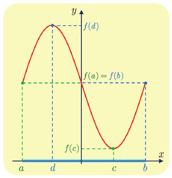

**مبرهنة 3**

ليكن $f$ تابعاً اشتقاقياً على مجال مفتوح $I$، ولتكن $c$ نقطة من $I$.

❶ إذا كانت $f(c)$ قيمة كبرى (أو صغرى) محلياً، كان $f'(c)=0$.

❷ إذا انعدم $f'$ عند $c$ وغيّر إشارته عندها، كانت $f(c)$ قيمة حدّية (كبرى أو صغرى) محلياً للتابع $f$.

إذن في شروط المبرهنة، إذا كانت $f(c)$ قيمة حدّية (كبرى أو صغرى)، كان المماس للخط البياني للتابع $f$ في النقطة $(c,f(c))$ أفقياً.

#### 3.3. حلّ المعادلات

**مبرهنة 4**

ليكن $f$ تابعاً اشتقاقياً على مجال $I=[a,b]$. لنفترض أن $f'\geq0$ على $I$، ولا ينعدم على أي مجال جزئي من $I$، عندئذٍ أيّاً كان $k$ من المجال $[f(a),f(b)]$، كان للمعادلة $f(x)=k$ حل وحيد في المجال $[a,b]$.

**الإثبات**

استناداً إلى فرضيات المبرهنة يكون $f$ مستمراً ومتزايداً تماماً على $I$، وهذه نتيجة من دراستنا في الوحدة السابقة.

لاحظ بالمثل أنه إذا كان $f'\leq0$ على $I$، ولا ينعدم على أي مجال جزئي من $I$، عندئذٍ أيّاً كان $k$ من المجال $[f(b),f(a)]$، كان للمعادلة $f(x)=k$ حل وحيد في المجال $[a,b]$. وكذلك يمكن أن نكتفي بافتراض $f$ مستمراً على المجال المغلق $[a,b]$ واشتقاقياً على $]a,b[$، ومشتقه لا يغيّر إشارته على هذا المجال.

#### تكريساً للفهم

**لماذا كان الشرط «$I$ مجال» ضرورياً في المبرهنة 2؟**

- على سبيل المثال، التابع $f$ المعرّف وفق $f(x)=-1$ عندما $x<0$ و $f(x)=1$ عندما $x>0$، اشتقاقي على $\mathbb R^*$، و $f'(x)=0$ أيّاً كانت $x$ من $\mathbb R^*$. ومع ذلك فإن $f$ ليس ثابتاً.

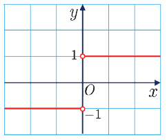

**لماذا لا يكون الشرط «$f'(c)=0$» شرطاً كافياً في المبرهنة 3؟**

- لأنّه، على سبيل المثال، التابع $f$ المعرّف وفق $f(x)=x^3$، يحقّق $f'(0)=0$. ومع ذلك فإن $f(0)$ ليست قيمة كبرى محلياً (ولا قيمة صغرى محلياً) للتابع. «لأن $f'$ لا يغيّر إشارته عند الصفر».

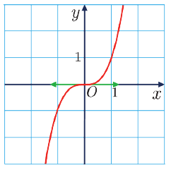

**كيف نحدد مواقع حلول معادلة $f(x)=0$؟**

- لإثبات أن المعادلة $f(x)=0$ تقبل حلاً وحيداً $\alpha$ في مجال $I$ (محدود أو غير محدود، مغلق أو مفتوح)، يكفي إثبات أن «$f$ مطّرد تماماً ويوجد عددان $a$ و $b$ في $I$ يجعلان $f(a)$ و $f(b)$ من إشارتين مختلفتين» أي «$f(a)\times f(b)<0$».

في الحقيقة، عندما يكون $f(a)\times f(b)<0$، يكون الصفر محصوراً تماماً بين $f(a)$ و $f(b)$، عندها وحسب المبرهنة 4، يوجد $\alpha$ محصوراً تماماً بين $a$ و $b$ ومحقّقاً $f(c)=0$. وهذا إثبات لوجود حلّ $\alpha$ للمعادلة $f(x)=0$. أمّا وحدانية الحل فهي بسبب الاطراد التام للتابع.

**مثال: دراسة التابع $f:x\mapsto\tan x$**

- **مجموعة التعريف:** تذكّر أن $\tan x=\frac{\sin x}{\cos x}$. إذن $\tan x$ غير معرّف عندما $\cos x=0$، أي في حالة $x=\frac\pi2+k\pi$ حيث $k\in\mathbb Z$. إذن

  $$D_f=\mathbb R\setminus\left\{\frac\pi2+k\pi:k\in\mathbb Z\right\}$$

- **مجموعة الدراسة:** أيّاً كانت $x$ من $D_f$، كان $-x$ من $D_f$ وكان

  $$f(-x)=\tan(-x)=\frac{\sin(-x)}{\cos(-x)}=-\tan x=-f(x)$$

  فالتابع $f$ فردي، فخطّه البياني $C_f$ في معلم متجانس متناظر بالنسبة إلى المبدأ $O$.

ومن جهة أخرى، أيّاً كانت $x$ من $D_f$، كان $x+\pi$ من $D_f$ و

$$f(x+\pi)=\tan(x+\pi)=\frac{\sin(x+\pi)}{\cos(x+\pi)}=\tan x=f(x).$$

فالتابع $f$ دوري، والعدد $\pi$ دور له. تكفي إذن دراسته على مجال طوله $\pi$، كالمجال $]-\frac\pi2,\frac\pi2[$، ثم ننتقل إلى المجال التالي بالانسحاب الذي شعاعه $\pi\vec i$ وإلى المجال السابق بالانسحاب الذي شعاعه $-\pi\vec i$. ولأن $f$ فردي، نكتفي بدراسته على المجال $[0,\frac\pi2[$ ونستكمل دراسته بالاستفادة من خواص التناظر المركزي والانسحاب.

- عند أطراف مجال الدراسة، التابع $f$ مستمرّ عند 0 و $f(0)=0$، وعندما تقترب $x$ من $\frac\pi2$ بقيم أصغر من $\frac\pi2$ يسعى $\cos x$ إلى الصفر بقيم موجبة. وعليه

  $$\lim_{x\to\frac\pi2,\,x<\frac\pi2}\tan x=\lim_{x\to\frac\pi2,\,x<\frac\pi2}\frac{\sin x}{\cos x}=+\infty$$

  فالمستقيم الذي معادلته $x=\frac\pi2$ مستقيم مقارب شاقولي للخطّ البياني للتابع $f$ على $[0,\frac\pi2[$.

- **الاطراد:** $f$ اشتقاقي على $D_f$ ولدينا $f'(x)=\frac1{\cos^2x}=1+\tan^2x$. إذن $f'>0$ على كلّ مجال من $D_f$، وعلى الخصوص التابع $f$ متزايد تماماً على $]-\frac\pi2,\frac\pi2[$.

- للتابع على مجال الدراسة $[0,\frac\pi2[$ جدول التغيّرات البسيط الآتي:

  | $x$ | $0$ |  | $\pi/2$ |
  | --- | --- | --- | --- |
  | $f'(x)$ |  | $+$ |  |
  | $f(x)$ | $0$ | ↗ | $+\infty$ |

- أمّا الخطّ البياني $C_f$ فهو مبيّن في الشكل الآتي:

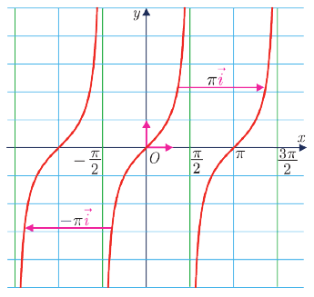

#### تدرّب

① ليكن $C$ الخطّ البياني للتابع $f$ المعرّف على $[-2,4]$ وفق $f(x)=\frac{ax+b}{x^2+1}$. عيّن $a$ و $b$ علماً بأن المستقيم $\Delta$ المرسوم في الشكل المجاور مماس للخطّ $C$ في النقطة $A$. تحقّق أن التابع الذي وجدته ينسجم مع مضمون النصّ.

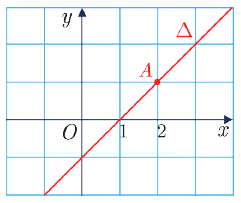

② في الشكل المجاور، $C$ هو الخط البياني لتابع $f$ معرّف على $\mathbb R$ واشتقاقي على $\mathbb R\setminus\{-1,1\}$. أيّ الخطوط البيانية المرسومة في الأشكال الآتية يمكن أن يمثّل الخطّ البياني للتابع المشتقّ $f'$؟

③ ليكن $f$ التابع المعرّف على $\mathbb R$ وفق $f(x)=x^3-x^2+ax$. عيّن العدد الحقيقي $a$ ليكون للتابع $f$ قيمة حدّية محلياً عند $x=1$.

④ ليكن $f$ التابع المعرّف على $\mathbb R\setminus\{1\}$ وفق $f(x)=\frac{ax^2+bx+1}{x-1}$، حيث $a$ و $b$ عددان حقيقيان. نهدف إلى البحث عن قيم $a$ و $b$ بحيث يتحقّق الشرطان الآتيان:

- $f(-1)$ قيمة حدّية محلياً للتابع.
- هذه القيمة الحدّية محلياً معدومة.

❶ لماذا $f'(-1)=0$ و $f(-1)=0$؟

❷ عيّن $a$ و $b$، ثم تحقّق أن التابع الذي حصلت عليه موافق لشروط المسألة.

⑤ ليكن $f$ التابع المعرّف على $\mathbb R$ وفق $f(x)=x^3-3x+5$.

❶ ادرس تغيّرات $f$ ونظّم جدولاً بها.

❷ تحقّق أن للمعادلة $f(x)=0$ جذراً وحيداً يقع بين $-3$ و $-2$. احصر هذا الجذر في مجال لا يزيد طوله على $10^{-1}$.

### 4. اشتقاق تابع مركّب

تسمح المبرهنة الآتية بحساب مشتقّ تابع $x\mapsto g(u(x))$ انطلاقاً من معرفة مشتقّ كلّ من $g$ و $u$.

**مبرهنة 5**

ليكن $g$ تابعاً اشتقاقياً على مجال $J$، وليكن $u$ تابعاً اشتقاقياً على مجال $I$، ولنفترض أنه أيّاً كان $x$ من $I$، انتمى $u(x)$ إلى $J$. عندئذٍ يكون التابع $f$ المعرّف وفق $f(x)=g(u(x))$ اشتقاقياً على $I$ وأيّاً كان $x$ من $I$، كان:

$$(g\circ u)'(x)=f'(x)=g'(u(x))\times u'(x)$$

لأن هذه الخاصّة موضعية فهي تبقى صحيحة حتى لو كان $I$ أو $J$ اجتماع مجالات.

**الإثبات (يُترك لقراءة ثانية)**

لتكن $a$ نقطة من $I$. نريد إثبات أن للتابع $t$ المعرّف على $I\setminus\{a\}$ وفق $t(x)=\frac{f(x)-f(a)}{x-a}$ نهاية تساوي العدد $g'(u(a))\times u'(a)$. لنضع $b=u(a)$، ولنلاحظ أنه بسبب كون $u$ اشتقاقياً عند $a$ وكون $g$ اشتقاقياً عند $b$ استنتجنا استمرار التابعين المعرّفين كما يأتي:

$$\alpha:I\to\mathbb R,\quad\alpha(x)=\begin{cases}\frac{u(x)-u(a)}{x-a},&x\ne a\\u'(a),&x=a\end{cases}$$

$$\beta:J\to\mathbb R,\quad\beta(x)=\begin{cases}\frac{g(x)-g(b)}{x-b},&x\ne b\\g'(b),&x=b\end{cases}$$

وهنا نلاحظ أنه في حالة $x$ من $I$ و $x\ne a$ لدينا

$$\beta(u(x))\alpha(x)=\frac{g(u(x))-g(u(a))}{x-a}=\frac{f(x)-f(a)}{x-a}$$

لما كان $\displaystyle\lim_{x\to a}\alpha(x)=u'(a)$ و $\displaystyle\lim_{x\to a}u(x)=b$ و $\displaystyle\lim_{x\to b}\beta(x)=g'(b)$ استنتجنا أن

$$\lim_{x\to a}\frac{f(x)-f(a)}{x-a}=g'(b)u'(a)$$

وهي النتيجة المطلوبة.

**مثال**

- إذا كان $f(x)=g(ax+b)$، كان $f'(x)=ag'(ax+b)$. هنا $u(x)=ax+b$.
- لحساب مشتقّ $f(x)=(3x^2-x)^4$ نضع $u(x)=3x^2-x$ و $g(x)=x^4$ فيكون $f=g\circ u$ ومن ثمّ:

  $$f'(x)=4(3x^2-x)^3\times(6x-1)=4(6x-1)(3x^2-x)^3$$

**مثال: حساب مشتقّات توابع مركّبة**

احسب التابع المشتق لكلّ من التوابع $f_1$ و $f_2$ و $f_3$ الآتية:

❶ $f_1(x)=\cos\left(2x+\frac\pi3\right)$

❷ $f_2(x)=\sin\left(\frac1x\right)$

❸ $f_3(x)=\cos(x^2)$

**الحل**

التوابع $f_1$ و $f_2$ و $f_3$ هي توابع مركّبة $g\circ u$. يتعلّق الأمر في كلّ حالة بمعرفة التابعين $g$ و $u$.

❶ $g_1(x)=\cos x$ و $u_1(x)=2x+\frac\pi3$. كلّ من هذين التابعين اشتقاقي على $\mathbb R$، فحسب المبرهنة 5 $f_1$ اشتقاقي على $\mathbb R$ ولما كان $g_1'(x)=-\sin x$ و $u_1'(x)=2$، استنتجنا:

$$f_1'(x)=g_1'(u_1(x))\times u_1'(x)=-\sin\left(2x+\frac\pi3\right)\times2=-2\sin\left(2x+\frac\pi3\right).$$

❷ $g_2(x)=\sin x$ و $u_2(x)=\frac1x$. $g_2$ اشتقاقي على $\mathbb R$ و $u_2$ اشتقاقي على $\mathbb R^*$. إذن $f_2$ اشتقاقي على $\mathbb R^*$. وأيّاً يكن $x$ من $\mathbb R^*$: $g_2'(x)=\cos x$ و $u_2'(x)=-\frac1{x^2}$، إذن أيّاً يكن $x$ من $\mathbb R^*$:

$$f_2'(x)=-\frac1{x^2}\cos\left(\frac1x\right).$$

❸ نجد بطريقة مماثلة لما سبق أن $f_3$ اشتقاقي على $\mathbb R$ وأن $f_3'(x)=-2x\sin(x^2)$.

**نتيجة 6**

إذا كان $u$ تابعاً موجباً تماماً واشتقاقياً على مجال $I$، كان التابع $f$ المعرّف على $I$ بالصيغة $f(x)=\sqrt{u(x)}$ اشتقاقياً على $I$، وأيّاً كان $x$ من $I$، كان $f'(x)=\frac{u'(x)}{2\sqrt{u(x)}}$.

**الإثبات**

نلاحظ أن $f(x)=g(u(x))$ حيث $g(x)=\sqrt{x}$. التابع $g$ اشتقاقي على $]0,+\infty[$، إذن $f$ اشتقاقي على $I$ لأن $u$ موجب تماماً واشتقاقي على $I$. وعليه أيّاً كان $x$ من $]0,+\infty[$، كان $f'(x)=g'(u(x))\times u'(x)$ حيث $g'(x)=\frac1{2\sqrt{x}}$، ومنه النتيجة المطلوبة.

**نتيجة 7**

ليكن $n$ عدداً صحيحاً لا يساوي الصفر، و ليكن $u$ تابعاً اشتقاقياً على مجال $I$، ولا ينعدم على $I$ في حالة $n<0$. عندئذٍ يكون التابع $f$ المعرّف وفق $f(x)=(u(x))^n$ اشتقاقياً على $I$ وأيّاً كان $x$ من $I$، كان

$$f'(x)=n(u(x))^{n-1}\times u'(x)$$

**الإثبات**

الإثبات متروك تمريناً للقارئ، ولكن نلاحظ أن صيغة المشتقّ هي ذاتها في حالتي $n>0$ و $n<0$، غير أنه في حالة $n<0$، علينا اشتراط أن $u(x)\ne0$ أيّاً يكن $x$ من $I$.

**مثال: تطبيق النتيجتين 6 و 7**

احسب التابع المشتقّ للتابع $f$ فيما يأتي:

❶ $f(x)=(x^2+3x+1)^3$

❷ $f(x)=\sqrt{x^2+2x+3}$

❸ $f(x)=\frac1{(x^2+x+1)^3}$

**الحل**

❶ يمكن أن نكتب $f(x)=(u(x))^3$ حيث $u(x)=x^2+3x+1$. التابع $u$ معرّف واشتقاقي على $\mathbb R$، إذن $f$ معرّف واشتقاقي على $\mathbb R$ ويعطى تابعه المشتقّ بالعلاقة

$$f'(x)=3(u(x))^2\times u'(x)=3(x^2+3x+1)^2\times(2x+3).$$

❷ يمكن أن نكتب $f(x)=\sqrt{u(x)}$ حيث $u(x)=x^2+2x+3$. التابع $f$ معرّف عندما يكون $u(x)\geq0$ واشتقاقي عندما يكون $u(x)>0$. وإذا درسنا إشارة ثلاثي الحدود $x^2+2x+3$ الذي مميّزه $(\Delta=-8<0)$ وجدناه موجباً تماماً على $\mathbb R$، إذن $f$ معرّف واشتقاقي على $\mathbb R$ ويعطى تابعه المشتقّ على $\mathbb R$ بالعلاقة:

$$f'(x)=\frac{u'(x)}{2\sqrt{u(x)}}=\frac{2x+2}{2\sqrt{x^2+2x+3}}=\frac{x+1}{\sqrt{x^2+2x+3}}.$$

❸ يمكن أن نكتب $f(x)=(u(x))^{-3}$ حيث $u(x)=x^2+x+1$. ولأن ثلاثي الحدود $x^2+x+1$ موجب تماماً على $\mathbb R$ واشتقاقي عليها، استنتجنا أن $f$ اشتقاقي على $\mathbb R$ ويعطى تابعه المشتقّ على $\mathbb R$ بالعلاقة

$$f'(x)=-3(u(x))^{-4}\times u'(x)=\frac{-3}{(x^2+x+1)^4}\times(2x+1)=\frac{-3(2x+1)}{(x^2+x+1)^4}.$$

#### تكريساً للفهم

**كيف نستفيد من المبرهنة 5 في دراسة اشتقاق التابع $f=g\circ u$؟**

- ليكن $f$ التابع المعرّف على المجال $[0,+\infty[$ وفق $f(x)=\cos\sqrt{x}$. بوضع $g(x)=\cos x$ و $u(x)=\sqrt{x}$، نرى أن $f=g\circ u$. التابع $g$ معرّف واشتقاقي على $\mathbb R$ والتابع $u$ معرّف على $[0,+\infty[$ واشتقاقي على $]0,+\infty[$.

إذن، استناداً إلى المبرهنة 5، يكون $f$ اشتقاقياً على $]0,+\infty[$، وعلى هذا المجال يكون:

$$f'(x)=(\cos u)'\times u'=-\sin u\times(\sqrt{x})'=-\frac{\sin\sqrt{x}}{2\sqrt{x}}$$

ولكن التابع $f$ معرّف عند 0 و $f(0)=1$ أيكون هذا التابع اشتقاقياً عند الصفر؟ لا تفيد المبرهنة 5 في الإجابة عن هذا السؤال. لذلك علينا العودة إلى تعريف العدد المشتقّ. فنبحث عن نهاية التابع $t$ المعرّف على $]0,+\infty[$ وفق $t(h)=\frac{f(h)-f(0)}{h-0}$ عندما تسعى $h$ إلى الصفر. لدينا

$$t(h)=\frac{\cos\sqrt h-1}{h}=-\frac{2\sin^2(\sqrt h/2)}h=-\frac12\left(\frac{\sin(\sqrt h/2)}{\sqrt h/2}\right)^2$$

ولأن $\displaystyle\lim_{h\to0}\frac{\sqrt h}2=0$ و $\displaystyle\lim_{X\to0}\frac{\sin X}X=1$ استنتجنا أن $\displaystyle\lim_{h\to0}t(h)=-\frac12$. فالتابع $f$ اشتقاقي أيضاً عند الصفر، و $f'(0)=-\frac12$.

**أيمكن للتابع $f$ المعرّف وفق $f(x)=\sqrt{u(x)}$، أن يقبل الاشتقاق عند $x_0$ تحقّق $u(x_0)=0$؟**

- نعم، لأن النتيجة 6 لا تنصّ على أن «$u(x_0)=0$» يقتضي «$f$ غير اشتقاقي عند $x_0$». فهذه النتيجة لا تجيب عن السؤال المطروح.

وعليه، لمعرفة ما إذا كان $f$ اشتقاقياً في $x_0$، علينا أن نعود إلى تعريف العدد المشتق في $x_0$. أي علينا أن ندرس نهاية التابع $t:x\mapsto\frac{f(x)-f(x_0)}{x-x_0}$ عند النقطة $x_0$.

**مثال**

ليكن $f(x)=\sqrt{x-1}$ في حالة $x$ من $[1,+\infty[$ وهنا $u(x)=x-1$ و $u(1)=0$ وفي حالة $x>1$ لدينا

$$t(x)=\frac{\sqrt{x-1}}{x-1}=\frac1{\sqrt{x-1}}$$

إذن $\displaystyle\lim_{x\to1,\,x>1}t(x)=+\infty$، فالتابع $f$ غير اشتقاقي عند 1.

**مثال**

ليكن $f(x)=\sqrt{(x-1)^4}$، أيّاً يكن $x$ من $\mathbb R$. هنا $u(x)=(x-1)^4$ و $u(1)=0$، وأيّاً يكن $x$ من $\mathbb R$، فلدينا $f(x)=(x-1)^2$. إذن $f$ اشتقاقي على $\mathbb R$ فهو اشتقاقي عند 1.

#### تدرّب

① في التمرينات الآتية، احسب مشتقّ $f$ على المجموعة $D$ المشار إليها في كلّ حالة.

❶ $D=\mathbb R$، $f(x)=(2x^3-1)^5$

❷ $D=\mathbb R\setminus\{-2\}$، $f(x)=\left(\frac{x+1}{x+2}\right)^3$

❸ $D=\mathbb R$، $f(x)=\sin\left(\frac x2-\frac\pi3\right)$

❹ $D=\mathbb R$، $f(x)=x\sqrt{x^2+1}$

❺ $D=\mathbb R$، $f(x)=\frac{x+1}{\sqrt{x^2+x+1}}$

❻ $D=\mathbb R\setminus[-1,2]$، $f(x)=\sqrt{\frac{x+1}{x-2}}$

❼ $D=[0,\frac\pi2[$، $f(x)=\sqrt{\cos x}$

❽ $D=[0,\frac\pi2[$، $f(x)=\frac{\sin^2x}{\cos^3x}$

❾ $D=[0,\frac\pi6[$، $f(x)=\tan(3x)$

❿ $D=[0,\frac\pi2[$، $f(x)=\tan^2x$

② في معلم متجانس $(O;\vec i,\vec j)$، $x^2+y^2=1$ هي معادلة للدائرة $C$ التي مركزها $O$ ونصف قطرها 1. وعليه فإن ربع الدائرة $C$ المرسوم في الشكل المرافق، هو الخط البياني للتابع $f$ المعرّف على المجال $[0,1]$ وفق $f(x)=\sqrt{1-x^2}$.

❶ احسب $f'(x)$ على المجال $[0,1[$.

❷ استنتج معادلة للمماس $T$ للدائرة $C$ في النقطة $A$ التي تساوي فاصلتها $\frac12$.

❸ تحقّق أن المستقيم $(OA)$ والمماس $T$ متعامدان.

③ في الشكل المرافق نجد الخط البياني $C$ للتابع $f$ المعرّف على $\mathbb R$ وفق $f(x)=\sqrt{x^2+1}$.

❶ تحقّق أن $f$ تابع زوجي.

❷ احسب نهاية $f$ عند $+\infty$ وعند $-\infty$.

❸ علّل كون المستقيم الذي معادلته $y=x$ مقارباً مائلاً للخطّ البياني $C$ في جوار $+\infty$؟

❹ ادرس تغيّرات $f$. هل من توافق بين نتائج الدراسة والنتائج التي تستخلصها من الخط البياني؟

### 5. المشتقّات من مراتب عليا

**تعريف 4**

ليكن $f$ تابعاً اشتقاقياً على مجال $I$. نسمي تابعه المشتقّ $f'$ التابع المشتقّ الأول (أو المشتقّ من المرتبة الأولى) للتابع $f$ ونرمز إليه أحياناً بالرمز $f^{(1)}$. وعندما يكون $f'$ اشتقاقياً على $I$، يُرمز إلى تابعه المشتقّ بالرمز $f''$ أو بالرمز $f^{(2)}$. يسمى $f''$ المشتقّ الثاني (أو المشتقّ من المرتبة الثانية) للتابع $f$. وهكذا، أيّاً يكن العدد الطبيعي $n\geq2$، نعرّف التابع المشتقّ من المرتبة $n$ بصفته التابع المشتقّ للتابع $f^{(n-1)}$. أي $f^{(n)}=(f^{(n-1)})'$.

**مثال**

ليكن $f$ التابع المعرّف على $\mathbb R\setminus\{1\}$ وفق الصيغة $f(x)=\frac1{1-x}$. عندئذٍ يعطى المشتقّ من المرتبة $n$ بالصيغة $f^{(n)}(x)=\frac{n!}{(1-x)^{n+1}}$ في حالة $x\ne1$.

**الحل**

سنعتمد أسلوب الإثبات بالتدريج، لتكن $E(n)$ الخاصّة الآتية:

«أيّاً كان $x$ من $\mathbb R\setminus\{1\}$ كان $f^{(n)}(x)=\frac{n!}{(1-x)^{n+1}}$»

- الخاصّة $E(1)$ صحيحة لأن

  $$f'(x)=\left(\frac1{1-x}\right)'=\frac{0\times(1-x)-1\times(1-x)'}{(1-x)^2}=\frac1{(1-x)^2}$$

  أو $f^{(1)}(x)=\frac{1!}{(1-x)^{1+1}}$.

- لنفترض إذن صحّة الخاصّة $E(n)$ أي أن $f^{(n)}(x)=\frac{n!}{(1-x)^{n+1}}$ أيّاً كانت $x\ne1$. عندها

  $$\begin{aligned}
  f^{(n+1)}(x)&=\left(\frac{n!}{(1-x)^{n+1}}\right)'=\frac{0\times(1-x)^{n+1}-n!\times((1-x)^{n+1})'}{((1-x)^{n+1})^2}\\
  &=\frac{0-n!\times(-(n+1))(1-x)^n}{(1-x)^{2n+2}}=\frac{(n+1)!}{(1-x)^{n+2}}
  \end{aligned}$$

وهذا يثبت صحّة الخاصّة $E(n+1)$. فنكون بذلك قد أثبتنا صحّة الخاصّة $E(n)$ أيّاً كانت $n$.

### أفكار يجب تمثّلها

- $f'(a)$ هو ميل المماس للخطّ البياني $C_f$ في النقطة $A(a,f(a))$.
- يمكن أن يكون للخطّ البياني $C_f$ مماس في النقطة $A(a,f(a))$ حتى لو لم يكن $f$ اشتقاقياً في $a$، على أن يكون $\displaystyle\lim_{x\to a}\frac{f(x)-f(a)}{x-a}=+\infty$ أو $\displaystyle\lim_{x\to a}\frac{f(x)-f(a)}{x-a}=-\infty$. وعندئذٍ يكون المماس شاقولياً.
- قد لا يكون تابع $f$ اشتقاقياً على كامل مجموعة تعريفه.

**مثال**

$x\mapsto\sqrt{x}$ معرّف على $[0,+\infty[$، لكنه غير اشتقاقي عند الصفر.

- **صيغة أساسية:** عندما $f(x)=g(u(x))$، يكون $f'(x)=g'(u(x))\times u'(x)$. وبوجه خاصّ

  $$\left(\frac1u\right)'=-\frac{u'}{u^2}\quad\text{و}\quad(\sqrt u)'=\frac{u'}{2\sqrt u}$$

- يمكن أن يكون التابع $x\mapsto g(u(x))$ اشتقاقياً في نقطة $a$ دون أن يستوفي شروط المبرهنة 5 أو النتيجة 6.

### منعكسات يجب امتلاكها

- إن تجد $f'(a)=0$، فكّر عندئذٍ بالمماس الأفقي. وبالعكس، إذا كان المماس في $A(a,f(a))$ أفقياً كان $f'(a)=0$.
- عند البحث عن قيم كبرى أو صغرى لتابع، فكّر بتنظيم جدول بتغيّراته.
- لإثبات أن للمعادلة $f(x)=0$ حلاً وحيداً في المجال $[a,b]$، فكّر بطريقة تقوم على إثبات أن $f$ مستمرّ ومطّرد تماماً على $[a,b]$ وأن $f(a)$ و $f(b)$ من إشارتين مختلفتين.
- عندما تصعب دراسة إشارة $f'(x)$، فكّر في دراسة تغيّرات تابع $g$ تكون إشارة $g(x)$ مماثلة لإشارة $f'(x)$.

**مثال**

إذا كان $f'(x)=(x^3-x^2+1)\times\sqrt{x}$، ادرس تغيّرات $g:x\mapsto x^3-x^2+1$.

- إذا أردت البحث عن إشارة $f'(x)$ في حالة $f(x)=\sqrt{u(x)}$، تذكّر أنه يكفي البحث عن إشارة $u'(x)$، لأن $f'(x)=\frac{u'(x)}{2\sqrt{u(x)}}$.

**مثال**

إذا كان $f(x)=\sqrt{x^2-4x+1}$، كانت إشارة $f'(x)$ مماثلة لإشارة $2x-4$.

- لمقارنة قيم $f$ و $g$ على مجال $I$، يمكن أن ندرس إشارة التابع $k=f-g$ ولتحقيق ذلك، قد نحتاج إلى دراسة تغيراته. تسمح معرفة إشارة $(f-g)$ بتحديد الوضع النسبي للخطين البيانيين $C_f$ و $C_g$. وبوجه خاص، تفيد معرفة إشارة $f(x)-((x-a)f'(a)+f(a))$ بتحديد الوضع النسبي للخط البياني $C_f$ ومماسه في النقطة $A(a,f(a))$.
- لمعرفة قابلية الاشتقاق في $a$ لتابع $f$ مستمر في $a$، فكر في دراسة $\displaystyle\lim_{x\to a}\frac{f(x)-f(a)}{x-a}$.

### أخطاء يجب تجنّبها

- إن مشتق التابع $x\mapsto f(ax+b)$ هو $x\mapsto af'(ax+b)$ فلا تنس المقدار «$a$».
- إذا كان $P(x)=g(a)f(x)$، أُعطي مشتق $P$ بالعلاقة $P'(x)=g(a)f'(x)$ وليس بالعلاقة $P'(x)=g(a)f'(x)+g'(a)f(x)$. لأن $g(a)$ عدد، وليس تابعاً للمتحول $x$.
- في صيغة مشتق $x\mapsto g(u(x))$، لا تنس الحد $u'(x)$.
- القضية «إذا كان $f=g$، كان $f'=g'$» صحيحة، لكن القضية «إذا كان $f>g$، كان $f'>g'$» خطأ في الحالة العامة.

### أنشطة

#### نشاط 1: دراسة تابع، التوابع المساعدة

##### 1. دراسة تابع

في الحالة العامة، المقصود بدراسة تابع $f$ هو تعيين مجموعة تعريفه $D_f$، وحساب نهاياته عند أطراف المجالات المكونة لمجموعة تعريفه والبحث عن مقاربات خطه البياني $C_f$، ودراسة تغيراته، وأخيراً رسم خطه البياني. وأحياناً، نكتشف بسهولة أن $f$ زوجي، أو فردي، أو دوري، مما يفيد في جعل دراسة التابع تقتصر على مجموعة جزئية من $D_f$ ثم تمدد الدراسة، إلى كامل $D_f$ مستفيدين من طبيعة الخاصة التي يتمتع بها التابع.

##### 2. دراسة تابع كسري

لنتأمل التابع الكسري $f$ المعرف على $]-1,+\infty[$ وفق الصيغة $f(x)=\dfrac{1-x}{x^3+1}$. لقد رسمنا باستعمال برنامج متخصص الخط البياني $C$ للتابع $f$ في معلم متجانس $(O,\vec i,\vec j)$.

ستسمح الدراسة الآتية بتعرف صفات $f$ ومن ثم توضيح كيفية الوصول إلى رسم خطه البياني $C$ دون استعمال أي برنامج وخصوصاً سير الخط البياني على المجال $[0,1]$. في الحقيقة، لا يعطي الخط المرسوم باستعمال الحاسوب دائماً، جميع المعلومات المتعلقة بالتابع، لكنه يزودنا بتصور مفيد جداً عن تلك المعلومات.

1. احسب $f'(x)$ على المجال $]-1,+\infty[$ وتحقق أن إشارة $f'(x)$ تماثل إشارة $2x^3-3x^2-1$.

في حالة تعذر تعيين إشارة $f'(x)$ جبرياً، ندرس تغيرات تابع مساعد $g$ نستنتج منه الإشارة المطلوبة.

2. نرمز بالرمز $g$ إلى التابع المعرف على $]-1,+\infty[$ وفق $g(x)=2x^3-3x^2-1$.
   - a. ادرس تغيرات $g$.
   - b. أثبت أن المعادلة $g(x)=0$ تقبل حلاً وحيداً $\alpha$ على $]-1,+\infty[$، وأن $\alpha$ ينتمي إلى المجال $[1.6,1.7]$.
   - c. استنتج إشارة $g(x)$.
3. بالاستفادة من النتائج السابقة، نظم جدولاً بتغيرات $f$.
4. اكتب معادلة للمماس $\Delta$ للخط البياني $C$ في النقطة $A$ منه التي تساوي فاصلتها $0$. وادرس الوضع النسبي للخط $C$ ومماسه $\Delta$ على المجال $]-1,1]$.
5. أثبت أن الخط $C$ يقع فوق المستقيم $d$ مماسه في النقطة التي تساوي فاصلتها $1$.
6. ارسم $\Delta$ و $d$ ثم ارسم $C$.

#### نشاط 2: مماس شاقولي

##### 1. الحالة العامة

لنتأمل تابعاً $f$ مستمراً عند نقطة $a$ تنتمي إلى أحد مجالات $D_f$. إذا كان

$$\lim_{x\to a}\frac{f(x)-f(a)}{x-a}=+\infty \quad \text{أو} \quad \lim_{x\to a}\frac{f(x)-f(a)}{x-a}=-\infty$$

قبل الخط البياني $C_f$ للتابع $f$، في معلم متجانس مماساً شاقولياً في النقطة $A(a,f(a))$. هندسياً، يفسر الشرطان «$f$ مستمر عند $a$ و $\displaystyle\lim_{x\to a}\frac{f(x)-f(a)}{x-a}=\pm\infty$» بأن ميل القاطع للخط $C_f$ في النقطة $A(a,f(a))$ يسعى إلى $+\infty$ (أو $-\infty$)، أي إن القاطع يسعى إلى المستقيم الذي معادلته $x=a$.

##### 2. حالة التابع $f:x\mapsto\sqrt{x}$

تعلم أن $f$ مستمر عند الصفر، لكنه غير اشتقاقي عند الصفر. أثبت أن محور التراتيب مماس لخطه البياني في مبدأ المعلم.

##### 3. دراسة التابع $f:x\mapsto x\sqrt{x(2-x)}$

1. a. تحقق أن $f$ معرف على المجال $[0,2]$.

   b. أثبت أن $f$ اشتقاقي على $]0,2[$ واحسب $f'(x)$ على هذا المجال.
2. ما نهاية $\dfrac{f(x)}{x}$ عندما تسعى $x$ إلى الصفر؟ استنتج أن $f$ اشتقاقي عند الصفر.
3. ما نهاية $\dfrac{f(x)-f(2)}{x-2}$ عندما تسعى $x$ إلى $2$؟ هل $f$ اشتقاقي عند $x=2$؟
4. نرمز إلى الخط البياني للتابع $f$، في معلم متجانس $(O,\vec i,\vec j)$، بالرمز $C$.
   - a. ادرس تغيرات $f$ ونظم جدولاً بها.
   - b. عين مماسي $C$ في النقطتين $A(0,0)$ و $B(2,0)$.
   - c. ارسم مماسي $C$ في $A$ و $B$ ثم ارسم $C$.

#### نشاط 3: دراسة تابع مثلثاتي

##### 1. كيف ندرس تابعاً مثلثاتياً؟

تذكر

- التابعان $\sin$ و $\cos$ دوريان ويساوي الدور الأصغر لكل منهما $2\pi$. لأن:

  $$\sin(x+2\pi)=\sin x \quad \text{و} \quad \cos(x+2\pi)=\cos x$$

- التابع $\tan$ دوري ويساوي دوره الأصغر $\pi$. لأن:

  $$\tan(x+\pi)=\tan x \quad \text{حيث} \quad x\ne\frac{\pi}{2}+k\pi \quad \text{و} \quad k\in\mathbb Z$$

- التابعان $x\mapsto\sin(ax+b)$ و $x\mapsto\cos(ax+b)$ والدور الأصغر لكل منهما هو $\dfrac{2\pi}{|a|}$.

غالباً، ما تفيد الصفات الخاصة بالتوابع المثلثاتية في استنتاج مجال دراسة تابع $f$ معرف على $D_f$:

- إذا كان $T$ دوراً للتابع $f$، كان $T$ موجباً تماماً، وأياً كان العدد الحقيقي $x$، إذا كان $x\in D_f$ كان $x+T\in D_f$ و $f(x+T)=f(x)$.

  في هذه الحالة يمكن أن ندرس التابع على مجال طوله $T$.
- إذا كان $f$ زوجياً أو فردياً، يكفي أن ندرسه على $[0,\frac T2]\cap D_f$، ثم:
  - إذا كان $f$ زوجياً، أعطى التناظر المحوري بالنسبة إلى محور التراتيب الخط البياني على $[-\frac T2,0]\cap D_f$.
  - وإذا كان $f$ فردياً، أعطى التناظر بالنسبة إلى المبدأ $O$ الخط البياني على $[-\frac T2,0]\cap D_f$.
- بعدئذ، يسمح الانسحابان اللذان شعاعاهما $T\vec i$ و $-T\vec i$ بالحصول على الخط البياني على مجالات أخرى.

وخلاف ذلك، تجري دراسة التوابع المثلثاتية بمثل دراسة التوابع الأخرى.

##### 2. دراسة التابع $x\mapsto 2\sin x+\sin 2x$

لنتأمل التابع $f$ المعرف على $\mathbb R$ وفق $f(x)=2\sin x+\sin 2x$.

1. تحقق أن $f$ دوري وأن $2\pi$ دور له. ادرس الصفة الزوجية أو الفردية للتابع $f$. استنتج إمكانية دراسة $f$ على المجال $[0,\pi]$.
2. أثبت أنه، في حالة عدد حقيقي $x$ لدينا $f'(x)=2(2\cos x-1)(\cos x+1)$.
3. ادرس تغيرات $f$ على المجال $[0,\pi]$.

**مساعدة:** ستحتاج إلى حل المتراجحة $\cos x>\frac12$. لهذا، يمكن استعمال الدائرة المثلثاتية، أو الخط البياني للتابع $x\mapsto\cos x$ على المجال $[0,\pi]$. وكذا الأمر عند دراسة إشارة $\cos x+1$.

4. ارسم الخط البياني للتابع $f$ على المجال $[0,\pi]$، ثم على المجال $[-2\pi,2\pi]$.

#### نشاط 4: نهايات ومشتقات

##### 1. المبدأ

ليكن $g$ تابعاً ما، وليكن $f$ تابعاً يحقق عند كل $x$ من مجال مفتوح يحوي $a$ و $x\ne a$ العلاقة

$$f(x)=\frac{g(x)-g(a)}{x-a}$$

ثم لنفترض إضافة إلى ذلك أن التابع $g$ اشتقاقي عند $a$، عندئذ يقبل $f$ نهاية عند $a$ ويكون

$$\lim_{x\to a}f(x)=g'(a).$$

إذن، لإزالة حالة عدم التعيين من الصيغة «$\frac00$» لتابع $f$ عند نقطة $a$، يمكن أن نحاول كتابة $f$ بالشكل $f(x)=\dfrac{g(x)-g(a)}{x-a}$ حيث $g$ اشتقاقي عند $a$. عندئذ يكون $\displaystyle\lim_{x\to a}f(x)=g'(a)$.

##### 2. تطبيقات

1. ليكن $f$ التابع المعرف بالعلاقة $f(x)=\dfrac{\sqrt{x+4}-2}{x}$. يقودنا البحث عن نهاية $f$ عند الصفر إلى إحدى صيغ عدم التعيين. ضع $g(x)=\sqrt{x+4}$ لكي تتمكن من حساب نهاية $f$ عند الصفر. ثم احسب هذه النهاية.
2. ننوي دراسة نهاية التابع $f:x\mapsto\dfrac{\cos x}{x-\frac\pi2}$ عند $\dfrac\pi2$.
   - a. تحقق أن الحساب المباشر يقود إلى صيغة عدم تعيين.
   - b. لاحظ أن $\cos\dfrac\pi2=0$، واستنتج أن نهاية $f$ عند $\dfrac\pi2$ تساوي العدد المشتق للتابع $x\mapsto\cos x$ عند $\dfrac\pi2$، ماذا تساوي هذه النهاية؟
3. ادرس، في كل من الحالتين الآتيتين، نهاية التابع $f$ في النقطة التي يشار إليها.
   - a. $f(x)=\dfrac{\tan x-1}{x-\frac\pi4}$ عند $x=\dfrac\pi4$.
   - b. $f(x)=\dfrac{\sqrt{x^2+1}-\sqrt2}{x-1}$ عند $x=1$.

#### نشاط 5: الاشتقاق من اليمين ومن اليسار

##### 1. حالة عامة: تعريف نصف المماس

عندما يكون التابع $f$ مستمراً على مجال يحوي $a$، ويقبل التابع $x\mapsto\dfrac{f(x)-f(a)}{x-a}$ نهاية $\ell$ من اليمين عند $a$، نقول عندئذ إن التابع $f$ **اشتقاقي من اليمين** عند $a$، ونسمي $\ell$ العدد المشتق من اليمين للتابع $f$ في $a$، ونرمز إليه بالرمز $f'(a^+)$. نعرف بأسلوب مماثل **الاشتقاق من اليسار** عند $a$ ونرمز إلى العدد المشتق من اليسار بالرمز $f'(a^-)$ في حال وجوده.

في حال وجود $f'(a^+)$ و $f'(a^-)$ نقول إن الخط البياني $C_f$ للتابع $f$ يقبل في النقطة $A(a,f(a))$ نصف مماس من اليمين ونصف مماس من اليسار. ويكون $f'(a^+)$ ميل نصف المماس من اليمين، و $f'(a^-)$ ميل نصف المماس من اليسار.

##### 2. دراسة مثال

ليكن $f$ التابع المعرف على $\mathbb R$ وفق $f(x)=\dfrac{x+2}{|x|+1}$.

1. ادرس قابلية اشتقاق $f$ عند الصفر من اليمين، ثم اكتب معادلة لنصف المماس من اليمين لخطه البياني $C_f$ في النقطة $A(0,2)$.
2. ادرس قابلية اشتقاق $f$ عند الصفر من اليسار، ثم اكتب معادلة لنصف المماس من اليسار لخطه البياني في النقطة $A(0,2)$.
3. ارسم نصفي المماسين السابقين وارسم $C_f$ على المجال $[-2,2]$.

#### نشاط 6: تأطير (حصر) توابع مثلثاتية

##### 1. تمهيد

لنتأمل تابعين $f$ و $g$ معرفين واشتقاقيين على المجال $D=[0,+\infty[$. ولنفترض أن $f'(x)\le g'(x)$ أياً يكن $x$ من $D$.

بدراسة التابع $h$ المعرف على $D$ وفق $h(x)=f(x)-f(0)-g(x)+g(0)$ أثبت أن:

$$f(x)-f(0)\le g(x)-g(0) \qquad (*)$$

##### 2. حصر $\sin x$ و $\cos x$

1. a. أثبت أن $\sin x\le x$، أياً يكن $x\ge 0$.

   b. باختيار $f(x)=-\cos x$، و $g(x)=\dfrac{x^2}{2}$ برهن مستفيداً من التمهيد أنه في حالة $x\in\mathbb R$

   $$1-\frac{x^2}{2}\le\cos x\le1 \qquad (\Delta)$$
2. a. أثبت أن $x-\dfrac{x^3}{6}\le\sin x\le x$، أياً يكن $x\ge0$.

   b. وأن $1-\dfrac{x^2}{2}\le\cos x\le1-\dfrac{x^2}{2}+\dfrac{x^4}{24}$، أياً يكن $x\in\mathbb R$.

   c. وأخيراً بين أن $x-\dfrac{x^3}{6}\le\sin x\le x-\dfrac{x^3}{6}+\dfrac{x^5}{120}$، أياً يكن $x\ge0$.

##### 3. تطبيقات

1. استنتج مما سبق أن العدد $1-\dfrac{x^2}{2}$ تقريب للعدد $\cos x$ بخطأ لا يتجاوز $\dfrac{x^4}{24}$. ما الخطأ الذي نرتكبه عندما نكتب $\cos(0.1)=0.995$؟
2. احسب نهاية $\dfrac{\cos x-1}{x^2}$ عندما يسعى المتحول $x$ إلى الصفر.
3. احسب نهاية $\dfrac{x-\sin x}{x^3}$ عندما يسعى المتحول $x$ إلى الصفر.

### تمرينات ومسائل

#### 1

اكتب معادلة للمماس للخط البياني للتابع المعطى $f$ في النقطة التي فاصلتها $a$.

1. $f(x)=x^3+x^2-3x$، $a=0$.
2. $f(x)=x\sqrt{x}$، $a=1$.
3. $f(x)=\dfrac{x}{x^2+1}$، $a=0$.
4. $f(x)=\dfrac{x}{x-1}$، $a=0$.
5. $f(x)=\cos x$، $a=0$.
6. $f(x)=x\cos x$، $a=\dfrac\pi4$.

#### 2

ليكن $C$ الخط البياني للتابع $f$ المعرف على $\mathbb R\setminus\{-1\}$ وفق $f(x)=\dfrac{x^2-3x+1}{x+1}$.

1. اكتب معادلة لمماس $C$ في النقطة التي تساوي فاصلتها $1$.
2. هل يقبل $C$ مماساً موازياً للمستقيم الذي معادلته $y=-4x$؟
3. هل يقبل $C$ مماساً موازياً للمستقيم الذي معادلته $3x-2y=0$؟

#### 3

ليكن $C$ الخط البياني للتابع $f$ المعرف على $\mathbb R$ وفق $f(x)=\dfrac{x}{x^2+2}$.

1. أعط معادلة لمماس $C$ في النقطة التي تساوي فاصلتها $1$.
2. هل يقبل $C$ مماساً موازياً للمستقيم الذي معادلته $y=-\dfrac14x$؟
3. هل يقبل $C$ مماساً موازياً للمستقيم الذي معادلته $4x-y=0$؟

#### 4

ليكن $f$ التابع المعرف على $\mathbb R$ وفق $f(x)=x^3-3x+1$.

1. ادرس تغيرات $f$ ونظم جدولاً بها.
2. تحقق أن للمعادلة $f(x)=0$ ثلاثة جذور. واحصر كلاً منها في مجال لا يزيد طوله على $10^{-1}$. 

هنا نجد رمزاً جديداً:  يعني هذا الرمز أن استعمال الآلة الحاسبة أو الحاسوب مسموح، ولكن ليس ضرورياً.

#### 5

ليكن $f$ هو التابع المعرف على $\mathbb R$ وفق $f(x)=x^3-x^2-x+\dfrac12$.

1. ادرس تغيرات $f$ ونظم جدولاً بها.
2. ما عدد حلول المعادلة $f(x)=0$؟
3. احصر كلاً منها في مجال لا يزيد طوله على $10^{-1}$. 

#### 6

ليكن $f$ هو التابع المعرف على $\mathbb R$ وفق $f(x)=3x^4+4x^3-12x^2+4$.

1. ادرس تغيرات $f$ ونظم جدولاً بها.
2. ما عدد حلول المعادلة $f(x)=0$؟
3. احصر كلاً منها في مجال لا يزيد طوله على $10^{-1}$. 

#### 7

في كل حالة من الحالات الآتية، احسب المشتقات من المراتب 1 و 2 و 3 للتابع $f$ المعرف بالعلاقة المشار إليها. وحدد في كل حالة المجموعة التي تحسب عليها المشتق.

1. $f(x)=x^3-\dfrac12x^2+x-1$.
2. $f(x)=x\sqrt{x}$.
3. $f(x)=\dfrac1{x-1}$.
4. $f(x)=\cos(2x)+\sin(2x)$.
5. $f(x)=\dfrac1{\cos x}$.
6. $f(x)=\dfrac1{\sin x}$.

#### 8

ليكن $f$ التابع المعرف على $\mathbb R$ وفق $f(x)=x+\sqrt{1+x^2}$.

1. تحقق أن $\sqrt{1+x^2}\cdot f'(x)=f(x)$، أياً يكن $x$ من $\mathbb R$.
2. استنتج أن $(1+x^2)f''(x)+xf'(x)-f(x)=0$، أياً يكن $x$ من $\mathbb R$.

#### 9

في كل من الحالات الآتية، ادرس قابلية التابع $f$ للاشتقاق عند الصفر.

1. $f(x)=x^2\sqrt{x}$.
2. $f(x)=x|x|$.
3. $f(x)=\dfrac{x^2+|x|}{x^2+1}$.

#### 10

التابع $f$ معرف على $\mathbb R$ وفق $f(0)=0$ و $f(x)=x^2\cos\left(\dfrac1x\right)$ في حالة $x\ne0$.

1. هل $f$ اشتقاقي عند الصفر؟ علل إجابتك.
2. احسب $f'(x)$ على $\mathbb R^*$.

### لنتعلّم البحث معاً

#### 11. محل هندسي

في معلم متجانس $(O;\vec i,\vec j)$، $M$ هي النقطة التي إحداثيتاها $(m,0)$ حيث $0\le m\le3$، و $N$ هي النقطة التي إحداثيتاها $(0,n)$ حيث $n\ge0$، النقطتان $M$ و $N$ تحققان $MN=3$. وأخيراً $J$ هي نقطة من القطعة المستقيمة $[MN]$ تحقق $MJ=2$. نهدف إلى تعيين المحل الهندسي $\mathcal L$ للنقطة $J$ عندما تتحول $m$ في المجال $[0,3]$، ورسمه.

**نحو الحلّ**

هذه مسألة في دراسة المحل الهندسي تحليلياً. سنسعى بداية إلى حساب $(x,y)$ إحداثيتي النقطة $J$ بدلالة $m$. يمكن التفكير بمبرهنة تالس، لكن يبدو الأمر أيسر باستعمال الأشعة.

1. أثبت أن $3\overrightarrow{OJ}=\overrightarrow{OM}+2\overrightarrow{ON}$.
2. أثبت أن $n=\sqrt{9-m^2}$. واستنتج $(x,y)$ إحداثيتي النقطة $J$ بدلالة $m$.

للحصول على معادلة للمحل الهندسي $\mathcal L$ للنقطة $J$، نبحث عن علاقة بين الإحداثيتين $x$ و $y$ للنقطة $J$ مستقلة عن الوسيط $m$. أثبت أن $y=2\sqrt{1-x^2}$، عندها تنتمي $J$ إلى الخط البياني $C$ للتابع $f$ المعرف على المجال $[0,1]$ وفق $f(x)=2\sqrt{1-x^2}$.

يبقى أن نجيب عن السؤال: أترسم $J$ الخط البياني $C$ كاملاً عندما تتحول $m$ على المجال $[0,3]$؟

1. لماذا تنتمي $x$ إلى المجال $[0,1]$؟
2. ما هو إذن المحل الهندسي للنقطة $J$؟
3. ادرس تغيرات $f$ وادرس قابلية اشتقاقه عند $1$. وأخيراً ارسم $\mathcal L$.

أنجز الحل واكتبه بلغة سليمة.

#### 12. توابع ومجموعات نقطية

في معلم متجانس $(O;\vec i,\vec j)$، نرمز بالرمز $\mathcal E$ إلى مجموعة النقاط $M(x,y)$ التي تحقق:

$$x^2-2x+4y^2=3 \qquad (*)$$

نهدف إلى إثبات أن المجموعة $\mathcal E$ هي اجتماع خطين بيانيين $C_1$ و $C_2$ لتابعين $f_1$ و $f_2$ ومن ثم رسم $\mathcal E$.

**نحو الحلّ**

**بحثاً عن طريق.** يتعلق الأمر بإثبات أن المجموعة $\mathcal E$ من النقاط $M(x,y)$ تساوي $C_1\cup C_2$. يجب إذن إثبات أن القول «تنتمي $M$ إلى $\mathcal E$» يكافئ «تنتمي $M$ إلى $C_1\cup C_2$» أو «تنتمي $M$ إلى $C_1$ أو إلى $C_2$»، حيث $C_1$ و $C_2$ هما خطان بيانيان لتابعين $f_1$ و $f_2$ فتكون معادلتاهما $y=f_1(x)$ و $y=f_2(x)$.

يتعلق الأمر إذن بإيجاد تابعين $f_1$ و $f_2$ تكون معهما المقولتان الآتيتان متكافئتين:

- «إحداثيتا $M$ تحققان $x^2-2x+4y^2=3$»
- «إحداثيتا $M$ تحققان $y=f_1(x)$ أو $y=f_2(x)$».

1. تحقق أن العلاقة $(*)$ تكافئ $y^2=\dfrac{-x^2+2x+3}{4}$.
2. تعلم أن «$y^2=a$» تكافئ «$y=\sqrt a$ أو $y=-\sqrt a$» فقط عندما يكون $a\ge0$. ما قيم $x$ التي تحقق $-x^2+2x+3\ge0$؟

تبقى دراسة تغيرات $f_1$ و $f_2$، ثم رسم خطيهما البيانيين $C_1$ و $C_2$. نرمز بالرمز $f_1$ إلى التابع المعرف على $[-1,3]$ وفق $f_1(x)=\dfrac{\sqrt{-x^2+2x+3}}2$.

1. أثبت أن $f_1$ اشتقاقي على $]-1,3[$. احسب $f'_1(x)$ على $]-1,3[$.
2. ادرس قابلية $f_1$ للاشتقاق عند $-1$ وعند $3$. ثم نظم جدولاً بتغيرات $f_1$. وارسم $C_1$.

يمكن، لكي نرسم $C_2$، أن ندرس تغيرات $f_2$. ولكن هنا، لدينا: $f_2(x)=-f_1(x)$، أياً تكن $x$ من $[-1,3]$. وفق أي تحويل هندسي يكون $C_2$ صورة $C_1$؟ ارسم $C_2$.

أنجز الحل واكتبه بلغة سليمة.

#### 13. متراجحة هويغنز Huygens

نهدف إلى إثبات صحة المتراجحة $2\sin x+\tan x\ge3x$ أياً يكن $x$ من المجال $I=[0,\frac\pi2[$.

**نحو الحلّ**

يبدو حل هذه المتراجحة مثلثاتياً شبه مستحيل. لذا نلجأ إلى دراسة التابع $f$ المعرف على $I$ وفق $f(x)=2\sin x+\tan x-3x$. تحقق أن إشارة $f'(x)$ على المجال $I$ تماثل إشارة $2\cos^3x-3\cos^2x+1$.

يمكنك أن تضع $\cos x=t$، ثم تدرس إشارة كثير الحدود $P(t)=2t^3-3t^2+1$ مع $t$ من $]0,1]$. ادرس تغيرات $P$ على المجال $]0,1]$، وتحقق أن $P$ موجب على هذا المجال.

أنجز الحل واكتبه بلغة سليمة.

### قدماً إلى الأمام

#### 14

التابع $f$ معرف على المجال $[0,1[$ وفق $f(x)=\sqrt{\dfrac{x^3}{1-x}}$.

1. هل $f$ اشتقاقي عند الصفر؟
2. احسب $f'(x)$ على $]0,1[$.

#### 15

نتأمل التابع $f$ المعرف على $\mathbb R\setminus\{1\}$ وفق $f(x)=\dfrac{x^2+1}{x-1}$.

1. احسب التابع المشتق للتابع $f$.
2. استنتج مشتق كل من التوابع الآتية:
   1. $g:x\mapsto\dfrac{x+1}{\sqrt{x}-1}$.
   2. $h:x\mapsto\dfrac{x^4+1}{x^2-1}$.
   3. $\ell:x\mapsto\sqrt{\dfrac{x^2+1}{x-1}}$.
   4. $k:x\mapsto\dfrac{\sin^2x+1}{\sin x-1}$.

#### 16

فيما يأتي، أوجد التابع المشتق للتابع $f$ محدداً المجموعة التي تنجز عليها الاشتقاق.

1. $f(x)=\cos^2 3x$.
2. $f(x)=\sin^3 2x$.
3. $f(x)=\dfrac1{\sin^2 3x}$.
4. $f(x)=\dfrac1{\cos^3 2x}$.

#### 17

ليكن التابع $f$ المعرف على $\mathbb R\setminus\{1\}$ وفق $f(x)=\dfrac{2x+3}{x-1}$.

1. عين التابع المشتق $f'$ للتابع $f$.
2. نرمز بالرمز $g$ إلى التابع المعرف على $I=]-\frac\pi2,\frac\pi2[$ وفق $g(x)=f(\sin x)$. أثبت أن $g$ اشتقاقي على $I$ ثم احسب $g'(x)$ على $I$.
3. نرمز بالرمز $h$ إلى التابع المعرف على $J=]1,+\infty[$ وفق $h(x)=f(\sqrt x)$. أثبت أن $h$ اشتقاقي على $J$ ثم احسب $h'(x)$ على $J$.

#### 18

$a$ و $b$ عددان حقيقيان، و $C$ هو الخط البياني للتابع $f$ المعرف على $\mathbb R$ وفق:

$$f(x)=ax^3+bx^2+1$$

هل يمكن تعيين $a$ و $b$ لكي يقبل $C$ مماساً أفقياً في النقطة $A(1,2)$ منه؟

#### 19

$a$ و $b$ عددان حقيقيان، $C$ هو الخط البياني للتابع $f$ المعرف على $\mathbb R$ وفق:

$$f(x)=\frac{3x^3+ax+b}{x^2+1}$$

عين $a$ و $b$ لتكون $y=4x+3$ معادلة للمماس للخط $C$ في النقطة التي فاصلتها $0$ منه؟

#### 20

$a$ عدد حقيقي، و $f$ هو التابع المعرف على $\mathbb R$ وفق $f(x)=ax^3+3x^2+3x$. هل يمكن تعيين $a$ ليكون للتابع $f$ قيمة حدية محلية عند $x=1$؟

#### 21

$f$ هو تابع معرف على $\mathbb R$ واشتقاقي عليها. إضافة إلى ذلك نفترض أن:

- $f(0)=0$ و $f'(0)=1$.
- $f'$ متزايد على المجال $[0,+\infty[$ ومتناقص على المجال $]-\infty,0]$.

ارسم خطاً بيانياً $C$ يمكن أن يمثل التابع $f$.

#### 22

في كل من الحالات الآتية، احسب في حال وجودها نهاية التابع $f$ عند $a$ المشار إليها.

1. $f(x)=\dfrac{\cos x-1}{x}$، $a=0$.
2. $f(x)=\dfrac{\tan x}{x}$، $a=0$.
3. $f(x)=\dfrac{\sqrt{x+1}-\sqrt2}{x-1}$، $a=1$.
4. $f(x)=\dfrac{\sqrt{x^2+x+2}-2}{x-1}$، $a=1$.

#### 23

في كل من الحالات الآتية، أوجد عدد حلول المعادلة، ثم احسب قيمة تقريبية لكل جذر بحيث لا يتعدى الخطأ في الحساب $10^{-1}$. 

1. $x^5-x^3+x-5=0$.
2. $x(2x+1)^2=5$.
3. $x^4-\dfrac12x+1=0$.
4. $\dfrac15x^5-\dfrac13x^3+1=0$.

#### 24

ليكن $f$ التابع المعرف على المجال $[1,+\infty[$ وفق $f(x)=x+\sqrt{x-1}-4$.

1. ادرس تغيرات التابع $f$. أثبت أن المعادلة $f(x)=0$ تقبل حلاً وحيداً يطلب حساب قيمة تقريبية لهذا الحل على ألا يتعدى الخطأ في الحساب $10^{-1}$. 
2. احسب جبرياً القيمة الحقيقية لذلك الجذر.

#### 25

ليكن $f$ التابع المعرف على المجال $I=]1,+\infty[$ وفق $f(x)=\dfrac1{x-1}-\sqrt x$.

1. ادرس تغيرات $f$ على $I$.
2. استنتج أن للمعادلة $f(x)=0$ جذراً وحيداً $\alpha$ يقع في المجال $]1,2[$.
3. احسب قيمة تقريبية لهذا الجذر على ألا يتعدى الخطأ في الحساب $10^{-1}$. 

#### 26

في معلم متجانس $(O;\vec i,\vec j)$، ليكن $C$ هو الخط البياني للتابع $f$ المعرف على $\mathbb R$ وفق:

$$f(x)=\frac{x^2+x}{x^2+x+3}$$

1. ادرس تغيرات $f$ وارسم خطه البياني $C$.
2. نريد تعيين المماسات للخط البياني $C$ المارة بالمبدأ، (غير المماس في المبدأ).
   - a. ليكن $a$ عدداً حقيقياً. اكتب معادلة للمماس $T_a$ الذي يمس $C$ في النقطة $A(a,f(a))$.
   - b. فكر في أن $T_a$ يكون أحد المماسات المطلوبة عندما يمر بالمبدأ. ثم جد معادلة لكل مماس للخط البياني $C$ يمر بالمبدأ.

#### 27

في معلم متجانس $(O;\vec i,\vec j)$، $C$ هو الخط البياني للتابع $f$ المعرف على $\mathbb R\setminus\{-1\}$ وفق:

$$f(x)=\frac{2x^2+x+7}{x+1}$$

1. أوجد نهاية $f$ عند $+\infty$ وعند $-\infty$.
2. أثبت أن المستقيم $d$ الذي معادلته $y=2x-1$ مقارب مائل للخط $C$.
3. ادرس نهاية $f$ عند $-1$. ماذا تستنتج فيما يتعلق بالخط $C$؟
4. ادرس تغيرات $f$ ونظم جدولاً بها.
5. أثبت أن النقطة $I(-1;-3)$ هي مركز تناظر للخط $C$.
6. ارسم مقاربات $C$ ثم ارسم $C$.

#### 28

في معلم متجانس $(O;\vec i,\vec j)$، $C$ هو الخط البياني للتابع $f$ المعرف على $\mathbb R\setminus\{1\}$ وفق:

$$f(x)=\frac{x^3-3x^2+10x-11}{(x-1)^2}$$

1. أوجد نهايات $f$ عند حدود مجموعة تعريفه، ثم ادرس تغيرات $f$ ونظم جدولاً بها.
2. أثبت أن المستقيم $d$ الذي معادلته $y=x-1$ مقارب مائل للخط $C$.
3. ادرس الوضع النسبي للخطين $d$ و $C$، ثم ارسم كلاً من $d$ و $C$.
4. حدد هندسياً عدد حلول المعادلة $x^3-(m+3)x^2+(2m+10)x-11-m=0$.

#### 29

في معلم متجانس $(O;\vec i,\vec j)$، $C$ هو الخط البياني للتابع $f$ المعرف على $\mathbb R$ وفق:

$$f(x)=x-\sqrt{x^2+8}$$

1. احسب نهاية $f$ عند $-\infty$ وعند $+\infty$. هل يقبل $C$ مقارباً أفقياً؟
2. تحقق أن المستقيم $d$ الذي معادلته $y=2x$ مقارب للخط $C$.
3. نظم جدولاً بتغيرات $f$.
4. ارسم مقاربات $C$ ثم ارسم $C$.

#### 30. دراسة تابع مثلثاتي

ليكن $f$ التابع المعرف على $\mathbb R$ وفق $f(x)=3\sin^2 x+4\cos^3 x$.

1. قارن كلاً من $f(-x)$ و $f(x+2\pi)$ مع $f(x)$. استنتج أنه تكفي دراسة $f$ على $[0,\pi]$.
2. أثبت أن $f'(x)=6\cos x\times\sin x(1-2\cos x)$، عند كل عدد حقيقي $x$.
3. ادرس تغيرات $f$ على $[0,\pi]$.
4. ارسم الخط البياني للتابع $f$ على $[-2\pi,2\pi]$.

#### 31. دراسة تابع مثلثاتي

ليكن $f$ التابع المعرف على $\mathbb R$ وفق $f(x)=4\sin^3 x+3\cos x$.

1. أثبت أن $f(x+2\pi)=f(x)$، أياً يكن العدد الحقيقي $x$.
2. تحقق أن $f'(x)=3\sin x(2\sin 2x-1)$، أياً يكن العدد الحقيقي $x$.
3. ادرس $f$ على مجال طوله $2\pi$، وارسم خطه البياني على المجال $[-2\pi,2\pi]$.

#### 32

ليكن $f$ التابع المعرف على المجال $I=[0,\frac\pi2[$ وفق $f(x)=4x-\tan^2 x$.

1. احسب التابع المشتق $f'(x)$. ضع $\tan x=t$ وتحقق أن

   $$f'(x)=2(1-t)(t^2+t+2)$$
2. استنتج جدولاً بتغيرات $f$ على المجال $I$.
3. أثبت أن للمعادلة $f(x)=-1$، في المجال $I$ جذراً وحيداً $\alpha$.

#### 33

ليكن $f$ التابع المعرف على $\mathbb R$ وفق $f(x)=x\cos x$.

1. احسب عند كل $x$ من $\mathbb R$، $f'(x)$ و $f''(x)$ و $f'''(x)$.
2. أثبت، مستخدماً البرهان بالتدريج، أن مهما تكن $n\ge1$ فلدينا:

   $$f^{(n)}(x)=x\cos\left(x+\frac{n\pi}{2}\right)+n\cos\left(x+(n-1)\times\frac\pi2\right)$$

   أياً يكن $x$ من $\mathbb R$.

#### 34

ليكن $f$ التابع المعرف على $\mathbb R\setminus\{-1,1\}$ وفق $f(x)=\dfrac{2x}{x^2-1}$.

1. أوجد عددين حقيقيين $a$ و $b$ يحققان $f(x)=\dfrac a{x-1}+\dfrac b{x+1}$، على $\mathbb R\setminus\{-1,1\}$.
2. بالاستفادة مما سبق، أوجد عبارة $f^{(n)}(x)$ في حالة $n\ge1$ و $x$ من $\mathbb R\setminus\{-1,1\}$.

#### 35. إيجاد تابع

نفترض وجود تابع $f$ معرف على $\mathbb R$ واشتقاقي عليها، ويحقق $f(0)=0$ و $f'(x)=\dfrac1{1+x^2}$ عند كل $x$ من $\mathbb R$.

وليكن $C$ خطه البياني في معلم متجانس (لن نبحث عن عبارة $f(x)$).

1. ليكن $g$ التابع المعرف على $\mathbb R$ وفق $g(x)=f(x)+f(-x)$.
   - a. تحقق أن $g$ اشتقاقي على $\mathbb R$. واحسب $g'(x)$.
   - b. احسب $g(0)$ واستنتج أن التابع $f$ فردي.
2. ليكن $h$ التابع المعرف على $I=]0,+\infty[$ وفق $h(x)=f(x)+f\left(\dfrac1x\right)$.
   - a. تحقق من أن $h$ اشتقاقي على $I$، واحسب $h'(x)$ على $I$.
   - b. أثبت أن $h(x)=2f(1)$، أياً يكن $x$ من $I$.
   - c. استنتج أن نهاية التابع $f$ عند $+\infty$ تساوي $2f(1)$.
   - d. ماذا تستنتج بشأن الخط البياني $C$؟
3. ليكن $k$ التابع المعرف على $J=]-\dfrac\pi2,\dfrac\pi2[$ وفق $k(x)=f(\tan x)-x$.
   - a. احسب $k'(x)$. ماذا تستنتج بشأن التابع $k$؟
   - b. احسب $f(1)$.
   - c. نظم جدولاً بتغيرات $f$ على $\mathbb R$.
   - d. ارسم المستقيمات المقاربة للخط البياني $C$ وارسم مماساته في النقاط التي فواصلها $-1$ و $0$ و $1$، ثم ارسم $C$.

## 4. نهاية متتالية

1. نهاية متتالية: تذكرة
2. مبرهنات تخص النهايات
3. تقارب المتتاليات المطّردة
4. متتاليات متجاورة

عندما تشرب القهوة وأنت تُجري حساباتك على الآلة الحاسبة، يمكن أن تقع معك أشياء غريبة. عندما انسكب الفنجان على الآلة الحاسبة تعطلت تماماً باستثناء بعض الأزرار التي بقيت تعمل، وها أنا أضع أمامكم في الشكل المجاور الوظائف المتبقية.

واجهتني المعضلة الآتية، الزر الذي يعطي العدد الشهير $\pi$ معطل فما العمل؟

1. ضغطت على `2` ثم `+` ثم `2` ثم `cos` وأخيراً `=` فظهر الجواب المبين جانباً: `1.583853163452857613`.
2. ظهر عدد فيه الكثير من الخانات فاغتنمت الفرصة وضغطت على `+` ثم `cos` ثم `=` فظهر الجواب المبين جانباً: `1.570796697782126794`.
3. ولِمَ لا أكرر الأمر ذاته مجدداً: `+` ثم `cos` ثم `=`: `1.570796326794896619`.
4. هناك خانات لم تعد تتغير وهذا مثير للاهتمام فلم لا أكرر الأمر ذاته مجدداً: `+` ثم `cos` ثم `=`: `1.570796326794896619`.

ويا للمفاجأة، لم يعد يتغير العدد الظاهر على الشاشة، ولكن أيذكركم هذا العدد بشيء؟

لم نستعمل زر الضرب فما رأيكم أن نضرب هذا الناتج الأخير بالعدد اثنان: `×` ثم `2` ثم `=`! `3.141592653589793238`

وها هو العدد $\pi$ بثماني عشرة خانة بعد الفاصلة. أليست الرياضيات جميلة؟

**ملاحظة:** في آلتي الحاسبة، على عطلها، عند الضغط على مفتاح تابع تحسب مباشرة قيمة العدد المعلن على شاشتها.

### 1. نهاية متتالية: تذكرة

#### 1.1. حالة نهاية منتهية (أو حقيقية)

**تعريف 1**

نقول إن عدداً حقيقياً $\ell$ هو نهاية للمتتالية $(u_n)_{n\ge0}$ إذا ضم كل مجال مفتوح مركزه $\ell$ جميع حدود المتتالية بدءاً من دليل معين (أو باستثناء عدد منته منها).

نكتب في مثل هذه الحالة $\displaystyle\lim_{n\to\infty}u_n=\ell$، ونقول إن المتتالية متقاربة أو إنها تتقارب من $\ell$.

تذكر أن المتتاليات $(u_n)_{n\ge1}$ التي حدها العام $u_n$ معطى بإحدى الصيغ الآتية

$$u_n=\frac1{\sqrt n},\quad u_n=\frac1n,\quad u_n=\frac1{n^2},\quad u_n=\frac1{n^3},$$

هي جميعها **متتاليات مرجعية**، وتسعى إلى الصفر عندما تسعى $n$ إلى $+\infty$: $\displaystyle\lim_{n\to\infty}u_n=0$.

#### 1.2. حالة النهاية اللانهائية

**تعريف 2**

نقول إن المتتالية $(u_n)_{n\ge0}$ تسعى إلى $+\infty$ إذا ضم كل مجال من النمط $]A,+\infty[$ جميع حدود المتتالية بدءاً من دليل معين (أو باستثناء عدد منته منها).

نكتب في مثل هذه الحالة $\displaystyle\lim_{n\to\infty}u_n=+\infty$، ونقول إن المتتالية تتباعد إلى $+\infty$.

تؤدي المتتاليات $(u_n)_{n\ge1}$ التي حدها العام $u_n$ معطى بإحدى الصيغ الآتية

$$u_n=\sqrt n,\quad u_n=n,\quad u_n=n^2,\quad u_n=n^3,$$

أيضاً دور **متتاليات مرجعية**، وهي تتباعد إلى $+\infty$ عندما تسعى $n$ إلى $+\infty$: $\displaystyle\lim_{n\to\infty}u_n=+\infty$.

**تعريف 3**

نقول إن المتتالية $(u_n)_{n\ge0}$ تسعى إلى $-\infty$ إذا ضم كل مجال من النمط $]-\infty,A[$ جميع حدود المتتالية بدءاً من دليل معين (أو باستثناء عدد منته منها).

نكتب في مثل هذه الحالة $\displaystyle\lim_{n\to\infty}u_n=-\infty$، ونقول إن المتتالية تتباعد إلى $-\infty$.

#### 1.3. حالة المتتالية الهندسية

**مبرهنة 1**

ليكن $q$ عدداً حقيقياً.

- في حالة $-1<q<1$، يكون $\displaystyle\lim_{n\to\infty}q^n=0$.
- في حالة $1<q$، يكون $\displaystyle\lim_{n\to\infty}q^n=+\infty$.
- في حالة $q\le-1$، ليس للمتتالية نهاية.
- في حالة $q=1$، تكون المتتالية $(q^n)_{n\ge0}$ ثابتة وجميع حدودها تساوي $1$، و $\displaystyle\lim_{n\to\infty}q^n=1$.

**مثال**

- المتتالية الهندسية المعرفة وفق $u_n=\left(\dfrac45\right)^n$ متقاربة من الصفر. لأن $-1<\dfrac45<1$.
- المتتالية الهندسية المعرفة وفق $u_n=\left(\dfrac54\right)^n$ متباعدة نحو $+\infty$. لأن $\dfrac54>1$.

**مثال: بدءاً من دليل ما**

تسعى المتتالية $(u_n)_{n\ge0}$ المعرفة، وفق

$$u_n=\frac{3n-1}{n+1}$$

إلى $3$. عين عدداً طبيعياً $n_0$ يحقق الشرط: إذا كان $n>n_0$، كان $u_n\in]2.99,3.01[$.

**الحل**

انتماء $u_n$ إلى المجال $]2.99,3.01[$ يعني أن $-0.01<u_n-3<0.01$، أو $|u_n-3|<0.01$، ولكن $u_n-3=\dfrac{-4}{n+1}$ إذن الشرط المطلوب هو $\dfrac4{n+1}<\dfrac1{100}$ وهذا يكافئ: $400<n+1$ (علل) أو $n>399$. ينتج من ذلك أننا يمكن أن نختار $n_0=399$، أو أي عدد أكبر من $399$. فالمجال $]2.99,3.01[$ يحوي جميع حدود المتتالية $(u_n)_{n\ge0}$ بدءاً من الحد ذي الدليل $400$.

بوجه عام تنتمي $u_n$ إلى المجال $I_\alpha=]3-\alpha,3+\alpha[$ حيث $(\alpha>0)$ إذا تحقق الشرط:

$$\left|\frac{3n-1}{n+1}-3\right|<\alpha$$

أي $n+1>\dfrac4\alpha$، فإذا كان $n_0$ أي عدد طبيعي أكبر أو يساوي $\dfrac4\alpha$ انتمى $u_n$ إلى $I_\alpha$ أياً كانت $n>n_0$.

**مثال: إثبات تقارب متتالية**

المتتالية $(u_n)_{n\ge1}$ معرفة وفق $u_n=1-\dfrac12-\dfrac14-\dfrac18-\cdots-\dfrac1{2^n}$. أثبت أن $(u_n)_{n\ge0}$ متقاربة. واحسب نهايتها.

**الحل**

لاحظ أن

$$u_n=1-\left(\frac12+\left(\frac12\right)^2+\left(\frac12\right)^3+\cdots+\left(\frac12\right)^n\right)$$

إن مضمون القوسين هو مجموع $n$ حداً متتالياً لمتتالية هندسية، كل من حدها الأول وأساسها يساوي $\dfrac12$. ومن المعلوم أن هذا المجموع يساوي

$$u_1\times\frac{1-q^n}{1-q}=\frac12\times\frac{1-\left(\frac12\right)^n}{1-\frac12}=1-\left(\frac12\right)^n$$

إذن، $u_n=\left(\dfrac12\right)^n$. وهذه متتالية هندسية أساسها $q=\dfrac12$ يحقق $|q|<1$ فهي متقاربة وتسعى إلى الصفر.

**فكّر**

في الحقيقة، يمكننا أيضاً أن نلاحظ ما يأتي

$$\begin{aligned}
u_{n+1}&=1-\frac12-\frac14-\frac18-\cdots-\frac1{2^n}-\frac1{2^{n+1}}\\
&=\frac12-\frac14-\frac18-\cdots-\frac1{2^n}-\frac1{2^{n+1}}\\
&=\frac12\left(1-\frac12-\frac14-\cdots-\frac1{2^{n-1}}-\frac1{2^n}\right)=\frac12u_n
\end{aligned}$$

فالمتتالية $(u_n)_{n\ge1}$ متتالية هندسية أساسها $\dfrac12$ وهي من ثم تسعى إلى الصفر.

#### تكريساً للفهم

**لماذا إذا تقاربت متتالية $(u_n)_{n\ge0}$ ذات حدود موجبة، كانت نهايتها عدداً موجباً؟**

(تذكر كلمة موجبة تعني أكبر أو تساوي الصفر: فعندما نقول $a$ موجب أو أكبر من الصفر نقصد المتراجحة $a\ge0$. أما إذا أردنا $a>0$، فعندها نقول إن $a$ موجب تماماً أو أكبر تماماً من الصفر.)

لنفكر بأسلوب نقض الفرض. لنفترض أن $u_n\ge0$، أياً يكن $n$، وأن $(u_n)_{n\ge0}$ تتقارب من عدد سالب تماماً $\ell$. نختار عندئذ مجالاً مفتوحاً مركزه $\ell$ لا ينتمي إليه الصفر. إن هذا المجال لن يحوي أي حد من حدود المتتالية، وهذا غير ممكن لأن ذلك يناقض تعريف نهاية متتالية. فلا يمكن إذن أن تكون نهاية $(u_n)_{n\ge0}$ عدداً سالباً تماماً.

يمكن لمتتالية جميع حدودها موجبة تماماً أن تساوي نهايتها الصفر. على سبيل المثال، المتتالية $(u_n)_{n\ge1}$ المعرفة وفق $u_n=\dfrac1n$.

**كيف يجري الربط بين نهاية متتالية ونهاية تابع عند $+\infty$؟**

التماثل بين التعريفين واضح، لأن المتتاليات حالات خاصة من التوابع. فمثلاً $\displaystyle\lim_{x\to\infty}f(x)=+\infty$ تعني أنه أياً كان العدد الحقيقي المعطى $M$ تحققت المتراجحة $f(x)>M$ بدءاً من قيمة $A$ للمتحول $x$ (أي عندما $x>A$). وكذلك الأمر $\displaystyle\lim_{n\to\infty}u_n=+\infty$ تعني أنه أياً كان العدد الحقيقي المعطى $M$ تحققت المتراجحة $u_n>M$ بدءاً من قيمة للدليل $n_0$ (أي عندما $n>n_0$).

#### تدرّب

1. المتتالية $(u_n)_{n\ge1}$ معرفة وفق $u_n=\dfrac1{n\sqrt n}$. نعلم أن $\displaystyle\lim_{n\to\infty}u_n=0$. جد عدداً طبيعياً $n_0$ يحقق $u_n\in]-10^{-3},10^{-3}[$ عند كل $n>n_0$.
2. المتتالية $(u_n)_{n\ge2}$ معرفة وفق $u_n=\dfrac{3n+1}{n-1}$ وتساوي نهايتها $3$. جد عدداً طبيعياً $n_0$ يجعل $u_n\in]2.98,3.02[$ عند كل $n$ أكبر تماماً من $n_0$.
3. المتتالية $(u_n)_{n\ge1}$ معرفة وفق $u_n=n\sqrt n$. نعلم أن $\displaystyle\lim_{n\to\infty}u_n=+\infty$. جد عدداً طبيعياً $n_0$ يجعل $u_n>10^6$ عند كل $n$ أكبر تماماً من $n_0$.
4. احسب نهاية كل من المتتاليتين $(x_n)_{n\ge0}$ و $(y_n)_{n\ge0}$ حيث $x_n=\dfrac{3^n}{2^n}$ و $y_n=\dfrac{10^n}{(10.1)^n}$.
5. ليكن $-1<q<1$، ولنعرف المتتالية $(u_n)_{n\ge0}$ بالعلاقة $u_n=1+q+q^2+\cdots+q^n$. أعط صيغة أخرى تفيد في حساب $u_n$ واستنتج قيمة $S=\displaystyle\lim_{n\to\infty}u_n$.
6. نتأمل المتتاليتين $(x_n)_{n\ge0}$ و $(y_n)_{n\ge0}$ المعرفتين وفق:

   $$x_0=3,\quad x_{n+1}=\frac13x_n-2 \qquad \text{و} \qquad y_n=x_n+3.$$

   1. a. أثبت أن المتتالية $(y_n)_{n\ge0}$ هندسية.

      b. احسب $y_n$ ثم $x_n$ بدلالة $n$.
   2. نضع $S_n=y_0+\cdots+y_n$ و $S'_n=x_0+\cdots+x_n$.

      a. احسب كلاً من $S_n$ و $S'_n$ بدلالة $n$.

      b. استنتج نهاية كل من المتتاليتين $(S_n)_{n\ge0}$ و $(S'_n)_{n\ge0}$.
7. نتأمل متتالية $(u_n)_{n\ge0}$، معرفة وفق العلاقة التدريجية $u_{n+1}=au_n+b$ و $u_0=s$.

   1. نفترض أن $a=1$، تيقن أن $(u_n)_{n\ge0}$ متتالية حسابية في هذه الحالة، واحسب $u_n$ بدلالة $n$ و $b$ و $s$ في هذه الحالة.
   2. هنا نفترض أن $a\ne1$. ونضع $\ell$ الحل الوحيد للمعادلة $x=ax+b$.
      - a. نعرف $(t_n)_{n\ge0}$ بالعلاقة $t_n=u_n-\ell$. برهن أن $(t_n)_{n\ge0}$ متتالية هندسية.
      - b. استنتج صيغة $t_n$ بدلالة $n$ و $b$ و $a$ و $s$ في هذه الحالة.
      - c. برهن أنه في حالة $-1<a<1$ تتقارب المتتالية $(u_n)_{n\ge0}$، واحسب نهايتها بدلالة $b$ و $a$.

### 2. مبرهنات تخص النهايات

#### 2.1. متتاليات من النمط $u_n=f(n)$

**مبرهنة 2**

ليكن $f$ تابعاً معرفاً على مجال من النمط $]b,+\infty[$ ولتكن $(u_n)_{n\ge n_0}$ متتالية معرفة بدءاً من دليل معين $n_0$ بالصيغة $u_n=f(n)$. عندئذ إذا كان $\displaystyle\lim_{x\to+\infty}f(x)=\ell$، كان أيضاً $\displaystyle\lim_{n\to+\infty}u_n=\ell$. حيث يدل $\ell$ على عدد حقيقي، أو على $+\infty$، أو على $-\infty$.

**مثال: دراسة نهاية متتالية**

ادرس نهاية المتتالية $(u_n)_{n\ge1}$ المعرفة بالعلاقة $u_n=\dfrac{2n^2+5n+1}{n^2+n}$.

**الحل**

بالاستفادة من قواعد العمليات على النهايات، لدينا حالة عدم تعيين من الصيغة «$\dfrac{+\infty}{+\infty}$». ولكن $u_n=f(n)$ حيث

$$f(x)=\frac{2x^2+5x+1}{x^2+x}$$

ولأن $\displaystyle\lim_{x\to+\infty}f(x)=2$، استنتجنا $\displaystyle\lim_{n\to+\infty}u_n=2$.

#### 2.2. متتاليات من النمط $u_n=f(v_n)$

**مبرهنة 3**

ليكن $f$ تابعاً معرفاً على مجال $I$ ولتكن $(v_n)_{n\ge0}$ متتالية تنتمي جميع حدودها إلى $I$. إذا كان $\displaystyle\lim_{n\to+\infty}v_n=b$ و $\displaystyle\lim_{x\to b}f(x)=c$، كان $\displaystyle\lim_{n\to+\infty}f(v_n)=c$. حيث يمثل كل من الرمزين $b$ و $c$ عدداً حقيقياً، أو $+\infty$، أو $-\infty$.

تماثل هذه المبرهنة مثيلتها المتعلقة بمركب تابعين، ولهما الإثبات نفسه، فقط هنا، نركب متتالية مع تابع.

**مثال**

المتتالية $(u_n)_{n\ge1}$ المعرفة وفق $u_n=\sqrt{\dfrac{3n+2}{n+1}}$ متقاربة وتساوي نهايتها $\sqrt3$. لأنه من الواضح أن $u_n=\sqrt{v_n}$ حيث $v_n=\dfrac{3n+2}{n+1}$. ولأن $\displaystyle\lim_{n\to+\infty}\dfrac{3n+2}{n+1}=3$ و $\displaystyle\lim_{x\to3}\sqrt x=\sqrt3$، استنتجنا $\displaystyle\lim_{n\to+\infty}u_n=\sqrt3$.

#### 2.3. العمليات على النهايات ومبرهنات الإحاطة

تبقى المبرهنات على نهايات التوابع عندما يسعى المتحول إلى $+\infty$ سارية في حالة المتتاليات. وخصوصاً نهاية مجموع متتاليتين ونهاية جدائهما ونهاية خارج قسمتهما. وهنا نعيد القارئ إلى ما درسناه في الوحدة الأولى. وفيما يتعلق بالمقارنة، نستعرض المبرهنات الآتية:

**مبرهنة 4**

لنتأمل ثلاث متتاليات $(u_n)_{n\ge1}$ و $(v_n)_{n\ge1}$ و $(w_n)_{n\ge1}$. إذا تحقق الشرطان

- $w_n\le u_n\le v_n$ عند كل $n$ أكبر من عدد $n_0$.
- يوجد عدد حقيقي $\ell$ يحقق $\displaystyle\lim_{n\to+\infty}v_n=\lim_{n\to+\infty}w_n=\ell$.

استنتجنا أن $\displaystyle\lim_{n\to+\infty}u_n=\ell$.

**مبرهنة 5**

لنتأمل متتاليتين $(u_n)_{n\ge1}$ و $(e_n)_{n\ge1}$ وعدداً حقيقياً $\ell$. إذا تحقق الشرطان

- $|u_n-\ell|\le e_n$ عند كل $n$ أكبر من عدد $n_0$.
- $\displaystyle\lim_{n\to+\infty}e_n=0$.

كان $\displaystyle\lim_{n\to+\infty}u_n=\ell$.

**مبرهنة 6**

لنتأمل متتاليتين $(u_n)_{n\ge1}$ و $(v_n)_{n\ge1}$، ولنفترض أن $u_n\le v_n$ عند كل $n$ أكبر من $n_0$. عندئذ

- إذا كان $\displaystyle\lim_{n\to+\infty}u_n=+\infty$ استنتجنا أن $\displaystyle\lim_{n\to+\infty}v_n=+\infty$.
- وإذا كان $\displaystyle\lim_{n\to+\infty}v_n=-\infty$ استنتجنا أن $\displaystyle\lim_{n\to+\infty}u_n=-\infty$.

**مثال**

المتتالية $(u_n)_{n\ge1}$ المعرفة وفق $u_n=\dfrac{\sin n}{n+1}$ متقاربة ونهايتها تساوي الصفر. في الحقيقة، نعلم أن $|\sin n|\le1$ أياً يكن $n$، إذن $|u_n-0|\le\dfrac1{n+1}$. ولأن $\displaystyle\lim_{n\to+\infty}\dfrac1{n+1}=0$، استنتجنا أن $\displaystyle\lim_{n\to+\infty}u_n=0$، وذلك اعتماداً على المبرهنة 5.

**مثال: دراسة حالة عدم تعيين من الصيغة «$+\infty-\infty$»**

ادرس نهاية المتتالية $(u_n)_{n\ge1}$ المعرفة بالعلاقة $u_n=n-\sqrt n$.

**الحل**

لما كان $\displaystyle\lim_{n\to+\infty}n=+\infty$ و $\displaystyle\lim_{n\to+\infty}\sqrt n=+\infty$، وجدنا أنفسنا أمام حالة عدم تعيين من الصيغة «$+\infty-\infty$». في مثل هذه الحالة نتذكر ما كنا نفعله في حالة التوابع من إخراج الحد المسيطر خارج قوسين فنكتب $u_n=n\left(1-\dfrac1{\sqrt n}\right)$. ولما كان $\displaystyle\lim_{n\to+\infty}\dfrac1{\sqrt n}=0$، استنتجنا أن $\displaystyle\lim_{n\to+\infty}u_n=+\infty$.

**فكّر**

يمكننا أيضاً أن نلاحظ أن $n\ge2\sqrt n$ في حالة $n\ge4$، إذن $u_n\ge\sqrt n$ عندما $n\ge4$، ولأن $\displaystyle\lim_{n\to+\infty}\sqrt n=+\infty$ استنتجنا أن $\displaystyle\lim_{n\to+\infty}u_n=+\infty$ عملاً بالمبرهنة 6.

#### تكريساً للفهم

**تطبيق: حالة المتتاليات $u_{n+1}=f(u_n)$**

عندما يكون $\displaystyle\lim_{n\to+\infty}u_n=\ell$، ويكون التابع $f$ مستمراً عند $\ell$ (أي $\displaystyle\lim_{x\to\ell}f(x)=f(\ell)$) عندئذ تفيد المبرهنة 3، بتأكيد أن $\displaystyle\lim_{n\to+\infty}f(u_n)=f(\ell)$. من جهة أخرى، تتقارب المتتالية $(u_{n+1})_{n\ge0}$ من $\ell$. (إذ حدودها هي حدود المتتالية $(u_n)_{n\ge0}$ ذاتها باستثناء $u_0$). ولكن مهما كان العدد الطبيعي $n$ فلدينا $u_{n+1}=f(u_n)$، أي المتتاليتان $(f(u_n))_{n\ge0}$ و $(u_{n+1})_{n\ge0}$ متساويتان، فتكون نهايتاهما متساويتين أيضاً، أي إن $\ell=f(\ell)$.

وهكذا، إذا كانت للمتتالية $(u_n)_{n\ge0}$ نهاية حقيقية $\ell$، وإذا كان $f$ مستمراً عند $\ell$، كان $\ell=f(\ell)$ مما يعني أيضاً أن $\ell$ هو حل للمعادلة $x=f(x)$.

**كيف نتصرف عندما نتعرض لحالة من حالات صيغ عدم التعيين؟**

ليس ثمة قواعد عامة. لكننا سنعرض، في الأمثلة والتمرينات، بعضاً من المهارات التي يمكن أن تكون مفيدة عندما يتعذر حساب النهاية مباشرة بالاعتماد على قواعد العمليات على النهايات.

- عندما يكون $u_n$ معرفاً بدلالة $n$، $u_n=f(n)$، و $f$ تابع مألوف: كثير حدود، كسري،...، يمكن أن ندرس نهاية $f$ عند $+\infty$، عندئذ،

  $$\text{إذا كان }\lim_{x\to+\infty}f(x)=\ell\text{، كان }\lim_{n\to+\infty}u_n=\ell$$

- يمكن أيضاً في وضع الحد المسيطر خارج قوسين.

#### تدرّب

1. المتتالية $(u_n)_{n\ge1}$ معرفة وفق $u_n=\dfrac{\cos(2n)}{\sqrt n}$. تحقق أن $-\dfrac1{\sqrt n}<u_n<\dfrac1{\sqrt n}$، وذلك أياً يكن $n\ge1$، ثم استنتج نهاية $(u_n)_{n\ge1}$.
2. المتتالية $(u_n)_{n\ge1}$ معرفة بالصيغة $u_n=n+1-\cos n$. تحقق أن $n\le u_n\le n+2$، وذلك أياً يكن $n\ge1$، ثم استنتج نهاية $(u_n)_{n\ge1}$.
3. فيما يأتي احسب نهاية المتتالية $(u_n)_{n\ge1}$ في حال وجودها:

   1. $u_n=\dfrac{2n+3}{3n-1}$.
   2. $u_n=\dfrac{5n-3}{3n-5}$.
   3. $u_n=n-\dfrac1{n+1}$.
   4. $u_n=\dfrac{5n^2-3n+7}{n^2+n+1}$.
   5. $u_n=\dfrac{-3n^2+2n+4}{2(n+1)^2}$.
   6. $u_n=\dfrac n4+\dfrac{2n}{n^2+1}$.
   7. $u_n=\dfrac{10n-3}{n^2+1}$.
   8. $u_n=\dfrac{2n^2-1}{3n+5}$.
   9. $u_n=\sqrt{\dfrac{4n-3}{n+1}}$.
   10. $u_n=\sqrt{\dfrac{2n^2-1}{3n+1}}$.
   11. $u_n=\cos\left(\dfrac{2n\pi}{3n+1}\right)$.
   12. $u_n=\sin\left(\dfrac{n\pi+1}{2n+1}\right)$.
   13. $u_n=\dfrac{2n+(-1)^n}{3n}$.
   14. $u_n=\sqrt{n^2+n}-n-\dfrac12$.
   15. $u_n=\dfrac{n!-2}{n!}$.
   16. $u_n=\sqrt{2n^2-5}-n\sqrt2$.
   17. $u_n=\dfrac n{\sqrt{n+1}}-\dfrac n{\sqrt{n+2}}$.
   18. $u_n=\dfrac{n\sqrt n+n}{n+2}$.
   19. $u_n=n^2\left(\sqrt{2+\dfrac1n}-\sqrt2\right)$.
   20. $u_n=\dfrac{3n-\sqrt{9n^2+1}}{\sqrt{n^2+5}}$.
   21. $u_n=\dfrac{\sqrt n+1}{n+1}$.

### 3. تقارب المتتاليات المطّردة

#### 3.1. عموميات

**تعريف 4**

- نقول إن المتتالية $(u_n)_{n\ge0}$ **محدودة من الأعلى**، إذا وفقط إذا وجد عدد حقيقي $M$ يحقق، عند كل عدد طبيعي $n$، المتراجحة $u_n\le M$. يسمى $M$ **عنصراً راجحاً** على $(u_n)_{n\ge0}$.
- نقول إن متتالية $(t_n)_{n\ge0}$ **محدودة من الأدنى**، إذا وفقط إذا وجد عدد حقيقي $m$ يحقق، عند كل عدد طبيعي $n$، المتراجحة $t_n\ge m$. يسمى $m$ **عنصراً قاصراً** عن المتتالية $(t_n)_{n\ge0}$.
- نقول إن متتالية $(w_n)_{n\ge0}$ **محدودة**، إذا كانت محدودة من الأعلى ومن الأدنى في آن معاً.

**ملاحظات**

- نفي المقولة «$(u_n)_{n\ge0}$ متتالية محدودة من الأعلى» يعني «مهما كبر العدد الحقيقي $A$، أمكن إيجاد حد $u_N$ من المتتالية يحقق $u_N>A$».
- إذا كان $M$ عنصراً راجحاً على متتالية $(u_n)_{n\ge0}$، كان كل عدد حقيقي أكبر من $M$ عنصراً راجحاً عليها.
- وإذا كان $m$ عنصراً قاصراً عن متتالية $(t_n)_{n\ge0}$، كان كل عدد حقيقي أصغر من $m$ عنصراً قاصراً عنها.

**مثال**

أثبت أن المتتالية $(u_n)_{n\ge0}$ المعرفة بالعلاقة $u_n=\sqrt{n+1}-\sqrt n$ محدودة من الأعلى، ومحدودة من الأدنى.

**الحل**

لما كان $n+1>n$ وتابع الجذر التربيعي متزايد استنتجنا أن $\sqrt{n+1}>\sqrt n$ ومن ثم $u_n>0$ أياً كان العدد $n$، والعدد $m=0$ عنصر قاصر عن المتتالية $(u_n)_{n\ge0}$، ومن جهة أخرى، لأن $\sqrt{n+1}+\sqrt n\ge1$ استنتجنا بعد الضرب بالمرافق أن $u_n=\dfrac1{\sqrt{n+1}+\sqrt n}\le1$، والعدد $M=1$ عنصر راجح على $(u_n)_{n\ge0}$.

#### 3.2. دراسة المتتاليات المطّردة

**مبرهنة 7**

1. كل متتالية متزايدة وغير محدودة من الأعلى تنتهي إلى $+\infty$.
2. كل متتالية متناقصة وغير محدودة من الأدنى تنتهي إلى $-\infty$.

**الإثبات (يترك إلى قراءة ثانية)**

1. لتكن $(u_n)_{n\ge0}$ متتالية متزايدة وغير محدودة من الأعلى. ولنتأمل عدداً حقيقياً كيفياً $A$.

   - لما كانت $(u_n)_{n\ge0}$ غير محدودة من الأعلى، أمكننا إيجاد حد $u_N$ من المتتالية يكون أكبر تماماً من $A$: $u_N>A$.
   - ولما كانت $(u_n)_{n\ge0}$ متزايدة، فإذا كان $n>N$ كان $u_n\ge u_N$، ومن ثم $u_n>A$. يعني هذا أن $u_n$ ينتمي إلى $]A,+\infty[$ أياً كانت $n>N$.

   هذا صحيح أياً يكن $A$، مما يثبت أن $\displaystyle\lim_{n\to\infty}u_n=+\infty$.
① يبرهن الجزء الثاني من المبرهنة بأسلوب مماثل لما سبق.

**مبرهنة 8**

1. كل متتالية متزايدة ومحدودة من الأعلى متقاربة.
2. كل متتالية متناقصة ومحدودة من الأدنى متقاربة.

**الإثبات**

هذه خاصة مهمة من خواص مجموعة الأعداد الحقيقية $\mathbb R$، سنقبلها دون إثبات.

**ملاحظات**

- لا تعطي هذه المبرهنة نهاية المتتالية، إنها تثبت فقط وجود نهاية حقيقية لها.
- في حالة متتالية $(u_n)_{n\ge0}$ متزايدة ومحدودة من الأعلى تكون نهايتها $\ell$ أصغر العناصر الراجحة عليها، أي هي أصغر الأعداد $M$ التي تحقق المتراجحة $u_n\le M$ مهما كانت قيمة $n$. نسمي هذه النهاية **الحد الأعلى للمتتالية**.
- في حالة متتالية $(u_n)_{n\ge0}$ متناقصة ومحدودة من الأدنى تكون نهايتها $\ell$ أكبر العناصر القاصرة عنها، أي هي أكبر الأعداد $m$ التي تحقق المتراجحة $u_n\ge m$ مهما كانت قيمة $n$. نسمي هذه النهاية **الحد الأدنى للمتتالية**.

#### تكريساً للفهم

**إذا كانت متتالية غير محدودة من الأعلى، فهي لا تنتهي بالضرورة إلى $+\infty$**

هذا صحيح، إذ من السهل بناء متتالية غير محدودة من الأعلى ولا تنتهي إلى $+\infty$.

**مثال**

المتتالية $(u_n)_{n\ge0}$ التي حدها العام $u_n=n+(-1)^n n$، أو

$$u_{2n}=4n \quad\text{و}\quad u_{2n+1}=0$$

هي غير محدودة من الأعلى، ومع ذلك لا تسعى إلى $+\infty$.

**لماذا إذا انتهت متتالية إلى $+\infty$، فهي ليست بالضرورة متزايدة؟**

لأنه من السهل بناء متتالية نهايتها $+\infty$ لكنها ليست متزايدة، يكفي أن نجعل قيم $u_n$ في تزايد ولكن دون ترتيب.

**مثال**

المتتالية $(u_n)_{n\ge0}$ التي حدها العام $u_n=2n+(-1)^n n$، أو

$$u_{2n}=6n \quad\text{و}\quad u_{2n+1}=2n+1$$

هي غير متزايدة، ومع ذلك $u_n\ge n$ إذن $\displaystyle\lim_{n\to\infty}u_n=+\infty$.

**كيف نستفيد من المبرهنة 8 في دراسة متتالية من النمط $u_{n+1}=f(u_n)$؟**

وجدنا في المبرهنة 8 أنه عندما تكون $(u_n)_{n\ge0}$ متزايدة ومحدودة من الأعلى، أو تكون متناقصة ومحدودة من الأدنى، تكون متقاربة نحو عدد حقيقي.

لنفترض إذن أن $(u_n)_{n\ge0}$ تحقق شروط المبرهنة 8 ولنرمز إلى نهايتها بالرمز $\ell$. إذا أثبتت الدراسة أن العدد الحقيقي $\ell$، غير المعلوم، ينتمي إلى مجال $I$، وكان التابع $f:x\mapsto f(x)$ مستمراً عليه، (إذن مستمراً عند $\ell$). أمكننا عندئذ البحث عن العدد $\ell$ بصفته حلاً للمعادلة $f(x)=x$.

**مثال**

لنتأمل المتتالية $(u_n)_{n\ge0}$ المعرفة بشرط البدء $u_0=1$ و $u_{n+1}=\sqrt{1+u_n}$ في حالة $n\ge0$.

يمكن إثبات أن $(u_n)_{n\ge0}$ متزايدة وأنها محدودة من الأعلى بالعدد $2$ بأن نبرهن بالتدريج الخاصتين الآتيتين:

$$P(n):\text{«}u_{n+1}>u_n\text{»} \quad\text{و}\quad Q(n):\text{«}u_n<2\text{»}$$

وهذه مهمة نتركها تمريناً.

نستنتج إذن أن للمتتالية $(u_n)_{n\ge0}$ نهاية حقيقية نرمز إليها بالرمز $\ell$. العدد $\ell$ موجب بطبيعة الحال، فالتابع $f$ المعرف وفق $f(x)=\sqrt{1+x}$ مستمر عند $\ell$، و $\ell$ هو حل موجب للمعادلة $f(x)=x$ أو $x=\sqrt{1+x}$.

إن حلول هذه المعادلة هي تلك الحلول الموجبة للمعادلة $x^2-x-1=0$. نجد بسهولة أن للمعادلة الأخيرة جذرين هما $x_1=\dfrac{1-\sqrt5}{2}$ و $x_2=\dfrac{1+\sqrt5}{2}$. وإذ $x_1<0$ و $x_2>0$، استنتجنا أن $\ell=\dfrac{1+\sqrt5}{2}$.

**كيف نحصر متتالية من الأعلى أو من الأدنى؟**

ليست هناك طرائق عامة ولكن هناك بعض القواعد التي يمكن أن نستفيد منها:

1. مجموع أعداد حقيقية موجبة أكبر من أي منها.

   **مثال:** المتتالية $(u_n)_{n\ge0}$ معرفة وفق $u_n=3n^2+n+1$. هنا $3n^2$ و $n$ و $1$ أعداد موجبة، إذن $u_n\ge3n^2$ أياً يكن $n\ge0$.
2. إذا كان $S$ مجموع $k$ عدداً حقيقياً، وكان $m$ أصغر هذه الأعداد و $M$ أكبرها، كان:

   $$km\le S\le kM$$

   **مثال:** إذا كان $u_n=n^3+n^2+n$، كان $3n\le u_n\le3n^3$.
3. إذا كان $ab>0$ كانت القضيتان «$a\le b$» و «$\dfrac1a\ge\dfrac1b$» متكافئتين.

   **مثال:** ليكن $u_n=\dfrac1n+\dfrac1{1+n}+\dfrac1{2+n}$ في حالة $n\ge1$.

   واضح أن $2+n>1+n>n>0$، نستنتج أن $\dfrac1{2+n}<\dfrac1{1+n}<\dfrac1n$. ثم نستنتج، بحسب الخاصة 2، أن $\dfrac3{n+2}\le u_n\le\dfrac3n$.
4. إذا كان $a$ و $b$ عددين موجبين، كانت القضيتان «$a\le b$» و «$\sqrt a\le\sqrt b$» متكافئتين.

   **مثال:** ليكن $u_n=\sqrt{1+n^2}$. لما كان $n^2\le1+n^2\le(1+n)^2$، كان $n\le u_n\le1+n$.
5. $a$ و $b$ و $c$ و $d$ أعداد موجبة تماماً. إذا كان $a\le c$ و $b\ge d$، كان $\dfrac ab\le\dfrac cd$.

   **مثال:** المتتالية $(u_n)_{n\ge1}$ معرفة وفق $u_n=\dfrac{3n^2+2n+1}{3n+2}$. هنا لدينا $1\le n^2$ و $2n\le2n^2$، إذن $3n^2+2n+1\le6n^2$ و $3n+2>3n$. نستنتج أن $u_n\le\dfrac{6n^2}{3n}$، أي $u_n\le2n$. (يمكن أن نستنتج أيضاً أن $u_n\ge\dfrac{3n}{5}$).

#### تدرّب

1. في كل من الحالات الآتية، مثل هندسياً الحدود الأولى من المتتالية $(u_n)_{n\ge0}$، ثم خمن جهة اطرادها إذا كانت مطردة ونهايتها المحتملة.
   1. $u_0=2$ و $u_{n+1}=\dfrac12u_n-3$.
   2. $u_0=1$ و $u_{n+1}=-\dfrac12u_n$.
   3. $u_0=1$ و $u_{n+1}=u_n+2$.
2. تأمل المتتالية $(u_n)_{n\ge1}$ المعرفة وفق $u_n=5-\dfrac{10}{n^2}$. بين أي الأعداد الآتية راجح عليها: $0$، $6$، $4.99999$، $5$؟
3. تأمل المتتالية $(u_n)_{n\ge0}$ المعرفة وفق $u_n=\dfrac{n^2+n+1}{n^2-n+1}$. أثبت أن $1\le u_n\le3$، أياً يكن العدد الطبيعي $n$.
4. فيما يأتي أعط متتاليتين $(t_n)_{n\ge2}$ و $(s_n)_{n\ge2}$، تختلفان عن $(u_n)_{n\ge2}$ وتحققان $t_n\le u_n\le s_n$ أياً يكن $n\ge2$.
   1. $u_n=\dfrac{n+2}{n+1}$.
   2. $u_n=\dfrac{5n+1}{n+1}$.
   3. $u_n=\dfrac{2n-3}{(n-1)(n+2)}$.
   4. $u_n=\dfrac{n^2-4n+7}{n-1}$.
   5. $u_n=\sqrt{2+n}$.
   6. $u_n=\dfrac1{\sqrt{n+2}}$.
5. فيما يأتي، بين إذا كانت المتتالية $(u_n)_{n\ge1}$ محدودة، أو محدودة من الأعلى، أو من الأدنى.
   1. $u_n=\sin n$.
   2. $u_n=1+\dfrac1{n^2}$.
   3. $u_n=\dfrac1{n+2}$.
   4. $u_n=\dfrac1{1+n^2}$.
   5. $u_n=\dfrac n{\sqrt{n^2+1}}$.
   6. $u_n=\sqrt{\dfrac{n^2-1}{n^2+1}}$.
   7. $u_n=\dfrac{-2}{\sqrt{2n+3}}$.
   8. $u_n=n\sqrt3-2$.
   9. $u_n=n^2+n-1$.
   10. $u_n=\dfrac1{n+1}+n^2$.
   11. $u_n=n+\cos n$.
   12. $u_n=(-1)^n\times n^2$.
6. لتكن المتتالية $(u_n)_{n\ge1}$ المعرفة بالصيغة:

   $$u_n=\frac13+\frac2{3^2}+\frac3{3^3}+\frac4{3^4}+\cdots+\frac n{3^n}$$

   1. أثبت بالتدريج على العدد $n$، أن $n\le2^n$ مهما كان العدد الطبيعي $n$.
   2. استنتج مما سبق عنصراً راجحاً على المتتالية $(u_n)_{n\ge1}$.

### 4. متتاليات متجاورة

إحدى الطرائق المهمة لتحديد مقدار مجهول $L$ (يدل على طول أو مساحة أو حجم أو عدد)، تقوم على محاولة إحاطة $L$ بأعداد معلومة يقترب بعضها من بعض شيئاً فشيئاً.

ننطلق بداية من $t_0<L<s_0$، ثم، في مرحلة أولى، نحصر $L$ كما يأتي

$$t_0<t_1<L<s_1<s_0$$

وهكذا...، فنصل في مرحلة $n$ إلى الوضع الآتي

$$t_0<t_1<\cdots<t_n<L<s_n<\cdots<s_1<s_0$$

ويمكن أن نستمر هكذا عدداً غير منته من المرات. المتتالية $(t_n)_{n\ge0}$ متزايدة، والمتتالية $(s_n)_{n\ge0}$ متناقصة، والمتتالية $(s_n-t_n)_{n\ge0}$ تتقارب من الصفر.

المجالات $[t_0,s_0]$، $[t_1,s_1]$، $[t_2,s_2]$، ...، $[t_n,s_n]$، ... متداخلة وتسعى أطوالها إلى الصفر.

**تعريف 5**

نقول إن المتتاليتين $(t_n)_{n\ge0}$ و $(s_n)_{n\ge0}$ **متجاورتان**، إذا وفقط إذا كانت إحداهما متزايدة والأخرى متناقصة، وتقاربت المتتالية $(s_n-t_n)_{n\ge0}$ من الصفر.

**مثال**

المتتاليتان $(t_n)_{n\ge1}$ و $(s_n)_{n\ge1}$ المعرفتان وفق $t_n=\dfrac n{n+1}$ و $s_n=\dfrac{n+1}{n}$ متجاورتان.

**مبرهنة 9**

نتأمل متتاليتين متجاورتين $(t_n)_{n\ge0}$ و $(s_n)_{n\ge0}$، عندئذ

1. تكون المتتاليتان $(t_n)_{n\ge0}$ و $(s_n)_{n\ge0}$ متقاربتين.
2. يكون للمتتاليتين $(t_n)_{n\ge0}$ و $(s_n)_{n\ge0}$ النهاية نفسها.

**الإثبات**

لنفترض أن $(t_n)_{n\ge0}$ متزايدة والمتتالية $(s_n)_{n\ge0}$ متناقصة. عندئذ تكون المتتاليتان $(-t_n)_{n\ge0}$ و $(s_n)_{n\ge0}$ متناقصتين فمجموعهما $(s_n-t_n)_{n\ge0}$ متتالية متناقصة أيضاً، ولأن هذه الأخيرة تسعى إلى الصفر وجب أن تكون جميع حدودها موجبة. وعليه $s_n\ge t_n$ أياً كانت $n$.

نستنتج من ذلك أنه مهما يكن $n$ يكن

$$t_0\le t_n\le s_n\le s_0$$

إذن المتتالية $(t_n)_{n\ge0}$ متزايدة ومحدودة من الأعلى (بالعدد $s_0$) فهي متقاربة. نرمز إلى نهايتها بالرمز $\ell$. وكذلك المتتالية $(s_n)_{n\ge0}$ متناقصة ومحدودة من الأدنى (بالعدد $t_0$) فهي أيضاً متقاربة. لنرمز إلى نهايتها بالرمز $\ell'$. يبقى إثبات أن $\ell=\ell'$. في الحقيقة لدينا

$$\lim_{x\to+\infty}(s_n-t_n)=\lim_{x\to+\infty}s_n-\lim_{x\to+\infty}t_n=\ell'-\ell$$

ولما كانت $(s_n-t_n)_{n\ge0}$ متقاربة من الصفر استنتجنا أن $\ell=\ell'$.

**مثال: دراسة متتاليتين متجاورتين**

نتأمل المتتاليتين $(t_n)_{n\ge0}$ و $(s_n)_{n\ge0}$، المعرفتين تدريجياً وفق:

- $t_0=1$ و $s_0=12$.
- $t_{n+1}=\dfrac{t_n+2s_n}{3}$ و $s_{n+1}=\dfrac{t_n+3s_n}{4}$.

1. أثبت أن المتتالية $(s_n-t_n)_{n\ge0}$ هندسية. واحسب نهايتها.
2. أثبت أن المتتاليتين $(t_n)_{n\ge0}$ و $(s_n)_{n\ge0}$ متجاورتان.
3. أثبت أن المتتالية $(u_n)_{n\ge0}$ المعرفة وفق $u_n=3t_n+8s_n$ ثابتة.
4. ماذا تستنتج فيما يتعلق بالمتتاليتين $(t_n)_{n\ge0}$ و $(s_n)_{n\ge0}$؟

**الحل**

1. لنضع $h_n=s_n-t_n$ عندئذ

   $$\begin{aligned}
   h_{n+1}&=s_{n+1}-t_{n+1}=\frac{3t_n+9s_n}{12}-\frac{4t_n+8s_n}{12}\\
   &=\frac1{12}(s_n-t_n)=\frac1{12}h_n
   \end{aligned}$$

   إذن المتتالية $(h_n)_{n\ge0}$ متتالية هندسية، أساسها $q=\dfrac1{12}$. ولما كان $-1<\dfrac1{12}<1$، استنتجنا أنها متقاربة وأن نهايتها تساوي الصفر. وإذا أخذنا في الحسبان أن $h_0=s_0-t_0=11$، استنتجنا أن $s_n-t_n>0$، أياً يكن $n$.
2. المتتالية $(t_n)_{n\ge0}$ متزايدة تماماً لأن

   $$t_{n+1}-t_n=\frac{t_n+2s_n}{3}-\frac{3t_n}{3}=\frac23(s_n-t_n)>0$$

   وبالمثل، المتتالية $(s_n)_{n\ge0}$ متناقصة تماماً لأن

   $$s_{n+1}-s_n=\frac{t_n+3s_n}{4}-\frac{4s_n}{4}=-\frac14(s_n-t_n)<0$$

   ولما كنا قد أثبتنا في السؤال الأول أن $\displaystyle\lim_{n\to+\infty}(s_n-t_n)=0$، استنتجنا أن المتتاليتين $(t_n)_{n\ge0}$ و $(s_n)_{n\ge0}$ متجاورتان وهما متقاربتان من النهاية $\ell$ ذاتها.
3. عند كل $n$،

   $$u_{n+1}-u_n=3t_{n+1}+8s_{n+1}-(3t_n+8s_n)=0$$

   إذن المتتالية $(u_n)_{n\ge0}$ ثابتة. ولإيجاد قيمتها الثابتة، نضع

   $$u_n=u_0=3t_0+8s_0=3(1)+8(12)=99$$
4. وإذ المتتاليات الثلاث $(t_n)_{n\ge0}$ و $(s_n)_{n\ge0}$ و $(u_n)_{n\ge0}$ متقاربة، فإن قواعد العمليات على النهايات تقود إلى:

   $$99=\lim_{n\to+\infty}u_n=3\lim_{n\to+\infty}t_n+8\lim_{n\to+\infty}s_n=3\ell+8\ell$$

   ومنه $\ell=9$، فالمتتاليتان $(t_n)_{n\ge0}$ و $(s_n)_{n\ge0}$ متقاربتان من العدد $9$.

#### تكريساً للفهم

**كيف نحصر $\sqrt2$ باستعمال متتاليتين متجاورتين؟**

بالاستفادة من خاصة التزايد التام للتابع $x\mapsto x^2$ على المجال $[0,+\infty[$، يمكن الحصول، بسهولة، على إحاطات متتابعة للعدد $\sqrt2$ كما يأتي:

- **البداية:** لما كان $1<2<4$ استنتجنا أن $1<\sqrt2<2$ وهذا ما يتيح لنا أن نعرف $x_0=1$ و $y_0=2$.
- **الخطوة الأولى:** نأخذ $m$ منتصف المجال $[x_0,y_0]$ ونبحث إلى أي المجالين $[x_0,m]$ أو $[m,y_0]$ ينتمي العدد $\sqrt2$ وذلك عن طريق مقارنة $m^2$ بالعدد $2$. هنا $m=1.5$ و $m^2=2.25>2$ إذن $\sqrt2\in[x_0,m]$، نعرف إذن $x_1=x_0=1$ و $y_1=m=1.5$. فنكون قد حصرنا $\sqrt2$ في المجال $[x_1,y_1]$ الذي طوله يساوي $0.5$.
- **الخطوة $n$:** لنفترض أننا حصرنا $\sqrt2$ في المجال $[x_{n-1},y_{n-1}]$. نأخذ مجدداً $m$ منتصف المجال $[x_{n-1},y_{n-1}]$ ونبحث إلى أي المجالين $[x_{n-1},m]$ أو $[m,y_{n-1}]$ ينتمي العدد $\sqrt2$ وذلك عن طريق مقارنة $m^2$ بالعدد $2$. فإذا كان $m^2\ge2$ عرفنا $[x_n,y_n]=[x_{n-1},m]$، وإذا كان $m^2<2$ عرفنا $[x_n,y_n]=[m,y_{n-1}]$. فنكون قد حصرنا $\sqrt2$ في المجال $[x_n,y_n]$ الذي طوله يساوي نصف طول سابقه $[x_{n-1},y_{n-1}]$. أي

  $$y_n-x_n=\frac12(y_{n-1}-x_{n-1})=\frac1{2^2}(y_{n-2}-x_{n-2})=\cdots=\frac1{2^n}(y_0-x_0)=\frac1{2^n}$$

- تبعاً لطريقة إنشائهما، المتتاليتان $(x_n)_{n\ge0}$ و $(y_n)_{n\ge0}$ متجاورتان ولهما نهاية مشتركة هي $\sqrt2$.
- يبين الجدول الآتي نتيجة تنفيذ هذه الخوارزمية:

| $n$ | $x_n$ | $y_n$ | $y_n-x_n$ | $n$ | $x_n$ | $y_n$ | $y_n-x_n$ |
|---|---|---|---|---|---|---|---|
| 0 | $1$ | $2$ | $1$ | 6 | $\frac{45}{32}$ | $\frac{91}{64}$ | $\frac1{64}$ |
| 1 | $1$ | $\frac32$ | $\frac12$ | 7 | $\frac{181}{128}$ | $\frac{91}{64}$ | $\frac1{128}$ |
| 2 | $\frac54$ | $\frac32$ | $\frac14$ | 8 | $\frac{181}{128}$ | $\frac{363}{256}$ | $\frac1{256}$ |
| 3 | $\frac{11}{8}$ | $\frac32$ | $\frac18$ | 9 | $\frac{181}{128}$ | $\frac{725}{512}$ | $\frac1{512}$ |
| 4 | $\frac{11}{8}$ | $\frac{23}{16}$ | $\frac1{16}$ | 10 | $\frac{181}{128}$ | $\frac{1449}{1024}$ | $\frac1{1024}$ |
| 5 | $\frac{45}{32}$ | $\frac{23}{16}$ | $\frac1{32}$ | 11 | $\frac{181}{128}$ | $\frac{2897}{2048}$ | $\frac1{2048}$ |

التي ينتج منها أن $x_{11}\approx1.4140625$ و $y_{11}\approx1.4145508$ وأخيراً أن

$$1.4140625<\sqrt2<1.4145508$$

#### تدرّب

1. لتكن $(t_n)_{n\ge0}$ و $(s_n)_{n\ge0}$ المتتاليتان المعرفتان وفق $t_n=-\dfrac1{2n+4}$ و $s_n=\dfrac1{n+1}$. أثبت أنهما متجاورتان ثم عين نهايتهما المشتركة.
2. لتكن $(t_n)_{n\ge0}$ و $(s_n)_{n\ge0}$ المتتاليتان المعرفتان وفق $t_n=\dfrac{n-1}{n}$ و $s_n=1+\dfrac1{n^2}$. أثبت أنهما متجاورتان ثم عين نهايتهما المشتركة.
3. في كل من الحالات الآتية، تبين إن كانت المتتاليتان $(x_n)_{n\ge1}$ و $(y_n)_{n\ge1}$ متجاورتين أم لا.
   1. $x_n=\dfrac1{n+1}+\dfrac1{n+2}+\cdots+\dfrac1{2n}$، $y_n=x_n+\dfrac1{4n}$.
   2. $x_n=\dfrac1n+\dfrac1{n+1}+\cdots+\dfrac1{2n-1}$، $y_n=\dfrac1{n+1}+\dfrac1{n+2}+\cdots+\dfrac1{2n}$.
   3. $x_n=1+\dfrac1{2^2}+\dfrac1{3^2}+\cdots+\dfrac1{n^2}$، $y_n=x_n+\dfrac1n$.
   4. $x_n=2-\dfrac1n$، $y_n=2+\dfrac1{n^2}$.

### أفكار يجب تمثّلها

- عندما تكون متتالية $(u_n)_{n\ge0}$ متقاربة نحو عدد حقيقي $\ell$، يحوي أي مجال مركزه $\ell$، مهما صغر هذا المجال، جميع حدود المتتالية (ما عدا عدداً منتهياً منها).
- عندما تكون متتالية $(u_n)_{n\ge0}$ متباعدة نحو $+\infty$، يحوي أي مجال من النمط $]M,+\infty[$، مهما كبر العدد الحقيقي $M$، جميع حدود المتتالية (ما عدا عدداً منتهياً منها).
- المتتالية الهندسية $(q^n)_{n\ge0}$ التي أساسها $q\ne0$ هي متتالية مرجعية:
  - متباعدة نحو $+\infty$ عندما $q>1$.
  - متقاربة من الصفر عندما $-1<q<1$.
- إن متتالية متزايدة:
  - تنتهي إلى عدد حقيقي $\ell$ عندما تكون محدودة.
  - تنتهي إلى $+\infty$ عندما تكون غير محدودة.
- كل متتالية متقاربة وحدودها موجبة، نهايتها عدد حقيقي موجب (أو معدوم).

### منعكسات يجب امتلاكها

- فكر في أن حساب بعض الحدود الأولى من متتالية، قد يفيد في تعرف حالة المتتالية بصورة أفضل.
- بحثاً عن نهاية متتالية، فكر في استعمال المتتاليات المرجعية:

  $$n,n^2,n^3,\ldots,\sqrt n \quad\text{و}\quad \frac1n,\frac1{n^2},\frac1{n^3},\ldots,\frac1{\sqrt n}.$$
- فكر في إمكانية الاعتماد على تابع مألوف $f$، يحقق $u_n=f(n)$. عندئذ، المتتالية $(u_n)_{n\ge0}$ والتابع $f$ لهما النهاية ذاتها عند $+\infty$ أو عند $-\infty$.
- في حالة $y_n=f(x_n)$، حيث $f$ تابع مألوف: إذا كان $\displaystyle\lim_{n\to+\infty}x_n=b$ و $\displaystyle\lim_{x\to b}f(x)=c$، كان $\displaystyle\lim_{n\to+\infty}y_n=c$.
- في حالة متتالية $(u_n)_{n\ge0}$ معرفة تدريجياً وفق $u_{n+1}=f(u_n)$، وإذا توفرت بعض الشروط، وكانت $(u_n)_{n\ge0}$ متقاربة، كانت نهايتها حلاً للمعادلة $f(x)=x$.
- لإثبات أن $\displaystyle\lim_{n\to+\infty}u_n=\ell$
  - استعمل المبرهنة 4، بإحاطة $(u_n)_{n\ge0}$ بمتتاليتين لهما النهاية نفسها $\ell$.
  - أثبت أن $|u_n-\ell|\le t_n$ مع $\displaystyle\lim_{n\to+\infty}t_n=0$. (المبرهنة 5).
- لإثبات أن متتالية $(u_n)_{n\ge0}$ تنتهي إلى $+\infty$، فكر في استعمال متتالية $(t_n)_{n\ge0}$ تساوي نهايتها $+\infty$ وتحقق، بدءاً من دليل ما، $t_n\le u_n$.

### أخطاء يجب تجنّبها

- لا يمكن إيجاد نهاية متتالية باستخدام مبرهنة النهايات في حالات صيغ عدم تعيين، وهي أربع: «$+\infty-\infty$» و «$0\times\infty$» و «$\dfrac00$» و «$\dfrac\infty\infty$».
- في حالة متتالية $(u_n)_{n\ge0}$ معرفة تدريجياً وفق $u_{n+1}=f(u_n)$، تزايد (أو تناقص) $f$ لا يقتضي بالضرورة تزايد (أو تناقص) $(u_n)_{n\ge0}$. (خلافاً لحالة $u_n=f(n)$).
- إن متتالية متقاربة ليست بالضرورة مطردة.
- إن متتالية متباعدة إلى $+\infty$ ليست بالضرورة متزايدة.
- عندما تكون متتالية متزايدة محدودة من الأعلى بعدد $M$، تكون متقاربة. ولكن نهايتها $\ell$ ليست بالضرورة مساوية للعدد $M$، بل $\ell\le M$.

### أنشطة

#### نشاط 1: تمثيل هندسي لمتتالية من النمط $u_{n+1}=f(u_n)$

##### 1. المبدأ

في الشكل المجاور، $C$ هو الخط البياني لتابع $f$ في معلم متجانس. نوضع العدد الحقيقي $u_0$ على محور الفواصل، ثم النقطة $A_0$ ذات الفاصلة $u_0$ على الخط البياني $C$، نرمز إلى ترتيب $A_0$ بالرمز $u_1$ فيكون $u_1=f(u_0)$.

نوضع $u_1$ على محور الفواصل بالاستفادة من المستقيم $\Delta$ الذي معادلته $y=x$، $u_1$ هي فاصلة نقطة تقاطع $\Delta$ والمستقيم الذي معادلته $y=u_1$.

نرمز إلى ترتيب النقطة $A_1$ من الخط $C$، التي فاصلتها $u_1$، بالرمز $u_2$ فيكون $u_2=f(u_1)$. نوضع $u_2$ على محور الفواصل بالاستفادة من المستقيم $\Delta$ كما في السابق. ونتابع بهذا لتعيين القيم المتوالية للمتتالية $(u_n)_{n\ge0}$ المعرفة بالعلاقة التدريجية $u_{n+1}=f(u_n)$.

##### 2. تمرين

في كل من الحالات الآتية، مثل الحدود الأولى للمتتالية $(u_n)_{n\ge0}$ المشار إليها، ثم خمن جهة تغيرها ونهايتها المحتملة.

1. $u_0=1$، $u_{n+1}=2u_n-1$.
2. $u_0=1$، $u_{n+1}=u_n^2-1$.
3. $u_0=0$، $u_{n+1}=u_n^2-1$.
4. $u_0=1$، $u_{n+1}=\dfrac1{u_n+2}$.
5. $u_0=1$، $u_{n+1}=\dfrac1{u_n}+u_n$.
6. $u_0=1$، $u_{n+1}=u_n^2$.

##### 3. تطبيق

نتأمل المتتالية $(u_n)_{n\ge0}$ المعرفة تدريجياً بالشرطين $u_0=2$ و $u_{n+1}=\dfrac{u_n}{2}+\dfrac1{u_n}$. استعمل الطريقة السابقة لتجيب عن الأسئلة الآتية:

1. أتكون المتتالية مطردة؟ أتكون محدودة من الأدنى؟ أتكون متقاربة؟
2. برهن صحة النتائج التي توصلت إليها إن أمكن.

#### نشاط 2: حجم مجسم قطع مكافئ دوراني

في الشكل نجد الخط البياني للتابع $f:x\mapsto x^2$، الذي يسمى قطعاً مكافئاً معادلته $y=x^2$، وهو متناظر بالنسبة إلى محور التراتيب كما تعلم. نهتم بالجزء $C$ الموافق لقيم $x$ من المجال $[-2,2]$. عندما يدور $C$ في الفراغ دورة كاملة حول محور التراتيب، نحصل على مجسم نسميه **مجسم القطع المكافئ الدوراني**.

نهدف إلى حساب $\mathcal V$ حجم هذا المجسم، في مثل هذه الحالات وفي غياب أية طرائق أخرى نسعى إلى حصر المقدار المجهول، وهو هنا $\mathcal V$ بمقادير معلومة ويمكننا حسابها، وفي الوقت نفسه تحصر المقدار المجهول بالدقة التي نريد. لنوضح المقصود: نحن نعرف كيف نحسب حجم أسطوانة، لنرجع الأمر إلى حساب مجموع حجوم أسطوانات.

ليكن $n$ عدداً طبيعياً أكبر تماماً من $2$. ولنفترض أننا حاولنا ملء المجسم بـ $n-1$ أسطوانة ارتفاع كل منها $\dfrac4n$، (بالطبع ستبقى بعض الفراغات)، وأننا استطعنا وضع المجسم داخل $n$ أسطوانة ارتفاع كل منها $\dfrac4n$ أيضاً، كما في الشكل المجاور.

لنرمز بالرمز $V_n$ إلى مجموع حجوم الأسطوانات الخارجية، وبالرمز $v_n$ إلى مجموع حجوم الأسطوانات الداخلية.

1. برهن أن

   $$V_n=\frac{16\pi}{n^2}(1+2+\cdots+(n-1)+n) \quad\text{و}\quad v_n=\frac{16\pi}{n^2}(1+2+\cdots+(n-1))$$
2. برهن أن المتتاليتين $(V_n)_{n\ge0}$ و $(v_n)_{n\ge0}$ متقاربتان، واستنتج قيمة $\mathcal V$ أي حجم المجسم المطلوب.

### تمرينات ومسائل

#### 1

المتتالية $(u_n)_{n\ge1}$ معرفة وفق $u_n=\dfrac1{n!}$. ($n!=n(n-1)\times\cdots\times2\times1$ عندما $n\ge1$).

1. احسب الحدود الستة الأولى منها.
2. تيقن أن $0<u_n\le\dfrac1n$ ثم استنتج نهاية $(u_n)_{n\ge1}$.

#### 2

المتتالية $(u_n)_{n\ge1}$ معرفة وفق $u_n=\left(\dfrac n{10}-1\right)^n$.

1. أعط قيماً تقريبية لحدودها الأولى من $u_1$ حتى $u_{11}$.
2. أثبت أن جميع حدودها، بدءاً من الحد $u_{31}$، تحقق $u_n\ge2^n$. استنتج نهاية $(u_n)_{n\ge1}$.

#### 3

المتتالية $(u_n)_{n\ge1}$ معرفة وفق $u_n=\dfrac{n^3}{n!}$.

1. احسب حدودها الستة الأولى.
2. a. أثبت أن $n!\ge n(n-1)(n-2)(n-3)$، أياً يكن $n\ge4$.

   b. استنتج نهاية $(u_n)_{n\ge1}$.

#### 4

أوجد نهاية كل من المتتاليات $(x_n)_{n\ge1}$ و $(y_n)_{n\ge1}$ و $(w_n)_{n\ge1}$ و $(t_n)_{n\ge1}$ المعرفة وفق:

$$x_n=\frac{n^2+1}{n+1},\quad y_n=\frac{x_n}{n},\quad w_n=x_n-n,\quad t_n=\frac{y_n-1}{w_n-1}$$

#### 5

أوجد نهاية كل من المتتاليات $(x_n)_{n\ge1}$ و $(y_n)_{n\ge1}$ و $(w_n)_{n\ge1}$ و $(t_n)_{n\ge1}$ المعرفة وفق:

$$x_n=\frac{\sqrt n}{n+1},\quad y_n=x_n\sqrt n,\quad w_n=x_n-\frac1{\sqrt n},\quad t_n=\frac{y_n}{w_n}$$

#### 6

أوجد نهاية كل من المتتاليات $(x_n)_{n\ge1}$ و $(y_n)_{n\ge1}$ و $(u_n)_{n\ge1}$ المعرفة وفق:

$$x_n=\frac{3n^2-4}{n+1},\quad y_n=\frac{x_n}{n},\quad u_n=x_n-3n$$

#### 7

المتتالية $(u_n)_{n\ge0}$ معرفة بالصيغة $u_n=\sqrt{n+1}-\sqrt n$.

1. أثبت أن $0<u_n\le1$، أياً يكن $n$.
2. a. أثبت أنه إذا كان $n>10^4$، كان $0<u_n<10^{-2}$.

   b. أثبت أنه إذا كان $n>10^8$، كان $0<u_n<10^{-4}$.

   c. كيف نختار $n$ كي نحصل على $u_n<10^{-8}$؟
3. ما نهاية $(u_n)_{n\ge0}$؟

#### 8

المتتاليتان $(x_n)_{n\ge1}$ و $(y_n)_{n\ge1}$ معرفتان وفق: $x_n=\dfrac1{\sqrt{n^2+1}}$ و $y_n=\dfrac1n$.

1. أثبت أن العدد $1$ راجح على $(x_n)_{n\ge1}$.
2. أثبت أن $x_n\le y_n$، أياً يكن $n\ge1$.
3. أي النتيجتين السابقتين أكثر إثارة للاهتمام؟

#### 9

المتتاليتان $(x_n)_{n\ge1}$ و $(y_n)_{n\ge1}$ معرفتان وفق: $x_n=\dfrac{2n^2+5n+3}{2n+1}$ و $y_n=5n$.

1. أثبت أن $x_n\le y_n$، أياً يكن $n\ge1$.
2. أثبت أن $x_n\ge\dfrac15y_n$، أياً يكن $n\ge1$.

#### 10

المتتالية $(u_n)_{n\ge4}$ معرفة وفق $u_n=\dfrac1{n^2-5n+6}$. أثبت أنها محدودة من الأعلى بالعدد $\dfrac12$.

### لنتعلّم البحث معاً

#### 11. عندما تفرض المناقشة نفسها

ليكن $a$ و $b$ عددين يحققان $a>b>0$ ولتكن $(u_n)_{n\ge0}$ متتالية معرفة وفق $u_n=\dfrac{a^n-b^n}{a^n+b^n}$.

ادرس تقارب هذه المتتالية.

**نحو الحلّ**

في عبارة $u_n$، نجد فقط حدوداً من النمط $q^n$، وإذ لدينا معرفة بنهاية المتتالية $(q^n)_{n\ge0}$، نفكر بالاستفادة من مبرهنات العمليات على النهايات. ولكن $a$ و $b$ غير معروفين، فعلينا أن نتوقع التعرض لصيغة عدم تعيين.

1. تحقق من التعرض لصيغة عدم تعيين في كل من الحالتين الآتيتين:
   1. $a>1$ و $b>1$.
   2. $a>1$ و $b<1$.
2. في حالة $a=1$ و $b<1$، لماذا تفيد مبرهنات النهايات في تعيين نهاية $(u_n)_{n\ge0}$؟

قد تفيد دراسة حالة خاصة في تعرف الحالة العامة. لنختر، مثلاً، في حالة $a=3$ و $b=2$، لدينا $u_n=\dfrac{3^n-2^n}{3^n+2^n}$. وعندما تكون قيم $n$ كبيرة، تكون قيم $3^n$ و $2^n$ غاية في الكبر. لمقارنة مرتبتي كبرهما عندما تسعى $n$ إلى $+\infty$. ندرس نهاية المتتالية $(v_n)_{n\ge0}$ حيث $v_n=\dfrac{2^n}{3^n}$.

1. لماذا لدينا $\displaystyle\lim_{n\to+\infty}v_n=0$؟
2. تحقق أن $u_n=\dfrac{1-v_n}{1+v_n}$. إذن ما نهاية $(u_n)_{n\ge0}$؟

نستشف من المثال السابق أهمية المتتالية $(v_n)_{n\ge0}$ المعرفة وفق $v_n=\left(\dfrac ba\right)^n$ ودورها في الوصول إلى النتيجة المرجوة.

1. أوجد نهاية $(v_n)_{n\ge0}$ تبعاً لقيم $a$ و $b$.
2. تحقق أن $u_n=\dfrac{1-v_n}{1+v_n}$ واستفد من حصيلة الأسئلة السابقة للوصول إلى الهدف المنشود.

أنجز الحل واكتبه بلغة سليمة.

#### 12. دراسة متتالية من النمط $u_{n+1}=f(u_n)$

نرمز إلى المربع $A_0B_0C_0D_0$ الذي طول ضلعه $10$ بالرمز $S_0$، وإلى المربع $A_1B_1C_1D_1$ الذي تقع رؤوسه على أضلاع $S_0$ (كما يشير الشكل المرافق) بالرمز $S_1$ حيث $A_0A_1=1$. بالطريقة التي رسمنا فيها $S_1$ انطلاقاً من $S_0$، نرسم $S_2$ انطلاقاً من $S_1$ ونقبل إمكانية الاستمرار بهذا الرسم عدداً غير منته من المرات. نرمز إلى طول ضلع المربع $S_n$ بالرمز $\ell_n$. نهدف إلى دراسة المتتالية $(\ell_n)_{n\ge0}$ وتعيين نهايتها.

**نحو الحلّ**

لنتفحص كيف يجري الإنشاء: يرسم كل مربع انطلاقاً من سابقه. فالمتتالية $(\ell_n)_{n\ge0}$ هي إذن متتالية تدريجية.

1. علل صحة المتراجحة $1<\ell_{n+1}<\ell_n$ أياً كان العدد الطبيعي $n$؟
2. لماذا يمكن استنتاج أن المتتالية $(\ell_n)_{n\ge0}$ متقاربة؟
3. أثبت أن $\ell_{n+1}=\sqrt{1+(\ell_n-1)^2}$.

يبقى تحديد العدد $\ell$، نهاية المتتالية $(\ell_n)_{n\ge0}$. إحدى الطرق العامة لذلك هي الاستعانة بالتابع $f$ المعرف بالعلاقة $\ell_{n+1}=f(\ell_n)$.

1. عين التابع $f$ المستعان به.
2. أثبت أن $\ell$ حل للمعادلة $x=\sqrt{1+(x-1)^2}$.
3. استنتج من ذلك قيمة النهاية $\ell$.

أنجز الحل واكتبه بلغة سليمة.

#### 13. مجموع عدد غير منته من الحدود

ليكن $u_n=\dfrac1{n(n+1)}$ في حالة عدد طبيعي غير معدوم $n$. وليكن

$$S_n=u_1+u_2+u_3+\cdots+u_n=\sum_{k=1}^n u_k$$

ادرس المتتالية $(S_n)_{n\ge1}$.

**نحو الحلّ**

يبدو من غير الممكن الاستفادة من تطبيقات مباشرة لمبرهنات مألوفة. ولكن معرفة قيم بضعة حدود أولى من متتالية قد تتيح تصور خواص لها من قبيل: جهة الاطراد، العناصر الراجحة عليها أو القاصرة عنها، أو إيجاد علاقة بين حدها ذي الدليل $n$ والدليل ذاته $n$، أو بين هذا الحد والحد الذي يليه. احسب $S_1$ و $S_2$ و $S_3$ و $S_4$ بصيغة كسور مختزلة.

تظهر النتائج أن دليل $S_n$، أي $n$، يظهر في عبارة $S_n$. وتحديداً يبدو أن $S_n=\dfrac n{n+1}$.

1. تحقق أنك ستحصل على النتيجة ذاتها عند $n=5$ وعند $n=6$.
2. أثبت صحة $S_n=\dfrac n{n+1}$ بالبرهان بالتدريج.

ثمة حل آخر، يتمثل في تعيين عددين $a$ و $b$ يحققان $u_n=\dfrac an+\dfrac b{n+1}$. جد هذين العددين ثم استنتج عبارة $S_n$.

**ملاحظة:** عند دراسة متتالية $(u_n)_{n\ge0}$، من المهم، في أكثر الحالات، تعرف الحدود الأولى منها، ومعرفة ما إن كانت هذه الحدود تتيح رؤية علاقة بين $u_n$ و $n$.

أنجز الحل واكتبه بلغة سليمة.

#### 14. دراسة متتاليتين في آن معاً

ليكن $a$ و $b$ عددين يحققان $0<a<b$. ولنتأمل المتتاليتين $(x_n)_{n\ge0}$ و $(y_n)_{n\ge0}$ المعرفتين وفق $x_0=a$ و $y_0=b$ وعند كل عدد طبيعي $n$:

$$x_{n+1}=\frac{2x_ny_n}{x_n+y_n}\quad\text{و}\quad y_{n+1}=\frac{x_n+y_n}{2}$$

نهدف إلى دراسة المتتاليتين $(x_n)_{n\ge0}$ و $(y_n)_{n\ge0}$ في آن معاً.

**نحو الحلّ**

لنتفحص الفرض كي نرى إن كانت ثمة نتائج مباشرة تفيد في الحل. يمكن ملاحظة أن مقام $x_{n+1}$ يساوي بسط $y_{n+1}$، فنستنتج أن:

$$x_{n+1}\times y_{n+1}=x_n\times y_n=ab \qquad (*)$$

ونلاحظ أيضاً أن $x_n$ و $y_n$ موجبان.

1. تحقق من المساواة $(*)$.
2. أثبت، بالتدريج، صحة الخاصة $E(n)$: «$x_n>0$ و $y_n>0$»، أياً يكن العدد الطبيعي $n$.

 لتحقيق فهم أفضل، قد يكون مفيداً تعرف بضع حدود أولى من المتتالية. ولما كان $a$ و $b$ غير معلومين، نتأمل مثلاً الحالة الخاصة $a=1$ و $b=3$.

1. احسب حدوداً أولى من كل من $(x_n)_{n\ge0}$ و $(y_n)_{n\ge0}$.
2. وضع هذه الحدود على محور الأعداد الحقيقية، ماذا تلاحظ؟

ربما علينا إذن إثبات أن المتتاليتين $(x_n)_{n\ge0}$ و $(y_n)_{n\ge0}$ متجاورتان. ولتحقيق ذلك علينا بداية دراسة اطراد هاتين المتتاليتين. علينا إذن دراسة إشارة كل من $x_{n+1}-x_n$ و $y_{n+1}-y_n$.

1. أثبت أن:

   $$x_{n+1}-x_n=\frac{x_n(y_n-x_n)}{x_n+y_n}\quad\text{و}\quad y_{n+1}-y_n=\frac{x_n-y_n}{2}.$$
2. لاحظ أن إشارتي $x_n$ و $x_n+y_n$ معلومتان، فإشارتا $x_{n+1}-x_n$ و $y_{n+1}-y_n$ تتعلقان بإشارة $y_n-x_n$. يتوقع استناداً إلى  أن يكون $y_n-x_n$ موجباً. احسب $y_{n+1}-x_{n+1}$ واستنتج أن $y_{n+1}-x_{n+1}$ موجب.
3. استنتج اطراد كل من المتتاليتين $(x_n)_{n\ge0}$ و $(y_n)_{n\ge0}$.

يبقى علينا إثبات أن $\displaystyle\lim_{n\to+\infty}(y_n-x_n)=0$. ولذلك سنسعى إلى تعريف متتالية $(t_n)_{n\ge0}$ تحقق عند كل عدد طبيعي $n$ المتراجحة $0<y_n-x_n<t_n$، وبحيث يكون $\displaystyle\lim_{n\to+\infty}t_n=0$. يبدو إنجاز ذلك صعباً انطلاقاً من العبارة $y_{n+1}-x_{n+1}$ التي أثبتناها سابقاً فلنرسم مخططاً يساعدنا:

1. أثبت إذن أن $y_{n+1}-x_{n+1}\le y_{n+1}-x_n=\dfrac12(y_n-x_n)$.
2. أثبت، مستخدماً البرهان بالتدريج، أن $y_n-x_n\le\dfrac1{2^n}(y_0-x_0)$.
3. أثبت أن المتتاليتين تتقاربان إلى النهاية $\ell$ ذاتها.
4. استفد من العلاقة $(*)$ لإثبات أن $\ell^2=ab$ ثم $\ell=\sqrt{ab}$.

أنجز الحل واكتبه بلغة سليمة.

**ملاحظة:** إذا حققت ثلاثة أعداد $x$ و $\alpha$ و $\beta$ العلاقة $\dfrac2x=\dfrac1\alpha+\dfrac1\beta$ قلنا إن $x$ هو **المتوسط التوافقي** للعددين $\alpha$ و $\beta$، وإذا حققت العلاقة $x=\sqrt{\alpha\beta}$ قلنا إن $x$ هو **المتوسط الهندسي** للعددين $\alpha$ و $\beta$. بهذا يكون $x_{n+1}$ المتوسط التوافقي للعددين $x_n$ و $y_n$ لأن $\dfrac2{x_{n+1}}=\dfrac1{x_n}+\dfrac1{y_n}$ ويكون $\ell$ المتوسط الهندسي للعددين $a$ و $b$ لأن $\ell=\sqrt{ab}$.

### قدماً إلى الأمام

#### 15

ادرس تقارب كل من المتتاليتين:

1. $x_n=\dfrac{3^n-2^n}{3^n-1}$.
2. $y_n=\dfrac{10^n-1}{10^n+1}$.

#### 16

المتتالية $(u_n)_{n\ge0}$ معرفة وفق: $u_0=\dfrac32$ وعند كل $n\in\mathbb N$، $u_{n+1}=u_n^2-2u_n+2$.

1. أثبت، مستعملاً البرهان بالتدريج، أن $1\le u_n\le2$ أياً يكن $n\in\mathbb N$.
2. a. أثبت أن $u_{n+1}-u_n=(u_n-2)(u_n-1)$ أياً يكن $n\in\mathbb N$.

   b. استنتج أن المتتالية $(u_n)_{n\ge0}$ متناقصة.
3. أهي متقاربة؟

#### 17

المتتالية $(u_n)_{n\ge0}$ معرفة عند كل $n\ge1$ وفق $u_n=1+\dfrac1{1!}+\dfrac1{2!}+\dfrac1{3!}+\cdots+\dfrac1{n!}$.

1. أثبت، مستعملاً البرهان بالتدريج، أن $\dfrac1{n!}\le\dfrac1{2^{n-1}}$.
2. استنتج أن العدد $3$ راجح على المتتالية $(u_n)_{n\ge0}$.
3. أثبت أن $(u_n)_{n\ge0}$ متقاربة.

#### 18

نتأمل متتالية $(u_n)_{n\ge0}$ تحقق الشرط الآتي: يوجد عدد حقيقي $\ell>0$ يحقق عند كل $n$ العلاقة

$$0\le u_{n+1}-\ell\le\frac23(u_n-\ell).$$

أثبت أن المتتالية $(u_n)_{n\ge0}$ متقاربة إلى $\ell$. بافتراض أن $u_0=1$ عين عدداً طبيعياً $N$ يحقق $u_n\in]\ell-10^{-3},\ell+10^{-3}[$ عند كل $n\ge N$.

#### 19

المتتالية $(u_n)_{n\ge0}$ معرفة وفق $u_n=\sqrt{n+1}-\sqrt n$.

1. أثبت أن $u_n=\dfrac1{\sqrt{n+1}+\sqrt n}$ ثم استنتج أن $(u_n)_{n\ge0}$ متقاربة نحو الصفر.
2. المتتالية $(v_n)_{n\ge1}$ معرفة عند كل $n\ge1$ وفق:

   $$v_n=1+\frac1{1+\sqrt2}+\frac1{\sqrt2+\sqrt3}+\cdots+\frac1{\sqrt{n-1}+\sqrt n}$$

   a. استفد من عبارة $u_n$ بصيغتيها الواردتين لاستنتاج عبارة بسيطة للحد $v_n$ بدلالة $n$.

   b. استنتج نهاية المتتالية $(v_n)_{n\ge1}$.

#### 20

ما العبارات الصحيحة وما العبارات غير الصحيحة فيما يأتي؟ تحقق من إجابتك في كل حالة.

1. إذا كانت $(u_n)_{n\ge0}$ متتالية متقاربة من عدد حقيقي $\ell$ وكانت $(v_n)_{n\ge0}$ متتالية ليس لها نهاية حقيقية، عندئذ ليس للمتتالية $(u_n+v_n)_{n\ge0}$ نهاية حقيقية.
2. إذا كانت $(u_n)_{n\ge0}$ متتالية متقاربة من عدد حقيقي $\ell$ وكانت $(v_n)_{n\ge0}$ متتالية ليس لها نهاية حقيقية، عندئذ ليس للمتتالية $(u_nv_n)_{n\ge0}$ نهاية حقيقية.
3. إذا كان $\displaystyle\lim_{n\to+\infty}u_n\cdot v_n=\ell$ و $\displaystyle\lim_{n\to+\infty}u_n=+\infty$، كان $\displaystyle\lim_{n\to+\infty}v_n=0$.
4. إذا كان لمتتالية عنصر قاصر عنها، كان لها عنصر راجح عليها.

#### 21

المتتالية $(u_n)_{n\ge1}$ معرفة عند كل $n\ge1$ وفق $u_n=\dfrac1{1^2}+\dfrac1{2^2}+\cdots+\dfrac1{n^2}$.

1. أثبت أن المتتالية $(u_n)_{n\ge1}$ متزايدة.
2. a. أثبت، مستعملاً البرهان بالتدريج، أن $u_n\le2-\dfrac1n$ أياً يكن $n\ge1$.

   b. ماذا يمكنك أن تستنتج بالنسبة إلى المتتالية $(u_n)_{n\ge1}$؟

#### 22

ليكن عند كل عدد طبيعي $n$، $u_n=\dfrac1{(2n-1)(2n+1)}$.

1. أوجد عددين حقيقيين $a$ و $b$ يحققان عند كل عدد طبيعي $n$، $u_n=\dfrac a{2n-1}+\dfrac b{2n+1}$.
2. ليكن، في حالة عدد طبيعي $n$، $S_n=u_0+u_1+\cdots+u_n$. عبر عن $S_n$ بدلالة $n$ واستنتج نهاية المتتالية $(S_n)_{n\ge0}$.

#### 23

لنضع في حالة عدد طبيعي موجب تماماً $n$، $u_n=1+\dfrac12+\dfrac13+\cdots+\dfrac1n$.

1. أثبت أن المتتالية $(u_n)_{n\ge1}$ متزايدة.
2. اكتب $u_{2n}-u_n$ واستنتج أن $u_{2n}-u_n\ge\dfrac12$.
3. أثبت، مستعملاً البرهان بالتدريج، أن $u_{2^n}\ge\dfrac n2$، أياً يكن العدد الطبيعي $n$ غير المعدوم.
4. هل للمتتالية $(u_n)_{n\ge1}$ نهاية حقيقية؟

#### 24

المتتالية $(u_n)_{n\ge1}$ معرفة عند كل عدد طبيعي $n\ge1$ وفق:

$$u_n=\frac n{n^2+1}+\frac n{n^2+2}+\frac n{n^2+3}+\cdots+\frac n{n^2+n}$$

1. أثبت أن $\dfrac{n^2}{n^2+n}\le u_n\le\dfrac{n^2}{n^2+1}$، أياً يكن $n\ge1$.
2. استنتج تقارب المتتالية $(u_n)_{n\ge1}$. ما نهايتها؟

#### 25

المتتالية $(u_n)_{n\ge1}$ معرفة عند كل عدد طبيعي $n\ge1$ وفق:

$$u_n=\frac1{\sqrt{n^2+1}}+\frac1{\sqrt{n^2+2}}+\cdots+\frac1{\sqrt{n^2+n}}$$

1. أثبت أن $\dfrac n{\sqrt{n^2+n}}\le u_n\le\dfrac n{\sqrt{n^2+1}}$، أياً يكن $n\ge1$.
2. استنتج تقارب المتتالية $(u_n)_{n\ge1}$. ما نهايتها؟

#### 26

بين أن المتتاليتين $(x_n)_{n\ge1}$ و $(y_n)_{n\ge1}$ الآتيتين متجاورتان:

$$x_n=\frac1{\sqrt1}+\frac1{\sqrt2}+\cdots+\frac1{\sqrt n}-2\sqrt{n+1}\quad\text{و}\quad y_n=\frac1{\sqrt1}+\frac1{\sqrt2}+\cdots+\frac1{\sqrt n}-2\sqrt n$$

#### 27

المتتالية $(u_n)_{n\ge0}$ معرفة وفق $u_0=3$ وعند كل عدد طبيعي $n$: $u_{n+1}=\dfrac2{u_n+1}$.

1. أثبت أن $u_n>0$، أياً يكن $n$.
2. المتتالية $(t_n)_{n\ge0}$ معرفة عند كل عدد طبيعي $n$ وفق $t_n=\dfrac{u_n-1}{u_n+2}$. أثبت أن المتتالية $(t_n)_{n\ge0}$ متتالية هندسية واحسب نهايتها.
3. استنتج أن المتتالية $(u_n)_{n\ge0}$ متقاربة واحسب نهايتها.

#### 28

المتتالية $(u_n)_{n\ge0}$ معرفة وفق $u_0=2$ وعند كل عدد طبيعي $n$: $u_{n+1}=\dfrac{u_n}{2}+\dfrac1{u_n}$.

1. أثبت أن $u_n>0$، أياً يكن $n$.
2. المتتالية معرفة بصيغة من النمط $u_{n+1}=f(u_n)$، عين التابع $f$ المعرف على $]0,+\infty[$.

   a. ادرس تغيرات التابع $f$ وارسم خطه البياني $C_f$ ومقارباته، وارسم على الشكل نفسه المستقيم $d$ الذي معادلته $y=x$، بعد أن تحسب إحداثيتي نقطة تقاطع $d$ مع $C_f$.

   b. بين أن ما سبق يفيد في إثبات أن $f$ متزايد على المجال $[\sqrt2,+\infty[$ وأن $f(x)\le x$ على هذا المجال.
3. استفد من الرسم لتنشيء الحدود الأولى من المتتالية المدروسة. أتجدها مطردة؟ ما جهة اطرادها؟ أهي محدودة؟ ثم برهن صحة توقعاتك عن طريق الاستفادة من ② b. لتبرهن بالتدريج أن: $\sqrt2\le u_{n+1}\le u_n$ مهما كان العدد $n$.
4. استنتج أن المتتالية $(u_n)_{n\ge0}$ متقاربة واحسب نهايتها.

#### 29

المتتالية $(u_n)_{n\ge0}$ معرفة وفق $u_0=\dfrac12$ وعند كل عدد طبيعي $n$: $u_{n+1}=-\dfrac13u_n^2+2u_n$.

1. احسب $u_1$ و $u_2$ و $u_3$ و $u_4$ و $u_5$.
2. نرمز بالرمز $f$ إلى التابع المعرف على $\mathbb R$ وفق $f(x)=-\dfrac13x^2+2x$.

   a. ادرس تغيرات $f$ ونظم جدولاً بها.

   b. أثبت أنه إذا انتمى $x$ إلى المجال $[0,3]$، انتمى $f(x)$ إلى المجال $[0,3]$.
3. استنتج من السؤال السابق أن:

   a. العدد $3$ عنصر راجح على المتتالية $(u_n)_{n\ge0}$.

   b. المتتالية $(u_n)_{n\ge0}$ متزايدة.
4. استنتج أن المتتالية $(u_n)_{n\ge0}$ متقاربة واحسب نهايتها مع ملاحظة أن $u_{n+1}=f(u_n)$.

#### 30

المتتالية $(u_n)_{n\ge0}$ معرفة وفق $u_0> -\dfrac43$ و $u_{n+1}=\sqrt{4+3u_n}$ عند كل عدد طبيعي $n$. نجد في الشكل أدناه، الخط البياني $C$ للتابع $f$ المعرف على المجال $[-\dfrac43,+\infty[$ وفق $f(x)=\sqrt{4+3x}$. والمستقيم $d$ الذي المعادلة $y=x$.

1. ما إحداثيتا نقطة تقاطع الخط $C$ والمستقيم $d$؟
2. نفترض في هذا السؤال أن $u_0=6$.

   a. أثبت أن المتتالية $(u_n)_{n\ge0}$ محدودة من الأدنى.

   b. ادرس اطراد المتتالية $(u_n)_{n\ge0}$.

   c. استنتج أن المتتالية $(u_n)_{n\ge0}$ متقاربة وأوجد نهايتها.
3. a. أثبت أن هذه النتيجة صحيحة أياً يكن $u_0>4$.

   b. هل هذه النتيجة صحيحة أيضاً عندما $-\dfrac43<u_0<4$؟

## 5. التابع اللوغاريتمي النيبيري

1. التابع اللوغاريتمي النيبري
2. لوغاريتم جداء ضرب
3. دراسة التابع اللوغاريتمي $\ln$
4. اشتقاق تابع مركب من النمط $\ln\circ u$
5. نهايات مهمة تتعلق بالتابع اللوغاريتمي

مع نهاية القرن السادس عشر وبداية القرن اللاحق، كان علم الفلك يتطور بسرعة، وكانت متطلباته الحسابية تتنامى مع دراسة حركة الكواكب التي أدت إلى حسابات صعبة طويلة ومرهقة.

جون نابير 1550-1617

وفي الوقت ذاته كانت حسابات أصحاب البنوك تزداد صعوبة وتعقيداً وخصوصاً عند حساب الفوائد في إطار اقتصاد يتوسع ويزدهر مع الاكتشافات الجديدة. وعليه، لم يكن مفاجئاً أن يبحث الرياضيون عن طرائق لتبسيط الحسابات.

الفكرة كانت بسيطة: استبدال عمليات جمع بعمليات ضرب، ولكن تحقيق ذلك لم يكن بالأمر السهل. إنه الاسكتلندي جون نابير John Napier الذي صمم، لأول مرة عام 1614، خوارزمية تفيد في استبدال عملية جمع الأعداد بعملية ضرب الأعداد، وذلك عن طريق تقديم جدول عددي يفيد في إجراء هذا التحويل، استفاد نابير من فكرة كانت سائدة في عصره تفيد بوجود تقابل بين المتتاليات الحسابية والمتتاليات الهندسية.

في عصر نابير لم تكن مفاهيم التوابع والنهايات والاشتقاق معروفة، فهو إذن لم يعرف التابع اللوغاريتمي الذي أصبح فيما بعد ذا أهمية علمية وعملية كبيرتين. ولكن من هنا انطلقت الفكرة.

### انطلاقة نشطة

#### نشاط 1: تحويل جداء إلى مجموع

##### 1. مقدمة تاريخية

في أواخر القرن السادس عشر، طرح التطور الملفت للتجارة، والملاحة، وعلم الفلك، مسائل في الحساب العددي شغلت جانباً مهماً من اهتمام الرياضياتيين، فبحثوا عن طرائق لتسهيل حساب جداء ضرب أعداد كبيرة. من المعلوم أن عملية الجمع أسهل من عملية الضرب، فكيف لهم أن ينطلقوا من جمع ليحصلوا على جداء ضرب؟

وهكذا نظمت جداول لتحويل جداءات إلى مجاميع، فلو أردنا حساب $a\times b$ آلت العملية إلى حساب مجموع عددين $a'$ و $b'$. هذه الأعداد تسمى **لوغاريتمات**.

في الشكل المجاور نجد جزءاً مستخلصاً من تلك الجداول، اخترنا للتبسيط $a=2$ و $b=3$. لحساب جداء الضرب نبحث في الجدول عن العدد الذي لوغاريتمه $a'+b'$.

| $n$ | $n'$ |
|---|---|
| 1 | 0.00000 |
| 2 | 0.30103 |
| 3 | 0.47712 |
| 4 | 0.60206 |
| 5 | 0.69897 |
| 6 | 0.77815 |

ولكن كيف نصنع هذه الجداول، أي كيف نحسب $a'$ انطلاقاً من العدد $a$؟

##### 2. التعبير عما سبق بلغة التوابع

المسألة المطروحة تناقش كما يأتي: أيوجد تابع $f$ معرف واشتقاقي على المجال $]0,+\infty[$ يحقق $f(x\cdot y)=f(x)+f(y)$ أياً يكن $x$ و $y$ من $]0,+\infty[$؟

1. نفترض وجود تابع يحقق تلك الصفات.

   a. ما المساواة التي نحصل عليها في حالة $x=y=1$؟ استنتج أن $f(1)=0$.

   b. نفترض أن $y=a$ مقدار ثابت، ونعرف التابع $g$ على $]0,+\infty[$ وفق $g(x)=f(ax)$. لما كان $g(x)=f(ax)=f(a)+f(x)$، أمكننا حساب $g'(x)$ بطريقتين. استنتج أن $af'(ax)=f'(x)$. وذلك أياً يكن $x>0$.

   c. باختيار مناسب للعدد $x$، استنتج أن $f'(a)=\dfrac{f'(1)}a=\dfrac ka$ حيث عرفنا $k=f'(1)$.

**الخلاصة:** إذا وجد تابع معرف واشتقاقي على $]0,+\infty[$ يحقق $f(x\cdot y)=f(x)+f(y)$ أياً يكن $x$ و $y$ من $]0,+\infty[$، عندئذ يكون $f(1)=0$ ويكون تابعه المشتق $x\mapsto\dfrac kx$.

2. وبالعكس، إذا كان $f$ تابعاً معرفاً واشتقاقياً على $]0,+\infty[$، وكان $f'(x)=\dfrac kx$ و $f(1)=0$. فهل يحقق هذا التابع الخاصة $f(x\cdot y)=f(x)+f(y)$ أياً يكن $x>0$ و $y>0$؟

   a. ليكن $b$ عدداً موجباً كيفياً. أثبت أن التابع $h:x\mapsto f(xb)-f(x)$ اشتقاقي على المجال $]0,+\infty[$ وأن $h'(x)=0$ أياً يكن $x$.

   b. استنتج أن التابع $h$ ثابت، وبين أن قيمته الثابتة تساوي $f(b)$، باختيار مناسب للعدد $x$. ماذا تستنتج؟

**الخلاصة:** إذا وجد تابع $f$ اشتقاقي على $]0,+\infty[$، ينعدم عند الواحد، ومشتقه $x\mapsto\dfrac kx$ حيث $k$ ثابت، فإن هذا التابع يحول جداء ضرب أعداد إلى مجموع أعداد.

وهكذا نكون قد أثبتنا النتيجة الآتية:

**نتيجة**

ليكن $f$ تابعاً معرفاً واشتقاقياً على المجال $\mathbb R_+^*=]0,+\infty[$. إن الشرط اللازم والكافي لكي يحقق $f$ الخاصة:

$$f(xy)=f(x)+f(y)\quad\text{أياً يكن }x\text{ و }y\text{ من }\mathbb R_+^*,$$

هو أن يكون $f(1)=0$ وأن يوجد عدد حقيقي $k$ يحقق

$$f'(x)=\frac kx\quad\text{أياً يكن }x\text{ من }\mathbb R_+^*.$$

**نتيجة**

يوجد على الأكثر تابع واحد $g$ معرف واشتقاقي على المجال $\mathbb R_+^*$. ويحقق الشرطين:

- $\mathcal L_1$: $g'(1)=1$.
- $\mathcal L_2$: وأياً يكن $x$ و $y$ من $\mathbb R_+^*$، فلدينا $g(xy)=g(x)+g(y)$.

وعندئذ يعطى مشتق $g$ على $\mathbb R_+^*$ بالصيغة $g'(x)=\dfrac1x$.

في الحقيقة، إذا حقق $g_1$ و $g_2$ كلا الشرطين $\mathcal L_1$ و $\mathcal L_2$ استنتجنا أن لهما المشتق $x\mapsto\dfrac1x$ نفسه على $\mathbb R_+^*$، ومن ثم كان مشتق $g_1-g_2$ معدوماً على المجال $\mathbb R_+^*$، فالفرق ثابت على هذا المجال ويساوي الصفر عند الواحد. هو إذن، أي الفرق $g_1-g_2$، معدوم على $\mathbb R_+^*$، أي $g_1=g_2$.

### 1. التابع اللوغاريتمي النيبري

#### 1.1. التعريف

**مبرهنة وتعريف 1**

يوجد تابع واحد معرف واشتقاقي على المجال $\mathbb R_+^*$، ينعدم عند $x=1$ ومشتقه على $\mathbb R_+^*$، هو التابع $x\mapsto\dfrac1x$. يسمى هذا التابع **تابع اللوغاريتم النيبري أو الطبيعي** ونرمز إليه بالرمز $\ln$. وبوجه عام يكتفى بتسميته **التابع اللوغاريتمي** إذا لم يكن هناك أي التباس.

**ملاحظة:** قديماً كانت قيم هذا التابع مجدولة في جداول تسمى الجداول اللوغاريتمية، أما في يومنا هذا فنجده مبرمجاً في آلاتنا الحاسبة وحواسيبنا، ونحصل على قيمه بلمسة زر $\ln$، مثلاً

$$\ln2\approx0.693,\quad\ln3\approx1.098$$

#### 1.2. نتائج مباشرة

1. مجموعة تعريف التابع $\ln$ هي المجال $\mathbb R_+^*=]0,+\infty[$ و $\ln(1)=0$.
   - التابع $\ln$ اشتقاقي على $\mathbb R_+^*$ و $\ln'(x)=\dfrac1x$.
   - التابع $\ln$ مستمر على $\mathbb R_+^*$ لأنه اشتقاقي على هذا المجال.
2. التابع $\ln$ متزايد تماماً على $\mathbb R_+^*$. في الحقيقة، $\dfrac1x>0$ لأن $x>0$، ومن ثم $\ln'(x)>0$.

ينتج من ذلك الجدول الآتي الذي يعبر عن النتائج السابقة:

3. من التزايد التام للتابع $\ln$ ومن $\ln(1)=0$، نستنتج الخلاصة الآتية:

$$\begin{aligned}
\ln x=0&\iff x=1\\
\ln x<0&\iff x\in]0,1[\\
\ln x>0&\iff x\in]1,+\infty[
\end{aligned}$$

هذا أول لقاء لنا مع الرمز $\Leftrightarrow$ وهو رمز التكافؤ بين خاصتين: أي إن صحة أي منهما تقتضي صحة الأخرى. فمثلاً ينعدم $\ln(x)$ إذا كان $x=1$ وفقط إذا كان $x=1$.

**مثال**

في حالة $x>2$، المتراجحة $\ln(x-2)>0$ تكافئ $x-2>1$، أي $x>3$، أو $x\in]3,+\infty[$.

أما المتراجحة $\ln(x-2)<0$ تكافئ $0<x-2<1$، أي $2<x<3$، أو $x\in]2,3[$.

4. وعموماً، أياً يكن العددان الموجبان تماماً $a$ و $b$ يكن:

$$\begin{aligned}
a=b&\iff\ln(a)=\ln(b)\\
a<b&\iff\ln(a)<\ln(b)\\
a>b&\iff\ln(a)>\ln(b)
\end{aligned}$$

**نتيجة**

لمقارنة عددين موجبين تماماً، يمكننا المقارنة بين لوغاريتميهما. فاللوغاريتم يحافظ على المساواة ويحافظ على الترتيب.

#### تكريساً للفهم

**لماذا علينا الحذر عند التعامل مع لوغاريتم عبارة متحولة؟**

لأن الأعداد الموجبة تماماً فقط لوغاريتماتها معرفة.

**مثال**

- الكتابة $\ln(x^2-1)$ ليس لها معنى إلا في حالة $x^2-1>0$، أي $x<-1$ أو $x>1$.
- والكتابة $\ln\left(\dfrac{x}{1-x}\right)$ ليس لها معنى إلا في حالة $\dfrac{x}{1-x}>0$، أي $x\in]0,1[$.
- والكتابة $\ln|x^2+2x|$ ليس لها معنى إلا في حالة $x^2+2x\ne0$، أي $x\in\mathbb R\setminus\{-2,0\}$.

**كيف نتخيل النتائج المباشرة، ونتذكرها؟**

يبين الشكل أدناه الخط البياني $C$ للتابع اللوغاريتمي، ويوضح مجمل هذه الخواص:

مثلاً $\ln x<0$ عندما $x\in]0,1[$، و $\ln x>0$ عندما $x\in]1,+\infty[$.

**كيف نحل معادلة $\ln g(x)=\ln h(x)$ أو متراجحة $\ln g(x)\le\ln h(x)$؟**

هنا $g$ و $h$ تابعان للمتحول $x$. استناداً إلى خواص التابع اللوغاريتمي:

- المعادلة $\ln g(x)=\ln h(x)$ تكافئ الشروط

  $$g(x)=h(x)\quad\text{و}\quad g(x)>0\quad\text{و}\quad h(x)>0$$
- والمتراجحة $\ln g(x)\le\ln h(x)$ تكافئ الشروط

  $$g(x)\le h(x)\quad\text{و}\quad g(x)>0\quad\text{و}\quad h(x)>0$$

**الطريقة:** لحل المعادلة $\ln g(x)=\ln h(x)$ أو المتراجحة $\ln g(x)\le\ln h(x)$.

1. نبدأ بتعيين $E_g$ مجموعة قيم $x$ التي تحقق $g(x)>0$.
2. ثم نعين بالمثل $E_h$ مجموعة قيم $x$ التي تحقق $h(x)>0$.
3. فتكون مجموعة تعريف المعادلة أو المتراجحة هي $E=E_g\cap E_h$. أي مجموعة الأعداد الحقيقية $x$ التي تحقق في آن معاً $h(x)>0$ و $g(x)>0$.
4. نحل في مجموعة الأعداد الحقيقية المعادلة $g(x)=h(x)$ أو المتراجحة $g(x)\le h(x)$، ولا نحتفظ من هذه الحلول إلا بتلك التي تنتمي إلى المجموعة $E$.

**فكّر**

علل لماذا تعطي الطريقة الآتية النتائج نفسها، وهي، من ثم، أبسط عند التطبيق:

1. نبدأ بتعيين $E_g$ مجموعة قيم $x$ التي تحقق $g(x)>0$. (التابع الصغير في المتراجحة).
2. نحل في مجموعة الأعداد الحقيقية المعادلة $g(x)=h(x)$ أو المتراجحة $g(x)\le h(x)$، ولا نحتفظ من هذه الحلول إلا بتلك التي تنتمي إلى المجموعة $E_g$. فنحصل على مجموعة الحلول المطلوبة.

**مثال: حل معادلات ومتراجحات لوغاريتمية**

1. حل المعادلة $\ln(3x-4)=\ln(x^2-4)$.
2. حل المتراجحة $\ln(x^2-4)\le\ln(-3x)$.

**الحل**

1. هنا لدينا حالة مساواة، نختار إذن $g(x)=3x-4$ وهو موجب على المجموعة $E_g=]\dfrac43,+\infty[$. المعادلة $3x-4=x^2-4$ تكافئ $x(x-3)=0$ ولها حلان $x_1=0\notin E_g$ و $x_2=3\in E_g$، إذن لهذه المساواة حل وحيد هو $x_2=3$.
2. هذه متراجحة، لذلك نأخذ $g(x)=x^2-4$ وهو موجب على المجموعة $E_g=]-\infty,-2[\cup]2,+\infty[$.

   أما المتراجحة $x^2-4\le-3x$ فتكافئ $(x+4)(x-1)\le0$ أي $x\in[-4,1]$، فمجموعة الحلول المطلوبة هي نقاط المجال $[-4,1]$ التي تنتمي إلى $E_g$ أي $[-4,-2[$، وهذه هي مجموعة حلول المتراجحة المعطاة.

#### تدرّب

1. في الحالات الآتية عين قيم $x$ التي تجعل المقدار المعطى معرفاً:
   1. $\ln(x^2)$.
   2. $\ln(1-x)$.
   3. $\ln(x-3)$.
   4. $\dfrac1x\ln(1+x)$.
   5. $\dfrac1{\ln x}$.
   6. $\ln(x^2+4x)$.
   7. $\ln(x^2-3x+2)$.
   8. $\ln|x+1|-\ln|x-1|$.
   9. $\ln\left(\dfrac{x-3}{2-x}\right)$.
2. $f$ هو التابع المعرف على المجال $I=\mathbb R_+^*$ وفق $f(x)=2+\ln x$. بين أن $f$ اشتقاقي على $I$، واحسب $f'(x)$، واكتب معادلة للمماس للخط البياني للتابع $f$ في النقطة التي فاصلتها $1$.
3. $f$ هو التابع المعرف على المجال $I=\mathbb R_+^*$ وفق $f(x)=\dfrac1x+\ln x$.
   1. أثبت أن $f$ اشتقاقي على $I$ واحسب تابعه المشتق $f'(x)$.
   2. نظم جدولاً يبين جهة اطراد $f$.
   3. استنتج من الجدول السابق أن $f(x)\ge1$ أياً يكن $x\in I$.
4. حل المعادلات الآتية:
   1. $\ln(2x)=\ln(x^2-1)$.
   2. $\ln(-3x)=\ln(x^2-4)$.
   3. $\ln(x-2)=\ln2$.
   4. $\ln(x-2)=\ln(x^2-2)$.
5. حل المتراجحات الآتية:
   1. $\ln(x-2)\le\ln(2x-1)$.
   2. $\ln(2x)\ge\ln(x^2-1)$.
   3. $\ln\left(1+\dfrac2x\right)\ge\ln x$.
   4. $\ln x\le\ln(x^2-2x)$.

### 2. لوغاريتم جداء ضرب

#### 2.1. خاصة أساسية

**مبرهنة 2**

أياً يكن $a>0$ و $b>0$ يكن

$$\ln(a\cdot b)=\ln a+\ln b$$

**الإثبات**

نثبت $a$ ونعرف التابع $f$ على $\mathbb R_+^*$ وفق

$$f(x)=\ln(ax)-\ln a-\ln x \qquad (*)$$

التابع $f$ اشتقاقي على $\mathbb R_+^*$، و

$$f'(x)=a\times\frac1{ax}-\frac1x=0$$

$f'$ تابع معدوم على $\mathbb R_+^*$، إذن $f$ ثابت عليها. ولأن $f(1)=\ln a-\ln a-\ln1=0$ استنتجنا أن $f(x)=0$ على $\mathbb R_+^*$. وبناءً على $(*)$ هذا يكافئ $\ln(ax)-\ln a-\ln x=0$، وتنتج الخاصة المطلوبة باختيار $x=b$.

#### 2.2. نتائج الخاصة الأساسية

#### 1. لوغاريتم كسر ولوغاريتم مقلوب

أياً يكن $a>0$ و $b>0$ يكن

$$\ln\left(\frac ab\right)=\ln a-\ln b\quad\text{و}\quad\ln\left(\frac1b\right)=-\ln b$$

**الإثبات:** لما كان $a=\dfrac ab\cdot b$ كان $\ln a=\ln\dfrac ab+\ln b$، ومنه $\ln\dfrac ab=\ln a-\ln b$. وفي الحالة الخاصة $a=1$ يكون $\ln\dfrac1b=\ln1-\ln b=-\ln b$.

#### 2. لوغاريتم جداء ضرب عدة أعداد

أياً يكن $a_1>0$ و $a_2>0$ و ... و $a_n>0$ يكن

$$\ln(a_1\cdot a_2\cdots a_n)=\ln a_1+\ln a_2+\cdots+\ln a_n$$

**الإثبات:** هذه تبرهن بالتدريج على العدد $n$.

#### 3. لوغاريتم قوة بأس طبيعي

أياً يكن $a>0$ و $n\in\mathbb N^*$، يكن

$$\ln a^n=n\ln a$$

**الإثبات:** يكفي أن نضع $a_1=a_2=\cdots=a_n=a$ في الخاصة السابقة.

#### 4. لوغاريتم الجذر التربيعي لعدد

أياً يكن $a>0$ يكن

$$\ln\sqrt a=\frac12\ln a$$

**الإثبات:** في الحقيقة لدينا $\ln b^2=2\ln b$ في حالة $b>0$ يكفي أن نضع $b=\sqrt a$.

#### تكريساً للفهم

**لماذا لا تصح المساواة $\ln(x^2)=2\ln x$ على $\mathbb R$؟**

لأن الخاصة الأساسية صحيحة فقط على مجموعة الأعداد الموجبة تماماً. فلحساب $\ln(x^2)$: نضع $x^2=x\times x=|x|\times|x|$، فيكون:

$$\ln(x^2)=\ln(|x|\cdot|x|)=\ln|x|+\ln|x|=2\ln|x|$$

- في حالة $x>0$، يكون $|x|=x$، فيكون $\ln(x^2)=2\ln x$.
- في حالة $x<0$، يكون $|x|=-x$، فيكون $\ln(x^2)=2\ln(-x)$.

**مثال**

لنتأمل التابعين $f:x\mapsto\ln(x^2-1)$ و $g:x\mapsto\ln(x+1)+\ln(x-1)$ ولنلاحظ ما يأتي. إن مجموعة تعريف $f$ هي $D_f=\mathbb R\setminus[-1,1]$. ومجموعة تعريف كل من $x\mapsto\ln(x+1)$ و $x\mapsto\ln(x-1)$ هي $D_1=]-1,+\infty[$ و $D_2=]1,+\infty[$، إذن مجموعة تعريف $g$ هي تقاطع هاتين المجموعتين أي $D_g=D_1\cap D_2=]1,+\infty[$. نستنتج أن التابعين $f$ و $g$ غير متساويين لاختلاف مجموعتي تعريفهما. ولكن مهما كانت $x$ من $D_f\cap D_g=]1,+\infty[$ كان $f(x)=g(x)$.

**مثال: حل معادلات ومتراجحات**

1. جد $S_E$ مجموعة حلول المعادلة $(E)$ الآتية $\ln\sqrt{2x-3}=\ln(6-x)-\dfrac12\ln x$.
2. جد $S_I$ مجموعة حلول المتراجحة $(I)$ الآتية $\ln(x^2-3x)\ge2\ln(6-x)$.

**الحل**

1. مجموعة تعريف المعادلة $(E)$ هي مجموعة قيم $x$ التي تحقق في آن معاً المتراجحات $2x-3>0$ و $6-x>0$ و $x>0$ فهي إذن $D=]\dfrac32,6[$. وعلى المجموعة $D$، تكتب المعادلة $(E)$ بالشكل

   $$\frac12\ln(2x-3)=\ln(6-x)-\frac12\ln x$$

   أو $\ln(2x-3)=2\ln(6-x)-\ln x$

   وهذا يكافئ $\ln(2x-3)+\ln x=\ln(6-x)^2$

   وأخيراً $\ln(2x^2-3x)=\ln(6-x)^2$.

   نحل في $\mathbb R$ المعادلة $2x^2-3x=(6-x)^2$ التي تعطي بعد الإصلاح $x^2+9x-36=0$ أو $(x+12)(x-3)=0$. ولهذه المعادلة حلان $x_1=-12\notin D$ و $x_2=3\in D$. فمجموعة حلول المعادلة $(E)$ هي $S_E=\{3\}$.
2. مجموعة تعريف المتراجحة $(I)$ هي مجموعة قيم $x$ التي تحقق في آن معاً المتراجحات $6-x>0$ و $x^2-3x>0$ فهي إذن $D'=]-\infty,0[\cup]3,6[$. وعلى المجموعة $D'$، تكتب المتراجحة $(I)$ بالشكل

   $$\ln(x^2-3x)\ge\ln(6-x)^2$$

   نحل في $\mathbb R$ المتراجحة $(x^2-3x)\ge(6-x)^2$ فنجدها بعد الإصلاح تكافئ $x\ge4$. فمجموعة حلول المتراجحة $(I)$ هي ما ينتمي من حلول المتراجحة $x\ge4$ إلى المجموعة $D'$. أي إن $S_I=[4,6[$.

**لاحظ** أن المتراجحة $\ln(x^2-3x)\ge2\ln(6-x)$ تكون محققة إذا وفقط إذا تحقق الشرطان

$$x<6\quad\text{و}\quad x^2-3x\ge(6-x)^2\qquad (*)$$

لأنه في هذه الحالة يكون الشرط $x^2-3x>0$ محققاً بطبيعة الحال ولا داعي للتوثق منه. والشرطان في $(*)$ يكافئان $x<6$ و $x\ge4$ أي $S_I=[4,6[$.

#### تدرّب

1. بسط كتابة الأعداد الآتية:
   1. $a=\ln3+\ln\dfrac13$.
   2. $b=\ln\dfrac1{16}$.
   3. $c=\dfrac12\ln\sqrt2$.
2. اكتب كلاً من الأعداد الآتية بدلالة $\ln2$ و $\ln5$:
   1. $a=\ln50$.
   2. $b=\ln\dfrac{16}{25}$.
   3. $c=\ln250$.
3. أثبت أن $\ln(2+\sqrt3)+\ln(2-\sqrt3)=0$.
4. في كل من الحالتين الآتيتين، قارن بين العددين $x$ و $y$ دون استعمال آلة حاسبة.
   1. $x=\ln5$، $y=\ln2+\ln3$.
   2. $x=2\ln3$، $y=3\ln2$.
5. فيما يأتي بسط كتابة كل من $a$ و $b$.
   1. $a=\ln567-\ln72-\ln\dfrac78+\ln\dfrac1{27}$.
   2. $b=\ln\sqrt{216}+\ln\sqrt{75}-\ln15-\ln\sqrt{27}$.
6. أثبت صحة كل من المساواتين الآتيتين مهما يكن $x>0$.
   1. $\ln(1+x)=\ln x+\ln\left(1+\dfrac1x\right)$.
   2. $\ln(1+x^2)=2\ln x+\ln\left(1+\dfrac1{x^2}\right)$.
7. في كل من الحالتين الآتيتين، جد مجموعة قيم $x$ التي تحقق المساواة.
   1. $\ln(x^2-x)=\ln x+\ln(x-1)$.
   2. $\ln\left(\dfrac{x-1}{x+2}\right)=\ln(x-1)-\ln(x+2)$.
8. في كل حالة مما يأتي، جد مجموعة قيم العدد الطبيعي $n$ التي تحقق المتراجحة المعطاة:
   1. $2^n\le100$.
   2. $\left(\dfrac13\right)^n\le10^{-2}$.
   3. $0.2\ge\left(\dfrac25\right)^n$.
   4. $\left(1+\dfrac3{100}\right)^n\ge2$.

   **مساعدة:** يمكن استعمال الآلة الحاسبة عند الضرورة.
9. حل كل متراجحة أو معادلة فيما يأتي:
   1. $2\ln x=\ln(x+4)+\ln(2x)$.
   2. $2\ln x=\ln(2x^2+8x)$.
   3. $\ln(x+11)=\ln(x+3)+\ln(x+2)$.
   4. $\ln(x+11)=\ln(x+3)(x+2)$.
   5. $\ln4+\ln2=\ln(x-6)+\ln(x+1)$.
   6. $\dfrac12\ln(2x)=\ln(3-x)-\ln\sqrt{x+1}$.
   7. $\ln3\le\ln(5-x)+\ln(x-1)$.
   8. $\ln(3x^2-x)\le\ln x+\ln2$.
   9. $\ln(6x+4)\le\ln(3x^2-x-2)$.
   10. $3\ln x>\ln(3x-2)$.
10. في كل حالة آتية، ارسم في معلم متجانس $(O;\vec i,\vec j)$ مجموعة النقاط $M(x,y)$ المحققة للشرط المشار إليه.
    1. $\ln x=\ln(y+1)$.
    2. $\ln y=2\ln x$.
    3. $\ln x+\ln y=0$.

### 3. دراسة التابع اللوغاريتمي $\ln$

#### 3.1. نهاية التابع اللوغاريتمي عند اللانهاية وعند الصفر

**مبرهنة 2**

1. $\displaystyle\lim_{x\to+\infty}\ln x=+\infty$.
2. $\displaystyle\lim_{x\to0}\ln x=-\infty$.

**الإثبات**

1. هدفنا هو إثبات أنه مهما كبر العدد الموجب $M$، فيوجد عدد $A$ يجعل $\ln x\ge M$ بمجرد انتماء $x$ إلى المجال $[A,+\infty[$.

   

   وسعياً لتحقيق هذا الهدف، نختار عدداً طبيعياً موجباً تماماً $n$ يحقق $n>\dfrac M{\ln2}$، ولما كان $\ln2>0$، استنتجنا أن $n\ln2=\ln2^n>M$. فإذا عرفنا $A=2^n$ استنتجنا من تزايد التابع اللوغاريتمي أن $x>A$ يقتضي $\ln x>\ln2^n>M$.

   وهذا يبرهن ① استناداً إلى التعريف.
2. نعتمد فكرة ذكية تنص على نقل النهاية عند الصفر إلى نهاية عند $+\infty$ وذلك بإجراء تغيير للمتحول فنضع $u=u(x)=\dfrac1x$، إذن $x=\dfrac1u$، فيكون $\displaystyle\lim_{x\to0,x>0}u(x)=+\infty$ و $\ln x=-\ln u(x)$. ولكن استناداً إلى ① لدينا $\displaystyle\lim_{u\to+\infty}\ln u=+\infty$، إذن

   $$\lim_{x\to0}\ln x=-\lim_{u\to+\infty}\ln u=-(+\infty)=-\infty$$

   وهذا يبرهن ②.

#### 3.2. المعادلة $\ln x=m$ ($m$ حقيقي)، العدد النيبري $e$

رأينا أن التابع $\ln$ متزايد تماماً واشتقاقي على $\mathbb R_+^*$، وأثبتنا إضافة إلى ذلك أن

$$\lim_{x\to+\infty}\ln x=+\infty\quad\text{و}\quad\lim_{x\to0}\ln x=-\infty.$$

تتيح هذه المعلومات تطوير جدول تغيرات $\ln$ الذي رأيناه سابقاً ليصبح كما يأتي:

| $x$ | $0$ |  | $1$ |  | $+\infty$ |
|---|---|---|---|---|---|
| $\ln\prime x$ |  | $+$ | $1$ | $+$ |  |
| $\ln x$ | $-\infty$ | $\nearrow\;-$ | $0$ | $\nearrow\;+$ | $+\infty$ |

واستناداً إلى المبرهنتين 7 و 8 من الوحدة الثانية، نستنتج أن صورة $\mathbb R_+^*$ وفق التابع $x\mapsto\ln x$ هي $\mathbb R$ كاملة. وأنه أياً كان العدد $m$ من $]-\infty,+\infty[$، كان للمعادلة $\ln x=m$ حل، وحل وحيد، في $]0,+\infty[$.

إذن يعرف التابع اللوغاريتمي **تقابلاً** من $]0,+\infty[$ إلى $]-\infty,+\infty[$.

**اصطلاح وترميز**

في حالة عدد حقيقي $m$ نرمز إلى الحل الحقيقي الوحيد للمعادلة $\ln x=m$ بالرمز $e^m$. هذا يعني أن $\ln(e^m)=m$ أياً يكن العدد الحقيقي $m$. نعرف الحالة الخاصة الموافقة للعدد $m=1$ **العدد النيبري** $e^1$ الذي نرمز إليه تبسيطاً $e$. وهو إذن الحل الحقيقي الوحيد للمعادلة $\ln x=1$.

يمكن حساب العدد $e$ إلى أية دقة نريد وهو يساوي تقريباً $2.7182818284590$.

ونظراً إلى أن $1$ هو الحل الوحيد للمعادلة $\ln x=0$ استنتجنا أيضاً أن $e^0=1$.

**فكّر**

هل يؤدي الترميز السابق إلى التباس؟ في الحقيقة، عندما يكون $m$ عدداً طبيعياً موجباً تماماً، فإن الرمز $e^m$ يشير من جهة أولى إلى الحل الوحيد $x^*$ للمعادلة $\ln x=m$، ويمكن، من جهة ثانية، أن يشير إلى العدد $x^{**}=\underbrace{e\times e\times\cdots\times e}_{m}$. ولكن لا ضير في ذلك لأن $x^*=x^{**}$ (لماذا؟)

#### تكريساً للفهم

**كيف نستعمل المساواة $\ln(e^m)=m$ في حل المعادلات والمتراجحات؟**

**مثال**

لنبحث عن الأعداد الحقيقية $x$ من المجال $]-\infty,\frac12[$ التي تحقق المعادلة $\ln(1-2x)=-2$.

في الحقيقة، أن يكون $x$ حلاً للمعادلة المعطاة يكافئ أن يكون $u=1-2x$ حلاً للمعادلة $\ln u=-2$. ولهذه المعادلة الأخيرة حل وحيد هو $u=e^{-2}$ إذن $1-2x=e^{-2}$ ومنه $x=\dfrac{1-e^{-2}}2$.

**مثال**

لنبحث عن الأعداد الحقيقية $x$ من المجال $]0,+\infty[$ التي تحقق المتراجحة

$$(\ln x+2)(\ln x-3)\le0$$

بإجراء تغيير للمتحول $z=\ln x$ تصبح المتراجحة $(z+2)(z-3)\le0$ وحلولها كما نعلم هي قيم $z$ التي تحقق $-2\le z\le3$. وبالعودة إلى $x$ تكافئ هذه المتراجحة ما يأتي

$$\ln(e^{-2})=-2\le\ln x\le3=\ln(e^3)$$

ولأن التابع $\ln$ متزايد تماماً، نستنتج أن $e^{-2}\le x\le e^3$. فمجموعة حلول المتراجحة هي $[e^{-2},e^3]$.

**ما هي النقاط والمماسات الملفتة من الخط البياني للتابع $\ln$؟**

- في الشكل المرسوم أعلاه، $C$ هو الخط البياني للتابع $\ln$، $A$ و $B$ النقطتان من هذا الخط اللتان فاصلتاهما بالترتيب $1$ و $e$. ولأن $\ln(1)=0$ و $\ln(e)=1$، فإن $A(1,0)$ و $B(e,1)$.
- محور التراتيب مقارب للخط $C$.
- ميل المماس للخط البياني $C$ في نقطة منه فاصلتها $x_0$ يساوي $\ln'(x_0)=\dfrac1{x_0}$. وهو يقبل $y=\ln(x_0)+\dfrac1{x_0}(x-x_0)$ أو $y=\dfrac{x}{x_0}+\ln(x_0)-1$ معادلة لهذا المماس. فمثلاً
  - $y=x-1$ هي معادلة للمماس في النقطة $A(1,0)$ للخط البياني $C$.
  - و $y=\dfrac xe$ هي معادلة للمماس في النقطة $B(e,1)$ للخط البياني $C$، وهذا المماس يمر بمبدأ الإحداثيات.

**مثال: دراسة تابع لحل متراجحة**

أثبت أن $\ln x<2\sqrt x$ أياً يكن $x>0$.

لعل إحدى أهم الطرائق لإثبات أن $\ln x<2\sqrt x$ أياً يكن $x>0$، هي دراسة اطراد التابع $f$ المعرف على المجال $I=]0,+\infty[$ وفق $f(x)=2\sqrt x-\ln x$.

**الحل**

التابع $f$ اشتقاقي على $I$، ويعطى تابعه المشتق على $I$ بالعلاقة

$$f'(x)=\frac1{\sqrt x}-\frac1x=\frac{\sqrt x-1}{x}=\frac{x-1}{x(\sqrt x+1)}$$

ينعدم هذا المشتق عند $x=1$ وإشارته تماثل إشارة $x-1$، وهذا ما يفيدنا في وضع جدول الاطراد الآتي للتابع $f$:

| $x$ | $0$ |  | $1$ |  | $+\infty$ |
|---|---|---|---|---|---|
| $f\prime(x)$ |  | $-$ | $0$ | $+$ |  |
| $f(x)$ |  | $\searrow$ | $2$ | $\nearrow$ |  |

بالاستعانة بجدول الاطراد نستنتج أن $f(x)\ge2>0$ أياً يكن $x>0$، أي إن $2\sqrt x-\ln x>0$، أو $\ln x<2\sqrt x$.

#### تدرّب

1. انطلاقاً من الخط البياني للتابع $x\mapsto\ln x$، ارسم الخط البياني لكل من التوابع الآتية: $x\mapsto\ln(-x)$، و $x\mapsto-\ln x$، و $x\mapsto-\ln(-x)$، و $x\mapsto1+\ln x$.
2. أثبت أن $\ln x\le2(\sqrt x-1)$، أياً يكن $x>0$. واستنتج أن $2<e<4$ باختيار قيم مناسبة للعدد $x$.
3. في كل من الحالتين الآتيتين، قارن بين العددين $x$ و $y$ دون استعمال آلة حاسبة.
   1. $x=\ln e^3-2$، $y=\ln(e\sqrt e)$.
   2. $x=\ln\left(\dfrac1e\right)^3$، $y=\left(\ln\dfrac1e\right)^2$.
4. حل كل متراجحة أو معادلة مما يأتي:
   1. $\ln(1-x)=-2$.
   2. $\ln(x-2)-\ln(x+1)=2$.
   3. $(\ln x)^2=16$.
   4. $(\ln x-1)(\ln x+2)=0$.
   5. $\ln(2-x)\ge1$.
   6. $\ln\dfrac1x>2$.

### 4. مشتق التابع المركب $\ln\circ u$

**مبرهنة 3**

إذا كان $u$ تابعاً اشتقاقياً على المجال $I$ وموجباً تماماً على $I$، كان التابع $x\mapsto\ln(u(x))$ اشتقاقياً على $I$ وكان $x\mapsto\dfrac{u'(x)}{u(x)}$ هو تابعه المشتق على $I$.

**الإثبات**

هذه نتيجة مباشرة من مبرهنة اشتقاق التابع المركب التي درسناها في الوحدة الثالثة، التابع $f=\ln\circ u$ اشتقاقي على $I$، وأياً يكن $x$ من $I$ يكن:

$$f'(x)=\ln'(u(x))\times u'(x)=\frac1{u(x)}\times u'(x)=\frac{u'(x)}{u(x)}$$

وإذا كان $u$ تابعاً اشتقاقياً على المجال $I$ وسالباً تماماً على $I$، كان $-u$ اشتقاقياً وموجباً تماماً على $I$، ومن ثم كان التابع $f(x)=\ln(-u(x))$ اشتقاقياً على $I$ وكان:

$$f'(x)=\frac{-u'(x)}{-u(x)}=\frac{u'(x)}{u(x)}$$

### 5. نهايات مهمة تتعلق بالتابع اللوغاريتمي

**مبرهنة 4**

1. $\displaystyle\lim_{x\to0}\frac{\ln(1+x)}x=1$.
2. $\displaystyle\lim_{x\to+\infty}\frac{\ln x}{x}=0$.
3. $\displaystyle\lim_{x\to0}(x\ln x)=0$.

**الإثبات**

1. في الحقيقة، التابع $\ln$ اشتقاقي عند $1$، فإذا عرفنا في حالة $x$ من $]-1,+\infty[\setminus\{0\}$ نسبة التغير

   $$t(x)=\frac{\ln(1+x)-\ln(1)}x=\frac{\ln(1+x)}x$$

   فإننا نعرف نظراً إلى اشتقاقية التابع اللوغاريتمي $\ln$ عند $1$ أن $\displaystyle\lim_{x\to0}t(x)=\ln'(1)=\frac11=1$. وهذه هي النتيجة المطلوبة في ①.
2. أثبتنا في مثال سابق أنه في حالة $x>0$ لدينا $\ln x<2\sqrt x$. ولما كان $\ln x>0$ في حالة $x>1$ استنتجنا أنه في حالة $x>1$ لدينا

   $$0<\ln x<2\sqrt x$$

   وبقسمة طرفي هذه المتراجحة على المقدار الموجب $x$ نستنتج أن $0<\dfrac{\ln x}{x}<\dfrac2{\sqrt x}$ أياً يكن $x>1$. ولما كان $\displaystyle\lim_{x\to+\infty}\dfrac2{\sqrt x}=0$، استنتجنا استناداً إلى مبرهنة الإحاطة أن $\displaystyle\lim_{x\to+\infty}\dfrac{\ln x}{x}=0$. وهي ②.
3. نجري تغيير المتحول $u=u(x)=\dfrac1x$ فنلاحظ أنه في حالة $x>0$ لدينا

   $$x\ln x=-\frac{\ln u}{u}$$

   ولكن $\displaystyle\lim_{x\to0,x>0}u(x)=+\infty$ و $\displaystyle\lim_{u\to+\infty}\dfrac{\ln u}{u}=0$ استناداً إلى مبرهنة نهاية تابع مركب.

   $$\lim_{x\to0}(x\ln x)=\lim_{u\to+\infty}\left(-\frac{\ln u}{u}\right)=-\lim_{u\to+\infty}\left(\frac{\ln u}{u}\right)=0.$$

**نتائج**

1. $\displaystyle\lim_{x\to0}\dfrac{x}{\ln(1+x)}=1$.
2. $\displaystyle\lim_{x\to1}\dfrac{\ln x}{x-1}=1$.
3. $\displaystyle\lim_{x\to1}\dfrac{x-1}{\ln x}=1$.
4. $\displaystyle\lim_{x\to+\infty}\dfrac{x}{\ln x}=+\infty$.

**مثال: استعمال المبرهنة 3 في حساب النهايات**

احسب كلاً من نهايات التوابع الآتية عند $a$:

1. $f:x\mapsto\dfrac1x+\ln x$، $a=0$.
2. $g:x\mapsto x\ln\left(1+\dfrac1x\right)$، $a=+\infty$.
3. $h:x\mapsto(\ln(2x+1)-\ln(x+2))$، $a=+\infty$.

**الحل**

1. التابع $f$ معرف على $D=\mathbb R_+^*$. ونعلم أن $\displaystyle\lim_{x\to0,x>0}\dfrac1x=+\infty$ و $\displaystyle\lim_{x\to0}\ln x=-\infty$، فنحن نواجه حالة عدم تعيين من النمط $+\infty-\infty$. لإزالة حالة عدم التعيين، نكتب $f(x)$ بالصيغة

   $$f(x)=\frac{1+x\ln x}{x}$$

   وعندئذ نرى أن البسط يسعى إلى الواحد لأن $\displaystyle\lim_{x\to0}(x\ln x)=0$، والمقام يسعى إلى الصفر بقيم موجبة، إذن $\displaystyle\lim_{x\to0}f(x)=+\infty$.
2. نجري تغيير المتحول $u=u(x)=\dfrac1x$ فنلاحظ أنه في حالة $x>0$ لدينا

   $$g(x)=x\ln\left(1+\frac1x\right)=\frac{\ln(1+u)}{u}$$

   ولكن $\displaystyle\lim_{x\to+\infty}u(x)=0$ و $\displaystyle\lim_{u\to0}\dfrac{\ln(1+u)}u=1$ إذن $\displaystyle\lim_{x\to+\infty}g(x)=\lim_{u\to0}\dfrac{\ln(1+u)}u=1$.
3. في حالة $x>0$ كل من $x+2$ و $2x+1$ موجب تماماً، إذن $h(x)=\ln\left(\dfrac{2x+1}{x+2}\right)$. ولما كان $\displaystyle\lim_{x\to+\infty}\dfrac{2x+1}{x+2}=2$ والتابع اللوغاريتمي مستمر عند $2$ استنتجنا أن $\displaystyle\lim_{x\to+\infty}h(x)=\ln2$.

#### تدرّب

1. جد كلاً من النهايات الآتية:
   1. $\displaystyle\lim_{x\to+\infty}\dfrac{\ln x}{x^2}$.
   2. $\displaystyle\lim_{x\to0}((x^2-x)\ln x)$.
   3. $\displaystyle\lim_{x\to+\infty}\dfrac{\sqrt x}{\ln x}$.
2. فيما يأتي، جد نهاية التابع $f$ عند أطراف مجالات تعريفه.
   1. $f(x)=\dfrac{\ln x}{x}$.
   2. $f(x)=\dfrac{x-\ln x}{x}$.
   3. $f(x)=x-\ln x$.
   4. $f(x)=x+x\ln\left(1+\dfrac1x\right)$.
   5. $f(x)=\dfrac1x-\ln x$.
   6. $f(x)=\dfrac{x\ln x}{x+1}$.
   7. $f(x)=\dfrac1{\ln x}$.
   8. $f(x)=x(1-\ln x)$.
   9. $f(x)=\ln\left(\dfrac{x+1}{x-4}\right)$.
   10. $f(x)=\dfrac1x(\ln x-1)$.
   11. $f(x)=\dfrac{x+1}{\ln x}$.
   12. $f(x)=x+\ln(x+1)-\ln x$.
3. ليكن $C$ الخط البياني للتابع $f$ المعرف على المجال $I=]0,+\infty[$ وفق $f(x)=x+1-\dfrac{\ln x}{x}$.
   1. لماذا المستقيم $d$ الذي معادلته $y=x+1$ مقارب للخط $C$؟
   2. ادرس الوضع النسبي للخطين $d$ و $C$.
4. في كل مما يأتي، أثبت أن التابع $f$ اشتقاقي على المجال $I$ ثم احسب $f'$.
   1. $I=]2,+\infty[$، $f(x)=\ln(x-2)-\ln(x+2)$.
   2. $I=]1,+\infty[$، $f(x)=\ln\left(\dfrac{x-1}{x+1}\right)$.
   3. $I=]0,+\infty[$، $f(x)=\dfrac1x-\ln\left(1+\dfrac1x\right)$.
   4. $I=\mathbb R$، $f(x)=\ln(1+x^2)$.

### أفكار يجب تمثّلها

- أساسيات التابع اللوغاريتمي:
  - $x\mapsto\ln x$ غير معرف إلا في حالة $x>0$.
  - $\ln1=0$.
  - $x>1$ و $\ln x>0$ متراجحتان متكافئتان، كذلك $x<1$ و $\ln x<0$.
  - $\displaystyle\lim_{x\to0}\ln x=-\infty$ و $\displaystyle\lim_{x\to+\infty}\ln x=+\infty$.
  - $x\mapsto\ln x$ متزايد تماماً على المجال $]0,+\infty[$.
- التابع $x\mapsto\ln x$ يحول الجداء إلى مجموع: $\ln(ab)=\ln a+\ln b$.
- التابع $x\mapsto\ln x$ يحقق الخاصة: $\ln(a^n)=n\ln a$.
- أياً يكن العدد الحقيقي $m$ فللمعادلة $\ln x=m$ حل وحيد هو $x=e^m$.
- عند طرفي المجال $]0,+\infty[$ لدينا $\displaystyle\lim_{x\to+\infty}\dfrac{\ln x}{x}=0$ و $\displaystyle\lim_{x\to0}(x\ln x)=0$.

### منعكسات يجب امتلاكها

- قبل البحث عن لوغاريتم عدد، عليك التأكد من أن العدد موجب تماماً.

  **مثال:** المقدار $\ln((x-1)(2-x))$ غير موجود إلا إذا كان $x\in]1,2[$.
- للمقارنة بين عددين موجبين تماماً، فكر في مقارنة لوغاريتميهما.
- لحل متراجحة مجهولها أس قوة، استعمل اللوغاريتم لإسقاط الأس.

  **مثال:** لتعيين الأعداد الطبيعية $n$ التي تحقق $\left(\dfrac23\right)^n<10^{-3}$، نحل المتراجحة $\ln\left(\dfrac23\right)^n<\ln10^{-3}$ أي

  $$n\ln\left(\frac23\right)<-3\ln10$$

  وهنا ننتبه أن $0<\dfrac23<1$، إذن $\ln\dfrac23<0$ فالمتراجحة السابقة تكافئ

  $$n>\frac{-3\ln10}{\ln\frac23}\approx17.0366$$

  فالأعداد الطبيعية $n$ التي تحقق $\left(\dfrac23\right)^n<10^{-3}$ هي التي تحقق $n\ge18$.
- لحساب نهاية تابع من النمط $x\mapsto x^n-\lambda\ln x$ عند $+\infty$، نضع $x^n$ خارج قوسين.

  **مثال:** لحساب نهاية التابع $f:x\mapsto x^2-3\ln x$ عند $+\infty$، نكتب

  $$f(x)=x^2\left(1-3\times\frac{\ln x}{x^2}\right)=f(x)=x^2\left(1-\frac3x\times\frac{\ln x}{x}\right).$$

  لدينا $\displaystyle\lim_{x\to+\infty}\dfrac{\ln x}{x}=0$ و $\displaystyle\lim_{x\to+\infty}\dfrac3x=0$، إذن $\displaystyle\lim_{x\to+\infty}\left(1-\dfrac{3\ln x}{x^2}\right)=1$. ولما كان $\displaystyle\lim_{x\to+\infty}x^2=+\infty$ استنتجنا أن $\displaystyle\lim_{x\to+\infty}f(x)=+\infty$.

### أخطاء يجب تجنّبها

- لا تعتقد أن لطرفي المساواة $\ln(ab)=\ln a+\ln b$ مجموعة التعريف ذاتها. لأن $\ln(ab)$ معرف لمجرد كون $a$ و $b$ من إشارة واحدة، بينما $\ln a+\ln b$ غير معرف إلا إذا كان $a>0$ و $b>0$.

  **مثال:** مجموعة تعريف $x\mapsto\ln(x-1)+\ln(x+1)$ هي $]1,+\infty[$، أما مجموعة تعريف $x\mapsto\ln(x^2-1)$ فهي $\mathbb R\setminus[-1,1]$.
- لا تباشر بأخذ لوغاريتم عدد قبل التيقن من كونه موجباً تماماً.

### أنشطة

#### نشاط 1: تتمات عن التابع اللوغاريتمي $\ln$

فيما يأتي $C$ هو الخط البياني للتابع $\ln$ في معلم متجانس $(O,\vec i,\vec j)$.

##### 1. وضع الخط $C$ بالنسبة إلى مماساته

$A$ نقطة من الخط $C$ فاصلتها $a>0$، و $T_a$ هو المماس للخط $C$ في النقطة $A$.

1. a. أثبت أن $y=\dfrac1a x-1+\ln a$ معادلة للمماس $T_a$.

   b. تحقق أن المماس $T_e$ للخط $C$ في النقطة $B(e,1)$ يمر بالنقطة $O$ مبدأ المعلم $(O,\vec i,\vec j)$.

   
2. ليكن $g$ التابع المعرف على المجال $\mathbb R_+^*$ وفق $g(x)=\dfrac1a x-1+\ln a-\ln x$.

   a. أثبت أن $g$ اشتقاقي على $\mathbb R_+^*$ وادرس إشارة $g'(x)$.

   b. استنتج جدولاً باطراد $g$ ومن ثم إشارة $g$.
3. استنتج مما سبق أن الخط $C$ يقع تحت أي مماس له.

##### 2. تطبيق

1. استنتج من الفقرة السابقة أنه مهما كان $a>0$ و $x>0$ كان

   $$\ln x\le\ln a+\frac{x-a}{a}\qquad(1)$$
2. استنتج من $(1)$ أنه مهما كان $a>0$ كان

   $$\ln(a+1)-\ln a\le\frac1a\qquad(2)$$
3. a. يبدو الخط $C$ على المجال $[10,11]$ وكأنه قطعة مستقيمة أفقية، لماذا؟

   b. ما فاصلتَا النقطتين $I$ و $J$ من الخط $C$ اللتين ترتيباهما على التوالي $10$ و $15$؟ أمن الممكن وضع هاتين النقطتين على الخط $C$؟ لماذا؟

تفسر المعلومات السابقة أن التابع $\ln$ «يسعى ببطء إلى $+\infty$».

#### نشاط 2: تابع اللوغاريتم العشري $\log$

##### 1. التابع اللوغاريتمي بالنسبة لأساس $a$

**تعريف**

في حالة عدد حقيقي $a$ عدداً حقيقياً ينتمي إلى المجموعة $]0,+\infty[\setminus\{1\}=]0,1[\cup]1,+\infty[$.

نعرف على المجال $\mathbb R_+^*=]0,+\infty[$ تابعاً وفق العلاقة $x\mapsto\dfrac{\ln x}{\ln a}$ نرمز إلى هذا التابع بالرمز $\log_a$ ونسميه التابع اللوغاريتمي بالأساس $a$. فيكون $\log_a(x)=\dfrac{\ln x}{\ln a}$.

لاحظ أنه في حالة $a=e$ يكون $\log_e(x)=\dfrac{\ln x}{\ln e}=\ln x$. إذن تابع اللوغاريتم النيبري $\ln$ هو التابع اللوغاريتمي الذي أساسه العدد النيبري $e$.

##### 2. التابع اللوغاريتمي العشري

التابع اللوغاريتمي العشري، هو التابع اللوغاريتمي بالأساس $10$، فهو التابع المعرف على المجال $\mathbb R_+^*=]0,+\infty[$ وفق $\log(x)=\log_{10}(x)=\dfrac{\ln x}{\ln(10)}$، ولقد جرت العادة أن نرمز إليه بالرمز $\log$ بدلاً من $\log_{10}$ وذلك تبسيطاً للكتابة.

1. احسب $\log(1)$ و $\log(10)$، ثم $\log(100)$ و $\log(1000)$ و $\log(10000)$.
2. نضع $k=\dfrac1{\ln(10)}$. أثبت أن $0<k<1$.
3. باستعمال المساواة $\log x=k\ln x$، تحقق من أن التابع $\log$ يتمتع بجميع خواص التابع $\ln$.
4. ارسم في معلم متجانس واحد الخطين البيانيين للتابعين $\log$ و $\ln$.

##### 3. بعض استعمالات اللوغاريتم العشري

**في الكيمياء:** تقاس درجة حموضة محلول بالـ $\mathrm{pH}$ الذي يساوي $\mathrm{pH}=-\log[\mathrm{H_3O^+}]$ حيث $[\mathrm{H_3O^+}]$ هو تركيز شوارد $[\mathrm{H_3O^+}]$ في المحلول مقاسة بواحدة المول بالليتر.

**في علم الزلازل:** يشير المقدار $I_0$ إلى شدة قاعدية مرجعية، وعندها نقول إن درجة زلزال شدته $I$ تساوي $M$ إذا كان $M=\log(I/I_0)$. فما درجة الزلزال الذي وقع في لوس أنجلس عام 1971 إذا علمت أن $I=50.01\times10^6I_0$.

**في علم الصوتيات:** تعطى الشدة $\mathcal I$ مقاسة بالديسيبل لصوت استطاعته $\mathcal P$ بالصيغة $10\log(\mathcal P/\mathcal P_0)$ حيث تمثل $\mathcal P_0$ حد الصوت المسموع، الذي لا يسمع أي صوت استطاعته أدنى منه.

#### نشاط 3: حصر المقدار $\ln(1+x)$

##### 1. متراجحة تضم $\ln(1+x)$

1. ادرس على $\mathbb R_+^*$ التابع $f:x\mapsto\ln x+1-x$، واستنتج في حالة $x>0$ صحة المتراجحة

   $$\ln x\le x-1\qquad(1)$$
2. a. بالاستفادة من $(1)$ برهن أنه في حالة $t>-1$ لدينا $\ln(1+t)\le t$.

   b. وكذلك باختيار $x=\dfrac1{1+t}$، أثبت أنه في حالة $t>-1$ لدينا $\dfrac t{1+t}\le\ln(1+t)$.

نستنتج إذن صحة المتراجحة:

$$\text{في حالة }t>-1\text{ لدينا }\frac t{1+t}\le\ln(1+t)\le t\qquad(2)$$

##### 2. إحاطة المقدار $\ln(2)$

ليكن $p$ عدداً طبيعياً موجباً تماماً. ولنضع $t=\dfrac1p$.

1. أثبت انطلاقاً من $(2)$ أن $\dfrac1{p+1}\le\ln\left(\dfrac{p+1}p\right)\le\dfrac1p$.
2. نعرف المتتالية $(u_n)_{n\ge1}$ بالعلاقة $u_n=\dfrac1{n+1}+\dfrac1{n+2}+\cdots+\dfrac1{2n}$.

   a. أثبت مستفيداً من $(2)$ أن $u_n\le\ln2\le u_n+\dfrac1{2n}$.

   b. استنتج أن $(u_n)_{n\ge1}$ متقاربة من العدد $\ln2$.

   c. احصر العدد $\ln2$ باختيار $n=10$.

#### نشاط 4: دراسة تابع

ليكن $g$ التابع المعرف على $[0,+\infty[$ بوضع $g(0)=0$ و $g(x)=\dfrac{x}{x-\ln x}$ في حالة $x>0$.

ليكن أيضاً $C$ الخط البياني الممثل للتابع $g$.

1. تيقن أن $g(x)$ معرف في حالة $x>0$.
2. a. أثبت أن $g$ مستمر عند الصفر.

   b. ادرس قابلية اشتقاق $g$ عند الصفر. وعين إن أمكن المماس للخط $C$ عند مبدأ الإحداثيات.
3. a. ما نهاية $g$ عند $+\infty$؟

   b. احسب $g'(x)$ في حالة $x>0$، ثم ادرس $g$.

   c. أعط معادلة للمماس $T$ للخط $C$ في النقطة التي فاصلتها $1$.

### تمرينات ومسائل

#### 1

نتأمل تابعاً $f$ معرفاً على المجال $I=[1,4]$ وفق $f(x)=ax+b+c\ln x$ حيث $a$ و $b$ و $c$ أعداد حقيقية نهدف إلى تعيينها. نجد في الشكل المجاور الخط البياني لهذا التابع.

1. أثبت أن $f$ اشتقاقي على $I$ واحسب تابعه المشتق $f'(x)$.
2. استفد من المعلومات المدونة على الشكل لإثبات أن:

   $$a+b=1\quad\text{و}\quad 2a+c=0\quad\text{و}\quad 2a+b+c\ln2=3-4\ln2.$$
3. جد قيم $a$ و $b$ و $c$ ثم اكتب عبارة $f(x)$.

#### 2

ليكن $a$ و $b$ عددين حقيقيين. في معلم متجانس $(O;\vec i,\vec j)$، $C$ هو الخط البياني للتابع $f$ المعرف على $\mathbb R_+^*$ وفق $f(x)=ax+b+\dfrac1x\ln x$. النقطة $A(1,0)$ هي نقطة من $C$، والمماس للخط البياني $C$ في $A$ يوازي المستقيم الذي معادلته $y=3x+2$. استفد من هذه المعطيات لتعين $a$ و $b$.

#### 3

في معلم متجانس $(O;\vec i,\vec j)$، رسمنا $C$ الخط البياني للتابع $\ln$. لتكن $M$ نقطة من $C$ فاصلتها $m$.

1. جد، بدلالة $m$، معادلة للمماس $T$ للخط $C$ في النقطة $M$.
2. لتكن $H$ مسقط $M$ على محور التراتيب ولتكن $K$ نقطة تقاطع المماس $T$ مع هذا المحور.

   a. أثبت أن ترتيب النقطة $K$ يساوي $\ln m-1$، أياً يكن $m>0$.

   b. استنتج أن $\overrightarrow{KH}=\vec j$.

   c. استفد مما سبق لإعطاء طريقة عملية وبسيطة لرسم مماس للخط $C$ من نقطة كيفية منه.

#### 4

كيف نختار العدد الحقيقي $m$ ليكون للمعادلة $x^2-2x+\ln(m+1)=0$ جذران مختلفان؟

#### 5

لتكن $(u_n)_{n\ge1}$ متتالية معرفة على $\mathbb N^*$ وفق $u_n=\ln\left(\dfrac{n+1}{n}\right)$.

1. جد نهاية هذه المتتالية.
2. نضع $S_n=u_1+u_2+\cdots+u_n$.

   a. أثبت أن $S_n=\ln(n+1)$.

   b. ما نهاية $(S_n)_{n\ge1}$؟

#### 6

أثبت أن المستقيم الذي معادلته $y=x-1$ مستقيم مقارب للخط البياني للتابع

$$f:x\mapsto x-x\ln\left(1+\frac1x\right)$$

في جوار $+\infty$. (ضع $X=\dfrac1x$).

#### 7

نتأمل التابع $f$ المعرف على $I=[0,+\infty[$ وفق:

$$f(x)=\begin{cases}x^2(1-\ln x),&x>0\\0,&x=0\end{cases}.$$

احسب $\displaystyle\lim_{x\to0^+}\dfrac{f(x)-f(0)}x$. واستنتج أن $f$ اشتقاقي عند الصفر.

#### 8

التوابع الآتية معرفة على $I=\mathbb R_+^*$. ادرس تغيرات كل منها وارسم خطه البياني.

1. $f:x\mapsto\dfrac{\ln x}{x}$.
2. $f:x\mapsto x-x\ln x$.
3. $f:x\mapsto x\ln x$.
4. $f:x\mapsto\dfrac{1-\ln x}{x}$.
5. $f:x\mapsto x-\ln x$.
6. $f:x\mapsto x^2-8x+8+6\ln x$.

#### 9

في كل مما يأتي، أثبت أن التابع $f$ اشتقاقي على المجال $I$ ثم احسب $f'$.

1. $f(x)=\ln(\ln(\ln x))$ و $I=]e,+\infty[$.
2. $f(x)=\ln\left(\dfrac{x+1}{\ln x}\right)$ و $I=]1,+\infty[$.

### لنتعلّم البحث معاً

#### 10. حساب لوغاريتمي

نفترض وجود عددين حقيقيين موجبين تماماً $a$ و $b$ يحققان

$$\ln\left(\frac{a+b}{3}\right)=\frac{\ln a+\ln b}{2}\qquad(1)$$

احسب $\dfrac ab$.

**نحو الحلّ**

يؤكد النص على وجود عددين $a$ و $b$ يحققان العلاقة $(1)$ (وليس مطلوباً حسابهما). بل حساب قيمة $\dfrac ab$. علينا إذن استبعاد اللوغاريتمات من العلاقة، ولهذا سنسعى للوصول إلى علاقة من النمط $\ln A=\ln B$، ومن ثم نستنتج أن $A=B$.

1. أثبت أن $\dfrac12(\ln a+\ln b)=\ln\sqrt{ab}$.
2. استنتج أن $a+b=3\sqrt{ab}$، ومن ثم $a^2+b^2-7ab=0$. $(2)$

لاستنتاج قيمة $\dfrac ab$، يمكننا التفكير بالآتي:

- القول إن $a$ حل للمعادلة $x^2-7bx+b^2=0$ يسمح بحساب $a$ بدلالة $b$. ثم استنتاج $\dfrac ab$ بالتقسيم على $b$.
- تسمية النسبة المجهولة $k=\dfrac ab$، فيكون $a=bk$ والسعي للحصول على مساواة لا تحوي إلا $k$. أثبت أن $k^2-7k+1=0$ ثم أكمل (لا تنس أن $k>0$).

أنجز الحل واكتبه بلغة سليمة.

#### 11. حل جملة معادلتين

$a$ عدد حقيقي موجب تماماً. حل في $\mathbb R^2$ جملة المعادلتين:

$$\begin{cases}xy=a^2 &(1)\\(\ln x)^2+(\ln y)^2=\dfrac52(\ln a)^2 &(2)\end{cases}$$

**نحو الحلّ**

إذا كان $(x,y)$ حلاً للجملة، كان $x>0$ و $y>0$. (لماذا؟). يمكننا التفكير كما في السابق بالسعي لاستبعاد اللوغاريتمات من المعادلة $(2)$ وكتابتها بالصيغة $\ln A=\ln B$ التي تقتضي $A=B$. عندها سنكون في مواجهة جملة معادلتين بالمجهولين $x$ و $y$ فقط. ولكن ليست هناك أية قاعدة تفيد في تبسيط $(\ln x)^2+(\ln y)^2$ فهذه المحاولة عقيمة. يمكننا أيضاً التفكير بتعويض $y=\dfrac{a^2}{x}$ في المعادلة $(2)$، ولكن النتيجة ليست مشجعة.

لنفكر إذن بتحويل العلاقة $(1)$ إلى العلاقة اللوغاريتمية $\ln xy=\ln a^2$، عندها سنحصل على جملة معادلتين بالمجهولين $\ln x$ و $\ln y$.

افترض أن $(x,y)$ حل للجملة، ثم تحقق أن $\ln x+\ln y=2\ln a$.

نضع إذن $X=\ln x$ و $Y=\ln y$، ثم نحسب منهما $x$ و $y$. كما نضع تبسيطاً للكتابة $A=\ln a$. (تذكر أن حل المعادلة $\ln t=T$ هو $t=e^T$).

1. أثبت، وفق تلك الإجراءات، أن $Y=2A-X$ وأن $4X^2-8AX+3A^2=0$.
2. استنتج أن $X$ تقبل قيمتين $X_1=\dfrac A2$ و $X_2=\dfrac{3A}{2}$، ثم استنتج قيم $Y$ الموافقة.
3. تحقق أن $(x=\sqrt a$ و $y=a\sqrt a)$ أو $(x=a\sqrt a$ و $y=\sqrt a)$.

وبالعكس تحقق أن كلاً من $(x,y)=(a,a\sqrt a)$ و $(x,y)=(a\sqrt a,a)$ هو حل للجملة المعطاة.

أنجز الحل واكتبه بلغة سليمة.

#### 12. مسألة وجود

أيوجد عددان موجبان تماماً ومختلفان يحققان $\dfrac{\ln a}{\ln b}=\dfrac ab$؟ $(1)$

**نحو الحلّ**

الفكرة المفيدة في البحث عن عددين $a$ و $b$، تعتمد على تجميع كل ما يتعلق بالعدد $a$ من جهة وكل ما يتعلق بالعدد $b$ من جهة أخرى. نبحث إذن عن $a$ و $b$، بحيث $\dfrac{\ln a}{a}=\dfrac{\ln b}{b}$. هذا يوحي إلينا أن ندرس التابع $f$ المعرف على المجال $\mathbb R_+^*$ بالعلاقة $f(x)=\dfrac{\ln x}{x}$. وتعود المسألة إلى البحث عن عددين مختلفين $a$ و $b$ يحققان $f(a)=f(b)$.

1. ادرس تغيرات التابع $f$ ونظم جدولاً بها (النهايات عند طرفي مجموعة التعريف وجهة الاطراد).
2. ارسم الخط البياني للتابع $f$.

لندرس استناداً إلى جدول التغيرات أو بيانياً عدد حلول المعادلة $f(x)=m$. وذلك تبعاً لقيم $m$.

1. ناقش عدد حلول المعادلة $f(x)=m$ في حالة $m>1/e$، $m=1/e$، $0<m<1/e$ وأخيراً $m\le0$.
2. استنتج الشرط اللازم والكافي ليكون للمعادلة $f(x)=m$ حلان مختلفان.
3. استنتج أنه أياً كان $m$ من $]0,1/e[$ يوجد عددان مختلفان $a$ و $b$ يحققان $f(a)=f(b)=m$.

أنجز الحل واكتبه بلغة سليمة.

#### 13. إثبات متراجحة

أثبت أن المتراجحة $\ln(x)\cdot\ln(1-x)\le(\ln2)^2$ محققة، أياً يكن $x$ من $]0,1[$.

**نحو الحلّ**

توحي إلينا المتراجحة $\ln x\ln(1-x)\le(\ln2)^2$ أن ندرس اطراد $f$ المعرف على $]0,1[$ بالعلاقة $f(x)=\ln(x)\cdot\ln(1-x)$. أثبت أن إشارة $f'(x)$ تماثل إشارة $(1-x)\ln(1-x)-x\ln x$ على المجال $]0,1[$.

لندرس إذن التابع $g(x)=(1-x)\ln(1-x)-x\ln x$ على $]0,1[$.

1. احسب $g'(x)$ واستنتج إشارة $g$ على كل من $]0,\frac12[$ و $]\frac12,1[$.
2. استنتج دراسة تغيرات التابع $f$، وأثبت المتراجحة المطلوبة.

أنجز الحل واكتبه بلغة سليمة.

### قدماً إلى الأمام

#### 14

حل كلاً من المعادلات الآتية:

1. $\ln|x+2|+\ln|x-2|=0$.
2. $\ln|x-2|+\ln(x+4)=3\ln2$.
3. $\ln|2x+3|+\ln|x-1|=2\ln|x|$.

#### 15

في كل حالة آتية، جد الحل المشترك لجملة المعادلتين.

1. $\begin{cases}x^2+y^2=10\\\ln x+\ln y=\ln3\end{cases}$.
2. $\begin{cases}2\ln x+\ln y=7\\3\ln x-5\ln y=4\end{cases}$.
3. $\begin{cases}(\ln x)(\ln y)=-12\\\ln(xy)=1\end{cases}$.

#### 16

حل كلاً من المعادلة $(\ln x)^2-2\ln x-3=0$، والمتراجحة $(\ln x)^2-2\ln x-3\ge0$.

**مساعدة:** ضع $X=\ln x$.

#### 17

ليكن $P(x)=2x^3+5x^2+x-2$.

1. a. تحقق أن $P(-1)=0$.

   b. استنتج أن $P(x)$ يكتب بالصيغة $P(x)=(x+1)Q(x)$ حيث $Q(x)$ كثير حدود من الدرجة الثانية.

   c. حل المتراجحة $P(x)\le0$.
2. استعمل المعلومات السابقة لحل المتراجحة $2\ln x+\ln(2x+5)\le\ln(2-x)$.

#### 18

ليكن $f$ التابع المعرف على المجال $I=]-1,1[$ وفق $f(x)=\ln\left(\dfrac{x+1}{1-x}\right)$.

1. أثبت أن $f$ تابع فردي.
2. a. أثبت أن $f$ اشتقاقي على $I$.

   b. ادرس تغيرات $f$ على المجال $[0,1[$.
3. ارسم الخط البياني للتابع $f$.

#### 19

ادرس في كل حالة مما يأتي تغيرات التابع $f$ على المجال $I$، وارسم خطه البياني.

1. $I=]1,+\infty[$، $f(x)=\dfrac1{x\ln x}$.
2. $I=\mathbb R$، $f(x)=\ln(1+x^2)$.
3. $I=]0,+\infty[$، $f(x)=\ln\left(\dfrac{x}{x+1}\right)$.

#### 20

في معلم متجانس، $C_f$ و $C_g$ هما على التوالي الخطان البيانيان للتابعين $f$ و $g$ المعرفين على المجال $I=]-1,+\infty[$ وفق $f(x)=\ln(x+1)$ و $g(x)=\dfrac{x}{x+1}$.

1. أثبت أن $g(x)\le f(x)$ أياً يكن $x$ من $I$.
2. أثبت أن $C_f$ و $C_g$ يقبلان مماساً مشتركاً في النقطة التي فاصلتها $x=0$.
3. ادرس تغيرات كل من $f$ و $g$ وارسم الخطين $C_f$ و $C_g$ مستفيداً من رسم المماس المشترك.

#### 21

ليكن $C$ الخط البياني للتابع $f$ المعرف على المجال $I=]1,+\infty[$ وفق

$$f(x)=x+1+2\ln\left(\frac{x}{x-1}\right)$$

1. ادرس تغيرات $f$ ونظم جدولاً بها.
2. أثبت أن المستقيم $d$ الذي معادلته $y=x+1$ مقارب للخط $C$ في جوار $+\infty$.
3. ادرس الوضع النسبي للخط البياني $C$ ومقاربه $d$.
4. ارسم في معلم واحد المستقيم $d$ ثم الخط البياني $C$.

#### 22

ليكن $C$ الخط البياني للتابع $f$ المعرف على المجال $I=]0,+\infty[$ وفق

$$f(x)=x-4+\ln\left(\frac{x}{x+1}\right)$$

1. أثبت أن $f$ متزايد تماماً على $I$.
2. أثبت أن المستقيم $d$ الذي معادلته $y=x-4$ مقارب للخط $C$ في جوار $+\infty$.
3. ادرس الوضع النسبي للخط البياني $C$ ومقاربه $d$.
4. ارسم في معلم واحد المستقيم $d$ ثم الخط البياني $C$.

#### 23

ليكن $C$ الخط البياني للتابع $f$ المعرف على المجال $I=]0,+\infty[$ وفق

$$f(x)=x-\ln\left(2+\frac1x\right)$$

1. ادرس تغيرات $f$ ونظم جدولاً بها.
2. أثبت أن المستقيم $d$ الذي معادلته $y=x-\ln2$ مقارب للخط $C$ في جوار $+\infty$.
3. ادرس الوضع النسبي للخط البياني $C$ ومقاربه $d$.
4. أثبت أن للمعادلة $f(x)=0$ حل وحيد $\alpha$ ينتمي إلى المجال $]1,2[$.
5. ارسم في معلم واحد المستقيم $d$ ثم الخط البياني $C$.

#### 24

ليكن $C$ الخط البياني للتابع $f$ المعرف على المجال $I=]4,+\infty[$ وفق

$$f(x)=5-2x+3\ln\left(\frac{x+1}{x-4}\right)$$

1. أثبت أن المستقيم $d$ الذي معادلته $y=5-2x$ مقارب للخط $C$.
2. ادرس الوضع النسبي للخط $C$ ومقاربه $d$.
3. ادرس تغيرات $f$ ونظم جدولاً بها. ثم ارسم في معلم واحد المستقيم $d$ ثم الخط البياني $C$.
4. أثبت أن المعادلة $f(x)=0$ تقبل حلاً وحيداً $\alpha$، واحصره في مجال طوله يساوي $1$.

#### 25

ليكن $C$ الخط البياني للتابع $f$ المعرف على المجال $I=]1,+\infty[$ وفق

$$f(x)=x+\ln(x^2-1)$$

1. أثبت أن $f$ متزايد تماماً على $I$.
2. أثبت أن المعادلة $f(x)=0$ تقبل حلاً وحيداً $\alpha$.
3. أثبت أن $1<\alpha<\sqrt{1+\dfrac1e}$.

#### 26

ليكن $C$ الخط البياني للتابع $f$ المعطى وفق: $f(x)=\ln\left(\dfrac{2x}{x-1}\right)$.

1. تحقق أن $D_f$، مجموعة تعريف $f$، هي $]-\infty,0[\cup]1,+\infty[$.
2. احسب نهاية $f$ عند كل طرف من أطراف مجموعة تعريفه $D_f$.
3. أثبت أن $f$ متناقص تماماً على كل من مجالي $D_f$.
4. ارسم في معلم متجانس الخط البياني $C$.

#### 27

ليكن $C$ الخط البياني للتابع $f$ المعرف على بالعلاقة $f(x)=\ln\left(\dfrac{x-1}{3-x}\right)$.

1. تحقق أن مجموعة تعريف $f$ ولتكن $D_f$ هي $]1,3[$.
2. أثبت أن $(4-x)\in D_f$، أياً يكن $x$ من $D_f$.
3. a. احسب عند كل $x$ من $D_f$ المقدار $f(4-x)+f(x)$.

   b. استنتج أن النقطة $A(2,0)$ هي مركز تناظر للخط $C$.
4. احسب نهاية $f$ عند كل طرف من أطراف مجموعة تعريفه $D_f$.
5. ادرس تغيرات $f$ ونظم جدولاً بها.
6. ارسم الخط $C$ في معلم متجانس.

#### 28

ليكن $C$ الخط البياني للتابع $f$ المعرف على المجال $\mathbb R_+^*$ وفق

$$f(x)=\ln\left(1+\frac1x\right)-\frac1{x+1}.$$

1. احسب $\displaystyle\lim_{x\to0}f(x)$ و $\displaystyle\lim_{x\to+\infty}f(x)$. ما مقاربات الخط $C$؟
2. ادرس تغيرات $f$ ونظم جدولاً بها، ثم ارسم الخط $C$.

#### 29

في كل من الحالتين الآتيتين، ادرس التابع $f$ على $I=\mathbb R_+^*$، وارسم خطه البياني $C$.

1. $f(x)=(x+1)\ln x$.
2. $f(x)=\dfrac1x+x\ln x$.

#### 30

ليكن $C$ الخط البياني للتابع $f$ المعرف على المجال $I=]0,+\infty[$ وفق $f(x)=\dfrac{1+\ln x}{x}$.

1. احسب $\displaystyle\lim_{x\to0}f(x)$ و $\displaystyle\lim_{x\to+\infty}f(x)$. ما مقاربات الخط $C$؟
2. ادرس تغيرات $f$ ونظم جدولاً بها، ثم ارسم الخط $C$.
3. لتكن $M_1$ و $M_2$ و $M_3$ و $M_4$ النقاط المعرفة كما يأتي:
   - $M_1$ نقطة تقاطع $C$ مع محور الفواصل.
   - $M_2$ نقطة من $C$ مماسه منها يمر بمبدأ الإحداثيات.
   - $M_3$ نقطة من $C$ مماسه منها يوازي محور الفواصل.
   - $M_4$ نقطة من $C$ ينعدم فيها المشتق الثاني للتابع $f$.

   a. احسب فواصل هذه النقاط.

   b. أثبت أن تلك الفواصل هي أربعة حدود متعاقبة من متتالية هندسية. ما أساسها؟

#### 31

ليكن $f$ التابع المعرف على $D_f=\mathbb R\setminus\{0,1\}$ وفق $f(x)=-\dfrac x2+\ln\left|\dfrac{x-1}{x}\right|$، وليكن $C$ خطه البياني في معلم متجانس.

1. a. أثبت أن $\dfrac{f(x)+f(1-x)}2=-\dfrac14$، أياً يكن $x$ من $D_f$.

   b. استنتج أن النقطة $A(\frac12,-\frac14)$ هي مركز تناظر الخط $C$.
2. ادرس تغيرات $f$ على مجموعة تعريفه.
3. أثبت أن المستقيم $d$ الذي معادلته $y=-\dfrac12x$ مقارب للخط $C$. وادرس الوضع النسبي للخط $C$ بالنسبة إلى مقاربه $d$.
4. ارسم في معلم واحد $d$ ثم $C$.

#### 32

ليكن $f$ التابع المعرف على $D_f=\mathbb R_+^*$ وفق $f(x)=\dfrac{\ln x}{x^2}$، وليكن $C$ خطه البياني في معلم متجانس.

1. ادرس تغيرات $f$ ونظم جدولاً بها.
2. لتكن $A$ النقطة من الخط $C$ التي فاصلتها $1$.

   a. جد معادلة للمستقيم $T_A$ المماس للخط $C$ في النقطة $A$.

   b. ارسم في معلم واحد $T_A$ ومقاربات $C$، ثم $C$.
3. لتكن $B$ نقطة من الخط $C$ فاصلتها $u$. أثبت أن $u^3-1+2\ln u=0$ هو الشرط اللازم والكافي ليكون المماس $T_B$ للخط $C$ في النقطة $B$ موازياً للمستقيم $\Delta$ الذي معادلته $y=x$.
4. a. حل المعادلة $u^3-1+2\ln u=0$.

   b. استنتج أن $A$ هي النقطة الوحيدة من $C$ يكون المماس فيها موازياً للمستقيم الذي معادلته $y=x$.

#### 33

في معلم متجانس $(O;\vec i,\vec j)$، $C$ هو الخط البياني للتابع $f$ المعرف على $[0,+\infty[$ وفق:

$$f(x)=\begin{cases}\dfrac{x^2}{2}\left(\ln x-\dfrac32\right),&x>0\\0,&x=0\end{cases}$$

1. a. احسب نهاية $\dfrac{f(x)-f(0)}{x}$ عندما تسعى $x$ إلى الصفر؟ واستنتج أن $f$ اشتقاقي عند $x=0$.

   b. احسب $\displaystyle\lim_{x\to+\infty}f(x)$.

   c. ادرس تغيرات $f$ ونظم جدولاً بها.
2. ليكن $T$ مماس الخط $C$ في النقطة التي فاصلتها $x=1$ منه، جد معادلة لهذا المماس.
3. نهدف هنا دراسة الوضع النسبي للخط $C$ والمماس $T$. ولهذا نعرف التابع $h$ على المجال $]0,+\infty[$ بالعلاقة $h(x)=f(x)+x-\dfrac14$. ادرس إشارة $h''(x)$ لتستنتج إشارة $h'(x)$ ومن ثم إشارة $h(x)$.
4. اكتب معادلات مماسات $C$ في نقاط تقاطعه مع محور الفواصل.
5. ارسم مماسات $C$ التي وجدتها، ثم ارسم الخط $C$ في المعلم ذاته.

## 6. التابع الأسي

1. تعريف التابع الأسي النيبري
2. خواص التابع الأسي
3. دراسة التابع الأسي
4. نهايات مهمة تتعلق بالتابع الأسي
5. دراسة التابع $x\mapsto a^x$، $(a>0)$
6. معادلات تفاضلية بسيطة

### التابع الأسي في العلوم الأخرى

#### 1. في الطب

عند إعطاء مريض جرعة دوائية، يطرح الجسم جزءاً منها، ويتفكك جزء آخر، ويبقى جزء فعال منها في الدم، لكل دواء عادة سرعة يتناقص وفقها تركيز الدواء في الدم. مثلاً إذا كان تركيز الدواء في الدم في لحظة ما مساوياً $c$ فبعد مرور ساعة يصبح تركيز الدواء $\lambda c$، حيث $(0<\lambda<1)$، وهكذا، إذا كان تركيز الدواء في الدم عند أخذ الجرعة هو $C$ أصبح التركيز بعد مرور الساعة الأولى $\lambda C$، وأصبح بعد مرور ساعتين $\lambda^2C$، وبعد مرور $n$ ساعة يصبح التركيز $\lambda^nC$. في الحقيقة، لا يجري الزمن هكذا في قفزات كل منها مدته ساعة واحدة، بل التركيز في الدم تابع مستمر للزمن، هذا التابع هو تابع أسي، التابع الذي سيكون موضوع بحثنا في هذه الوحدة.

#### 2. في الفيزياء

يستعمل نظير الكربون-14 في تحديد عمر بعض اللقى الأثرية أو المستحاثات. ليكن $N(t)$ عدد ذرات الكربون-14 في اللحظة $t$ في عينة من مادة عضوية. سرعان ما تتحلل ذرات الكربون-14 لتتحول إلى النظير غير المشع للكربون، يبرهن الفيزيائيون أن سرعة تغير عدد ذرات الكربون-14 متناسب مع عدد هذه الذرات في العينة، وتحديداً يحقق التابع $N$ الخاصة $N'(t)=-kN(t)$ حيث $k=1.245\times10^{-4}$.

في الكائن الحي تتجدد ذرات الكربون-14 على الدوام، ولكنها تتوقف عن ذلك عند موته، وهكذا بمقارنة نسبة الكربون-14 في قطعة من مستحاثة مع نسبته في قطعة مشابهة حديثة شاهدة، يمكننا تحديد عمر المستحاثة بدقة كبيرة. سنرى في هذه الوحدة أن التابع $t\mapsto N(t)$ تابع أسي للزمن.

التابع الأسي هو أساس جميع التوابع على الإطلاق. وسنتعرف على بعض من خواصه في هذه الوحدة.

### 1. التابع الأسي النيبري

#### 1.1. تعريف وصلة بالتابع اللوغاريتمي

**تعريف 1**

التابع الأسي النيبري الذي رمزه $\exp$، هو التابع المعرف على $\mathbb R$ كما يأتي:

«صورة كل $x$ من $\mathbb R$ وفق $\exp$ هي العدد الذي لوغاريتمه النيبري يساوي $x$»

ولما كان $e^x$ هو العدد الذي لوغاريتمه النيبري يساوي $x$، كان $\exp(x)=e^x$.

#### 1.2. نتائج مباشرة

1. وجدنا في الوحدة السابقة أن $e^m$ هو الحل الوحيد للمعادلة $\ln x=m$. هذا يعني أنه مهما يكن $x>0$ فالمساواة $\ln x=y$ تقتضي $x=e^y$. نرمز عادة إلى هذه الصياغة بالكتابة

   $$\ln x=y\Rightarrow x=e^y$$

   هذا أول لقاء لنا مع الرمز $\Rightarrow$ وهو رمز الاقتضاء بين خاصتين: $A\Rightarrow B$ ويعني أن صحة الخاصة $A$ تقتضي صحة الخاصة $B$.
2. وبالمثل، مهما كان $y>0$، إذا كان $x=e^y$، كان $\ln(x)=\ln(e^y)$، أو $\ln x=y$. وباستعمال رمز الاقتضاء السابق ذكره، نكتب

   $$x=e^y\Rightarrow\ln x=y$$

   نستنتج مما سبق أن العلاقتين $y=e^x$ و $\ln y=x$ متكافئتان فصحة أي منهما تقتضي صحة الأخرى.
3. في حالة $x>0$، العدد $x$ هو العدد الذي لوغاريتمه $\ln x$ إذن $e^{\ln x}=x$. وعليه، إن التابع

   $$\exp:\mathbb R\to\mathbb R_+^*:x\mapsto e^x$$

   هو التقابل العكسي للتقابل $\ln:\mathbb R_+^*\to\mathbb R:x\mapsto\ln x$.

فالخط البياني $C$ للتابع الأسي $\exp$ هو نظير الخط البياني $C'$ لتابع اللوغاريتم $\ln$ بالنسبة إلى المستقيم $d$ منصف الربع الأول الذي معادلته $y=x$. كما هو مبين في الشكل.

**مثال**

- في حالة $x>0$ لدينا $e^{-\ln x}=e^{\ln(1/x)}=\dfrac1x$.
- وفي حالة $x>0$ لدينا

  $$e^{|\ln x|}=\begin{cases}e^{\ln x},&x\ge1\\e^{-\ln x},&x<1\end{cases}=\begin{cases}x,&x\ge1\\\dfrac1x,&x<1\end{cases}=\max\left(x,\frac1x\right)$$

  هنا $\max(u,v)$ هو أكبر العددين $u$ و $v$.
4. **التابع الأسي**، بصفته التقابل العكسي لتابع متزايد تماماً، هو بدوره **تابع متزايد تماماً** على $\mathbb R$. في الحقيقة ليكن $u$ و $v$ عددين حقيقيين يحققان $u>v$، إذا افترضنا جدلاً أن $e^u\le e^v$ استنتجنا من تزايد التابع اللوغاريتمي أن $\ln(e^u)\le\ln(e^v)$، وهذا يؤدي إلى التناقض $u\le v$. إذن لا بد أن يكون $e^u>e^v$.

**نتيجة 1**

لمقارنة عددين حقيقيين $a$ و $b$، يمكننا المقارنة بين $e^a$ و $e^b$. فالتابع الأسي $\exp$ يحافظ على المساواة ويحافظ على الترتيب. وعموماً، أياً يكن العددان $a$ و $b$ يكن:

$$\begin{aligned}a=b&\iff e^a=e^b\\a<b&\iff e^a<e^b\\a\le b&\iff e^a\le e^b\end{aligned}$$

#### تكريساً للفهم

**لماذا للمعادلتين $\mathcal E_1:e^{u(x)}=e^{v(x)}$ و $\mathcal E_2:u(x)=v(x)$ مجموعة الحلول نفسها؟**

لأن هذا تماماً ما تنص عليه النتيجة 1. فإذا كان $x_0$ حلاً للمعادلة $\mathcal E_1$ كان $e^{u(x_0)}=e^{v(x_0)}$ وعملاً بالنتيجة المشار إليها نستنتج أن $u(x_0)=v(x_0)$ أي إن $x_0$ حل للمعادلة $\mathcal E_2$، وبالمثل إذا كان $x_0$ حلاً للمعادلة $\mathcal E_2$ كان $u(x_0)=v(x_0)$، ومن ثم $e^{u(x_0)}=e^{v(x_0)}$، إذن $x_0$ حل للمعادلة $\mathcal E_1$. ونبرهن بالمثل أن للمتراجحتين $e^{u(x)}\le e^{v(x)}$ و $u(x)\le v(x)$ مجموعة الحلول نفسها.

**مثال: حل معادلات ومتراجحات**

حل المعادلات أو المتراجحات الآتية:

1. $e^{1/x}=e^{x+1}$.
2. $e^{2x+1}<e^{-x^2+4}$.
3. $e^{3x+1}\ge2$.

**الحل**

1. المعادلة $e^{1/x}=e^{x+1}$ تكافئ المعادلة $\dfrac1x=x+1$ أو $x^2+x-1=0$، وهي معادلة من الدرجة الثانية لها جذران $x_1=\dfrac{-1-\sqrt5}{2}$ و $x_2=\dfrac{-1+\sqrt5}{2}$. إذن مجموعة حلول المعادلة ① هي

   $$\left\{\frac{-1-\sqrt5}{2},\frac{-1+\sqrt5}{2}\right\}.$$
2. المتراجحة $e^{2x+1}<e^{-x^2+4}$ تكافئ $2x+1<-x^2+4$ أو $x^2+2x-3<0$، وهي محققة عند قيم $x$ المحصورة تماماً بين جذري المعادلة $x^2+2x-3=0$. أي بين $1$ و $-3$، فمجموعة حلول المتراجحة ② هي $]-3,1[$.
3. المتراجحة $e^{3x+1}\ge2$ ليست من النمط المدروس $e^{u(x)}\ge e^{v(x)}$، ولكن يمكن كتابتها وفق هذا النمط باستعمال المساواة $a=e^{\ln a}$. فنضع $2=e^{\ln2}$ لتصبح المتراجحة $e^{3x+1}\ge e^{\ln2}$ ومجموعة حلولها هي مجموعة حلول المتراجحة $3x+1\ge\ln2$ أو $x\ge\dfrac13(-1+\ln2)$. فمجموعة حلول المتراجحة ③ هي $\left[\dfrac{-1+\ln2}{3},+\infty\right[$.

#### تدرّب

1. اكتب بأبسط ما يمكن كلاً من الأعداد الآتية:
   1. $A=e^{\ln2}+e^{\ln3}$.
   2. $B=e^{\frac12\ln16}+e^{\ln3}$.
   3. $C=\ln e^{-3}+e^{\ln5}$.
   4. $D=e^{-\ln\frac32}+e^{\ln\frac13}$.
2. اكتب بأبسط ما يمكن كلاً من العبارات الآتية، مبيناً المجموعة التي تكون معرفة عليها:
   1. $A=e^{\ln x}-\ln(2e^x)$.
   2. $B=e^{\ln(x-1)-\ln x}+\dfrac1x$.
   3. $C=\ln(e^{1/x})+e^{-\ln x}$.
3. حل المعادلات أو المتراجحات الآتية:
   1. $e^{3-x}=1$.
   2. $e^{2x^2+3}=e^{7x}$.
   3. $\dfrac{e^x}{1-2e^x}=5$.
   4. $2e^{-x}=\dfrac1{e^x+2}$.
   5. $\ln(e^x-2)=3$.
   6. $\ln(2-e^x)\ge3$.
   7. $e^{x^2-2}\le e^{4-x}$.
   8. $(e^x-1)(e^x-4)<0$.
   9. $e^{2x^2-1}\ge3$.
4. اشرح لماذا تتفق إشارة $e^x-\dfrac4{e^x}$ مع إشارة $(e^x-2)$؟ ثم حل المتراجحة $e^x-\dfrac4{e^x}<0$.

### 2. خواص التابع الأسي

#### 2.1. خواص جبرية للتابع الأسي

**مبرهنة 2**

1. $e^0=1$، و $x=0$ هو الحل الوحيد للمعادلة $e^x=1$.
2. أياً يكن العددان الحقيقيان $a$ و $b$ يكن $e^{a+b}=e^a\times e^b$.
3. أياً يكن العدد الحقيقي $a$ فلدينا $e^{-a}=\dfrac1{e^a}$.
4. أياً يكن العددان الحقيقيان $a$ و $b$ يكن $e^{a-b}=\dfrac{e^a}{e^b}$.
5. أياً تكن الأعداد الحقيقية $a_1$ و $a_2$ و ... و $a_n$: $e^{a_1+a_2+\cdots+a_n}=e^{a_1}\times e^{a_2}\times\cdots\times e^{a_n}$.
6. أياً يكن العدد الحقيقي $a$ وأياً يكن العدد الصحيح $p$ يكن $(e^a)^p=e^{pa}$.

**الإثبات**

1. في الحقيقة، إن المساواة $e^x=1$ تكافئ $x=\ln(1)=0$.
2. بملاحظة أن $\ln(e^ae^b)=\ln(e^a)+\ln(e^b)=a+b=\ln(e^{a+b})$ نستنتج $e^ae^b=e^{a+b}$.
3. باختيار $b=-a$ في $e^ae^b=e^{a+b}$ نستنتج $e^ae^{-a}=e^0=1$ منه $e^{-a}=\dfrac1{e^a}$.
4. باستبدال $-b$ بالعدد $b$ في $e^ae^b=e^{a+b}$ والاستفادة من ③، نستنتج $e^{a-b}=e^ae^{-b}=\dfrac{e^a}{e^b}$.
5. تنتج هذه بالتدريج على العدد $n$ والاستفادة من ②.
6. في حالة $p=0$ هذه هي ①. وفي حالة $p>0$ نختار $n=p$ و $a_1=a_2=\cdots=a_n=a$ في الخاصة ⑤، وفي حالة $p<0$ يكون $q=-p>0$ ومن ثم نكتب

   $$e^{pa}=e^{q(-a)}=(e^{-a})^q=\left(\frac1{e^a}\right)^q=(e^a)^{-q}=(e^a)^p.$$

**مثال: تبسيط الكتابة**

بسط كلاً من العبارات الآتية، علماً أن $x$ عدد حقيقي.

1. $A=e^{2+\ln8}$.
2. $B=\dfrac{e^2}{e^{1+\ln2}}$.
3. $C=(e^{2x})(e^{-x})^3$.

**الحل**

1. $e^{2+\ln8}$ هو من النمط $e^{a+b}$ الذي يساوي $e^a\times e^b$، إذن $A=e^2\times e^{\ln8}=e^2\times8=8e^2$.
2. على غرار ①، $e^{1+\ln2}=e^{\ln2}\times e^1=2e$، إذن $B=\dfrac{e^2}{2e}=\dfrac e2$.
3. لما كان $(e^{-x})^3=e^{-3x}$، استنتجنا أن $C=e^{2x}\cdot e^{-3x}=e^{2x-3x}=e^{-x}$.

#### 2.2. القوى الحقيقية

**تعريف 2**

في حالة عدد حقيقي موجب تماماً $a$ وعدد حقيقي ما $x$، نعرف $a^x$ ($a$ مرفوعاً إلى الأس $x$) بأنه العدد الحقيقي $e^{x\ln a}$ أي $a^x=e^{x\ln a}$، أو $\ln(a^x)=x\ln a$.

فعلى سبيل المثال: $\pi^\pi=e^{\pi\ln\pi}\approx36.46216$، و $2^{\sqrt2}=e^{\sqrt2\ln2}\approx2.6651$.

#### 2.3. خواص القوى الحقيقية

**مبرهنة 3**

أياً يكن العددان الحقيقيان الموجبان تماماً $a$ و $b$، والعددان الحقيقيان $u$ و $v$ كان:

1. $1^u=1$.
2. $a^u\times a^v=a^{u+v}$.
3. $(a\cdot b)^u=a^u\times b^u$.
4. $(a^u)^v=a^{u\cdot v}$.
5. $\dfrac{a^u}{a^v}=a^{u-v}$.
6. $\dfrac{a^u}{b^u}=\left(\dfrac ab\right)^u$.

**الإثبات**

هذه نتائج مباشرة من خواص التابع الأسي:

1. $1^u=e^{u\times\ln1}=e^{u\times0}=e^0=1$.
2. $a^u\times a^v=e^{u\ln a}\times e^{v\ln a}=e^{u\ln a+v\ln a}=e^{(u+v)\ln a}=a^{u+v}$.
3. $(ab)^u=e^{u\ln(ab)}=e^{u(\ln a+\ln b)}=e^{u\ln a+u\ln b}=e^{u\ln a}\times e^{u\ln b}=a^u\times b^u$.
4. $(a^u)^v=e^{v\ln(a^u)}=e^{v\cdot u\ln a}=a^{u\cdot v}$.
5. $\dfrac{a^u}{a^v}=\dfrac{e^{u\ln a}}{e^{v\ln a}}=e^{u\ln a-v\ln a}=e^{(u-v)\ln a}=a^{u-v}$.
6. $\dfrac{a^u}{b^u}=\dfrac{e^{u\ln a}}{e^{u\ln b}}=e^{u\ln a-u\ln b}=e^{u(\ln a-\ln b)}=e^{u\ln(\frac ab)}=\left(\dfrac ab\right)^u$.

**مثال: حل معادلات ومتراجحات أسية**

حل المعادلات والمتراجحات الآتية:

1. $e^{x^2}=(e^x)^3e$.
2. $e^{2x}-5e^x+4=0$.
3. $e^x+4e^{-x}\le5$.

**الحل**

1. نعلم أن $(e^x)^3e=e^{3x}\cdot e^1=e^{3x+1}$، فالمعادلة $e^{x^2}=(e^x)^3e$ تكافئ $e^{x^2}=e^{3x+1}$ وهي معادلة من النمط $e^{u(x)}=e^{v(x)}$ التي حلولها هي حلول المعادلة $u(x)=v(x)$ نفسها، أي $x^2=3x+1$ أو $x^2-3x-1=0$. ولهذه الأخيرة جذران:

   $$x_1=\frac{3-\sqrt{13}}2\quad\text{و}\quad x_2=\frac{3+\sqrt{13}}2.$$

   إذن مجموعة حلول المعادلة ① هي $\left\{\dfrac{3-\sqrt{13}}2,\dfrac{3+\sqrt{13}}2\right\}$.
2. لحل ② نجري تغييراً في المقدار المجهول: $e^x=X$ فتصبح المعادلة $X^2-5X+4=0$ أو $(X-1)(X-4)=0$، إذن إما أن يكون $X=1$ أو $X=4$، أي إما أن يكون $e^x=1$ من ثم $x=0$، أو $e^x=4$، ومن ثم $x=\ln4$. فمجموعة حلول المعادلة ② هي $\{0,\ln4\}$.
3. لما كان $e^{-x}=\dfrac1{e^x}$ كتبت المتراجحة بالشكل $e^x-5+\dfrac4{e^x}\le0$، ولأن $e^x>0$ لا تتغير المتراجحة عند ضرب طرفيها بالمقدار $e^x$، فهي إذن تكافئ $e^{2x}-5e^x+4\le0$، ولحلها نضع $e^x=X$ فنجد $X^2-5X+4\le0$، وهذه المتراجحة تتحقق بين جذري ثلاثي الحدود $X^2-5X+4$، وهما $1$ و $4$، إذن مجموعة حلول المتراجحة هي التي تحقق $1\le X\le4$ أو $1\le e^x\le4$ أو $0\le x\le\ln4$ فمجموعة حلول المتراجحة ③ هي $[0,\ln4]$.

#### تكريساً للفهم

**كيف نحل معادلة من النمط $ae^{2x}+be^x+c=0$ $(E)$؟**

نضع $e^x=X$، ونحل المعادلة $aX^2+bX+c=0$ $(E')$. وحلول المعادلة $(E)$، إن وجدت، هي الأعداد $x_0$ التي تحقق $x_0=\ln X_0$ و $X_0$ حل موجب تماماً للمعادلة $(E')$.

#### تدرّب

1. أثبت صحة كل من المساواتين الآتيتين على $\mathbb R$.
   1. $\ln(e^x+1)-\ln(e^{-x}+1)=x$.
   2. $\dfrac{e^x}{1+e^x}=\dfrac1{1+e^{-x}}$.
2. اكتب بأبسط ما يمكن كلاً من الأعداد الآتية:
   1. $A=\ln\sqrt{e^5}$.
   2. $B=\dfrac e{e^{2+\ln3}}$.
   3. $C=\dfrac{e^{2+\ln8}}{e^{3+\ln4}}$.
   4. $D=\dfrac{e^{4x}}{e\times(e^x)^2}$.
   5. $E=(e^{2x})^3\times(e^{-x})^6$.
   6. $F=\dfrac{e^{3\pi}-e^{2\pi}}{e^{2\pi}-e^\pi}$.
   7. $G=(32)^{3/2}$.
   8. $H=3^{-1/\ln3}$.
   9. $I=\sqrt[6]{27}\times3^{1/2}$.
3. أثبت أن التابع $f$ المعرف على $\mathbb R$ وفق $f(x)=(e^x+e^{-x})^2-(e^x-e^{-x})^2$ تابع ثابت.
4. حل المعادلات الآتية:
   1. $e^{2x}-5e^x+4=0$.
   2. $e^{2x}-e^x-6=0$.
   3. $4e^{2x}-e^x+2=0$.
   4. $e^{-2x}-7e^{-x}+6=0$.
5. حل المتراجحات الآتية:
   1. $e^x-4e^{-x}\le0$.
   2. $(e^x-2)e^x>2(e^x-2)$.
   3. $e^{x+2}\ge\dfrac3{e^x}$.
   4. $e^{2x}-2e^{-x}-3<0$.
   5. $e^{x+\ln4}>\dfrac23$.
   6. $e^x+4e^{-x}\le5$.

### 3. دراسة التابع الأسي

#### 3.1. نهاية التابع الأسي عند $+\infty$ وعند $-\infty$

**مبرهنة 4**

1. $\displaystyle\lim_{x\to+\infty}e^x=+\infty$.
2. $\displaystyle\lim_{x\to-\infty}e^x=0$.

**الإثبات**

1. رأينا عند دراسة التابع اللوغاريتمي أن $\ln y\le y-1$ أياً يكن العدد الحقيقي الموجب $y$. فإذا اخترنا $y=e^x$ استنتجنا أنه مهما كان العدد الحقيقي $x$ كان $\ln e^x\le e^x-1$ أو $1+x\le e^x$. ولأن $\displaystyle\lim_{x\to+\infty}(x+1)=+\infty$ استنتجنا أن $\displaystyle\lim_{x\to+\infty}e^x=+\infty$.
2. لنضع $u(x)=-x$ عندئذ $e^x=e^{-u(x)}=\dfrac1{e^{u(x)}}$. ولكن $\displaystyle\lim_{x\to-\infty}u(x)=+\infty$ و $\displaystyle\lim_{u\to+\infty}e^u=+\infty$ إذن $\displaystyle\lim_{x\to-\infty}e^x=\lim_{u\to+\infty}\dfrac1{e^u}=0$.

#### 3.2. مشتق التابع الأسي

**تمهيد**

$$\lim_{x\to0}\frac{e^x-1}{x}=1$$

**الإثبات**

نقبل أن التابع الأسي مستمر عند الصفر، عندئذ، إذا عرفنا $u(x)=e^x-1$ كان $\displaystyle\lim_{x\to0}u(x)=e^0-1=0$.

ومن جهة أخرى المساواة $u=e^x-1$ تقتضي $e^x=1+u$ ومن ثم $x=\ln(1+u)$ إذن

$$\frac{e^x-1}{x}=\frac{u(x)}{\ln(1+u(x))}$$

إذن لما كان $\displaystyle\lim_{x\to0}u(x)=0$ و $\displaystyle\lim_{u\to0}\dfrac{u}{\ln(1+u)}=1$، استنتجنا من مبرهنة نهاية التابع المركب أن

$$\lim_{x\to0}\frac{e^x-1}{x}=\lim_{u\to0}\frac{u}{\ln(1+u)}=1.$$

**مبرهنة 5**

التابع الأسي $\exp$ اشتقاقي على $\mathbb R$ وهو يساوي تابعه المشتق، أي $\exp'=\exp$.

**الإثبات**

لإثبات أن $\exp$ اشتقاقي عند $x_0$ نحسب تابع نسبة التغير:

$$t(h)=\frac{\exp(x_0+h)-\exp(x_0)}h=\frac{e^{x_0+h}-e^{x_0}}h=e^{x_0}\times\frac{e^h-1}{h}$$

واستناداً إلى التمهيد السابق

$$\lim_{h\to0}t(h)=e^{x_0}\times\lim_{h\to0}\frac{e^h-1}{h}=e^{x_0}=\exp(x_0)$$

فالتابع الأسي $\exp$ اشتقاقي عند $x_0$ ومشتقه عندها يساوي $\exp(x_0)$.

#### 3.3. مشتق التابع الأسي لتابع

لما كان $\exp$ معرفاً على $\mathbb R$، كانت مجموعة تعريف $x\mapsto e^{u(x)}$ هي نفسها مجموعة تعريف $u$. وعليه بالاستفادة من قاعدة اشتقاق تابع مركب نجد ما يأتي:

**مبرهنة 6**

إذا كان $u$ تابعاً اشتقاقياً على مجال $I$، فإن التابع $f:x\mapsto e^{u(x)}$ اشتقاقي على $I$ وعند كل $x$ من $I$ لدينا $f'(x)=u'(x)\cdot e^{u(x)}$.

**مثال**

احسب مشتقات التوابع الآتية:

1. $f(x)=e^{x^2-x}$.
2. $f(x)=\pi^{x^2-x}$.

**الحل**

1. هنا $f(x)=e^{u(x)}$ مع $u(x)=x^2-x$، إذن $f'(x)=u'(x)e^{u(x)}=(2x-1)e^{x^2-x}$.
2. في هذه الحالة $f(x)=\pi^{x^2-x}=e^{(x^2-x)\ln\pi}$، إذن $f'(x)=(\ln\pi)(2x-1)e^{(x^2-x)\ln\pi}$.

#### تكريساً للفهم

**كيف يتوضع الخط البياني $C$ للتابع $f:x\mapsto e^x$ بالنسبة إلى مماساته؟**

لتكن $M(m,e^m)$ نقطة من $C$، وليكن $T$ المماس للخط $C$ في النقطة $M$. ميل المماس $T$ يساوي $f'(m)=e^m$، فمعادلته هي $y=e^m+e^m(x-m)$ أو $y=e^m(x-m+1)$.

لدراسة وضع الخط $C$ بالنسبة إلى $T$، ندرس التابع $\varphi$ المعرف على $\mathbb R$ والذي يمثل الفرق:

$$\varphi(x)=e^x-e^m(x-m+1)$$

يعطى مشتق $\varphi$ على $\mathbb R$ بالعلاقة $\varphi'(x)=e^x-e^m$ وإشارته تماثل إشارة $x-m$ ومنه:

| $x$ | $-\infty$ |  | $m$ |  | $+\infty$ |
|---|---|---|---|---|---|
| $\varphi'(x)$ |  | $-$ | $0$ | $+$ |  |
| $\varphi(x)$ |  | $\searrow$ | $0$ | $\nearrow$ |  |

نلاحظ أن $\varphi(m)=0$ وأن $\varphi(x)>0$ في حالة $x\ne m$. ولأن $M$ هي نقطة من $C$، نستنتج أن $C$ يقع فوق أي مماس له. في الشكل المجاور مماس الخط البياني $C$ في النقطة $A(1,e)$ يمر بمبدأ المعلم $(O;\vec i,\vec j)$.

**مثال: دراسة تابع من النمط $f(x)=e^{u(x)}$**

ليكن $f$ التابع المعرف على $\mathbb R$ وفق $f(x)=\exp\left(\dfrac{x}{x^2+1}\right)$. ادرس تغيرات $f$ وارسم خطه البياني $C$.

**الحل**

- التابع $f$ من النمط $f(x)=e^{u(x)}$، حيث $u(x)=\dfrac{x}{x^2+1}$. ولما كانت مجموعة تعريف $u$ هي $\mathbb R$، فمجموعة تعريف $f$ هي $\mathbb R$ أيضاً.
- ولأن $\displaystyle\lim_{x\to-\infty}u(x)=0$، استنتجنا أن $\displaystyle\lim_{x\to-\infty}f(x)=e^0=1$. فالمستقيم $d$ الذي معادلته $y=1$ مستقيم مقارب للخط البياني $C$ في جوار $-\infty$.
- وكذلك $\displaystyle\lim_{x\to+\infty}u(x)=0$، إذن $\displaystyle\lim_{x\to+\infty}f(x)=e^0=1$. فالمستقيم $d$ ذاته مستقيم مقارب للخط البياني $C$ في جوار $+\infty$.
- التابع $u$ اشتقاقي على $\mathbb R$، إذن $f$ اشتقاقي على $\mathbb R$. ولأن $u'(x)=\dfrac{1-x^2}{(x^2+1)^2}$، إذن

  $$f'(x)=u'(x)e^{u(x)}=\frac{e^{u(x)}}{(x^2+1)^2}(1-x^2).$$

  فإشارة $f'(x)$ تماثل إشارة $1-x^2$ الذي ينعدم عند $x=-1$ و $x=1$، وهي موجبة بين الجذرين وسالبة خارجهما. كما إن $f(-1)=e^{-1/2}=1/\sqrt e$ و $f(1)=e^{1/2}=\sqrt e$.
- يمكننا إذن وضع جدول التغيرات الآتي للتابع $f$:

| $x$ | $-\infty$ |  | $-1$ |  | $+1$ |  | $+\infty$ |
|---|---|---|---|---|---|---|---|
| $f'(x)$ |  | $-$ | $0$ | $+$ | $0$ | $-$ |  |
| $f(x)$ | $1$ | $\searrow$ | $1/\sqrt e$ | $\nearrow$ | $\sqrt e$ | $\searrow$ | $1$ |

- مماسا $C$ في $A(-1,1/\sqrt e)$ و $B(1,\sqrt e)$ يوازيان محور الفواصل ($f'(-1)=f'(1)=0$). وفي النقطة $M(0,1)$، ميل المماس $m=f'(0)=1$، فالمماس يوازي منصف الربع الأول ومعادلته $y=x+1$. نرمز إليه بالرمز $\Delta$.
- نرسم $d$ و $\Delta$ ومماسي $C$ في $A$ و $B$، ثم نرسم الخط $C$ محققاً صفات $f$ المدروسة.

#### تدرّب

1. ليكن $C$ الخط البياني للتابع $f$ المعرف على $\mathbb R$ وفق $f(x)=\exp\left(\dfrac12-x^2\right)$.
   1. احسب $\displaystyle\lim_{x\to-\infty}f(x)$ و $\displaystyle\lim_{x\to+\infty}f(x)$. استنتج معادلة كل مقارب للخط البياني $C$.
   2. ادرس تغيرات $f$ ونظم جدولاً بها. أشر إلى قيمة حدية للتابع.
   3. اكتب معادلة للمماس $d$ للخط $C$ في النقطة التي ينعدم فيها $f'(x)$.
   4. جد إحداثيات النقطتين اللتين ينعدم فيهما $f''(x)$، واكتب معادلتي المماسين $d_1$ و $d_2$ فيهما.
   5. ادرس وضع الخط البياني $C$ بالنسبة إلى كل من $d$ و $d_1$ و $d_2$.
   6. ارسم $d$ و $d_1$ و $d_2$ ثم ارسم $C$.
2. $f$ و $g$ هما التابعان المعرفان على $\mathbb R$ وفق $f(x)=\dfrac12(e^x+e^{-x})$ و $g(x)=\dfrac12(e^x-e^{-x})$. و $h$ هو التابع المعرف على $\mathbb R$ وفق $h=\dfrac gf$. احسب كلاً من $f'(x)$ و $g'(x)$. وأثبت أن $h'=\dfrac1{f^2}$.

### 4. نهايات مهمة تتعلق بالتابع الأسي

**مبرهنة 7**

مهما كان العدد الطبيعي $n$، فإنه في جوار $+\infty$ يكون $x^n$ مهملاً أمام $e^x$. أي

$$\lim_{x\to+\infty}\frac{e^x}{x^n}=+\infty\quad\text{أو}\quad\lim_{x\to+\infty}(x^ne^{-x})=0.$$

**الإثبات**

في الحقيقة، رأينا أن الخط البياني للتابع الأسي يقع فوق أي من مماساته. وبوجه خاص لدينا المتراجحة $e^x\ge1+x$ أياً كانت قيمة $x$ لأن $y=x+1$ هي معادلة للمماس في النقطة $(0,1)$ من الخط البياني للتابع الأسي، وعليه سنستفيد فقط من الخاصة $e^t\ge t$ في حالة $t\ge0$.

لنتأمل عدداً موجباً $x$ وعدداً طبيعياً $n$، عندئذ

$$e^x=\left(e^{\frac{x}{n+1}}\right)^{n+1}\ge\left(\frac{x}{n+1}\right)^{n+1}=\frac{x^{n+1}}{(n+1)^{n+1}}$$

ومن ثم

$$\frac{e^x}{x^n}\ge\frac{x}{(n+1)^{n+1}}$$

ولأن $\displaystyle\lim_{x\to\infty}x=+\infty$ استنتجنا أن $\displaystyle\lim_{x\to\infty}\dfrac{e^x}{x^n}=+\infty$.

**نتيجة 8**

مهما كان العدد الطبيعي $n$ فلدينا

$$\lim_{x\to-\infty}(x^ne^x)=0.$$

**الإثبات**

في الحقيقة، يكفي إجراء تغيير في المتحول $x\mapsto-x$ في المبرهنة السابقة.

نعلم أن $\displaystyle\lim_{x\to+\infty}\dfrac{x}{\ln x}=+\infty$، إذن $\ln x$ مهمل أمام $x$ في جوار $+\infty$، ورأينا أعلاه أن $x$ مهمل أمام $e^x$ في جوار $+\infty$. إذن $\ln x$ مهمل أمام $e^x$ في جوار $+\infty$. ومن ثم

$$\lim_{x\to+\infty}\frac{e^x}{\ln x}=+\infty$$

في الحقيقة هذا ينتج من المساواة $\dfrac{e^x}{\ln x}=\dfrac{e^x}{x}\cdot\dfrac{x}{\ln x}$ المحققة في حالة $x>0$.

**مثال: حساب نهايات**

احسب كلاً من نهايات التوابع الآتية عند $+\infty$:

1. $f:x\mapsto x-e^x$.
2. $g:x\mapsto e^{2x}-e^x$.
3. $h:x\mapsto e^x-\ln x$.

**الحل**

1. لحساب نهاية $f(x)=x-e^x$ عند $+\infty$، نكتب $f(x)=e^x\left(\dfrac{x}{e^x}-1\right)$. ولأن $\displaystyle\lim_{x\to+\infty}\dfrac{x}{e^x}=0$، استنتجنا أن $\displaystyle\lim_{x\to+\infty}\left(\dfrac{x}{e^x}-1\right)=-1$. ولكن $\displaystyle\lim_{x\to+\infty}e^x=+\infty$، إذن $\displaystyle\lim_{x\to+\infty}f(x)=-\infty$.
2. لحساب نهاية $g(x)=e^{2x}-e^x$ عند $+\infty$، نكتب $g(x)=e^x(e^x-1)$. ولأن $\displaystyle\lim_{x\to+\infty}e^x=+\infty$، إذن $\displaystyle\lim_{x\to+\infty}g(x)=+\infty$.
3. لحساب نهاية $h(x)=e^x-\ln x$ عند $+\infty$، نكتب:

   $$h(x)=e^x\left(1-\frac{\ln x}{e^x}\right)=e^x\left(1-\frac{\ln x}{x}\times\frac{x}{e^x}\right).$$

   نعلم أن $\displaystyle\lim_{x\to+\infty}\dfrac{\ln x}{x}=\lim_{x\to+\infty}\dfrac{x}{e^x}=0$، إذن $\displaystyle\lim_{x\to+\infty}\left(1-\dfrac{\ln x}{e^x}\right)=1$. ولأن $\displaystyle\lim_{x\to+\infty}e^x=+\infty$، نستنتج أن $\displaystyle\lim_{x\to+\infty}h(x)=+\infty$.

**مثال: حساب نهايات**

ادرس نهاية كل من التابعين $f$ و $g$ عند حدود مجموعة تعريفه.

1. $f:x\mapsto e^x-x^2$.
2. $g:x\mapsto\dfrac{2e^x+1}{1+e^x}$.

**الحل**

1. التابع $f$ معرف على $\mathbb R$.
   - $\displaystyle\lim_{x\to-\infty}e^x=0$ و $\displaystyle\lim_{x\to-\infty}x^2=+\infty$، إذن $\displaystyle\lim_{x\to-\infty}f(x)=-\infty$.
   - $\displaystyle\lim_{x\to+\infty}e^x=+\infty$ و $\displaystyle\lim_{x\to+\infty}x^2=+\infty$، أمامنا إذن حالة عدم تعيين من النمط $+\infty-\infty$. لإزالة عدم التعيين نكتب $f(x)=e^x(1-x^2e^{-x})$. ولما كان $\displaystyle\lim_{x\to+\infty}x^2e^{-x}=0$ و $\displaystyle\lim_{x\to+\infty}e^x=+\infty$ استنتجنا أن $\displaystyle\lim_{x\to+\infty}f(x)=+\infty$.
2. $g$ معرف على $\mathbb R$.
   - في جوار $-\infty$. $\displaystyle\lim_{x\to-\infty}e^x=0$، إذن $\displaystyle\lim_{x\to-\infty}g(x)=\dfrac11=1$.
   - في جوار $+\infty$. لدينا حالة عدم تعيين من النمط $\dfrac{+\infty}{+\infty}$. لإزالتها نكتب

     $$g(x)=\frac{e^x(2+e^{-x})}{e^x(e^{-x}+1)}=\frac{2+e^{-x}}{1+e^{-x}}.$$

     ولما كان $\displaystyle\lim_{x\to+\infty}e^{-x}=0$، استنتجنا أن $\displaystyle\lim_{x\to+\infty}g(x)=2$.

**مثال: دراسة تابع وحل معادلة**

ليكن $f$ التابع المعرف على $\mathbb R$ وفق $f(x)=e^{-x}+x-2$. ادرس تغيرات $f$ وارسم خطه البياني $C$ ثم بيّن أن للمعادلة $f(x)=0$ حلين في $\mathbb R$.

**الحل**

- في جوار $-\infty$. $\displaystyle\lim_{x\to-\infty}e^{-x}=+\infty$ و $\displaystyle\lim_{x\to-\infty}(x-2)=-\infty$. نحن أمام حالة عدم تعيين، لإزالتها نكتب $f(x)=e^{-x}(1+xe^x)-2$. نعلم أن $\displaystyle\lim_{x\to-\infty}xe^x=0$ و $\displaystyle\lim_{x\to-\infty}e^{-x}=+\infty$، إذن $\displaystyle\lim_{x\to-\infty}e^{-x}(1+xe^x)=+\infty$. ومن ثم $\displaystyle\lim_{x\to-\infty}f(x)=+\infty$.
- في جوار $+\infty$. لدينا $\displaystyle\lim_{x\to+\infty}e^{-x}=0$ و $\displaystyle\lim_{x\to+\infty}(x-2)=+\infty$، إذن $\displaystyle\lim_{x\to+\infty}f(x)=+\infty$. هذا يوحي بوجود فرع لا نهائي، وهنا نلاحظ أن $f(x)-x+2=e^{-x}$ ومن ثم

  $$\lim_{x\to+\infty}(f(x)-(x-2))=\lim_{x\to+\infty}e^{-x}=0$$

  نستنتج أن المستقيم $d$ الذي معادلته $y=x-2$ مقارب مائل للخط $C$ في جوار $+\infty$. ثم إن $y_C-y_d=f(x)-(x-2)=e^{-x}>0$ فالخط $C$ يقع كاملاً فوق المقارب $d$.
- التابع $f$ اشتقاقي على $\mathbb R$ و $f'(x)=-e^{-x}+1=e^{-x}(e^x-1)$. ينعدم $f'(x)$ فقط عند $x=0$، وإشارته تماثل إشارة $e^x-1$ أي إشارة $x$، وهذا ما يتيح لنا وضع جدول تغيرات $f$ الآتي:

| $x$ | $-\infty$ |  | $0$ |  | $+\infty$ |
|---|---|---|---|---|---|
| $f'(x)$ |  | $-$ | $0$ | $+$ |  |
| $f(x)$ | $+\infty$ | $\searrow$ | $-1$ | $\nearrow$ | $+\infty$ |

لاحظ أن المماس في النقطة $A(0,-1)$ يوازي محور الفواصل ويقع الخط $C$ فوق هذا المماس.

- **الخط البياني:**
  - نرسم المستقيم المقارب $d$ الذي معادلته $y=x-2$.
  - نرسم النقطة $A(0,-1)$ والمماس الأفقي فيها.
  - نرسم $C$ محققاً خواص $f$ المتعلقة بالتناقص على $]-\infty,0[$ والتزايد على $[0,+\infty[$.

- **حل المعادلة $f(x)=0$:**
  - $f$ مستمر ومتناقص تماماً على المجال $]-\infty,0[$ إذن $f(]-\infty,0[)=]-1,+\infty[$ ولما كان $0\in]-1,+\infty[$، فللمعادلة $f(x)=0$ حل وحيد في المجال $]-\infty,0[$.
  - $f$ مستمر ومتزايد تماماً على المجال $[0,+\infty[$ إذن $f([0,+\infty[)=[-1,+\infty[$ ولما كان $0\in[-1,+\infty[$، فللمعادلة $f(x)=0$ حل وحيد في المجال $[0,+\infty[$.
  - وبهذا يكون للمعادلة $f(x)=0$ حلان في $\mathbb R$.

**مثال: نهايات مميزة**

جد نهاية كل من التوابع الآتية عند $a$:

1. $f:x\mapsto(1+x)^{1/x}$ و $a=0$.
2. $g:x\mapsto\left(1+\dfrac1x\right)^x$ و $a=+\infty$.
3. $h:x\mapsto\left(\dfrac{x+3}{x-1}\right)^{x/2}$ و $a=+\infty$.

جميع هذه الحالات، من النمط $a^b$ حيث $a$ و $b$ توابع للمتحول $x$، هنا نعود دوماً إلى التعريف $a^b=\exp(b\ln a)$.

**الحل**

1. في هذا المثال $f(x)=\exp(u(x))$ حيث $u(x)=\dfrac{\ln(1+x)}x$. ونعلم أن $\displaystyle\lim_{x\to0}\dfrac{\ln(1+x)}x=1$، والتابع الأسي مستمر عند الواحد إذن $\displaystyle\lim_{x\to0}f(x)=\lim_{u\to1}e^u=e$. أي $\displaystyle\lim_{x\to0}(1+x)^{1/x}=e$.
2. نجري تغيير المتحول $u(x)=\dfrac1x$، $g(x)=(1+u(x))^{1/u(x)}$. ولكن $\displaystyle\lim_{x\to+\infty}u(x)=0$، ووجدنا أن $\displaystyle\lim_{u\to0}(1+u)^{1/u}=e$، إذن $\displaystyle\lim_{x\to+\infty}\left(1+\dfrac1x\right)^x=e$.
3. لنحاول أن نجعل صيغة $h$ قريبة مما درسناه آنفاً:

   $$h(x)=\left(\frac{x-1+4}{x-1}\right)^{x/2}=\left(1+\frac4{x-1}\right)^{x/2}.$$

   فإذا وضعنا $u(x)=\dfrac{x-1}{4}$، كان $\dfrac x2=2u(x)+\dfrac12$. وكان من ثم

   $$h(x)=\left(1+\frac1{u(x)}\right)^{2u(x)+\frac12}=\left(\left(1+\frac1{u(x)}\right)^{u(x)}\right)^2\sqrt{1+\frac1{u(x)}}.$$

   لما كان $\displaystyle\lim_{x\to+\infty}u(x)=+\infty$ و $\displaystyle\lim_{u\to+\infty}\sqrt{1+\dfrac1u}=1$ و $\displaystyle\lim_{u\to+\infty}\left(1+\dfrac1u\right)^u=e$، استنتجنا أن

   $$\lim_{x\to+\infty}h(x)=\left(\lim_{u\to+\infty}\left(1+\frac1u\right)^u\right)^2\cdot\lim_{u\to+\infty}\sqrt{1+\frac1u}=e^2.$$

#### تدرّب

1. ادرس نهاية كل من التابعين $f$ و $g$ عند حدود مجموعة تعريفه.
   1. $f(x)=\ln x-e^x$.
   2. $g(x)=\dfrac{e^x-1}{e^x+1}$.
2. ليكن $C$ الخط البياني للتابع $f$ المعرف على $\mathbb R$ وفق $f(x)=(3-x)e^x$.
   1. ادرس تغيرات $f$.
   2. اكتب معادلة $d$ مماس الخط $C$ في النقطة التي فاصلتها تعدم $f''(x)$.
   3. ارسم في معلم واحد المماس $d$ ثم الخط $C$.
3. جد نهاية كل من التوابع الآتية عند $a$:
   1. $f(x)=(2-x)^{3/(x-1)}$، $a=1$.
   2. $f(x)=\left(\dfrac{x-2}{x+1}\right)^{(x+1)/3}$، $a=+\infty$.
   3. $f(x)=\dfrac{e^x-1}{2x}$، $a=0$.
   4. $f(x)=2xe^{-x}$، $a=+\infty$.
   5. $f(x)=\dfrac{e^x-1}{x-1}$، $a=+\infty,-\infty$.
   6. $f(x)=e^{2x}-e^x+3$، $a=+\infty,-\infty$.
   7. $f(x)=\ln(e^x+2)$، $a=+\infty,-\infty$.
   8. $f(x)=2x-1+e^{-x}$، $a=-\infty$.
   9. $f(x)=\dfrac1x(e^x-1)$، $a=0,+\infty$.
   10. $f(x)=e^{1/x}$، $a=+\infty,0,-\infty$.

### 5. دراسة توابع من النمط $x\mapsto a^x$ ($a>0$)

إذا كان $a$ عدداً حقيقياً موجباً تماماً، كان $a^x=e^{x\ln a}$، التابع الأسي $\exp$ هو تابع من هذا النمط يوافق الحالة الخاصة $a=e$. لنرمز إذن إلى التابع $x\mapsto a^x$ بالرمز $\exp_a$ ولنسَمِّه التابع الأسي بالأساس $a$.

لاحظ أنه في حالة $a=1$، يمثّل التابع $\exp_1$ التابع الثابت $x\mapsto 1$. لذلك سنعتبر فيما يأتي العدد $a$ موجباً تماماً ومختلفاً عن $1$. واستناداً إلى التعريف يكون $\exp_a(x)=e^{x\ln a}$، فهو إذن من الشكل $\exp\circ u$ حيث $u(x)=x\ln a$.

#### 5.1. مشتق التابع الأسي بالأساس $a$ ودراسة تغيراته

**مبرهنة 9**

أياً يكن العدد الحقيقي $a$ من $]0,1[\cup]1,+\infty[$، فالتابع $\exp_a$ المعرّف على $\mathbb{R}$ وفق $\exp_a(x)=a^x$ اشتقاقي على $\mathbb{R}$ ويعطى مشتقه بالعلاقة $\exp'_a=(\ln a)\exp_a$. ينتج من ذلك أن $\exp_a$ متزايد تماماً في حالة $a>1$، ومتناقص تماماً في حالة $0<a<1$.

**الإثبات**

لما كان $\exp_a(x)=e^{u(x)}$ حيث $u(x)=x\ln a$. وكان $u$ اشتقاقياً على $\mathbb{R}$ ومشتقه $u'(x)=\ln a$، استنتجنا من المبرهنة 6، أن $\exp_a$ اشتقاقي على $\mathbb{R}$ وأن

$$\exp'_a(x)=(\ln a)\exp_a(x)$$

أياً يكن $x$ من $\mathbb{R}$.

ولما كان $a^x>0$، كانت إشارة $\exp'_a(x)$ مماثلة لإشارة $\ln a$. إذن

- في حالة $a>1$، $\ln a>0$، فالتابع $\exp_a$ متزايد تماماً على $\mathbb{R}$.
- وفي حالة $0<a<1$، $\ln a<0$، فالتابع $\exp_a$ متناقص تماماً على $\mathbb{R}$.

#### 5.2. نهاية التابع الأسي بالأساس $a$ عند $+\infty$ وعند $-\infty$ ورسم خطه البياني

لنرمز إلى الخط البياني للتابع $\exp_a$ بالرمز $C_a$. ولنلاحظ أن $\exp_a(0)=e^0=1$، فالخط البياني $C_a$ يقطع محور التراتيب بالنقطة $A(0,1)$.

##### حالة $a>1$

- في جوار $-\infty$ لدينا

  $$\lim_{x\to-\infty}a^x=\lim_{x\to-\infty}e^{x\ln a}=0$$

  ومحور الفواصل مستقيم مقارب للخط $C_a$ في جوار $-\infty$.

- وفي جوار $+\infty$ لدينا

  $$\lim_{x\to+\infty}a^x=\lim_{x\to+\infty}e^{x\ln a}=+\infty$$

- التابع $\exp_a$ متزايد تماماً على $\mathbb{R}$. ومنه جدول التغيرات الآتي:

| $x$ | $-\infty$ | | $+\infty$ |
|---|---|---|---|
| $\exp_a$ | $0$ | $\nearrow$ | $+\infty$ |

##### حالة $0<a<1$

- في جوار $-\infty$ لدينا

  $$\lim_{x\to-\infty}a^x=\lim_{x\to-\infty}e^{x\ln a}=+\infty$$

- وفي جوار $+\infty$ لدينا

  $$\lim_{x\to+\infty}a^x=\lim_{x\to+\infty}e^{x\ln a}=0$$

  ومحور الفواصل مستقيم مقارب للخط $C_a$ في جوار $+\infty$.

- التابع $\exp_a$ متناقص تماماً على $\mathbb{R}$. ومنه جدول التغيرات الآتي:

| $x$ | $-\infty$ | | $+\infty$ |
|---|---|---|---|
| $\exp_a$ | $+\infty$ | $\searrow$ | $0$ |

نجد في الشكل الخطوط البيانية $C_a$ الموافقة لعدة قيم للعدد $a$:

#### 5.3. تتمات

- في حالة عدد حقيقي $a$ موجب تماماً ومختلف عن $1$. عرّفنا في وحدة التابع اللوغاريتمي التابع $\log_a$ المعرّف على $\mathbb{R}_+^*$ وفق الصيغة $\log_a(x)=\dfrac{\ln x}{\ln a}$، فما العلاقة مع التابع الأسي بالأساس $a$ الذي رمزنا إليه $\exp_a$؟

في الحقيقة، أياً كان $x>0$ كان $\exp_a\circ\log_a(x)=e^{\ln a\log_a(x)}=e^{\ln x}=x$. وفي حالة $x$ من $\mathbb{R}$ لدينا $\log_a\circ\exp_a(x)=\dfrac{1}{\ln a}\ln\left(e^{(\ln a)x}\right)=\dfrac{1}{\ln a}(\ln a)x=x$.

نستنتج مما سبق أن $\exp_a$ هو التابع العكسي للتابع $\log_a$، فخطاهما البيانيان متناظران بالنسبة إلى منصف الربع الأول $\Delta$ الذي معادلته $y=x$.

بوجه خاص، التابع $\exp_{10}:x\mapsto10^x$ هو التابع العكسي للتابع اللوغاريتمي العشري $\log$.

- هناك خاصة تناظرية مهمة هي الخاصة الآتية: إن الخطين البيانيين $C_a$ و $C_{1/a}$ متناظران بالنسبة إلى محور التراتيب.

في الحقيقة:

$$a^x=e^{x\ln a}=e^{(-x)(-\ln a)}=e^{-x\ln(1/a)}=(1/a)^{-x}.$$

فنظيرة النقطة $M(x,a^x)$ من $C_a$ بالنسبة إلى محور التراتيب هي النقطة $M'(-x,(1/a)^{-x})$ من $C_{1/a}$.

**مثال: دراسة تابع**

ادرس تغيرات التابع $f$ المعرّف على $\mathbb{R}$ وفق $f(x)=x\cdot2^x$، وارسم خطه البياني $C$.

**الحل**

استناداً إلى التعريف، لدينا $f(x)=xe^{x\ln2}$ عند كل عدد حقيقي $x$.

- في جوار $-\infty$ لدينا $f(x)=\dfrac{1}{\ln2}u(x)e^{u(x)}$ حيث $u(x)=(\ln2)x$. ولما كان

  $$\lim_{x\to-\infty}u(x)=-\infty\quad\text{و}\quad\lim_{u\to-\infty}ue^u=0$$

  استنتجنا أن $\lim_{x\to-\infty}f(x)=0$، ومحور الفواصل مقارب للخط $C$ في جوار $-\infty$.

- في جوار $+\infty$ لدينا $\lim_{x\to+\infty}f(x)=+\infty$.

- التابع $f$ اشتقاقي على $\mathbb{R}$ ولدينا

  $$f'(x)=e^{x\ln2}+x\ln2\times e^{x\ln2}=e^{x\ln2}(1+x\ln2)=2^x(1+x\ln2).$$

  إذن إشارة $f'(x)$ تماثل إشارة $1+x\ln2$ الذي ينعدم فقط عند $x=-\dfrac{1}{\ln2}$. وعند هذا الحلّ

  $$f\left(-\frac{1}{\ln2}\right)=-\frac{1}{\ln2}e^{-\frac{1}{\ln2}\times\ln2}=\frac{-1}{e\ln2}$$

- جدول تغيرات $f$:

| $x$ | $-\infty$ | | $-\dfrac{1}{\ln2}$ | | $+\infty$ |
|---|---|---|---|---|---|
| $f'(x)$ | | $-$ | $0$ | $+$ | |
| $f(x)$ | $0$ | $\searrow$ | $-\dfrac{1}{e\ln2}$ | $\nearrow$ | $+\infty$ |

#### تدرّب

1. بسّط كتابة كل من العددين $A=3^{-\frac{1}{\ln3}}$ و $B=2^{\frac{1}{\ln4}}$.

2. حل في كل حالة المعادلة أو المتراجحة المعطاة:

   1. $7^{x-1}=3^x$
   2. $3^x=4^{2x+1}$
   3. $3^x>4$
   4. $\left(\dfrac13\right)^x>4$
   5. $5^{-x}<5^{2x}$
   6. $\dfrac{2^x}{2^x+1}<\dfrac13$

3. فيما يأتي حل كلاً من المعادلات والمتراجحات المعطاة:

   1. $4^x+2^{x+1}-3=0$، و $4^x+2^{x+1}-3\leq0$.
   2. $2^{x+1}-10\times2^x+12=0$، و $2^{x+1}-10\times2^x+12\geq0$.
   3. $3^{x+1}+2\times3^{-x}=7$، و $3^{x+1}+2\times3^{-x}\geq7$.

4. ليكن $C$ الخط البياني للتابع $f$ المعرّف على $\mathbb{R}$ وفق $f(x)=2^{x^2-2x}$.

   1. ادرس تغيرات $f$.
   2. اكتب معادلة $d$ مماس الخط $C$ في النقطة التي فاصلتها تعدم $f'(x)$.
   3. ارسم في معلم واحد المماس $d$ ثم الخط $C$.

5. جد التابع المشتق لكل من التوابع الآتية:

   1. $f(x)=x^x$
   2. $f(x)=3^{x^2}$
   3. $f(x)=\pi^{\ln x}$.

6. حل في $\mathbb{R}$ جملة المعادلتين:

   $$3^x\times3^y=9\qquad(1)$$
   $$3^x+3^y=4\sqrt3\qquad(2)$$

7. إذا علمت أن $a>0$ و $b>0$، فهل صحيح أن $a^{\ln b}=b^{\ln a}$؟

8. ليكن $f$ التابع المعرّف على $\mathbb{R}$ وفق $f(x)=x\cdot2^{-x}$. ادرس تغيرات $f$ وارسم خطه البياني.

9. ليكن $C$ الخط البياني للتابع $f$ المعرّف على $\mathbb{R}$ وفق $f(x)=4^x-2^{x+2}$.

   1. ادرس تغيرات $f$ ونظّم جدولاً بها.
   2. ارسم $C$.

10. ليكن $f$ التابع المعرّف على $\mathbb{R}$ وفق $f(x)=(1-x)\times2^x$. ادرس تغيرات $f$ وارسم خطه البياني.

### 6. معادلات تفاضلية بسيطة

#### 6.1. مفردات جديدة

أن نحلّ على مجال $I$ المعادلة التفاضلية $y'=ay$، $(a\ne 0)$ بالتابع المجهول $y$، هو أن نعثر على جميع التوابع $f$ الاشتقاقية على $I$، والتي تحقق في حالة $x$ من $I$، العلاقة $f'(x)=af(x)$. يسمى مثل هذا التابع حلاً للمعادلة التفاضلية $y'=ay$.

#### 6.2. حلّ المعادلة $y'=ay$ في حالة $a\ne 0$

**مبرهنة 10**

إن حلول المعادلة التفاضلية $y'=ay$، $(a\ne 0)$ على $\mathbb{R}$، هي التوابع $f_k:x\mapsto ke^{ax}$ حيث $k$ عدد حقيقي.

**الإثبات**

من الواضح أولاً أن كل تابع من النمط $f_k$ هو حلّ للمعادلة التفاضلية لأن

$$f'_k(x)=ake^{ax}=af_k(x)$$

وبالعكس، لنتأمل تابعاً $f$ معرّفاً على $\mathbb{R}$ يحقّق المعادلة التفاضلية، ولنعرف $g:x\mapsto f(x)e^{-ax}$. عندئذٍ يكون لدينا ما يأتي:

$$g'(x)=f'(x)e^{-ax}+f(x)(-a)e^{-ax}=\bigl(f'(x)-af(x)\bigr)e^{-ax}=0$$

إذن $g$ تابع ثابت على $\mathbb{R}$ لأن مشتقه معدوم عليها، وإذا رمزنا بالرمز $k$ إلى قيمة هذا الثابت استنتجنا أن $f(x)=ke^{ax}=f_k(x)$.

**نتيجة**

أياً كان $(x_0,y_0)$ فيوجد حلّ وحيد $f$ معرّف على $\mathbb{R}$ للمعادلة التفاضلية $y'=ay$، $(a\ne 0)$، يحقق $f(x_0)=y_0$.

**الإثبات**

في الحقيقة، إن أي حلّ $f$ للمعادلة التفاضلية المعطاة، هو من النمط $f:x\mapsto ke^{ax}$، بقي أن نعيّن قيم $k$ التي تجعل $f(x_0)=y_0$، أي $ke^{ax_0}=y_0$ أو $k=y_0e^{-ax_0}$. وهنا نجد أن قيمة واحدة للعدد $k$ وفقط واحدة هي التي تحقق المطلوب إذن $f:x\mapsto y_0e^{a(x-x_0)}$ هو الحلّ الوحيد المنشود.

**مبرهنة 11**

إن حلول المعادلة التفاضلية $y'=ay+b$، $(a\ne 0,b\in\mathbb{R})$ على $\mathbb{R}$، هي التوابع

$$g_k:x\mapsto ke^{ax}-\frac{b}{a}$$

حيث $k$ عدد حقيقي.

**الإثبات**

من الواضح أولاً أن كل تابع من النمط $g_k$ هو حلّ للمعادلة التفاضلية $y'=ay+b$ لأن

$$g'_k(x)=ake^{ax}=a\left(g_k(x)+\frac{b}{a}\right)=ag_k+b$$

وبالعكس، لنتأمل تابعاً $g$ معرّفاً على $\mathbb{R}$ يحقق المعادلة التفاضلية، ولنعرف $f:x\mapsto g(x)+\dfrac{b}{a}$. عندئذٍ يكون لدينا في حالة عدد حقيقي $x$ ما يأتي:

$$f'(x)=g'(x)=ag(x)+b=af(x)$$

إذن $f$ حلّ للمعادلة $y'=ay$، فهو إذن من الشكل $x\mapsto ke^{ax}$ حيث $k$ عدد حقيقي، أو $g(x)=ke^{ax}-\dfrac{b}{a}=g_k(x)$.

#### تدرّب

1. حلّ المعادلات التفاضلية الآتية:

   1. $y'=3y$
   2. $y'+2y=0$
   3. $3y'=5y$
   4. $2y'+3y=0$

2. في كل حالة عيّن حلّ المعادلة التفاضلية الذي يحقق الشرط المعطى:

   1. $y'=2y$، والحلّ $f$ يحقق الشرط $f(0)=1$.
   2. $y'+5y=0$، والخط البياني $C$ للحلّ يمر بالنقطة $A(-2,1)$.
   3. $y'+2y=0$، وميل المماس في النقطة التي فاصلتها $-2$ من الخط البياني للحلّ يساوي $\dfrac12$.

3. حلّ المعادلات التفاضلية الآتية:

   1. $y'=2y+1$
   2. $y+3y'=2$
   3. $2y'=y-1$
   4. $2y+3y'-1=0$

### أفكار يجب تمثّلها

- الخطان البيانيان للتابعين $\ln$ و $\exp$ متناظران بالنسبة إلى المستقيم الذي معادلته $y=x$.
- يساعد التابع $\exp$ في حلّ المعادلة $y=\ln x$ بالمجهول $x$: $y=\ln x\Leftrightarrow x=e^y$.
- $e^x$ هو العدد الذي لوغاريتمه يساوي $x$: $\ln e^x=x$ أياً كان $x\in\mathbb{R}$. وفي حالة خاصة $\ln e=1$. كما أن $e^{\ln x}=x$ في حالة $x>0$.
- أساسيات التابع الأسي:
  - $e^x$ عدد حقيقي أياً يكن العدد الحقيقي $x$، وهو موجب تماماً، ثم إن $e^0=1$.
  - $e^x\geq1\Leftrightarrow x\geq0$ و $e^x<1\Leftrightarrow x<0$.
  - $\exp$ متزايد تماماً على $\mathbb{R}$.
  - $\lim_{x\to-\infty}e^x=0$ و $\lim_{x\to+\infty}e^x=+\infty$.
- التابع $\exp$ يساوي تابعه المشتق: $\exp'=\exp$.
- مجموعة تعريف التابع $x\mapsto e^{u(x)}$ هي مجموعة تعريف التابع $x\mapsto u(x)$.
- التابع $\exp$ يفيد في تعريف قوة حقيقية (قد لا تكون أعداداً عادية):

  $$a^b=\exp(b\ln a)=e^{b\ln a}\qquad(a>0\ \text{و}\ b\in\mathbb{R}).$$

- قواعد العمليات على القوى الحقيقية منسجمة مع مثيلاتها على القوى الصحيحة.
- مهما كانت $n$ فإن $x^n$ مهمل أمام $e^x$ في جوار $+\infty$ أي $\lim_{x\to+\infty}\dfrac{e^x}{x^n}=+\infty$.

### منعكسات يجب امتلاكها

- لتبسيط عبارة أو تحليلها إلى مضاريب، تذكّر أن $e^{nx}=(e^x)^n$.
- تذكّر أن $e^u$ لا ينعدم وهو موجب تماماً أياً تكن العبارة $u$.
- لحل المعادلة $e^{u(x)}=e^{v(x)}$ أو المتراجحة $e^{u(x)}\geq e^{v(x)}$، نحل المعادلة $u(x)=v(x)$ أو المتراجحة $u(x)\geq v(x)$.
- تذكر أن أية قوة موجبة لـ $x$ مهملة أمام $e^x$ في جوار $+\infty$، ولذا

  $$\lim_{x\to+\infty}\frac{e^x}{x^n}=+\infty\quad\text{و}\quad\lim_{x\to+\infty}\frac{x^n}{e^x}=0.$$

  وهذا مفيد عند حساب النهايات في جوار $+\infty$.

**مثال**

لحساب نهاية التابع $f:x\mapsto e^x-x$ عند $+\infty$، نكتب $f(x)=e^x\left(1-\dfrac{x}{e^x}\right)$، ولأن $\lim_{x\to+\infty}\dfrac{x}{e^x}=0$، إذن $\lim_{x\to+\infty}\left(1-\dfrac{x}{e^x}\right)=1$. ولما كان $\lim_{x\to+\infty}e^x=+\infty$، استنتجنا أن $\lim_{x\to+\infty}f(x)=+\infty$.

- للبحث عن النهايات في جوار $-\infty$، ضع $u=-x$ ثم ابحث عن النهايات عندما تسعى $u$ إلى $+\infty$.

**مثال**

لحساب نهاية التابع $f:x\mapsto e^{-x}+x$ عند $-\infty$، نضع $u=-x$ فيكون $\lim_{x\to-\infty}u=+\infty$ ويكون $f(x)=e^u-u$. وبناءً على المثال السابق، لدينا $\lim_{u\to+\infty}(e^u-u)=+\infty$، إذن $\lim_{x\to-\infty}f(x)=+\infty$.

- في حالة $f(x)=e^{u(x)}$، لمعرفة إشارة $f'(x)$، ادرس إشارة $u'(x)$. لأن $f'(x)=u'(x)e^{u(x)}$ و $e^{u(x)}>0$.
- تذكّر أن «$a^x$» هو $e^{u(x)}$ حيث $u(x)=x\ln a$. والتابع $f:x\mapsto a^{v(x)}$ في الحالة العامة، له تابع مشتق معطى بالصيغة $f'(x)=v'(x)\cdot\ln a\cdot a^{v(x)}$ عندما يكون $v$ اشتقاقياً. وفي حالة $f(x)=a^x$ خصوصاً يكون $f'(x)=\ln a\cdot a^x$.

### أخطاء يجب تجنّبها

- لا ترفع عدداً سالباً إلى أسّ غير صحيح، فعلى سبيل المثال ليس للرمز $(-2)^\pi$ أي معنى.
- لا تعتقد أن مشتق التابع $f(x)=a^x$ هو $f'(x)=xa^{x-1}$ لأن $x$ هو أسّ القوة.
- لا تعتقد أن $e^a+e^b=e^{a+b}$.

### أنشطة

#### نشاط 1: إحاطة العدد النيبيري $e$

نهتم في هذا النشاط بإحاطة العدد النيبيري $e$ باستعمال متتاليات، ونهتم بسرعة تقارب هذه المتتاليات.

##### 1. إحاطة العدد $e$

ليكن $f$ التابع المعرّف على $]-1,+\infty[$ بالصيغة $f(x)=\ln(1+x)-x$.

1. ادرس تغيرات التابع $f$، واستنتج أن $\ln(1+x)\leq x$ في حالة $x>-1$.

2. ليكن $n$ عدداً طبيعياً أكبر أو يساوي $2$.

   a. تحقق أن $\dfrac1n$ عنصر من $]0,1[$، وأن $\dfrac{-1}{1+n}$ عنصر من $]-1,0[$.

   b. بالاستفادة من نتيجة ① استنتج أن

   - $\ln\left(1+\dfrac1n\right)\leq\dfrac1n$ ومن ثم $\left(1+\dfrac1n\right)^n\leq e$.
   - $\ln\left(\dfrac{n}{n+1}\right)\leq-\dfrac1{n+1}$ ومن ثم $\ln\left(1+\dfrac1n\right)\geq\dfrac1{n+1}$، وأخيراً $\left(1+\dfrac1n\right)^{n+1}\geq e$. إذن

   $$\left(1+\frac1n\right)^n\leq e\leq\left(1+\frac1n\right)^{n+1}\qquad(*)$$

3. ليكن $n$ عدداً طبيعياً موجباً تماماً. وليكن $g$ و $h$ التابعين المعرّفين على $[0,1]$ وفق

   $$g(x)=e^{-x}\left(1+\frac{x}{1!}+\frac{x^2}{2!}+\cdots+\frac{x^n}{n!}\right)$$

   $$h(x)=g(x)+e^{-x}\frac{x^{n+1}}{n(n!)}$$

   a. ادرس اطراد كلّ من التابعين $g$ و $h$ على $[0,1]$، واستنتج أن $h(1)\geq1\geq g(1)$.

   b. استنتج أن

   $$1+\frac1{1!}+\frac1{2!}+\cdots+\frac1{n!}\leq e\leq1+\frac1{1!}+\frac1{2!}+\cdots+\frac1{n!}+\frac1{n\cdot(n!)}\qquad(**)$$

##### 2. تطبيق

لنتأمل المتتاليتين $(u_n)_{n\geq1}$ و $(v_n)_{n\geq1}$ الآتيتين: $u_n=\left(1+\dfrac1n\right)^n$ و $v_n=1+\dfrac1{1!}+\dfrac1{2!}+\cdots+\dfrac1{n!}$.

1. أثبت أن $0\leq e-u_n\leq\dfrac{u_n}{n}\leq\dfrac3n$ بالاعتماد على $(*)$.
2. استنتج من $(**)$ أن $0\leq e-v_n\leq\dfrac1{n(n!)}$. أي المتتاليتين أفضل لحساب تقريب للعدد $e$؟

### تمرينات ومسائل

#### 1

في كلّ من الحالات الآتية، احسب التابع المشتق للتابع $f$ على المجموعة $I$ المشار إليها.

1. $I=\mathbb{R}$، $f(x)=(x^2-2x)e^x$
2. $I=]0,+\infty[$، $f(x)=e^{-x}\ln x$
3. $I=\mathbb{R}$، $f(x)=(x^2-x+1)e^{-x}$
4. $I=\mathbb{R}\setminus\{0\}$، $f(x)=\dfrac1x e^x$
5. $I=\mathbb{R}$، $f(x)=\dfrac{e^x-1}{1+e^{-x}}$
6. $I=\mathbb{R}\setminus\{0\}$، $f(x)=xe^{1/x}$
7. $I=\mathbb{R}$، $f(x)=\ln(1+e^x)$
8. $I=]0,+\infty[$، $f(x)=e^{x\ln x}$
9. $I=\mathbb{R}$، $f(x)=(\sin x+\cos x)e^x$
10. $I=\mathbb{R}$، $f(x)=\ln(e^{2x}-e^x+1)$

#### 2

$C$ هو الخط البياني لتابع $f$ معرّف على $\mathbb{R}$ وفق $f(x)=(ax+b)e^{-x}$، حيث $a$ و $b$ عددان حقيقيان. اعتماداً على ما تجد في الشكل:

1. احسب قيمة كلّ من $a$ و $b$.
2. احسب $f'(x)$، واستنتج إحداثيتي النقطة $A$ الموافقة للقيمة الكبرى للتابع $f$.
3. أثبت أن محور الفواصل مقارب للخط $C$ في جوار $+\infty$.

#### 3

ارسم الخط البياني $C$ للتابع الأسي $\exp$. ثم استنتج رسم الخط البياني لكلّ من التوابع الآتية:

1. $f:x\mapsto e^x-2$
2. $g:x\mapsto1-e^x$
3. $h:x\mapsto|1-e^x|$

#### 4

ليكن $C$ هو الخط البياني للتابع $f$ المعرّف على $\mathbb{R}$ وفق $f(x)=\dfrac1{1+e^x}$.

1. ما نهاية $f$ عند كلّ من طرفي مجموعة تعريفه؟
2. ادرس تغيرات $f$ وارسم $C$.
3. $g$ هو التابع المعرّف على $\mathbb{R}$ وفق $g(x)=\dfrac1{1+e^{-x}}$. أثبت أن $g(x)=f(-x)$، ثم استنتج رسم الخط البياني للتابع $g$ انطلاقاً من $C$.

#### 5

في الحالات الآتية بيّن أن الخط البياني $C$ للتابع $f$ المعطى على $\mathbb{R}$ يقبل مقارباً مائلاً $d$، عيّنه وادرس الوضع النسبي لهذا الخط بالنسبة إلى $d$.

1. $f(x)=x-1+e^{-2x}$
2. $f(x)=x+1+4e^{-x}$
3. $f(x)=x+2+xe^x$

#### 6

بيّن أن الخط البياني $C$ للتابع $f$ المعطى على $\mathbb{R}$ بالصيغة $f(x)=\ln(3+e^x)$ يقبل خطين مقاربين أحدهما أفقي والآخر مائل يطلب تعيينهما.

#### 7

ليكن $C$ الخط البياني للتابع $f$ المعرّف على $\mathbb{R}$ وفق $f(x)=\dfrac{2e^x-3}{e^x+1}$.

1. لماذا المستقيمان $d_1$ الذي معادلته $y=2$ و $d_2$ الذي معادلته $y=-3$ مقاربان للخط $C$؟
2. ادرس تغيرات $f$ ونظّم جدولاً بها.
3. اكتب معادلة المماس $T$ للخط البياني $C$ في نقطة تقاطعه مع محور التراتيب.
4. ادرس وضع $C$ بالنسبة إلى $T$. ثم ارسم في معلم متجانس $d_1$ و $d_2$ و $T$ و $C$.

#### 8

ليكن $C$ الخط البياني للتابع $f$ المعرّف على $\mathbb{R}$ وفق $f(x)=(x-1)e^x$. ادرس نهايات التابع $f$ عند أطراف مجموعة تعريفه، وادرس تغيرات $f$ ونظّم جدولاً بها، ثم ارسم $C$.

#### 9

ليكن $C$ الخط البياني للتابع $f$ المعرّف على $\mathbb{R}$ وفق $f(x)=e^x-x$.

1. جد نهاية $f$ عند أطراف مجموعة تعريفه.
2. بيّن أن المستقيم $d$ الذي معادلته $y=-x$ مقارب للخط $C$؟
3. ادرس تغيرات $f$ ونظّم جدولاً بها، ثم ارسم $d$ و $C$.

#### 10

ليكن $C$ الخط البياني للتابع $f$ المعرّف على $\mathbb{R}$ وفق $f(x)=x-1+\dfrac4{e^x+1}$.

1. جد نهاية $f$ عند أطراف مجموعة تعريفه.
2. أثبت أن المستقيم $d$ الذي معادلته $y=x-1$ مقارب مائل للخط $C$ في جوار $+\infty$.
3. أثبت أن المستقيم $d'$ الذي معادلته $y=x+3$ مقارب مائل للخط $C$ في جوار $-\infty$.
4. ادرس تغيرات $f$ ونظّم جدولاً بها.
5. اكتب معادلة المماس $T$ للخط البياني $C$ في نقطة تقاطعه مع محور التراتيب.
6. ادرس وضع $C$ بالنسبة إلى $T$. ثم ارسم في معلم متجانس $d$ و $d'$ و $T$ و $C$.

#### 11

ليكن $f$ التابع المعرّف على $\mathbb{R}$ وفق $f(x)=2e^x-x-2$.

1. جد نهاية $f$ عند أطراف مجموعة تعريفه.
2. ادرس تغيرات $f$ ونظّم جدولاً بها.
3. استنتج من ② أن للمعادلة $f(x)=0$ جذرين، أحدهما يساوي الصفر.
4. نرمز إلى الجذر الآخر للمعادلة $f(x)=0$ بالرمز $\alpha$. أثبت أن $-2<\alpha<-1$.
5. ادرس إشارة $f(x)$ تبعاً لقيم $x$.

### لنتعلّم البحث معاً

#### 12. مماسات مشتركة

ليكن $C_E$ و $C_L$ الخطّان البيانيان للتابعين الأسي $\exp$ واللوغاريتمي $\ln$ بالترتيب. أيقبل هذان الخطّان مماسات مشتركة؟

**نحو الحلّ**

- لنرسم الخطين $C_E$ و $C_L$ ثم لنتأملهما. كم مماساً مشتركاً لهذين الخطين برأيك؟ حاول أن ترسم مماسين مشتركين أترى غيرهما؟
- لنتأمل مماساً $T_E$ يمس $C_E$ في النقطة $A(a,e^a)$، ومماساً $T_L$ يمس $C_L$ في النقطة $B(b,\ln b)$، $b>0$. ثم لنبحث عن الشروط على $a$ و $b$ التي يجب أن يحققاها كي ينطبق المستقيمان $T_E$ و $T_L$.

  1. اكتب بالصيغة $\alpha x+\beta y+\gamma=0$ معادلة للمستقيم $T_E$ وأخرى للمستقيم $T_L$.
  2. أثبت إذن أن العبارتين الآتيتين متكافئتان:
     1. المستقيمان $T_E$ و $T_L$ منطبقان.
     2. $b=e^{-a}$ و $e^{-a}=\dfrac{a-1}{a+1}$.

- يبقى علينا معرفة إن كان ثمّة عدد حقيقي $a$ يحقّق $e^{-a}=\dfrac{a-1}{a+1}$. لا تحلّ هذه المعادلة جبرياً. هذا يدفعنا للتفكير بدراسة التابع $f$ المعرّف على $\mathbb{R}\setminus\{-1\}$ وفق $f(x)=e^{-x}-\dfrac{x-1}{x+1}$.

  1. ادرس تغيرات $f$ ونظّم جدولاً بها.
  2. استنتج أن للمعادلة $f(x)=0$ حلّين فقط $a_1$ و $a_2$.
  3. أثبت أن

     $$f(-x)+\frac{x+1}{x-1}\cdot e^x f(x)=0\quad\text{في حالة }x\notin\{1,-1\}$$

     ثم بيّن أن $a_1=-a_2$.

أنجز الحل واكتبه بلغة سليمة.

#### 13. تابع القوّة

ليكن $\alpha$ عدداً حقيقياً غير معدوم. نهدف إلى دراسة التابع $P_\alpha$ المعرّف على $]0,+\infty[$ بالصيغة $P_\alpha(x)=x^\alpha$.

**نحو الحلّ**

- تذكّر أن $P_\alpha(x)=e^{\alpha\ln x}$ فالتابع $P_\alpha$ من النمط $x\mapsto e^{u(x)}$ حيث $u(x)=\alpha\ln x$.

  1. عيّن، تبعاً لإشارة $\alpha$، جهة اطراد التابع $u$، واستنتج جهة اطراد $P_\alpha$.
  2. ادرس تبعاً لإشارة $\alpha$ نهاية $P_\alpha$ عند طرفي مجموعة تعريفه. وبيّن أنه في حالة $\alpha>0$ يمكننا أن نعرّف $P_\alpha(0)=0$ فنحصل على تابع مستمر على $[0,+\infty[$ في هذه الحالة.

- لندرس اشتقاقية التابع $P_\alpha$.

  1. أثبت أن $P_\alpha$ اشتقاقي على $]0,+\infty[$ وأن $P'_\alpha=\alpha P_{\alpha-1}$ أو كما جرت العادة أن نكتب $(x^\alpha)'=\alpha x^{\alpha-1}$.
  2. نفترض أن $0<\alpha<1$. وأننا عرّفنا في هذه الحالة $P_\alpha(0)=0$. احسب نهاية نسبة التغير $x\mapsto t(x)=\dfrac{P_\alpha(x)-P_\alpha(0)}{x}$ عند الصفر. ماذا تستنتج؟
  3. أعد السؤال السابق في حالة نفترض أن $1<\alpha$.

- أثبت $P_\alpha\circ P_\beta=P_{\alpha\beta}$. وبوجه خاص $P_{1/\alpha}$ هو التقابل العكسي للتابع $P_\alpha$. في حالة عدد طبيعي موجب تماماً $n$ نسمّي التابع $P_{1/n}$ تابع الجذر من المرتبة $n$، ونرمز عادة إلى $x^{1/n}$ بالرمز $\sqrt[n]{x}$، فيكون $x\mapsto\sqrt[n]{x}$ التقابل العكسي للتابع $x\mapsto x^n$ المعرّفين على المجال $]0,+\infty[$.
- مقارنة تابع القوة بالتابعين الأسي واللوغاريتمي.

  1. أثبت أنه في حالة $\alpha>0$ يكون $\lim_{x\to+\infty}\dfrac{\ln x}{x^\alpha}=0$ و $\lim_{x\to0}(x^\alpha\ln x)=0$.
  2. أثبت أنه في حالة $\alpha>0$ يكون $\lim_{x\to+\infty}\dfrac{e^x}{x^\alpha}=+\infty$ و $\lim_{x\to+\infty}(x^\alpha e^{-x})=0$.

أنجز الحل واكتبه بلغة سليمة.

### قدماً إلى الأمام

#### 14

حلّ كلاً من المعادلات أو المتراجحات الآتية:

1. $\dfrac{e^{-x}-1}{e^x-1}=-2$
2. $4e^{2x}+e^{-2x}\leq5$
3. $e^{3x+1}+4e^{2x+1}-5e^{x+1}=0$
4. $e^{2x}-3e^{x+1}+2e^2=0$
5. $e^x+\dfrac e{e^x}=1+e$
6. $e^{3x}-(e^2-1)e^{2x}=e^{x+2}$
7. $\dfrac{e^x-1}{e^{2x}+1}<\dfrac{e^x-2}{e^x+2}$

#### 15

في كلّ حالة آتية، جد الحل المشترك لجملة المعادلتين.

1. $\begin{cases}e^x-\dfrac1e e^y=1\\2e^x+e^y=4+e\end{cases}$
2. $\begin{cases}e^{4x}e^y=\dfrac1{e^2}\\xy=-2\end{cases}$
3. $\begin{cases}x+y=1\\3e^x-e^{y+3}-2e^2=0\end{cases}$

#### 16

ليكن $C$ الخط البياني للتابع $f$ المعرّف على $\mathbb{R}$ وفق $f(x)=\dfrac12(e^x-e^{-x})$.

1. a. بيّن أن التابع $f$ فردي، ادرس تغيرات $f$ وارسم $C$.

   b. اكتب معادلة المماس $d$ للخط $C$ في المبدأ، وادرس الوضع النسبي للخط $C$ والمستقيم $d$.

2. a. ليكن $m$ عدداً حقيقياً. أثبت أن للمعادلة $f(x)=m$ حلاً وحيداً في $\mathbb{R}$. ليكن $\alpha$ هذا الحل.

   b. أثبت أن المعادلة $f(x)=m$ تكافئ $e^{2x}-2me^x-1=0$، ثم استنتج أن $\alpha=\ln(m+\sqrt{m^2+1})$.

#### 17

ليكن $C$ الخط البياني للتابع $f$ المعرّف على $\mathbb{R}\setminus\{0\}$ وفق $f(x)=e^x+\ln|x|$. وليكن $g$ التابع المعرّف على $\mathbb{R}$ وفق $g(x)=xe^x+1$.

1. ادرس تغيرات $g$ واستنتج إشارة $\dfrac{g(x)}x$ على $\mathbb{R}\setminus\{0\}$.
2. ادرس تغيرات $f$ وارسم الخط $C$.
3. أثبت أن المعادلة $f(x)=m$ تقبل حلّين مختلفين أياً يكن $m$ من $\mathbb{R}$.

#### 18

ليكن $C$ الخط البياني للتابع $f$ المعرّف وفق $f(x)=\ln(e^{2x}-e^x+1)$.

1. تحقق من كلّ من المقولات الآتية:

   a. $f$ معرّف على $\mathbb{R}$.

   b. يكتب $f(x)$ بالصيغة $f(x)=2x+\ln(1-e^{-x}+e^{-2x})$.

   c. المستقيم $d$ الذي معادلته $y=2x$ مقارب مائل للخط $C$.

   d. الخط $C$ يقبل مماساً وحيداً $\Delta$ موازياً محور الفواصل.

2. ادرس تغيرات $f$ ونظّم جدولاً بها.
3. اكتب معادلة المماس $T$ للخط البياني $C$ في النقطة التي فاصلتها $0$ منه.
4. ارسم كلاً من $d$ و $\Delta$ و $T$، ثم ارسم $C$ في المعلم ذاته.

#### 19

ليكن $f$ التابع المعرّف على المجال $\mathbb{R}_+^*$ وفق $f(x)=e^{-x}(3+\ln x)$.

1. ادرس تغيرات $g:x\mapsto e^xf'(x)$.
2. استنتج دراسة تغيرات $f$.

#### 20

ادرس تغيرات التابع $f$ المعرّف على $\mathbb{R}\setminus\{1\}$ بالصيغة $f(x)=\exp\left(\dfrac{1+x}{1-x}\right)$ وارسم خطه البياني.

#### 21

ليكن $C$ هو الخط البياني للتابع $f$ المعرّف على $\mathbb{R}$ وفق $f(x)=\ln(e^{-x}+1)$.

1. a. جد نهاية $f$ عند $-\infty$ وعند $+\infty$. هل يقبل الخط $C$ مقاربات غير مائلة؟

   b. أثبت أن $f(x)=-x+\ln(e^x+1)$.

   c. استنتج أن الخط $C$ يقبل مقارباً مائلاً، وليكن $d$، في جوار $-\infty$.

2. ادرس تغيرات $f$ ونظّم جدولاً بها. ثم ارسم في معلم واحد $d$ ثم $C$.
3. نرمز إلى نقاط $C$ التي فواصلها $0$ و $1$ و $-1$ على التوالي بالرموز $A$ و $B$ و $D$. أثبت أن مماس $C$ في $A$ يوازي المستقيم $(BD)$.

#### 22. محل هندسي

نتأمل التابعين $f_1:x\mapsto e^x$ و $f_2:x\mapsto e^{-x}$، وخطّاهما البيانيان $C_1$ و $C_2$ في معلم متجانس $(O;\vec i,\vec j)$. يقطع المستقيم المرسوم من $A(m,0)$ موازياً محور التراتيب الخطّين $C_1$ و $C_2$ في $M$ و $N$، بالترتيب.

1. ارسم $C_1$ و $C_2$.
2. نرمز بالرمزين $T_1$ و $T_2$ إلى مماسي $C_1$ و $C_2$ في $M$ و $N$ بالترتيب. اكتب معادلة لكلّ من $T_1$ و $T_2$. واستنتج أن $T_1$ و $T_2$ متعامدان.
3. أثبت أن إحداثيتي $P$، نقطة تقاطع $T_1$ و $T_2$، هما $\left(m-\dfrac{e^m-e^{-m}}{e^m+e^{-m}},\dfrac2{e^m+e^{-m}}\right)$.
4. لتكن النقطة $I$ منتصف القطعة $[MN]$.

   a. احسب، بدلالة $m$، إحداثيتي النقطة $I$.

   b. جد $\Gamma$ المحل الهندسي للنقطة $I$ عندما تتحول $m$ في $\mathbb{R}$.

   c. ارسم مجموعة النقاط $I$ في المعلم الذي رسمت فيه الخطين $C_1$ و $C_2$.

5. a. احسب، بدلالة $m$، مركّبات الشعاعين $\overrightarrow{IP}$ و $\overrightarrow{AP}$.

   b. استنتج أن المستقيم $(IP)$ مماس للخط $\Gamma$ في النقطة $I$، وأن الطول $AP$ ثابت.

#### 23

ابحث عن نهاية كلّ من المتتاليات $(u_n)_{n\geq0}$ الآتية:

1. $u_n=\dfrac{e^{-n}+1}{e^{-n}+3}$
2. $u_n=\dfrac{e^{2n}}{(1+n)^2}$
3. $u_n=\ln(2+e^{-n})$
4. $u_n=e^{1-\frac1n-\frac1{n^2}}$
5. $u_n=n(e^{1/n}-1)$
6. $u_n=\left(1+\dfrac1n\right)^{2n}$

#### 24. المشتق من المرتبة $n$

ليكن $f$ التابع المعرّف وفق $f(x)=(x^2+x-1)e^x$. ولتكن $f^{(1)}=f'$ و $f^{(2)}=f''$ و $f^{(3)}$ و ... و $f^{(n)}$ المشتقات المتوالية للتابع $f$ ($n\geq1$).

1. احسب $f^{(1)}(x)$ و $f^{(2)}(x)$.
2. a. أثبت أن $f^{(n)}(x)=(x^2+a_nx+b_n)e^x$ مع $a_{n+1}=a_n+2$ و $b_{n+1}=b_n+a_n$.

   b. استنتج أن $a_n$ و $b_n$ أعداد عادية.

3. في هذا السؤال نريد كتابة $a_n$ و $b_n$ بدلالة $n$.

   a. أثبت أن المتتالية $(a_n)$ حسابية. استنتج كتابة $a_n$ بدلالة $n$.

   b. تحقق من أن $b_n=a_{n-1}+a_{n-2}+\cdots+a_2+a_1$ (أياً يكن $n\geq1$) ثم استنتج كتابة $b_n$ بدلالة $n$.

#### 25. معادلة تفاضلية

1. لتكن $(E)$ المعادلة التفاضلية $2y'+3y=0$. عيّن جميع حلول $(E)$.
2. لتكن $(E')$ المعادلة التفاضلية $2y'+3y=x^2+1$.

   a. عيّن كثير حدود من الدرجة الثانية $f$ يحقّق المعادلة $(E')$.

   b. بيّن أنه إذا كان $g$ حلاً للمعادلة $(E')$ كان $g-f$ حلاً للمعادلة $(E)$، وبرهن بالعكس، أنه إذا كان $g-f$ حلاً للمعادلة $(E)$ كان $g$ حلاً للمعادلة $(E')$.

   c. استنتج جميع حلول المعادلة التفاضلية $(E')$.

#### 26

نتأمل المعادلة التفاضلية $(E):\ y'+3y=2e^{-x}$.

1. عيّن العدد $a$ ليكون التابع $x\mapsto ae^{-x}$ حلاً للمعادلة التفاضلية $(E)$.
2. ليكن $a$ العدد الذي وجدناه في ①، وليكن $g$ تابعاً اشتقاقياً على $\mathbb{R}$. نعرّف التابع $h:x\mapsto g(x)-ae^{-x}$. أثبت أن التابع $g$ حلّ للمعادلة التفاضلية $(E)$، إذا وفقط إذا كان $h$ حلاً للمعادلة التفاضلية $(F):\ y'+3y=0$.
3. حلّ المعادلة التفاضلية $(F)$، واستنتج مجموعة حلول $(E)$.

#### 27

ليكن $n$ عدداً طبيعياً أكبر أو يساوي $2$.

1. a. حلّ المعادلة التفاضلية $(1)$ الآتية: $y'-\dfrac1n y=0$.

   b. نتأمل المعادلة التفاضلية $(2)$ الآتية: $y'-\dfrac1n y=-\dfrac{x+1}{n(n+1)}$. عيّن عددين $a$ و $b$ ليكون التابع $x\mapsto g(x)=ax+b$ المعرّف على $\mathbb{R}$ حلاً للمعادلة $(2)$.

   c. ① أثبت أنه ليكون تابع $h$ معرّف على $\mathbb{R}$ حلاً للمعادلة $(2)$ يلزم ويكفي أن يكون $h-g$ حلاً للمعادلة $(1)$.

   ② استنتج من ذلك حلول المعادلة $(2)$.

   ③ ومن بينها عيّن تلك الحلول $f$ التي تحقق $f(0)=0$.

2. نتأمل التابع $f_n$ المعرّف على $\mathbb{R}$ بالعلاقة $f_n(x)=1+\dfrac{x}{n+1}-e^{x/n}$.

   a. ادرس إشارة $f'_n$، واستنتج جدول تغيرات التابع $f_n$. أثبت على الخصوص أن التابع $f_n$ يبلغ قيمة كبرى $M$ موجبة تماماً يطلب تعيينها.

   b. أثبت أن الخط البياني $C_n$ للتابع $f_n$ يقبل مقارباً مائلاً $d_n$. أعط معادلة للمستقيم $d_n$. وارسم كلاً من $d_2$ و $C_2$.

## 7. التكامل والتوابع الأصلية

1. التوابع الأصلية
2. بعض قواعد حساب التوابع الأصلية
3. التكامل المحدد وخواصه
4. التكامل المحدد وحساب المساحة

التكامل أداة رياضياتية مهمّة تفيد في العديد من المجالات التطبيقية والبحثة، في الميكانيك، إذا عرفنا القوة المؤثرة في نقطة مادية بدلالة الزمن، يمكننا انطلاقاً من المبدأ الأساسي في التحريك معرفة تسارعها، وبإجراء مكاملة يمكننا معرفة سرعتها بدلالة الزمن، ثم بإجراء مكاملة أخرى يمكننا معرفة موضعها بدلالة الزمن.

بإجراء تكامل نعيّن مركز ثقل جسم وعزم عطالته حول محور ومساحة سطحه وحجمه. وبإجراء تكامل نحسب عمل قوة متغيرة تنتقل على مسار، وبإجراء تكامل نحلّ العديد من المعادلات التفاضلية التي تصف العديد من الظواهر الفيزيائية.

سنعتمد في دراسة التكامل مقاربة سهلة تستند إلى مفهوم التوابع الأصلية؛ حساب التابع الأصلي هو العملية المعاكسة لحساب المشتق، فكما نحصل على سرعة متحرك على مسار مستقيم باشتقاق تابع موضعه نحصل على تابع الموضع بحساب التابع الأصلي لتابع السرعة.

إن إحدى أهم إنجازات هذه النظرية في القرن التاسع عشر إثباتها وجود تابع أصلي لكل تابع مستمر على مجال، بالطبع هذا لا يعني بالضرورة إمكان حساب هذا التابع الأصلي بدلالة التوابع المألوفة الأخرى، فمثلاً يوجد للتابع $x\mapsto e^{-x^2}$ تابع أصلي $\Phi$ على مجموعة الأعداد الحقيقية ولكن برهن أنه لا يمكن التعبير عن $\Phi$ بدلالة التوابع المألوفة، ومع ذلك، لم يمنعنا هذا من حساب قيم $\Phi$ وجدولتها.

### 1. التوابع الأصلية

#### 1.1. تعريف وقواعد

**تعريف 1**

ليكن $f$ تابعاً معرّفاً على مجال $I$. نقول إن التابع $F$ تابع أصلي للتابع $f$ على المجال $I$ إذا وفقط إذا كان $F$ اشتقاقياً على $I$ وكان $F'(x)=f(x)$ في حالة $x$ من $I$.

**مثال**

- $F:x\mapsto2x-3$ تابع أصلي للتابع $f:x\mapsto2$ على $\mathbb{R}$.
- $F:x\mapsto x^3+1$ تابع أصلي للتابع $f:x\mapsto3x^2$ على $\mathbb{R}$.
- $F:x\mapsto\dfrac1x$ تابع أصلي للتابع $f:x\mapsto-\dfrac1{x^2}$ على $]0,+\infty[$، وكذلك على $]-\infty,0[$.
- $F:x\mapsto\ln x$ تابع أصلي للتابع $f:x\mapsto\dfrac1x$ على المجال $]0,+\infty[$.
- $F:x\mapsto\ln(-x)$ تابع أصلي للتابع $f:x\mapsto\dfrac1x$ على المجال $]-\infty,0[$.
- $F:x\mapsto\dfrac12e^{2x-1}+3$ تابع أصلي للتابع $f:x\mapsto e^{2x-1}$ على المجال $]-\infty,0[$.

إن معرفة تابع أصلي لتابع على مجال كافٍ لمعرفة جميع التوابع الأصلية لهذا التابع على هذا المجال. وهذا ما توضحه المبرهنة الآتية:

**مبرهنة 1**

ليكن $f$ تابعاً معرّفاً على مجال $I$. وليكن $F$ تابعاً أصلياً للتابع $f$ على المجال $I$، عندئذٍ

1. كل تابع $G:x\mapsto F(x)+k$، حيث $k$ ثابت حقيقي، هو تابع أصلي للتابع $f$.
2. أي تابع أصلي $G$ للتابع $f$، على المجال $I$، هو من الصيغة $G(x)=F(x)+k$ حيث $k$ ثابت حقيقي.
3. أياً كان $x_0$ من $I$ و $y_0$ من $\mathbb{R}$، فيوجد تابع أصلي وحيد $G$ للتابع $f$، معرّف على المجال $I$، ويحقق $G(x_0)=y_0$.

**الإثبات**

1. إذا كان $F$ اشتقاقياً على $I$ وكان $F'=f$، كان من الواضح أن $G$ اشتقاقي على $I$ وأن $G'=f$.
2. وبالعكس، إذا كان $G$ تابعاً أصلياً للتابع $f$ على $I$ استنتجنا أن

   $$(G-F)'=G'-F'=f-f=0$$

   فالتابع $G-F$ تابع ثابت على $I$ لأن مشتقه معدوم على هذا المجال، فإذا رمزنا إلى هذا الثابت بالرمز $k$ تحققت الخاصة المطلوبة.
3. تؤول المسألة إلى تعيين الثابت $k$ بالشرط $y_0=G(x_0)=F(x_0)+k$ أي

   $$k=y_0-F(x_0)$$

   فالتابع $G:x\mapsto F(x)-F(x_0)+y_0$ هو التابع الأصلي الوحيد للتابع $f$ على المجال $I$ الذي يحقق $G(x_0)=y_0$.

في معلم متجانس $(O,\vec i,\vec j)$، إذا كان $C$ الخط البياني للتابع الأصلي $F:x\mapsto F(x)$ للتابع $f$، أسمينا $C$ منحنى تكاملياً للتابع $f$، وعندئذٍ ينتج المنحني التكاملي $C_k$ الموافق للتابع الأصلي $F_k:x\mapsto F(x)+k$ للتابع $f$ من $C$ بانسحاب شعاعه $k\vec j$.

**مثال**

التابع $F:x\mapsto x^3-x^2$ تابع أصلي للتابع $f:x\mapsto3x^2-2x$ على $\mathbb{R}$. يبيّن الشكل المجاور المنحني التكاملي $C$ للتابع $f$ الذي يمر بالمبدأ $O(0,0)$، ومنحنياً تكاملياً آخر $C_k$ ينتج من الأول بانسحاب شعاعه $k\vec j$.

**مثال**

عيّن التابع الأصلي الذي ينعدم عند $x=1$ للتابع $f:x\mapsto3x^2-x+1$ المعرّف على $\mathbb{R}$.

**الحل**

من السهل التيقّن أن $F:x\mapsto x^3-\dfrac12x^2+x$ تابع أصلي للتابع $f$ على $\mathbb{R}$، إذن يأخذ كل تابع أصلي آخر $G$ الصيغة $G(x)=x^3-\dfrac12x^2+x+k$ حيث $k$ ثابت حقيقي. التابع الأصلي المنشود ينعدم عند $x=1$ وهذا يفيد في تعيين قيمة الثابت $k$: $0=G(1)=1^3-\dfrac12 1^2+1+k=\dfrac32+k$، أي $G(x)=x^3-\dfrac12x^2+x-\dfrac32$ هو التابع الأصلي المطلوب.

#### 1.2. المبرهنة الأساسية

تعدّ المبرهنة الآتية المبرهنة الأساسية في نظرية التوابع الأصلية، ولكن إثباتها خارج عن إطار هذا الكتاب.

**مبرهنة 2**

ليكن $f$ تابعاً مستمراً على مجال $I$. عندئذٍ يوجد تابع أصلي $F$ للتابع $f$ على $I$.

**مثال: تابع اللوغاريتم النيبيري**

تذكّر أننا عرّفنا $\ln$ بأنه التابع الأصلي الوحيد للتابع $x\mapsto\dfrac1x$ على $\mathbb{R}_+^*$ الذي ينعدم عند $x=1$.

**مثال: إثبات أن تابعاً تابع أصلي**

1. أثبت أن التابع $F:x\mapsto\dfrac23x\sqrt x$ المعرّف على $[0,+\infty[$ تابع أصلي للتابع $f:x\mapsto\sqrt x$ على المجال المفتوح $]0,+\infty[$.
2. أيكون $F$ تابعاً أصلياً للتابع $f:x\mapsto\sqrt x$ على $[0,+\infty[$؟

**الحل**

1. علينا التحقق أن $F$ اشتقاقي على $]0,+\infty[$ وأن $F'(x)=f(x)$ في حالة $x$ من $]0,+\infty[$. التابعان $x\mapsto\sqrt x$ و $x\mapsto x$ اشتقاقيان على المجال $]0,+\infty[$، فجداء ضربيهما كذلك ومنه:

   $$F'(x)=\frac23\sqrt x+\frac23x\frac1{2\sqrt x}=\frac23\sqrt x+\frac13\sqrt x=\sqrt x=f(x)$$

2. لا يمكن اعتماد المناقشة السابقة في حالة المجال $[0,+\infty[$ لأن $x\mapsto\sqrt x$ ليس اشتقاقياً عند الصفر. لذلك نعود إلى تعريف العدد المشتق ونكتب:

   $$t(x)=\frac{F(x)-F(0)}{x-0}=\frac23\sqrt x$$

   إذن $\lim_{x\to0}t(x)=0$ فالتابع $F$ اشتقاقي عند $0$ و $F'(0)=0=f(0)$. نستنتج مما سبق أن $F$ اشتقاقي على $[0,+\infty[$ ومشتقه $f$ على هذا المجال، فهو إذن تابع أصلي للتابع $f$ على $[0,+\infty[$.

#### تكريساً للفهم

كيف نثبت أن تابعاً $F$ تابع أصلي لتابع $f$ على مجال $I$؟

يكفي أن نثبت أن $F$ اشتقاقي على $I$ وأن $F'(x)=f(x)$ أياً كانت $x$ من $I$.

#### تدرّب

1. في كلّ من الحالات الآتية، تحقق أن $F$ تابع أصلي للتابع $f$ على المجال $I$.

   1. $f(x)=\tan^2x$، $F(x)=\tan x-x$، $I=]-\dfrac\pi2,\dfrac\pi2[$.
   2. $f(x)=\cos x-x\sin x$، $F(x)=x\cos x$، $I=\mathbb{R}$.
   3. $f(x)=\dfrac{2(x^4-1)}{x^3}$، $F(x)=\left(x+\dfrac1x\right)^2$، $I=]0,+\infty[$.
   4. $f(x)=\dfrac{2x-1}{x^2(x-1)^2}$، $F(x)=\dfrac{-1}{x(x-1)}$، $I=]0,1[$.
   5. $f(x)=\ln x$، $F(x)=x\ln x-x$، $I=]0,+\infty[$.
   6. $f(x)=\dfrac1{x\ln x}$، $F(x)=\ln(\ln x)$، $I=]1,+\infty[$.
   7. $f(x)=\dfrac1{1+e^x}$، $F(x)=x-\ln(1+e^x)$، $I=\mathbb{R}$.
   8. $f(x)=\sqrt{e^x}$، $F(x)=2\sqrt{e^x}$، $I=\mathbb{R}$.

2. في كل من الحالات الآتية، تحقق أن $F$ و $G$ تابعان أصليان للتابع $f$ نفسه على المجال $I$.

   1. $F(x)=\dfrac{x^2+3x-1}{x-1}$، $G(x)=\dfrac{x^2+7x-5}{x-1}$، $I=]1,+\infty[$.
   2. $F(x)=\tan^2x$، $G(x)=\dfrac1{\cos^2x}$، $I=]-\dfrac\pi2,+\dfrac\pi2[$.
   3. $F(x)=\dfrac{2x^2-3x+7}{4x-5}$، $G(x)=\dfrac{-4x^2+2x-9}{10-8x}$، $I=]\dfrac54,+\infty[$.
   4. $F(x)=\dfrac1{x^2+1}$، $G(x)=\dfrac{5+3x^2}{2(1+x^2)}$، $I=\mathbb{R}$.
   5. $F(x)=\sin^2x$، $G(x)=2-\cos^2x$، $I=\mathbb{R}$.

3. أيكون التابعان $F$ و $G$ الآتيان تابعين أصليين للتابع $f$ ذاته على $\mathbb{R}$؟

   $$F(x)=\sin(3x)-2\sin x\quad\text{و}\quad G(x)=\sin x-3\sin^3x.$$

### 2. بعض قواعد حساب التوابع الأصلية

#### 2.1. التوابع الأصلية لبعض التوابع المألوفة

تفيدنا النتائج المعروفة عن اشتقاقية التوابع المألوفة في ملء الجدول الآتي، الذي نجد فيه التابع الأصلي $F$ للتابع $f$ على المجال $I$.

| $f$ | $F$ | $I$ | ملاحظات |
|---|---|---|---|
| $x\mapsto a$ | $x\mapsto ax$ | $\mathbb{R}$ | $a$ ثابت حقيقي |
| $x\mapsto x^n$ | $x\mapsto\dfrac{x^{n+1}}{n+1}$ | $\mathbb{R}$ | $n$ عدد طبيعي |
| $x\mapsto x^n$ | $x\mapsto\dfrac{x^{n+1}}{n+1}$ | $]0,+\infty[$ أو $]-\infty,0[$ | $n$ عدد صحيح أصغر تماماً من $-1$ |
| $x\mapsto x^\alpha$ | $x\mapsto\dfrac{x^{\alpha+1}}{\alpha+1}$ | $]0,+\infty[$ | $\alpha$ عدد حقيقي لا يساوي $-1$ |
| $x\mapsto\dfrac1x$ | $x\mapsto\ln x$ | $]0,+\infty[$ | |
| $x\mapsto\dfrac1x$ | $x\mapsto\ln(-x)$ | $]-\infty,0[$ | |
| $x\mapsto e^x$ | $x\mapsto e^x$ | $\mathbb{R}$ | |
| $x\mapsto\sin x$ | $x\mapsto-\cos x$ | $\mathbb{R}$ | |
| $x\mapsto\cos x$ | $x\mapsto\sin x$ | $\mathbb{R}$ | |
| $x\mapsto\dfrac1{\cos^2x}$ | $x\mapsto\tan x$ | $]-\dfrac\pi2+\pi k,\dfrac\pi2+\pi k[$ | $k$ عدد صحيح |
| $x\mapsto\dfrac1{\sin^2x}$ | $x\mapsto-\cot x$ | $]\pi k,\pi(k+1)[$ | $k$ عدد صحيح |
| $x\mapsto f(ax+b)$ | $x\mapsto\dfrac1aF(ax+b)$ | $I$ | $a\ne0$، و $F$ تابع أصلي للتابع $f$ |

جدول بتوابع أصلية لبعض التوابع المألوفة.

تقودنا العمليات على التوابع الاشتقاقية، وتعريف التابع الأصلي إلى الخواص البسيطة الآتية:

**مبرهنة 3**

1. إذا كان $F$ و $G$، بالترتيب، تابعين أصليين للتابعين $f$ و $g$ على مجال $I$، كان $F+G$ تابعاً أصلياً للتابع $f+g$ على المجال نفسه $I$.
2. إذا كان $F$ تابعاً أصلياً للتابع $f$ على مجال $I$، وكان $\lambda$ عدداً حقيقياً كان $\lambda F$ تابعاً أصلياً للتابع $\lambda f$ على المجال نفسه $I$.

#### تكريساً للفهم

كيف نجد تابعاً أصلياً لكثير حدود على $\mathbb{R}$؟

يكفي حساب تابع أصلي لكلّ حد من حدوده، ثم نجمع هذه التوابع الأصلية.

**مثال**

ليكن $f$ كثير الحدود المعرّف على $\mathbb{R}$ وفق $f(x)=4x^3-6x^2+2x-3$. نهدف إلى حساب تابع أصلي للتابع $f$. لما كان كل حدّ من النمط $x\mapsto ax^n$ يقبل تابعاً أصلياً على $\mathbb{R}$ من النمط $x\mapsto\dfrac{a}{n+1}x^{n+1}$، استنتجنا أن $F:x\mapsto x^4-2x^3+x^2-3x$ تابع أصلي للتابع $f$ على $\mathbb{R}$.

**مثال: حساب توابع أصلية**

في كل حالة من الحالات الآتية، جد تابعاً أصلياً $F$ للتابع $f$ على المجال $I$:

1. $f(x)=\dfrac1{x^3}$، $I=]-\infty,0[$.
2. $f(x)=\sin^2x$، $I=\mathbb{R}$.
3. $f(x)=\cos5x\cdot\sin x$، $I=\mathbb{R}$.
4. $f(x)=\dfrac3x-5$، $I=]0,+\infty[$.
5. $f(x)=x^3-\dfrac1{x^2}$، $I=]0,+\infty[$.
6. $f(x)=\tan^2x$، $I=]-\dfrac\pi2,+\dfrac\pi2[$.

**الحل**

1. هنا $f(x)=x^{-3}$. فيكون $F:x\mapsto\dfrac{x^{-3+1}}{-3+1}=\dfrac{x^{-2}}{-2}=\dfrac{-1}{2x^2}$ تابعاً أصلياً للتابع $f$ على المجال $]-\infty,0[$.
2. نكتب $f(x)=\dfrac12-\dfrac12\cos2x$، فيكون $F:x\mapsto\dfrac12x-\dfrac12\left(\dfrac12\sin2x\right)$ تابعاً أصلياً للتابع $f$ على $\mathbb{R}$. ويكتب $F:x\mapsto\dfrac x2-\dfrac{\sin2x}{4}$.
3. كما في الحالة السابقة نستفيد من الدساتير المثلثاتية لنكتب

   $$f(x)=\frac12\bigl(\sin(5x+x)-\sin(5x-x)\bigr)=\frac12\sin6x-\frac12\sin4x$$

   فيكون $F:x\mapsto-\dfrac1{12}\cos6x+\dfrac18\cos4x$ تابعاً أصلياً للتابع $f$ على $\mathbb{R}$.
4. نكتب $f(x)=3\cdot\dfrac1x-5$، فيكون $F:x\mapsto3\ln x-5x$ تابعاً أصلياً للتابع $f$ على $]0,+\infty[$.
5. نكتب $f(x)=x^3-x^{-2}$، فيكون $F:x\mapsto\dfrac{x^{3+1}}{3+1}-\dfrac{x^{-2+1}}{-2+1}=\dfrac14x^4+\dfrac1x$ تابعاً أصلياً للتابع $f$ على $]0,+\infty[$.
6. نكتب $f(x)=1+\tan^2x-1$، فيكون $F:x\mapsto\tan x-x$ تابعاً أصلياً للتابع $f$ على المجال $]-\dfrac\pi2,+\dfrac\pi2[$.

#### 2.2. قواعد عامة

يلخص الجدول الآتي حالات مختلفة لاستعمال قاعدة اشتقاق تابع مركّب في إيجاد صيغة تابع أصلي. في كل حالة التابع $u$ هو تابع اشتقاقي على مجال $I$.

| $f$ | $F$ | ملاحظات |
|---|---|---|
| $u'u^n$ | $\dfrac{u^{n+1}}{n+1}$ | $n$ عدد صحيح لا يساوي $-1$، وفي حالة كون $n<-1$ يجب ألا ينعدم $u$ على $I$ |
| $\dfrac{u'}{\sqrt u}$ | $2\sqrt u$ | $u>0$ على $I$ |
| $u'u^\alpha$ | $\dfrac{u^{\alpha+1}}{\alpha+1}$ | $\alpha\notin\{0,-1\}$ و $u>0$ على $I$ |
| $\dfrac{u'}u$ | $\ln u$ | $u>0$ على $I$ |
| $\dfrac{u'}u$ | $\ln(-u)$ | $u<0$ على $I$ |
| $u'e^u$ | $e^u$ | |
| $u'\sin u$ | $-\cos u$ | |
| $u'\cos u$ | $\sin u$ | |

بوجه عام إذا كان $F$ تابعاً أصلياً لتابع $f$ على مجال $I$ وكان $u$ تابعاً اشتقاقياً على مجال $J$ ويأخذ قيمه في $I$ كان $F(u)$ تابعاً أصلياً للتابع $u'f(u)$.

**مثال: حساب توابع أصلية**

في كل حالة من الحالات الآتية، جد تابعاً أصلياً $F$ للتابع $f$ على المجال $I$:

1. $f(x)=(x-2)(x^2-4x+5)^3$، $I=\mathbb{R}$.
2. $f(x)=\dfrac2{x+3}$، $I=]-\infty,-3[$.
3. $f(x)=\dfrac{2x-1}{x^2-x+3}$، $I=\mathbb{R}$.
4. $f(x)=\dfrac{2x+1}{x-1}$، $I=]1,+\infty[$.
5. $f(x)=xe^{x^2}$، $I=\mathbb{R}$.
6. $f(x)=\dfrac1{x\ln x}$، $I=]1,+\infty[$.

**الحل**

1. هنا نلاحظ أنه إذا وضعنا $u(x)=x^2-4x+5$ كان $u'(x)=2(x-2)$ ومن ثم

   $$f(x)=\frac12u'(x)(u(x))^3$$

   وعليه يكون $x\mapsto\dfrac12\dfrac{(u(x))^4}{4}$ تابعاً أصلياً للتابع $f$ على $\mathbb{R}$، أو $F(x)=\dfrac18(x^2-4x+5)^4$.
2. هنا نضع $u(x)=x+3$ فيكون $f(x)=2\dfrac{u'(x)}{u(x)}$ ولأن $u<0$ على $I=]-\infty,-3[$ استنتجنا أن $F:x\mapsto2\ln(-x-3)=\ln((x+3)^2)$ تابع أصلي للتابع $f$ على $]-\infty,-3[$.
3. هنا نضع $u(x)=x^2-x+3$ وهو موجب دوماً، فيكون $f(x)=\dfrac{u'(x)}{u(x)}$ ولأن $u>0$ على $\mathbb{R}$ استنتجنا أن $F:x\mapsto\ln u(x)=\ln(x^2-x+3)$ تابع أصلي للتابع $f$ على $\mathbb{R}$.
4. هنا نضع مجدداً $u(x)=x-1$ فيكون $u'(x)=1$ و $x=1+u$ ومن ثم

   $$f(x)=\frac{2(1+u(x))+1}{u(x)}=\frac3{u(x)}+2=3\frac{u'(x)}{u(x)}+2$$

   ولأن $u>0$ على $I=]1,+\infty[$ استنتجنا أن $F:x\mapsto3\ln(u(x))+2x=3\ln(x-1)+2x$ تابع أصلي للتابع $f$ على $]1,+\infty[$.
5. نضع $u(x)=x^2$ فيكون $f(x)=\dfrac12u'(x)\cdot e^{u(x)}$، إذن $F:x\mapsto\dfrac12e^{u(x)}=\dfrac12e^{x^2}$ تابع أصلي للتابع $f$ على $\mathbb{R}$.
6. نضع $u(x)=\ln x$ فيكون $f(x)=\dfrac{u'(x)}{u(x)}$، و $u>0$ على $]1,+\infty[$، إذن $F:x\mapsto\ln(\ln x)$ تابع أصلي للتابع $f$ على $]1,+\infty[$.

#### تدرّب

1. في كلّ من الحالات الآتية جد تابعاً أصلياً للتابع $f:x\mapsto f(x)$ على المجال $I$.

   1. $f(x)=8x^3+6x^2-2x+3$، $I=\mathbb{R}$.
   2. $f(x)=\dfrac1{x^4}$، $I=]0,+\infty[$.
   3. $f(x)=\sqrt[3]x+\dfrac1{\sqrt[3]x}-\dfrac3{x^2}$، $I=]-\infty,0[$.
   4. $f(x)=\dfrac1{1-2x+x^2}$، $I=]1,+\infty[$.
   5. $f(x)=\dfrac{2x+1}{(x^2+x)^2}$، $I=]-\infty,-1[$.
   6. $f(x)=\dfrac{4x-2}{\sqrt{x^2-x}}$، $I=]1,+\infty[$.
   7. $f(x)=\dfrac5{4x-3}$، $I=]-\infty,\dfrac34[$.
   8. $f(x)=\dfrac{3x+1}{2x}$، $I=]0,+\infty[$.
   9. $f(x)=\dfrac{x+1}{x-2}$، $I=]-\infty,2[$.
   10. $f(x)=\dfrac{3x+2}{2x-1}$، $I=]\dfrac12,+\infty[$.

2. في كلّ من الحالات الآتية جد تابعاً أصلياً للتابع $f:x\mapsto f(x)$ على المجال $I$.

   1. $f(x)=\cos^2 3x$، $I=\mathbb{R}$.
   2. $f(x)=\cos^4x$، $I=\mathbb{R}$.
   3. $f(x)=\cos3x\cdot\cos x$، $I=\mathbb{R}$.
   4. $f(x)=\cot^2x$، $I=]0,\pi[$.
   5. $f(x)=\tan x$، $I=]\dfrac\pi2,\dfrac{3\pi}2[$.
   6. $f(x)=\cot x$، $I=]0,\pi[$.
   7. $f(x)=\sqrt{(2x-1)^3}$، $I=]\dfrac12,+\infty[$.
   8. $f(x)=\dfrac1{\sqrt{3-2x}}$، $I=]-\infty,\dfrac32[$.
   9. $f(x)=x\cdot\sqrt[3]{(x^2+1)^2}$، $I=\mathbb{R}$.
   10. $f(x)=\dfrac{x}{\sqrt{3-x^2}}$، $I=]-\sqrt3,\sqrt3[$.

### 3. التكامل المحدّد وخواصه

#### 3.1. تعريف التكامل المحدّد لتابع مستمر على مجال

**مبرهنة وتعريف 4**

ليكن $f$ تابعاً مستمراً على مجال $I$، وليكن $F$ أحد توابعه الأصلية على هذا المجال، وليكن $a$ و $b$ عددين من $I$. عندئذٍ لا يتعلق العدد $F(b)-F(a)=\left[F(x)\right]_a^b$ بالتابع الأصلي المختار للتابع $f$. نسمي هذا العدد التكامل المحدّد للتابع $f$ من $a$ إلى $b$، ونرمز إليه بالرمز

$$\int_a^b f\quad\text{أو}\quad\int_a^b f(x)dx$$

إذن

$$\int_a^b f=F(a)-F(b)=\left[F(x)\right]_a^b$$

حيث $F$ تابع أصلي ما للتابع $f$ على $I$.

**الإثبات**

إذا كان $G$ تابعاً أصلياً آخر للتابع $f$ على $I$، وجد عدد حقيقي $k$ يحقق $G(x)=F(x)+k$ أياً كانت $x$ من $k$. وعندئذٍ

$$\begin{aligned}
\left[G(x)\right]_a^b&=G(b)-G(a)=\bigl(F(b)+k\bigr)-\bigl(F(a)-k\bigr)\\
&=F(b)-F(a)=\left[F(x)\right]_a^b
\end{aligned}$$

فقيمة $\left[F(x)\right]_a^b$ لا تتعلق بالتابع الأصلي المختار للتابع $f$، لذلك يمكن اعتمادها تعريفاً للتكامل المحدّد للتابع $f$ من $a$ إلى $b$.

**فكّر**

- عندما نكتب $\int_a^b f(x)dx$ فإن هذا المقدار لا يتعلق بالمتحول $x$، ولذلك يمكن أيضاً أن نرمز إليه $\int_a^b f(t)dt$ أو $\int_a^b f(s)ds$ أو ...، ومنه جاء الترميز $\int_a^b f$ عند غياب الحاجة لذكر صيغة قاعدة ربط التابع $f$.
- إذا كان $f$ تابعاً مستمراً على مجال $I$، وكان $a$ عدداً من $I$. كان التابع $F:x\mapsto\int_a^x f$ المعرّف على $I$ هو التابع الأصلي للتابع $f$ على $I$ الذي ينعدم عند $x=a$.

**مثال**

1. $\displaystyle\int_{-1}^{2}(2x-1)dx=\left[x^2-x\right]_{-1}^{2}=(4-2)-(1+1)=0$.
2. $\displaystyle\int_{\pi/12}^{\pi/6}(\cos2x)dx=\left[\frac12\sin2x\right]_{\pi/12}^{\pi/6}=\frac12\sin\frac\pi3-\frac12\sin\frac\pi6=\frac12\times\frac{\sqrt3}{2}-\frac12\times\frac12=\frac{\sqrt3-1}{4}$.
3. $\displaystyle\int_2^4\frac3{x-1}dx=\left[3\ln(x-1)\right]_2^4=3\ln3-3\ln1=3\ln3$.
4. $\displaystyle\int_0^1 2xe^{x^2}dx=\left[e^{x^2}\right]_0^1=e^1-e^0=e-1$.

#### 3.2. خواص التكامل المحدّد لتابع مستمر على مجال

نجد في المبرهنة الآتية بعض الخواص البسيطة والمهمة من الناحية العملية.

**مبرهنة 5**

ليكن $f$ و $g$ تابعين مستمرين على مجال $I$، وليكن $a$ و $b$ عددين من $I$، و $\lambda$ عدد حقيقي. عندئذٍ تتحقق الخواص الآتية:

1. $\displaystyle\int_a^b(f+g)=\int_a^b f+\int_a^b g$.
2. $\displaystyle\int_a^b(\lambda f)=\lambda\int_a^b f$.
3. $\displaystyle\int_b^a f=-\int_a^b f$.

**الإثبات**

1. في الحقيقة، إذا كان $F$ و $G$ بالترتيب تابعين أصليين للتابعين $f$ و $g$ على $I$، كان $F+G$ تابعاً أصلياً للتابع $f+g$ ومن ثم

   $$\begin{aligned}
   \int_a^b(f+g)&=[F+G]_a^b=\bigl(F(b)+G(b)\bigr)-\bigl(F(a)+G(a)\bigr)\\
   &=\bigl(F(b)-F(a)\bigr)+\bigl(G(b)-G(a)\bigr)\\
   &=[F]_a^b+[G]_a^b=\int_a^b f+\int_a^b g
   \end{aligned}$$

ونبرهن بالمثل النقطتين ② و ③، وهذا أمر نتركه تمريناً للقارئ.

**ملاحظة:** يمكن بسهولة تعميم الخاصة ① على مجموع أي عدد منتهٍ من التوابع.

**مبرهنة 6 (علاقة شال Chasles)**

ليكن $f$ تابعاً مستمراً على مجال $I$، ولتكن $a$ و $b$ و $c$ ثلاثة أعداد من $I$، عندئذٍ تتحقق الخاصة الآتية:

$$\int_a^c f+\int_c^b f=\int_a^b f$$

**الإثبات**

إذا كان $F$ تابعاً أصلياً للتابع $f$ على $I$، كان

$$\begin{aligned}
\int_a^c f+\int_c^b f&=[F]_a^c+[F]_c^b=F(c)-F(a)+F(b)-F(c)\\
&=F(b)-F(a)=[F]_a^b=\int_a^b f
\end{aligned}$$

**ملاحظة:** يمكن تعميم علاقة شال بسهولة على مجموع أي عدد منتهٍ من نقاط المجال $I$.

**مثال: حساب تكاملات محدّدة**

في كل حالة من الحالات الآتية، احسب التكامل المحدّد $I$:

1. $\displaystyle I=\int_{-1}^1\sqrt{(x+1)^3}dx$
2. $\displaystyle I=\int_{\pi/12}^{\pi/6}\cos^2x\,dx$
3. $\displaystyle I=\int_0^2|x^2-1|dx$
4. $\displaystyle I=\int_0^2\frac2{x-3}dx$

**الحل**

1. نلاحظ أن التابع المكامل $f$ يكتب بالصيغة $f(x)=\sqrt{(x+1)^3}=(x+1)^{3/2}$ فله تابع أصلي $F:x\mapsto\dfrac25(x+1)^{5/2}$، ومن ثم

   $$I=\int_{-1}^1(x+1)^{3/2}dx=\left[\frac25(x+1)^{5/2}\right]_{-1}^1=\frac25 2^{5/2}-0=\frac85\sqrt2$$

2. نلاحظ أن التابع المكامل $f$ يكتب بالصيغة $f(x)=\cos^2x=\dfrac12+\dfrac12\cos(2x)$ فله تابع أصلي $F:x\mapsto\dfrac x2+\dfrac{\sin(2x)}4$، ومن ثم

   $$\begin{aligned}
   I&=\int_{\pi/12}^{\pi/6}\cos^2x\,dx=\left[\frac x2+\frac{\sin(2x)}4\right]_{\pi/12}^{\pi/6}\\
   &=\left(\frac\pi{12}+\frac{\sin(\pi/3)}4\right)-\left(\frac\pi{24}+\frac{\sin(\pi/6)}4\right)=\frac\pi{24}+\frac{\sqrt3}{8}-\frac18
   \end{aligned}$$

3. هذه هي المرّة الأولى التي نصادف فيها تكامل تابع يتضمن قيمة مطلقة. نلاحظ أن $x^2-1\leq0$ على المجال $[0,1]$ وأن $x^2-1\geq0$ على المجال $[1,2]$ إذن

   $$\begin{aligned}
   I&=\int_0^2|x^2-1|dx=\int_0^1|x^2-1|dx+\int_1^2|x^2-1|dx\\
   &=\int_0^1(1-x^2)dx+\int_1^2(x^2-1)dx\\
   &=\left[x-\frac{x^3}3\right]_0^1+\left[\frac{x^3}3-x\right]_1^2=2
   \end{aligned}$$

4. التابع المكامل $f$ هو $f(x)=\dfrac2{x-3}$ و $x-3<0$ على المجال $[0,2]$. إذن هو يقبل تابعاً أصلياً $F:x\mapsto2\ln(3-x)$ على المجال $[0,2]$، وعليه

   $$I=\int_0^2\frac2{x-3}dx=\left[2\ln(3-x)\right]_0^2=-2\ln3$$

#### 3.3. حساب التكامل بالتجزئة

**مبرهنة 7**

نتأمل تابعين $u$ و $v$ قابلين للاشتقاق على مجال $I$. نفترض أن المشتقين $u'$ و $v'$ مستمران على $I$. عندئذٍ، أياً كان العددان $a$ و $b$ من $I$ كان

$$\int_a^b(u\cdot v')=[u\cdot v]_a^b-\int_a^b(u'\cdot v)$$

**الإثبات**

في الحقيقة، لما كان $(u\cdot v)'=u'\cdot v+u\cdot v'$ استنتجنا أن $u\cdot v$ تابع أصلي للتابع $u'\cdot v+u\cdot v'$ على المجال $I$، وعليه

$$\int_a^b(u\cdot v'+u'\cdot v)=[u\cdot v]_a^b$$

وبالاستفادة من المبرهنة 5 نستنتج أن

$$\int_a^b(u\cdot v')+\int_a^b(u'\cdot v)=[u\cdot v]_a^b$$

وهذه تكافئ العلاقة المنشودة.

**مثال**

احسب التكامل المحدّد $\displaystyle I=\int_0^1xe^{-x}dx$.

**الحل**

بوجه عام لحساب تكامل تابع مكوّن من جداء ضرب تابع أسي وكثير حدود نلجأ إلى التكامل بالتجزئة، حيث نسعى إلى اشتقاق كثير الحدود بهدف تخفيض درجته. لنوضح هذا الأمر: هنا للتابع المكامل $f$ الصيغة $f(x)=xe^{-x}$ وعلينا أن نكتبه بشكل جداء ضرب تابعين: $u(x)v'(x)$. فنضع

| | |
|---|---|
| $u(x)=x$ | $v'(x)=e^{-x}$ |
| $u'(x)=1$ | $v(x)=-e^{-x}$ |

وعندئذٍ استناداً إلى عبارة التكامل بالتجزئة يكون لدينا $\int_a^b(u\cdot v')=[u\cdot v]_a^b-\int_a^b(u'\cdot v)$ أي

$$\begin{aligned}
\int_0^1xe^{-x}dx&=\left[x(-e^{-x})\right]_0^1-\int_0^1(-e^{-x})dx\\
&=-e^{-1}-\left[e^{-x}\right]_0^1=-2e^{-1}+1=\frac{e-2}{e}
\end{aligned}$$

#### 3.4. حساب تكامل بعض التوابع الكسرية

سنكتفي بدراسة مثال التوابع الكسرية $f:x\mapsto\dfrac{A(x)}{B(x)}$ حيث $A$ كثير حدود، و $B$ كثير حدود من الدرجة الثانية، واحدي (أي إن حدّه المسيطر يساوي $x^2$)، وله صفران حقيقيان مختلفان. أي يوجد عددان حقيقيان مختلفان $r_1$ و $r_2$ بحيث $B(x)=(x-r_1)(x-r_2)$. نهدف إلى حساب $I=\int_a^b f$ حيث $a$ و $b$ عددان من أحد مجالات المجموعة $\mathbb{R}\setminus\{r_1,r_2\}$.

**الحالة الأولى:** نفترض أن $\deg A\leq1$. هنا نعبّر عن كثير الحدود $A(x)$ بدلالة كثيري الحدود $x-r_1$ و $x-r_2$ عن طريق تعيين ثابتين $\lambda$ و $\mu$ يحققان

$$A(x)=\lambda(x-r_1)+\mu(x-r_2)$$

نعوّض مثلاً $x=r_1$ فنجد $\mu$، ثم نعوّض $x=r_2$ فنجد $\lambda$. عندئذٍ يكتب $f$ بالصيغة

$$f(x)=\frac{A(x)}{B(x)}=\frac{\lambda(x-r_1)+\mu(x-r_2)}{(x-r_1)(x-r_2)}=\frac\lambda{x-r_2}+\frac\mu{x-r_1}$$

وتؤول مسألة حساب $I=\int_a^b f$ إلى حساب تكاملات مألوفة لدينا.

**الحالة الثانية:** $\deg A\geq2$. نجري قسمة إقليدية لكثير الحدود $A$ على $B$، فنجد

$$A(x)=Q(x)B(x)+R(x)\quad\text{حيث}\quad\deg R(x)\leq1$$

وعندها $f(x)=Q(x)+\dfrac{R(x)}{B(x)}$، ولكن حساب $\int_a^b Q$ أمر يسير لأن $Q$ كثير حدود، وحساب $\int_a^b\dfrac RB$ يؤول إلى الحالة السابقة.

**مثال**

لنتأمل التابع $f:x\mapsto\dfrac1{x^2-x-2}$، لما كان $x^2-x-2=(x+1)(x-2)$ استنتجنا أن التابع $f$ تابع مستمر على $\mathbb{R}\setminus\{-1,2\}$. لنفترض أننا نرغب بحساب التكامل المحدّد

$$I=\int_0^1\frac1{x^2-x-2}dx=\int_0^1\frac1{(x+1)(x-2)}dx$$

لنبحث عن ثابتين $\lambda$ و $\mu$ يحققان: $1=\lambda(x+1)+\mu(x-2)$. بتعويض $x=-1$ فنجد $\mu=-\dfrac13$، ثم نعوّض $x=2$ فنجد $\lambda=\dfrac13$. عندئذٍ يكتب $f$ بالصيغة

$$f(x)=\frac13\cdot\frac{(x+1)-(x-2)}{(x+1)(x-2)}=\frac13\cdot\frac1{x-2}-\frac13\cdot\frac1{x+1}$$

وعليه، لأن $x+1>0$ على $[0,1]$ و $x-2<0$ على $[0,1]$، استنتجنا أن

$$\begin{aligned}
I&=\int_0^1\frac1{x^2-x-2}dx=\frac13\int_0^1\frac1{x-2}dx-\frac13\int_0^1\frac1{x+1}dx\\
&=\frac13[\ln(2-x)]_0^1-\frac13[\ln(x+1)]_0^1\\
&=\frac13(-\ln2)-\frac13\ln2=-\frac23\ln2
\end{aligned}$$

**مثال**

نهدف إلى حساب

$$I=\int_0^1\frac{2x+1}{x^2+3x+2}dx$$

هنا نتأمل التابع $f:x\mapsto\dfrac{2x+1}{x^2+3x+2}$، لما كان $x^2+3x+2=(x+1)(x+2)$ استنتجنا أن التابع $f$ تابع مستمر على $\mathbb{R}\setminus\{-1,-2\}$.

لحساب $I$ نبحث عن ثابتين $\lambda$ و $\mu$ يحققان: $2x+1=\lambda(x+1)+\mu(x+2)$. بتعويض $x=-1$ نجد $\mu=-1$، ثم بتعويض $x=-2$ نجد $\lambda=3$. عندئذٍ يكتب $f$ بالصيغة

$$f(x)=\frac{3(x+1)-(x+2)}{(x+1)(x+2)}=\frac3{x+2}-\frac1{x+1}$$

وعليه، لأن $x+1>0$ و $x+2>0$ على المجال $[0,1]$ استنتجنا أن

$$\begin{aligned}
I&=\int_0^1\frac{2x+1}{x^2+3x+2}dx=3\int_0^1\frac1{x+2}dx-\int_0^1\frac1{x+1}dx\\
&=3[\ln(2+x)]_0^1-[\ln(x+1)]_0^1=3\ln3-4\ln2=\ln\frac{27}{16}
\end{aligned}$$

**مثال**

نهدف إلى حساب

$$I=\int_0^1\frac{4x^3-3x}{2x^2-3x-2}dx$$

هنا نتأمل التابع $f:x\mapsto\dfrac{4x^3-3x}{2x^2-3x-2}$، لما كان $2x^2-3x-2=(2x+1)(x-2)$ استنتجنا أن $f$ مستمر على $\mathbb{R}\setminus\{-\frac12,2\}$ وخصوصاً هذا التابع مستمر على $[0,1]$. ولما كانت درجة البسط أكبر من درجة المقام أمكننا إجراء قسمة إقليدية للبسط على المقام لنجد

$$4x^3-3x=(2x+3)(2x^2-3x-2)+10x+6$$

إذن $f(x)=2x+3+\dfrac{10x+6}{2x^2-3x-2}$ ومن ثم

$$\begin{aligned}
I&=\int_0^1(2x+3)dx+\int_0^1\frac{10x+6}{2x^2-3x-2}dx\\
&=[x^2+3x]_0^1+\underbrace{\int_0^1\frac{5x+3}{x^2-\frac32x-1}dx}_{J}=4+J
\end{aligned}$$

لحساب $J$ نبحث عن ثابتين $\lambda$ و $\mu$ يحققان: $5x+3=\lambda(x+\frac12)+\mu(x-2)$. بتعويض $x=-\dfrac12$ نجد $\mu=-\dfrac15$، ثم بتعويض $x=2$ نجد $\lambda=\dfrac{26}5$. عندئذٍ

$$\frac{5x+3}{x^2-\frac32x-1}=\frac{\frac{26}5(x+\frac12)-\frac15(x-2)}{(x+\frac12)(x-2)}=\frac{26}5\cdot\frac1{x-2}-\frac15\cdot\frac1{x+\frac12}$$

وعليه، لأن $x+\dfrac12>0$ و $x-2<0$ على المجال $[0,1]$ استنتجنا أن

$$\begin{aligned}
J&=\int_0^1\frac{5x+3}{x^2-\frac32x-1}dx=\frac{26}5\int_0^1\frac1{x-2}dx-\frac15\int_0^1\frac1{x+\frac12}dx\\
&=\frac{26}5[\ln(2-x)]_0^1-\frac15[\ln(x+\tfrac12)]_0^1=-\frac{26}5\ln2-\frac15\ln3
\end{aligned}$$

وبالعودة إلى $I$ نجد $I=4-\dfrac{26}5\ln2-\dfrac15\ln3$.

#### تكريساً للفهم

لماذا افترضنا المقام واحدياً في حالة التوابع الكسرية المدروسة؟

- أولاً يمكن دوماً الرجوع إلى هذه الحالة بالقسمة على أمثال $x^2$ في المقام $B(x)$.
- عندما يكون المقام $B(x)$ واحدياً يمكننا أن نكتب $B(x)=(x-r_1)(x-r_2)$ حيث $r_1$ و $r_2$ هما صفراه الحقيقيان.

كيف نستفيد من طرائق حساب التكامل المحدّدة لحساب تابع أصلي؟

- إذا كان $f$ تابعاً مستمراً على مجال $I$، عندئذٍ نحسب $x\mapsto F(x)$ حيث

  $$F(x)=\int_a^x f=\int_a^x f(t)dt$$

  حيث $a$ عدد مثبت (ولكن كيفي) من $I$. فيكون $F$ تابعاً أصلياً للتابع $f$ على $I$.

**مثال**

ليكن التابع $f:x\mapsto\ln x$ المعرّف والمستمر على $I=]0,+\infty[$. عيّن تابعاً أصلياً للتابع $f$.

**الحل**

نختار على سبيل المثال العدد $a=1$ من $I$. ونحسب $F(x)=\int_1^x f(t)dt=\int_1^x(\ln t)dt$. نعلم أن مشتق التابع اللوغاريتمي تابع بسيط لذلك نفكّر باستعمال المكاملة بالتجزئة بحيث يجري اشتقاق هذا التابع فنضع

| | |
|---|---|
| $u(t)=\ln t$ | $v'(t)=1$ |
| $u'(x)=1/t$ | $v(t)=t$ |

وعندئذٍ استناداً إلى عبارة التكامل بالتجزئة يكون لدينا $\int_1^x(u\cdot v')=[u\cdot v]_1^x-\int_1^x(u'\cdot v)$ أي

$$\begin{aligned}
F(x)&=\int_1^x(\ln t)dt=[t\ln t]_1^x-\int_1^x t\times\frac1t dt\\
&=x\ln x-\int_1^x dt=x\ln x-x+1
\end{aligned}$$

إذن $x\mapsto x\ln x-x$ تابع أصلي للتابع $x\mapsto\ln x$ على المجال $]0,+\infty[$.

#### تدرّب

1. احسب التكاملات الآتية:

   1. $\displaystyle I=\int_{3\pi/2}^{2\pi}\sqrt{2-2\cos2x}\,dx$
   2. $\displaystyle J=\int_{-1}^{2}x|x-1|dx$
   3. $\displaystyle K=\int_0^1(e^{2x}-e^{-2x})dx$
   4. $\displaystyle L=\int_{-2}^{-1}\frac{2x-1}{x-1}dx$
   5. $\displaystyle M=\int_{\pi/6}^{\pi/3}\tan x\,dx$
   6. $\displaystyle N=\int_0^{\pi/4}\frac{\cos x-\sin x}{\cos x+\sin x}dx$

2. احسب التكاملات الآتية باستعمال تكامل بالتجزئة.

   1. $\displaystyle I=\int_1^e x\ln x\,dx$
   2. $\displaystyle J=\int_0^\pi(x-1)\cos x\,dx$
   3. $\displaystyle K=\int_0^1(x+2)e^x\,dx$
   4. $\displaystyle L=\int_0^{\pi/3}x\sin(3x)dx$
   5. $\displaystyle M=\int_0^\pi e^x\cos x\,dx$
   6. $\displaystyle N=\int_0^\pi e^x\sin x\,dx$

   **مساعدة:** احسب $M$ و $N$ في آن معاً.

3. جد تابعاً أصلياً للتابع $f:x\mapsto f(x)$ على المجال $I$.

   1. $f(x)=x\cdot\cos x$، $I=\mathbb{R}$.
   2. $f(x)=x\cdot\sin2x$، $I=\mathbb{R}$.
   3. $f(x)=x^2\cdot e^x$، $I=\mathbb{R}$.
   4. $f(x)=x^2\cdot\ln x$، $I=]0,+\infty[$.
   5. $f(x)=x^2\cdot\sin2x$، $I=\mathbb{R}$.
   6. $f(x)=x^2\cdot\cos3x$، $I=\mathbb{R}$.

4. جد تابعاً أصلياً للتابع $f:x\mapsto f(x)$ على المجال $I$.

   1. $f(x)=\dfrac{x+3}{x^2-1}$، $I=]1,+\infty[$.
   2. $f(x)=\dfrac{x+1}{x^2-4}$، $I=]-\infty,-2[$.
   3. $f(x)=\dfrac{x}{x^2-x-6}$، $I=]-2,3[$.
   4. $f(x)=\dfrac{2x-1}{x^2+x}$، $I=]-1,0[$.
   5. $f(x)=\dfrac{x^3}{x^2-x-2}$، $I=]2,+\infty[$.
   6. $f(x)=\dfrac{2x-1}{(x+2)^2}$، $I=]-\infty,-2[$.

**ملاحظة:** التكامل الأخير ليس من النوع الذي درسناه بل هو أبسط من ذلك!

### 4. التكامل المحدّد وحساب المساحة

**مبرهنة 8**

ليكن $f$ و $g$ تابعين مستمرين على مجال $I$، وليكن $a$ و $b$ عددين من $I$.

1. إذا كان $a<b$، وكان $f\geq0$ على المجال $[a,b]$ كان $\displaystyle\int_a^b f\geq0$.
2. إذا كان $a<b$، وكان $f\geq g$ على المجال $[a,b]$ كان $\displaystyle\int_a^b f\geq\int_a^b g$.

**الإثبات**

1. ليكن $F$ تابعاً أصلياً للتابع $f$ على $I$. التابع $x\mapsto F(x)$ تابع متزايد على $I$ لأن مشتقه $f$ موجب على هذا المجال، نستنتج من تزايد $F$ أن $F(b)\geq F(a)$، أي $\int_a^b f=F(b)-F(a)\geq0$.
2. بتطبيق الخاصة ① على التابع $(f-g)$ نستنتج أن $\int_a^b f-\int_a^b g=\int_a^b(f-g)\geq0$، وهي النتيجة المرجوة.

**مثال**

في حالة $b\geq0$ تتحقق المتراجحات

$$\sin b\leq b\quad\text{و}\quad1-\frac{b^2}{2}\leq\cos b\quad\text{و}\quad b-\frac{b^3}{6}\leq\sin b$$

**الحل**

في الحقيقة، نعلم أن $\cos t\leq1$ أياً كانت $t$، إذن عملاً بالمبرهنة السابقة يكون لدينا في حالة $0\leq b$ ما يأتي

$$\sin b=\int_0^b\cos t\,dt\leq\int_0^b1\,dt=b$$

وبتطبيق ثانٍ للمبرهنة السابقة نجد المتراجحة الثانية

$$1-\cos b=\int_0^b\sin t\,dt\leq\int_0^b t\,dt=\frac{b^2}{2}$$

ثم بتطبيق ثالث للمبرهنة ذاتها نجد المتراجحة الثالثة

$$b-\sin b=\int_0^b(1-\cos t)dt\leq\int_0^b\frac{t^2}{2}dt=\frac{b^3}{6}$$

**مبرهنة 9**

ليكن $f$ تابعاً مستمراً على مجال $I$، وليكن $a$ و $b$ عددين من $I$. نفترض أن $b>a$ وأن $f\geq0$ على $[a,b]$. عندئذٍ $\int_a^b f$ يساوي مساحة السطح المحصور بين محور الفواصل والخط البياني $C_f$ للتابع $f$ والمستقيم $d_a$ الذي معادلته $x=a$ والمستقيم $d_b$ الذي معادلته $x=b$.

**الإثبات (يترك لقراءة ثانية)**

في الحقيقة، لنعرّف التابع $S:t\mapsto S(t)$ المعرّف على $[a,b]$ ويقرن بكلّ عدد $t$ من $[a,b]$ مساحة السطح المحصور بين محور الفواصل والخط البياني $C_f$ والمستقيم $d_a$ الذي معادلته $x=a$ والمستقيم $d_t$ الذي معادلته $x=t$.

ليكن $\varepsilon>0$ عندئذٍ نظراً إلى استمرار التابع $f$ عند $t$ من $[a,b]$ يوجد عدد $\delta>0$ بحيث يكون $f(t)-\varepsilon\leq f(u)\leq f(t)+\varepsilon$ في حالة $0\leq u-t<\delta$. وهذا يقتضي أنه في حالة $0<h<\delta$ يكون المقدار $S(t+h)-S(t)$ الذي يمثّل مساحة السطح المحصور بين محور الفواصل والخط البياني $C_f$ والمستقيمين $d_t$ و $d_{t+h}$ أكبر من مساحة المستطيل الذي يعيّنه محور الفواصل والمستقيم الذي معادلته $y=f(t)-\varepsilon$ والمستقيمين $d_t$ و $d_{t+h}$ أي $(f(t)-\varepsilon)h$، وأصغر من مساحة المستطيل الذي يعيّنه محور الفواصل والمستقيم الذي معادلته $y=f(t)+\varepsilon$ والمستقيمين $d_t$ و $d_{t+h}$ أي $(f(t)+\varepsilon)h$.

إذن في حالة $0<h<\delta$ يكون

$$(f(t)-\varepsilon)h\leq S(t+h)-S(t)\leq(f(t)+\varepsilon)h$$

أو

$$\left|\frac{S(t+h)-S(t)}h-f(t)\right|\leq\varepsilon$$

هذا يبرهن أن $\lim_{h\to0^+}\dfrac{S(t+h)-S(h)}h=f(t)$. ونبرهن بالمثل أن $\lim_{h\to0^-}\dfrac{S(t+h)-S(h)}h=f(t)$ عند كل $t$ من $]a,b[$. إذن $S$ اشتقاقي على $[a,b]$ و $S'=f$ على هذا المجال. نستنتج إذن أن $S$ تابع أصلي للتابع $f$ على $[a,b]$، ومن ثم $\int_a^b f=S(b)-S(a)$ وهذه هي النتيجة المرجوة.

**مثال**

يتقاطع الخط البياني $C_f$ للتابع $f:x\mapsto4x(1-x)$ مع محور الفواصل عند $x=0$ و $x=1$. عيّن مساحة السطح المحدود المحصور بين $C_f$ ومحور الفواصل.

**الحل**

نلاحظ أن التابع $f$ موجب على المجال $[0,1]$، إذن مساحة السطح المطلوبة تساوي

$$\begin{aligned}
\mathcal A&=\int_0^1 4x(1-x)dx=\int_0^1(4x-4x^2)dx\\
&=\left[2x^2-\frac43x^3\right]_0^1=2-\frac43=\frac23
\end{aligned}$$

**نتيجة 10**

ليكن $f$ تابعاً مستمراً على مجال $I$، وليكن $a$ و $b$ عددان من $I$. نفترض أن $b>a$ وأن $f\leq0$ على $[a,b]$. عندئذٍ $\int_a^b(-f)$ يساوي مساحة السطح المحصور بين محور الفواصل والخط البياني $C_f$ للتابع $f$ والمستقيم $d_a$ الذي معادلته $x=a$ والمستقيم $d_b$ الذي معادلته $x=b$.

**الإثبات**

نلاحظ أن السطح المطلوبة مساحته هو نظير السطح المحصور بين محور الفواصل والخط البياني $C_{-f}$ للتابع $-f$ والمستقيمين $d_a$ و $d_b$ بالنسبة إلى محور التراتيب. لذلك لهذين السطحين المساحة ذاتها، ومنه الخاصة المطلوبة.

يمكن جمع المبرهنة 9 والنتيجة 10 في صياغة واحدة بوضع $\int_a^b|f|$ في الحالتين، إذ عند حساب المساحة يجب أن يكون التابع المكامل موجباً لأن المساحة عدد موجب. أما إذا غير التابع إشارته في المجال $[a,b]$ فعندئذٍ نستعين بعلاقة شال، ونحسب مساحة كل جزء يحافظ فيه التابع على إشارة ثابتة عليه، وبعدئذٍ نجمع مساحات الأجزاء لنحصل على المساحة المطلوبة. تلخّص النتيجة الآتية هذه المناقشة.

**نتيجة 11**

ليكن $f$ تابعاً مستمراً على مجال $I$، وليكن $a$ و $b$ عددين من $I$. نفترض أن $b>a$. عندئذٍ $\int_a^b|f|$ يساوي مساحة السطح المحصور بين محور الفواصل والخط البياني $C_f$ للتابع $f$ والمستقيم $d_a$ الذي معادلته $x=a$ والمستقيم $d_b$ الذي معادلته $x=b$.

#### تكريساً للفهم

ما العلاقة بين المساحة والتكامل المحدّد؟

يمكن اعتبار $\int_a^b f$ قياساً جبرياً لمساحة السطح بين الخط البياني للتابع $f$ ومحور الفواصل على المجال المدروس، فإذا أعطينا قياساً جبرياً موجباً لمساحات السطوح فوق محور الفواصل وقياساً جبرياً سالباً لتلك الواقعة تحت هذا المحور، كان $\int_a^b f$ المجموع الجبري لهذه المساحات. أما إذا أردنا المساحة الفعلية للسطح المحصور بين الخط البياني للتابع $f$ ومحور الفواصل على المجال $[a,b]$ فعلينا جعل القياس الجبري لجميع هذه المساحات موجباً ومن ثم أخذ $\int_a^b|f|$.

**مثال: حساب مساحة**

ليكن $C$ الخط البياني للتابع $f:x\mapsto2x^3+3x^2-2x$. ولنحسب $\mathcal A$، مساحة السطح المحصور بين $C$ ومحور الفواصل والمستقيمين $d_1$ و $d_2$ اللذين معادلتاهما بالترتيب $x=1$ و $x=-2$.

**الحل**

نلاحظ أن $f(x)=x(x+2)(2x-1)$ فنجد أن $f(x)\leq0$ على $]-\infty,-2]\cup[0,1/2]$ و $f(x)\geq0$ على $[-2,0]\cup[1/2,+\infty[$. كما أن $F:x\mapsto\dfrac{x^4}{2}+x^3-x^2$ تابع أصلي للتابع $f$. إذن

$$\begin{aligned}
\mathcal A&=\int_{-2}^1|f(x)|dx=\int_{-2}^0 f(x)dx+\int_0^{1/2}(-f(x))dx+\int_{1/2}^1f(x)dx\\
&=F(0)-F(-2)-\bigl(F(1/2)-F(0)\bigr)+F(1)-F(1/2)\\
&=-F(-2)+2F(0)-2F(1/2)+F(1)=\frac{75}{16}
\end{aligned}$$

### أفكار يجب تمثّلها

- لكل تابع مستمر $f$ على مجال $I$ تابع أصلي $F$ على هذا المجال. وعندها يكون لكل تابع أصلي للتابع $f$ على هذا المجال الصيغة $x\mapsto F(x)+k$ حيث $k$ عدد حقيقي. وهناك تابع أصلي وحيد للتابع $f$ يأخذ قيمة معطاة $y_0$ عند $x_0$ من $I$.
- عملية إيجاد التابع الأصلي لتابع مستمر هي العملية العكسية للاشتقاق.
- بمعرفة التابع الأصلي $F$ لتابع $f$ على مجال يكون لدينا $\int_a^b f=F(b)-F(a)$ مهما كان $a$ و $b$ عددان من $I$.
- إذا كان $C_f$ الخط البياني لتابع مستمر $f$ على مجال $I$، وكان $a$ و $b$ عددين من $I$ يحققان $a<b$. فإنه عندما يكون $f$ موجباً على $[a,b]$ يكون $\int_a^b f$ مساوياً مساحة السطح المحصور بين $C_f$ ومحور الفواصل والمستقيمين اللذين معادلتاهما $x=a$ و $x=b$.
- علاقة شال $\int_a^b f=\int_a^c f+\int_c^b f$ صحيحة أياً كانت الأعداد $a$ و $b$ و $c$ من $I$. وتذكّرنا بعلاقة شال بين الأشعة $\overrightarrow{AB}=\overrightarrow{AC}+\overrightarrow{CB}$.
- التكامل المحدّد خطّي أي إن $\int_a^b(\lambda f+\mu g)=\lambda\int_a^b f+\mu\int_a^b g$ أياً كانت الأعداد $\lambda$ و $\mu$.
- تمكن مكاملة المتراجحات على مجال، فإذا كان $f\leq g$ على مجال $[a,b]$ كان $\int_a^b f\leq\int_a^b g$.
- في حالة تابع مستمر $f$ على مجال $I$ ونقطة $a$ من $I$ يكون $F:x\mapsto\int_a^x f$ التابع الأصلي للتابع $f$ الذي ينعدم عند $x=a$. إذن تفيد طرائق حساب التكامل المحدّد في حساب التوابع الأصلية.
- علاقة التكامل بالتجزئة $\int_a^b uv'=[uv]_a^b-\int_a^b u'v$ هي نتيجة مباشرة من خاصة اشتقاق جداء ضرب تابعين.

### منعكسات يجب امتلاكها

- عند حساب مساحة باستعمال التكامل، فكّر بتجزئة مجال التكامل إلى مجالات جزئية يحافظ $f$ على إشارة ثابتة على كلّ منها، وخذ هذه الإشارات في الحسبان.
- عند حساب تابع أصلي تيقّن من صحة حسابك بحساب مشتقه.

### أخطاء يجب تجنّبها

- المتراجحة $f\leq g$ لا تقتضي $\int_a^b f\leq\int_a^b g$ إلا إذا كان $a\leq b$.

### أنشطة

#### نشاط 1: حساب مساحة سطح مستوٍ

##### 1. مساحة السطح المحصور بين منحنيين

لنتأمل الخطّين البيانيين $C_f$ و $C_g$ للتابعين $f:x\mapsto e^x$ و $g:x\mapsto e^{-x}$ المعرّفين على $\mathbb{R}$.

1. ارسم الخطّين البيانيين $C_f$ و $C_g$.
2. احسب مساحة السطح المحصور بين $C_f$ و $C_g$ والمستقيم الذي معادلته $x=\lambda$ حيث $\lambda$ عدد حقيقي. (ناقش تبعاً لإشارة $\lambda$).

نقبل عموماً أنه إذا كان $C_f$ و $C_g$ الخطّين البيانيين لتابعين مستمرين $f$ و $g$ على مجال $I$، وكان $a$ و $b$ عددين من $I$ يحققان $b>a$. عندئذٍ $\int_a^b|f-g|$ يساوي مساحة السطح المحصور بين $C_f$ و $C_g$ والمستقيم $d_a$ الذي معادلته $x=a$ والمستقيم $d_b$ الذي معادلته $x=b$. يتطلب هذا الحساب دراسة إشارة الفرق $f-g$ على $[a,b]$.

##### 2. منحنى ومقارب مائل

ليكن $f$ التابع المعرّف على $\mathbb{R}$ بالعلاقة $f(x)=x(1+e^{-x})$. وليكن $C_f$ الخط البياني الممثّل للتابع $f$. الهدف من هذا النشاط دراسة مساحة السطح المحصور بين الخط البياني $C_f$ ومقاربه.

1. a. ادرس نهايات التابع $f$ عند $-\infty$ و $+\infty$. واكتب جدول تغيرات $f$. (استعمل $f''$ لدراسة إشارة المشتق $f'$).

   b. تحقق أن المستقيم $\Delta$ الذي معادلته $y=x$ مستقيم مقارب للخط $C_f$ في جوار $+\infty$. وادرس وضع $C_f$ بالنسبة إلى المقارب $\Delta$.

   c. ارسم $\Delta$ و $C_f$.

2. a. ليكن $\lambda$ عدداً حقيقياً موجباً تماماً. احسب $A(\lambda)$ مساحة السطح المحصور بين $C_f$ و $\Delta$ والمستقيم الذي معادلته $x=\lambda$.

   b. ما نهاية $A(\lambda)$ عندما تسعى $\lambda$ إلى $+\infty$؟

#### نشاط 2: حساب حجم مجسّم

ليكن $S$ مجسّماً يحدّه مستويان $P_a$ و $P_b$ معادلتاهما بالترتيب $z=a$ و $z=b$ في معلم متجانس $(O;\vec i,\vec j,\vec k)$. نرمز بالرمز $\mathcal V$ إلى حجم هذا المجسم، وبالرمز $A(z)$ إلى مساحة مقطع هذا المجسّم بالمستوي $P$ الذي يوازي كلاً من $P_a$ و $P_b$ وراقمه يساوي $z$ ($a\leq z\leq b$).

نقبل أن $\mathcal V$ يحسب بالعلاقة:

$$\mathcal V=\int_a^b A(z)dz\qquad(*)$$

نجد فيما يأتي عدداً من الأمثلة على استعمال هذه العلاقة.

##### 1. حجم كرة نصف قطرها $R$

يكفي حساب حجم نصف الكرة ثم نضرب الناتج بالعدد $2$.

1. اشرح باستعمال رموز الشكل، لماذا $A(z)=\pi(R^2-z^2)$؟
2. استنتج مجدداً العبارة $\mathcal V=\dfrac43\pi R^3$.

##### 2. حجم مجسّم دوراني

نجد في الشكل المجاور الخط البياني $C$ للتابع $f$ المعطى على المجال $[0,4]$ بالصيغة $f(x)=\sqrt x$. عندما يدور $C$ دورة كاملة حول محور الفواصل، يولّد مجسّماً دورانياً $S$.

1. ما طبيعة مقطع هذا المجسّم بمستوٍ عمودي على محور الفواصل ويمر بالنقطة $I(x,0)$ ($0\leq x\leq4$)؟
2. عبّر عن $A(x)$، مساحة هذا المقطع، بدلالة $x$.
3. استنتج $\mathcal V$ حجم المجسم $S$.

### تمرينات ومسائل

#### 1

في كل حالة من الحالات الآتية، جد تابعاً أصلياً $F$ للتابع $f$ على المجال $I$:

1. $f(x)=1-\dfrac1{x^2}+\dfrac3x$، $I=]0,+\infty[$.
2. $f(x)=\dfrac2{\sqrt{1-2x}}$، $I=]-\infty,\dfrac12[$.
3. $f(x)=\dfrac{2x}{\sqrt{x^2-1}}$، $I=]1,+\infty[$.
4. $f(x)=(2x-1)^3$، $I=\mathbb{R}$.
5. $f(x)=\dfrac1{(1-3x)^2}$، $I=]-\infty,\dfrac13[$.
6. $f(x)=\dfrac{x-1}{(x^2-2x-3)^2}$، $I=]-1,3[$.

#### 2

في كل حالة من الحالات الآتية، جد تابعاً أصلياً $F$ للتابع $f$ على المجال $I$:

1. $f(x)=\cos x(\sin^2x-3\sin x)$، $I=\mathbb{R}$.
2. $f(x)=\dfrac1{x-4}$، $I=]4,+\infty[$.
3. $f(x)=\dfrac2{\cos^2x}-1$، $I=]0,\dfrac\pi2[$.
4. $f(x)=\dfrac1{x-4}$، $I=]-\infty,4[$.
5. $f(x)=2e^{3x-1}$، $I=\mathbb{R}$.
6. $f(x)=\dfrac{2x-1}{x+1}$، $I=]-1,+\infty[$.

#### 3

في كلّ من الحالات الآتية، هات تابعاً أصلياً $F$ للتابع $f$ على مجال $I$ يطلب تحديده ويحقق الشرط المعطى.

1. $f(x)=\dfrac2{x^2}+x$، $F(1)=0$.
2. $f(x)=\dfrac1{(2x+1)^2}$، $F(0)=0$.
3. $f(x)=\sin(2x-\dfrac\pi4)$، $F(\dfrac\pi2)=0$.
4. $f(x)=\sin x\cdot\cos^2x$، $F(\dfrac\pi2)=0$.
5. $f(x)=\dfrac{-1}{3-x}$، $F(1)=1$.
6. $f(x)=\dfrac{x}{(x^2-1)^2}$، $F(0)=0$.

#### 4

نرمز عادة بالرمز $\min(a,b)$ إلى أصغر العددين $a$ و $b$.

تحقق أن الخط البياني $C_f$ للتابع $f$ المعرّف على المجال $[0,2]$ بالصيغة $f(x)=\min(x^2,2-x)$، هو الخط المرسوم في الشكل المجاور. احسب التكامل $\int_0^2 f(x)dx$، وقل ماذا يمثل هذا العدد؟

احسب بالمثل $\int_0^2g(x)dx$ و $\int_0^1h(x)dx$ في حالة $g(x)=1-|1-x|$ و $h(x)=\min(x^2,(x-1)^2)$ بعد رسم خطيهما البيانيين على مجال المكاملة.

#### 5

احسب التكاملات الآتية:

1. $\displaystyle I=\int_2^{-1}(x^2-4x+3)dx$
2. $\displaystyle I=\int_2^{-1}(x-2)(x^2-4x+3)dx$
3. $\displaystyle I=\int_1^2\left(t^2+t-\frac1t\right)dt$
4. $\displaystyle I=\int_0^3\frac{dt}{\sqrt{1+t}}$
5. $\displaystyle I=\int_1^2\frac{x^3}{x^4+2}dx$
6. $\displaystyle I=\int_0^\pi\sin(x+\tfrac\pi4)dx$
7. $\displaystyle I=\int_{-2}^{-1}\frac{x-3}{x}dx$
8. $\displaystyle I=\int_0^1te^{t^2-1}dt$
9. $\displaystyle I=\int_0^2\sqrt{2x+1}\,dx$
10. $\displaystyle I=\int_0^1\frac{e^x-e^{-x}}{e^x+e^{-x}}dx$

#### 6

ليكن $f$ التابع المعرّف على $D=\mathbb{R}\setminus\{-3\}$ وفق $f(x)=\dfrac{4x^2-5x+1}{x+3}$.

1. جد الأعداد $a$ و $b$ و $c$ التي تحقق $f(x)=ax+b+\dfrac c{x+3}$، أياً يكن $x$ من $D$.
2. احسب $J=\int_2^0 f(x)dx$.

#### 7

ليكن $f$ التابع المعرّف على $D=\mathbb{R}\setminus\{1\}$ وفق $f(x)=\dfrac{x^2}{(x-1)^2}$.

1. جد الأعداد $a$ و $b$ و $c$ التي تحقق $f(x)=a+\dfrac b{x-1}+\dfrac c{(x-1)^2}$، أياً يكن $x$ من $D$.
2. احسب $J=\int_{-3}^0 f(x)dx$.

#### 8

أثبت أن $\dfrac1{1+e^x}=1-\dfrac{e^x}{1+e^x}$، واستنتج قيمة $I=\int_0^1\dfrac1{1+e^x}dx$.

#### 9

باستعمال صيغتي $\sin^2a$ و $\cos^2a$ بدلالة $\cos2a$، أو بأية طريقة تراها مناسبة اكتب $\sin^4x$ بدلالة $\cos2x$ و $\cos4x$، ثم احسب $I=\int_0^{\pi/8}\sin^4x\,dx$.

#### 10

احسب التكاملات الآتية باستعمال تكامل بالتجزئة.

1. $\displaystyle I=\int_1^e(x-1)\ln x\,dx$
2. $\displaystyle I=\int_{\ln2}^{\ln3}(x^2-1)e^x\,dx$
3. $\displaystyle I=\int_0^1(2x+1)e^{-x}dx$
4. $\displaystyle I=\int_1^2(t-2)e^{2t}dt$

### لنتعلّم البحث معاً

#### 11. إثبات متراجحة

نفترض أن $a$ و $b$ عددان حقيقيان وأن $0\leq a<b\leq\pi$. أثبت صحة المتراجحة

$$\cos a-\cos b\geq\frac12(b-a)\sin b.$$

**نحو الحلّ**

- قد نفكر في دراسة تابع، كأن نفترض $b$ ثابتاً ونبرهن أن التابع $g$ المعرّف وفق الصيغة الآتية موجب على المجال $[0,b]$: $g(x)=\cos x-\cos b-\dfrac12(b-x)\sin b$، ولكن سرعان ما نقتنع أن هذا الطريق لا يؤدي إلى إثبات سهل للمتراجحة فإشارة المشتق الأول ليست سهلة التعيين.
- ولكن المقدار $\cos a-\cos b$ يدفعنا إلى التفكير بالتكامل $\cos a-\cos b=\int_b^a f(t)dt$ حيث $f(t)=\cos't=-\sin t$ أو

  $$\cos a-\cos b=-\int_b^a\sin t\,dt=\int_a^b\sin t\,dt.$$

  

  1. ليكن $C$ الخط البياني للتابع $x\mapsto\sin x$ على المجال $[0,\pi]$. برّر كون $\int_a^b\sin t\,dt$ هو مساحة منطقة عليك تحديدها. نرمز إلى تلك المساحة بالرمز $\mathcal A$. علل كون $\mathcal A$ أكبر من مساحة شبه المنحرف $ABCD$ المبيّن في الشكل.
  2. احسب مساحة شبه المنحرف $ABCD$ وتحقق أنها أكبر من $\dfrac12(b-a)\sin b$.
  3. تيقّن أن المتراجحة صحيحة في حالة $a=0$ و $b=\pi$.

أنجز الحل واكتبه بلغة سليمة.

#### 12. البحث عن تابع أصلي

ليكن التابع $f$ المعرّف على $\mathbb{R}$ وفق $f(x)=e^{2x}\sin x$. عيّن تابعاً أصلياً $F$ للتابع $f$.

**نحو الحلّ**

- التابع المدروس مستمر فله تابع أصلي، ولكننا لا نتعرف على صيغته بين الصيغ المألوفة لدينا، لذلك نسعى لكتابته بالشكل $F(x)=\int_0^x e^{2t}\sin t\,dt$، آملين أن تفيدنا مكاملة بالتجزئة لأن للتابع المكامل شكل جداء ضرب. أثبت أن

  $$F(x)=\int_0^x e^{2t}\sin t\,dt=\frac12e^{2x}\sin x-\frac12\int_0^x e^{2t}\cos t\,dt$$

- التكامل في الطرف الأيمن يشبه التكامل المطلوب ولكن استبدل فيه تابع التجيب بتابع الجيب. ومنه تأتي فكرة إجراء مكاملة بالتجزئة ثانية، إذ نتوقع أن يظهر التابع $F$ مجدداً.

  1. أثبت أن $\int_0^x e^{2t}\cos t\,dt=\dfrac12e^{2x}\cos x-\dfrac12+\dfrac12F(x)$.
  2. استنتج عبارة $F$.

- **طريقة ثانية.** قد يخطر لنا أن نقحم المشتقات المتتالية للتابع $f$ ونبحث عن علاقة بين $f$ و $f'$ و $f''$.

  1. احسب $f'(x)$ و $f''(x)$.
  2. جد العددين الحقيقيين $a$ و $b$ اللذين يحققان $f(x)=af'(x)+bf''(x)$.
  3. استنتج عبارة $F(x)$ حيث $F$ تابع أصلي للتابع $f$.

أنجز الحل واكتبه بلغة سليمة.

#### 12. البحث عن تابع أصلي

ليكن التابع $f$ المعرّف على $\mathbb{R}$ وفق $f(x)=(1+x+x^2+x^3)e^{-x}$. أيوجد تابع كثير الحدود $P$ بحيث يكون $F:x\mapsto P(x)e^{-x}$ تابعاً أصلياً للتابع $f$ على $\mathbb{R}$.

**نحو الحلّ**

- التحليل: لنفترض وجود كثير الحدود $P$ هذا.

  1. أثبت أن كون $F$ تابعاً أصلياً للتابع $f$ يقتضي أن يكون

     $$P'(x)-P(x)=1+x+x^2+x^3\qquad(*)$$

  2. لماذا يجب أن يكون $\deg P=3$؟
  3. بوضع $P(x)=ax^3+bx^2+cx+d$ عيّن اعتماداً على $(*)$ الأمثال $a$ و $b$ و $c$ و $d$.

- التركيب: أثبتنا أنه إذا كان $P$ موجوداً فمن الواجب أن يكون له الصيغة التي وجدناها أعلاه. وبالعكس تحقق أن التابع $F$ الذي وجدته تابع أصلي للتابع $f$ على $\mathbb{R}$.

أنجز الحل واكتبه بلغة سليمة.

### قدماً إلى الأمام

#### 13

في كل حالة من الحالات الآتية، جد تابعاً أصلياً $F$ للتابع $f$ على المجال $I$:

1. $f(x)=\dfrac{1-2x}{(2x^2-2x+1)^3}$، $I=\mathbb{R}$.
2. $f(x)=\cot x$، $I=]-\pi,0[$.
3. $f(x)=\dfrac{1-x}{\sqrt{x^2-2x+2}}$، $I=\mathbb{R}$.
4. $f(x)=\dfrac1{\sin(2x)}$، $I=]0,\dfrac\pi2[$.
5. $f(x)=(1-2x)^4$، $I=\mathbb{R}$.
6. $f(x)=\dfrac1{x^2}\times e^{-2/x}$، $I=\mathbb{R}_+^*$.
7. $f(x)=2e^{2-3x}$، $I=\mathbb{R}$.
8. $f(x)=\dfrac{\ln x-1}{x^2}$، $I=\mathbb{R}_+^*$.
9. $f(x)=\dfrac{\sin x-x\cos x}{x^2}$، $I=\mathbb{R}_+^*$.
10. $f(x)=\dfrac{3x+2}{2\sqrt{x+1}}$، $I=]-1,+\infty[$.

#### 14

في كل من الحالات الآتية احسب التكامل المعطى.

1. $\displaystyle I=\int_{-2}^0\frac{x}{x-1}dx$
2. $\displaystyle I=\int_0^2\frac{4x-5}{2x+1}dx$
3. $\displaystyle I=\int_{-1}^2\frac{2x}{x^2-9}dx$
4. $\displaystyle I=\int_0^3\frac{x+2}{(x+1)^4}dx$
5. $\displaystyle I=\int_0^1\frac{2x^3-3x-4}{x-2}dx$
6. $\displaystyle I=\int_1^2\frac{8x^2-4}{4x^2-1}dx$

#### 15

في كل من الحالات الآتية جد تابعاً أصلياً للتابع $f$ مستفيداً من العلاقة $\sin^2x+\cos^2x=1$.

1. $f(x)=\cos^3x$
2. $f(x)=\sin x+\sin^3x$
3. $f(x)=\sin^3x\cdot\cos^2x$

#### 16

ليكن $f$ التابع المعرّف على $\mathbb{R}$ وفق $f(x)=\sin^4x$.

1. احسب $f'(x)$ و $f''(x)$. واكتب $f(x)$ بدلالة $f''(x)$ و $\cos4x$.
2. استنتج تابعاً أصلياً $F$ للتابع $f$ على $\mathbb{R}$.

#### 17

ليكن $f$ التابع المعرّف على $\mathbb{R}$ وفق $f(x)=x^3e^{2x}$، جد تابعاً أصلياً $F$ للتابع $f$ على $\mathbb{R}$ بالصيغة $F(x)=P(x)e^{2x}$، حيث $P$ تابع كثير حدود.

#### 18

نريد حساب $I=\int_0^1\dfrac{x^3}{1+x^2}dx$. احسب $J=\int_0^1\dfrac{x}{1+x^2}dx$، ثم $I+J$، واستنتج $I$.

#### 19

نريد حساب $I=\int_0^{\pi/2}\dfrac{\sin2x}{1+2\sin x}dx$. احسب $J=\int_0^{\pi/2}\dfrac{\cos x}{1+2\sin x}dx$، ثم $I+J$، واستنتج $I$.

#### 20

ليكن التابع $f$ المعرّف على $\mathbb{R}$ وفق $f(x)=e^{2x}\cos x$.

1. احسب $f'(x)$ و $f''(x)$.
2. عيّن عددين $a$ و $b$ يحققان المساواة $f(x)=af'(x)+bf''(x)$ أياً كان $x$.
3. استنتج تابعاً أصلياً $F$ للتابع $f$ على $\mathbb{R}$.

#### 21

$F$ و $G$ تابعان أصليان للتابعين $f:x\mapsto\cos(\ln x)$ و $g:x\mapsto\sin(\ln x)$ على $]0,+\infty[$، ينعدمان عند $x=1$. انطلاقاً من الصيغتين

$$F(x)=\int_1^x\cos(\ln t)dt\quad\text{و}\quad G(x)=\int_1^x\sin(\ln t)dt$$

1. أثبت باستعمال التكامل بالتجزئة أن:

   $$F(x)=x\cos(\ln x)-1+G(x)\quad\text{و}\quad G(x)=x\sin(\ln x)-F(x).$$

2. استنتج عبارتي $F(x)$ و $G(x)$.

#### 22. إثبات متراجحة

1. تيقّن أنه في حالة $0<x<a$ يكون $\dfrac1{1+a}\leq\dfrac1{1+x}\leq1$.
2. استنتج أن $\dfrac a{1+a}\leq\ln(1+a)\leq a$ في حالة $a>0$.

#### 23

فيما يأتي، ارسم الخط البياني $C$ الذي يمثّل التابع $f$، ثم احسب مساحة السطح المحصور بين $C$ ومحور الفواصل والمستقيمين اللذين معادلتاهما $x=a$ و $x=b$.

1. $f(x)=2+x-x^2$، $a=0$، $b=1$.
2. $f(x)=\dfrac6{(2x+1)^2}$، $a=1$، $b=4$.
3. $f(x)=\cos(2x-\dfrac\pi4)$، $a=0$، $b=\dfrac\pi4$.
4. $f(x)=(x+1)e^{-x}$، $a=-1$، $b=\ln2$.

#### 24

ارسم في جملة متجانسة الخطّين البيانيين للتابعين $x\mapsto\sin x$ و $x\mapsto x\sin x$ على المجال $[0,\pi]$. ما مساحة السطح المحصور بين هذين الخطّين على المجال $[0,\pi]$.

#### 25

ليكن $\mathcal P$ الخط البياني للتابع $x\mapsto x^2$ مرسوماً على المجال $[-2,2]$. المستقيم $d_m$ الذي معادلته $y=m$ ($0\leq m\leq4$) يقسم داخل جزء القطع المكافئ $\mathcal P$ إلى منطقتين.

عند أية قيمة للوسيط $m$ تتساوى مساحتا هاتين المنطقتين؟

#### 26

ليكن $f$ الخط البياني للتابع $f$ المعرّف على $\mathbb{R}$ وفق $f(x)=(2-x)e^x$. وليكن $C$ خطّه البياني في جملة متجانسة.

1. ادرس تغيرات $f$ وارسم $C$.
2. ليكن $C_1$ الجزء من الخط البياني $C$ المحصور بين المستقيمين اللذين معادلتاهما $x=0$ و $x=2$، وليكن $S$ السطح المحصور بين $C_1$ ومحور الفواصل. احسب مساحة $S$.
3. عندما يدور السطح $S$ حول محور الفواصل فإنه يولّد مجسّماً دورانياً حجمه $\mathcal V$.

   a. عيّن الأعداد $a$ و $b$ و $c$ حتى يكون التابع $G:x\mapsto(ax^2+bx+c)e^{2x}$ تابعاً أصلياً للتابع $x\mapsto(f(x))^2$.

   b. استنتج قيمة $\mathcal V$.

#### 27. مسألة مركّبة

1. في معلم متجانس رسمنا الخطّين البيانيين $C$ و $\Gamma$ لتابعين اشتقاقيين على $\mathbb{R}$. نعلم أن أحدهما مشتق للآخر، لذلك يمكن أن نرمز إليهما $g$ و $g'$.

   

   1. بيّن معللاً أيّ هذين الخطّين هو الخط البياني للتابع $g$ وأيهما لمشتقه.
   2. ما ميل المماس للخط $C$ في النقطة التي فاصلتها $0$؟

2. نتأمل المعادلة التفاضلية $(E):\ y'+y=2(x+1)e^{-x}$.

   1. أثبت أن $f_0:x\mapsto(x^2+2x)e^{-x}$ هو حلّ للمعادلة التفاضلية $(E)$.
   2. لتكن $(E')$ المعادلة التفاضلية $y'+y=0$. أثبت أن «$f$ حلّ للمعادلة $(E)$» يكافئ «$u=f-f_0$ حلّ للمعادلة $(E')$». ثم حلّ $(E')$ واستنتج صيغة $f(x)$ عندما يكون $f$ حلاً للمعادلة $(E)$.
   3. إذا علمت أن التابع $g$ من الجزء ❶ هو حلّ للمعادلة $(E)$، فأعط صيغة $g(x)$ بدلالة $x$.
   4. عيّن $h$ حلّ المعادلة $(E)$ الذي يقبل مماساً أفقياً عند $x=0$.

3. ليكن $f$ التابع المعرّف على $\mathbb{R}$ وفق $f(x)=(x^2+2x+2)e^{-x}$.

   1. ادرس التابع وضع جدولاً بتغيراته، مبيّناً نهايته عند $+\infty$ و $-\infty$.
   2. ليكن $C'$ الخط البياني الذي يمثّل $f$ في معلم متجانس. اكتب معادلة للمماس $T$ للخط $C'$ في النقطة $\Omega$ التي فاصلتها $-1$. وارسم $C'$ و $T$.
   3. عيّن الأعداد $a$ و $b$ و $c$ حتى يكون التابع $F:x\mapsto(ax^2+bx+c)e^{-x}$ تابعاً أصلياً للتابع $f$ على $\mathbb{R}$. ثم احسب $A(\alpha)$ مساحة السطح المحصور بين محور الفواصل و $C'$ والمستقيمين اللذين معادلتاهما $x=0$ و $x=\alpha$.

## مسرد المصطلحات العلمية

| العربية | الإنكليزية |
| --- | --- |
| إثبات بالتدريج أو بالاستقراء الرياضي | Proof by mathematical induction |
| اطراد | Monotonicity |
| باقي القسمة | Remainder |
| تابع (دالة) | Function |
| تابع أصلي | Primitive function |
| التابع الأسي | Exponential function |
| تابع التجيب | Cosine function |
| تابع الجيب | Sine function |
| تابع الظل | Tangent function |
| التابع اللوغاريتمي | Logarithmic function |
| تابع تآلفي | Affine function |
| تابع دوري | Periodic function |
| تابع زوجي | Even function |
| تابع عكسي | Inverse function |
| تابع فردي | Odd function |
| تابع مستمر | Continuous function |
| تابع هوموغرافي | Homographic function |
| تركيب التوابع | Composition of functions |
| تقابل | Bijective function |
| تقريب تآلفي | Affine approximation |
| تكامل | Integral |
| تكامل محدد | Definite integral |
| تكامل بالتجزئة | Integration by parts |
| حجم | Volume |
| حدّ راجح | Upper bound |
| حدّ قاصر | Lower bound |
| خارج القسمة | Quotient |
| خط بياني لتابع | Graph of a function |
| صورة مجال | Image of an interval |
| عدم تعيين | Indetermination |
| قسمة إقليدية | Euclidean division |
| قطع زائد | Hyperbola |
| قطع مكافئ | Parabola |
| قيمة صغرى محلياً | Local minimum |
| قيمة كبرى محلياً | Local maximum |
| كثير الحدود | Polynomial |
| كرة | Sphere |
| اللانهاية | Infinity |
| متتاليات متجاورة | Adjacent sequences |
| متتالية | Sequence |
| متتالية تدريجية | Recurrence sequence, Recursive sequence |
| متتالية حسابية | Arithmetic sequence |
| متتالية متباعدة | Divergent sequence |
| متتالية متقاربة | Convergent sequence |
| متتالية محدودة | Bounded sequence |
| متتالية هندسية | Geometric sequence |
| متراجحة | Inequality |
| متزايد (تابع، متتالية) | Increasing |
| متناقص (تابع، متتالية) | Decreasing |
| مجال | Interval |
| مجسم دوراني | Solid of revolution |
| مجموعة تعريف (تابع) | Domain |
| محور تناظر | Axis of symmetry |
| مركز تناظر | Center of symmetry |
| مساحة | Area |
| مشتق | Derivative |
| مشتقات من مراتب عليا | Higher order derivatives |
| معادلة | Equation |
| معادلة تفاضلية | Differential equation |
| معلم | Coordinate system |
| مقارب | Asymptote |
| مقارب مائل | Oblique asymptote |
| ملاحظة | Observation |
| مماس | Tangent |
| مميز | Discriminant |
| نهاية | Limit |
