الجمهورية العربية السورية\
وزارة التربية\
المركز الوطني لتطوير المناهج التربوية

# الرياضيات — الجزء الثاني

الصف الثالث الثانوي العلمي

العام الدراسي 2021-2022 م\
1442-1443 هـ

## حقوق النشر

حقوق التأليف والنشر محفوظة\
لوزارة التربية في الجمهورية العربية السورية

حقوق الطبع والتوزيع محفوظة\
للمؤسسة العامة للطباعة

طبع أول مرة للعام الدراسي 2016-2017 م

## لجنة التأليف

فئة من المختصين

## خطة توزيع منهاج الرياضيات

يخصص أربع حصص أسبوعياً لكتاب الرياضيات الجزء الثاني

| الشهر | الأسبوع الأول | الأسبوع الثاني | الأسبوع الثالث | الأسبوع الرابع |
| --- | --- | --- | --- | --- |
| أيلول |  |  | الأشعة في الفراغ عموميات | الارتباط الخطي لثلاثة أشعة المعلم في الفراغ |
| تشرين أول | المسافة في الفراغ مركز الأبعاد المتناسبة في الفراغ | أنشطة تمرينات ومسائل: لنتعلم البحث | تمرينات ومسائل قدماً إلى الأمام | الجداء السلمي في المستوي الجداء السلمي في الفراغ |
| تشرين ثاني | التعامد في الفراغ المعادلة الديكارتية لمستوٍ أنشطة | تمرينات ومسائل لنتعلم البحث وقدماً إلى الأمام المستقيمات والمستويات في الفراغ | المستقيم والمستوي بصفتهما مراكز أبعاد متناسبة التمثيلات الوسيطية | تقاطع مستقيمات ومستويات تقاطع ثلاثة مستويات |
| كانون أول | أنشطة مسائل: لنتعلم البحث | مسائل: قدماً إلى الأمام | مجموعة الأعداد العقدية مرافق عدد عقدي | الشكل المثلثي لعدد عقدي |
| كانون ثاني | امتحان الفصل الأول والعطلة الانتصافية |  |  | طويلة عدد عقدي وزاويته |
| شباط | الشكل الأسي لعدد عقدي المعادلة التربيعية ذات الأمثال الحقيقية | أنشطة تمرينات ومسائل: لنتعلم البحث | مسائل: قدماً إلى الأمام تمثيل الأشعة بأعداد عقدية | استعمال العدد العقدي الممثل لشعاع، الكتابة العقدية للتحويلات الهندسية |
| آذار | أنشطة تمرينات ومسائل: لنتعلم البحث | مسائل: قدماً إلى الأمام إنشاء قوائم من عناصر مجموعة | التوافيق منشور ذي الحدين | أنشطة، تمرينات ومسائل: لنتعلم البحث |
| نيسان | مسائل قدماً إلى الأمام الاحتمالات المشروطة المتحولات العشوائية | الاستقلال الاحتمالي لمتحولين المتحولات العشوائية الحدانية | أنشطة، تمرينات ومسائل تمرينات ومسائل | تمرينات ومسائل |
| أيار | تمرينات ومسائل | حل نماذج اختبارات |  |  |

## مقدمة

يأتي منهاج الرياضيات في الصف الثالث الثانوي العلمي متمماً لمنهاج الرياضيات في الصفين الأول والثاني الثانوي الذي جرى إعداده في المركز الوطني لتطوير المناهج التربوية وفق المعايير الوطنية، معتمداً في بنائه على التراكم الحلزوني للمفاهيم والمهارات وتكاملها، إذ تتطور المفاهيم والمهارات في بناء مترابط، فتقترن المعارف بالحياة العملية وتقدم المادة العلمية بطرائق سهلة ومتنوعة ومدعمة بمواقف حياتية وتتكامل مع المواد الدراسية الأخرى.

يشتمل كتاب الرياضيات الجزء الثاني على سبع وحدات متضمنة ثلاثين درساً وينتهي كل درس بعدد من التدريبات تهدف إلى تقويم الطالب وتمكينه من المعارف والمهارات التي تعلمها في الدرس، وليتابع بقية دروس الوحدة، ونجد في كل وحدة عدداً من الفقرات المميزة التي نجملها فيما يأتي:

- المقدمة: وهي مقدمة تحفيزية تهدف إلى تنمية اتجاهات إيجابية نحو الرياضيات واحترام ما قدمه العلماء من إسهامات في ميادين العلوم المختلفة.
- انطلاقة نشطة: تهدف إلى تعزيز المهارات الأساسية التي يحتاجها المتعلم مزودة بأسئلة وشروحات وتوضيحات كمدخل للوحدة والإضاءة على مفاهيمها.
- أمثلة: تتضمن مختلف الفقرات الموجودة في الدرس وهي في أغلب الأحيان تعرض حلولاً نموذجية جرى صوغها صياغة لغوية سليمة وبأسلوب منهجي علمي لتكون نماذج يجب اتباعها عند حل الأنشطة والتدريبات والمسائل.
- تكريساً للفهم: تطرح سؤالاً هاماً للمناقشة يتعلق بفكرة الدرس الأساسية في مادة التعلم والإجابة عنه بطرائق متعددة موضحة بالأمثلة المناسبة لتكريس الفهم عند المتعلم حيث تتم إعادة فكرة الدرس بأساليب مختلفة.
- أفكار يجب تمثلها: وهي فقرة يجري فيها التنويه إلى قضايا ومفاهيم أساسية في الوحدة حيث تعاد صياغتها بأسلوب مختصر ومبسط.
- منعكسات يجب امتلاكها: وهي فقرة تتضمن إرشادات للمتعلم على كيفية التفكير قبل البدء بالإجابة عن سؤال، وما هو المنعكس السريع الذي يجب أن يتبادر إلى ذهنه وكيفية استعمال القضايا والمفاهيم الأساسية في أمثلة توضيحية.
- أخطاء يجب تجنبها: حيث جرت الإشارة إلى بعض الأخطاء الشائعة التي يقع فيها الطلاب عادة، أو المفاهيم التي يستعملها الطلاب في غير مكانها، أو بأسلوب منقوص.
- أنشطة: في نهاية كل وحدة مجموعة من التمرينات والتطبيقات الحياتية صيغت على شكل أنشطة تفاعلية.
- لنتعلم البحث: وهي فقرة تدرب المتعلم على طرائق حل المشكلات وتشجع التعلم الذاتي عن طريق تزويد الطالب بمنهجية التفكير الاستقصائي وجعله يطرح على نفسه الأسئلة الصحيحة بهدف الوصول إلى حلول المسائل ثم صياغة هذه الحلول بلغة سليمة.
- قدماً إلى الأمام: وهي تمارين ومسائل متنوعة ومتدرجة في صعوبتها تشمل في بعض الأحيان مواقف حياتية تتيح للمتعلم فرص تعلم كثيرة وتعزز مهارات حل المسائل والتفكير الناقد لديه.

- وهكذا كانت الوحدة الأولى (الأشعة في الفراغ) ليعمم مفهوم الشعاع، الذي درسناه في الصف الثاني الثانوي، دونما فوارق أساسية، إلى الفراغ.
- الوحدة الثانية (الجداء السلمي في الفراغ) سنقتصر في دراستنا على المفهوم الهندسي البسيط وتطبيقاته المباشرة.
- ثم نأتي الوحدة الثالثة (المستقيمات والمستويات في الفراغ) إذ تهتم هذه الوحدة بدراسة حلول جملة ثلاث معادلات خطية بثلاثة مجاهيل، ودراسة التمثيل الوسيطي لمستقيم إذ يتيح التفسير الهندسي في حل بعض جمل المعادلات معرفة سابقة لعدد حلول الجملة، مما يجعل التحقق من صحة الحل الجبري أمراً يسيراً.
- وندرس في الوحدة الرابعة (الأعداد العقدية) وفيها نتعرف مجموعة الأعداد العقدية والشكل الجبري والشكل المثلثي والشكل الأسي لعدد عقدي وطويلته وزاويته وبعض قواعد حسابه وحل المعادلة من الدرجة الثانية ذات الأمثال الحقيقية.
- ونتعرف في الوحدة الخامسة (تطبيقات الأعداد العقدية في الهندسة) ومنها تمثيل الأشعة بأعداد عقدية، العدد العقدي الموافق لمركز الأبعاد المتناسبة والكتابة العقدية لبعض التحويلات الهندسية.
- وفي الوحدة السادسة (التحليل التوافقي) ندرس بعض طرائق العد ومنشور ذي الحدين.
- وأخيراً تأتي الوحدة السابعة (الاحتمالات) لنتابع فيها دراسة الاحتمالات والتمثيل الشجري للتجارب الاحتمالية المركبة، القواعد العامة في حالة التمثيل الشجري لتجربة، والمتحولات العشوائية، والقانون الحداني.

زود الكتاب أيضاً بمجموعة من نماذج الاختبارات تشمل جميع مفاهيم الكتاب، وجرى فيها تنويع طرائق عرض الأسئلة، وتضمين تمارين متدرجة في المستوى لتمكن المتعلمين من حلها تبعاً لمستويات تحصيلهم. نرجو أن تكون هذه النماذج عوناً للمدرس في بناء نماذج مشابهة، تساعده في قياس مدى تحقيقه للأهداف التعليمية المطلوبة.

وهنا نريد التأكيد على أن تحقيق الأهداف المرجوة من الكتاب في تنمية مهارات التفكير المختلفة وخاصة مهارات التفكير الناقد والتفكير الإبداعي، يتطلب من المدرس أن يؤدي دور الميسر والموجه للعملية التعلمية، فيطرح التساؤلات المناسبة، ويختار المناسب من الأمثلة، ويرتب الأفكار ترتيباً منطقياً، ويوجه ممهداً الطريق لحل المسائل، ويصوغ الحلول صياغة لغوية سليمة على السبورة.

وأخيراً نأمل من زملائنا الإسهام معنا في إنجاح هذه التجربة الجديدة وتزويدنا بمقترحاتهم البناءة المتعلقة بهذا الكتاب متعاونين معاً لتطوير الكتاب المدرسي باستمرار. وننوه أنه يمكن الحصول على النسخة الإلكترونية من هذا الكتاب من موقع المركز الوطني لتطوير المناهج التربوية على الشبكة: www.nccd.gov.sy.

المعدّون

## المحتوى

### 1. الأشعة في الفراغ — 13

1. عموميات — 13
2. الارتباط الخطي لثلاثة أشعة — 17
3. المعلم في الفراغ — 21
4. المسافة في الفراغ — 25
5. مركز الأبعاد المتناسبة في الفراغ — 28

أنشطة — 33

تمرينات ومسائل — 35

### 2. الجداء السلمي في الفراغ — 45

1. الجداء السلمي في المستوي (تذكرة) — 48
2. الجداء السلمي في الفراغ — 51
3. التعامد في الفراغ — 54
4. المعادلة الديكارتية لمستوٍ — 57

أنشطة — 61

تمرينات ومسائل — 64

### 3. المستقيمات والمستويات في الفراغ — 73

1. المستقيم والمستوي بصفتهما مراكز أبعاد متناسبة — 78
2. التمثيلات الوسيطية — 82
3. تقاطع مستقيمات ومستويات — 85
4. تقاطع ثلاثة مستويات — 88

أنشطة — 92

تمرينات ومسائل — 94

### 4. الأعداد العقدية — 99

1. مجموعة الأعداد العقدية — 103
2. مرافق عدد عقدي — 106
3. الشكل المثلثي لعدد عقدي — 108
4. طويلة عدد عقدي وزاويته — 111
5. الشكل الأسي لعدد عقدي — 114
6. المعادلات من الدرجة الثانية ذات الأمثال الحقيقية — 117

أنشطة — 120

تمرينات ومسائل — 122

### 5. تطبيقات الأعداد العقدية في الهندسة — 127

1. تمثيل الأشعة بأعداد عقدية — 128
2. استعمال العدد العقدي الممثل لشعاع — 130
3. الكتابة العقدية للتحويلات الهندسية — 134

أنشطة — 138

تمرينات ومسائل — 140

### 6. التحليل التوافقي — 147

1. إنشاء قوائم من عناصر مجموعة — 149
2. التوافيق — 153
3. خواص عدد التوافيق $\binom{n}{r}$، ومنشور ذي الحدين — 156

أنشطة — 161

تمرينات ومسائل — 164

### 7. الاحتمالات — 169

1. الاحتمالات المشروطة — 173
2. المتحولات العشوائية — 181
3. الاستقلال الاحتمالي لمتحولين عشوائيين — 185
4. المتحولات العشوائية الحدانية — 188

أنشطة — 194

تمرينات ومسائل — 198

### اختبارات عامة — 205

### مسرد المصطلحات العلمية — 215

## 1. الأشعة في الفراغ

1. عموميات
2. الارتباط الخطي لثلاثة أشعة
3. المعلم في الفراغ
4. المسافة في الفراغ
5. مركز الأبعاد المتناسبة في الفراغ

تاريخياً، يمكن إرجاع مفهوم الأشعة إلى بداية القرن التاسع عشر، في أعمال بولزانو Bolzano الذي نشر عام 1804 كتاباً عن أسس الهندسة، يتعامل فيه مع النقاط والمستقيمات والمستويات بصفتها عناصر غير معرفة، ثم يعرّف عمليات عليها، وكانت هذه خطوة مهمة على طريق وضع الأسس الموضوعاتية للهندسة، وقفزة ضرورية من التجريد اللازم نحو مفهوم الأشعة والفضاءات الشعاعية.

وفي عام 1827 نشر موبيوس Möbius كتاباً عن حساب مراكز الأبعاد المتناسبة: انطلاقاً من أي مثلث $ABC$، أي نقطة $P$ من المستوي هي مركز ثقل النقاط $A$ و $B$ و $C$ وقد وضعنا فيها أوزاناً مناسبة $a$ و $b$ و $c$. تكمن أهمية هذا العمل في أن موبيوس كان يتأمل مقادير موجهة، الظهور الأول للأشعة. وفي عام 1837 نشر موبيوس نفسه كتاباً في علم التوازن يتحدث فيه صراحة عن تحليل مقدار شعاعي على محورين.

في عام 1814 مثّل آرغان Argand الأعداد العقدية بنقاط في المستوي، أي بأزواج من الأعداد الحقيقية، ولكن هاملتون Hamilton هو من تعامل مع هذه الأعداد بصفتها أشعة ثنائية الأبعاد في مقالة علمية نشرت عام 1833، وأمضى بعدها عشر سنين من حياته محاولاً - دون جدوى - تعميم عملية ضرب الأعداد العقدية على الأشعة في الفراغ الثلاثي الأبعاد. ولكنه نجح في فضاء ذي أربعة أبعاد واكتشف عام 1843 ما يعرف بحقل الرباعيات Quaternion وهو حقل غير تبديلي يمدد حقل الأعداد العقدية.

### 1. عموميات

#### 1.1. التعاريف وقواعد الحساب

يعمم مفهوم الشعاع، الذي رأيناه في المستوي في الصف الثاني الثانوي، دونما فوارق، إلى الفراغ.

1. نقرن بكل ثنائية نقاط $(A,B)$ من الفراغ، الشعاع $\overrightarrow{AB}$.

   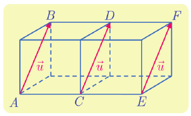

   - في حالة $A\ne B$، يمتلك الشعاع $\overrightarrow{AB}$:
     - منحى هو منحى المستقيم $(AB)$.
     - اتجاهاً يتفق مع الانتقال من $A$ إلى $B$.
     - طولاً أو نظيماً هو المسافة بين $A$ و $B$. نرمز إلى نظيم الشعاع $\overrightarrow{AB}$ بالرمز $\|\overrightarrow{AB}\|$، فيكون $\|\overrightarrow{AB}\|=AB$.
   - في حالة $A=B$، الشعاع $\overrightarrow{AA}$ هو الشعاع الصفري ويرمز إليه بالرمز $\vec{0}$.

2. نقول إن أشعة متساوية عندما تمتلك المنحى ذاته، والاتجاه ذاته، والطول ذاته. نكتب عندئذ، $\vec{u}=\overrightarrow{AB}=\overrightarrow{CD}=\overrightarrow{EF}$ كما يشير الشكل السابق.
3. إذا لم تكن النقاط الأربع $A$ و $B$ و $C$ و $D$ على استقامة واحدة، عندئذ:

   « $\overrightarrow{AB}=\overrightarrow{CD}$ » يكافئ « $ABDC$ متوازي أضلاع »

4. أياً تكن النقطة $A$ من الفراغ، وأياً يكن الشعاع $\vec{u}$، توجد نقطة واحدة $B$ تحقق $\overrightarrow{AB}=\vec{u}$.
5. قواعد الحساب المتبعة مع الأشعة في الفراغ، هي ذاتها المتبعة مع الأشعة في المستوي (علاقة شال مثلاً).

#### 2.1. الأشعة المرتبطة خطياً، التوازي والوقوع على استقامة واحدة

يعرّف الارتباط الخطي لشعاعين في الفراغ كما هي حال التعريف في المستوي. والأمر ذاته فيما يتعلق بالمبرهنات والنتائج المترتبة عليها:

**تعريف 1**

القول إن الشعاعين $\overrightarrow{AB}$ و $\overrightarrow{CD}$ غير الصفريين، مرتبطان خطياً، يعني أن المستقيمين $(AB)$ و $(CD)$ متوازيان (الانطباق حالة خاصة من التوازي). أي إن لهما المنحى ذاته.

اصطلح أن الشعاع الصفري وأي شعاع $\vec{u}$ مرتبطان خطياً.

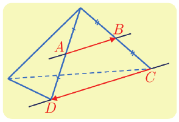

**مبرهنة 1**

- يكون الشعاعان $\vec{u}$ و $\vec{v}$ مرتبطين خطياً إذا وفقط إذا نتج أحدهما من الآخر بضربه بعدد حقيقي أي إذا وجد عدد حقيقي $k$ يحقق $\vec{v}=k\vec{u}$ أو وجد عدد حقيقي $k'$ يحقق $\vec{u}=k'\vec{v}$.
- تكون النقاط المتمايزة $A$ و $B$ و $C$ على استقامة واحدة إذا وفقط إذا كان الشعاعان $\overrightarrow{AB}$ و $\overrightarrow{AC}$ مرتبطين خطياً وهذا بدوره يكافئ وجود عدد حقيقي غير معدوم $k$ يحقق $\overrightarrow{AB}=k\overrightarrow{AC}$.

ومثلما في المستوي، لدينا المبرهنة الآتية:

**مبرهنة 2**

لتكن $A$ و $B$ نقطتين مختلفتين من الفراغ، عندئذ المستقيم $(AB)$ هو مجموعة النقاط $M$ التي تجعل $\overrightarrow{AM}$ و $\overrightarrow{AB}$ مرتبطين خطياً، أي مجموعة النقاط $M$ التي تحقق $\overrightarrow{AM}=t\overrightarrow{AB}$ حيث $t$ من $\mathbb{R}$.

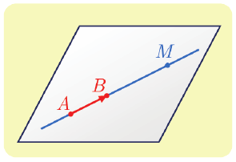

**مثال: كيف نستفيد من قواعد الحساب؟**

$ABCDEFGH$ مكعب و $I$ منتصف الحرف $[FG]$.

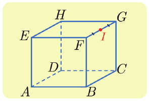

1. عين النقطة $M$ التي تحقق العلاقة (1) الآتية:

   $$\overrightarrow{AB}+\overrightarrow{AE}+\overrightarrow{FI}=\overrightarrow{AM}.$$

2. أثبت صحة العلاقة (2) الآتية:

   $$\overrightarrow{AB}+\overrightarrow{CF}=\overrightarrow{AF}+\overrightarrow{CB}.$$

**الحل**

1. إذا كانت $A$ نقطة معلومة وكان $\vec{u}$ شعاعاً معلوماً، أمكن تعيين النقطة $M$ التي تحقق $\overrightarrow{AM}=\vec{u}$. ومنه فكرة البحث عن شعاع واحد يساوي الشعاع $\overrightarrow{AB}+\overrightarrow{AE}+\overrightarrow{FI}$.

   الرباعي $ABFE$ مربع، إذن $\overrightarrow{AB}+\overrightarrow{AE}=\overrightarrow{AF}$ استناداً إلى قاعدة متوازي الأضلاع في جمع الأشعة، ومنه $\overrightarrow{AB}+\overrightarrow{AE}+\overrightarrow{FI}=\overrightarrow{AF}+\overrightarrow{FI}$. ثم نستفيد من علاقة شال لنجد $\overrightarrow{AF}+\overrightarrow{FI}=\overrightarrow{AI}$ ومنه $\overrightarrow{AB}+\overrightarrow{AE}+\overrightarrow{FI}=\overrightarrow{AI}$، وبالتعويض في (1) نجد $\overrightarrow{AI}=\overrightarrow{AM}$، ومنه $M=I$.

2. لإثبات المساواة (2)، نفكر بتحليل الشعاع $\overrightarrow{AB}$ لإظهار الشعاع $\overrightarrow{AF}$. فنكتب، استناداً إلى علاقة شال $\overrightarrow{AB}=\overrightarrow{AF}+\overrightarrow{FB}$، إذن

   $$\overrightarrow{AB}+\overrightarrow{CF}=\overrightarrow{AF}+\overrightarrow{FB}+\overrightarrow{CF}=\overrightarrow{AF}+\overrightarrow{CF}+\overrightarrow{FB}$$

   وبالاستفادة من علاقة شال ثانية، نجد $\overrightarrow{AB}+\overrightarrow{CF}=\overrightarrow{AF}+\overrightarrow{CB}$.

**فكّر**

أتبقى العلاقة التي أثبتناها في المثال السابق صحيحة أياً كانت النقاط $A,B,C,F$ في الفراغ؟

**مثال: كيف نثبت وقوع نقاط على استقامة واحدة؟**

ليكن $ABCDIJKL$ متوازي سطوح. وليكن $G$ مركز ثقل المثلث $BIK$. أثبت أن النقاط $D$ و $G$ و $J$ تقع على استقامة واحدة.

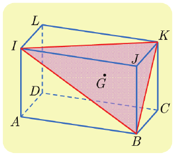

أحد أساليب إثبات وقوع النقاط $D$ و $G$ و $J$ على استقامة واحدة هو إثبات أن الشعاعين $\overrightarrow{DJ}$ و $\overrightarrow{DG}$ مرتبطان خطياً.

**الحل**

لما كانت $G$ مركز ثقل المثلث $BIK$، كان $\overrightarrow{GB}+\overrightarrow{GI}+\overrightarrow{GK}=\vec{0}$. لنسع إلى إظهار الشعاع $\overrightarrow{DG}$ بالاستفادة من علاقة شال، نجد

$$\overrightarrow{GD}+\overrightarrow{DB}+\overrightarrow{GD}+\overrightarrow{DI}+\overrightarrow{GD}+\overrightarrow{DK}=\vec{0}$$

ومنه

$$3\overrightarrow{GD}+\overrightarrow{DB}+\overrightarrow{DI}+\overrightarrow{DK}=\vec{0}$$

ومن جهة أخرى لنسع إلى إظهار الشعاع $\overrightarrow{DJ}$، نلاحظ أن

$$\begin{aligned}
\overrightarrow{DB}+\overrightarrow{DI}+\overrightarrow{DK}
&=\overrightarrow{DJ}+\overrightarrow{JB}+\overrightarrow{DJ}+\overrightarrow{JI}+\overrightarrow{AJ}\\
&=2\overrightarrow{DJ}+\underbrace{\overrightarrow{IA}+\overrightarrow{AJ}+\overrightarrow{JI}}_{\vec{0}}=2\overrightarrow{DJ}
\end{aligned}$$

أو $3\overrightarrow{GD}+2\overrightarrow{DJ}=\vec{0}$ أي $3\overrightarrow{DG}=2\overrightarrow{DJ}$. إذن تقع النقاط $D$ و $G$ و $J$ على استقامة واحدة.

#### تكريساً للفهم

ما فائدة مفهوم الارتباط الخطي لشعاعين في الفراغ؟

- لإثبات توازي مستقيمين أو نفي توازيهما.
- لإثبات وقوع ثلاث نقاط على استقامة واحدة أو نفي وقوعها.

#### تدرّب

1. $ABCDEFGH$ مكعب. $I$ منتصف $[EF]$، $J$ منتصف $[FG]$.

   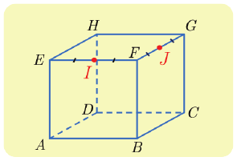

   1. في كل من الحالات التالية، بين إذا كانت النقطة $M$ المعرفة بالمساواة الشعاعية المفروضة تنطبق أو لا تنطبق على أحد رؤوس المكعب. وعلل إجابتك.
      1. $\overrightarrow{AM}=\overrightarrow{AB}+\overrightarrow{DH}$.
      2. $\overrightarrow{AM}=\overrightarrow{AE}+\overrightarrow{AB}+\overrightarrow{AD}$.
      3. $\overrightarrow{AM}=\overrightarrow{FE}+\overrightarrow{DG}$.
      4. $\overrightarrow{AM}=\overrightarrow{AG}+\overrightarrow{BF}$.
      5. $\overrightarrow{AM}=\frac12(\overrightarrow{AG}+\overrightarrow{HB})$.
   2. في كل من الحالات الآتية، حدد موقع النقطة $N$ المحققة للمساواة الشعاعية المفروضة.
      1. $\overrightarrow{AN}=\overrightarrow{AB}+\overrightarrow{AE}+\overrightarrow{FJ}$.
      2. $\overrightarrow{AN}=\overrightarrow{AE}+\overrightarrow{BC}+\overrightarrow{HJ}$.
      3. $\overrightarrow{AN}=\overrightarrow{AD}+\overrightarrow{DC}+\overrightarrow{CF}+\overrightarrow{GH}+\overrightarrow{EI}$.
   3. في كل من الحالات الآتية، عبّر عن المجموع الشعاعي المفروض بشعاع واحد (قد يكون مضروباً بعدد) وذلك باستخدام نقطتين من الشكل حصراً.
      1. $\overrightarrow{AJ}+\overrightarrow{BA}$.
      2. $\overrightarrow{BF}+\overrightarrow{EC}$.
      3. $\overrightarrow{AE}+\overrightarrow{AF}$.
      4. $\frac12\overrightarrow{EG}+\overrightarrow{JF}$.

2. $ABCDEFGH$ متوازي سطوح.

   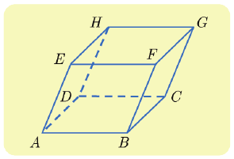

   1. أثبت صحة المساواة الشعاعية، في كل من الحالات الآتية:
      1. $\overrightarrow{EA}+\overrightarrow{EF}+\overrightarrow{BE}=\vec{0}$.
      2. $\overrightarrow{ED}+\overrightarrow{CF}=\vec{0}$.
      3. $\overrightarrow{CD}+\overrightarrow{CG}+\overrightarrow{EB}=\vec{0}$.
      4. $\overrightarrow{FE}+\overrightarrow{FB}+\overrightarrow{FG}=\overrightarrow{FD}$.
   2. وضع النقاط $P$ و $Q$ و $R$ بحيث يكون:
      1. $\overrightarrow{AP}=\overrightarrow{AB}+\frac12\overrightarrow{AD}+\frac12\overrightarrow{AE}$.
      2. $\overrightarrow{AQ}=\frac12\overrightarrow{AB}+\frac12\overrightarrow{AD}+\overrightarrow{AE}$.
      3. $\overrightarrow{CR}=\frac12\overrightarrow{AE}-\overrightarrow{AB}-\frac12\overrightarrow{AD}$.
   3. عين شعاعاً يساوي $\overrightarrow{DC}+\overrightarrow{BD}+\overrightarrow{BF}$ وأثبت أن هذا الشعاع يرتبط خطياً بالشعاع $\overrightarrow{AH}$.
   4. أوجد شعاعاً يساوي $\overrightarrow{FE}+\overrightarrow{FG}+\overrightarrow{FB}$ وأثبت أن هذا الشعاع يرتبط خطياً بالشعاع $\overrightarrow{DF}$.

### 2. الارتباط الخطي لثلاثة أشعة

#### 1.2. الخاصة المميزة لمستوٍ في الفراغ

**مبرهنة 3**

لتكن $A$ و $B$ و $C$ ثلاث نقاط ليست واقعة على استقامة واحدة. عندئذ المستوي $(ABC)$ هو مجموعة النقاط $M$ المعرفة بالعلاقة:

$$\overrightarrow{AM}=x\overrightarrow{AB}+y\overrightarrow{AC}$$

حيث $x$ و $y$ من $\mathbb{R}$.

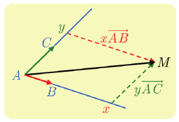

نقول في هذه الحالة إن $\overrightarrow{AB}$ و $\overrightarrow{AC}$ يوجهان المستوي $(ABC)$.

ونقول أيضاً إن $\overrightarrow{AB}$ و $\overrightarrow{AC}$ هما شعاعا توجيه في المستوي $(ABC)$.

يتعين مستوٍ $\mathcal{P}$ عموماً بنقطة وشعاعين $\vec{u}$ و $\vec{v}$ غير مرتبطين خطياً، هما شعاعا توجيه $\mathcal{P}$.

**الإثبات (يترك إلى قراءة ثانية)**

- النقاط $A$ و $B$ و $C$ ليست على استقامة واحدة، فالشعاعان $\overrightarrow{AB}$ و $\overrightarrow{AC}$ غير مرتبطين خطياً، إذن $(A;\overrightarrow{AB},\overrightarrow{AC})$ معلم في المستوي $(ABC)$. فإذا كانت $M$ نقطة من ذاك المستوي، وجدت ثنائية حقيقية $(x,y)$ تحقق $\overrightarrow{AM}=x\overrightarrow{AB}+y\overrightarrow{AC}$.
- وبالعكس، لنثبت أن كل نقطة $M$ معينة بالعلاقة $\overrightarrow{AM}=x\overrightarrow{AB}+y\overrightarrow{AC}$ هي نقطة من المستوي $(ABC)$. لما كان $(A;\overrightarrow{AB},\overrightarrow{AC})$ معلماً في المستوي $(ABC)$، إذن توجد نقطة $N$ من هذا المستوي إحداثياتها $(x,y)$ أي $\overrightarrow{AN}=x\overrightarrow{AB}+y\overrightarrow{AC}$، وعندئذ يكون $\overrightarrow{AM}=\overrightarrow{AN}$ ومنه $M=N$. فالنقطة $M$ تنتمي إلى المستوي $(ABC)$.

#### 2.2. الارتباط الخطي لثلاثة أشعة

**تعريف 2**

نقول إن الأشعة $\vec{u}$ و $\vec{v}$ و $\vec{w}$ مرتبطة خطياً، إذا وفقط إذا وجدت نقطة $O$ تجعل النقاط $O$ و $A$ و $B$ و $C$، المعرفة وفق $\overrightarrow{OA}=\vec{u}$ و $\overrightarrow{OB}=\vec{v}$ و $\overrightarrow{OC}=\vec{w}$، تقع في مستوٍ واحد.

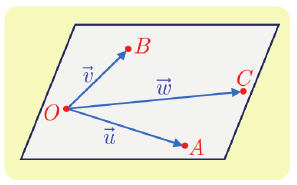

وعندئذ أي نقطة $O$ من الفراغ تحقق هذه الخاصة.

**ملاحظة:** عندما يكون الشعاعان، غير الصفريين $\vec{u}$ و $\vec{v}$، مرتبطين خطياً، تكون النقاط $O$ و $A$ و $B$ على استقامة واحدة، فيوجد على الأقل مستوٍ يحوي المستقيم $(OA)$ والنقطة $C$، وعندئذ تكون الأشعة $\vec{u}$ و $\vec{v}$ و $\vec{w}$ مرتبطة خطياً.

**مبرهنة 4**

$\vec{u}$ و $\vec{v}$ و $\vec{w}$ ثلاثة أشعة. نفترض أن $\vec{u}$ و $\vec{v}$ ليسا مرتبطين خطياً. عندئذ تكون الأشعة $\vec{u}$ و $\vec{v}$ و $\vec{w}$ مرتبطة خطياً إذا وفقط إذا وجد عددان حقيقيان $a$ و $b$ يحققان $\vec{w}=a\vec{u}+b\vec{v}$.

**الإثبات (يترك إلى قراءة ثانية)**

- لنفترض أن الأشعة $\vec{u}$ و $\vec{v}$ و $\vec{w}$ مرتبطة خطياً. ولتكن $O$ نقطة تقع في مستوٍ واحد $\mathcal{P}$ مع النقاط $A$ و $B$ و $C$ التي تحقق:

  $$\overrightarrow{OA}=\vec{u}\quad و \quad\overrightarrow{OB}=\vec{v}\quad و \quad\overrightarrow{OC}=\vec{w}$$

  لما كان الشعاعان $\vec{u}$ و $\vec{v}$ غير مرتبطين خطياً، كانا شعاعي توجيه في المستوي $(OAB)$ أي $\mathcal{P}$. واستناداً إلى التعريف، تنتمي النقطة $C$ إلى هذا المستوي. وعملاً بالمبرهنة 3، يوجد عددان حقيقيان $a$ و $b$ يحققان $\overrightarrow{OC}=a\overrightarrow{OA}+b\overrightarrow{OB}$، أي $\vec{w}=a\vec{u}+b\vec{v}$.
- وبالعكس، لنفترض أن $\vec{w}=a\vec{u}+b\vec{v}$ حيث $a$ و $b$ من $\mathbb{R}$. ولتكن $O$ نقطة ما من الفراغ عندئذ نعرف النقاط $A$ و $B$ و $C$ بالعلاقات

  $$\overrightarrow{OA}=\vec{u}\quad و \quad\overrightarrow{OB}=\vec{v}\quad و \quad\overrightarrow{OC}=\vec{w}$$

  فيكون لدينا $\overrightarrow{OC}=a\overrightarrow{OA}+b\overrightarrow{OB}$، وهذا يثبت، بناءً على المبرهنة 3 نفسها، أن $C$ تنتمي إلى المستوي $(OAB)$. وبهذا يتم إثبات المطلوب.

**مثال: إثبات ارتباط خطي لأشعة**

$ABCDEFGH$ مكعب. النقطة $I$ منتصف $[BE]$ و $J$ منتصف $[FG]$. أثبت أن الأشعة $\overrightarrow{EF}$ و $\overrightarrow{BG}$ و $\overrightarrow{IJ}$ مرتبطة خطياً.

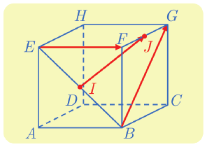

**الحل**

ليس واضحاً من الشكل وجود شعاعين مرتبطين خطياً من بين الأشعة الثلاثة وقد لا يكون ذلك صحيحاً. لنحاول إذن التعبير عن $\overrightarrow{IJ}$ بدلالة $\overrightarrow{EF}$ و $\overrightarrow{BG}$ وهما غير مرتبطين خطياً لأنهما متعامدان. لأجل ذلك، نستفيد من علاقة شال.

فعلى سبيل المثال

$$\overrightarrow{IJ}=\overrightarrow{IE}+\overrightarrow{EF}+\overrightarrow{FJ}\qquad ①$$

$$\overrightarrow{IJ}=\overrightarrow{IB}+\overrightarrow{BG}+\overrightarrow{GJ}\qquad ②$$

فإذا أخذنا في الحسبان أن $\overrightarrow{IE}+\overrightarrow{IB}=\vec{0}$ و $\overrightarrow{FJ}+\overrightarrow{GJ}=\vec{0}$، بدا طبيعياً أن نجمع ① و ② طرفاً مع طرف، فنجد $2\overrightarrow{IJ}=(\overrightarrow{IE}+\overrightarrow{IB})+\overrightarrow{EF}+\overrightarrow{BG}+(\overrightarrow{FJ}+\overrightarrow{GJ})$. إذن $2\overrightarrow{IJ}=\overrightarrow{EF}+\overrightarrow{BG}$ ومنه $\overrightarrow{IJ}=\frac12\overrightarrow{EF}+\frac12\overrightarrow{BG}$. وهذا يثبت الارتباط الخطي للأشعة $\overrightarrow{EF}$ و $\overrightarrow{BG}$ و $\overrightarrow{IJ}$.

#### تكريساً للفهم

**كيف نثبت توازي مستقيم ومستوٍ؟**

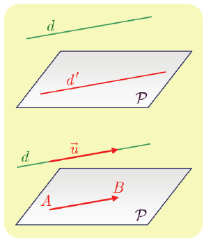

- هندسياً: لإثبات أن مستقيماً $d$ يوازي مستوياً $\mathcal{P}$، يمكننا إثبات أن $d$ يوازي مستقيماً $d'$ من $\mathcal{P}$.
- شعاعياً: لإثبات أن مستقيماً $d$ يوازي مستوياً $\mathcal{P}$، يمكننا إثبات أن في المستوي $\mathcal{P}$ نقطتين $A$ و $B$ تحققان $\overrightarrow{AB}=\vec{u}$، و $\vec{u}$ شعاع توجيه للمستقيم $d$.

**كيف نثبت توازي مستويين؟**

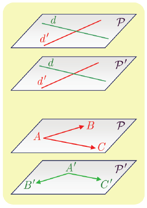

- هندسياً: لإثبات توازي مستويين، يمكن إثبات أن مستقيمين متقاطعين من أحدهما، يوازيان مستقيمين متقاطعين من الآخر.
- شعاعياً: لإثبات توازي مستويين، يكفي إيجاد شعاعين غير مرتبطين خطياً $\overrightarrow{AB}$ و $\overrightarrow{AC}$ من الأول، وشعاعين غير مرتبطين خطياً $\overrightarrow{A'B'}$ و $\overrightarrow{A'C'}$ من الثاني، تحقق أن الأشعة $\overrightarrow{AB}$ و $\overrightarrow{AC}$ و $\overrightarrow{A'B'}$ مرتبطة خطياً، وكذلك أن الأشعة $\overrightarrow{AB}$ و $\overrightarrow{AC}$ و $\overrightarrow{A'C'}$ مرتبطة خطياً.

#### تدرّب

1. $A$ و $B$ و $C$ ثلاث نقاط متمايزة من الفراغ. أتكون الأشعة $\overrightarrow{AB}$ و $\overrightarrow{AC}$ و $\overrightarrow{BC}$ مرتبطة خطياً؟
2. $A$ و $B$ و $C$ ثلاث نقاط متمايزة من الفراغ. $E$ نقطة تحقق $\overrightarrow{BE}=4\overrightarrow{BC}$، و $F$ نقطة تحقق $\overrightarrow{AF}=\frac12\overrightarrow{AE}$. أتقع النقاط $A$ و $B$ و $C$ و $E$ و $F$ في مستوٍ واحد؟
3. $ABCDEFGH$ مكعب. $I$ منتصف $[EF]$ و $J$ منتصف $[FG]$.

   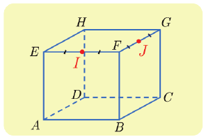

   1. أتنتمي النقطة $J$ إلى المستوي $(ABI)$؟
   2. أتقع الأشعة $\overrightarrow{AB}$ و $\overrightarrow{AI}$ و $\overrightarrow{AJ}$ في مستوٍ واحد؟

4. $ABCD$ رباعي وجوه. و $M$ هي النقطة المحققة للعلاقة

   $$\overrightarrow{AM}=\overrightarrow{AD}+\frac12\overrightarrow{AB}+\overrightarrow{DC}$$

   عبّر عن $\overrightarrow{AM}$ بدلالة $\overrightarrow{AB}$ و $\overrightarrow{BC}$. واستنتج أن $M$ تنتمي إلى المستوي $(ABC)$.

5. $ABCDEFGH$ مكعب. فيه $M$ نقطة تحقق $\overrightarrow{EM}=\frac13\overrightarrow{EH}$، و $N$ نقطة تحقق $\overrightarrow{AN}=\frac13\overrightarrow{AB}$.
   1. أثبت أن $\overrightarrow{MN}=\overrightarrow{EA}+\frac13\overrightarrow{DB}$.
   2. أتكون الأشعة $\overrightarrow{EA}$ و $\overrightarrow{MN}$ و $\overrightarrow{HB}$ مرتبطة خطياً؟

6. $ABCDEFGH$ مكعب. $I$ و $J$ و $K$ و $L$ هي بالترتيب منتصفات $[AB]$ و $[BC]$ و $[CG]$ و $[AE]$. ولتكن $M$ النقطة المحققة للعلاقة $3\overrightarrow{EM}=2\overrightarrow{EI}$.

   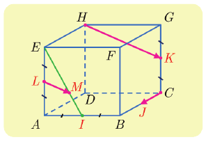

   1. لماذا $M$ هي مركز ثقل المثلث $AEB$؟
   2. أتكون الأشعة $\overrightarrow{LM}$ و $\overrightarrow{CJ}$ و $\overrightarrow{HK}$ مرتبطة خطياً؟

### 3. المعلم في الفراغ

#### 1.3. المعلم في الفراغ

اختيار معلم في الفراغ، هو إعطاء نقطة $O$ تسمى مبدأ المعلم، وجملة ثلاثة أشعة $(\vec{i},\vec{j},\vec{k})$ ليست مرتبطة خطياً. نرمز إلى هذا المعلم بالرمز $(O;\vec{i},\vec{j},\vec{k})$. ونسمي عادة الجملة $(\vec{i},\vec{j},\vec{k})$ أساس أشعة الفراغ. ونقول إن بعد الفراغ يساوي 3 لأن عدد أشعة أي أساس فيه يساوي 3.

**ملاحظة:** تعد المعالم $(O;\vec{i},\vec{j},\vec{k})$ و $(O;\vec{i},\vec{k},\vec{j})$ و ... و $(O;\vec{j},\vec{i},\vec{k})$ معالم مختلفة في الفراغ.

#### 2.3. الإحداثيات

**مبرهنة وتعريف 5**

$(O;\vec{i},\vec{j},\vec{k})$ معلم في الفراغ. عندئذ أياً كانت النقطة $M$ من الفراغ، توجد ثلاثية $(x,y,z)$ وحيدة من الأعداد الحقيقية، تحقق: $\overrightarrow{OM}=x\vec{i}+y\vec{j}+z\vec{k}$. تسمى $(x,y,z)$ إحداثيات النقطة $M$ في المعلم $(O;\vec{i},\vec{j},\vec{k})$. $x$ هي فاصلة $M$ و $y$ هي ترتيب $M$ و $z$ هي علو أو راقم $M$ في هذا المعلم.

**الإثبات**

لما كانت الأشعة $\vec{i}$ و $\vec{j}$ و $\vec{k}$ ليست مرتبطة خطياً، استنتجنا أن المستقيم المار بالنقطة $M$ موجهاً بالشعاع $\vec{k}$ يتقاطع مع المستوي $(O;\vec{i},\vec{j})$ في نقطة $M'$. إذن يوجد عددان $x$ و $y$ يحققان $\overrightarrow{OM'}=x\vec{i}+y\vec{j}$.

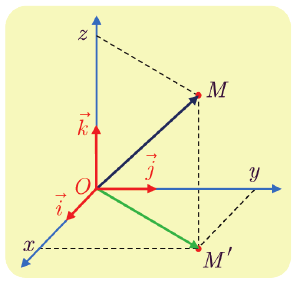

ولما كان الشعاعان $\overrightarrow{M'M}$ و $\vec{k}$ مرتبطين خطياً، يوجد عدد حقيقي $z$ يحقق $\overrightarrow{M'M}=z\vec{k}$. وتبعاً لعلاقة شال $\overrightarrow{OM}=\overrightarrow{OM'}+\overrightarrow{M'M}$، ومنه $\overrightarrow{OM}=x\vec{i}+y\vec{j}+z\vec{k}$. نقبل وحدانية كتابة $\overrightarrow{OM}$ بدلالة $\vec{i}$ و $\vec{j}$ و $\vec{k}$.

**تعريف 3**

$(O;\vec{i},\vec{j},\vec{k})$ معلم في الفراغ. نقرن بالشعاع $\vec{u}$ النقطة $M$ التي تحقق $\overrightarrow{OM}=\vec{u}$. نعرف مركبات الشعاع $\vec{u}$ بأنها $(x,y,z)$ إحداثيات النقطة $M$. وعليه يكتب أي شعاع $\vec{u}$ بطريقة واحدة بالصيغة $\vec{u}=\overrightarrow{OM}=x\vec{i}+y\vec{j}+z\vec{k}$.

وكما هي الحال في المستوي، يمكن أن نكتب مركبات الشعاع $\vec{u}$ في عمود: $\vec{u}\begin{bmatrix}x\\y\\z\end{bmatrix}$.

#### 3.3. الحساب باستعمال الإحداثيات

جميع النتائج المتعلقة بالإحداثيات في المستوي، تمتد على الفراغ بإضافة إحداثية ثالثة. في معلم معطى $(O;\vec{i},\vec{j},\vec{k})$، إذا أعطيت إحداثيات $\vec{u}$ و $\vec{v}$ وفق

$$\vec{u}(x,y,z) \qquad \text{و} \qquad \vec{v}(x',y',z')$$

عندئذ:

- أياً كان العدد الحقيقي $k$، كانت $(kx,ky,kz)$ مركبات الشعاع $k\vec{u}$.
- مركبات الشعاع $\vec{u}+\vec{v}$ هي $(x+x',y+y',z+z')$.
- إذا أعطينا النقطتين $A(x_A,y_A,z_A)$ و $B(x_B,y_B,z_B)$ كان لدينا:
  - مركبات الشعاع $\overrightarrow{AB}$ هي $(x_B-x_A,y_B-y_A,z_B-z_A)$.
  - إحداثيات النقطة $M$ منتصف القطعة المستقيمة $[AB]$ هي $\left(\frac{x_A+x_B}{2},\frac{y_A+y_B}{2},\frac{z_A+z_B}{2}\right)$.

**مثال: الحساب في معلم**

نتأمل، في معلم $(O;\vec{i},\vec{j},\vec{k})$، النقاط $A(1,2,-3)$ و $B(-1,3,3)$ و $C(4,-1,2)$. ولتكن $D$ نقطة تجعل $ABCD$ متوازي أضلاع. احسب إحداثيات $D$، ثم احسب إحداثيات $I$ مركز متوازي الأضلاع هذا.

**الحل**

- يكون الرباعي $ABCD$ متوازي أضلاع إذا وفقط إذا كان $\overrightarrow{AB}=\overrightarrow{DC}$. ولكن مركبات $\overrightarrow{AB}$ هي

  $$(x_B-x_A,y_B-y_B,z_B-z_A)=(-2,1,6)$$

  وإذا افترضنا $D(x,y,z)$، كانت مركبات الشعاع $\overrightarrow{DC}$ هي $(4-x,-1-y,2-z)$. وعليه تكتب المساواة $\overrightarrow{AB}=\overrightarrow{DC}$ بالشكل

  $$\begin{bmatrix}4-x\\-1-y\\2-z\end{bmatrix}=\begin{bmatrix}-2\\1\\6\end{bmatrix}$$

  ومنه $x=6$ و $y=-2$ و $z=-4$، أي $D(6,-2,-4)$.

- مركز متوازي الأضلاع $I$، هو منتصف قطره $[AC]$. فإحداثيات النقطة $I$ هي

  $$\left(\frac{x_A+x_C}{2},\frac{y_A+y_C}{2},\frac{z_A+z_C}{2}\right)=\left(\frac{1+4}{2},\frac{2-1}{2},\frac{-3+2}{2}\right)$$

  أو $I\left(\frac52,\frac12,-\frac12\right)$.

**مثال: كيف نثبت وقوع نقاط على استقامة واحدة؟**

ليكن $ABCDIJKL$ متوازي سطوح. وليكن $G$ مركز ثقل المثلث $BIK$. أثبت تحليلياً، بعد اختيار معلم مناسب، أن النقاط $D$ و $G$ و $J$ تقع على استقامة واحدة.

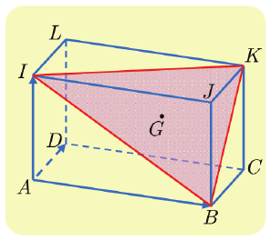

نختار معلماً تكون إحداثيات رؤوس المجسم المعطى بالنسبة إليه سهلة الحساب.

**الحل**

نختار، على سبيل المثال، المعلم $(A;\overrightarrow{AB},\overrightarrow{AD},\overrightarrow{AI})$، فيكون $B(1,0,0)$ و $D(0,1,0)$ و $J(1,0,1)$ و $K(1,1,1)$. ولما كانت $G$ مركز ثقل المثلث $BIK$، كان: $\overrightarrow{GB}+\overrightarrow{GI}+\overrightarrow{GK}=\vec{0}$، ولكننا نبحث عن مركبات $\overrightarrow{AG}$، لذلك نستفيد من علاقة شال لنستنتج مما سبق أن

$$\overrightarrow{GA}+\overrightarrow{AB}+\overrightarrow{GA}+\overrightarrow{AI}+\overrightarrow{GA}+\overrightarrow{AK}=\vec{0}$$

أو

$$3\overrightarrow{GA}=-(\overrightarrow{AB}+\overrightarrow{AI}+\overrightarrow{AK})$$

إذن $\overrightarrow{AG}=\frac13(\overrightarrow{AB}+\overrightarrow{AI}+\overrightarrow{AK})$. فإحداثيات $G$ هي

$$\left(\frac{1+0+1}{3},\frac{0+0+1}{3},\frac{0+1+1}{3}\right)=\left(\frac23,\frac13,\frac23\right)$$

وبالعودة إلى الأشعة، لما كان $\overrightarrow{DG}=\overrightarrow{AG}-\overrightarrow{AD}$ و $\overrightarrow{DJ}=\overrightarrow{AJ}-\overrightarrow{AD}$، استنتجنا أن

$$\overrightarrow{DG}\left(\frac23,-\frac23,\frac23\right) \qquad \text{و} \qquad \overrightarrow{DJ}(1,-1,1)$$

إذن $\overrightarrow{DG}=\frac23\overrightarrow{DJ}$. والشعاعان $\overrightarrow{DG}$ و $\overrightarrow{DJ}$ مرتبطان خطياً، فالنقاط $D$ و $G$ و $J$ تقع على استقامة واحدة.

#### تكريساً للفهم

كيف نتعرف الارتباط الخطي لشعاعين في الفراغ تحليلياً؟

في معلم معطى، يكون الشعاعان $\vec{u}(x,y,z)$ و $\vec{v}(x',y',z')$، غير المعدومين، مرتبطين خطياً، إذا وجد عدد حقيقي $k$ غير معدوم، يحقق $\vec{u}=k\vec{v}$، أي $x=kx'$ و $y=ky'$ و $z=kz'$. وهذا يكافئ أن $\frac{x}{x'}=\frac{y}{y'}=\frac{z}{z'}=k$ في حالة $x'$ و $y'$ و $z'$ من $\mathbb{R}^{*}$.

#### تدرّب

1. نتأمل النقاط $A(3,5,2)$ و $B(2,-1,3)$ و $C(0,-2,2)$ و $D(-2,5,1)$ و $E(3,9,2)$ و $F(8,13,3)$، في معلم $(O;\vec{i},\vec{j},\vec{k})$ للفراغ.
   1. احسب إحداثيات منتصفات القطع المستقيمة $[AB]$ و $[CD]$ و $[EF]$.
   2. احسب مركبات الأشعة $\overrightarrow{AB}$ و $\overrightarrow{CD}$ و $\overrightarrow{EF}$.
   3. عين إحداثيات النقطة $K$ بحيث يكون الرباعي $ABCK$ متوازي أضلاع.
   4. جد مركبات كل من الشعاعين:

      $$\vec{u}=3\overrightarrow{AB}+2\overrightarrow{CD} \qquad \text{و} \qquad \vec{v}=2\overrightarrow{AB}-\frac12\overrightarrow{CD}+3\overrightarrow{EF}$$

2. في معلم $(O;\vec{i},\vec{j},\vec{k})$ للفراغ. تعطى إحداثيات أربع من رؤوس متوازي السطوح $ABCDEFGH$ المرسوم جانباً، وهي $A(2,1,-1)$ و $B(1,3,-1)$ و $C(-3,2,0)$ و $E(3,-1,3)$. جد إحداثيات الرؤوس الأربعة الأخرى.

   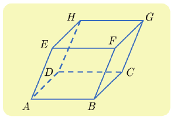

3. لدينا، في معلم للفراغ، النقاط $A(3,0,-1)$ و $B(-2,3,2)$ و $C(1,2,-2)$.
   1. جد إحداثيات النقطة $I$ منتصف $[AB]$.
   2. جد إحداثيات النقطة $D$ نظيرة $I$ بالنسبة إلى $C$.
   3. جد إحداثيات النقطة $M$ التي تحقق العلاقة $\overrightarrow{BM}=\overrightarrow{AB}+3\overrightarrow{AC}$.
   4. جد إحداثيات النقطة $N$ التي تحقق العلاقة $\overrightarrow{NA}=2\overrightarrow{NC}$.

4. لدينا النقطتان $A(2,3,-2)$ و $B(5,-1,0)$. جد، إن أمكن، في كل حالة، إحداثيات النقطة $M$ المحققة للعلاقة المفروضة.
   1. $\overrightarrow{MA}=2\overrightarrow{AB}$
   2. $\overrightarrow{MA}=\overrightarrow{MB}$
   3. $3\overrightarrow{BA}+\overrightarrow{MB}=\vec{0}$
   4. $\overrightarrow{MA}-\overrightarrow{MB}=\overrightarrow{AB}$

5. أيمكن تعيين $a$ و $b$ لتقع النقاط $A(2,3,0)$ و $B(3,2,1)$ و $M(a,b,2)$ على استقامة واحدة؟
6. أيمكن تعيين $a$ ليكون الشعاعان $\vec{u}(2,a,5)$ و $\vec{v}(1,-2,a)$ مرتبطين خطياً؟
7. في كل من الحالات الآتية، بين إذا كانت النقاط $A$ و $B$ و $C$ تقع على استقامة واحدة.
   1. $A(3,-1,2)$، $B(0,2,4)$، $C(2,0,-3)$
   2. $A(-4,1,3)$، $B(-2,0,5)$، $C(0,-1,7)$
   3. $A(1,-1,0)$، $B(1,-1,4)$، $C(1,-1,-3)$

### 4. المسافة في الفراغ

#### 1.4. المعلم المتجانس

نتأمل نقاطاً $O$ و $I$ و $J$ و $K$ من الفراغ، ونكتب $\overrightarrow{OI}=\vec{i}$ و $\overrightarrow{OJ}=\vec{j}$ و $\overrightarrow{OK}=\vec{k}$.

**تعريف 3**

نقول إن المعلم $(O;\vec{i},\vec{j},\vec{k})$ معلم متجانس إذا تحقق الشرطان:

- المستقيمات $(OI)$ و $(OJ)$ و $(OK)$ متعامدة مثنى.
- نظيم كل من $\vec{i}$ و $\vec{j}$ و $\vec{k}$ يساوي واحدة الطول، أي $\|\vec{i}\|=\|\vec{j}\|=\|\vec{k}\|=1$.

#### 2.4. نظيم شعاع، المسافة بين نقطتين

**مبرهنة 6**

في معلم متجانس يتحقق ما يأتي:

1. يعطى نظيم الشعاع $\vec{u}$ الذي مركباته $(a,b,c)$ بالعلاقة

   $$\|\vec{u}\|=\sqrt{a^2+b^2+c^2}$$

2. وفي حالة نقطتين $A(x_A,y_A,z_A)$ و $B(x_B,y_B,z_B)$، يكون

   $$AB=\sqrt{(x_B-x_A)^2+(y_B-y_A)^2+(z_B-z_A)^2}$$

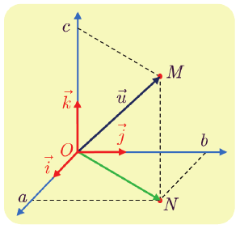

**الإثبات**

1. ليكن $(O;\vec{i},\vec{j},\vec{k})$ المعلم المتجانس، ولتكن $M$ النقطة التي تحقق $\vec{u}=\overrightarrow{OM}$، فيكون $\overrightarrow{OM}=a\vec{i}+b\vec{j}+c\vec{k}$. لتكن $N$ النقطة من المستوي $(O;\vec{i},\vec{j})$ التي تحقق $\overrightarrow{ON}=a\vec{i}+b\vec{j}$ و $\overrightarrow{NM}=c\vec{k}$. فيكون

   $$ON^2=a^2+b^2 \qquad \text{و} \qquad NM^2=c^2$$

   ولكن المعلم متجانس، فالمستقيمان $(NM)$ و $(O;\vec{k})$ عموديان على المستوي $(O;\vec{i},\vec{j})$ والمثلث $ONM$ قائم في $N$، إذن

   $$OM^2=ON^2+NM^2=a^2+b^2+c^2$$

   ولكن $OM=\|\vec{u}\|$، إذن $\|\vec{u}\|=\sqrt{a^2+b^2+c^2}$.

2. لدينا $AB=\|\overrightarrow{AB}\|$ ومركبات $\overrightarrow{AB}$ هي $(x_B-x_A,y_B-y_A,z_B-z_A)$، إذن استناداً إلى ① نجد الخاصة المطلوبة.

**مثال**

في معلم متجانس $(O;\vec{i},\vec{j},\vec{k})$.

- إذا كان $\vec{u}=3\vec{i}-2\vec{j}+\vec{k}$، كان $\|\vec{u}\|=\sqrt{3^2+(-2)^2+1^2}=\sqrt{14}$.
- إذا كانت $A(4,-1,3)$ و $B(2,3,-2)$، كان

  $$AB=\sqrt{(2-4)^2+(3+1)^2+(-2-3)^2}=\sqrt{45}=3\sqrt5$$

**مثال: الحساب في معلم**

نتأمل، في معلم متجانس $(O;\vec{i},\vec{j},\vec{k})$، النقاط الآتية:

$$A(2,3,2) \quad \text{و} \quad B(-2,-1,2) \quad \text{و} \quad C(-2,3,-2) \quad \text{و} \quad D\left(\frac13,\frac23,-\frac13\right)$$

1. احسب المسافات $AB,AC,AD,BC,BD,CD$.
2. بيّن طبيعة وجوه رباعي الوجوه $ABCD$.

**الحل**

1. حساب الأطوال

   - $AB^2=(-2-2)^2+(-1-3)^2+(2-2)^2=32$، أي $AB=4\sqrt2$.
   - $AC^2=(-2-2)^2+(3-3)^2+(-2-2)^2=32$، أي $AC=4\sqrt2$.
   - $AD^2=\left(\frac13-2\right)^2+\left(\frac23-3\right)^2+\left(-\frac13-2\right)^2=\frac{25}{9}+\frac{49}{9}+\frac{49}{9}=\frac{123}{9}$، أي $AD=\frac{\sqrt{123}}{3}$.
   - $BC^2=(-2+2)^2+(3+1)^2+(-2-2)^2=32$، أي $BC=4\sqrt2$.
   - $BD^2=\left(\frac13+2\right)^2+\left(\frac23+1\right)^2+\left(-\frac13-2\right)^2=\frac{49}{9}+\frac{25}{9}+\frac{49}{9}=\frac{123}{9}$، أي $BD=\frac{\sqrt{123}}{3}$.
   - $CD^2=\left(\frac13+2\right)^2+\left(\frac23-3\right)^2+\left(-\frac13+2\right)^2=\frac{49}{9}+\frac{49}{9}+\frac{25}{9}=\frac{123}{9}$، أي $CD=\frac{\sqrt{123}}{3}$.

2. $AB=AC=BC$، فالمثلث $ABC$ متساوي الأضلاع.

   - $AD=BD$ و $BD\ne AB$، فالمثلث $ABD$ متساوي الساقين رأسه $D$ وهو ليس مثلثاً قائماً لأن $DA^2+DB^2\ne AB^2$.
   - نجد، بالمثل، أن كلاً من المثلثين $ACD$ و $BCD$ مثلث متساوي الساقين.
   - يضاف إلى ما سبق، أن المثلثات $ABD$ و $ACD$ و $BCD$ مثلثات طبوقة.

**مثال: معادلة كرة مركزها المبدأ**

نتأمل، في معلم متجانس $(O;\vec{i},\vec{j},\vec{k})$، النقطة $A$ التي إحداثياتها $(1,2,-4)$.

1. جد معادلة الكرة $S$ التي مركزها $O$ ونصف قطرها يساوي $5$.
2. جد معادلة الكرة $S'$ التي مركزها $O$ وتمر بالنقطة $A$.

لإيجاد معادلة كرة، يمكن استعمال التعريف الآتي: الكرة $S$ التي مركزها $O$ ونصف قطرها $R$، هي مجموعة النقاط $M$ من الفراغ التي تحقق $OM^2=R^2$.

**الحل**

1. الكرة $S$ التي مركزها $O$ ونصف قطرها $5$، هي مجموعة نقاط الفراغ التي تبعد عن $O$ مسافة تساوي $5$. فالقول إن النقطة $M(x,y,z)$ تنتمي إلى الكرة $S$، يكافئ القول إن $OM=5$، أو $OM^2=x^2+y^2+z^2=25$. ويعني هذا أن معادلة الكرة $S$ هي:

   $$x^2+y^2+z^2=25$$

2. نصف قطر الكرة $S'$ يساوي $OA$، ولما كان $OA^2=1^2+2^2+(-4)^2=21$. استنتجنا أن $x^2+y^2+z^2=21$ هي معادلة الكرة $S'$.

#### تدرّب

1. احسب نظيم $\vec{u}$ و $\vec{v}$ و $\vec{w}$ في كل من الحالات الآتية:
   1. $\vec{u}(2,-2,3)$ و $\vec{v}(4,-4,-2)$ و $\vec{w}(4,1,-2)$.
   2. $\vec{u}=2\vec{i}-3\vec{j}$ و $\vec{v}=\vec{i}+5\vec{k}$ و $\vec{w}=\sqrt2\vec{i}-\sqrt3\vec{j}+\vec{k}$.

2. فيما يأتي، بين هل المثلث $ABC$ قائم؟ هل هو متساوي الساقين؟ هل هو متساوي الأضلاع؟
   1. في حالة $A(1,3,-1)$ و $B(3,6,-2)$ و $C(0,4,0)$.
   2. في حالة $A(1,3,-2)$ و $B(2,-1,0)$ و $C(6,-3,-1)$.

3. لدينا النقطتان $A(5,2,-1)$ و $B(3,0,1)$. بيّن أي النقاط $C$ أو $D$ أو $E$ تنتمي إلى المستوي المحوري للقطعة $[AB]$، في حالة $C(-2,5,-2)$ و $D(1,1,-3)$ و $E(3,2,1)$.

   المستوي المحوري لقطعة مستقيمة هو مجموعة النقاط التي تبعد عن طرفيها المسافة نفسها.

4. نتأمل النقاط $A(1,1,\sqrt2)$ و $B(\sqrt2,-\sqrt2,0)$ و $C$ نظيرة $A$ بالنسبة إلى المبدأ $O$. أثبت أن المثلث $ABC$ مثلث قائم ومتساوي الساقين.
5. نتأمل النقاط $A(2,3,-1)$ و $B(2,8,-1)$ و $C(7,3,-1)$ و $D(-1,3,3)$ و $E(5,3,3)$. أثبت أن $B$ و $C$ و $D$ و $E$ تقع على كرة واحدة مركزها $A$.

### 5. مركز الأبعاد المتناسبة في الفراغ

يعمم تعريف مركز الأبعاد المتناسبة الذي درسناه في الصف الثاني الثانوي إلى حالة الفراغ دون عناء، وفي حالة نقطتين أو ثلاث نقاط، يؤول هذا المفهوم إلى الحالة السابقة إذ تجري الدراسة عندئذ على مستقيم أو في مستوٍ. سنهتم إذن بمركز جملة مؤلفة من أربع نقاط.

**تعريف 4**

إن مركز الأبعاد المتناسبة $G$ للنقاط المثقلة الأربع $(A,\alpha)$ و $(B,\beta)$ و $(C,\gamma)$ و $(D,\delta)$ حيث $\alpha+\beta+\gamma+\delta\ne0$، هو النقطة الوحيدة $G$ التي تحقق العلاقة

$$\alpha\overrightarrow{GA}+\beta\overrightarrow{GB}+\gamma\overrightarrow{GC}+\delta\overrightarrow{GD}=\vec{0}$$

إن إثبات وجود ووحدانية النقطة $G$، مماثل تماماً لحالة ثلاث نقاط. كما إن براهين المبرهنات الآتية مماثلة لتلك الموافقة للمبرهنات التي رأيناها في وحدة مركز الأبعاد المتناسبة العام الماضي.

**مبرهنة 7**

ليكن $G$ مركز الأبعاد المتناسبة للنقاط المثقلة الأربع $(A,\alpha)$ و $(B,\beta)$ و $(C,\gamma)$ و $(D,\delta)$ حيث $\alpha+\beta+\gamma+\delta\ne0$، عندئذ، أياً كانت النقطة $M$، كان:

$$\alpha\overrightarrow{MA}+\beta\overrightarrow{MB}+\gamma\overrightarrow{MC}+\delta\overrightarrow{MD}=(\alpha+\beta+\gamma+\delta)\overrightarrow{MG}$$

**ملاحظة:** عندما نقول إن $G$ هي مركز الأبعاد المتناسبة لنقاط مثقلة، فإن قولنا هذا يفترض أن مجموع المعاملات أو الأمثال لا يساوي الصفر.

**مبرهنة 8 (الخاصة التجميعية)**

ليكن $G$ مركز الأبعاد المتناسبة للنقاط المثقلة الأربع $(A,\alpha)$ و $(B,\beta)$ و $(C,\gamma)$ و $(D,\delta)$ حيث $\alpha+\beta+\gamma+\delta\ne0$، عندئذ، إذا كان $H$ مركز الأبعاد المتناسبة لثلاث نقاط منها مثل $(A,\alpha)$ و $(B,\beta)$ و $(C,\gamma)$، كان $G$ مركز الأبعاد المتناسبة للنقطتين $(H,\alpha+\beta+\gamma)$ و $(D,\delta)$.

**ملاحظة:** إذا كانت $H$ مركز الأبعاد المتناسبة للنقطتين $(A,\alpha)$ و $(B,\beta)$، وكانت $K$ مركز الأبعاد المتناسبة للنقطتين $(C,\gamma)$ و $(D,\delta)$، كانت $G$ مركز الأبعاد المتناسبة للنقطتين $(H,\alpha+\beta)$ و $(K,\gamma+\delta)$.

**مثال: مركز ثقل رباعي الوجوه**

ليكن $ABCD$ رباعي وجوه، وليكن $G$ مركز الأبعاد المتناسبة للنقاط $(A,1)$ و $(B,1)$ و $(C,1)$ و $(D,1)$. لتعيين موضع $G$، نستبدل، على سبيل المثال، بالنقاط $(A,1)$ و $(B,1)$ و $(C,1)$ مركزها $G'$ وهو مركز ثقل المثلث $ABC$. واعتماداً على المبرهنة 8، $G$ هو مركز الأبعاد المتناسبة للنقطتين $(G',3)$ و $(D,1)$، إذن تحقق $G$ العلاقة

$$\overrightarrow{G'G}=\frac14\overrightarrow{G'D}$$

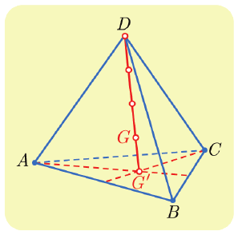

تسمى النقطة $G$ مركز ثقل رباعي الوجوه $ABCD$. وهي تقع على القطعة المستقيمة $[G'D]$ التي تسمى المتوسط المرسوم من $D$ لرباعي الوجوه وتقع في نهاية الربع الأول من هذا المتوسط من طرف $G'$.

نرى بإثبات مماثل أن $G$ تقع في نهاية الربع الأول من كل من المتوسطات المرسومة من $A$ و $B$ و $C$ أيضاً. فالمتوسطات الأربعة لرباعي الوجوه تتقاطع في نقطة واحدة هي $G$. وهي تقسم كل متوسط بنسبة $3:4$ من جهة الرأس.

**مثال: إثبات وقوع نقاط على استقامة واحدة**

$ABCD$ رباعي وجوه مركز ثقله $G$. $I$ منتصف $[AD]$، $J$ منتصف $[BC]$. أثبت أن $I$ و $J$ و $G$ تقع على استقامة واحدة.

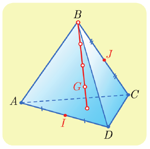

لكي نثبت أن النقاط $I$ و $J$ و $G$ تقع على استقامة واحدة، يمكننا أن نثبت مثلاً أن $G$ هي مركز أبعاد متناسبة للنقطتين $(I,\alpha)$ و $(J,\beta)$.

**الحل**

لما كان $G$ مركز ثقل $ABCD$، فهو إذن مركز الأبعاد المتناسبة للنقاط $(A,1)$ و $(B,1)$ و $(C,1)$ و $(D,1)$. ولكن $I$ منتصف $[AD]$، هو مركز الأبعاد المتناسبة للنقطتين $(A,1)$ و $(D,1)$. و $J$ هو مركز الأبعاد المتناسبة للنقطتين $(B,1)$ و $(C,1)$. واستناداً إلى الخاصة التجميعية، النقطة $G$ هي مركز الأبعاد المتناسبة للنقطتين $(I,2)$ و $(J,2)$. فالنقاط $I$ و $J$ و $G$ تقع على استقامة واحدة، وتكون $G$ في منتصف $[IJ]$.

**فكّر**

نستنتج من هذا التمرين أن القطع المستقيمة الواصلة بين منتصفي كل حرفين متقابلين في رباعي الوجوه، متناصفة ونقطة التقائها هي مركز ثقل رباعي الوجوه.

**مثال: إثبات وقوع نقاط من الفراغ في مستوٍ واحد**

$ABCDEFGH$ مكعب. أثبت أن النقطة $K$ المعرفة بالعلاقة

$$2\overrightarrow{AK}=\overrightarrow{CB}+\overrightarrow{CA}+3\overrightarrow{AG}$$

تقع في المستوي $(BCG)$. ارسم النقطة $K$.

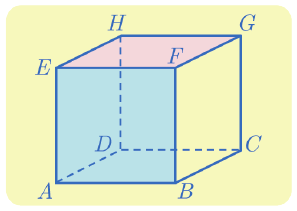

لإثبات أن نقطة $K$ تنتمي إلى مستوٍ $(BCG)$، يكفي إثبات أن $K$ هي مركز أبعاد متناسبة للنقاط $(B,\alpha)$ و $(C,\beta)$ و $(G,\gamma)$.

**الحل**

- لإثبات أن $K$ هي نقطة من المستوي $(BCG)$، نبحث عن علاقة بين الأشعة $\overrightarrow{KB}$ و $\overrightarrow{KC}$ و $\overrightarrow{KG}$. باستخدام علاقة شال، تكتب العلاقة المفروضة $2\overrightarrow{AK}-\overrightarrow{CB}-\overrightarrow{CA}-3\overrightarrow{AG}=\vec{0}$، بالصيغة المكافئة:

  $$2\overrightarrow{AK}-\overrightarrow{CK}-\overrightarrow{KB}-\overrightarrow{CK}-\overrightarrow{KA}-3\overrightarrow{AK}-3\overrightarrow{KG}=\vec{0}$$

  أو

  $$\overrightarrow{KB}-2\overrightarrow{KC}+3\overrightarrow{KG}=\vec{0}$$

  ولما كان $1+(-2)+3\ne0$، استنتجنا أن $K$ هي مركز الأبعاد المتناسبة للنقاط $(B,1)$ و $(C,-2)$ و $(G,3)$. وهذا يثبت انتماء $K$ إلى المستوي $(BCG)$.

- لرسم النقطة $K$، نبدأ برسم $L$ مركز الأبعاد المتناسبة للنقطتين $(G,3)$ و $(C,-2)$، إذ تكتب العلاقة $3\overrightarrow{LG}-2\overrightarrow{LC}=\vec{0}$ بالصيغة $\overrightarrow{GL}=-2\overrightarrow{GC}$، فنرسم $L$ على امتداد $[CG]$ على أن تقع $G$ بين $C$ و $L$ وتحقق $GL=2GC$.

  وأخيراً نرسم $K$، مركز النقطتين $(B,1)$ و $(L,1)$، أي منتصف القطعة $[BL]$.

#### تكريساً للفهم

ماذا يفيد مفهوم مركز الأبعاد المتناسبة في الفراغ؟

- يفيد في إثبات وقوع نقاط على استقامة واحدة.
- يفيد في إثبات وقوع نقاط في مستوٍ واحد.
- يفيد في إثبات تقاطع مستقيمات.

#### تدرّب

1. بالاستفادة من المعلومات المبينة في الشكل المجاور، عين الأعداد الأربعة $a$ و $b$ و $c$ و $d$ ليتحقق ما يأتي:

   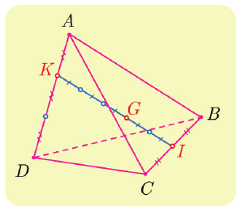

   1. $K$ مركز الأبعاد المتناسبة للنقطتين $(A,a)$ و $(D,d)$.
   2. $I$ مركز الأبعاد المتناسبة للنقطتين $(B,b)$ و $(C,c)$.
   3. $G$ مركز الأبعاد المتناسبة للنقاط المثقلة $(A,a)$ و $(B,b)$ و $(C,c)$ و $(D,d)$.

2. عين مركز ثقل المثلث $ABC$، في حالة $A(-4,-1,2)$ و $B(-2,1,0)$ و $C(6,3,-5)$.
3. لدينا ثلاث نقاط في الفراغ $A$ و $B$ و $C$.
   1. أثبت وجود نقطة وحيدة $M$ تحقق $\overrightarrow{MA}+\overrightarrow{MB}-\overrightarrow{MC}=\vec{0}$.
   2. ما القول عن $M$ عندما تكون $A$ و $B$ و $C$ على استقامة واحدة؟
   3. ما القول عن الرباعي $ACBM$ عندما لا تقع $A$ و $B$ و $C$ على استقامة واحدة؟

4. ليكن $ABCD$ رباعي وجوه و $k$ عدد حقيقي غير معدوم ولا يساوي $1$. لتكن $I$ و $J$ و $K$ و $L$ النقاط المعرفة بالعلاقات: $\overrightarrow{AI}=k\overrightarrow{AB}$ و $\overrightarrow{AJ}=k\overrightarrow{AD}$ و $\overrightarrow{CK}=k\overrightarrow{CD}$ و $\overrightarrow{CL}=k\overrightarrow{CB}$.
   1. أثبت أن $\overrightarrow{IJ}=k\overrightarrow{BD}=\overrightarrow{LK}$ واستنتج أن النقاط الأربع $I$ و $J$ و $K$ و $L$ تقع في مستوٍ واحد.
   2. ما طبيعة الشكل الرباعي $IJKL$؟

### أفكار يجب تمثّلها

- يجري التعامل مع الأشعة في الفراغ مثلما في المستوي.
  - إذ تعريف المساواة نفسه.
  - وطريقة الجمع نفسها.
  - وطريقة الضرب بعدد نفسها.
  - وطرائق الحساب نفسها.
- المستقيم $(AB)$ هو مجموعة النقاط $M$ التي تحقق $\overrightarrow{AM}=t\overrightarrow{AB}$ حيث $t$ من $\mathbb{R}$. وهذا يتفق مع حالة الهندسة المستوية.
- وكما في الهندسة المستوية، نقول إن النقاط $A$ و $B$ و $C$ تقع على استقامة واحدة عندما يكون الشعاعان $\overrightarrow{AB}$ و $\overrightarrow{AC}$ مرتبطين خطياً.
- وكما في الهندسة المستوية، يكون شعاعان $\vec{u}$ و $\vec{v}$، غير معدومين، مرتبطين خطياً، عندما يوجد عدد حقيقي $k$ بحيث يكون $\vec{u}=k\vec{v}$.
- المستوي $(ABC)$ هو مجموعة النقاط $M$ التي تحقق العلاقة $\overrightarrow{AM}=x\overrightarrow{AB}+y\overrightarrow{AC}$ حيث $x$ و $y$ متحولان في $\mathbb{R}$.

  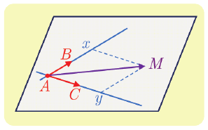

- يفيد مفهوم الارتباط الخطي لثلاثة أشعة في الفراغ، في إثبات وقوع أربع نقاط في المستوي نفسه. لأن القول «تقع النقاط $A$ و $B$ و $C$ و $D$ في مستوٍ واحد» يكافئ أن الأشعة $\overrightarrow{AB}$ و $\overrightarrow{AC}$ و $\overrightarrow{AD}$ مرتبطة خطياً.
- لإثبات أن ثلاثة أشعة $\vec{u}$ و $\vec{v}$ و $\vec{w}$ مرتبطة خطياً، يكفي إثبات وجود عددين حقيقيين $a$ و $b$ يحققان العلاقة $\vec{w}=a\vec{u}+b\vec{v}$.
- إن نقطة $O$، وثلاثة أشعة $\vec{i}$ و $\vec{j}$ و $\vec{k}$ ليست مرتبطة خطياً، تؤلف معلماً للفراغ نرمز إليه بالرمز $(O;\vec{i},\vec{j},\vec{k})$.
- في معلم متجانس للفراغ، إذا كان $\vec{u}(x,y,z)$، كان $\|\vec{u}\|^2=x^2+y^2+z^2$.

### منعكسات يجب امتلاكها

- لإثبات مساواة شعاعية، فكّر في علاقة شال.
- فكّر بالاستفادة من أداة جديدة هي «الارتباط الخطي لثلاثة أشعة»
  - لإثبات انتماء نقاط على مستوٍ واحد.
  - لإثبات توازي مستقيم ومستوٍ.
  - لإثبات توازي مستويين.
- فكّر في أن استعمال معلم يمكن أن يكون عوناً في حل مسألة، فعلى سبيل المثال، في حالة مكعب أو رباعي وجوه، يوجد معلم مناسب «طبيعي».
- لإيجاد مركز الأبعاد المتناسبة لأربع نقاط من الفراغ، يمكن استبدال باثنتين أو بثلاث منها مركزها بعد أن نسند إليه معاملاً يساوي مجموع معاملاتها.

### أخطاء يجب تجنّبها

- للتعامل مع مسائل المسافات، لا تختر معلماً كيفياً، بل، اختر، حصراً، معلماً متجانساً.
- أن يكون شعاعا توجيه مستقيمين في الفراغ غير مرتبطين خطياً، لا يكفي بالضرورة لتأكيد تقاطع هذين المستقيمين، بل يجب إضافة إلى ذلك، إثبات وقوعهما في مستوٍ واحد.

### أنشطة

#### نشاط 1: معادلة أسطوانة ومعادلة مخروط

##### 1. معادلة أسطوانة

لتكن $A$ النقطة التي إحداثياتها $(0,0,7)$ في معلم متجانس معطى في الفراغ $(O;\vec{i},\vec{j},\vec{k})$. نتأمل الأسطوانة المولدة من دوران الضلع $[BC]$ من المستطيل $OABC$ حول المستقيم $(OA)$ حيث $AB=3$. ولتكن $M$ نقطة متحولة من الأسطوانة، و $H$ مسقطها القائم على القطعة المستقيمة $[OA]$.

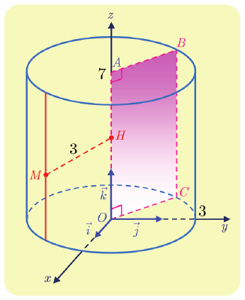

1. نفترض أن $M(x,y,z)$. ما إحداثيات النقطة $H$؟ أثبت أن إحداثيات $M$ تحقق العلاقتين:

   $$x^2+y^2=9 \qquad \text{و} \qquad 0\le z\le7.$$

2. بالعكس، إذا كانت $M(x,y,z)$ نقطة من الفراغ تحقق إحداثياتها $x^2+y^2=9$ و $0\le z\le7$، فأثبت أن $MH=3$، واستنتج أن $M$ تقع على الأسطوانة.

   **النتيجة:** معادلة هذه الأسطوانة هي $x^2+y^2=9$ و $0\le z\le7$.

3. أي النقاط الآتية تقع على الأسطوانة $D(3,0,3)$ و $E(\sqrt3,\sqrt6,4)$ و $F(1,3,1)$؟
4. 
   a. جد معادلة للأسطوانة التي محورها $(O,\vec{j})$ وقاعدتها الدائرة التي مركزها $O$ ونصف قطرها $2$.

   b. أعد السؤال ④ a. في حالة مركز قاعدة الأسطوانة هو النقطة $Q(0,8,0)$.
5. جد معادلة الأسطوانة التي محورها $(O,\vec{i})$ ومركز قاعدتها $T(3,0,0)$ ونصف قطرها $\sqrt6$.
6. صف مجموعة النقاط $M(x,y,z)$ التي تحقق إحداثياتها العلاقات $x^2+y^2=25$ و $1\le z\le4$.

##### 2. معادلة مخروط

لتكن $A$ النقطة التي إحداثياتها $(0,0,5)$ في معلم متجانس معطى في الفراغ $(O;\vec{i},\vec{j},\vec{k})$. لنتأمل المخروط المولد من دوران الضلع $[OK]$ من المثلث $OAK$ حول $(OA)$ مع $AK=2$.

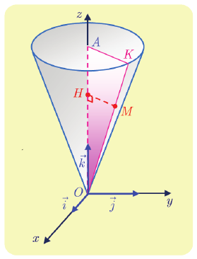

1. لتكن $M$ نقطة من المخروط، و $H$ مسقطها القائم على القطعة $[OA]$.

   a. أثبت أن $\frac{MH}{OH}=\frac25$، ثم $MH^2=\frac4{25}OH^2$.

   b. اكتب المساواة السابقة بدلالة إحداثيات $M$ ولتكن $(x,y,z)$. وأثبت أنه إذا كانت $M(x,y,z)$ نقطة من المخروط، كان $x^2+y^2-\frac4{25}z^2=0$ و $0\le z\le5$.

2. بالعكس، لتكن $M(x,y,z)$ نقطة من الفراغ تحقق إحداثياتها العلاقات $x^2+y^2-\frac4{25}z^2=0$ و $0\le z\le5$. أثبت أنه إذا كان $z\ne0$، كان $\frac{MH}{OH}=\frac25$. واستنتج أن $M$ تقع على المخروط. لا تنس حالة $z=0$.

   **النتيجة:** معادلة هذا المخروط هي $x^2+y^2-\frac4{25}z^2=0$ مع $0\le z\le5$.

3. عين من بين النقاط الآتية، تلك التي تقع على المخروط، مبرراً إجابتك:

   $$Q(2,0,5) \quad \text{و} \quad R(-2,1,5) \quad \text{و} \quad S(1,1,3) \quad \text{و} \quad T(2,2\sqrt3,10)$$

4. اكتب معادلة المخروط الذي رأسه $O$ ومحوره $(O,\vec{i})$ وقاعدته الدائرة التي مركزها $B(4,0,0)$ ونصف قطرها $3$.

### تمرينات ومسائل

#### 1

$ABCD$ رباعي وجوه. فيه $I$ منتصف $[AB]$ و $J$ منتصف $[CD]$ و $O$ منتصف $[IJ]$.

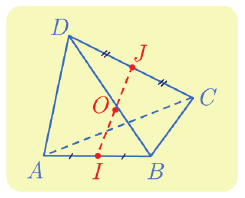

1. املأ الفراغ: $\overrightarrow{AB}+\overrightarrow{CD}=\overrightarrow{AD}+\cdots+\overrightarrow{CD}$. واستنتج أن

   $$\overrightarrow{AB}+\overrightarrow{CD}=\overrightarrow{AD}+\overrightarrow{CB}$$

2. بسّط كلاً من $\overrightarrow{AI}+\overrightarrow{IJ}+\overrightarrow{JC}$ و $\overrightarrow{BI}+\overrightarrow{IJ}+\overrightarrow{JD}$. استنتج أن

   $$\overrightarrow{AC}+\overrightarrow{BD}=2\overrightarrow{IJ}$$

3. لماذا $\overrightarrow{OA}+\overrightarrow{OB}=2\overrightarrow{OI}$ و $\overrightarrow{OC}+\overrightarrow{OD}=2\overrightarrow{OJ}$؟ استنتج أن

   $$\overrightarrow{OA}+\overrightarrow{OB}+\overrightarrow{OC}+\overrightarrow{OD}=\vec{0}$$

4. لتكن $K$ منتصف $[AD]$، و $L$ منتصف $[BC]$. أثبت أن $\overrightarrow{IK}=\frac12\overrightarrow{BD}$ و $\overrightarrow{LJ}=\frac12\overrightarrow{BD}$. استنتج أن $IKJL$ متوازي أضلاع.

#### 2

$ABCD$ رباعي وجوه. وضع على شكل النقاط الآتية:

1. $I$ مركز الأبعاد المتناسبة للنقطتين $(A,1)$ و $(B,2)$.
2. $J$ مركز الأبعاد المتناسبة للنقطتين $(C,2)$ و $(D,1)$.
3. $K$ مركز الأبعاد المتناسبة للنقاط $(A,1)$ و $(B,2)$ و $(C,2)$ و $(D,1)$.
4. $L$ مركز الأبعاد المتناسبة للنقطتين $(A,1)$ و $(B,-2)$.
5. $M$ مركز الأبعاد المتناسبة للنقاط $(A,1)$ و $(B,-2)$ و $(C,-1)$.
6. $N$ مركز الأبعاد المتناسبة للنقاط $(A,1)$ و $(B,-2)$ و $(C,-1)$ و $(D,1)$.

#### 3

في المقولات الآتية، بيّن الصحيح من الخطأ معللاً إجابتك.

1. $ABC$ مثلث. مهما كانت $D$ من الفراغ كانت الأشعة $\overrightarrow{DA}$ و $\overrightarrow{DB}$ و $\overrightarrow{DC}$ مرتبطة خطياً.
2. $ABCD$ رباعي الوجوه. لتكن $I$ النقطة المعرفة بالعلاقة $2\overrightarrow{IA}=\overrightarrow{DA}+\overrightarrow{BC}+\overrightarrow{CA}$. عندئذ تقع $I$ على أحد حروف رباعي الوجوه.
3. نتأمل الأشعة $\overrightarrow{AD}$ و $\overrightarrow{AC}$ و $\overrightarrow{AB}$. نفترض أن أي شعاعين منها ليسا مرتبطين خطياً، عندها تكون الأشعة $\overrightarrow{AD}$ و $\overrightarrow{AC}$ و $\overrightarrow{AB}$ غير مرتبطة خطياً.
4. النقاط $A(5,1,3)$ و $B(2,-\sqrt5,-2)$ و $C(3,-3,3)$ متساوية البعد عن $K(2,0,1)$.
5. النقاط $C(4,0,0)$ و $D(0,-2,0)$ و $E(1,2,6)$ و $F(5,1,1)$ تنتمي إلى المستوي المحوري للقطعة المستقيمة التي طرفيها $A(4,-2,2)$ و $B(2,2,0)$.

### لنتعلّم البحث معاً

#### 4. إثبات وقوع نقاط في مستوٍ واحد

نتأمل، في المعلم $(O;\vec{i},\vec{j},\vec{k})$، النقاط الآتية:

$$A(2,0,1) \quad \text{و} \quad B(1,-2,1) \quad \text{و} \quad C(5,5,0) \quad \text{و} \quad D(-3,-5,6) \quad \text{و} \quad E(3,1,2).$$

أثبت انتماء النقاط $A$ و $B$ و $C$ و $D$ إلى مستوٍ واحد $\mathcal{P}$، وتبيّن إذا كانت النقطة $E$ تنتمي إلى المستوي $\mathcal{P}$.

**نحو الحلّ**

غير مجدٍ هنا رسم شكل. إذ تكمن الفائدة الوحيدة من الرسم في العمل على إظهار نقاط تقع على استقامة واحدة. ولكن قد تبدو النقاط في شكل فراغي على استقامة واحدة دون أن تكون كذلك. في حين تدعونا معرفة إحداثيات النقاط المفروضة إلى التعامل مع المسألة تحليلياً.

يتعلق الأمر بمعرفة إذا كانت النقاط $A$ و $B$ و $C$ و $D$ واقعة في مستوٍ واحد. لهذا، نتحرى وجود شعاعين غير مرتبطين خطياً من بين الأشعة $\overrightarrow{AB}$ و $\overrightarrow{AC}$ و $\overrightarrow{AD}$.

1. احسب مركبات كل من $\overrightarrow{AB}$ و $\overrightarrow{AC}$ و $\overrightarrow{AD}$.
2. استنتج أن $\overrightarrow{AB}$ و $\overrightarrow{AC}$، على سبيل المثال، غير مرتبطين خطياً.

استناداً إلى المبرهنة 4، يؤول إقرار انتماء نقطة $D$ إلى المستوي $(ABC)$، إلى وجود عددين حقيقيين $a$ و $b$ يحققان $\overrightarrow{AD}=a\overrightarrow{AB}+b\overrightarrow{AC}$.

1. اكتب المساواة الشعاعية السابقة بلغة الإحداثيات، وتحقق أنك ستحصل على جملة من ثلاث معادلات خطية بالمجهولين $a$ و $b$ هي:

   $$\begin{cases}-a+3b=-5\\-2a+5b=-5\\-b=5\end{cases}$$

2. لحل مثل هذه الجملة من المعادلات، اختر جملة من معادلتين من هذه المعادلات الثلاث وحلها. هل العددان $a$ و $b$ اللذان وجدتهما حلول للمعادلة الثالثة؟ أكمل.
3. تصرف بالمثل مع النقطة $E$.

أنجز الحل واكتبه بلغة سليمة.

#### 5. إثبات تقاطع مستقيمين

في معلم $(O;\vec{i},\vec{j},\vec{k})$، لدينا النقطتان $A(3,-1,1)$ و $B(3,-3,-1)$، والشعاعان $\vec{u}(1,0,-2)$ و $\vec{v}(2,1,-3)$. $d$ هو المستقيم المار بالنقطة $A$ والموجه بالشعاع $\vec{u}$، و $d'$ هو المستقيم المار بالنقطة $B$ والموجه بالشعاع $\vec{v}$. أثبت أن المستقيمين $d$ و $d'$ متقاطعان، ثم عين $I$ نقطة تقاطعهما.

**نحو الحلّ**

ليس مفيداً، هنا، رسم شكل بالنقاط والأشعة والمستقيمات المفترضة. إذ قد يبدو مستقيمان في الفراغ متقاطعين، دون أن يكونا كذلك، لأنهما غير واقعين في مستوٍ واحد.

يتعلق الأمر بإثبات تقاطع مستقيمين من الفراغ، إذن يجب إثبات أنهما غير متوازيين ويقعان في مستوٍ واحد. وتدعونا معرفة إحداثيات النقاط ومركبات الأشعة إلى التعامل مع المسألة تحليلياً.

1. أثبت أن $\vec{u}$ و $\vec{v}$ غير مرتبطين خطياً.
2. ما قولك بشأن المستقيمين $d$ و $d'$؟

يبقى إثبات وقوع المستقيمين $d$ و $d'$ في مستوٍ واحد. المستقيم $d$ والنقطة $B$ يعينان مستوياً $\mathcal{P}$ طالما $B$ لا تقع على $d$. فلإثبات أن $d$ و $d'$ يقعان في مستوٍ واحد، يكفي إثبات أن الأشعة $\overrightarrow{AB}$ و $\vec{u}$ و $\vec{v}$ مرتبطة خطياً.

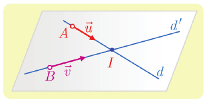

1. تحقق، بذكر المبرهنة ذات الصلة، أن المسألة تؤول إلى إثبات وجود عددين حقيقيين $a$ و $b$ يحققان $\overrightarrow{AB}=a\vec{u}+b\vec{v}$.
2. اكتب المساواة السابقة بلغة الإحداثيات، فتحصل على جملة من ثلاث معادلات خطية بمجهولين.
3. اختر اثنتين من المعادلات الثلاث التي حصلت عليها، ثم حل الجملة المؤلفة منهما. أيكون العددان الحقيقيان $a$ و $b$ اللذان وجدتهما حلولاً للمعادلة الثالثة؟ أتمم.

لحساب إحداثيات $I(x,y,z)$، نقطة تقاطع المستقيمين $d$ و $d'$، نسعى، بالتعامل شعاعياً، إلى التوثق من أن $I$ تقع على كل من $d$ و $d'$.

1. تحقق من وجود عددين حقيقيين $\alpha$ و $\beta$ يحققان $\overrightarrow{AI}=\alpha\vec{u}$ و $\overrightarrow{BI}=\beta\vec{v}$.
2. اكتب هاتين المساواتين بلغة الإحداثيات لتستنتج $\alpha$ و $\beta$ ومن ثم إحداثيات النقطة $I$.

أنجز الحل واكتبه بلغة سليمة.

#### 6. التوازي في الفراغ

لنتأمل المكعب $ABCDEFGH$. النقطة $I$ من الحرف $[CD]$ تحقق المساواة $\overrightarrow{DI}=\frac14\overrightarrow{DC}$، والنقطة $J$ من $[BC]$ تحقق المساواة $\overrightarrow{BJ}=\frac34\overrightarrow{BC}$. أثبت أن المستقيم $(HI)$ يوازي المستوي $(EGJ)$.

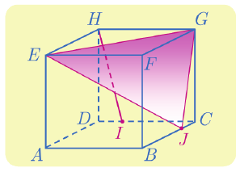

**نحو الحلّ**

لا يظهر الشكل مستقيماً من المستوي $(EGJ)$ موازياً $(HI)$. إذ لو كان مستقيم من المستوي $(EGJ)$ موازياً $(HI)$، لتأكد لنا أن المستقيم $(HI)$ يوازي المستوي $(EGJ)$. لنفكر إذن بالتعامل مع المسألة تحليلياً. نختار $(A;\overrightarrow{AB},\overrightarrow{AD},\overrightarrow{AE})$ معلماً للفراغ، لأنه من السهل تعيين إحداثيات نقاط الشكل في هذا المعلم. عين في هذا المعلم إحداثيات النقاط $H,I,J,E,G$.

لإثبات أن المستقيم $(HI)$ يوازي المستوي $(EGJ)$، باستعمال الأشعة، يكفي، على سبيل المثال، إثبات أن الأشعة $\overrightarrow{HI}$ و $\overrightarrow{EG}$ و $\overrightarrow{EJ}$ واقعة في مستوٍ واحد.

1. أثبت أن هذا يقودنا إلى إثبات وجود عددين حقيقيين $x$ و $y$ يحققان

   $$\overrightarrow{HI}=x\overrightarrow{EG}+y\overrightarrow{EJ}$$

2. اكتب هذه المساواة الشعاعية بلغة الإحداثيات: ستحصل على جملة من ثلاث معادلات بمجهولين.
3. اختر اثنتين من المعادلات الثلاث التي حصلت عليها، ثم حل الجملة المؤلفة منهما. هل العددان الحقيقيان $x$ و $y$ اللذان وجدتهما حلول للمعادلة الثالثة؟

أنجز الحل واكتبه بلغة سليمة.

**حل آخر**

فيما سبق، لم نسع إلى إظهار مستقيم في المستوي $(EGJ)$ يوازي $(HI)$، فلجأنا إلى التعامل مع الإحداثيات. ولكن دراسة تقاطع المكعب مع المستوي $(EGJ)$، تظهر مستقيماً من هذا القبيل. المستويان $(EFG)$ و $(ABC)$ متوازيان، والمستوي $(EGJ)$ يقطعهما بفصلين مشتركين متوازيين.

1. ارسم الفصل المشترك للمستويين $(EGJ)$ و $(ABC)$، ولتكن $K$ نقطة تقاطعه مع $(AB)$. بين لماذا $\overrightarrow{AK}=\frac14\overrightarrow{AB}$؟ أثبت أن $EK=HI$.
2. ماذا تستنتج بشأن المستقيمين $(HI)$ و $(EK)$؟ وكذلك بشأن المستقيم $(HI)$ والمستوي $(EGJ)$؟

أنجز الحل الآخر واكتبه بلغة سليمة.

#### 7. مقطع مكعب بمستوٍ

$ABCDEFGH$ مكعب. $M$ و $N$ و $P$ ثلاث نقاط من الأحرف $[AE]$ و $[EF]$ و $[FG]$ بالترتيب، كما في الشكل المجاور. يطلب إيجاد مقطع المكعب بالمستوي $(MNP)$.

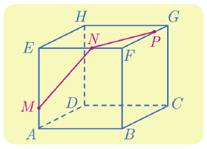

**نحو الحلّ**

نريد تعيين تقاطع المستوي $(MNP)$ مع وجوه المكعب. ولكن بم نبدأ؟ نعلم أنه عندما يقطع المستوي $(MNP)$ وجهين متقابلين من المكعب، وهما في مستويين متوازيين، يكون الفصلان المشتركان الناتجان متوازيين.

1. أي وجه من وجوه المكعب يتقاطع مع $(MNP)$ ويوازي $(MN)$؟
2. أي وجه من وجوه المكعب يتقاطع مع $(MNP)$ ويوازي $(NP)$؟
3. أي وجه تختار إذن للتعامل معه؟

لنبدأ، على سبيل المثال، بالبحث عن تقاطع المستوي $(MNP)$ مع الوجه $(DCGH)$. لإيجاد الفصل المشترك لهذين المستويين، يكفي إيجاد نقطة مشتركة بينهما. لنبحث إذن عن نقطة من هذا القبيل.

1. لماذا نقطة تقاطع $(PN)$ و $(HG)$ ملائمة؟ ارمز إلى تلك النقطة بالرمز $Q$.
2. المستقيم المار بالنقطة $Q$ موازياً المستقيم $(MN)$، يقطع $(CG)$ في $R$ ويقطع $(DC)$ في $S$. حدد الفصل المشترك للمستوي $(MNP)$ والوجه $(DCGH)$.

1. لماذا يفيد المستقيم المار بالنقطة $S$ موازياً $(PN)$، في تحديد الفصل المشترك للمستوي $(MNP)$ والوجه $(ABCD)$؟ لتكن $T$ نقطة تقاطعه مع $[AD]$.
2. ما الفصل المشترك للمستوي $(MNP)$ مع كل من الوجهين $(BCGF)$ و $(ADHE)$؟

أنجز الحل الآخر واكتبه بلغة سليمة.

#### 8. حساب مسافة

$ABCDE$ هرم رأسه $E$ وقاعدته مربع. $[BE]$ عمودي على المستوي $(ABCD)$، $EB=4\sqrt2$ و $AB=4$. $M$ نقطة من القطعة $[ED]$ تحقق $3\overrightarrow{DM}=\overrightarrow{DE}$. لتكن $P$ المسقط القائم للنقطة $M$ على المستوي $(ABCD)$ و $H$ المسقط القائم للنقطة $P$ على المستقيم $(AB)$. احسب طول القطعة المستقيمة $[MH]$.

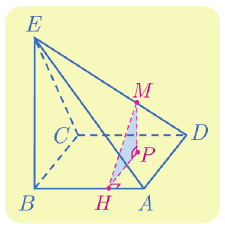

**نحو الحلّ**

تدعونا مختلف أوضاع التعامد والتساوي في الشكل إلى التعامل تحليلياً مع هذا التمرين. يحضرنا، هنا، المعلم المتجانس $(B;\vec{i},\vec{j},\vec{k})$ حيث $\overrightarrow{BA}=4\vec{i}$ و $\overrightarrow{BC}=4\vec{j}$ و $\overrightarrow{BE}=4\sqrt2\vec{k}$.

1. جد، في هذا المعلم، إحداثيات كل من النقطتين $D$ و $E$.
2. حدد إحداثيات النقطة $M$.

$P$ هي المسقط القائم للنقطة $M$ على المستوي $(ABCD)$، فنستنتج إحداثيات $P$، بسهولة، من إحداثيات النقطة $M$. وبالمثل، نستنتج إحداثيات النقطة $H$ من إحداثيات $P$.

1. حدد إحداثيات كل من النقطتين $P$ و $H$.
2. احسب طول $[MH]$.

أنجز الحل الآخر واكتبه بلغة سليمة.

#### 9

$ABCD$ رباعي وجوه، و $a$ عدد حقيقي. $I$ و $J$ هما، بالترتيب، منتصفا $[AB]$ و $[CD]$. و $E$ و $F$ نقطتان تحققان، العلاقتين: $\overrightarrow{AE}=a\overrightarrow{AD}$ و $\overrightarrow{BF}=a\overrightarrow{BC}$. وأخيراً $H$ هي منتصف $[EF]$. أثبت أن $I$ و $J$ و $H$ تقع على استقامة واحدة.

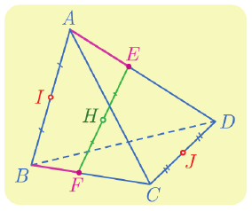

**نحو الحلّ**

نهدف إلى إثبات وقوع ثلاث نقاط من الفراغ على استقامة واحدة. تدعونا الفرضيات التي تحدد نقاط الشكل إلى استعمال مركز الأبعاد المتناسبة أداة للإثبات. يكفي إذن، على سبيل المثال، إثبات أن $H$ هي مركز أبعاد متناسبة للنقطتين $I$ و $J$. وقد أسندنا إليهما ثقلين مناسبين.

1. تيقن أن $E$ هي مركز الأبعاد المتناسبة للنقطتين $(A,1-a)$ و $(D,a)$، وأن $F$ هي مركز الأبعاد المتناسبة للنقطتين $(B,1-a)$ و $(C,a)$.
2. بالاستفادة من الخاصة التجميعية، أثبت أن $H$ هي مركز الأبعاد المتناسبة للنقاط $(A,1-a)$ و $(B,1-a)$ و $(C,a)$ و $(D,a)$.
3. استنتج أن النقاط $I$ و $J$ و $H$ تقع على استقامة واحدة.

أنجز الحل الآخر واكتبه بلغة سليمة.

### قدماً إلى الأمام

#### 10

$A$ و $B$ و $C$ ثلاث نقاط ليست على استقامة واحدة من الفراغ. و $D$ و $E$ نقطتان تحققان:

$$3\overrightarrow{AD}=2\overrightarrow{AB} \qquad \text{و} \qquad \overrightarrow{AE}=3\overrightarrow{CE}.$$

1. أثبت أن النقاط $A$ و $B$ و $C$ و $D$ و $E$ تقع في مستوٍ واحد.
2. لتكن $I$ منتصف $[CD]$ و $J$ منتصف $[BE]$. أثبت وقوع $A$ و $I$ و $J$ على استقامة واحدة.

#### 11

$ABCD$ رباعي وجوه. و $E$ و $F$ و $G$ هي نظائر $A$ بالنسبة إلى منتصفات $[BC]$ و $[CD]$ و $[DB]$ بالترتيب.

1. أثبت أن $\overrightarrow{AC}=\overrightarrow{DF}$ و $\overrightarrow{AC}=\overrightarrow{BE}$.
2. استنتج أن للقطعتين $[DE]$ و $[FB]$ المنتصف نفسه.
3. أثبت أن المستقيمات $(BF)$ و $(DE)$ و $(CG)$ متلاقية في نقطة واحدة.

#### 12

$ABCD$ رباعي وجوه. و $E$ هي نظيرة $A$ بالنسبة إلى $C$، و $F$ و $G$ هما النقطتان اللتان تجعلـان $EBCF$ و $FDAG$ متوازيي الأضلاع.

1. أثبت أن $\overrightarrow{DG}=\overrightarrow{DA}+\overrightarrow{DE}+\overrightarrow{BC}$.
2. استنتج أن $\overrightarrow{DG}=2\overrightarrow{DC}+\overrightarrow{BC}$، ثم أن النقاط $B$ و $C$ و $D$ و $G$ تقع في مستوٍ واحد.

#### 13

نتأمل في معلم $(O;\vec{i},\vec{j},\vec{k})$ النقاط $A(3,2,1)$ و $B(1,2,0)$ و $C(3,1,-2)$.

1. أثبت أن النقاط $A$ و $B$ و $C$ ليست على استقامة واحدة.
2. عند أية قيمة للوسيط $m$ تنتمي النقطة $M(m,1,3)$ إلى المستوي $(ABC)$؟
3. ما العلاقة بين $x$ و $y$ لتقع النقاط $A$ و $B$ و $C$ و $D(x,y,3)$ في مستوٍ واحد؟

#### 14. مجموعة نقاط

لتكن $\mathcal{E}$ مجموعة النقاط $M(x,y,z)$ التي تحقق إحداثياتها العلاقة: $x-2y+3z-5=0$.

1. أثبت أن النقاط $A(7,1,0)$ و $B(5,0,0)$ و $C(2,0,1)$ تنتمي إلى المجموعة $\mathcal{E}$.
2. أثبت أن النقاط $A$ و $B$ و $C$ تحدد مستوياً $\mathcal{P}$.
3. 
   a. أثبت أن مركبات الشعاع $\overrightarrow{BM}$ هي $(2y-3z,y,z)$.

   b. استنتج أن $\overrightarrow{BM}=y\overrightarrow{BA}+z\overrightarrow{BC}$. ماذا يمكنك أن تستنتج من ذلك؟
4. بالعكس، أثبت أن أية نقطة $M(x,y,z)$ من المستوي $\mathcal{P}$ تحقق المعادلة:

   $$x-2y+3z-5=0$$

   ما هي المجموعة $\mathcal{E}$؟

#### 15

نتأمل في معلم $(O;\vec{i},\vec{j},\vec{k})$ المستقيم $d$ المار بالنقطة $A(2,0,5)$ والموجه بالشعاع $\vec{u}(2,5,-1)$، والمستقيم $d'$ المار بالنقطة $B(2,2,-1)$ والموجه بالشعاع $\vec{v}(1,2,1)$. هل $d$ و $d'$ متقاطعان؟ في حالة الإيجاب، عين نقطة تقاطعهما.

#### 16

جد على محور الفواصل نقطة $C$ متساوية البعد عن النقطتين $A(2,-1,3)$ و $B(0,5,-1)$.

#### 17

ليكن $\alpha$ عدداً حقيقياً، ولنتأمل النقاط الثلاث $A(3,1,-3)$ و $B(-1,5,-3)$ و $C(-1,1,\alpha)$. أثبت أن المثلث $ABC$ متساوي الساقين، أياً كان $\alpha$. أيمكن أن يكون متساوي الأضلاع؟

#### 18

نتأمل النقطتين $A(2,1,0)$ و $B(-1,4,2)$.

1. أوجد نقطة متساوية البعد عن $A$ و $B$.
2. أوجد العدد الحقيقي $\lambda$ الذي يجعل النقطة $C(1,1,\lambda)$ متساوية البعد عن $A$ و $B$.
3. أثبت أن «$M(x,y,z)$ نقطة من المستوي المحوري للقطعة $[AB]$» إذا وفقط إذا تحقق الشرط «$3x-3y-2z+8=0$».

#### 19. بُعد نقطة عن مستقيم

نتأمل النقاط $A(2,3,0)$ و $B(2,3,6)$ و $M(4,-1,2)$. نهدف إلى حساب بعد $M$ عن المستقيم $(AB)$.

1. أثبت أن $M$ لا تقع على المستقيم $(AB)$.
2. أثبت أن لكل نقطة $K$ من المستقيم $(AB)$ إحداثيات من النمط $(2,3,z)$.
3. احسب $MK^2$ بدلالة $z$.
4. عند أية قيمة للعدد $z$ يكون $MK$ أصغر ما يمكن؟ حدد إذن بعد $M$ عن $(AB)$.

#### 20. المسافات وحجم هرم

$m$ و $n$ عددان حقيقيان موجبان يحققان $n>m>0$. نتأمل النقاط $A(\sqrt3,3,0)$ و $B(0,6,0)$ و $M(0,6,m)$ و $N(0,0,n)$ في معلم متجانس $(O;\vec{i},\vec{j},\vec{k})$. عين $m$ و $n$ ليكون المثلث $MAN$ قائماً في $A$ وحجم المجسم $AOBMN$ يساوي $5\sqrt3$.

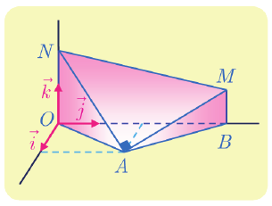

#### 21

نتأمل رباعي وجوه $ABCD$، ونقطتين $E$ و $F$ معرفتين وفق $\overrightarrow{BE}=\frac14\overrightarrow{BC}$ و $\overrightarrow{AF}=\frac23\overrightarrow{AD}$. أثبت أن $G$، مركز الأبعاد المتناسبة للنقاط $(A,1)$ و $(B,3)$ و $(C,1)$ و $(D,2)$، يقع على $[EF]$. ثم عين النقطة $G$ على $[EF]$.

#### 22

نتأمل رباعي وجوه $ABCD$. ونقطتين $I$ و $J$ معرفتين وفق $\overrightarrow{IA}=2\overrightarrow{IB}$ و $\overrightarrow{JC}=2\overrightarrow{JD}$.

1. أيمكن أن تنطبق إحدى النقطتين $I$ و $J$ على الأخرى؟
2. أثبت أنه، أياً كانت النقطة $M$ من الفراغ، كان:

   $$\overrightarrow{MA}-2\overrightarrow{MB}=-\overrightarrow{MI} \qquad \text{و} \qquad \overrightarrow{MC}-2\overrightarrow{MD}=-\overrightarrow{MJ}$$

3. جد مجموعة نقاط الفراغ $M$ التي تحقق:

   $$\left\|\overrightarrow{MB}+\overrightarrow{MC}+\overrightarrow{MD}\right\|=\left\|3\overrightarrow{MA}-\overrightarrow{MB}-\overrightarrow{MC}-\overrightarrow{MD}\right\|$$

#### 23

لدينا في معلم متجانس $(O;\vec{i},\vec{j},\vec{k})$ النقطتان $A(2,-1,2)$ و $B(-2,1,-2)$. نقرن بكل نقطة $M(x,y,z)$، من الفراغ، المقدار $f(M)=MA^2+MB^2$.

1. احسب $f(M)$ بدلالة $x$ و $y$ و $z$.
2. أثبت أن مجموعة النقاط $M$ التي تحقق $f(M)=18$ مؤلفة من نقطة واحدة.
3. أثبت أن مجموعة النقاط $M$ التي تحقق $f(M)=30$ كرة مركزها $O$. أوجد نصف قطرها.
4. أثبت أنه، وفق شرط على العدد الحقيقي $k$، مجموعة النقاط $M$ المحققة للعلاقة $f(M)=k$ هي كرة مركزها $O$.

#### 24

نتأمل رباعي الوجوه $ABCD$ رباعي وجوه.

1. $M$ نقطة من الحرف $[AC]$. جد مقطع رباعي الوجوه بالمستوي المار بالنقطة $M$ موازياً للمستوي $(BCD)$.
2. $I$ نقطة من الحرف $[AD]$، و $J$ نقطة من المستقيم $(CD)$، و $K$ نقطة من المستقيم $(BC)$. عين مقطع رباعي الوجوه بالمستوي $(IJK)$.
3. $L$ نقطة من المستوي $(ABD)$. أوجد مقطع رباعي الوجوه بالمستوي $(KJL)$.

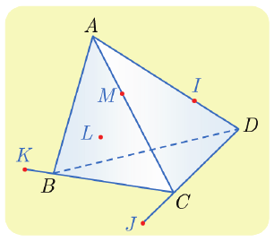

#### 25

نتأمل مكعباً $ABCDEFGH$، والنقاط $I$ و $J$ و $K$ و $L$ منتصفات $[AE]$ و $[BG]$ و $[EG]$ و $[AB]$ بالترتيب. والنقطة $M$ مركز الأبعاد المتناسبة للنقاط $(A,1)$ و $(B,1)$ و $(G,1)$ و $(E,1)$.

1. أثبت أن $M$ تنتمي إلى $[IJ]$ وعين موضعها على هذه القطعة.
2. أثبت أن $M$ تنتمي إلى $[KL]$ وعين موضعها على هذه القطعة.
3. استنتج أن $I$ و $J$ و $K$ و $L$ تقع في مستوٍ واحد وعين طبيعة الرباعي $ILJK$.

## 2. الجداء السلمي في الفراغ

1. الجداء السلمي في المستوي (تذكرة)
2. الجداء السلمي في الفراغ
3. التعامد في الفراغ
4. المعادلة الديكارتية لمستوٍ

الجداء السلمي للأشعة مفهوم حديث نسبياً، يعود إلى القرن الثامن عشر، ولقد ظهر في الفيزياء قبل الرياضيات للحديث عن عمل قوة تنتقل على مسار، ثم دخل علم الهندسة ليعطي أداة هندسية إضافية لدراسة التعامد والإسقاط القائم، وسرعان ما تطور وأصبح أكثر تجريداً على يد رياضيين من نهاية القرن التاسع عشر من مثل غراسمان وهيلبرت وغيرهما.

سنقتصر في دراستنا على المفهوم الهندسي البسيط وتطبيقاته المباشرة، ولكن قد يكون من المفيد أن تعلم أننا في يومنا هذا ندرس فضاءات الأشياء التي يمكن تعريف جداء سلمي عليها، جداء سلمي لتوابع، وجداء سلمي لكثيرات حدود، وإسقاطات قائمة، يفيد هذا المفهوم في تعريف المسافة بين هذه الأشياء فأصبح من أهم المفاهيم الرياضياتية على الإطلاق لما له من تطبيقات عملية في شتى المجالات، من تقريب للتوابع، وحل عددي لمعادلات تفاضلية وغير ذلك.

هذا ومايزال البحث مستمراً عن تطبيقات جديدة لهذا المفهوم المهم، وربما ينتظرك بعضها، فالمجال هنا ما يزال واسعاً للبحث والإبداع.

### انطلاقة نشطة

**الحساب في المكعب.** نهدف إلى التعبير بصيغة تحليلية عن التعامد في الفراغ. لنتأمل مكعباً $ABCDEFGH$ طول ضلعه يساوي $3$. ولنتأمل المعلم $(O;\vec{i},\vec{j},\vec{k})$ المشار إليه في الشكل.

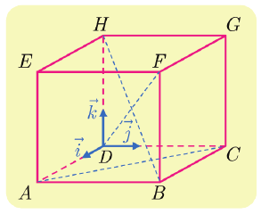

1. اكتب إحداثيات جميع رؤوس المكعب.
2. 
   a. علل تعامد المستقيمين $(AB)$ و $(FG)$.

   b. عين $(x,y,z)$ مركبات الشعاع $\overrightarrow{AB}$ و $(x',y',z')$ مركبات الشعاع $\overrightarrow{FG}$.

   c. احسب المقدار $xx'+yy'+zz'$.
3. 
   a. علل تعامد المستقيمين $(AC)$ و $(BF)$.

   b. عين $(x,y,z)$ مركبات الشعاع $\overrightarrow{AC}$ و $(x',y',z')$ مركبات الشعاع $\overrightarrow{BF}$.

   c. احسب المقدار $xx'+yy'+zz'$.
4. 
   a. ارسم الرباعي $DBFH$ بالأبعاد الحقيقية. أيكون المستقيمان $(DF)$ و $(HB)$ متعامدين؟

   b. عين $(x,y,z)$ مركبات الشعاع $\overrightarrow{DF}$ و $(x',y',z')$ مركبات الشعاع $\overrightarrow{HB}$.

   c. احسب المقدار $xx'+yy'+zz'$.
5. 
   a. ليكن $I$ مركز الوجه $EFGH$. ما إحداثيات $I$؟

   b. لتكن $(x,y,z)$ مركبات الشعاع $\overrightarrow{DF}$ المحسوبة سابقاً، احسب $(x',y',z')$ مركبات الشعاع $\overrightarrow{BI}$.

   c. احسب المقدار $xx'+yy'+zz'$، ماذا تقترح؟
6. 
   a. وضع $I$ على الشكل المرسوم في ④ a.

   b. لإثبات تعامد $(DF)$ و $(BI)$، تؤول المسألة إلى مسألة في المستوي. باختيار معلم متجانس في المستوي $(DBF)$، أعط إحداثيات نقاط الشكل، واحسب الجداء السلمي $\overrightarrow{BI}\cdot\overrightarrow{DF}$، ماذا تستنتج؟

### 1. الجداء السلمي في المستوي (تذكرة)

#### 1.1. العبارات المختلفة للجداء السلمي

1. في المستوي، الجداء السلمي لشعاعين $\vec{u}$ و $\vec{v}$ هو العدد الحقيقي

   $$\vec{u}\cdot\vec{v}=\frac12\left(\|\vec{u}+\vec{v}\|^2-\|\vec{u}\|^2-\|\vec{v}\|^2\right)$$

2. إذا كان الشعاعان $\vec{u}$ و $\vec{v}$ غير معدومين كان

   $$\vec{u}\cdot\vec{v}=\|\vec{u}\|\cdot\|\vec{v}\|\cos(\vec{u},\vec{v})=\|\vec{u}\|\cdot\|\vec{v}\|\cos\theta$$

   حيث $\theta$ هو قياس الزاوية الهندسية للشعاعين $\vec{u}$ و $\vec{v}$.
3. إذا كانت مركبات الشعاعين $\vec{u}$ و $\vec{v}$ في معلم متجانس هي $(x,y)$ و $(x',y')$ بالترتيب كان

   $$\vec{u}\cdot\vec{v}=xx'+yy'$$

4. إذا كان $\overrightarrow{C'D'}$ هو المسقط القائم للشعاع $\overrightarrow{CD}$ على المستقيم $(AB)$ كان

   $$\overrightarrow{CD}\cdot\overrightarrow{AB}=\overrightarrow{C'D'}\cdot\overrightarrow{AB}$$

   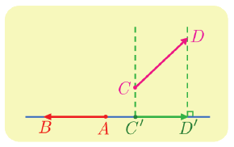

#### 2.1. التعامد والمسافة

**مبرهنة وتعريف 1**

القول إن الشعاعين $\vec{u}$ و $\vec{v}$ متعامدان، يعني أن جداءهما السلمي معدوم: $\vec{u}\cdot\vec{v}=0$. وهذا يكافئ في معلم متجانس أن $xx'+yy'=0$ حيث $(x,y)$ و $(x',y')$ هي مركبات الشعاعين $\vec{u}$ و $\vec{v}$ بالترتيب.

ومن جهة أخرى، لما كانت الزاوية الهندسية بين الشعاع وذاته تساوي الصفر استنتجنا أن $\vec{u}\cdot\vec{u}=\|\vec{u}\|^2$، وعليه، في حالة نقطتين $A$ و $B$ في المستوي يكون لدينا $\overrightarrow{AB}\cdot\overrightarrow{AB}=AB^2$.

#### 3.1. بُعد نقطة عن مستقيم

**مبرهنة 2**

في معلم متجانس، بعد النقطة $A(\alpha,\beta)$ عن المستقيم $d$ الذي معادلته $ax+by+c=0$ يساوي $\frac{|a\alpha+b\beta+c|}{\sqrt{a^2+b^2}}$.

**الإثبات**

الشعاع $\vec{n}(a,b)$ شعاع ناظم على المستقيم $d$، وبوجه خاص $\vec{n}\ne\vec{0}$. لنرمز $A'(\alpha',\beta')$ إلى المسقط القائم للنقطة $A$ على $d$، المسافة المطلوبة هي $AA'$. ولكن الشعاعين $\overrightarrow{AA'}$ و $\vec{n}$ مرتبطان خطياً إذن

$$\left|\vec{n}\cdot\overrightarrow{AA'}\right|=\|\vec{n}\|\cdot AA'=\sqrt{a^2+b^2}\cdot AA' \qquad (*)$$

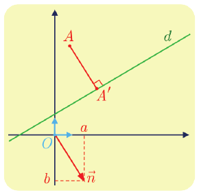

ولكن مركبتي الشعاع $\overrightarrow{AA'}$ هما $(\alpha'-\alpha,\beta'-\beta)$ إذن

$$\begin{aligned}
\vec{n}\cdot\overrightarrow{AA'}&=a(\alpha'-\alpha)+b(\beta'-\beta)=a\alpha'+b\beta'-a\alpha-b\beta\\
&=\underbrace{a\alpha'+b\beta'+c}_{0}-(a\alpha+b\beta+c)=-(a\alpha+b\beta+c)
\end{aligned}$$

إذ استفدنا من وقوع النقطة $A'(\alpha',\beta')$ على $d$ لنستنتج أن $a\alpha'+b\beta'+c=0$. وبالتعويض في $(*)$ نجد المساواة المطلوبة.

#### تكريساً للفهم

**كيف نجري الحسابات باستعمال الجداء السلمي؟**

- أياً كانت الأشعة $\vec{u}$ و $\vec{v}$ و $\vec{w}$ والأعداد الحقيقية $a$ و $b$ كان:
  1. $\vec{u}\cdot\vec{v}=\vec{v}\cdot\vec{u}$
  2. $\vec{u}\cdot(\vec{v}+\vec{w})=\vec{u}\cdot\vec{v}+\vec{u}\cdot\vec{w}$
  3. $(a\vec{u})\cdot(b\vec{v})=ab(\vec{u}\cdot\vec{v})$
  4. $(\vec{u}+\vec{v})\cdot\vec{w}=\vec{u}\cdot\vec{w}+\vec{v}\cdot\vec{w}$
- لا يحقق الجداء السلمي جميع خواص ضرب الأعداد، فمثلاً $\vec{u}\cdot\vec{v}=\vec{u}\cdot\vec{w}$ لا تقتضي $\vec{v}=\vec{w}$. ولكن المساواة $\vec{u}\cdot\vec{v}=\vec{u}\cdot\vec{w}$ تكافئ $\vec{u}\cdot(\vec{v}-\vec{w})=0$ أي إن الشعاعين $\vec{u}$ و $\vec{v}-\vec{w}$ متعامدان.

**كيف نحسب $\vec{u}\cdot\vec{v}$ عندما يكون $\vec{u}$ و $\vec{v}$ مرتبطين خطياً؟**

- إذا كان الشعاعان مرتبطين خطياً ولهما الجهة نفسها كان $\vec{u}\cdot\vec{v}=\|\vec{u}\|\|\vec{v}\|$. وإذا كانا متعاكسين بالجهة كان $\vec{u}\cdot\vec{v}=-\|\vec{u}\|\|\vec{v}\|$. وفي جميع الأحوال $|\vec{u}\cdot\vec{v}|=\|\vec{u}\|\|\vec{v}\|$.

#### تطبيقات

- علاقة الكاشي: $a^2=b^2+c^2-2bc\cos A$.
- مبرهنة المتوسط: $b^2+c^2=2m^2+\frac{a^2}{2}$.
- في متوازي الأضلاع: مجموع مربعات أطوال الأضلاع يساوي مجموع مربعي طولي القطرين.

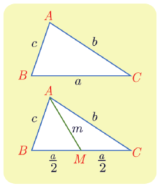

**مثال: إثبات تعامد مستقيمين**

$ABC$ مثلث قائم في $A$، و $M$ منتصف $[BC]$، و $H$ موقع الارتفاع المرسوم من $A$. ليكن $K$ و $L$ المسقطين القائمين للنقطة $H$ على $[AB]$ و $[AC]$ بالترتيب. أثبت تعامد المستقيمين $(AM)$ و $(KL)$.

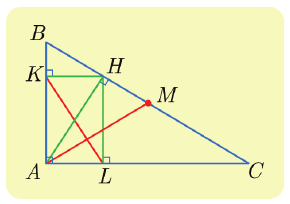

**الحل**

سنستعمل الجداء السلمي. لإثبات تعامد المستقيمين $(AM)$ و $(KL)$، نبرهن أن $\overrightarrow{AM}\cdot\overrightarrow{KL}=0$. لما كانت $M$ منتصف $[BC]$ كان $\overrightarrow{AM}=\frac12(\overrightarrow{AB}+\overrightarrow{AC})$ لنحسب إذن $\overrightarrow{AB}\cdot\overrightarrow{KL}$ و $\overrightarrow{AC}\cdot\overrightarrow{KL}$.

بالاستفادة من المسقط القائم على $(AB)$ نجد: $\overrightarrow{AB}\cdot\overrightarrow{KL}=\overrightarrow{AB}\cdot\overrightarrow{KA}=\overrightarrow{AB}\cdot\overrightarrow{HA}$.

وبالاستفادة من المسقط القائم على $(AC)$ نجد: $\overrightarrow{AC}\cdot\overrightarrow{KL}=\overrightarrow{AC}\cdot\overrightarrow{AL}=\overrightarrow{AC}\cdot\overrightarrow{AH}$.

إذن

$$\begin{aligned}
\overrightarrow{AM}\cdot\overrightarrow{KL}&=\frac12(\overrightarrow{AB}\cdot\overrightarrow{KL}+\overrightarrow{AC}\cdot\overrightarrow{KL})=\frac12(\overrightarrow{AB}\cdot\overrightarrow{HA}+\overrightarrow{AC}\cdot\overrightarrow{AH})\\
&=\frac12(\overrightarrow{AC}-\overrightarrow{AB})\cdot\overrightarrow{AH}=\frac12\overrightarrow{BC}\cdot\overrightarrow{AH}=0
\end{aligned}$$

لأنه استناداً إلى الفرض $(AH)$ عمودي على $(BC)$. ومنه تعامد المستقيمين $(AM)$ و $(KL)$.

#### تدرّب

نعطى في هذه الفقرة معلماً متجانساً $(O;\vec{i},\vec{j})$.

1. احسب $\vec{u}\cdot\vec{v}$ و $\vec{v}\cdot\vec{w}$ و $\vec{w}\cdot\vec{u}$ في الحالتين:
   1. $\vec{u}=2\vec{i}-3\vec{j}$ و $\vec{v}=\frac12\vec{i}+5\vec{j}$ و $\vec{w}=\frac13\vec{i}-2\vec{j}$.
   2. $\vec{u}(2,-1)$ و $\vec{v}(-\frac12,3)$ و $\vec{w}(5,2)$.
2. أعط في الحالتين الآتيتين معادلة المستقيم المار بالنقطة $A$ والعمودي على المستقيم $d$:
   1. $A(5,3)$ و $d:2x+5y-5=0$.
   2. $A(-1,2)$ و $d:x-3y+2=0$.
3. أثبت في حالة أربع نقاط $A$ و $B$ و $C$ و $D$ من المستوي أن:

   $$2\overrightarrow{AC}\cdot\overrightarrow{DB}=AB^2-BC^2+CD^2-DA^2$$

4. أعط في الحالتين الآتيتين بُعد النقطة $A$ عن المستقيم $d$:
   1. $A(-2,4)$ و $d:2x+y-5=0$.
   2. $A(-\sqrt2,2)$ و $d:\sqrt2x-3y-1=0$.

### 2. الجداء السلمي في الفراغ

فيما يأتي نفترض أننا اخترنا في الفراغ واحدة للطول.

#### 1.2. تعريف

**تعريف 2**

في الفراغ، الجداء السلمي لشعاعين $\vec{u}$ و $\vec{v}$ هو العدد الحقيقي

$$\vec{u}\cdot\vec{v}=\frac12\left(\|\vec{u}+\vec{v}\|^2-\|\vec{u}\|^2-\|\vec{v}\|^2\right)$$

لاحظ أن شعاعين يقعان بالضرورة في مستوٍ، أي إذا تأملنا ثلاث نقاط $A$ و $B$ و $C$ بحيث يكون $\vec{u}=\overrightarrow{AB}$ و $\vec{v}=\overrightarrow{AC}$، فيوجد على الأقل مستوٍ $\mathcal{P}$ يحوي النقاط $A$ و $B$ و $C$، وتكون واحدة الطول في $\mathcal{P}$ هي نفسها في الفراغ، وهكذا يتفق تعريف الجداء السلمي للشعاعين $\overrightarrow{AB}$ و $\overrightarrow{AC}$ في الفراغ مع تعريف الجداء السلمي لهذين الشعاعين في المستوي $\mathcal{P}$. ينتج من ذلك أن العبارات الآتية للجداء السلمي، التي جرى إثبات صحتها في المستوي، تبقى صحيحة في الفراغ:

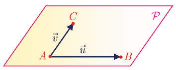

- إذا كان $\alpha$ قياساً للزاوية الهندسية للشعاعين $\vec{u}$ و $\vec{v}$ كان $\vec{u}\cdot\vec{v}=\|\vec{u}\|\cdot\|\vec{v}\|\cos\alpha$. وعلى وجه الخصوص $\overrightarrow{AB}\cdot\overrightarrow{AB}=\|\overrightarrow{AB}\|^2=AB^2$.
- وإذا كانت $H$ هي المسقط القائم في المستوي $\mathcal{P}$ للنقطة $C$ على المستقيم $(AB)$ كان

  $$\vec{u}\cdot\vec{v}=\overrightarrow{AB}\cdot\overrightarrow{AC}=\overrightarrow{AB}\cdot\overrightarrow{AH}$$

  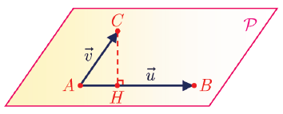

#### 2.2. العبارة التحليلية للجداء السلمي

**مبرهنة 3**

نفترض أن مركبات الشعاعين $\vec{u}$ و $\vec{v}$ في معلم متجانس هي $(x,y,z)$ و $(x',y',z')$ بالترتيب، عندئذ: $\vec{u}\cdot\vec{v}=xx'+yy'+zz'$.

**الإثبات**

ضمن شروط المبرهنة لدينا

$$\|\vec{u}\|^2=x^2+y^2+z^2 \qquad \text{و} \qquad \|\vec{v}\|^2=x'^2+y'^2+z'^2$$

و

$$\begin{aligned}
\|\vec{u}+\vec{v}\|^2&=(x+x')^2+(y+y')^2+(z+z')^2\\
&=x^2+y^2+z^2+x'^2+y'^2+z'^2+2xx'+2yy'+2zz'
\end{aligned}$$

إذن

$$\vec{u}\cdot\vec{v}=xx'+yy'+zz'$$

تفيد المبرهنة السابقة في إثبات صحة قواعد الحساب التي تماثل نظيراتها في المستوي دون عناء. المبرهنة الآتية تلخص هذه القواعد:

**مبرهنة 4**

أياً كانت الأشعة $\vec{u}$ و $\vec{v}$ و $\vec{w}$ والأعداد الحقيقية $a$ و $b$ كان

1. $\vec{u}\cdot\vec{v}=\vec{v}\cdot\vec{u}$
2. $\vec{u}\cdot(\vec{v}+\vec{w})=\vec{u}\cdot\vec{v}+\vec{u}\cdot\vec{w}$
3. $(a\vec{u})\cdot(b\vec{v})=ab(\vec{u}\cdot\vec{v})$
4. $(\vec{u}+\vec{v})\cdot\vec{w}=\vec{u}\cdot\vec{w}+\vec{v}\cdot\vec{w}$

**الإثبات**

متروك تمريناً للقارئ.

**مثال: حساب جداء سلمي دون معلم**

1. $ABCD$ رباعي وجوه منتظم. كل وجه فيه مثلث متساوي الأضلاع طول ضلعه $a$. احسب $\overrightarrow{AB}\cdot\overrightarrow{AC}$ و $\overrightarrow{AB}\cdot\overrightarrow{AD}$ و $\overrightarrow{AB}\cdot\overrightarrow{CD}$.
2. $ABCDEFGH$ مكعب طول ضلعه $a$. احسب $\overrightarrow{AE}\cdot\overrightarrow{AF}$ و $\overrightarrow{AE}\cdot\overrightarrow{CH}$ و $\overrightarrow{AE}\cdot\overrightarrow{AG}$ و $\overrightarrow{AF}\cdot\overrightarrow{HC}$.

**الحل**

1. أولاً، لدينا $\overrightarrow{AB}\cdot\overrightarrow{AC}=AB\cdot AC\cos\widehat{BAC}=a^2\cos\frac\pi3=\frac{a^2}{2}$. وبالمثل $\overrightarrow{AB}\cdot\overrightarrow{AD}=\frac{a^2}{2}$. وأخيراً، لأن $\overrightarrow{CD}=\overrightarrow{AD}-\overrightarrow{AC}$ استنتجنا أن

   $$\begin{aligned}
   \overrightarrow{AB}\cdot\overrightarrow{CD}&=\overrightarrow{AB}\cdot(\overrightarrow{AD}-\overrightarrow{AC})\\
   &=\overrightarrow{AB}\cdot\overrightarrow{AD}-\overrightarrow{AB}\cdot\overrightarrow{AC}=\frac{a^2}{2}-\frac{a^2}{2}=0
   \end{aligned}$$

   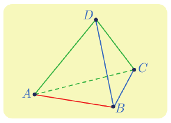

2. 
   - لأن $E$ هي المسقط القائم للنقطة $F$ على $(AE)$ استنتجنا أن $\overrightarrow{AE}\cdot\overrightarrow{AF}=\overrightarrow{AE}\cdot\overrightarrow{AE}=a^2$.
   - ولأن $\overrightarrow{CH}=\overrightarrow{BE}$ و $A$ هي المسقط القائم للنقطة $B$ على $(AE)$ استنتجنا أن $\overrightarrow{AE}\cdot\overrightarrow{CH}=\overrightarrow{AE}\cdot\overrightarrow{BE}=\overrightarrow{AE}\cdot\overrightarrow{AE}=a^2$.
   - ولأن $H$ هي المسقط القائم للنقطة $G$ على المستوي $(ADH)$، و $E$ هي المسقط القائم للنقطة $H$ على $(AE)$ وجدنا $\overrightarrow{AE}\cdot\overrightarrow{AG}=\overrightarrow{AE}\cdot\overrightarrow{AH}=\overrightarrow{AE}\cdot\overrightarrow{AE}=a^2$.
   - وأخيراً $\overrightarrow{AF}\cdot\overrightarrow{HC}=\overrightarrow{AF}\cdot\overrightarrow{EB}=0$.

   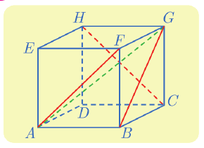

**مثال: حساب جداء سلمي في معلم**

نعطى في معلم متجانس $(O;\vec{i},\vec{j},\vec{k})$ النقاط $A(1,0,0)$ و $B(0,1,0)$ و $C(0,0,1)$ و $D(0,2,0)$ و $E(1,1,1)$. النقطة $M$ هي منتصف $[AB]$. احسب $\overrightarrow{AB}\cdot\overrightarrow{AC}$ و $\overrightarrow{AE}\cdot\overrightarrow{AD}$ و $\overrightarrow{OE}\cdot\overrightarrow{CM}$.

**الحل**

- مركبات الشعاعين $\overrightarrow{AB}$ و $\overrightarrow{AC}$ هي $(-1,1,0)$ و $(-1,0,1)$ بالترتيب إذن $\overrightarrow{AB}\cdot\overrightarrow{AC}=1$.
- مركبات الشعاعين $\overrightarrow{AD}$ و $\overrightarrow{AE}$ هي $(-1,2,0)$ و $(0,1,1)$ بالترتيب إذن $\overrightarrow{AE}\cdot\overrightarrow{AD}=2$.
- لما كان $M(\frac12,\frac12,0)$ استنتجنا أن مركبات الشعاعين $\overrightarrow{OE}$ و $\overrightarrow{CM}$ هي $(1,1,1)$ و $(\frac12,\frac12,-1)$ بالترتيب إذن $\overrightarrow{OE}\cdot\overrightarrow{CM}=0$.

#### تدرّب

نعطى في هذه الفقرة معلماً متجانساً $(O;\vec{i},\vec{j},\vec{k})$.

1. احسب $\vec{u}\cdot\vec{v}$ و $\vec{v}\cdot\vec{w}$ و $\vec{w}\cdot\vec{u}$ في الحالتين:
   1. $\vec{u}(1+\sqrt2,\sqrt3,0)$ و $\vec{v}(1-\sqrt2,0,-1)$ و $\vec{w}(0,-\sqrt3,1)$.
   2. $\vec{u}(\frac23,-\frac16,\frac12)$ و $\vec{v}(\frac12,-2,\frac23)$ و $\vec{w}(1,0,1)$.
2. إذا علمت أن نظيم $\vec{u}$ يساوي $5$ ونظيم $\vec{v}$ يساوي $3$ وأن $\vec{u}\cdot\vec{v}=-4$ فاحسب المقادير الآتية:
   1. $\vec{u}\cdot(\vec{u}+\vec{v})$
   2. $\vec{v}\cdot(\vec{u}-\vec{v})$
   3. $(2\vec{u})\cdot(\vec{v}-3\vec{u})$
   4. $(\vec{u}+\vec{v})\cdot(\vec{u}-3\vec{v})$
3. نتأمل هرماً $S-ABCD$ قاعدته مربع ورأسه $S$. وطول كل حرف من حروفه وأضلاع قاعدته يساوي $a$. احسب $\overrightarrow{SA}\cdot\overrightarrow{SB}$ و $\overrightarrow{SA}\cdot\overrightarrow{SC}$ و $\overrightarrow{SA}\cdot\overrightarrow{AC}$.
4. $ABCDEFGH$ مكعب طول ضلعه $a$. فيه $I$ منتصف $[EF]$ و $J$ منتصف $[CG]$. احسب $\overrightarrow{EI}\cdot\overrightarrow{EA}$ و $\overrightarrow{EI}\cdot\overrightarrow{FC}$ و $\overrightarrow{EI}\cdot\overrightarrow{GJ}$ و $\overrightarrow{EI}\cdot\overrightarrow{IA}$ و $\overrightarrow{JH}\cdot\overrightarrow{JD}$.

   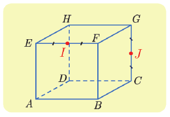

### 3. التعامد في الفراغ

#### 1.3. الأشعة المتعامدة

**تعريف 3**

- في الفراغ، يتعامد شعاعان $\vec{u}$ و $\vec{v}$ إذا وفقط إذا كان $\vec{u}\cdot\vec{v}=0$.
- وهذا يعني أنه في حالة $\vec{u}=\overrightarrow{AB}\ne\vec{0}$ و $\vec{v}=\overrightarrow{CD}\ne\vec{0}$ فإن تعامد الشعاعين $\vec{u}$ و $\vec{v}$ يكافئ تعامد المستقيمين $(AB)$ و $(CD)$.
- وأنه إذا كان $\vec{u}(x,y,z)$ و $\vec{v}(x',y',z')$ في معلم متجانس فإن تعامد الشعاعين $\vec{u}$ و $\vec{v}$ يكافئ $xx'+yy'+zz'=0$.

#### 2.3. الشعاع الناظم على مستوٍ

**تعريف 4**

تعريفاً، القول إن الشعاع غير الصفري $\overrightarrow{AB}$ شعاع ناظم على المستوي $\mathcal{P}$ يعني أن المستقيم $(AB)$ عمودي على $\mathcal{P}$. أي يكون $\vec{n}\ne\vec{0}$ شعاعاً ناظماً على المستوي $\mathcal{P}$ إذا وفقط إذا كان منحاه عمودياً على $\mathcal{P}$.

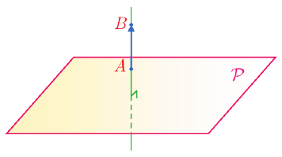

#### 3.3. تعامد مستقيم ومستوٍ

ليكن $d$ مستقيماً شعاع توجيهه $\vec{n}$، ولتكن $A$ نقطة من $d$. المستوي $\mathcal{P}$ العمودي على $d$ في $A$ هو مجموعة النقاط $M$ التي تحقق أن المستقيم $(AM)$ عمودي على $d$ (بالإضافة إلى النقطة $A$ ذاتها). إذن $\mathcal{P}$ هو مجموعة النقاط $M$ التي تحقق أن الشعاع $\overrightarrow{AM}$ عمودي على $\vec{n}$. فالشعاع $\vec{n}$ هو إذن شعاع ناظم على $\mathcal{P}$.

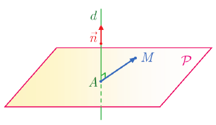

وعليه:

المستوي المار بالنقطة $A$ ويقبل $\vec{n}$ شعاعاً ناظماً هو مجموعة النقاط $M$ التي تحقق $\overrightarrow{AM}\cdot\vec{n}=0$.

#### تكريساً للفهم

لحساب $\overrightarrow{AB}\cdot\overrightarrow{AC}$ يمكن استبدال المسقط القائم للشعاع $\overrightarrow{AC}$ على مستوٍ يحوي $(AB)$ بالشعاع $\overrightarrow{AC}$.

لنفترض أن $A$ و $B$ نقطتان من مستوٍ $\mathcal{P}$، والنقطة $C$ لا تنتمي إلى المستوي $\mathcal{P}$. عندئذ يوجد مستقيم وحيد عمودي على $\mathcal{P}$ ويمر بالنقطة $C$. يقطع هذا المستقيم المستوي $\mathcal{P}$ في نقطة $C'$، نسميها المسقط القائم للنقطة $C$ على المستوي $\mathcal{P}$. ويكون

$$\overrightarrow{AB}\cdot\overrightarrow{AC}=\overrightarrow{AB}\cdot(\overrightarrow{AC'}+\overrightarrow{C'C})=\overrightarrow{AB}\cdot\overrightarrow{AC'}+\overrightarrow{AB}\cdot\overrightarrow{C'C}$$

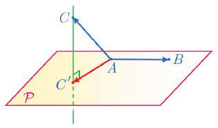

ولكن المستقيمين $(AB)$ و $(CC')$ متعامدان، إذن $\overrightarrow{AB}\cdot\overrightarrow{C'C}=0$ و $\overrightarrow{AB}\cdot\overrightarrow{AC}=\overrightarrow{AB}\cdot\overrightarrow{AC'}$.

**الخلاصة:** لا تتغير قيمة الجداء السلمي لشعاعين $\overrightarrow{AB}$ و $\overrightarrow{AC}$ عند استبدال المسقط القائم للشعاع $\overrightarrow{AC}$ على المستقيم $(AB)$ أو على مستوٍ يحوي $(AB)$ بالشعاع $\overrightarrow{AC}$.

**كيف نترجم شعاعياً تعامد مستقيم مع مستوٍ؟**

إذا كان الشعاع الموجه $\vec{u}$ لمستقيم $d$ عمودياً على زوج $(\vec{v},\vec{w})$ من الأشعة المستقلة خطياً في مستوٍ $\mathcal{P}$، كان $d$ عمودياً على $\mathcal{P}$.

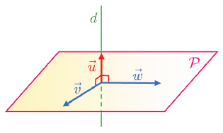

**كيف نعين الأوضاع النسبية لمستويين اعتماداً على الأشعة الناظمة؟**

ليكن $\vec{n}_1$ شعاعاً ناظماً على مستوٍ $\mathcal{P}$، وليكن $\vec{n}_2$ شعاعاً ناظماً على مستوٍ $\mathcal{Q}$.

- إذا كان $\vec{n}_1$ و $\vec{n}_2$ مرتبطين خطياً كان المستويان $\mathcal{P}$ و $\mathcal{Q}$ متوازيين (أو منطبقين) وإذا كانا غير مرتبطين خطياً كان المستويان متقاطعين.
- وإذا كان $\vec{n}_1$ و $\vec{n}_2$ متعامدين كان المستويان $\mathcal{P}$ و $\mathcal{Q}$ متعامدين، والعكس صحيح أيضاً.

**مثال: تعامد مستقيمين (خاصة الأعمدة الثلاثة)**

المستقيم $d$ محتوى في المستوي $\mathcal{P}$. والنقطة $B$ هي المسقط القائم لنقطة $A$ خارج $\mathcal{P}$ على $\mathcal{P}$. و $C$ هي المسقط القائم للنقطة $B$ على $d$. عندئذ المستقيمان $(AC)$ و $d$ متعامدان.

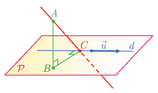

لإثبات تعامد مستقيمين يمكننا إثبات تعامد شعاع موجه لأحدهما مع شعاع موجه للآخر.

**الحل**

ليكن $\vec{u}$ شعاعاً موجهاً للمستقيم $d$، $\overrightarrow{BC}$ هو المسقط القائم للشعاع $\overrightarrow{AC}$ على المستوي $\mathcal{P}$، والمستقيم $(BC)$ عمودي على $d$ إنشاءً إذن $\overrightarrow{AC}\cdot\vec{u}=\overrightarrow{BC}\cdot\vec{u}=0$. وهي النتيجة المرجوة.

#### تدرّب

نعطى في هذه الفقرة معلماً متجانساً $(O;\vec{i},\vec{j},\vec{k})$.

1. بيّن فيما يأتي إذا كان الشعاعان $\vec{u}$ و $\vec{v}$ متعامدين أو عين الوسيط $\alpha$ ليكونا كذلك.
   1. $\vec{u}(\frac54,-\frac32,\frac12)$، $\vec{v}(-\frac25,2,3)$.
   2. $\vec{u}(\sqrt2,1+\sqrt2,1-\sqrt2)$، $\vec{v}(-\sqrt2,1,1)$.
   3. $\vec{u}(2,-\frac12,5)$، $\vec{v}(-\frac25,3,\alpha)$.
   4. $\vec{u}(\sqrt3,\frac13,2)$، $\vec{v}(\alpha,2\alpha,\frac12)$.
2. نتأمل النقطتين $A(2,-5,1)$ و $B(0,2,6)$. والمستقيم $d$ المار بالنقطة $C(-2,3,1)$ وشعاع توجيهه $\vec{u}=-4\vec{i}+\vec{j}-3\vec{k}$. أثبت أن $d$ عمودي على المستقيم $(AB)$.
3. أطوال الأشعة $\vec{u}$ و $\vec{v}$ و $\vec{u}+\vec{v}$ هي بالترتيب $6$ و $8$ و $10$. أيكون الشعاعان $\vec{u}$ و $\vec{v}$ متعامدين؟
4. نتأمل شعاعين $\vec{u}$ و $\vec{v}$، ونفترض أن $\vec{u}+\vec{v}$ و $\vec{u}-\vec{v}$ متعامدان. أثبت أن للشعاعين $\vec{u}$ و $\vec{v}$ الطول نفسه.

### 4. المعادلة الديكارتية لمستوٍ

#### 1.4. المعادلة الديكارتية لمستوٍ

**مبرهنة 5**

في معلم متجانس.

1. لكل مستوٍ $\mathcal{P}$ معادلة ديكارتية من الشكل $ax+by+cz+d=0$ حيث الأعداد $a$ و $b$ و $c$ ليست جميعها معدومة. وعندها يكون $\vec{n}(a,b,c)$ شعاعاً ناظماً على $\mathcal{P}$.
2. وبالعكس، إذا أعطيت الأعداد $a$ و $b$ و $c$ و $d$، ولم تكن $a$ و $b$ و $c$ جميعها معدومة، فإن مجموعة النقاط $M(x,y,z)$ التي تحقق $ax+by+cz+d=0$ هي مستوٍ يقبل $\vec{n}(a,b,c)$ شعاعاً ناظماً.

**الإثبات**

1. ليكن $\mathcal{P}$ مستوياً وليكن $\vec{n}(a,b,c)$ شعاعاً ناظماً عليه، في هذه الحالة لا تكون الأعداد $a$ و $b$ و $c$ معدومة معاً. لنختر $A(x_0,y_0,z_0)$ نقطة من $\mathcal{P}$. عندئذ يكون $\mathcal{P}$ هو مجموعة النقاط $M(x,y,z)$ التي تحقق $\overrightarrow{AM}\cdot\vec{n}=0$. وهذا يكافئ

   $$a(x-x_0)+b(y-y_0)+c(z-z_0)=0$$

   أو $ax+by+cz+d=0$ وقد عرفنا $d=-ax_0-by_0-cz_0$.
2. وبالعكس، لتكن $\mathcal{E}$ مجموعة النقاط $M(x,y,z)$ التي تحقق $ax+by+cz+d=0$، حيث الأعداد $a$ و $b$ و $c$ ليست معدومة معاً. عندها من الممكن دوماً اختيار أعداد $x_0$ و $y_0$ و $z_0$ تحقق $d=-ax_0-by_0-cz_0$ (مثلاً في حالة $a\ne0$ يمكننا أن نختار $x_0=-d/a$ و $y_0=z_0=0$). وهكذا تكون $A(x_0,y_0,z_0)$ نقطة من $\mathcal{E}$. والقول إن $M(x,y,z)$ نقطة ما من $\mathcal{E}$ يكافئ:

   $$a(x-x_0)+b(y-y_0)+c(z-z_0)=0$$

   أي إن الشعاع $\vec{n}(a,b,c)$ عمودي على الشعاع $\overrightarrow{AM}$. والنقطة $M$ تنتمي إلى المستوي $\mathcal{P}$ المار بالنقطة $A$ ويقبل $\vec{n}(a,b,c)$ شعاعاً ناظماً. وهذا يثبت المطلوب.

#### 2.4. بُعد نقطة عن مستوٍ

**مبرهنة 6**

في معلم متجانس. لتكن $ax+by+cz+d=0$ معادلة المستوي $\mathcal{P}$. عندئذ يعطى بعد النقطة $A(\alpha,\beta,\gamma)$ عن المستوي $\mathcal{P}$ بالعلاقة

$$\operatorname{dist}(A,\mathcal{P})=\frac{|a\alpha+b\beta+c\gamma+d|}{\sqrt{a^2+b^2+c^2}}.$$

**الإثبات**

الشعاع $\vec{n}(a,b,c)$ شعاع ناظم على المستوي $\mathcal{P}$، وبوجه خاص $\vec{n}\ne\vec{0}$. لنرمز $A'(\alpha',\beta',\gamma')$ إلى المسقط القائم للنقطة $A$ على $\mathcal{P}$، المسافة المطلوبة هي $\operatorname{dist}(A,\mathcal{P})=AA'$. ولكن الشعاعين $\overrightarrow{AA'}$ و $\vec{n}$ مرتبطان خطياً إذن

$$|\vec{n}\cdot\overrightarrow{AA'}|=\|\vec{n}\|\cdot AA'=\sqrt{a^2+b^2+c^2}\cdot AA' \qquad (*)$$

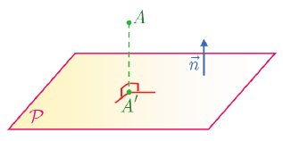

ولكن مركبات الشعاع $\overrightarrow{AA'}$ هي $(\alpha'-\alpha,\beta'-\beta,\gamma'-\gamma)$ إذن

$$\begin{aligned}
\vec{n}\cdot\overrightarrow{AA'}&=a(\alpha'-\alpha)+b(\beta'-\beta)+c(\gamma'-\gamma)\\
&=a\alpha'+b\beta'+c\gamma'-a\alpha-b\beta-c\gamma\\
&=\underbrace{a\alpha'+b\beta'+c\gamma'+d}_{0}-(a\alpha+b\beta+c\gamma+d)\\
&=-(a\alpha+b\beta+c\gamma+d)
\end{aligned}$$

إذ استفدنا من وقوع النقطة $A'(\alpha',\beta',\gamma')$ في $\mathcal{P}$ لنستنتج أن $a\alpha'+b\beta'+c\gamma'+d=0$. وبالتعويض في $(*)$ نجد

$$\operatorname{dist}(A,\mathcal{P})=\frac{|a\alpha+b\beta+c\gamma+d|}{\sqrt{a^2+b^2+c^2}}$$

**مثال: إيجاد المعادلة الديكارتية لمستوٍ**

نتأمل، في معلم متجانس $(O;\vec{i},\vec{j},\vec{k})$، النقطة $A(2,1,-3)$ و الشعاع $\vec{n}(1,1,2)$. أعط معادلة للمستوي $\mathcal{P}$ المار بالنقطة $A$ ويقبل $\vec{n}$ شعاعاً ناظماً.

**الحل**

تنتمي النقطة $M(x,y,z)$ إلى المستوي المطلوب $\mathcal{P}$ إذا وفقط إذا تحقق الشرط $\overrightarrow{MA}\cdot\vec{n}=0$. وهذا يكافئ

$$1\times(x-2)+1\times(y-1)+2\times(z+3)=0$$

أو $x+y+2z+3=0$. وهي المعادلة المطلوبة.

**مثال: تقاطع مستويين أو توازيهما**

في الحالات الآتية نعطي المستويين $\mathcal{P}$ و $\mathcal{Q}$ ويطلب معرفة إذا كانا متوازيين أو متقاطعين أو متعامدين.

1. $\mathcal{P}:x-4y+7=0$، $\mathcal{Q}:x+2y-z+1=0$
2. $\mathcal{P}:x-2y+3z-1=0$، $\mathcal{Q}:2x-4y+6z=0$
3. $\mathcal{P}:x+2y+4z-5=0$، $\mathcal{Q}:2x+y-z+1=0$

**الحل**

1. نلاحظ أن $\vec{n}_1(1,-4,0)$ شعاع ناظم على $\mathcal{P}$، و $\vec{n}_2(1,2,-1)$ شعاع ناظم على $\mathcal{Q}$. الشعاعان $\vec{n}_1$ و $\vec{n}_2$ ليسا مرتبطين خطياً لأن مركباتهما ليست متناسبة، أي لا يوجد عدد حقيقي $k$ يحقق $\vec{n}_1=k\vec{n}_2$. إذن المستويان $\mathcal{P}$ و $\mathcal{Q}$ متقاطعان. ومن الطبيعي أن نتساءل إذا كانا متعامدين. فنحسب $\vec{n}_1\cdot\vec{n}_2=-7\ne0$ لنرى أن $\vec{n}_1$ و $\vec{n}_2$ ليسا متعامدين. فالمستويان $\mathcal{P}$ و $\mathcal{Q}$ غير متعامدين.
2. هنا نجد أن المستويين $\mathcal{P}$ و $\mathcal{Q}$ متوازيين وغير منطبقين لأن المبدأ $O(0,0,0)$ ينتمي إلى $\mathcal{Q}$ ولا ينتمي إلى $\mathcal{P}$.
3. في هذه الحالة نجد أن الشعاعين الناظمين على $\mathcal{P}$ و $\mathcal{Q}$ متعامدان فالمستويان المذكوران متعامدان.

#### تدرّب

نعطى في هذه الفقرة معلماً متجانساً $(O;\vec{i},\vec{j},\vec{k})$.

1. في كل من الحالات الآتية اكتب معادلة للمستوي المار بالنقطة $A$ ويقبل الشعاع $\vec{n}$ شعاعاً ناظماً:
   1. $A(1,0,5)$، $\vec{n}(1,-1,0)$
   2. $A(\sqrt2,-2,5)$، $\vec{n}(2,-3,-1)$
   3. $A(\frac12,3,-1)$، $\vec{n}(\frac23,4,-1)$
   4. $A(0,-3,0)$، $\vec{n}(\sqrt3,2,0)$
2. في كل من الحالات الآتية اكتب معادلة للمستوي $\mathcal{Q}$ المار بالنقطة $A$ موازياً المستوي $\mathcal{P}$:
   1. $A(1,0,1)$، $\mathcal{P}:2x-y+3z=4$
   2. $A(0,0,0)$، $\mathcal{P}:z=2$
   3. $A(0,3,0)$، $\mathcal{P}:x+y=5$
   4. $A(-1,2,-3)$، $\mathcal{P}:5x-3y+4z=8$
3. ادرس تعامد كل زوج من المستويات الآتية:

   $$\mathcal{P}:7x+3y-z-1=0 \quad \text{و} \quad \mathcal{Q}:6x-11y-9z-5=0 \quad \text{و} \quad \mathcal{R}:2x-3y+5z+4=0$$

4. في كل من الحالات الآتية بيّن إذا كان المستويان $\mathcal{P}$ و $\mathcal{Q}$ متقاطعين.
   1. $\mathcal{P}:x-y+z=0$، $\mathcal{Q}:x-y+z-3=0$
   2. $\mathcal{P}:2x+y+5=0$، $\mathcal{Q}:4x+2y+z+5=0$
5. احسب بُعد النقطة $A(5,-3,4)$ عن المستوي $\mathcal{P}:2x-y+3z-5=0$. وكذلك احسب بعد النقطة $B(2,2,5)$ عن المستوي $\mathcal{Q}:y-z=0$.

### أفكار يجب تمثّلها

- بعد اختيار واحدة للأطوال في الفضاء، يجري التعبير عن الجداء السلمي لشعاعين $\vec{u}$ و $\vec{v}$ كما في حالة المستوي أي:
  - $\vec{u}\cdot\vec{v}=\frac12(\|\vec{u}+\vec{v}\|^2-\|\vec{u}\|^2-\|\vec{v}\|^2)$.
  - $\vec{u}\cdot\vec{v}=\|\vec{u}\|\|\vec{v}\|\cos\alpha$ حيث $\alpha$ هي قياس الزاوية الهندسية للشعاعين $\vec{u}$ و $\vec{v}$.
- إذا كانت $H$ المسقط القائم للنقطة $C$ على المستقيم $(AB)$ أو على مستوٍ يحوي $(AB)$ كان $\overrightarrow{AB}\cdot\overrightarrow{AC}=\overrightarrow{AB}\cdot\overrightarrow{AH}$.
- تحليلياً إذا كان $\vec{u}(x,y,z)$ و $\vec{v}(x',y',z')$ في معلم متجانس كان $\vec{u}\cdot\vec{v}=xx'+yy'+zz'$.
- كما في حالة المستوي، يفيد الجداء السلمي في الفراغ في مسائل التعامد وحساب المسافة وتمام جيب زاوية.
- مفهوم الشعاع الناظم على مستوٍ مفيد وأساسي، فهو يتيح التفسير الشعاعي لتعامد وتوازي المستقيمات والمستويات. وهو لا يكون معدوماً أبداً.
- المستوي المار بالنقطة $A$ ويقبل $\vec{n}$ شعاعاً ناظماً هو مجموعة نقاط الفراغ $M$ التي تحقق الشرط $\overrightarrow{AM}\cdot\vec{n}=0$. وهذه الخاصة المميزة هي التي تفيد في كتابة المعادلة الديكارتية لمستوٍ.
- تذكّر أن بُعد النقطة $A(\alpha,\beta,\gamma)$ عن مستوٍ معادلته $ax+by+cz+d=0$ يعطى بالعلاقة

  $$\frac{|a\alpha+b\beta+c\gamma+d|}{\sqrt{a^2+b^2+c^2}}$$

### منعكسات يجب امتلاكها

- إذا كانت $ax+by+cz+d=0$ معادلة مستوٍ فنتذكر أن $\vec{n}(a,b,c)$ شعاع ناظم عليه. وأن كل نقطة $M(x,y,z)$ تحقق مركباتها معادلة المستوي تقع عليه.
- التفسير الشعاعي للتعامد والتوازي.
- لا تنس أن استعمال معلم متجانس مفيد في الإثبات. عندئذ نختار معلماً تكون فيه إحداثيات النقاط المفتاحية بسيطة.

### أخطاء يجب تجنّبها

- للتعامل مع مسائل المسافات أو التعامد، لا تختر معلماً كيفياً، بل، اختر، حصراً، معلماً متجانساً.

### أنشطة

#### نشاط 1: خواص رباعي الوجوه المنتظم

رباعي الوجوه المنتظم هو مجسم له أربعة وجوه كل منها مثلث متساوي الأضلاع. نسمي حرفين متقابلين كل حرفين لا يشتركان برأس.

##### 1. خواص عامة

لتكن $ABCD$ رباعي وجوه منتظم ولنضع $AB=a$.

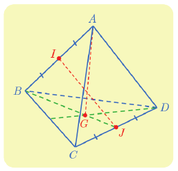

1. نهدف إلى إثبات أن كل حرفين متقابلين متعامدان، وأن المستقيم الواصل بين منتصفي حرفين متقابلين عمودي على كل منهما.
   a. احسب $\overrightarrow{AB}\cdot\overrightarrow{AC}$ و $\overrightarrow{AB}\cdot\overrightarrow{BC}$ و $\overrightarrow{AB}\cdot\overrightarrow{AD}$.

   b. أثبت تعامد المستقيمين $(AB)$ و $(CD)$.

   c. ماذا تستنتج بشأن المستقيمين $(AC)$ و $(BD)$ والمستقيمين $(AD)$ و $(BC)$؟

   d. ليكن $I$ منتصف $[AB]$ و $J$ منتصف $[CD]$. تيقن أن $\overrightarrow{IJ}=\frac12\overrightarrow{AB}+\overrightarrow{BC}+\frac12\overrightarrow{CD}$، واستنتج أن المستقيم $(IJ)$ عمودي على كل من المستقيمين $(AB)$ و $(CD)$.
2. في رباعي الوجوه $ABCD$، الارتفاع النازل من $A$ هو المستقيم المار بالنقطة $A$ عمودياً على المستوي $(BCD)$.

   a. ليكن $G$ مركز ثقل المثلث $BCD$. احسب $\overrightarrow{AG}\cdot\overrightarrow{CD}$ و $\overrightarrow{AG}\cdot\overrightarrow{BD}$، واستنتج أن $(AG)$ هو الارتفاع النازل من $A$.

   b. عين بقية الارتفاعات في رباعي الوجوه $ABCD$.
3. نسمي مركز رباعي الوجوه المنتظم $ABCD$ النقطة $O$ مركز الأبعاد المتناسبة لرؤوس رباعي الوجوه وقد أسندنا إليها الأمثال ذاتها: $\overrightarrow{OA}+\overrightarrow{OB}+\overrightarrow{OC}+\overrightarrow{OD}=\vec{0}$.

   a. أثبت أن النقاط $A$ و $O$ و $G$ تقع على استقامة واحدة واحسب $AG$ و $AO$.

   b. أثبت أن $O$ هو منتصف القطعة المستقيمة $[IJ]$.

   c. احسب الأطوال $OB$ و $OI$.

   d. أثبت أن النقطة $O$ متساوية البعد عن جميع رؤوس رباعي الوجوه.
4. نهدف إلى حساب الزاوية الهندسية $\widehat{AOB}$.

   a. احسب $\overrightarrow{OA}\cdot\overrightarrow{OB}$ بأسلوبين أحدهما بكتابة $\overrightarrow{OA}\cdot\overrightarrow{OB}=(\overrightarrow{OI}+\overrightarrow{IA})\cdot(\overrightarrow{OI}+\overrightarrow{IB})$.

   b. استنتج قيمة تقريبية للزاوية $\widehat{AOB}$ بالدرجات. وبيّن أن $\widehat{AOB}=\widehat{BOC}=\widehat{COD}=\widehat{DOA}$.

##### 2. تطبيق في الكيمياء

نجد أدناه تمثيلاً لجزيئة الميثان. تقع نوى ذرات الهيدروجين الأربع $H$ على رؤوس رباعي وجوه منتظم. تقع نواة ذرة الكربون $C$ داخل رباعي الوجوه على المسافة نفسها من كل واحدة من رؤوس رباعي الوجوه أي في مركزه. لتبسيط تمثيل جزيئة الميثان، نستعمل المخطط المبين أدناه، حيث مثلنا الروابط بخطوط متصلة وحروف رباعي الوجوه بخطوط متقطعة لنتذكرها. هذا المخطط هو الصيغة الستيريوكيميائية للميثان. أتاحت قياسات تحديد طول الروابط $C-H$ بمقدار $1.09\times10^{-10}\,\mathrm{m}$.

1. أعط تقريباً لقياس الزاوية بين رابطتين من النوع $C-H$.
2. عين طول حرف رباعي الوجوه أي المسافة بين ذرتي هيدروجين.

#### نشاط 2: استعمال معلم

##### 1. رباعي الوجوه ثلاثي الزوايا القائمة

نتأمل رباعي الوجوه $OABC$ ثلاثي الزوايا القائمة رأسه $O$، أي إن المستقيمات $(OA)$ و $(OB)$ و $(OC)$ متعامدة مثنى مثنى. لنفترض إضافة إلى ذلك أن $OC=1$ و $OB=2$ و $OA=3$. نرمز بالرمز $H$ إلى المسقط القائم للنقطة $O$ على المستوي $(ABC)$.

1. نريد إثبات أن $H$ هي نقطة تلاقي ارتفاعات المثلث $ABC$. لنختر إذن معلماً متجانساً $(O;\vec{i},\vec{j},\vec{k})$ بوضع $\vec{i}=\frac13\overrightarrow{OA}$ و $\vec{j}=\frac12\overrightarrow{OB}$ و $\vec{k}=\overrightarrow{OC}$.

   a. احسب إحداثيات $H$.

   b. احسب $\overrightarrow{OC}\cdot\overrightarrow{AB}$ و $\overrightarrow{OH}\cdot\overrightarrow{AB}$ واستنتج أن المستقيم $(AB)$ عمودي على المستوي $(OCH)$.

   c. احسب $\overrightarrow{CH}\cdot\overrightarrow{AB}$ و $\overrightarrow{BH}\cdot\overrightarrow{AC}$ واستنتج أن $H$ هي نقطة تلاقي ارتفاعات المثلث $ABC$.
2. 
   a. أثبت أن المسقط القائم لكل من النقطتين $C$ و $O$ على المستقيم $(AB)$ هو النقطة $K$ ذاتها، واحسب إحداثيات $K$.

   b. أعط تقريباً لقياس الزاوية $\widehat{OKC}$.

##### بعض خواص المكعب

ليكن $ABCDA'B'C'D'$ مكعباً طول حرفه $a$. النقطة $H$ هي المسقط القائم للرأس $B$ على المستقيم $(AC')$. نريد إثبات أن النقطة $H$ هي أيضاً المسقط القائم لكل من $A'$ و $D$ على المستقيم $(AC')$.

سنستعمل المعلم المتجانس $(D';\vec{i},\vec{j},\vec{k})$ حيث $\overrightarrow{D'D}=a\vec{i}$ و $\overrightarrow{D'C'}=a\vec{j}$ و $\overrightarrow{D'A'}=a\vec{k}$.

1. اكتب في هذا المعلم إحداثيات رؤوس المكعب.
2. لحساب $(x,y,z)$ إحداثيات النقطة $H$:

   a. اكتب بدءاً من المساواة $\overrightarrow{BH}\cdot\overrightarrow{AC'}=0$، علاقة بين $x$ و $y$ و $z$ و $a$.

   b. اكتب علاقة بين $x$ و $y$ و $z$ و $a$ و $\lambda$ حيث $\lambda$ معرفة بالعلاقة $\overrightarrow{AH}=\lambda\overrightarrow{AC'}$. واستنتج قيمة $\lambda$ ثم إحداثيات $H$.
3. لإثبات أن المسقط القائم للنقطة $A'$ على $(AC')$ هي النقطة $H$ ذاتها، يكفي أن نثبت أن $(A'H)$ عمودي على $(AC')$. أثبت تعامد الشعاعين $\overrightarrow{A'H}$ و $\overrightarrow{AC'}$.
4. أثبت أن المسقط القائم للنقطة $D$ على $(AC')$ هي النقطة $H$ ذاتها.
5. لتكن $K$ المسقط القائم للنقطة $D'$ على $(AC')$.

   a. ماذا تقول عن الطول $C'K$؟

   b. حدد موقع $K$ على المستقيم $(AC')$.

   c. ما هي النقاط الأخرى من المكعب التي مسقطها القائم على $(AC')$ هي النقطة $K$ ذاتها؟

### تمرينات ومسائل

#### 1

نعطى معلماً متجانساً في المستوي.

1. بيّن أزواج الأشعة المتعامدة من بين الأشعة الآتية: $\vec{u}(2,5)$ و $\vec{v}(-2,-5)$ و $\vec{w}(-\frac12,\frac15)$ و $\vec{t}(\frac12,-\frac15)$ و $\vec{s}(2,-\frac45)$.
2. في الحالتين الآتيتين اكتب معادلة لمحور القطعة المستقيمة $[AB]$:
   1. $A(4,1)$، $B(-1,2)$
   2. $A(-5,3)$، $B(-2,\frac13)$
3. نتأمل النقاط $A(-5,2)$ و $B(1,-1)$ و $C(-3,3)$ و $E(-\frac94,-1)$. أتكون النقطة $E$ متساوية البعد عن المستقيمات التي تؤلفها أضلاع المثلث $ABC$؟

#### 2

$ABCD$ مربع. $I$ منتصف $[AB]$ و $J$ منتصف $[BC]$. أثبت أن المستقيمين $(DJ)$ و $(CI)$ متعامدان.

#### 3

نعطى معلماً متجانساً في الفراغ.

1. بيّن في كل من الحالتين الآتيتين إذا كان الشعاعان $\vec{u}$ و $\vec{v}$ متعامدين:
   1. $\vec{u}(1,-2,5)$، $\vec{v}(2,-\frac32,1)$
   2. $\vec{u}(\sqrt2,\sqrt3,0)$، $\vec{v}(\sqrt2,\sqrt3,1)$
2. نتأمل النقاط $A(4,1,-2)$ و $B(-1,2,4)$ و $C(0,2,-5)$ و $D(1,-2,-\frac72)$. ونعرف $M$ منتصف القطعة المستقيمة $[AB]$. احسب $\overrightarrow{AB}\cdot\overrightarrow{AC}$ و $\overrightarrow{AB}\cdot\overrightarrow{CD}$ و $\overrightarrow{DB}\cdot\overrightarrow{AC}$ و $\overrightarrow{MB}\cdot\overrightarrow{CD}$.
3. بيّن في كل من الحالات الآتية إذا كان المستويان $\mathcal{P}$ و $\mathcal{Q}$ متعامدين:
   1. $\mathcal{P}:x+2y-5z+7=0$، $\mathcal{Q}:x+2y+z-3=0$
   2. $\mathcal{P}:x-3y+2=0$، $\mathcal{Q}:y-2z+3=0$
4. احسب في كل من الحالتين الآتيتين بُعد النقطة $A$ عن المستوي $\mathcal{P}$:
   1. $A(0,\sqrt2,1)$، $\mathcal{P}:x+y-2z+4=0$
   2. $A(5,-2,0)$، $\mathcal{P}:3x+y-\frac z2+7=0$

### لنتعلّم البحث معاً

#### 4. مستويان متعامدان

نتأمل، في المعلم المتجانس $(O;\vec{i},\vec{j},\vec{k})$، النقطتين الآتيتين: $A(1,-1,2)$ و $B(2,0,4)$ والمستوي $\mathcal{P}$ الذي معادلته $x-y+3z-4=0$. جد معادلة للمستوي $\mathcal{Q}$ العمودي على $\mathcal{P}$ ويمر بالنقطتين $A$ و $B$.

**نحو الحلّ**

نريد تعيين معادلة لمستوٍ $\mathcal{Q}$ مار بنقطة (بل اثنتين). وإذا كنا نعرف شعاعاً ناظماً $\vec{n}(a,b,c)$ على $\mathcal{Q}$ استطعنا تعيين المستوي. أتوجد فرضيات في المسألة تفيد في تعيين $\vec{n}$؟ المستويان $\mathcal{P}$ و $\mathcal{Q}$ متعامدان فرضاً إذن يكون كل شعاع ناظم $\vec{u}$ على $\mathcal{P}$ شعاعاً عمودياً على $\vec{n}$، كما إن المستقيم $(AB)$ محتوى في $\mathcal{Q}$ فالشعاع $\overrightarrow{AB}$ عمودي أيضاً على $\vec{n}$.

1. أعط مركبات شعاع ناظم $\vec{u}$ على $\mathcal{P}$.
2. علل صحة المساواتين $\vec{u}\cdot\vec{n}=0$ و $\overrightarrow{AB}\cdot\vec{n}=0$.

لدينا إذن جملة المعادلتين

$$\begin{cases}a-b+3c=0\\a+b+2c=0\end{cases}$$

لا تكفي هاتان المعادلتان لتعيين قيم $a$ و $b$ و $c$، وهذا ليس مفاجئاً لأننا نعلم أنه يوجد عدد لانهائي من الأشعة الناظمة على مستوٍ. ولأنه يكفي تعيين ثلاثية واحدة $(a,b,c)$ تحقق الجملة، يمكننا مثلاً أن نختار قيمة إحدى المركبات. فمثلاً لنضع $c=2$.

1. أثبت في هذه الحالة أن $a=-5$، $b=1$.
2. تحقق أن $\vec{n}(-5,1,2)$ شعاع ناظم على $\mathcal{Q}$.
3. اكتب معادلة للمستوي $\mathcal{Q}$.

أنجز الحل واكتبه بلغة سليمة.

#### 5. بُعد نقطة عن مستقيم في الفراغ

في معلم متجانس $(O;\vec{i},\vec{j},\vec{k})$، لدينا النقطة $A(3,-1,2)$، والمستويان $\mathcal{P}$ و $\mathcal{Q}$:

$$\mathcal{P}:2x-y+z-4=0 \qquad \mathcal{Q}:x+y+2z-5=0$$

أثبت تقاطع المستويين $\mathcal{P}$ و $\mathcal{Q}$، واحسب بُعد $A$ عن المستقيم $d$ الذي يمثل فصلهما المشترك.

**نحو الحلّ**

للتحقق من تقاطع المستويين $\mathcal{P}$ و $\mathcal{Q}$، نستعمل الأشعة الناظمة على كل منهما.

1. عين شعاعاً ناظماً $\vec{n}_1$ على $\mathcal{P}$، وشعاعاً ناظماً $\vec{n}_2$ على $\mathcal{Q}$.
2. استنتج أن $\mathcal{P}$ و $\mathcal{Q}$ متقاطعان.

بُعد $A$ عن $d$ يساوي بُعد $A$ عن $A'$ حيث $A'$ هي المسقط القائم للنقطة $A$ على $d$. بالطبع إذا وقعت $A$ على $d$ كان $A=A'$ ومن ثم $AA'=0$. تيقن أن $A$، في الحقيقة، لا تقع على أي من المستويين $\mathcal{P}$ أو $\mathcal{Q}$.

إحدى الطرائق لحساب $AA'$ تتمثل في تعيين إحداثيات $A'$. تنتمي هذه النقطة إلى كل من $\mathcal{P}$ و $\mathcal{Q}$ فإحداثياتها تحقق معادلتيهما. بالإضافة إلى ما سبق المستقيم $(AA')$ عمودي على $d$، فإذا كان $\vec{u}$ شعاعاً موجهاً للمستقيم $d$ فإن $A'$ هي النقطة الوحيدة من $d$ التي تحقق $\overrightarrow{AA'}\cdot\vec{u}=0$. علينا إذن تعيين شعاع $\vec{u}$ يوجه المستقيم $d$، ولهذا نبحث عن نقطتين $B$ و $C$ من $d$.

1. تذكر أن $M(x,y,z)$ تقع على $d$، إذا تحقق الشرطان $2x-y+z-4=0$ و $x+y+2z-5=0$.
2. مثلاً لتعيين نقطة $B(x,y,z)$ من $d$، نختار $x=0$ ونعين $y$ و $z$ الموافقتين. ولتعيين $C(x,y,z)$ من $d$، نختار $x=1$ ونعين $y$ و $z$. وهذا يتيح لنا تعيين $\vec{u}=\overrightarrow{BC}$.
3. أثبت أن $(a,b,c)$ إحداثيات $A'$ تحقق جملة المعادلات

   $$\begin{cases}2a-b+c-4=0 &(1)\\a+b+2c-5=0 &(2)\\a+b-c=0 &(3)\end{cases}$$

4. استنتج من (2) و (3) أن $3c=5$ ثم احسب إحداثيات $A'$، واستنتج المطلوب.

أنجز الحل واكتبه بلغة سليمة.

#### 6. تقاطع مستقيم ومستوٍ

في معلم متجانس $(O;\vec{i},\vec{j},\vec{k})$، نتأمل نقطتين $A(2,-1,0)$ و $B(-1,3,5)$. والمستوي $\mathcal{P}$ الذي يقبل معادلة $2x-3y+z-5=0$. أثبت أن المستقيم $(AB)$ يقطع المستوي $\mathcal{P}$ وعين إحداثيات $C$ نقطة التقاطع.

**نحو الحلّ**

لإثبات وجود النقطة $C$ علينا إثبات أن المستقيم $(AB)$ لا يوازي المستوي $\mathcal{P}$. أعط شعاعاً موجهاً للمستقيم $(AB)$ وشعاعاً ناظماً على $\mathcal{P}$. واستنتج وجود $C$.

علينا إذن تعيين $(a,b,c)$ إحداثيات النقطة $C$.

1. علل وجود ثابت $k$ يحقق $\overrightarrow{AC}=k\overrightarrow{AB}$.
2. استنتج عبارات $a$ و $b$ و $c$ بدلالة $k$.
3. عين $k$ اعتماداً على وقوع $C$ في $\mathcal{P}$. واستنتج إحداثيات $C$.

أنجز الحل واكتبه بلغة سليمة.

#### 7. مستقيم عمودي على مستوٍ

في معلم متجانس $(O;\vec{i},\vec{j},\vec{k})$، نتأمل نقطتين $A(2,5,3)$ و $B(-1,0,-1)$، ومستوياً $\mathcal{P}$ يقبل $\vec{u}(1,1,-2)$ و $\vec{v}(3,-1,-1)$ شعاعين موجهين. أثبت أن المستقيم $(AB)$ عمودي على المستوي $\mathcal{P}$.

**نحو الحلّ**

يكفي لإثبات المطلوب أن نبرهن أن الشعاع $\overrightarrow{AB}$ عمودي على شعاعين غير مرتبطين خطياً من المستوي $\mathcal{P}$.

1. أعط شعاعاً $\vec{w}$ موجهاً للمستقيم $(AB)$. وتيقن أن الشعاعين $\vec{u}$ و $\vec{v}$ غير مرتبطين خطياً.
2. أثبت أن $\vec{w}$ عمودي على كل من $\vec{u}$ و $\vec{v}$.

أنجز الحل الآخر واكتبه بلغة سليمة.

#### 8. المسقط القائم على مستوٍ

في معلم متجانس $(O;\vec{i},\vec{j},\vec{k})$، نتأمل النقاط $A(1,2,0)$ و $B(0,0,1)$ و $C(1,5,5)$. يطلب تعيين $D'$ المسقط القائم للنقطة $D(-11,9,-4)$ على المستوي $(ABC)$.

**نحو الحلّ**

لنرسم شكلاً مبسطاً. كيف نجد إحداثيات النقطة $D'$؟ نعلم أن المستقيم $(DD')$ عمودي على المستوي $(ABC)$، فهو من ثم عمودي على جميع مستقيمات هذا المستوي. الفكرة، إذن، تكمن في التعبير شعاعياً عن هذا التعامد.

1. اشرح لماذا $M(x,y,z)$ تنتمي إلى $(DD')$ إذا وفقط إذا كان $\overrightarrow{DM}\cdot\overrightarrow{AB}=0$ و $\overrightarrow{DM}\cdot\overrightarrow{AC}=0$.
2. اكتب تحليلياً الشرطين السابقين.
3. استنتج أن $(DD')$ هو مجموعة النقاط $M\left(x,\frac{62-5x}{13},\frac{3x-19}{13}\right)$ حيث $x$ عدد حقيقي.

علينا كتابة معادلة للمستوي $(ABC)$ لأن $D'$ هي النقطة $M$ من $(DD')$ التي تنتمي إلى هذا المستوي. ولكن أي شعاع موجه للمستقيم $(DD')$ هو شعاع ناظم على $(ABC)$.

1. بإعطاء قيمتين مختلفتين للمتحول $x$ أعط إحداثيات نقطتين مختلفتين من $(DD')$.
2. استنتج مركبات شعاع موجه للمستقيم $(DD')$، أي شعاع ناظم على $(ABC)$.
3. اكتب معادلة للمستوي $(ABC)$.
4. عين قيمة $x$ التي تجعل النقطة $M$ من 3. عنصراً من $(ABC)$. استنتج إحداثيات $D'$.

أنجز الحل الآخر واكتبه بلغة سليمة.

### قدماً إلى الأمام

#### 9

$ABCDA'B'C'D'$ متوازي مستطيلات. يتقاطع قطراه $[BD']$ و $[CA']$ في $O$. نضع $\alpha=\widehat{COD'}$، ونفترض أن $BC=a$ و $CD=b$ و $DD'=c$. نهدف في هذه المسألة إلى حساب $\cos\alpha$. نختار معلماً متجانساً $(A,\vec{i},\vec{j},\vec{k})$ بحيث يكون $\overrightarrow{AB}$ و $\vec{i}$ مرتبطين خطياً، و $\overrightarrow{AD}$ و $\vec{j}$ مرتبطين خطياً، وكذلك $\overrightarrow{AA'}$ و $\vec{k}$ مرتبطين خطياً.

1. أعط إحداثيات جميع رؤوس متوازي المستطيلات وإحداثيات مركزه $O$.
2. أثبت أن $\cos\alpha=\frac{a^2-b^2-c^2}{a^2+b^2+c^2}$. ادرس على وجه الخصوص حالة المكعب.

#### 10

في الحالتين الآتيتين، احسب بُعد $A$ عن المستوي $\mathcal{P}$:

1. $A(1,2,-3)$ و $\mathcal{P}:2x-y+z+1=0$.
2. $A(-1,1,1)$ و $\mathcal{P}$ هو المستوي المار بالنقاط $B(0,1,0)$ و $C(-1,1,0)$ و $D(-1,-2,-3)$.

#### 11

$ABCDEFGH$ متوازي مستطيلات، فيه $AB=2$ و $BC=GC=1$. لتكن النقطة $I$ منتصف $[AB]$.

1. أعط معلماً متجانساً مبدؤه $A$ ويمكن التعبير عن إحداثيات رؤوس متوازي المستطيلات فيه ببساطة.
2. اكتب معادلة للمستوي $(IFH)$.
3. احسب بُعد $G$ عن المستوي $(IFH)$.
4. احسب بُعد $G$ عن المستقيم $(IH)$. أينتمي المسقط القائم للنقطة $G$ على المستوي $(IFH)$ إلى المستقيم $(IH)$؟

#### 12

في معلم متجانس $(O;\vec{i},\vec{j},\vec{k})$، لدينا النقطة $A(2,2,-1)$، والمستويين $\mathcal{P}$ و $\mathcal{Q}$:

$$\mathcal{P}:x-y+z=0 \qquad \mathcal{Q}:3x+z-1=0$$

احسب بعد $A$ عن المستقيم $d$ الذي يمثل الفصل المشترك للمستويين $\mathcal{P}$ و $\mathcal{Q}$.

#### 13

نتأمل في معلم متجانس $(O;\vec{i},\vec{j},\vec{k})$، لدينا النقطة $A(2,1,2)$، والمستويين $\mathcal{P}$ و $\mathcal{Q}$:

$$\mathcal{P}:x+y-2z-1=0 \qquad \mathcal{Q}:x+y+z=0$$

1. أثبت أن المستويين $\mathcal{P}$ و $\mathcal{Q}$ متعامدان.
2. احسب بعد $A$ عن كل من المستويين $\mathcal{P}$ و $\mathcal{Q}$.
3. استنتج بُعد النقطة $A$ عن الفصل المشترك للمستويين $\mathcal{P}$ و $\mathcal{Q}$.

#### 14

في كل من الحالات الآتية، نعطى نقطتين $A$ و $B$ والمعادلة الديكارتية لمستوٍ $\mathcal{P}$. تيقن في كل حالة أن المستقيم $(AB)$ ليس عمودياً على $\mathcal{P}$. ثم أعط معادلة للمستوي $\mathcal{Q}$ العمودي على $\mathcal{P}$ والمار بالنقطتين $A$ و $B$.

1. $\mathcal{P}:x+y+z=0$، $A(1,0,0)$، $B(0,1,1)$
2. $\mathcal{P}:x+z=0$، $A(1,2,0)$، $B(1,0,1)$
3. $\mathcal{P}:2x+z-4=0$، $A(2,3,-1)$، $B(1,1,1)$

#### 15

نتأمل في معلم متجانس $(O;\vec{i},\vec{j},\vec{k})$، المستويين $\mathcal{P}$ و $\mathcal{Q}$:

$$\mathcal{P}:x-2y+3z-5=0 \qquad \text{و} \qquad \mathcal{Q}:x+y+z+1=0$$

1. علل كون المستويين $\mathcal{P}$ و $\mathcal{Q}$ متقاطعين. نرمز بالرمز $d$ إلى فصلهما المشترك.
2. أثبت أن $d$ هو مجموعة النقاط $M(-\frac53z+1,\frac23z-2,z)$ عندما تتحول $z$ في $\mathbb{R}$.
3. أعط شعاعاً موجهاً للمستقيم $d$.
4. اكتب معادلة للمستوي $\mathcal{R}$ العمودي على كل من $\mathcal{P}$ و $\mathcal{Q}$ ويمر بالنقطة $A(2,5,-2)$.

#### 16

نتأمل في معلم متجانس $(O;\vec{i},\vec{j},\vec{k})$، النقاط: $A(2,1,3)$ و $B(1,0,-1)$ و $C(4,0,0)$ و $D(0,4,0)$ و $E(1,-1,1)$.

1. أثبت أن النقاط $C$ و $D$ و $E$ ليست واقعة على استقامة واحدة.
2. أثبت أن المستقيم $(AB)$ عمودي على المستوي $(CDE)$.

#### 17

نتأمل في معلم متجانس $(O;\vec{i},\vec{j},\vec{k})$، النقاط: $A(2,4,3)$ و $B(4,-2,3)$ و $C(1,-1,1)$ و $D(3,3,-3)$.

1. أثبت أن النقاط $A$ و $B$ و $C$ ليست واقعة على استقامة واحدة.
2. عين إحداثيات المسقط القائم $D'$ للنقطة $D$ على المستوي $(ABC)$.

#### 18

نتأمل في معلم متجانس $(O;\vec{i},\vec{j},\vec{k})$ النقطتين $\Omega(2,-1,3)$ و $A(-1,0,1)$. نهدف إلى كتابة معادلة للكرة $S$ التي مركزها $\Omega$ وتمر بالنقطة $A$.

1. احسب $\Omega A$.
2. لتكن $M(x,y,z)$ نقطة من الفراغ احسب $\Omega M^2$ بدلالة $x$ و $y$ و $z$.
3. أثبت أن «$M(x,y,z)$ نقطة من $S$» إذا وفقط إذا تحقق الشرط «$\Omega M^2=\Omega A^2$» واستنتج معادلة للكرة $S$ المطلوبة.

#### 19

في معلم متجانس $(O;\vec{i},\vec{j},\vec{k})$. اكتب معادلة الكرة التي مركزها $\Omega$ وتمر بالنقطة $A$.

1. $\Omega(0,0,1)$ و $A(1,1,1)$.
2. $\Omega(0,5,-1)$ و $A(1,-2,3)$.

#### 20

في معلم متجانس $(O;\vec{i},\vec{j},\vec{k})$. اكتب معادلة الكرة التي مركزها $\Omega$ ونصف قطرها $r$.

1. $\Omega(1,2,3)$ و $r=2$.
2. $\Omega(0,5,-1)$ و $r=\sqrt3$.

#### 21

في معلم متجانس $(O;\vec{i},\vec{j},\vec{k})$. عين طبيعة مجموعة النقاط $M(x,y,z)$ في الحالات الآتية:

1. $x^2+y^2+z^2-2x+6y-2=0$
2. $x^2+y^2+z^2-10x+2z+26=0$
3. $x^2+y^2+z^2+x+y+z=0$
4. $x^2+y^2+z^2-4x+5=0$

#### 22

في معلم متجانس $(O;\vec{i},\vec{j},\vec{k})$ نتأمل النقطة $A(2,-2,2)$ والمستوي $\mathcal{P}:x+2y+3z=5$. اكتب معادلة للكرة التي مركزها $A$ وتمس المستوي $\mathcal{P}$.

#### 23

في معلم متجانس $(O;\vec{i},\vec{j},\vec{k})$ نتأمل النقطتين $A(2,1,2)$ و $B(-2,0,2)$.

1. أعط معادلة للمجموعة $\mathcal{E}$ المكونة من النقاط $M(x,y,z)$ التي تحقق $\overrightarrow{MA}\cdot\overrightarrow{MB}=0$.
2. ما طبيعة المجموعة $\mathcal{E}$؟

#### 24

نتأمل نقطتين مختلفتين $A$ و $B$ في الفراغ. نضع $r=\frac12 AB$، ونعرف $I$ منتصف $[AB]$.

1. أثبت أنه في حالة نقطة ما $M$ من الفراغ تتحقق المساواة: $\overrightarrow{MA}\cdot\overrightarrow{MB}=MI^2-r^2$.
2. أثبت أن مجموعة نقاط الفراغ التي تحقق $\overrightarrow{MA}\cdot\overrightarrow{MB}=0$ هي الكرة التي مركزها $I$ ونصف قطرها $r$، وهي أيضاً الكرة التي تقبل $[AB]$ قطراً فيها.

#### 25

في معلم متجانس $(O;\vec{i},\vec{j},\vec{k})$ نتأمل النقطتين $A(1,1,1)$ و $B(0,-1,-1)$.

1. أعط معادلة للمجموعة $\mathcal{E}$ المكونة من النقاط $M(x,y,z)$ التي تحقق $MA=2MB$.
2. ما طبيعة المجموعة $\mathcal{E}$؟
3. أعط معادلة للمجموعة $\mathcal{P}$ المكونة من النقاط $M(x,y,z)$ التي تحقق $MA=MB$.
4. ما طبيعة المجموعة $\mathcal{P}$؟

#### 26

نتأمل نقطتين مختلفتين $A$ و $B$ في الفراغ، وعدداً موجباً غير معدوم $k$. نعرف $\mathcal{E}_k$ مجموعة نقاط الفراغ $M$ التي تحقق الشرط $AM=k\cdot BM$.

1. حالة $k=1$.
   1. لتكن $I$ منتصف $[AB]$ أثبت أن

      $$\overrightarrow{BA}\cdot\overrightarrow{MI}=\frac12(\overrightarrow{MA}-\overrightarrow{MB})\cdot(\overrightarrow{MA}+\overrightarrow{MB})=\frac{MA^2-MB^2}{2}$$

   2. استنتج أن $\mathcal{E}_1$ هي المستوي $\mathcal{P}$ المار بمنتصف القطعة المستقيمة $[AB]$ والعمودي على $(AB)$. (المستوي المحوري للقطعة المستقيمة $[AB]$).
2. حالة $k\ne1$.
   1. لتكن $I$ مركز الأبعاد المتناسبة للنقطتين $(A,1)$ و $(B,k)$، ولتكن $J$ مركز الأبعاد المتناسبة للنقطتين $(A,1)$ و $(B,-k)$. أثبت أن

      $$\overrightarrow{MI}\cdot\overrightarrow{MJ}=\frac{1}{1-k^2}(\overrightarrow{MA}-k\overrightarrow{MB})\cdot(\overrightarrow{MA}+k\overrightarrow{MB})=\frac{MA^2-k^2MB^2}{1-k^2}$$

   2. استنتج أن $\mathcal{E}_k$ هي الكرة $S$ التي تقبل القطعة المستقيمة $[IJ]$ قطراً فيها.

#### 27

في معلم متجانس $(O;\vec{i},\vec{j},\vec{k})$ نتأمل النقاط $A(4,0,-3)$ و $B(2,2,2)$ و $C(3,-3,-1)$ و $D(0,0,-3)$.

1. أعط معادلة للمستوي المحوري $\mathcal{P}_1$ للقطعة المستقيمة $[AB]$.
2. أعط معادلة للمستوي المحوري $\mathcal{P}_2$ للقطعة المستقيمة $[BC]$.
3. أعط معادلة للمستوي المحوري $\mathcal{P}_3$ للقطعة المستقيمة $[CD]$.
4. علل لماذا إذا تقاطعت المستويات $\mathcal{P}_1$ و $\mathcal{P}_2$ و $\mathcal{P}_3$ في نقطة واحدة $\Omega$، كانت $\Omega$ مركزاً لكرة تمر بالنقاط $A$ و $B$ و $C$ و $D$.
5. بحل جملة من ثلاث معادلات بثلاثة مجاهيل أثبت أن المستويات $\mathcal{P}_1$ و $\mathcal{P}_2$ و $\mathcal{P}_3$ تتقاطع في نقطة واحدة $\Omega$.
6. احسب نصف قطر الكرة $S$ المارة بالنقاط $A$ و $B$ و $C$ و $D$.
7. اكتب معادلة للكرة $S$ المارة برؤوس رباعي الوجوه $ABCD$.

## 3. المستقيمات والمستويات في الفراغ

1. المستقيم والمستوي بصفتهما مراكز أبعاد متناسبة
2. التمثيلات الوسيطية
3. تقاطع مستقيمات ومستويات
4. تقاطع ثلاثة مستويات

لقد كانت دراسة مسألة تقاطع ثلاثة مستويات، التي تؤول إلى دراسة حلول جملة ثلاث معادلات خطية بثلاثة مجاهيل، نقطة انطلاق فرع مهم جداً وأساسي من فروع الرياضيات. إنه الجبر الخطي.

كثيراً ما ترجع حل مسألة رياضياتية إلى حل جملة من المعادلات الخطية، مثلاً تعيين شكل سطح جناح طائرة، أو التنبؤ بأحوال الطقس في الساعات المقبلة، أو محاكاة تجارب علمية معقدة. ولقد صار من المألوف استعمال الحاسوب لحل جمل مكونة من آلاف المعادلات الخطية ذات آلاف المجاهيل.

هذه بالطبع مسائل مستحيلة الحل بدون استعمال الحواسيب، طريقة غاوس في حل جملة معادلات مكونة من $n$ معادلة خطية ذات $n$ مجهولاً هي بوجه عام مقبولة عندما تكون $n$ صغيرة أي أقل من $1000$ مثلاً؛ إذ يتناسب عدد العمليات الحسابية اللازمة للحل، أو زمن الحساب، مع $n^3$.

ولكن عندما تصبح $n$ كبيرة نلجأ إلى طرائق خاصة أكثر فعالية. تتيح أفضل طريقة عملية معروفة إجراء هذا الحساب بزمن متناسب مع $n^{\log_2 7}\approx n^{2.8}$، وهناك خوارزميات أسرع ولكنها ليست عملية، المجال هنا واسع ورحب للتقصي والبحث. نحن هنا لن نتعمق في التفاصيل ولكن سنكتفي بفتح نافذة تاركين أمر المتابعة للمهتمين.

### انطلاقة نشطة

#### حل جملة معادلات خطية

##### 1. الطريقة الأولى: الحذف بالتعويض

نهدف إلى حل جملة المعادلات الآتية ذات المجاهيل $(x,y,z)$:

$$(S)\quad\begin{cases}2x-y+3z=0 &(1)\\x-2y+z=1 &(2)\\x+y-z=2 &(3)\end{cases}$$

تسمى الجملة $(S)$ جملة ثلاث معادلات خطية بثلاثة مجاهيل وتعتمد طريقة الحذف بالتعويض على إرجاع هذه الجملة إلى جملة معادلتين خطيتين بمجهولين عن طريق معاملة أحد هذه المجاهيل بصفته مقداراً ثابتاً، فمثلاً تكتب المعادلتان (2) و (3) بالشكل

$$\begin{cases}x-2y=1-z\\x+y=2+z\end{cases}$$

ثم نحل هذه الجملة بالمجهولين $(x,y)$.

1. تحقق أن $x=\frac{5+z}{3}$ و $y=\frac{1+2z}{3}$.

نعوض قيمتي $x=f(z)=\frac{5+z}{3}$ و $y=g(z)=\frac{1+2z}{3}$ في المعادلة (1) لنحصل على معادلة وحيدة بالمجهول $z$.

2. تحقق أنك تحصل على $z=-1$، ومن ثم $x=\frac43$ و $y=-\frac13$.

تبرهن النظرية، وهذا ما نقبل به، أننا بهذا الأسلوب نحصل على مجموعة الحلول. وهكذا نكون قد أثبتنا أن للجملة $(S)$ حلاً وحيداً هو $(x,y,z)=(\frac43,-\frac13,-1)$.

عندما نصل إلى معادلة لا يظهر فيها إلا متحول واحد، $z$ مثلاً، عندئذ نناقش كما يأتي:

- إذا لم يكن للمعادلة حل، استنتجنا أن ليس للجملة $(S)$ حلول.
- إذا أخذت المعادلة الصيغة $0\cdot z=0$ استنتجنا أن للجملة $(S)$ عدداً لا نهائياً من الحلول. وتكتب مجموعة الحلول بالشكل $(x,y,z)=(f(z),g(z),z)$ حيث $z$ عدد حقيقي.

##### 2. الطريقة الثانية: الحذف بالجمع

نهدف إلى حل جملة المعادلات الآتية ذات المجاهيل $(x,y,z)$:

$$(S)\quad\begin{cases}x+y+z=0 &(L_1)\\x+y-z=-2 &(L_2)\\x-y+z=4 &(L_3)\end{cases}$$

نسمي معادلة من الصيغة $aL_1+bL_2$، حيث $a$ و $b$ عددان حقيقيان، عبارة خطية في $L_1$ و $L_2$.

1. اجمع المعادلتين $L_1$ و $L_2$، وكذلك المعادلتين $L_2$ و $L_3$. ما هي المعادلات التي تحصل عليها؟
2. استنتج قيم $x$ و $y$ و $z$.
3. تحقق أن الثلاثية التي حصلت عليها هي حل للجملة المعطاة. ماذا تستنتج؟

عندما نجري مثل هذه التحويلات على غير هدى، ليس هناك ما يجعلنا نستنتج أن الحل أو الحلول التي نجدها هي حلول للجملة الأصلية، مما يحتم علينا التيقن من تحقيق هذه الحلول للجملة الأصلية. المثال الآتي يوضح هذا الأمر:

**مثال**

لنتأمل الجملتين الآتيتين:

$$(S)\quad\begin{cases}x+y+z=1 &(L_1)\\x+y-z=2 &(L_2)\\x-y+z=-4 &(L_3)\end{cases} \qquad \text{و} \qquad (S')\quad\begin{cases}2x+2y=3 &(L_1+L_2)\\2y-2z=6 &(L_2-L_3)\\2x+2z=-3 &(L_1+L_3)\end{cases}$$

هنا يمكنك أن تتيقن بسهولة أن $(0,\frac32,-\frac32)$ حل للجملة $(S')$ ولكنه ليس حلاً للجملة $(S)$.

##### 3. الطريقة الثالثة: طريقة غاوس

هذه الطريقة تشبه طريقة الحذف بالجمع المشار إليها أعلاه ولكنها تتميز بأن الجملة النهائية التي نحصل عليها تكافئ الجملة الأصلية أي يكون لهما مجموعة الحلول ذاتها.

نهدف إلى حل الجملة

$$(S)\quad\begin{cases}x-3y+2z=1 &(L_1)\\2x-y+3z=9 &(L_2)\\3x-2y+4z=11 &(L_3)\end{cases}$$

1. **المرحلة الأولى:** نسعى إلى حذف $x$ من $L_2$ و $L_3$ بالاستفادة من عبارات خطية تشمل $L_1$. لهذا الهدف نضرب $L_2$ بالمقدار $-\frac12$ و $L_3$ بالمقدار $-\frac13$ بحيث يظهر الحد $-x$. ثم نجمع $L_1$ إلى كل منهما ونصلح النتيجة. تحقق من صحة الخطوات المبينة فيما يأتي:

$$\begin{cases}x-3y+2z=1 &(L_1)\\-x+\frac12y-\frac32z=-\frac92 &(-\frac12L_2)\\-x+\frac23y-\frac43z=-\frac{11}{3} &(-\frac13L_3)\end{cases}\rightsquigarrow\begin{cases}x-3y+2z=1 &(L_1)\\-\frac52y+\frac12z=-\frac72 &(L_1-\frac12L_2)\\-\frac73y+\frac23z=-\frac83 &(L_1-\frac13L_3)\end{cases}$$

وبعد إصلاح المعادلتين الأخيرتين بضرب طرفي الثانية بالعدد $-2$ وطرفي الثالثة بالعدد $-3$ نصل إلى الجملة الجديدة

$$(S')\quad\begin{cases}x-3y+2z=1 &(L_1)\\5y-z=7 &(L'_2)\\7y-2z=8 &(L'_3)\end{cases}$$

2. **المرحلة الثانية:** نسعى إلى حذف $y$ من $L'_3$ بالاستفادة من $L'_2$. لتحقيق ذلك نضرب $L'_3$ بالعدد $-\frac57$ كي يظهر فيها الحد $-5y$ ثم نجمع إلى المعادلة الناتجة المعادلة $L'_2$:

$$\begin{cases}x-3y+2z=1 &(L_1)\\5y-z=7 &(L'_2)\\7y-2z=8 &(L'_3)\end{cases}\rightsquigarrow\begin{cases}x-3y+2z=1 &(L_1)\\5y-z=7 &(L'_2)\\\frac37z=\frac97 &(L'_2-\frac57L'_3)\end{cases}$$

وبعد إصلاح المعادلة الأخيرة بضرب طرفيها بالعدد $\frac73$ نصل إلى الجملة الجديدة:

$$(S'')\quad\begin{cases}x-3y+2z=1 &(L_1)\\5y-z=7 &(L'_2)\\z=3 &(L''_3)\end{cases}$$

تبرهن النظرية، وهذا ما نقبل به، أن حلول الجملة $(S'')$ هي حلول الجملة $(S)$ ذاتها.

3. استنتج مجموعة حلول الجملة $(S)$.

من المهم ملاحظة أننا نكتب في كل مرة جمل معادلات، وأننا نكرر كتابة السطر الأول من $(S)$ والسطر الثاني من $(S')$.

وعندما نحصل على جملة تكون فيها المعادلتان الأخيرتان متكافئتين (لهما الحلول ذاتها)، فعندها تقبل الجملة الأصلية $(S)$ عدداً لا نهائياً من الحلول، كما يبين المثال الآتي:

**مثال**

تؤول الجملة

$$\begin{cases}x+y-2z=3\\3y-z=1\\6y-2z=2\end{cases} \quad \text{إلى} \quad \begin{cases}x+y=2z+3\\3y=z+1\end{cases}$$

ومنه $y=\frac{1+z}{3}$ و $x=\frac{8+5z}{3}$. إذن مجموعة حلول هذه الجملة هي مجموعة الثلاثيات $\left(\frac{8+5z}{3},\frac{1+z}{3},z\right)$ حيث $z$ عدد حقيقي.

وأخيراً عندما نحصل على جملة تكون فيه المعادلتان الأخيرتان متناقضتين، لا يكون للجملة أية حلول.

فمثلاً ليس للجملة $\begin{cases}x+2y-3z=3\\3y-z=1\\3y-z=0\end{cases}$ حلول.

### 1. المستقيم والمستوي بصفتهما مراكز أبعاد متناسبة

#### 1.1. المستقيمات والقطع المستقيمة في الفراغ

كما هي الحال في المستوي، في الفراغ أيضاً المستقيم $(AB)$ هو مجموعة النقاط $M$ التي تحقق $\overrightarrow{AM}=t\overrightarrow{AB}$ عندما تتحول $t$ في مجموعة الأعداد الحقيقية $\mathbb{R}$. والقطعة المستقيمة $[AB]$ هي مجموعة النقاط $M$ التي تحقق $\overrightarrow{AM}=t\overrightarrow{AB}$ عندما تتحول $t$ في المجال $[0,1]$. ومنه المبرهنة الآتية:

**مبرهنة 1**

1. المستقيم $(AB)$ هو مجموعة مراكز الأبعاد المتناسبة للنقطتين المثقلتين $(A,1-t)$ و $(B,t)$ عندما تتحول $t$ في مجموعة الأعداد الحقيقية $\mathbb{R}$.
2. القطعة المستقيمة $[AB]$ هي مجموعة مراكز الأبعاد المتناسبة للنقطتين المثقلتين $(A,1-t)$ و $(B,t)$ عندما تتحول $t$ في المجال $[0,1]$.

**الإثبات**

في حالة عدد حقيقي $t$، القول إن $M$ هي مركز الأبعاد المتناسبة للنقطتين المثقلتين $(A,1-t)$ و $(B,t)$ يعني أن $(1-t)\overrightarrow{AM}+t\overrightarrow{BM}=\vec{0}$ أو $\overrightarrow{AM}=t(\overrightarrow{AM}+\overrightarrow{MB})=t\overrightarrow{AB}$. ومنه نستنتج النقطتين ① و ② مباشرة.

القطعة المستقيمة $[AB]$ هي أيضاً مجموعة مراكز الأبعاد المتناسبة للنقطتين المثقلتين $(A,\alpha)$ و $(B,\beta)$ حيث $\alpha\ge0$ و $\beta\ge0$ و $\alpha+\beta>0$. في الحقيقة، إن مركز الأبعاد المتناسبة للنقطتين المثقلتين $(A,\alpha)$ و $(B,\beta)$، هو نفسه مركز الأبعاد المتناسبة للنقطتين المثقلتين $(A,\frac{\alpha}{\alpha+\beta})$ و $(B,\frac{\beta}{\alpha+\beta})$، فهو إذن مركز الأبعاد المتناسبة للنقطتين المثقلتين $(A,1-t)$ و $(B,t)$ وقد وضعنا $t=\frac{\beta}{\alpha+\beta}\in[0,1]$.

**نتيجة 2**

إن داخل المثلث $ABC$ هو مجموعة مراكز الأبعاد المتناسبة للنقاط المثقلة $(A,\alpha)$ و $(B,\beta)$ و $(C,\gamma)$ حيث $\alpha>0$ و $\beta>0$ و $\gamma>0$.

في الحقيقة، لنفترض أن $M$ نقطة من هذا النوع ولنضع $I$ مركز الأبعاد المتناسبة للنقطتين المثقلتين $(B,\beta)$ و $(C,\gamma)$، عندئذ تقع $I$ داخل القطعة المستقيمة $[BC]$، واستناداً إلى الخاصة التجميعية، تكون $M$ مركز الأبعاد المتناسبة للنقطتين المثقلتين $(A,\alpha)$ و $(I,\beta+\gamma)$، فهي إذن تقع داخل القطعة المستقيمة $[AI]$، فهي إذن داخل المثلث $ABC$.

وبالعكس، إذا كانت $M$ نقطة واقعة داخل المثلث $ABC$، قطع المستقيم $(AM)$ المستقيم $(BC)$ في نقطة $I$ واقعة بين $B$ و $C$، إذن يوجد $\beta>0$ و $\gamma>0$ بحيث تكون $I$ مركز الأبعاد المتناسبة للنقطتين المثقلتين $(B,\beta)$ و $(C,\gamma)$. ولكن تقع $M$ داخل القطعة المستقيمة $[AI]$ فيوجد $\alpha>0$ بحيث تكون $M$ مركز الأبعاد المتناسبة للنقطتين المثقلتين $(A,\alpha)$ و $(I,\beta+\gamma)$. واستناداً إلى الخاصة التجميعية، تكون $M$ مركز الأبعاد المتناسبة للنقاط المثقلة $(A,\alpha)$ و $(B,\beta)$ و $(C,\gamma)$.

#### 2.1. المستويات في الفراغ

لنتذكر أن المستوي $(ABC)$ هو مجموعة النقاط $M$ التي تحقق $\overrightarrow{AM}=x\overrightarrow{AB}+y\overrightarrow{AC}$ حيث $x$ و $y$ عددان حقيقيان كيفيان.

**مبرهنة 3**

إن انتماء نقطة $M$ إلى المستوي $(ABC)$ يكافئ وجود عددين $x$ و $y$ بحيث تكون $M$ مركز الأبعاد المتناسبة للنقاط المثقلة $(A,1-x-y)$ و $(B,x)$ و $(C,y)$.

**الإثبات**

في حالة عددين حقيقيين $x$ و $y$ تكافئ المساواة $\overrightarrow{AM}=x\overrightarrow{AB}+y\overrightarrow{AC}$، ما يأتي:

$$\begin{aligned}
\overrightarrow{AM}&=x(\overrightarrow{AM}+\overrightarrow{MB})+y(\overrightarrow{AM}+\overrightarrow{MC})\\
&=-(x+y)\overrightarrow{MA}+x\overrightarrow{MB}+y\overrightarrow{MC}
\end{aligned}$$

أو

$$(1-x-y)\overrightarrow{MA}+x\overrightarrow{MB}+y\overrightarrow{MC}=\vec{0}$$

أي إن $M$ هي مركز الأبعاد المتناسبة للنقاط المثقلة $(A,1-x-y)$ و $(B,x)$ و $(C,y)$.

**مثال: إثبات وقوع نقاط على استقامة واحدة**

$ABCD$ رباعي وجوه، $I$ و $K$ منتصَفا الحرفين $[AB]$ و $[CD]$، و $J$ و $L$ نقطتان معرفتان بالعلاقتين $\overrightarrow{AL}=\frac13\overrightarrow{AD}$ و $\overrightarrow{CJ}=\frac23\overrightarrow{CB}$، وأخيراً $G$ هي منتصف $[JL]$. أثبت أن النقاط $G$ و $I$ و $K$ تقع على استقامة واحدة.

لإثبات وقوع ثلاث نقاط على استقامة واحدة يكفي إثبات أن إحداها هي مركز الأبعاد المتناسبة للنقطتين الأخريين.

**الحل**

من تعريف $L$ نرى أن $L$ هي مركز الأبعاد المتناسبة للنقطتين $(A,2)$ و $(D,1)$، ونرى بالمثل أن $J$ هي مركز الأبعاد المتناسبة للنقطتين $(C,1)$ و $(B,2)$. لتكن إذن النقطة $G'$ مركز الأبعاد المتناسبة للنقاط $(A,2)$ و $(D,1)$ و $(C,1)$ و $(B,2)$.

باستعمال الخاصة التجميعية نرى أن النقطة $G'$ هي مركز الأبعاد المتناسبة للنقطتين $(L,3)$ و $(J,3)$ إذن هي منتصف $[LJ]$ أي إن $G'=G$.

ولكن $I$ هي مركز الأبعاد المتناسبة للنقطتين $(A,2)$ و $(B,2)$ و $K$ هي مركز الأبعاد المتناسبة للنقطتين $(C,1)$ و $(D,1)$ ومن ثم استناداً إلى الخاصة التجميعية نرى أن النقطة $G'$ هي مركز الأبعاد المتناسبة للنقطتين $(I,4)$ و $(K,2)$ إذن تقع النقاط $G=G'$ و $K$ و $I$ على استقامة واحدة.

**مثال: إثبات وقوع نقاط في مستوٍ واحد**

$ABCDEFGH$ مكعب، $I$ و $J$ منتصَفا الحرفين $[AB]$ و $[BC]$ بالترتيب، و $K$ هي مركز الأبعاد المتناسبة للنقاط $(A,1)$ و $(B,2)$ و $(C,1)$ و $(H,1)$. أثبت وقوع النقاط $I$ و $J$ و $K$ و $H$ في مستوٍ واحد.

لإثبات وقوع أربع نقاط في مستوٍ واحد يكفي إثبات أن إحداها هي مركز الأبعاد المتناسبة للنقاط الثلاث الأخرى.

**الحل**

استناداً إلى الفرض $I$ هي مركز الأبعاد المتناسبة للنقطتين $(A,1)$ و $(B,1)$، و $J$ هي مركز الأبعاد المتناسبة للنقطتين $(B,1)$ و $(C,1)$. ولأن $K$ هي مركز الأبعاد المتناسبة للنقاط $(A,1)$ و $(B,1)$ و $(B,1)$ و $(C,1)$ و $(H,1)$. استنتجنا من الخاصة التجميعية أن $K$ هي مركز الأبعاد المتناسبة للنقاط $(I,2)$ و $(J,2)$ و $(H,1)$. وهكذا نرى أن $K$ واقعة في المستوي $(IJH)$ والنقاط $I$ و $J$ و $K$ و $H$ تقع في مستوٍ واحد.

#### تدرّب

1. النقطتان $A$ و $B$ نقطتان مختلفتان. في الحالات الآتية عين $t$ التي تحقق $\overrightarrow{AM}=t\overrightarrow{AB}$.
   1. $M$ مركز الأبعاد المتناسبة للنقطتين $(A,-2)$ و $(B,1)$.
   2. $M$ مركز الأبعاد المتناسبة للنقطتين $(A,2)$ و $(B,3)$.
2. أعط في الحالات الآتية $\alpha$ و $\beta$ لتكون $M$ مركز الأبعاد المتناسبة للنقطتين $(A,\alpha)$ و $(B,\beta)$.
   1. $\overrightarrow{AM}=\frac27\overrightarrow{AB}$
   2. $2\overrightarrow{AM}+\overrightarrow{AB}=\vec{0}$
   3. $\overrightarrow{MA}-3\overrightarrow{AB}=\vec{0}$
3. في الشكل الآتي التدريجات متساوية. عبّر في كل حالة عن كل واحدة من النقاط $A$ و $B$ و $C$ بصفتها مركز الأبعاد المتناسبة للنقطتين الأخريين.

   1. 
   2. 

4. نتأمل مثلثاً $ABC$. في كل حالة مما يأتي، جد عددين $x$ و $y$ بحيث $\overrightarrow{AM}=x\overrightarrow{AB}+y\overrightarrow{AC}$.
   1. $M$ مركز الأبعاد المتناسبة للنقاط $(A,-1)$ و $(B,1)$ و $(C,1)$.
   2. $M$ مركز الأبعاد المتناسبة للنقاط $(A,3)$ و $(B,1)$ و $(C,2)$.
5. نتأمل مثلثاً $ABC$. في كل حالة مما يأتي، جد الأعداد $\alpha$ و $\beta$ و $\gamma$ لتكون $M$ مركز الأبعاد المتناسبة للنقاط $(A,\alpha)$ و $(B,\beta)$ و $(C,\gamma)$.
   1. $\overrightarrow{AM}=2\overrightarrow{AB}-\overrightarrow{AC}$
   2. $\overrightarrow{BM}=\overrightarrow{BA}-\overrightarrow{BC}$
   3. $\overrightarrow{CM}=3\overrightarrow{CA}+2\overrightarrow{CB}$
   4. $\overrightarrow{AM}=\overrightarrow{MB}+\frac12\overrightarrow{AC}$
6. انطلاقاً من الشكل المجاور. جد الأمثال $\alpha$ و $\beta$ و $\gamma$ لتكون $I$ مركز الأبعاد المتناسبة للنقاط $(A,\alpha)$ و $(B,\beta)$ و $(C,\gamma)$. واستنتج $\lambda$ التي تحقق $\overrightarrow{GA}+\lambda\overrightarrow{GB}=\vec{0}$.

   

7. انطلاقاً من الشكل المجاور. جد الأمثال $\alpha$ و $\beta$ و $\gamma$ و $\delta$ لتكون $K$ مركز الأبعاد المتناسبة للنقاط $(A,\alpha)$ و $(B,\beta)$ و $(C,\gamma)$ و $(D,\delta)$.

   

8. $ABCD$ رباعي وجوه. استعمل الخاصة التجميعية لتعيين موضع النقطة $G$ في الحالات الآتية:
   1. $G$ مركز الأبعاد المتناسبة للنقاط $(A,1)$ و $(B,1)$ و $(C,1)$ و $(D,3)$.
   2. $G$ مركز الأبعاد المتناسبة للنقاط $(A,-1)$ و $(B,2)$ و $(C,-1)$ و $(D,-2)$.
   2. $G$ مركز الأبعاد المتناسبة للنقاط $(A,1)$ و $(B,2)$ و $(C,3)$ و $(D,6)$.

### 2. التمثيلات الوسيطية

#### 1.2. التمثيل الوسيطي لمستقيم

لنفترض أن المستقيم $d$ معرف بنقطة $A(x_0,y_0,z_0)$ وبشعاع موجه $\vec{u}(a,b,c)$. تنتمي النقطة $M(x,y,z)$ إلى $d$ إذا وفقط إذا وجد عدد حقيقي $t$ بحيث $\overrightarrow{AM}=t\vec{u}$، وهذا يترجم باستعمال المركبات كما يأتي: يوجد $t$ بحيث $x-x_0=at$ و $y-y_0=bt$ و $z-z_0=ct$، ومنه المبرهنة:

**مبرهنة 4**

إن المستقيم $d$ المار بالنقطة $A(x_0,y_0,z_0)$ والموجه بالشعاع $\vec{u}(a,b,c)$، هو مجموعة النقاط $M(x,y,z)$ التي تحقق

$$(S)\quad\begin{cases}x=at+x_0\\y=bt+y_0\\z=ct+z_0\end{cases}\qquad t\in\mathbb{R}$$

تسمى الجملة $(S)$ تمثيلاً وسيطياً للمستقيم $d$ في المعلم $(O;\vec{i},\vec{j},\vec{k})$، ويسمى $t$ وسيطاً. نقرن بكل عدد حقيقي $t$ نقطة وحيدة $M(at+x_0,bt+y_0,ct+z_0)$ من المستقيم $d$. وبالعكس يوافق كل نقطة $M$ من $d$ عدد حقيقي وحيد $t$ يحقق $\overrightarrow{AM}=t\vec{u}$.

**مثال**

في حالة $A(1,2,3)$ و $B(2,3,1)$ يكون الشعاع $\overrightarrow{AB}(1,1,-2)$ شعاعاً موجهاً للمستقيم $(AB)$ ويقبل المستقيم $(AB)$ التمثيل الوسيطي:

$$\begin{cases}x=t+1\\y=t+2\\z=-2t+3\end{cases}\qquad t\in\mathbb{R}.$$

#### 2.2. التمثيل الوسيطي لقطعة مستقيمة ولنصف مستقيم

لتكن $A(x_0,y_0,z_0)$ و $B(x_1,y_1,z_1)$ نقطتين من الفراغ، ولنضع $\overrightarrow{AB}=\vec{u}(a,b,c)$ عندئذ القطعة المستقيمة $[AB]$ هي مجموعة النقاط $M(x,y,z)$ التي تحقق

$$\begin{cases}x=at+x_0\\y=bt+y_0\\z=ct+z_0\end{cases}\qquad t\in[0,1]$$

ونصف المستقيم $[AB)$ الذي مبدؤه $A$ ويمر بالنقطة $B$ هو مجموعة النقاط $M(x,y,z)$ التي تحقق

$$\begin{cases}x=at+x_0\\y=bt+y_0\\z=ct+z_0\end{cases}\qquad t\in[0,+\infty[$$

#### تكريساً للفهم

**كيف نتعرف تمثيلين وسيطيين مختلفين للمستقيم نفسه؟**

**مثال**

لنتأمل الجملتين

$$(S)\begin{cases}x=3t+1\\y=4t\\z=-t+1\end{cases}\quad t\in\mathbb{R} \qquad \text{و} \qquad (S')\begin{cases}x=-9t+4\\y=-12t+4\\z=3t\end{cases}\quad t\in\mathbb{R}$$

يمثل $(S)$ التمثيل الوسيطي للمستقيم $d$ الموجه بالشعاع $\vec{u}(3,4,-1)$ والمار بالنقطة $A(1,0,1)$. أما $(S')$ فهو تمثيل وسيطي لمستقيم $d'$ موجه بالشعاع $\vec{u}'(-9,-12,3)$. ولكن $\vec{u}'=-3\vec{u}$ إذن $\vec{u}$ هو أيضاً شعاع توجيه للمستقيم $d'$، والنقطة $A(1,0,1)$ من $d$ تنتمي أيضاً إلى $d'$ (يكفي أن نختار $t=\frac13$ في التمثيل الوسيطي $(S')$ للمستقيم $d'$). إذن $d=d'$ والجملتان $(S)$ و $(S')$ هما تمثيلان وسيطيان للمستقيم $d$ ذاته.

**كيف ندرس تقاطع مستقيمين معرفين وسيطياً؟**

**مثال**

لنتأمل المستقيمين:

$$(d)\begin{cases}x=t+1\\y=2t-3\\z=-t+2\end{cases}\quad t\in\mathbb{R} \qquad \text{و} \qquad (d')\begin{cases}x=3t+2\\y=-t-1\\z=t+1\end{cases}\quad t\in\mathbb{R}$$

القول إن $I(x,y,z)$ تنتمي إلى $d\cap d'$ يعني أنها نقطة واقعة على كل من $d$ و $d'$. ووقوع $I$ على $d$ يعني أنه يوجد عدد حقيقي $t$ يحقق $x=t+1$ و $y=2t-3$ و $z=-t+2$. ولكن انتبه لا يعني انتماء $I$ إلى $d'$ أيضاً أن $x=3t+2$ و $y=-t-1$ و $z=t+1$. إذ ليس هناك أي سبب يجعل قيمة الوسيط $t$ التي توافق $I$ على $d$ هي ذاتها قيمة الوسيط $t$ التي توافق النقطة $I$ على $d'$. يجب استعمال حرف آخر ($s$ مثلاً) للدلالة على الوسيط على المستقيم $d'$. وعليه القول إن $I(x,y,z)$ هي نقطة تقاطع المستقيمين $d$ و $d'$ تكافئ وجود عدد حقيقي $t$ وعدد حقيقي $s$ بحيث

$$\begin{cases}t+1=3s+2\\2t-3=-s-1\\-t+2=s+1\end{cases}$$

نجد من ثم $t=1$ و $s=0$، وعليه يشترك المستقيمان $d$ و $d'$ بالنقطة $I(2,-1,1)$.

**مثال: تعرّف وضع مستقيمين في الفراغ**

ادرس وضع المستقيمين $d$ و $d'$ المعرفين كما يأتي:

$$d:\begin{cases}x=t+1\\y=-3t+2\\z=-3t+3\end{cases}\quad t\in\mathbb{R} \qquad \text{و} \qquad d':\begin{cases}x=t\\y=-3t-3\\z=-t+1\end{cases}\quad t\in\mathbb{R}$$

لتعيين وضع مستقيمين معرفين وسيطياً ندرس أولاً الارتباط الخطي لأشعتهما الموجهة $\vec{u}$ و $\vec{u}'$.

**الحل**

للمستقيمين $d$ و $d'$ شعاعان موجهان $\vec{u}(1,-3,-3)$ و $\vec{u}'(1,-3,-1)$ بالترتيب. ولأن مركبات هذين الشعاعين ليست متناسبة استنتجنا أن الشعاعين $\vec{u}$ و $\vec{u}'$ غير مرتبطين خطياً. وعليه، إما أن يكون المستقيمان $d$ و $d'$ متقاطعين أو أن يكونا متخالفين (أي غير واقعين في مستوٍ واحد). لنبحث إذا كانا متقاطعين، علينا حل الجملة

$$\begin{cases}t+1=s\\-3t+2=-3s-3\\-3t+3=-s+1\end{cases}\rightsquigarrow\begin{cases}t-s=-1 &(1)\\-3t+3s=-5 &(2)\\-3t+s=-2 &(3)\end{cases}$$

ولكن المعادلتين (1) و (2) متناقضتان، وليس لهذه الجملة حلول. إذن لا يقع المستقيمان $d$ و $d'$ في مستوٍ واحد.

#### تدرّب

نعطى في هذه الفقرة معلماً متجانساً $(O;\vec{i},\vec{j},\vec{k})$.

1. أعط معادلة وسيطية للمستقيم $d$:
   1. المستقيم $d$ يمر بالنقطة $A(-1,2,0)$ وموجه بالشعاع $\vec{u}(0,1,-1)$.
   2. $d=(AB)$ حيث $A(2,1,-1)$ و $B(3,-1,1)$.
2. نتأمل النقطتين $A(-2,1,0)$ و $B(2,3,1)$. أعط تمثيلاً وسيطياً لكل من:
   1. المستقيم $(AB)$.
   2. القطعة المستقيمة $[AB]$.
   3. نصف المستقيم $[AB)$.
   4. نصف المستقيم $[BA)$.
3. $ABCDEFGH$ مكعب طول ضلعه $1$. فيه $I$ منتصف $[BC]$ و $J$ منتصف $[CD]$ و $K$ منتصف $[EH]$. نتأمل المعلم $(A;\overrightarrow{AB},\overrightarrow{AD},\overrightarrow{AE})$.

   

   1. أعط تمثيلاً وسيطياً لكل من $(IK)$ و $(FJ)$.
   2. أيتقاطع المستقيمان $(IK)$ و $(FJ)$؟ هل تقع النقاط $I$ و $J$ و $K$ و $F$ في مستوٍ واحد؟

### 3. تقاطع مستقيمات ومستويات

نُعطى في هذه الفقرة جملة متجانسة $(O;\vec i,\vec j,\vec k)$.

#### 3.1. تقاطع مستويين

لنتأمل مستويين $\mathcal P_1:a_1x+b_1y+c_1z+d_1=0$ و $\mathcal P_2:a_2x+b_2y+c_2z+d_2=0$. يمكننا، من حيث المبدأ، معرفة إذا كان هذان المستويان متوازيين أو متقاطعين انطلاقاً من كون الأشعة الناظمة عليهما مرتبطة خطياً أو غير ذلك. وعلى وجه الخصوص، عندما يكون هذان المستويان متقاطعين، نحصل على إحداثيات نقاط التقاطع بحل الجملة المكوّنة من معادلتي المستويين. لهذه الجملة عدد لا نهائي من الحلول ممثّلة بنقاط المستقيم $\Delta$ الفصل المشترك للمستويين $\mathcal P_1$ و $\mathcal P_2$.

يلخّص الجدول الآتي الحالات المختلفة لمجموعة حلول الجملة $(S)$:

$$
(S)\quad\begin{cases}
a_1x+b_1y+c_1z+d_1=0 &(1)\\
a_2x+b_2y+c_2z+d_2=0 &(2)
\end{cases}
$$

| المستويان منطبقان | المستويان متوازيان ومختلفان | المستويان متقاطعان |
|---|---|---|
|  |  |  |
| حلول الجملة $(S)$ كل ثلاثية $(x,y,z)$ تكون حلاً للمعادلة (1) (أو (2)). | ليس للجملة $(S)$ حلول. | حلول الجملة $(S)$ هي نقاط $\Delta$، المستقيم $\Delta$ ليس معرّفاً بتمثيل وسيطي، بل هو مجموعة النقاط $M(x,y,z)$ حيث $(x,y,z)$ هي حلول $(S)$. |

#### 3.2. تقاطع مستقيم ومستو

لنتأمل مستوياً $\mathcal P:ax+by+cz+d=0$ له شعاع ناظم $\vec n(a,b,c)$، ومستقيماً $\Delta$ موجّهاً بالشعاع $\vec u(\alpha,\beta,\gamma)$ ويمر بالنقطة $A(x_0,y_0,z_0)$. يمكننا، من حيث المبدأ، معرفة إذا كان $\Delta$ موازياً للمستوي $\mathcal P$ أو قاطعاً له تبعاً لكون $\vec u$ عمودياً على $\vec n$ أو لم يكن.

وبوجه خاص، إذا قطع $\Delta$ المستوي $\mathcal P$، فإن إحداثيات نقطة التقاطع هي الثلاثية $(x,y,z)$ حل الجملة $(S)$ الآتية:

$$
(S)\quad\begin{cases}
ax+by+cz+d=0\\
x=\alpha t+x_0\\
y=\beta t+y_0\\
z=\gamma t+z_0
\end{cases}
$$

يلخّص الجدول الآتي الحالات المختلفة:

| المستقيم محتوى في المستوي | المستقيم يوازي المستوي | المستقيم يتقاطع مع المستوي |
|---|---|---|
|  |  |  |
| للجملة $(S)$ عدد لا نهائي من الحلول ممثّلة بنقاط $\Delta$. | ليس للجملة $(S)$ حلول. | تقبل $(S)$ حلاً وحيداً ممثّلاً بالنقطة $I$. |

**مثال: تعيين التمثيل الوسيطي للفصل المشترك لمستويين**

نتأمل المستويين $\mathcal P_1:2x+y-z+2=0$ و $\mathcal P_2:x+2y-z+1=0$. تبيّن أن هذين المستويين متقاطعان، ثم جد تمثيلاً وسيطياً لفصلهما المشترك $d$.

**الحل**

للمستويين $\mathcal P_1$ و $\mathcal P_2$ الشعاعين الناظمين $\vec n_1(2,1,-1)$ و $\vec n_2(1,2,-1)$ بالترتيب. الشعاعان $\vec n_1$ و $\vec n_2$ غير مرتبطين خطياً لأن مركباتهما غير متناسبة، إذن المستويان $\mathcal P_1$ و $\mathcal P_2$ متقاطعان. تنتمي $M(x,y,z)$ إلى $d$ إذا وفقط إذا تحقّق الشرطان:

$$\begin{cases}2x+y-z+2=0\\x+2y-z+1=0\end{cases}$$

لحل هذه الجملة، نستعمل طريقة الحذف بالتعويض، فنعبّر مثلاً عن $x$ و $y$ بدلالة $z$:

$$
\begin{cases}2x+y=z-2&L_1\\x+2y=z-1&L_2\end{cases}
\sim
\begin{cases}2x+y=z-2&L_1\\\frac32y=\frac12z&L_2-\frac12L_1\end{cases}
\sim
\begin{cases}2x+y=z-2&L_1\\y=\frac13z&L'_2\end{cases}
$$

ومنه $x=\frac13z-1$ و $y=\frac13z$. يأخذ المجهول $z$ أية قيمة حقيقية. يمكننا إذن أن نرمز إليه بالرمز $z=3t$ تسهيلاً للكتابة ليصبح انتماء $M(x,y,z)$ إلى $d$ مكافئاً للشرط:

$$(d)\quad\begin{cases}x=t-1\\y=t\\z=3t\end{cases}\qquad t\in\mathbb R$$

فنحصل بذلك على تمثيل وسيطي للفصل المشترك $d$.

**مثال: تعيين تقاطع مستقيم ومستو**

نتأمل النقطتين $A(2,1,-2)$ و $B(-1,2,1)$، والمستوي $\mathcal P:2x-y+z-2=0$. تبيّن أن $(AB)$ يقطع المستوي $\mathcal P$ في نقطة $I$ يُطلب تعيين إحداثياتها.

**الحل**

للمستقيم $(AB)$ شعاع موجّه $\vec u=\overrightarrow{AB}=(-3,1,3)$، وللمستوي $\mathcal P$ شعاع ناظم $\vec n(2,-1,1)$. ونلاحظ أن $\vec n\cdot\vec u=-4\ne0$، فالشعاعان $\vec u$ و $\vec n$ غير متعامدين مما يثبت تقاطع المستقيم $(AB)$ والمستوي $\mathcal P$. إحداثيات نقطة التقاطع $I$ هي الثلاثية $(x,y,z)$ حل الجملة الآتية:

$$
\begin{cases}2x-y+z-2=0\\x=-3t+2\\y=t+1\\z=3t-2\end{cases}
\sim
\begin{cases}t=-\frac14\\x=-3t+2\\y=t+1\\z=3t-2\end{cases}
\sim
\begin{cases}t=-\frac14\\x=\frac{11}4\\y=\frac34\\z=-\frac{11}4\end{cases}
$$

ومنه يقطع $(AB)$ المستوي $\mathcal P$ في $I(\frac{11}4,\frac34,-\frac{11}4)$.

#### تدرّب

نُعطى في هذه الفقرة معلماً متجانساً $(O;\vec i,\vec j,\vec k)$.

1. في الحالات الآتية تحقّق من تقاطع المستويين $\mathcal P_1$ و $\mathcal P_2$ وأعط تمثيلاً وسيطياً لفصلهما المشترك.

   1. $\mathcal P_1:x+y=2$ و $\mathcal P_2:x+z=1$.
   2. $\mathcal P_1:-x+y+z=3$ و $\mathcal P_2:2x-y+2z=1$.

2. في الحالات الآتية، أعط تمثيلاً وسيطياً للمستقيم $d'$ وبيّن إذا كان $d\parallel d'$ أو كان $d$ منطبقاً على $d'$.

   1. $d:\begin{cases}x=t\\y=-t\\z=2t-1\end{cases}$، $d':\begin{cases}3x-y-2z=1\\x-y-z=0\end{cases}$.
   2. $d:\begin{cases}x=2t-1\\y=2\\z=t+1\end{cases}$، $d':\begin{cases}x+y-2z=3\\x-y-2z=5\end{cases}$.

3. في الحالات الآتية أثبت تقاطع المستقيم $d$ مع المستوي $\mathcal P$ وعيّن إحداثيات نقطة التقاطع.

   1. $d=(AB)$ حيث $A(-1,2,3)$ و $B(1,2,-1)$، و $\mathcal P:x+y+z=1$.
   2. $d$ يمر بالنقطة $A(2,-1,0)$ ويوجّهه الشعاع $\vec u=\vec i-2\vec j$، و $\mathcal P:\frac{x}{2}+\frac{y}{3}-\frac{z}{6}=1$.

4. في الحالات الآتية، ادرس تقاطع المستقيم $d$ والمستوي $\mathcal P$.

   1. $d:\begin{cases}x=2t-1\\y=t\\z=1-3t\end{cases}$، $\mathcal P:x-y+z=1$.
   2. $d:\begin{cases}x=s+1\\y=2s+1\\z=8s-3\end{cases}$، $\mathcal P:2x+3y-z=0$.

### 4. تقاطع ثلاثة مستويات

نُعطى في هذه الفقرة جملة متجانسة $(O;\vec i,\vec j,\vec k)$.

#### 4.1. تقاطع ثلاثة مستويات

نلاحظ أولاً أنه في حالة انطباق اثنين من المستويات الثلاثة تؤول مسألة التقاطع إلى تقاطع مستويين وقد درسناها في الفقرة السابقة. لذلك سنفترض فيما يأتي أن المستويات الثلاثة $\mathcal P_1$ و $\mathcal P_2$ و $\mathcal P_3$ مختلفة مثنى مثنى. ولتعيين تقاطعها تأتي الفكرة دراسة التقاطع $\mathcal P_1\cap\mathcal P_2$ أولاً، ثم تقاطع $\mathcal P_1\cap\mathcal P_2$ مع $\mathcal P_3$ بالاستفادة من دراستنا السابقة في حال كون $\mathcal P_1\cap\mathcal P_2$ مستقيماً. نبيّن في ما يأتي الحالات المختلفة:

| لا توجد نقاط مشتركة | لا توجد نقاط مشتركة | لا توجد نقاط مشتركة |
|---|---|---|
|  |  |  |

| يوجد مستقيم مشترك | توجد نقطة وحيدة مشتركة |
|---|---|
|  |  |

#### 4.2. الترجمة الجبرية للمسألة

لتكن $\mathcal P_1$ و $\mathcal P_2$ و $\mathcal P_3$ ثلاثة مستويات معادلاتها

$$
\begin{aligned}
\mathcal P_1 &: a_1x+b_1y+c_1z+d_1=0\\
\mathcal P_2 &: a_2x+b_2y+c_2z+d_2=0\\
\mathcal P_3 &: a_3x+b_3y+c_3z+d_3=0
\end{aligned}
$$

تؤول دراسة تقاطع هذه المستويات إلى حل جملة ثلاث معادلات خطية بثلاثة مجاهيل:

$$(S)\quad\begin{cases}a_1x+b_1y+c_1z+d_1=0\\a_2x+b_2y+c_2z+d_2=0\\a_3x+b_3y+c_3z+d_3=0\end{cases}$$

نلخّص فيما يأتي الحالات المختلفة:

| تقاطع المستويات $\mathcal P_1$ و $\mathcal P_2$ و $\mathcal P_3$ | مجموعة حلول الجملة $(S)$ |
|---|---|
| لا توجد نقاط مشتركة | خالية |
| نقطة مشتركة واحدة $I$ | حل وحيد $(x,y,z)$ يمثّل إحداثيات النقطة $I$ |
| مستقيم $\Delta$ معرّف باثنتين من المعادلات الثلاث | جميع الثلاثيات $(x,y,z)$ التي تمثّل حلول المعادلتين اللتين تعرّفان $\Delta$. |
| المستوي (حالة $\mathcal P_1=\mathcal P_2=\mathcal P_3$). | جميع الثلاثيات $(x,y,z)$ التي تحقّق إحدى المعادلات. |

#### تكريساً للفهم

أيفيد التفسير الهندسي في حل بعض جمل المعادلات؟

نعم، فهو يتيح معرفة سابقة لعدد حلول الجملة، مما يجعل التحقّق من صحة الحل الجبري يسيراً.

**مثال**

يؤول حل الجملة

$$\begin{cases}x+y-2z=-1\\3x+y-z=-1\\-2x-2y+4z=1\end{cases}$$

إلى دراسة تقاطع المستويات الآتية: $\mathcal P_1:x+y-2z+1=0$ و $\mathcal P_2:3x+y-z+1=0$ و $\mathcal P_3:-2x-2y+4z-1=0$. وهي تقبل بالترتيب الأشعة الناظمة $\vec n_1(1,1,-2)$ و $\vec n_2(3,1,-1)$ و $\vec n_3(-2,-2,4)$. ولكن $\vec n_3=-2\vec n_1$ إذن $\vec n_1$ و $\vec n_3$ مرتبطان خطياً والمستويان $\mathcal P_1$ و $\mathcal P_3$ متوازيان. بالقسمة على $-2$ تأخذ معادلة المستوي $\mathcal P_3$ الصيغة $x+y-2z=-\frac12$، وهذا يبرهن أن المستويين $\mathcal P_1$ و $\mathcal P_3$ غير منطبقين. إذن تقاطع المستويات $\mathcal P_1$ و $\mathcal P_2$ و $\mathcal P_3$ مجموعة خالية، وليس للجملة المعطاة حلول.

**مثال: تعيين تقاطع ثلاثة مستويات**

نتأمل المستويات:

$$\begin{aligned}\mathcal P_1&:-x+2y+3z-5=0\\\mathcal P_2&:3x-y-4z+5=0\\\mathcal P_3&:2x+3y-2z+2=0\end{aligned}$$

أثبت أن هذه المستويات تتقاطع في نقطة واحدة يطلب تعيين إحداثياتها.

**الحل**

يتعلّق الأمر بالبحث عن حل جبري للجملة

$$(S)\quad\begin{cases}-x+2y+3z=5 &(L_1)\\3x-y-4z=-5 &(L_2)\\2x+3y-2z=-2 &(L_3)\end{cases}$$

لنتبع طريقة غاوس، لحذف $x$ من المعادلتين الثانية والثالثة نجمع إلى $(L_2)$ ثلاثة أمثال الأولى ونجمع إلى $(L_3)$ مثلي الأولى:

$$(S)\sim\begin{cases}-x+2y+3z=5 &(L_1)\\5y+5z=10 &(L_2+3L_1)\\7y+4z=8 &(L_3+2L_1)\end{cases}\sim\begin{cases}-x+2y+3z=5 &(L_1)\\y+z=2 &(L'_2)\\7y+4z=8 &(L'_3)\end{cases}$$

ثم، لحذف $y$ من المعادلة الأخيرة $(L'_3)$ نطرح منها سبعة أمثال $(L'_2)$. فنجد

$$(S)\sim\begin{cases}-x+2y+3z=5 &(L_1)\\y+z=2 &(L'_2)\\-3z=-6 &(L'_3-7L'_2)\end{cases}\sim\begin{cases}-x+2y+3z=5 &(L_1)\\y+z=2 &(L'_2)\\z=2 &(L''_3)\end{cases}$$

ومنه $y=0$ و $x=1$. فالجملة تقبل حلاً وحيداً $(x,y,z)=(1,0,2)$. والمستويات $\mathcal P_1$ و $\mathcal P_2$ و $\mathcal P_3$ تتقاطع في نقطة واحدة هي $I(1,0,2)$.

#### تدرّب

نُعطى في هذه الفقرة معلماً متجانساً $(O;\vec i,\vec j,\vec k)$. في كل من الحالات الآتية نعطي معادلات ثلاثة مستويات، حلّ الجملة الخطية الموافقة وبيّن إذا كانت هذه المستويات تشترك في نقطة فقط، أو في مستقيم مشترك، أو لا تشترك بأية نقطة:

1. $\begin{cases}\mathcal P_1: 5x+y+z=-5\\\mathcal P_2: 2x+13y-7z=-1\\\mathcal P_3: x-y+z=1\end{cases}$
2. $\begin{cases}\mathcal P_1: x-2y-3z=3\\\mathcal P_2: 2x-y-4z=7\\\mathcal P_3: 3x-3y-5z=8\end{cases}$
3. $\begin{cases}\mathcal P_1: 2x-y+3z=0\\\mathcal P_2: x+2y+z=0\\\mathcal P_3: 3x-4y+5z=0\end{cases}$
4. $\begin{cases}\mathcal P_1: 2x-y+3z=2\\\mathcal P_2: x+2y+z=1\\\mathcal P_3: 3x-4y+5z=3\end{cases}$
5. $\begin{cases}\mathcal P_1: 2x-y+3z=2\\\mathcal P_2: x+2y+z=1\\\mathcal P_3: 3x-4y+5z=4\end{cases}$
6. $\begin{cases}\mathcal P_1: x+y+z=1\\\mathcal P_2: x-2y+z=1\\\mathcal P_3: 3x-4y+3z=-1\end{cases}$

### أفكار يجب تمثّلها

- المستقيم $(AB)$ هو مجموعة مراكز الأبعاد المتناسبة للنقطتين $A$ و $B$، وبالعكس. وعندما $\overrightarrow{AM}=t\overrightarrow{AB}$ تكون $M$ مركز الأبعاد المتناسبة للنقطتين $(A,1-t)$ و $(B,t)$.
- القطعة المستقيمة $[AB]$ هي مجموعة مراكز الأبعاد المتناسبة للنقطتين $A$ و $B$ بعد تزويدهما بأمثال موجبة (أو لها الإشارة ذاتها).
- المستوي $(ABC)$ هو مجموعة مراكز الأبعاد المتناسبة للنقاط $A$ و $B$ و $C$.
- داخل المثلث $ABC$ هي مجموعة مراكز الأبعاد المتناسبة للنقاط $A$ و $B$ و $C$ بعد تزويدها بأمثال موجبة تماماً (أو لها الإشارة ذاتها).
- القول إن النقطة $M(x,y,z)$ تقع على المستقيم $d$ المارّ بالنقطة $A(x_0,y_0,z_0)$ والموجّه بالشعاع $\vec u(a,b,c)$ يكافئ القول $\begin{cases}x=at+x_0\\y=bt+y_0\\z=ct+z_0\end{cases}$، $t\in\mathbb R$، هذا يعبّر تحليلياً عن المساواة $\overrightarrow{AM}=t\vec u$.
- كل قيمة للوسيط $t$ تعيّن نقطة ونقطة واحدة فقط من المستقيم $d$.
- بعد تزويد الفضاء بمعلم متجانس، تؤول مسألة دراسة تقاطع مستقيم ومستو، أو تقاطع عدّة مستويات إلى حل جملة معادلات خطية.

### منعكسات يجب امتلاكها

- لإثبات وقوع ثلاث نقاط على استقامة واحدة فكّر بإثبات أن إحداها مركز الأبعاد المتناسبة للنقطتين الأخريين.
- لإثبات وقوع أربع نقاط في مستو واحد فكّر بإثبات أن إحداها مركز الأبعاد المتناسبة للنقاط الأخرى.
- تذكّر أن التمثيل الوسيطي لمستقيم يعطي مباشرة شعاع توجيه له، وإحداثيات نقطة منه.

### أخطاء يجب تجنّبها

- المعادلة $ax+by+cz+d=0$ ليست معادلة مستقيم في الفراغ بل هي معادلة مستو فيه.

### أنشطة

#### نشاط 1: مستقيمات متقاطعة في الفراغ

##### 1. خواص عامة خواص رباعي الوجوه

ليكن $ABCD$ رباعي وجوه ما. ولتكن $G$ مركز الأبعاد المتناسبة لرؤوسه مزوّدة جميعها بالأمثال $1$ ذاتها. وليكن $K$ مركز ثقل المثلث $BCD$. وكذلك ليكن $I$ و $J$ منتصفي $[AB]$ و $[CD]$ بالترتيب.

1. نسمي القطعة المستقيمة التي تصل الرأس بمركز ثقل الوجه المقابل متوسطاً في رباعي الوجوه. نهدف إلى إثبات تلاقي المتوسطات جميعها في نقطة واحدة هي النقطة $G$. ولهذا نسمي $G$ مركز ثقل رباعي الوجوه.

   a. استعمل الخاصة التجميعية لتثبت أن $G$ تقع على $[AK]$ وأن $AG=\frac34 AK$.

   b. أثبت بالمثل أن $G$ تقع على المتوسطات الثلاثة الأخرى.

2. نهدف في هذا السؤال إلى إثبات أن القطع المستقيمة الواصلة بين منتصفات الأحرف المتقابلة في رباعي الوجوه تتلاقى أيضاً في $G$، وأن $G$ تقع في منتصف كل منها.

   a. أثبت أن $G$ هي مركز الأبعاد المتناسبة للنقطتين $(I,2)$ و $(J,2)$. واستنتج أن $G$ تقع في منتصف $[IJ]$.

   b. أثبت صحة الخاصة المشار إليها في ②.

##### 2. مسألة مستقيمات متقاطعة

ليكن $ABCD$ رباعي وجوه ما. ولنعرّف النقاط $P$ و $Q$ و $R$ و $S$ كما يأتي:

$$\overrightarrow{BP}=\frac15\overrightarrow{BC}\quad\text{و}\quad\overrightarrow{AQ}=\frac34\overrightarrow{AD}\quad\text{و}\quad\overrightarrow{BR}=\frac15\overrightarrow{BA}\quad\text{و}\quad\overrightarrow{DS}=\frac14\overrightarrow{DC}$$

نريد إثبات تلاقي المستقيمين $(PQ)$ و $(RS)$.

1. a. أثبت أن $P$ هو مركز الأبعاد المتناسبة للنقطتين $(B,4)$ و $(C,1)$. وأن $Q$ هو مركز الأبعاد المتناسبة للنقطتين $(A,1)$ و $(D,3)$.

   b. ليكن $G$ مركز الأبعاد المتناسبة للنقاط $(A,1)$ و $(B,4)$ و $(C,1)$ و $(D,3)$. بيّن أن $G$ تقع على المستقيم $(PQ)$.

2. أثبت بأسلوب مماثل أن $G$ تقع أيضاً على $(RS)$، فالمستقيمان $(PQ)$ و $(RS)$ متقاطعان.
3. لتكن $I$ منتصف $[AC]$. أثبت تلاقي المستقيمين $(IG)$ و $(BD)$، وعيّن نقطة تقاطعهما.

#### نشاط 2: بعد نقطة عن مستو

نتأمل في معلم متجانس $(O;\vec i,\vec j,\vec k)$ النقاط $A(a,0,0)$ و $B(0,b,0)$ و $C(0,0,c)$ حيث $a$ و $b$ و $c$ أعداد موجبة تماماً. نهدف إلى إثبات علاقة بين بُعد $O$ عن المستوي $(ABC)$ والمسافات $OA$ و $OB$ و $OC$.

1. a. أثبت أن $\frac{x}{a}+\frac{y}{b}+\frac{z}{c}=1$ معادلة للمستوي $(ABC)$.

   b. استنتج تمثيلاً وسيطياً للمستقيم $\Delta$ المار بالنقطة $O$ عمودياً على المستوي $(ABC)$.

2. لتكن $H$ نقطة تقاطع المستقيم $\Delta$ مع المستوي $(ABC)$.

   a. احسب إحداثيات $H$ بدلالة $a$ و $b$ و $c$.

   b. تحقّق أن $H$ هي نقطة تلاقي ارتفاعات المثلث $ABC$.

   c. نضع $h=OH$ أثبت أن $\frac1{h^2}=\frac1{a^2}+\frac1{b^2}+\frac1{c^2}$.

### تمرينات ومسائل

#### 1

ليكن $ABCD$ رباعي الوجوه. وليكن $\alpha$ عدداً حقيقياً، و $I$ منتصف $[AB]$ و $J$ منتصف $[CD]$. النقطتان $E$ و $F$ معرّفتان بالعلاقتين $\overrightarrow{AE}=\alpha\overrightarrow{AD}$ و $\overrightarrow{BF}=\alpha\overrightarrow{BC}$. وأخيراً $H$ هي منتصف $[EF]$.

1. تحقّق أن $E$ هي مركز الأبعاد المتناسبة للنقطتين $(A,1-\alpha)$ و $(D,\alpha)$، وكذلك أن النقطة $F$ هي مركز الأبعاد المتناسبة للنقطتين $(B,1-\alpha)$ و $(C,\alpha)$.
2. a. أثبت أن النقطة $H$ هي مركز الأبعاد المتناسبة للنقاط $(A,1-\alpha)$ و $(B,1-\alpha)$ و $(C,\alpha)$ و $(D,\alpha)$.

   b. استنتج وقوع النقاط $I$ و $J$ و $H$ على استقامة واحدة.

#### 2

$ABCD$ رباعي وجوه. أثبت في كل من الحالتين الآتيتين أن النقاط $M$ و $B$ و $C$ و $D$ تقع في مستو واحد، ثم وضع النقطة $M$.

1. $\overrightarrow{MA}+\overrightarrow{MB}+\overrightarrow{MC}=\overrightarrow{DA}$.
2. $\overrightarrow{MB}+2\overrightarrow{AD}=2\overrightarrow{AM}-\overrightarrow{MC}$.

#### 3

نُعطى معلماً متجانساً في الفراغ $(O;\vec i,\vec j,\vec k)$. نُعطى النقطتين $A(1,0,0)$ و $B(4,3,-3)$.

1. أتكون مجموعة النقاط $M$ مراكز الأبعاد المتناسبة للنقطتين $(A,1-\alpha)$ و $(B,\alpha)$ عندما تتحول $\alpha$ في $\mathbb R$، هي نفسها المستقيم المار بالنقطة $A$ وشعاع توجيهه $\vec i+\vec j-\vec k$؟
2. أتكون مجموعة النقاط $M$ مراكز الأبعاد المتناسبة للنقاط $(A,1-x-y)$ و $(B,x)$ و $(O,y)$ عندما تتحول $x$ و $y$ في $\mathbb R$، هي نفسها المستوي المار بالنقطة $O$ ويقبل $\vec i$ و $\vec i+\vec j-\vec k$ شعاعي توجيه؟

#### 4

ليكن $ABCD$ رباعي الوجوه. وليكن $I$ مركز ثقل المثلث $BCD$، و $J$ منتصف $[AI]$ و $K$ نظيرة $A$ بالنسبة إلى $I$. عبّر عن $J$ و $K$ بصفتهما مراكز الأبعاد المتناسبة للنقاط $A$ و $B$ و $C$ و $D$ بعد تزويدها بأمثال مناسبة.

### لنتعلّم البحث معاً

#### 5. الوقوع على استقامة واحدة

ليكن $ABCDEFGH$ متوازي سطوح، وليكن $I$ مركز ثقل المثلث $AHC$. أثبت أن النقاط $D$ و $I$ و $F$ تقع على استقامة واحدة. وعيّن موقع $I$ على $[DF]$.

**نحو الحلّ**

- الفكرة الأولى التي تخطر لنا هي محاولة إيجاد ثابت $k$ يحقّق $\overrightarrow{DI}=k\overrightarrow{DF}$، يبدو هذا صعباً للوهلة الأولى، ومنه تأتي الفكرة المعتادة القائمة على تحليل أحد هذه الأشعة أو جميعها والاستفادة من علاقة شال. أثبت انطلاقاً من تعريف $I$ أن $3\overrightarrow{DI}=\overrightarrow{DA}+\overrightarrow{DC}+\overrightarrow{DH}$.
- ولكن $ABCDEFGH$ متوازي سطوح. استفد من ذلك لتبرهن أن

  $$\overrightarrow{DA}+\overrightarrow{DC}+\overrightarrow{DH}=\overrightarrow{DF}$$

أنجز الحل واكتبه بلغة سليمة.

**طريقة ثانية:**

- يمكننا أيضاً التفكير بطريقة تحليلية. لإثبات الوقوع على استقامة واحدة لا نحتاج إلى معلم متجانس. لذلك نتأمل المعلم $(D;\overrightarrow{DA},\overrightarrow{DC},\overrightarrow{DH})$.

  1. أعط تمثيلاً وسيطياً للمستقيم $(DF)$.
  2. احسب إحداثيات النقطة $I$.
  3. تحقّق أن $I$ تقع على المستقيم $(DF)$ وعيّن قيمة $t$ التي تحقق $\overrightarrow{DI}=t\overrightarrow{DF}$.

أنجز الحل واكتبه بلغة سليمة.

#### 6. تعيين نقطة تلاقي مستقيمات

نتأمل رباعي وجوه $ABCD$. لتكن $x$ من $]0,1[$، ولتكن $P$ و $Q$ و $R$ و $S$ النقاط التي تحقق

$$\begin{aligned}\overrightarrow{AP}&=x\overrightarrow{AB},&\quad\overrightarrow{AQ}&=x\overrightarrow{AD}\\\overrightarrow{CR}&=x\overrightarrow{CD},&\quad\overrightarrow{CS}&=x\overrightarrow{CB}\end{aligned}$$

النقطتان $I$ و $J$، هما منتصَفا الحرفين $[AC]$ و $[BD]$. أثبت تلاقي المستقيمات $(IJ)$ و $(PR)$ و $(QS)$ في نقطة واحدة.

**نحو الحلّ**

- نعرف فعالية الخاصة التجميعية في حل مسائل التلاقي، وفرضيات مثل $\overrightarrow{AP}=x\overrightarrow{AB}$ تعني أن $P$ هي مركز أبعاد متناسبة للنقطتين $A$ و $B$.

  1. بيّن أن $P$ هي مركز الأبعاد المتناسبة للنقطتين $(A,1-x)$ و $(B,x)$.
  2. عبّر بالمثل عن النقاط $Q$ و $R$ و $S$.

- نتأمل إذن النقطة $G$ مركز الأبعاد المتناسبة للنقاط $(A,1-x)$ و $(C,1-x)$ و $(B,x)$ و $(D,x)$.

  1. أثبت استناداً إلى الخاصة التجميعية أن $G$ تقع على كل من القطع المستقيمة $[PR]$ و $[QS]$ و $[IJ]$.
  2. ماذا تستنتج؟

أنجز الحل واكتبه بلغة سليمة.

### قدماً إلى الأمام

#### 7

نتأمل رباعي وجوه $ABCD$. $K$ نقطة من $[AB]$ تحقّق $AK=\frac13 AB$، و $L$ نقطة من القطعة المستقيمة $[CD]$ تحقّق $CL=\frac23 CD$. وأخيراً $I$ هي منتصف $[AD]$، و $J$ هي منتصف $[BC]$. نعرّف $G$ مركز الأبعاد المتناسبة للنقاط $(A,2)$ و $(B,1)$ و $(C,1)$ و $(D,2)$.

1. a. أثبت أن النقاط $G$ و $I$ و $J$ تقع على استقامة واحدة.

   b. أثبت أن النقاط $G$ و $K$ و $L$ تقع على استقامة واحدة.

2. استنتج وقوع النقاط $I$ و $J$ و $K$ و $L$ في مستو واحد.

#### 8

نتأمل رباعي وجوه $ABCD$. والنقاط $P$ و $Q$ و $R$ هي نقاط تجعل $ABPC$ و $ABQD$ و $ACRD$ متوازيات أضلاع. نهدف إلى إثبات تلاقي المستقيمات $(DP)$ و $(CQ)$ و $(BR)$.

1. a. أثبت أن النقطة $P$ هي مركز الأبعاد المتناسبة للنقاط $(A,-1)$ و $(B,1)$ و $(C,1)$.

   b. عبّر بالمثل عن $Q$ بصفتها مركز أبعاد متناسبة للنقاط $A$ و $B$ و $D$. وكذلك، عبّر عن $R$ بصفتها مركز أبعاد متناسبة للنقاط $A$ و $C$ و $D$.

2. بالاستفادة من نقطة $I$، وهي مركز أبعاد متناسبة مختارة للنقاط $A$ و $B$ و $C$ و $D$، ومن الخاصة التجميعية، أثبت تلاقي المستقيمات $(DP)$ و $(CQ)$ و $(BR)$، وعيّن موقع $I$ على هذه المستقيمات.

#### 9

نتأمل ثلاث نقاط $A$ و $B$ و $C$ من الفراغ، وعدداً حقيقياً $k$ من المجال $[-1,1]$. نرمز $G_k$ إلى مركز الأبعاد المتناسبة للنقاط $(A,k^2+1)$ و $(B,k)$ و $(C,-k)$.

1. مثّل النقاط $A$ و $B$ و $C$ و $I$ منتصف القطعة المستقيمة $[BC]$، وأنشئ النقطتين $G_1$ و $G_{-1}$.
2. a. أثبت أنه مهما كان العدد $k$ من $[-1,1]$ كان $\overrightarrow{AG_k}=-\frac{k}{1+k^2}\overrightarrow{BC}$.

   b. ادرس تغيرات التابع $f$ المعرّف على المجال $[-1,1]$ بالصيغة $f(x)=-\frac{x}{1+x^2}$.

   c. استنتج مجموعة النقاط $G_k$ عندما تتحول $k$ في المجال $[-1,1]$.

3. عيّن المجموعة $\mathcal E$ المكوّنة من النقاط $M$ التي تحقّق

   $$\left\|2\overrightarrow{MA}+\overrightarrow{MB}-\overrightarrow{MC}\right\|=\left\|2\overrightarrow{MA}-\overrightarrow{MB}+\overrightarrow{MC}\right\|$$

4. عيّن المجموعة $\mathcal F$ المكوّنة من النقاط $M$ التي تحقّق

   $$\left\|2\overrightarrow{MA}+\overrightarrow{MB}-\overrightarrow{MC}\right\|=\left\|2\overrightarrow{MA}-\overrightarrow{MB}-\overrightarrow{MC}\right\|$$

5. نزوّد الفضاء بمعلم متجانس $(O;\vec i,\vec j,\vec k)$. ونفترض أن النقاط $A$ و $B$ و $C$ معطاة كما يأتي: $A(0,0,2)$ و $B(-1,2,1)$ و $C(-1,2,5)$، وأن $G_k$ و $\mathcal E$ و $\mathcal F$ معرّفة كما في السابق.

   a. احسب إحداثيات النقطتين $G_1$ و $G_{-1}$، وأثبت أن المجموعتين $\mathcal E$ و $\mathcal F$ متقاطعتان.

   b. احسب نصف قطر الدائرة $\Gamma$ الناتجة من تقاطع المجموعتين $\mathcal E$ و $\mathcal F$.

#### 10

نتأمل معلماً متجانساً $(O;\overrightarrow{OA},\overrightarrow{OB},\overrightarrow{OC})$. ليكن $G$ مركز ثقل المثلث $ABC$.

1. احسب إحداثيات $G$، وتحقّق أن $(OG)$ عمودي على $(ABC)$.
2. تعرّف النقاط $A'(2,0,0)$ و $B'(0,2,0)$ و $C'(0,0,3)$ المستوي $(A'B'C')$.

   a. اكتب معادلة للمستوي $(A'B'C')$.

   b. أثبت أن $M(x,y,z)$ تنتمي إلى المستقيم $(AC)$ إذا وُجد عدد $k$ بحيث $\begin{cases}x=1-k\\y=0\\z=k\end{cases}$.

   c. احسب إحداثيات النقطة $K$ المشتركة بين المستقيم $(AC)$ والمستوي $(A'B'C')$.

3. a. احسب إحداثيات النقطة $L$ المشتركة بين المستقيم $(BC)$ والمستوي $(A'B'C')$.

   b. أثبت توازي المستقيمات $(AB)$ و $(A'B')$ و $(KL)$.

4. عيّن تقاطع المستويين $(ABC)$ و $(A'B'C')$ بدلالة النقاط المعرّفة سابقاً.

#### 11

ليكن $ABCDEFGH$ متوازي مستطيلات فيه $AB=2$ و $BC=GC=1$. النقطة $I$ هي منتصف $[AB]$ و $J$ هي منتصف $[CG]$.

نتأمل المعلم المتجانس $(A;\frac12\overrightarrow{AB},\overrightarrow{AD},\overrightarrow{AE})$.

1. احسب المسافتين $DJ$ و $IJ$.
2. أثبت أن المستقيمين $(DI)$ و $(IJ)$ متعامدان. واحسب $\cos\widehat{IJD}$.
3. a. أعط معادلة للمستوي $(DIJ)$.

   b. احسب بُعد $H$ عن المستوي $(DIJ)$.

4. احسب حجم رباعي الوجوه $HDIJ$.
5. a. أعط تمثيلاً وسيطياً للمستقيم $d$ المار بالنقطة $J$ عمودياً على المستوي $(HDI)$.

   b. احسب إحداثيات النقطة $J'$ نقطة تقاطع المستقيم $d$ والمستوي $(HDI)$.

   c. جد بطرائق مختلفة بُعد النقطة $J$ عن المستوي $(HDI)$.

#### 12

في معلم متجانس $(O;\vec i,\vec j,\vec k)$، نتأمل الهرم $S-OABC$ حيث $\overrightarrow{OA}=\vec i$ و $\overrightarrow{OB}=\vec i+\vec j$ و $\overrightarrow{OC}=\vec j$ و $\overrightarrow{OS}=\vec k$. وليكن $t$ عدداً يحقق $0<t<1$. نهدف إلى تعيين مقطع الهرم بالمستوي $\mathcal P$ الذي معادلته $x+y=t$، وتعيين قيمة $t$ التي تجعل مساحة المقطع أعظمية.

1. a. يقطع المستوي $\mathcal P$ المستقيمات $(OA)$ و $(OC)$ و $(SC)$ و $(SB)$ و $(SA)$ في $D$ و $E$ و $F$ و $G$ و $H$ بالترتيب. ارسم شكلاً وبيّن طبيعة هذا المقطع.

   b. أثبت أن الرباعي $DEFH$ مستطيل، وعبّر عن مساحته بدلالة $t$.

   c. احسب إحداثيات النقطة $G$، ثم مساحة المثلث $FGH$ بدلالة $t$.

   d. استنتج عبارة $A(t)$ مساحة المقطع المنشود بدلالة $t$.

2. ادرس اطراد $A$ على المجال $]0,1[$، واستنتج قيمة $t$ التي تجعل مساحة المقطع أعظمية.
3. استنتج أن المستوي المار بمركز ثقل المثلث $OAC$ ويقبل $\overrightarrow{AC}$ و $\overrightarrow{OS}$ شعاعي توجيه يوافق مقطعاً أعظمي المساحة.

## 4. الأعداد العقدية

1. مجموعة الأعداد العقدية
2. مرافق عدد عقدي
3. الشكل المثلثي لعدد عقدي
4. خواص طويلة عدد عقدي وزاويته
5. الشكل الأسي لعدد عقدي
6. المعادلة من الدرجة الثانية ذات الأمثال الحقيقية

في القرن السادس عشر، استطاع رياضياتيو عصر النهضة في أوربا مثل كاردانو Cardano وبومبيلّي Bombelli، لأول مرة حل معادلات من الدرجة الثالثة والدرجة الرابعة. ولكن لتعيين حلول حقيقية لمثل هذه المعادلات، كانوا يستعملون أعداداً غريبة ليست كالأعداد المتعارفة. وهكذا برهن بومبيلّي أنه بالإمكان كتابة الحل $x=4$ للمعادلة $x^3=15x+4$، بالصيغة الآتية

$$\sqrt[3]{2-\sqrt{-121}}+\sqrt[3]{2+\sqrt{-121}}=4$$

موضّحاً بذلك أنه يمكن التعبير عن الأعداد الحقيقية بصيغ تخيّلية.

كانت عملية أخذ الجذر التربيعي لعدد سالب عملاً يتطلّب الجرأة! كوفئ هذا الإقدام بنتائج إيجابية، مما جعل الناس أكثر ثقة باستعمال هذه الأعداد التخيّلية.

وفي منتصف القرن الثامن عشر اقترح أويلر Euler استبدال الرمز $i$ بالكتابة $\sqrt{-1}$، فصار $i^2=-1$، وبيّن دالمبير أن جميع الأعداد التخيّلية التي جرى اختراعها (والتي أسماها غاوس Gauss الأعداد العقدية) تكتب بالشكل $a+ib$ حيث $a$ و $b$ عددان حقيقيان.

### انطلاقة نشطة

لنتأمل معلماً متجانساً $(O;\vec u,\vec v)$ في المستوي. إذا كانت $M$ نقطة مختلفة عن $O$ أمكننا تعيين موقع $M$ بواسطة بُعد $M$ عن $O$: $r=OM$ والزاوية $\theta=(\vec u,\overrightarrow{OM})$. في حالة نقطة $M$ مختلفة عن $O$ نسمي الزوج $(r,\theta)$ الذي يحقّق $r=OM$ و $\theta=(\vec u,\overrightarrow{OM})$ زوجاً من الإحداثيات القطبية للنقطة $M$، ونعبّر عن ذلك بالكتابة $M(r;\theta)$. وإذا كانت الإحداثيات الديكارتية للنقطة $M$ هي $(x,y)$ كان:

$$r=\sqrt{x^2+y^2},\qquad x=r\cos\theta,\qquad y=r\sin\theta$$

لن نستعرض إنشاءً دقيقاً من وجهة نظر الرياضيات لمجموعة الأعداد العقدية التي يُرمز إليها عادة بالرمز $\mathbb C$. ولكننا سنعتمد مقاربة قريبة من مقاربة غاوس الذي كتب في رسالة تعود إلى عام 1811 ما يأتي: مثلما يمكننا تمثيل مجموعة الأعداد الحقيقية بواسطة خط مستقيم...، كذلك يمكننا أن نتخيل الأعداد الحقيقية والتخيلية ممثلة بواسطة مستو حيث توافق كل نقطة محددة بفاصلتها $a$ وترتيبها $b$ العدد العقدي $a+ib$...، ويقترن اسم الرياضياتي السويسري أرغان Argand الذي عاش في الفترة 1768-1822 بهذا التمثيل للأعداد العقدية.

#### 1. التمثيل

نتأمل معلماً متجانساً $(O;\overrightarrow{OI},\overrightarrow{OJ})$. نقبل أن محور الفواصل يمثّل مجموعة الأعداد الحقيقية $\mathbb R$، وعليه يُمثّل العدد الحقيقي $x$ بالنقطة $P(x,0)$. ونصطلح أن كل نقطة أخرى في المستوي هي أيضاً عدد، ولكنه ليس عدداً حقيقياً معتاداً بل عدد عقدي.

1. نصطلح أن النقطة $J(0,1)$ تمثّل العدد العقدي الذي يرمز إليه بالرمز $i$. وأن النقطة $N(0,y)$ تمثّل العدد $iy$ (أو $i\times y$). لاحظ أن $\overrightarrow{ON}=y\overrightarrow{OJ}$.

   - وضع النقاط $N_1$ و $N_2$ و $N_3$ التي تمثّل الأعداد $y_1=i\times3$ و $y_2=i\times0$ و $y_3=i\times(-1)$ ثم اكتب إحداثيات كل منها.
   - ما هي الأعداد التي تمثّلها النقاط $N_4(0,5)$ و $N_5(0,-2)$؟

2. نصطلح أن النقطة $M(a,b)$ تمثّل العدد العقدي $a+ib$، الذي هو مجموع العدد الحقيقي $a$ والعدد العقدي $ib$. لاحظ أن $\overrightarrow{OM}=a\overrightarrow{OI}+b\overrightarrow{OJ}$.

   

   - وضع النقاط $M_1$ و $M_2$ و $M_3$ التي تمثّل الأعداد $z_1=2+i\times3$ و $z_2=-1+i\times4$ و $z_3=5+i\times(-2)$ ثم اكتب إحداثيات كل منها.
   - ما هي الأعداد العقدية التي تمثّلها النقاط $M_4(1,2)$ و $M_5(-3.2,4)$؟

**الخلاصة:** تمثّل كل نقطة $M(a,b)$ العدد العقدي $a+ib$. ويمثّل كل عدد عقدي $z=a+ib$ بنقطة $M$ إحداثياتها $(a,b)$.

#### 2. الحساب باستعمال هذه الأعداد الجديدة

تجري الحسابات على الأعداد العقدية بأسلوب الأعداد الحقيقية ذاته مع إضافة واحدة هي أننا عند حساب $i^2$ نضع $-1$. فمثلاً

$$\begin{aligned}(3+2i)+(5-3i)&=8-i\\(3+2i)\cdot(5-3i)&=15-9i+10i-6i^2\\&=15+i-6\times(-1)\\&=21+i\end{aligned}$$

- احسب المقادير الآتية:

  $$\begin{aligned}A&=(-2+7i)+(4-3i),&B&=(-2+7i)-(4-3i),\\C&=(-2+7i)(4-3i),&D&=(3+4i)(3-4i).\end{aligned}$$

- احسب أيضاً:

  $$\begin{aligned}A&=2i(3+4i),&B&=(1-i)^2,\\C&=i^3,&D&=(-1+\sqrt3\,i)^3.\end{aligned}$$

- احسب بوجه عام $(a+ib)(a'+ib')$ حيث $a$ و $a'$ و $b$ و $b'$ هي أعداد حقيقية.

### 1. مجموعة الأعداد العقدية

نتأمل معلماً متجانساً $(O;\overrightarrow{OI},\overrightarrow{OJ})$ في المستوي.

#### 1.1. الشكل الجبري للعدد العقدي

نصطلح أن كل نقطة من المستوي تمثّل عدداً، نسميه عدداً عقدياً، واحداً فقط. تمثّل النقطة $J(0,1)$ العدد العقدي الذي يُرمز إليه $i$، وكل نقطة $M(a,b)$ تمثّل العدد العقدي $z=a+ib$، وعندها نقول إن النقطة $M$ هي صورة العدد العقدي $z$. نرمز إلى مجموعة الأعداد العقدية بالرمز $\mathbb C$.

كل عدد حقيقي $x$ هو أيضاً عدد عقدي لأن $x=x+i\times0$، ويسمى كل عدد عقدي من النمط $ib$ (حيث $b$ عدد حقيقي) عدداً تخيلياً بحتاً. وهكذا يمثّل محور الفواصل مجموعة الأعداد الحقيقية، ويمثّل محور التراتيب مجموعة الأعداد التخيّلية البحتة.

**تعريف 1**

تسمّى الكتابة $z=a+ib$ حيث $a$ و $b$ عددان حقيقيان، الشكل الجبري للعدد العقدي $z$.

- نسمي $a$ الجزء الحقيقي للعدد العقدي $z$ ونكتب $a=\operatorname{Re}(z)$.
- ونسمي $b$ الجزء التخيلي للعدد العقدي $z$ ونكتب $b=\operatorname{Im}(z)$.
- القول إن $z$ حقيقي يعني أن $\operatorname{Im}(z)=0$.
- والقول إن $z$ تخيّلي بحت يعني أن $\operatorname{Re}(z)=0$.
- نسمي طويلة العدد العقدي $z$ المقدار $|z|=\sqrt{a^2+b^2}$ وهو يمثّل الطول $OM$ بُعد النقطة $M(a,b)$ عن المبدأ $O$.
- وأخيراً يتساوى عددان عقديان إذا مثّلا النقطة ذاتها في المستوي أي $a+ib=a'+ib'$ إذا وفقط إذا كان $(a=a'$ و $b=b')$.

#### 1.2. قواعد الحساب في $\mathbb C$

- نصطلح أن $i\times i=i^2=-1$.
- نزوّد مجموعة الأعداد العقدية $\mathbb C$ بعمليتين: الجمع والضرب، لهما خواص العمليات المماثلة في $\mathbb R$، فقط نستبدل $-1$ بالمقدار $i^2=i\times i$ عند ظهوره في الحسابات.
- وعليه في حالة عددين عقديين $z$ و $z'$ يُكتبان بالشكل الجبري كما يأتي $z=a+ib$ و $z'=a'+ib'$ لدينا

  $$\begin{aligned}z+z'&=(a+ib)+(a'+ib')=(a+a')+i(b+b')\\zz'&=(a+ib)(a'+ib')=aa'-bb'+i(ab'+ba')\end{aligned}$$

- استناداً إلى قواعد الحساب المشار إليها أعلاه، في حالة عددين حقيقيين $a$ و $b$ يكون

  $$(a+ib)(a-ib)=a^2-iab+iab-i^2b^2=a^2+b^2$$

من المفيد ملاحظة أن

$$\operatorname{Re}(z+z')=\operatorname{Re}(z)+\operatorname{Re}(z')\quad\text{و}\quad\operatorname{Im}(z+z')=\operatorname{Im}(z)+\operatorname{Im}(z')$$

ولكن من الخطأ الاعتقاد أن الجزء الحقيقي لجداء ضرب يساوي جداء ضرب الجزأين الحقيقيين مثلاً كما توضح ذلك قاعدة الضرب.

#### تكريساً للفهم

**ما الشرط لتكون الكتابة $a+ib$ شكلاً جبرياً لعدد عقدي؟**

يجب أن يكون $a$ و $b$ عددين حقيقيين. لأنهما في الحقيقة فاصلة وترتيب النقطة $M$ التي يمثّلها هذا العدد العقدي.

**لماذا نستعمل الرمز $|z|$ للدلالة على طويلة العدد العقدي $z$؟**

لأن هذا المفهوم يعمّم مفهوم القيمة المطلقة لعدد حقيقي، فكل عدد حقيقي $a$ يُكتب بالشكل $a=a+i\times0$، ومن ثم تكون طويلته $\sqrt{a^2}$، وهي كما نعلم تساوي القيمة المطلقة للعدد $a$. إذن القيمة المطلقة لعدد حقيقي تساوي طويلته إذا نظرنا إليه بصفته عدداً عقدياً.

**ما عكس عدد عقدي؟**

إن عكس العدد العقدي $z=a+ib$ هو $-z=-a-ib$ لأن $(a+ib)+(-a-ib)=0$. وهندسياً النقطة $M'$ الموافقة للعدد $-z$ هي نظيرة النقطة $M$ (الموافقة للعدد $z$) بالنسبة إلى المبدأ $O$.

**ما مقلوب عدد عقدي غير معدوم؟**

إن مقلوب العدد العقدي $z=a+ib$ حيث $z\ne0$ هو العدد $\frac1z=\frac1{a+ib}$ ولكن هذا العدد ليس موضوعاً بالشكل الجبري المألوف لذلك نضرب البسط والمقام بالعدد $a-ib$، مستفيدين من الخاصة التي رأيناها سابقاً: $(a+ib)(a-ib)=a^2+b^2$. لنجد

$$\frac1z=\frac{a-ib}{a^2+b^2}=\frac{a}{a^2+b^2}+i\frac{-b}{a^2+b^2}$$

**مثال: حسابات في $\mathbb C$**

نضع $z_1=3+2i$ و $z_2=2-i$. اكتب بالشكل الجبري كلاً من الأعداد العقدية الآتية: $z_1+z_2$ و $z_1z_2$ و $\frac1{z_1}$ و $\frac1{z_2}$.

**الحل**

- نلاحظ أولاً أن $z_1+z_2=(3+2i)+(2-i)=5+i$.
- وكذلك $z_1z_2=(3+2i)(2-i)=6-3i+4i-2i^2=8+i$.
- العدد العقدي $z_1$ غير معدوم إذن له مقلوب ولدينا

  $$\frac1{z_1}=\frac1{3+2i}=\frac{3-2i}{9+4}=\frac3{13}-\frac2{13}i$$

- ونجد بالمثل أن

  $$\frac1{z_2}=\frac1{2-i}=\frac{2+i}{5}=\frac25+\frac15i$$

#### تدرّب

1. ليكن $x$ عدداً عقدياً تمثّله نقطة $M$ في المستوي. وليكن $z_1=2+xi$ و $z_2=3+x+4i$. اكتب $z_1$ و $z_2$ بالشكل الجبري في حالة $M=A$ أو $M=B$ أو $M=C$، حيث $A$ و $B$ و $C$ مبيّنة في الشكل المجاور.

   

2. في حالة عدد عقدي $z$ نضع $P(z)=z^3-(1-i)z^2-(4-5i)z+(4+6i)$. احسب كلاً من $P(i)$ و $P(-2)$ و $P(3-2i)$.
3. بسّط العبارتين:
   1. $z=\dfrac{\sqrt2+i}{\sqrt2-i}+\dfrac{\sqrt2-i}{\sqrt2+i}$.
   2. $w=(1+i)^8$.
4. أعط الشكل الجبري للأعداد العقدية الآتية:
   1. $z_1=(2+i)(3-2i)$
   2. $z_2=(1+i)^2$
   3. $z_3=(1-i)^2$
   4. $z_4=(1+2i)(1-2i)$
   5. $z_5=(3+i\sqrt5)(3-i\sqrt5)$
   6. $z_6=(4-3i)^2$
   7. $z_7=\dfrac{4-6i}{3+2i}$
   8. $z_8=\dfrac1{2-i}$
   9. $z_9=\dfrac{3-6i}{3+i}+\dfrac4{3-i}$
   10. $z_{10}=\left(\dfrac{4-6i}{2-3i}\right)\left(\dfrac{1+3i}{3+2i}\right)$

### 2. مرافق عدد عقدي

#### 2.1. التعريف

**تعريف 2**

إن مرافق العدد العقدي $z=a+ib$ حيث $a$ و $b$ حقيقيان، هو العدد العقدي $a-ib$ الذي نرمز إليه $\overline z$.

لاحظ أن النقطة $M'$ الموافقة للعدد العقدي $\overline z=a-ib$ هي نظيرة النقطة $M$ الموافقة للعدد العقدي $z=a+ib$ بالنسبة إلى محور الفواصل. ونلاحظ أن $|z|=|\overline z|$ لأن $OM=OM'$.

فمثلاً في حالة $z_1=1+i$ و $z_2=3$ و $z_3=-2i$ لدينا $\overline z_1=1-i$ و $\overline z_2=3$ و $\overline z_3=2i$.

#### 2.2. نتائج مباشرة

- إن مرافق العدد العقدي $\overline z$ هو العدد العقدي $z$ ذاته: $\overline{(\overline z)}=z$.
- إذا كان $z=a+ib$ و $a$ و $b$ عددان حقيقيان كان $z+\overline z=2a$ و $z-\overline z=2ib$ إذن

  $$\operatorname{Re}(z)=\frac{z+\overline z}{2}\quad\text{و}\quad\operatorname{Im}(z)=\frac{z-\overline z}{2i}$$

- نستنتج مما سبق أن العدد العقدي $z$ يكون حقيقياً إذا وفقط إذا كان $\overline z=z$، وأنه يكون تخيلياً بحتاً إذا وفقط إذا كان $\overline z=-z$.
- وأخيراً لأن $z\overline z=(a+ib)(a-ib)=a^2+b^2=|z|^2$ استنتجنا العلاقة الأساسية:

  $$z\overline z=|z|^2$$

**مبرهنة 1**

1. إن مرافق مجموع عددين عقديين يساوي مجموع مرافقيهما: $\overline{z+w}=\overline z+\overline w$.
2. إن مرافق جداء عددين عقديين يساوي جداء مرافقيهما: $\overline{zw}=\overline z\times\overline w$.
3. إن مرافق خارج قسمة عددين عقديين يساوي خارج قسمة مرافقيهما: $\overline{\left(\frac zw\right)}=\frac{\overline z}{\overline w}$، $w\ne0$.

**الإثبات**

1. لنفترض أن $z=a+ib$ و $w=c+id$ عندئذ $z+w=a+c+i(b+d)$ ومن ثم

   $$\overline{z+w}=a+c-i(b+d)=a-ib+c-id=\overline z+\overline w$$

ونترك للقارئ إثبات صحة الخاصتين ② و ③ بالمثل.

**ملاحظة:** يمكن تعميم الخواص السابقة دون عناء على مجموع $n$ عدداً عقدياً أو جداء ضرب $n$ عدداً عقدياً. وبوجه خاص لدينا، في حالة عدد طبيعي غير معدوم $n$:

$$\overline{(z^n)}=(\overline z)^n$$

#### تكريساً للفهم

**ما الفائدة من استعمال مرافق عدد عقدي؟**

- إنه يفيد في حساب الشكل الجبري لخارج قسمة بسبب كون العدد $z\overline z$ عدداً حقيقياً.
- ويفيد في إعطاء شرط لازم وكاف ليكون عدد عقدي ما حقيقياً أو تخيلياً بحتاً.

**مثال: حساب الشكل الجبري لخارج قسمة**

اكتب بالشكل الجبري كلاً من الأعداد العقدية الآتية:

$$z_1=\frac{2-i}{3+2i}\quad\text{و}\quad z_2=\frac1{2+i}-\frac1{3-i}$$

لحساب الشكل الجبري لخارج قسمة نضرب كلاً من البسط والمقام بمرافق المقام.

**الحل**

- لما كان مرافق $3+2i$ يساوي $3-2i$ استنتجنا أن

  $$z_1=\frac{(2-i)(3-2i)}{(3+2i)(3-2i)}=\frac{4-7i}{9+4}=\frac4{13}-\frac7{13}i$$

- وكذلك في الحالة الثانية:

  $$\begin{aligned}z_2&=\frac{2-i}{(2+i)(2-i)}-\frac{3+i}{(3-i)(3+i)}\\&=\frac{2-i}{4+1}-\frac{3+i}{9+1}=\frac{4-2i}{10}-\frac{3+i}{10}=\frac1{10}-\frac3{10}i\end{aligned}$$

#### تدرّب

1. اكتب بدلالة $\overline z$ مرافق كل من الأعداد العقدية $Z$ الآتية:
   1. $Z=(z-1)(z+i)$
   2. $Z=\dfrac{3z^2-2iz+4}{2z-3i}$
   3. $Z=z^3+2iz^2+1-3i$
   4. $Z=(1+2iz)^3$
2. حل كلاً من المعادلات الآتية بالمجهول $z$:
   1. $z-2\overline z=2$
   2. $2iz+\overline z=3+3i$
   3. $2\overline z=i-1$
   4. $\dfrac{\overline z-1}{\overline z+1}=i$

### 3. الشكل المثلثي لعدد عقدي

في هذه الفقرة وفي الفقرات اللاحقة نزوّد المستوي بمعلم متجانس $(O;\vec u,\vec v)$، حيث $\overrightarrow{OI}=\vec u$ و $\overrightarrow{OJ}=\vec v$.

سنقرن بكل نقطة $M(a,b)$ العدد العقدي $z=a+ib$. ولكن إذا كانت $M$ مختلفة عن $O$ كان للنقطة $M$ إحداثيات قطبية $(r;\theta)$، حيث $r=OM=\sqrt{a^2+b^2}$ و $\theta=(\overrightarrow{OI},\overrightarrow{OM})$.

نستنتج إذن أن $a=r\cos\theta$ و $b=r\sin\theta$، ومن ثم

$$z=r(\cos\theta+i\sin\theta)$$

**تعريف 3**

ليكن $z$ عدداً عقدياً غير معدوم، حيث $z=a+ib$ حيث $a$ و $b$ عددان حقيقيان أحدهما على الأقل غير معدوم.

- نسمي زاوية للعدد العقدي $z$، ونرمزها $\arg z$، أي قياس بالراديان للزاوية $(\overrightarrow{OI},\overrightarrow{OM})$.
- نسمي الصيغة $z=r(\cos\theta+i\sin\theta)$ الشكل المثلثي للعدد العقدي $z$ حيث $r=|z|$ و $\arg z=\theta\ (2\pi)$.[^b20_1]

[^b20_1]: تذكّر أن الكتابة $\theta=\varphi\ (2\pi)$ تعني أن $\theta=\varphi+2\pi k$ حيث $k$ عدد من $\mathbb Z$.

**فكّر**

انطلاقاً من $z=r(\cos\theta+i\sin\theta)$ نلاحظ أن

$$\begin{aligned}\overline z&=r(\cos\theta-i\sin\theta)=r(\cos(-\theta)+i\sin(-\theta))\\-z&=r(-\cos\theta-i\sin\theta)=r(\cos(\theta+\pi)+i\sin(\theta+\pi))\end{aligned}$$

إذن $\arg\overline z=-\arg z$ و $\arg(-z)=\pi+\arg z$.

**نتيجة 3**

في حالة عدد عقدي $z$ شكله الجبري $a+ib$ وشكله المثلثي $r(\cos\theta+i\sin\theta)$:

- عند معرفة $r$ و $\theta$ يكون $a=r\cos\theta$ و $b=r\sin\theta$.
- عند معرفة $a$ و $b$ يكون $r=|z|=\sqrt{a^2+b^2}$، و $\theta$ هي معرّفة بالشرطين

  $$\cos\theta=\frac ar\quad\text{و}\quad\sin\theta=\frac br$$

**مثال**

- إذا كان $z=1-i$ كان $r=\sqrt2$ و $\cos\theta=\frac1{\sqrt2}$ و $\sin\theta=-\frac1{\sqrt2}$. إذن يمكن أن نختار $\theta=-\frac\pi4$ زاوية للعدد العقدي $z$. إذن $z=\sqrt2\left(\cos(-\frac\pi4)+i\sin(-\frac\pi4)\right)$.
- إذا كان $z=2\left(\cos(\frac{5\pi}6)+i\sin(\frac{5\pi}6)\right)$ كان $z=-\sqrt3+i$.

**فكّر**

إذا تساوى العددان $z=r(\cos\theta+i\sin\theta)$ و $z'=r'(\cos\theta'+i\sin\theta')$ وهما مكتوبان بشكلهما المثلثي كان $r=r'$ و $\theta=\theta'\ (2\pi)$، لماذا؟

#### تكريساً للفهم

**ما فائدة الشكل المثلثي لعدد عقدي؟**

- تفيد هذه الصيغة بتوضيح الصلة مع المعنى الهندسي للعدد العقدي، عن طريق تفسير الطويلة بدلالة البعد عن المبدأ والزاوية باعتبارها قياساً لزاوية موجهة بين أشعة.
- وهي كما سنرى مفيدة في إيجاد طريقة فعّالة جداً لحساب جداء ضرب الأعداد العقدية، وقواها.

**متى لا تمثّل الكتابة $z=r(\cos\theta+i\sin\theta)$ دوماً شكلاً مثلثياً لعدد عقدي؟**

- عندما لا يتحقق الشرط $r>0$. فمثلاً في حالة $z=-2(\cos\theta+i\sin\theta)$ نكتب

  $$z=2(-\cos\theta-i\sin\theta)=2(\cos(\theta+\pi)+i\sin(\theta+\pi))$$

  فنستنتج أن $|z|=2$ و $\arg z=\theta+\pi\ (2\pi)$.

**ما الخواص التي تجب معرفتها بشأن زاوية عدد عقدي؟**

في حالة عدد عقدي غير معدوم $z$:

- يكون $z$ حقيقياً إذا وفقط إذا كان $\arg z=0\ (2\pi)$ أو $\arg z=\pi\ (2\pi)$.
- يكون $z$ تخيلياً بحتاً إذا وفقط إذا كان $\arg z=\frac\pi2\ (2\pi)$ أو $\arg z=-\frac\pi2\ (2\pi)$.
- ولدينا دوماً $\arg\overline z=-\arg z\ (2\pi)$ و $\arg(-z)=\arg z+\pi\ (2\pi)$.

#### الانتقال من الشكل الجبري إلى الشكل المثلثي وبالعكس

1. ليكن $z_1=\sqrt3+i$. أعط الشكل المثلثي للعدد $z_1$.
2. ليكن $z_2$ العدد العقدي الذي طويلته $3$ وزاويته $-\frac\pi4$. أعط الشكل الجبري للعدد $z_2$.

**الحل**

1. للعدد $z_1$ الشكل $a+ib$ حيث $a=\sqrt3$ و $b=1$. إذن $r=\sqrt{a^2+b^2}=2$، الزاوية $\theta$ تتعين بالشرطين $\cos\theta=\frac{\sqrt3}2$ و $\sin\theta=\frac12$. إذن $\theta=\frac\pi6+2\pi k\ (k\in\mathbb Z)$. ومنه $z_1=2(\cos\frac\pi6+i\sin\frac\pi6)$.
2. هنا لدينا $r=3$ و $\theta=-\frac\pi4$ إذن: $z_2=3\left(\cos(-\frac\pi4)+i\sin(-\frac\pi4)\right)=\frac{3\sqrt2}2-\frac{3\sqrt2}2i$.

#### تدرّب

1. مثّل الأعداد الآتية في المستوي العقدي، ثم أعط زاوية لكل منها انطلاقاً من اعتبارات هندسية ودون إجراء حسابات.

   $$1+i,\ -1-i,\ 5,\ -3,\ 3i,\ 4-4i,\ -5i,\ 3+3i$$

2. اكتب بالشكل المثلثي كلاً من الأعداد العقدية الآتية:

   1. $z_1=-\sqrt2+i\sqrt2$
   2. $z_2=2+2i\sqrt3$
   3. $z_3=4-4i$
   4. $z_4=-2i$
   5. $z_5=-\frac14+\frac{i\sqrt3}{4}$
   6. $z_6=\frac4{1-i}$

3. في الشكل المجاور مثّلنا في معلم متجانس مربعاً $ABCD$ ومسدساً $ABCDEF$. أعط الأعداد العقدية التي تمثّل كلاً من رؤوس كل منهما.

   

4. في كل من الحالات الآتية، عيّن مجموعة النقاط $M$ التي يحقق العدد العقدي $z$ الذي يمثّلها الشرط المعطى:

   1. $\arg z=\frac\pi3$
   2. $\arg z=-\frac{2\pi}3$
   3. $\arg z=\pi$
   4. $|z|=3$
   5. $\operatorname{Re}(z)=-2$
   6. $\operatorname{Im}(z)=1$

### 4. خواص طويلة عدد عقدي وزاويته

#### 4.1. طويلة وزاوية جداء ضرب أعداد عقدية

**مبرهنة 4**

أياً كان العددان العقديان غير المعدومين $z$ و $z'$ كان

$$|zz'|=|z|\times|z'|\quad\text{و}\quad\arg(zz')=\arg z+\arg z'\ (2\pi)$$

**الإثبات**

لنفترض أن $z=r(\cos\theta+i\sin\theta)$ و $z'=r'(\cos\theta'+i\sin\theta')$ حيث $r=|z|$ و $\theta=\arg z$ و $r'=|z'|$ و $\theta'=\arg z'$.

عندئذ

$$\begin{aligned}z\times z'&=r(\cos\theta+i\sin\theta)\times r'(\cos\theta'+i\sin\theta')\\&=rr'\big((\cos\theta\cos\theta'-\sin\theta\sin\theta')+i(\cos\theta\sin\theta'+\sin\theta\cos\theta')\big)\\&=rr'\big(\cos(\theta+\theta')+i\sin(\theta+\theta')\big)\end{aligned}$$

ولأن $rr'>0$ استنتجنا أن $|zz'|=rr'$ وأن $\arg(zz')=\theta+\theta'$.

**مثال**

ليكن $z=2\left(\cos(\frac\pi5)+i\sin(\frac\pi5)\right)$ و $z'=3\left(\cos(-\frac\pi4)+i\sin(-\frac\pi4)\right)$. عندئذ

$$|zz'|=2\times3=6\quad\text{و}\quad\arg(zz')=\frac\pi5-\frac\pi4=-\frac\pi{20}$$

ومنه $zz'=6\left(\cos(-\frac\pi{20})+i\sin(-\frac\pi{20})\right)$.

ونثبت بالتدريج على العدد $n$ النتيجة المهمة الآتية:

**نتيجة 5**

أياً كان العدد العقدي غير المعدوم $z$، وأياً كان العدد الطبيعي $n$ كان

$$|z^n|=|z|^n\quad\text{و}\quad\arg(z^n)=n\arg z\ (2\pi)$$

وبصياغة أخرى، عند وضع $z=r(\cos\theta+i\sin\theta)$، نجد

$$\big(r(\cos\theta+i\sin\theta)\big)^n=r^n(\cos n\theta+i\sin n\theta)$$

أما الحالة الخاصة الموافقة لعدد عقدي طويلته تساوي $1$ أي $r=1$ فتعطينا دستور دوموافر:

$$(\cos\theta+i\sin\theta)^n=\cos n\theta+i\sin n\theta$$

#### 4.2. طويلة وزاوية خارج قسمة عددين عقديين

**مبرهنة 6**

أياً كان العددان العقديان غير المعدومين $z$ و $z'$ كان

$$\left|\frac z{z'}\right|=\frac{|z|}{|z'|}\quad\text{و}\quad\arg\left(\frac z{z'}\right)=\arg z-\arg z'\ (2\pi)$$

وبوجه خاص $\left|\frac1w\right|=\frac1{|w|}$ و $\arg\left(\frac1w\right)=-\arg w\ (2\pi)$ في حالة $w\ne0$.

**الإثبات**

لنضع $w=\frac z{z'}$ فيكون $z=wz'$، ومن ثم $|z|=|w|\times|z'|$ و $\arg z=\arg w+\arg z'\ (2\pi)$، ومنه النتيجة المرجوّة.

**مثال**

ليكن $z=4\left(\cos(\frac{2\pi}3)+i\sin(\frac{2\pi}3)\right)$ و $z'=\frac32\left(\cos(-\frac\pi6)+i\sin(-\frac\pi6)\right)$. عندئذ

$$\left|\frac z{z'}\right|=\frac4{3/2}=\frac83\quad\text{و}\quad\arg\left(\frac z{z'}\right)=\frac{2\pi}3-\left(-\frac\pi6\right)=\frac{5\pi}6$$

ومنه $\frac z{z'}=\frac83\left(\cos(\frac{5\pi}6)+i\sin(\frac{5\pi}6)\right)$.

#### تكريساً للفهم

**ما هي قواعد حساب الطويلة؟**

تذكّر أن طويلة جداء ضرب عددين عقديين تساوي جداء ضرب الطويلتين، وطويلة خارج قسمتهما هي خارج قسمة الطويلتين.

ولكن عموماً طويلة مجموع عددين عقديين لا تساوي مجموع الطويلتين؛ تأمل مثلاً $z'=-z$ و $z\ne0$ عندئذ $|z+z'|=0$ و $|z|+|z'|>0$، ولكن لدينا متراجحة المثلث $|z+z'|\leq|z|+|z'|$ المبيّنة في الشكل المجاور $OM''\leq OM+OM'$.

**مثال**

أعط الشكل الجبري لكل من العددين: $z=(1-i\sqrt3)^5$ و $w=\dfrac{(1+i)^4}{(\sqrt3+i)^3}$.

عند حساب القوى يُفضّل استعمال التمثيل المثلثي.

**الحل**

1. لنضع $z'=1-i\sqrt3$، نلاحظ أن $|z'|=2$ و $\arg z'=-\frac\pi3$، إذن

   $$z'=2\left(\cos(-\frac\pi3)+i\sin(-\frac\pi3)\right)$$

   نستنتج من ذلك أن

   $$\begin{aligned}z=z'^5&=2^5\left(\cos(-\frac{5\pi}3)+i\sin(-\frac{5\pi}3)\right)\\&=2^5\left(\cos(\frac\pi3)+i\sin(\frac\pi3)\right)=16+16\sqrt3\,i\end{aligned}$$

2. هنا أيضاً نلاحظ أن $1+i=\sqrt2\left(\cos(\frac\pi4)+i\sin(\frac\pi4)\right)$ ومنه

   $$(1+i)^4=(\sqrt2)^4\left(\cos(\frac{4\pi}4)+i\sin(\frac{4\pi}4)\right)=-4$$

   وكذلك $\sqrt3+i=2\left(\cos(\frac\pi6)+i\sin(\frac\pi6)\right)$ ومنه

   $$(\sqrt3+i)^3=2^3\left(\cos(\frac\pi2)+i\sin(\frac\pi2)\right)=8i$$

   إذن $w=-4/(8i)=\frac i2$.

#### تدرّب

1. اكتب بالشكل المثلثي كلاً من الأعداد:
   1. $z=(1-i)^2$
   2. $z=\dfrac{1-i\sqrt3}{1+i}$
   3. $z=\left(\dfrac{\sqrt3-i}{i}\right)^5$
2. نُعطى العددين العقديين $z_1=\dfrac{\sqrt6-i\sqrt2}{2}$ و $z_2=1-i$.
   1. اكتب بالشكل المثلثي كلاً من الأعداد $z_1$ و $z_2$ و $\dfrac{z_1}{z_2}$.
   2. اكتب بالشكل الجبري $\dfrac{z_1}{z_2}$.
   3. استنتج أن $\cos\dfrac\pi{12}=\dfrac{\sqrt6+\sqrt2}4$ و $\sin\dfrac\pi{12}=\dfrac{\sqrt6-\sqrt2}4$.
3. اكتب بالشكل المثلثي العدد العقدي $1+i\sqrt3$ واستنتج الشكل المثلثي للعدد $1-i\sqrt3$، وأخيراً احسب العددين:
   1. $z_1=(1+i\sqrt3)^5+(1-i\sqrt3)^5$
   2. $z_2=(1+i\sqrt3)^5-(1-i\sqrt3)^5$
4. اكتب بالشكل المثلثي كلاً من الأعداد العقدية الآتية:
   1. $z=\left(\cos\frac\pi8+i\sin\frac\pi8\right)^6$
   2. $z=\left(\sin\frac\pi5+i\cos\frac\pi5\right)^6$
   3. $z=(1+i)\left(\cos\frac\pi9+i\sin\frac\pi9\right)$
   4. $z=(1+i)^{2016}$

### 5. الشكل الأسي لعدد عقدي

#### 5.1. حالة عدد عقدي طويلته تساوي الواحد

يُكتب كل عدد عقدي طويلته تساوي الواحد بالصيغة $\cos\theta+i\sin\theta$، وبالعكس طويلة كل عدد من هذا الشكل تساوي $1$. نرمز عادة إلى مجموعة الأعداد العقدية التي تساوي طويلتها الواحد بالرمز $\mathbb U$. أي

$$\mathbb U=\{z\in\mathbb C:|z|=1\}=\{\cos\theta+i\sin\theta:\theta\in\mathbb R\}$$

يجعلنا هذا نفكّر بالتابع $\mathcal E:\theta\mapsto\mathcal E(\theta)$ الذي يقرن بكل عدد حقيقي $\theta$ العدد $\mathcal E(\theta)=\cos\theta+i\sin\theta$ من $\mathbb U$. يحقّق التابع $\mathcal E$ الخاصة المهمة الآتية:

$$\mathcal E(\theta+\theta')=\mathcal E(\theta)\cdot\mathcal E(\theta')$$

في الحقيقة

$$\begin{aligned}\mathcal E(\theta)\cdot\mathcal E(\theta')&=(\cos\theta+i\sin\theta)(\cos\theta'+i\sin\theta')\\&=(\cos\theta\cos\theta'-\sin\theta\sin\theta')+i(\sin\theta\cos\theta'+\cos\theta\sin\theta')\\&=\cos(\theta+\theta')+i\sin(\theta+\theta')\\&=\mathcal E(\theta+\theta')\end{aligned}$$

وعليه نرى أن التابع $\mathcal E$ يؤدي دوراً يشبه دور التابع الأسي، فهو يحوّل المجموع إلى جداء ضرب، ومنه جاءت فكرة وضع الرمز الجديد $e^{i\theta}$ دلالة على $\mathcal E(\theta)$ ومنه التعريف الآتي:

**تعريف 4**

يُرمز إلى العدد العقدي الذي طويلته تساوي الواحد وزاويته تساوي $\theta$ بالرمز $e^{i\theta}$ فيكون

$$e^{i\theta}=\cos\theta+i\sin\theta$$

وعلى وجه الخصوص لدينا $e^{i\pi}=-1$ و $e^{i\frac\pi2}=i$.

**فكّر**

لما كان $0=i\times0$ صار هناك تعريفان للعدد $e^0$ تحقّق أنهما متفقان.

#### 5.2. الحالة العامة

يُكتب كل عدد عقدي غير معدوم $z$ بالصيغة $z=|z|(\cos\theta+i\sin\theta)$، واستناداً إلى ما سبق يُكتب هذا العدد بالشكل $z=|z|e^{i\theta}$. ومنه التعريف الآتي:

**تعريف 5**

الشكل الأسي لعدد عقدي غير معدوم $z$ زاويته $\theta$ هو الصيغة $z=|z|e^{i\theta}$.

وبالاستفادة مما أثبتناه في الفقرة السابقة المتعلقة بالتمثيل المثلثي نجد:

**مبرهنة 7**

في حالة عددين موجبين تماماً $r$ و $r'$ وعددين حقيقيين $\theta$ و $\theta'$ لدينا

- $re^{i\theta}\times r'e^{i\theta'}=rr'e^{i(\theta+\theta')}$
- $\dfrac{re^{i\theta}}{r'e^{i\theta'}}=\dfrac r{r'}e^{i(\theta-\theta')}$
- $\overline{re^{i\theta}}=re^{-i\theta}$
- $re^{i\theta}=r'e^{i\theta'}\Leftrightarrow(r=r',\theta=\theta'\ (2\pi))$

ونترك للقارئ إثبات النتيجة المهمة ولكن بسيطة الإثبات الآتية:

**نتيجة 8**

1. **دستور دوموافر:** أياً كان العدد الحقيقي $\theta$ والعدد الصحيح $n$ كان

   $$(e^{i\theta})^n=e^{in\theta}.$$

2. **علاقتا أويلر:** أياً كان العدد الحقيقي $\theta$ كان

   $$\sin\theta=\frac{e^{i\theta}-e^{-i\theta}}{2i}\quad\text{أو}\quad\cos\theta=\frac{e^{i\theta}+e^{-i\theta}}2$$

**مثال: الانتقال من الشكل الجبري إلى الأسي وبالعكس**

1. وضع النقاط $M_1$ و $M_2$ و $M_3$ صور الأعداد $z_1=2e^{i\pi/4}$ و $z_2=\frac32e^{i\pi/2}$ و $z_3=\sqrt3e^{-i2\pi/3}$، ثم عيّن الشكل الجبري لكل من هذه الأعداد العقدية.
2. وبالعكس، اكتب بالشكل الأسي الأعداد العقدية التي تمثّل النقاط $M'_1$ و $M'_2$ و $M'_3$ المرسومة في الشكل.
3. احسب المقادير $z_1\times z_2$ و $\frac{z_1}{z_2}$ و $(z_3)^5$ بالشكل الأسي.

**الحل**

1. نعرف طويلة وزاوية كل من هذه الأعداد. فمثلاً لتعيين $M_1$ نرسم نصف المستقيم $[OA)$ الذي يصنع زاوية قدرها $\frac\pi4$ مع $\overrightarrow{OI}$. ثم نعيّن عليه $M_1$ بحيث $OM_1=2$. ونعيّن بالمثل $M_2$ و $M_3$. ونحسب $z_1=\sqrt2+i\sqrt2$ و $z_2=\frac32i$ و $z_3=-\frac{\sqrt3}2-\frac32i$.
2. ونجد بقراءة الشكل $z'_1=2e^{i\pi/6}$ و $z'_2=e^{i\pi}$ و $z'_3=2\sqrt2e^{-i3\pi/4}$.
3. ونجد أخيراً باستعمال قواعد حساب القوى

   $$\begin{aligned}z_1z_2&=2\times\frac32e^{i(\pi/4+\pi/2)}=3e^{i3\pi/4}\\\frac{z_1}{z_2}&=\frac2{3/2}e^{i(\pi/4-\pi/2)}=\frac43e^{-i\pi/4}\\z_3^5&=(\sqrt3)^5(e^{-i2\pi/3})^5=9\sqrt3e^{-i10\pi/3}=9\sqrt3e^{i2\pi/3}\end{aligned}$$

**مثال: تعيين الشكل الأسي لعدد عقدي**

ليكن $\theta$ عدداً من المجال $]-\frac\pi2,\frac\pi2[$. أعط الشكل الأسي للعدد العقدي $z=1+e^{2i\theta}$.

**الحل**

نلاحظ أن

$$\begin{aligned}z&=1+\cos2\theta+i\sin2\theta=2\cos^2\theta+i(2\sin\theta\cos\theta)\\&=2\cos\theta(\cos\theta+i\sin\theta)=(2\cos\theta)e^{i\theta}\end{aligned}$$

ولكن $\cos\theta>0$ في حالة $\theta$ من $]-\frac\pi2,\frac\pi2[$. إذن الشكل الأسي المطلوب هو $z=(2\cos\theta)e^{i\theta}$.

#### تدرّب

1. نضع $z_1=e^{i\pi/3}$ و $z_2=3e^{-i\pi/4}$ و $z_3=\sqrt2e^{2i\pi/3}$. جد الشكل الأسي للأعداد الآتية:

   $$z_1z_2,\quad\frac{z_1}{z_2},\quad z_1^3,\quad z_1z_2z_3,\quad z_3^4,\quad\frac{z_2}{z_3}$$

2. اكتب بالشكل الأسي كلاً من الأعداد العقدية الآتية:
   1. $z_1=2\sqrt3+6i$
   2. $z_2=(1+i)\sqrt3e^{i\pi/3}$
   3. $z_3=(1-\sqrt2)e^{i\pi/4}$
   4. $z_4=(1+i\sqrt3)^4$
   5. $z_5=\dfrac6{1+i}$
   6. $z_6=(1+i\sqrt3)^4e^{4i\pi/3}$
   7. $z_7=\left(\dfrac{1+i}{\sqrt3+i}\right)^5$
   8. $z_8=\dfrac{(2\sqrt3+2i)^5}{(1-i)^4}$
   9. $z_9=-12e^{i\pi/4}$
   10. $z_{10}=3ie^{i\pi/3}$
3. نضع $Z=\dfrac{-\sqrt2}{1+i}e^{i\pi/3}$ بيّن أي الخواص الآتية صحيحة:
   1. $|Z|=1$
   2. $Z=-(1-i)e^{i\pi/3}$
   3. $\arg Z=-\dfrac\pi{12}$
   4. $Z=e^{i13\pi/12}$

### 6. المعادلة من الدرجة الثانية ذات الأمثال الحقيقية

نذكّر أن المعادلة من الدرجة الثانية ذات الأمثال الحقيقية هي كل معادلة من الشكل $aX^2+bX+c=0$، بالمجهول $X$ حيث $a$ و $b$ و $c$ ثلاثة أعداد حقيقية و $a\ne0$. وحلّ هذه المعادلة في $\mathbb C$ هو إيجاد جميع الأعداد العقدية $w$ التي تحقّق $aw^2+bw+c=0$، نسمي $w$ حلاً للمعادلة أو جذراً لها. سنبرهن أن لهذه المعادلة عموماً حلين في $\mathbb C$ يمكن أن يكونا منطبقين.

لحل هذه المعادلة نعمد كما في حالة $\mathbb R$ إلى تحليل $az^2+bz+c$ إلى جداء ضرب عاملين، ولهذا الهدف نسعى إلى كتابته بالشكل القانوني متذكّرين أن قواعد الحساب في $\mathbb C$ هي نفسها قواعد الحساب في $\mathbb R$. فإذا وضعنا كما جرت العادة $\Delta=b^2-4ac$ أمكننا أن نكتب

$$az^2+bz+c=a\left(\left(z+\frac b{2a}\right)^2-\frac{b^2-4ac}{4a^2}\right)=a\left(\left(z+\frac b{2a}\right)^2-\frac\Delta{4a^2}\right)$$

ولأن $a\ne0$ استنتجنا أن حل المعادلة $az^2+bz+c=0$ يؤول إلى حل

$$\left(z+\frac b{2a}\right)^2-\frac\Delta{4a^2}=0$$

حيث نسمي العدد $\Delta$ مميّز المعادلة.

- إذا كان $\Delta>0$ فنحن نعلم أن للمعادلة حلين حقيقيين وحلين فقط، ولأن $\mathbb R$ محتواة في $\mathbb C$ استنتجنا أن للمعادلة في $\mathbb C$ حلين هما

  $$z_1=\frac{-b-\sqrt\Delta}{2a}\quad\text{و}\quad z_2=\frac{-b+\sqrt\Delta}{2a}$$

- إذا كان $\Delta=0$ فللمعادلة حل وحيد فقط هو $z=-\frac b{2a}$ نسميه جذراً مضاعفاً.
- إذا كان $\Delta<0$ نستفيد من المساواة $\Delta=(i\sqrt{-\Delta})^2$ لنكتب

  $$\left(z+\frac b{2a}\right)^2-\frac\Delta{4a^2}=\left(z+\frac b{2a}\right)^2-\left(\frac{i\sqrt{-\Delta}}{2a}\right)^2=\left(z+\frac{b+i\sqrt{-\Delta}}{2a}\right)\left(z+\frac{b-i\sqrt{-\Delta}}{2a}\right)$$

  إذن في هذه الحالة يكون للمعادلة $az^2+bz+c=0$ حلان عقديان مترافقان هما

  $$z_1=\frac{-b-i\sqrt{-\Delta}}{2a}\quad\text{و}\quad z_2=\frac{-b+i\sqrt{-\Delta}}{2a}$$

**مثال**

لحل المعادلة $z^2+6z+34=0$ نلاحظ هنا أن $a=1$ و $b=6$ و $c=34$. بحساب المميّز نجد $\Delta=b^2-4ac=-100<0$، إذن للمعادلة حلان عقديان:

$$z_1=\frac{-6-10i}{2}=-3-5i\quad\text{و}\quad z_2=\frac{-6+10i}{2}=-3+5i$$

**فكّر**

بوجه عام إذا كان $z_1$ و $z_2$ جذري المعادلة $az^2+bz+c=0$ حيث $a\ne0$ فيمكن تفريق كثير الحدود من الدرجة الثانية $aX^2+bX+c$ بالشكل

$$aX^2+bX+c=a(X-z_1)(X-z_2)$$

وهنا يمكن أن يكون $z_1$ و $z_2$ حقيقيين مختلفين $(\Delta>0)$ أو $z_1=z_2$ $(\Delta=0)$ أو عقديين مترافقين $(\Delta<0)$.

#### تدرّب

1. حلّ في $\mathbb C$ كلاً من جمل المعادلات الآتية بالمجهولين $z$ و $z'$:
   1. $\begin{cases}3z+z'=2-5i\\z-z'=-2+i\end{cases}$
   2. $\begin{cases}3z+z'=5+2i\\-z+z'=1-2i\end{cases}$
   3. $\begin{cases}2iz+z'=2i\\3z-iz'=1\end{cases}$
2. حلّ في $\mathbb C$ كلاً من المعادلات الآتية:
   1. $2z^2-6z+5=0$
   2. $z^2-5z+9=0$
   3. $z^2+z+1=0$
   4. $z^2-2z+3=0$
   5. $z^2-2(1+\sqrt2)z+2(\sqrt2+2)=0$
   6. $z^2-2(\cos\theta)z+1=0$، $(\theta\in\mathbb R)$
3. جد عددين عقديين $p$ و $q$ كي تقبل المعادلة $z^2+pz+q=0$ العددين $1+2i$ و $3-5i$ جذرين لها.
4. احسب جداء الضرب $(z^2+2z-3)(z^2+2z+5)$ ثم حلّ في $\mathbb C$ المعادلة

   $$z^4+4z^3+6z^2+4z-15=0$$

### أفكار يجب تمثّلها

- يرتبط الشكل الجبري $z=a+ib$ حيث $a$ و $b$ حقيقيان، بالنقطة $M(z)$ التي إحداثيتاها الديكارتيتان $(a,b)$. المحور الحقيقي هو محور الفواصل، والمحور التخيلي البحت هو محور التراتيب.
- ويرتبط الشكل المثلثي لعدد عقدي غير معدوم $z=r(\cos\theta+i\sin\theta)$ بالإحداثيات القطبية. عندما $z=a+ib=r(\cos\theta+i\sin\theta)$ نجد $a=r\cos\theta$ و $b=r\sin\theta$ و $r^2=a^2+b^2$.
- هندسياً، النقطة $M(\overline z)$ هي نظيرة $M(z)$ بالنسبة إلى المحور الحقيقي. ومرافق مجموع عددين عقديين، أو جداء ضربهما أو خارج قسمتهما هو مجموع مرافقي هذين العددين أو جداء ضرب مرافقيهما أو خارج قسمة مرافقيهما.
- بين العددين العقديين $z$ و $\overline z$ لدينا العلاقات $z\overline z=|z|^2$، و $z+\overline z=2\operatorname{Re}(z)$ فهو إذن حقيقي، و $z-\overline z=2i\operatorname{Im}(z)$ وهو إذن تخيلي بحت.
- لضرب أعداد عقدية غير معدومة نضرب طويلاتها ونجمع زواياها، ولقسمة عددين عقديين غير معدومين نقسم الطويلتين ونطرح الزاويتين.
- تجري الحسابات في $\mathbb C$ مثلما في $\mathbb R$ مع $i^2=-1$.
- للمعادلة $az^2+bz+c=0$ حيث $a$ و $b$ و $c$ أعداد حقيقية و $a\ne0$ دوماً جذران في $\mathbb C$. وهما يحسبان كما في حالة $\mathbb R$ عندما $\Delta>0$ أو $\Delta=0$. وعندما يكون $\Delta<0$ نكتب $\Delta=i^2(-\Delta)$ والجذران هما: $z_1=\frac{-b-i\sqrt{-\Delta}}{2a}$ و $z_2=\frac{-b+i\sqrt{-\Delta}}{2a}$.

### منعكسات يجب امتلاكها

- فكّر باستعمال المرافق $\overline z$ عند البحث عن الشكل الجبري لخارج قسمة.
- لإثبات أن $z$ حقيقي يمكن استعمال واحدة من الخواص الآتية: $\operatorname{Im}z=0$ أو $\overline z=z$ أو $\arg z=0$ أو $\arg z=\pi$ في حالة $z\ne0$.
- لإثبات أن $z$ تخيلي بحت يمكن استعمال واحدة من الخواص الآتية: $\operatorname{Re}z=0$ أو $\overline z=-z$ أو $\arg z=\frac\pi2$ أو $\arg z=-\frac\pi2$ في حالة $z\ne0$.

### أخطاء يجب تجنّبها

- لا تستعمل المتراجحات بين أعداد عقدية.

### أنشطة

#### نشاط 1: كثيرات الحدود

نعمّم مفهوم التابع الكثير الحدود ليصبح أي تابع $P$ معرّف على $\mathbb C$ ويأخذ قيمه في $\mathbb C$ من الشكل:

$$z\mapsto a_nz^n+a_{n-1}z^{n-1}+\cdots+a_1z+a_0$$

حيث $a_n,a_{n-1},\ldots,a_1,a_0$ هي أعداد عقدية، وإذا كانت $a_n,a_{n-1},\ldots,a_1,a_0$ حقيقية قلنا إن $P$ ذو أمثال حقيقية. وإذا كان $a_n\ne0$ قلنا إن درجة $P$ تساوي $n$. نقبل صحة الخواص الآتية:

- إذا كان $z_0$ جذراً لكثير حدود $P$ درجته $n$ (أي $P(z_0)=0$) وُجد كثير حدود $Q$ درجته $n-1$ بحيث $P(z)=(z-z_0)Q(z)$.
- لكل كثير حدود $P$ درجته $n$، عدداً من الجذور يساوي $n$ في $\mathbb C$ على أن نكرّر كل جذر بقدر درجة مضاعفته.

##### 1. مثال على كثير حدود من الدرجة الثالثة

نهدف إلى حل المعادلة

$$z^3-3z^2+3z+7=0\tag{1}$$

1. علّل وجود كثير حدود من الدرجة الثانية $Q$ يحقّق: $z^3-3z^2+3z+7=(z+1)Q(z)$.
2. عيّن $Q$ ثم حلّ المعادلة $Q(z)=0$.
3. لتكن $A$ و $B$ و $C$ نقاط المستوي التي تمثّل حلول المعادلة (1) أثبت أن $ABC$ مثلث متساوي الأضلاع.

##### 2. مثال على كثير حدود من الدرجة الرابعة

نهدف إلى حلّ المعادلة

$$z^4-6z^3+24z^2-18z+63=0\tag{2}$$

1. أثبت بوجه عام أنه إذا كانت أمثال $P$ حقيقية، وكان $z_0$ جذراً للمعادلة $P(z)=0$ كان $\overline{z_0}$ أيضاً جذراً للمعادلة $P(z)=0$.
2. تحقّق أن $i\sqrt3$ جذر للمعادلة (2). ماذا تستنتج بالاستفادة من ①؟
3. استنتج وجود كثير حدود من الدرجة الثانية $Q$ يجعل المعادلة (2) تكتب $(z^2+3)Q(z)=0$.
4. حلّ المعادلة (2). لتكن $A$ و $B$ و $C$ و $D$ نقاط المستوي التي تمثّل حلول المعادلة (2) أثبت أن هذه النقاط تقع على دائرة واحدة. عيّن مركزها ونصف قطرها.

#### نشاط 2: الجذور التربيعية لعدد عقدي

نُعطى عدداً عقدياً غير الصفر $w=a+ib$ ونهدف إلى حل المعادلة $z^2-w=0$ $(*)$. هناك أسلوبان ممكنان:

- يمكن أن نكتب $w=Re^{i\varphi}$ ثم نبحث عن $z=re^{i\theta}$ تحقّق $(*)$. تبيّن عندئذ أن $r=\sqrt R$ وأن $\theta=\frac\varphi2\ (2\pi)$ أو $\theta=\frac\varphi2+\pi\ (2\pi)$، إذن $z\in\{z_0,-z_0\}$ حيث $z_0=\sqrt R\,e^{i\frac\varphi2}$.
- ويمكن أن نبحث عن $z=x+iy$ تحقّق $(*)$. وهنا علينا حلّ جملة المعادلتين غير الخطيتين:

  $$\begin{cases}x^2-y^2=a &(1)\\2xy=b &(2)\end{cases}$$

هنا يمكننا أيضاً أن نستفيد من المعادلة المساعدة $|z|^2=|w|$ التي تنتج مباشرة من $(*)$ وتعطي المعادلة (3) الآتية: $x^2+y^2=\sqrt{a^2+b^2}$. وهكذا نحل في $\mathbb R$ جملة المعادلتين (1) و (3) ثم نختار من مجموعة الحلول الناتجة تلك التي تحقق المعادلة (2).

##### 1. تعيين الجذور التربيعية للعدد $i$

1. اكتب $i$ بالشكل الأسي.
2. حل المعادلة $z^2=i$.

##### 2. تعيين الجذور التربيعية للعدد $1+i$

1. أثبت أن حل المعادلة $(x+iy)^2=1+i$ في $\mathbb R$، يؤول إلى تعيين $x$ و $y$ تحققان

   $$\begin{cases}x^2-y^2=1,\\x^2+y^2=\sqrt2\\2xy=1\end{cases}$$

2. حل المعادلة $z^2=1+i$.
3. حل المعادلة $z^2=1+i$ بأسلوب ثانٍ، واستنتج النسب المثلثية للزاوية $\frac\pi8$.

#### نشاط 3: الأعداد العقدية والتوابع المثلثية

عندما يكون $z$ و $z'$ عددين عقديين طويلة كل منهما تساوي الواحد وزاويتاهما $a$ و $b$ بالترتيب، تكون طويلة $zz'$ مساوية الواحد وزاويته $a+b$. بكتابة $zz'$ بطريقتين أثبت أن

$$\cos(a+b)=\cos a\cos b-\sin a\sin b\quad\text{و}\quad\sin(a+b)=\sin a\cos b+\cos a\sin b$$

- ما العلاقات التي تستنتجها عند استبدال $-b$ بالمقدار $b$؟ استنتج أن

  $$\begin{aligned}\cos a\cos b&=\frac12(\cos(a+b)+\cos(a-b)),&\sin a\sin b&=\frac12(\cos(a-b)-\cos(a+b))\\\sin a\cos b&=\frac12(\sin(a+b)+\sin(a-b)),&\cos a\sin b&=\frac12(\sin(a+b)-\sin(a-b))\end{aligned}$$

- ما العلاقات التي تستنتجها عند تعويض $a+b=p$ و $a-b=q$؟
- استفد مما سبق لتحلّ في $\mathbb R$ المعادلة المثلثية: $\cos3x-\cos5x=\sin6x+\sin2x$.

### تمرينات ومسائل

#### 1

لتكن النقاط $A$ و $B$ و $C$ و $D$ نقاطاً تمثّل بالترتيب الأعداد العقدية $a=1$ و $b=e^{i\pi/3}$ و $c=\frac32+\frac{\sqrt3}{2}i$ و $d=\frac{\sqrt3}{2}e^{-i\pi/6}$.

1. اكتب $c$ بالشكل الأسي، واكتب $d$ بالشكل الجبري.
2. a. وضع النقاط $A$ و $B$ و $C$ و $D$ في مستو مزوّد بمعلم متجانس.

   b. أثبت أن الرباعي $OACB$ معيّن.

#### 2

1. اكتب بالشكل الأسي حلول المعادلة:

   $$(z^2+3\sqrt3z+9)(z^2-3\sqrt3z+9)=0\tag{1}$$

2. أثبت أن النقاط $A$ و $B$ و $C$ و $D$ التي تمثّل جذور المعادلة السابقة هي رؤوس مستطيل.

#### 3

بسّط كتابة العدد العقدي

$$Z=\frac{1+\cos x-i\sin x}{1+\cos x+i\sin x}$$

موضّحاً قيم $x$ التي يكون عندها هذا المقدار موجوداً.

#### 4

1. ليكن $z$ عدداً عقدياً ما، وليكن $u$ عدداً عقدياً طويلته تساوي الواحد وهو مختلف عن الواحد. أثبت أن $\dfrac{z-u\overline z}{1-u}$ عدد حقيقي.
2. نفترض أن $u\ne1$ وأن $\dfrac{z-u\overline z}{1-u}$ عدد حقيقي أثبت أنه إما أن يكون $z$ حقيقياً أو أن يكون $|u|=1$.

#### 5

اكتب بالشكل الجبري كلاً من العددين:

$$z_1=\frac{\cos x+i\sin x}{\cos x-i\sin x}\quad\text{و}\quad z_2=(3+i)^4$$

#### 6

ليكن $z$ و $z'$ عددين عقديين أثبت أن:

$$|z+z'|^2+|z-z'|^2=2|z|^2+2|z'|^2$$

#### 7

ليكن المثلث $ABC$. أثبت تكافؤ الخاصتين الآتيتين:

1. المثلث متساوي الساقين ورأسه $A$.
2. $2\sin\widehat B\cos\widehat C=\sin\widehat A$.

### لنتعلّم البحث معاً

#### 8. تعيين مجموعة

ليكن $a$ عدداً عقدياً معطى. لتكن $\mathcal E$ مجموعة الأعداد العقدية $z$ التي تحقّق:

$$z^2-a^2=\overline z^{\,2}-\overline a^{\,2}$$

عيّن المجموعة $\mathcal E$ ومثّلها في مستو مزوّد بمعلم.

**نحو الحلّ**

- الفكرة الأولى التي تخطر لنا هي بوضع $z=x+iy$ و $a=\alpha+i\beta$ حيث $x$ و $y$ و $\alpha$ و $\beta$ هي أعداد حقيقية، ثم نسعى إلى إيجاد معادلة ديكارتية للمجموعة $\mathcal E$.

  1. أثبت بهذا الأسلوب أن $M(x,y)$ تنتمي إلى $\mathcal E$ إذا وفقط إذا كان $xy=\alpha\beta$.
  2. ناقش الحالتين $\alpha\beta=0$ و $\alpha\beta\ne0$ ثم عيّن $\mathcal E$ في هاتين الحالتين.

- هناك أسلوب آخر، نلاحظ أن مرافق $z^2-a^2$ هو $\overline z^{\,2}-\overline a^{\,2}$ أثبت تكافؤ الخواص:

  - $z$ تنتمي إلى $\mathcal E$.
  - $z^2-a^2$ حقيقي.
  - الجزء التخيلي للمقدار $z^2-a^2$ يساوي $0$ أو $\operatorname{Im}(z^2)=\operatorname{Im}(a^2)$.

استنتج مجدداً المجموعة $\mathcal E$.

أنجز الحل واكتبه بلغة سليمة.

### قدماً إلى الأمام

#### 9

نتأمل عددين عقديين $z$ و $w$ يحققان $|z|=1$ و $|w|=1$ و $zw\ne-1$ أثبت أن العدد العقدي $Z=\dfrac{z+w}{1+zw}$ عدد حقيقي.

#### 10

نتأمل كثير الحدود $P(z)=z^4-19z^2+52z-40$.

1. عيّن عددين حقيقيين $a$ و $b$ يحقّقان $P(z)=(z^2+az+b)(z^2+4z+2a)$.
2. حلّ في $\mathbb C$ المعادلة $P(z)=0$.

#### 11

حلّ في $\mathbb C$ المعادلة $z^3-(3+4i)z^2-6(3-2i)z+72i=0$ إذا علمت أنها تقبل حلاً تخيلياً بحتاً.

#### 12

ليكن $\alpha=e^{2i\pi/5}$. نضع $A=\alpha+\alpha^4$ و $B=\alpha^2+\alpha^3$.

1. أثبت أن $1+\alpha+\alpha^2+\alpha^3+\alpha^4=0$ واستنتج أن $A$ و $B$ هما جذرا المعادلة من الدرجة الثانية: $x^2+x-1=0$ (1).
2. عبّر عن $A$ بدلالة $\cos(\frac{2\pi}5)$.
3. حلّ المعادلة (1) واستنتج قيمة $\cos(\frac{2\pi}5)$.

#### 13

ليكن $\theta$ عدداً حقيقياً من المجال $]-\pi,\pi[$. نعرّف $t=\dfrac{e^{i\frac\theta2}-e^{-i\frac\theta2}}{e^{i\frac\theta2}+e^{-i\frac\theta2}}$.

1. احسب المقادير $\dfrac{2t}{1+t^2}$ و $\dfrac{2t}{1-t^2}$ و $\dfrac{1+t^2}{1-t^2}$ بدلالة النسب المثلثية للعدد $\theta$.
2. أثبت صحة العلاقات:

   $$\sin\theta=\frac{2\tan\frac\theta2}{1+\tan^2\frac\theta2}\quad\text{و}\quad\cos\theta=\frac{1-\tan^2\frac\theta2}{1+\tan^2\frac\theta2}\quad\text{و}\quad\tan\theta=\frac{2\tan\frac\theta2}{1-\tan^2\frac\theta2}$$

#### 14

1. حلّ في $\mathbb C$ المعادلات $z^2=w$ في الحالات الآتية:
   1. $w=-3+4i$
   2. $w=-21-20i$
   3. $w=-7+24i$
2. حلّ في $\mathbb C$ المعادلات الآتية:
   1. $z^2+(1+4i)z-5-i=0$
   2. $2iz^2+(3+7i)z+4+2i=0$
   3. $z^2+(1+8i)z-17+i=0$

#### 15

في حالة عدد عقدي $z\ne-1$ نضع $Z=\dfrac{2+\overline z}{1+\overline z}$ ونفترض أن $z=x+iy$ و $Z=X+iY$ حيث $x$ و $y$ و $X$ و $Y$ هي أعداد حقيقية.

1. احسب $X$ و $Y$ بدلالة العددين $x$ و $y$.
2. أثبت أن مجموعة النقاط $M(z)$ التي يكون عندها $Z$ حقيقياً هي مستقيم محذوف منه نقطة.
3. أثبت أن مجموعة النقاط $M(z)$ التي يكون عندها $Z$ تخيلياً بحتاً هي دائرة محذوف منها نقطة.

#### 16

عيّن في كل حالة مجموعة الأعداد العقدية $z$ التي تحقّق الشرط المعطى:

1. المقدار $(z+1)(\overline z-2)$ حقيقي.
2. العدد $z$ مختلف عن $4i$ و $\dfrac{z+2i}{z-4i}$ عدد حقيقي.

## 5. تطبيقات الأعداد العقدية في الهندسة

1. تمثيل الأشعة بأعداد عقدية
2. استعمال العدد العقدي الممثّل لشعاع
3. الكتابة العقدية للتحويلات الهندسية

تعطي الأعداد العقدية أسلوباً سهلاً وجذاباً لدراسة الهندسة المستوية، إذ يمكن للعدد العقدي الواحد أن يحمل في آن معاً معلومات عن كل من مركّبتيه.

لقد كان الدانيماركي كاسبر ويسل Casper Wessel، أول من ربط جمع الأعداد العقدية بقاعدة متوازي الأضلاع لجمع الأشعة، وكان جان روبير أرغان أول من ربط بين ضرب الأعداد العقدية والتشابه في الهندسة المستوية، فضرب عدد عقدي $re^{i\theta}$ بالعدد $z$ يؤول إلى دوران حول المبدأ زاويته $\theta$ متبوعاً بتحاكٍ مركزه المبدأ ونسبته $r$.

لعل إحدى مسائل الهندسة الشهيرة التي يجري إثباتها بسهولة باستعمال الأعداد العقدية هي المسألة الآتية المعروفة باسم مبرهنة مورلي Morley:

خذ مثلثاً كيفياً $ABC$، ثم ثلّث الزاوية $A$ إلى ثلاثة أجزاء متساوية برسم المستقيمين $(AA')$ و $(AA'')$، وافعل بالمثل مع الزوايا الأخرى. يتقاطع $(AA')$ و $(BB'')$ في $R$، ويتقاطع $(BB')$ و $(CC'')$ في $Q$، ويتقاطع $(CC')$ و $(AA'')$ في $P$، عندئذ يكون المثلث $PQR$ متساوي الأضلاع.

### انطلاقة نشطة

نتأمل معلماً متجانساً $(O;\vec u,\vec v)$ في المستوي.

1. يبيّن الشكل المجاور مربعين طول ضلع كل منهما يساوي الواحد. يُطلب حساب النسبة $r=\dfrac{OB}{OA}$ وتعيين قياس للزاوية $\theta=(\overrightarrow{OA},\overrightarrow{OB})$.

   

   بالطبع يمكن استعمال الطرائق التقليدية، ولكننا هنا سنسعى إلى استعمال الأعداد العقدية.

   1. أعط $z_A$ و $z_B$ العددان العقديان اللذان يمثّلان $A$ و $B$.
   2. اشرح العلاقة بين $Z=\dfrac{z_B}{z_A}$ والعددين المطلوبين $r$ و $\theta$.
   3. احسب $Z$ واستنتج قيم $r$ و $\cos\theta$ و $\sin\theta$.

2. يبيّن الشكل المجاور ثلاثة مربعات طول ضلع كل منها يساوي الواحد. يُطلب حساب $\alpha+\beta$ مجموع قياسي الزاويتين المبيّنتين في الشكل.

   

   1. أعط $z_A$ و $z_B$ العددين العقديين اللذين يمثّلان $A$ و $B$.
   2. اشرح العلاقة بين كل من $\alpha$ و $\beta$ وزاويتي العددين العقديين $z_A$ و $z_B$.
   3. بيّن أن المطلوب هو حساب زاوية العدد العقدي $Z=z_A\cdot z_B$.
   4. احسب $Z$ واستنتج قيمة $\alpha+\beta$.

### 1. تمثيل الأشعة بأعداد عقدية

في هذه الوحدة، نتأمل معلماً متجانساً $(O;\vec u,\vec v)$ في المستوي.

#### 1.1. تعريف ونتائج

كما نقرن بكل نقطة $M(x,y)$ العدد العقدي $z_M=x+iy$، كذلك نقرن بكل شعاع $\vec w(a,b)$ العدد العقدي $z=a+ib$. ومنه التعريف:

**تعريف 1**

العدد العقدي الممثّل للشعاع $\vec w$ الذي مركبتاه $(a,b)$، هو العدد العقدي $z=a+ib$. والعدد العقدي الممثّل للشعاع $\overrightarrow{AB}$ هو $z_B-z_A$ حيث $z_A$ و $z_B$ هما العددان العقديان اللذان يمثّلان $A$ و $B$ بالترتيب.

في الحقيقة، إذا كان $z_A=x_A+iy_A$ و $z_B=x_B+iy_B$ كان $A(x_A,y_A)$ و $B(x_B,y_B)$، ومن ثم كانت $(x_B-x_A,y_B-y_A)$ هما مركبتا الشعاع $\overrightarrow{AB}$، وكان، من ثم، العدد الذي يمثّله هو العدد العقدي

$$z=(x_B-x_A)+i(y_B-y_A)=z_B-z_A$$

**نتيجة 1**

- تساوي شعاعين يكافئ تساوي العددين العقديين اللذين يمثّلانهما.
- إذا كان $\vec w$ و $\vec w'$ شعاعين يمثّلهما العددان العقديان $z$ و $z'$، وكان $\lambda$ عدداً حقيقياً، مثّل العددان $z+z'$ و $\lambda z$ الشعاعين $\vec w+\vec w'$ و $\lambda\vec w$ بالترتيب.

#### 1.2. العدد العقدي الموافق لمركز الأبعاد المتناسبة

**مبرهنة 2**

لنتأمل عدداً $n$ من النقاط المثقلة $(A_1;\alpha_1)$، $(A_2;\alpha_2)$، ...، $(A_n;\alpha_n)$، التي تمثّلها الأعداد العقدية $z_1$، $z_2$، ...، $z_n$ بالترتيب. نفترض أن $\alpha_1+\alpha_2+\cdots+\alpha_n\ne0$. عندئذ يُعطى $z_G$ العدد العقدي الممثّل للنقطة $G$ مركز الأبعاد المتناسبة لهذه النقاط بالعلاقة:

$$z_G=\frac{\alpha_1z_1+\alpha_2z_2+\cdots+\alpha_nz_n}{\alpha_1+\alpha_2+\cdots+\alpha_n}$$

**الإثبات**

هذه نتيجة مباشرة من المساواة الشعاعية $\alpha_1\overrightarrow{OA_1}+\alpha_2\overrightarrow{OA_2}+\cdots+\alpha_n\overrightarrow{OA_n}=(\alpha_1+\cdots+\alpha_n)\overrightarrow{OG}$.

إذن يعطى العدد العقدي $z_I$ الممثّل لمنتصف القطعة المستقيمة $[AB]$ بالصيغة

$$z_I=\frac{z_A+z_B}2$$

ويعطى العدد العقدي $z_G$ الممثّل لمركز ثقل المثلث $[MNP]$ بالصيغة

$$z_G=\frac{z_M+z_N+z_P}3$$

**مثال: إثبات الوقوع على استقامة واحدة باستعمال الأعداد العقدية**

نتأمل معلماً متجانساً $(O;\vec u,\vec v)$ في المستوي العقدي، والنقاط $A$ و $B$ و $C$ التي تمثّلها الأعداد العقدية $a=6-i$ و $b=-6+3i$ و $c=-18+7i$ بالترتيب. أثبت وقوع النقاط $A$ و $B$ و $C$ على استقامة واحدة.

**الحل**

علينا إثبات وجود عدد حقيقي $\lambda$ يحقق $\overrightarrow{AC}=\lambda\overrightarrow{AB}$. ولكن الشعاعان $\overrightarrow{AB}$ و $\overrightarrow{AC}$ يمثّلهما العددان العقديان

$$Z_{\overrightarrow{AB}}=b-a=-12+4i\quad\text{و}\quad Z_{\overrightarrow{AC}}=c-a=-24+8i$$

ونلاحظ أن $Z_{\overrightarrow{AC}}=2Z_{\overrightarrow{AB}}$، إذن $\overrightarrow{AC}=2\overrightarrow{AB}$ ومنه وقوع النقاط $A$ و $B$ و $C$ على استقامة واحدة.

**مثال: استعمال معلم متجانس**

ليكن $MNP$ مثلثاً ما، والنقاط $A$ و $B$ و $C$ هي منتصفات أضلاعه $[NP]$ و $[PM]$ و $[MN]$ بالترتيب. أثبت أن للمثلثين $MNP$ و $ABC$ مركز الثقل نفسه.

**الحل**

نختار معلماً متجانساً كيفياً. ونرمز بالرموز $m$ و $n$ و $p$ و $a$ و $b$ و $c$ إلى الأعداد العقدية التي تمثّل النقاط $M$ و $N$ و $P$ و $A$ و $B$ و $C$ بالترتيب. لمّا كانت $A$ منتصف $[NP]$ استنتجنا أن $a=\frac{n+p}2$، ونجد بالمثل $b=\frac{m+p}2$ و $c=\frac{n+m}2$. الآن، لتكن $g$ العدد العقدي الممثّل للنقطة $G$ مركز ثقل المثلث $MNP$، وليكن $g'$ العدد العقدي الممثّل للنقطة $G'$ مركز ثقل المثلث $ABC$.

عندئذ من جهة أولى لدينا $g=\frac13(m+n+p)$، ومن جهة ثانية

$$g'=\frac13\left(\frac{n+p}2+\frac{p+m}2+\frac{m+n}2\right)=\frac13(m+n+p)$$

إذن $g=g'$، فالنقطتان $G$ و $G'$ منطبقتان.

### 2. استعمال العدد العقدي الممثّل لشعاع

#### 2.1. المسافة والزاوية

ليكن $\overrightarrow{AB}$ شعاعاً، ولتكن $M$ النقطة التي تحقّق $\overrightarrow{OM}=\overrightarrow{AB}$. نستنتج من تساوي هذين الشعاعين أن:

$$z_M=z_B-z_A$$

ولكن $|z_M|=OM=AB$ إذن

$$AB=|z_B-z_A|\tag{1}$$

وكذلك، في حالة $\overrightarrow{AB}\ne\vec0$ يكون $\overrightarrow{OM}\ne\vec0$ و $\arg(z_M)=(\vec u,\overrightarrow{OM})$، إذن نستنتج من المساواة $\overrightarrow{OM}=\overrightarrow{AB}$ أن

$$(\vec u,\overrightarrow{AB})=\arg(z_B-z_A)\tag{2}$$

#### 2.2. قياس الزاوية الموجهة

**مبرهنة 3**

لتكن $A$ و $B$ و $C$ و $D$ أربع نقاط تمثّلها الأعداد العقدية $z_A$ و $z_B$ و $z_C$ و $z_D$. نفترض أن $z_A\ne z_B$ و $z_C\ne z_D$. عندئذ

$$(\overrightarrow{AB},\overrightarrow{CD})=\arg\left(\frac{z_D-z_C}{z_B-z_A}\right)$$

**الإثبات**

استناداً إلى علاقة شال في الزوايا الموجهة لدينا

$$\begin{aligned}(\overrightarrow{AB},\overrightarrow{CD})&=(\overrightarrow{AB},\vec u)+(\vec u,\overrightarrow{CD})=(\vec u,\overrightarrow{CD})-(\vec u,\overrightarrow{AB})\\&=\arg(z_D-z_C)-\arg(z_B-z_A)\\&=\arg\left(\frac{z_D-z_C}{z_B-z_A}\right)\end{aligned}$$

**ملاحظة:** في الحالة الخاصة الموافقة لثلاث نقاط متباينة $M$ و $A$ و $B$ تمثّلها الأعداد العقدية $z$ و $a$ و $b$ بالترتيب لدينا:

$$(\overrightarrow{MA},\overrightarrow{MB})=\arg\left(\frac{z-b}{z-a}\right)$$

#### 2.3. تمثيل بعض المجموعات الخاصة

- ليكن $r$ عدداً حقيقياً موجباً تماماً، ولتكن $\omega$ عدداً عقدياً. عندئذ المجموعة $\Gamma$ المكوّنة من النقاط $M(z)$ التي يحقّق العدد العقدي $z$ الذي يمثّلها الشرط $|z-\omega|=r$ هي الدائرة التي مركزها النقطة $\Omega(\omega)$ ونصف قطرها $r$.

  

  في الحقيقة، الشرط $|z-\omega|=r$ يكافئ $\Omega M=r$.

- لتكن $A$ و $B$ نقطتان يمثّلهما العددان العقديان $a$ و $b$ حيث $(a\ne b)$. عندئذ المجموعة $\Delta$ المكوّنة من النقاط $M(z)$ التي يحقّق العدد العقدي $z$ الذي يمثّلها الشرط $|z-a|=|z-b|$ هي محور القطعة المستقيمة $[AB]$.

  

  في الحقيقة، الشرط $|z-a|=|z-b|$ يكافئ $MA=MB$.

#### تكريساً للفهم

**ما الفائدة من حساب النسبة $\dfrac{z_D-z_C}{z_B-z_A}$ في حالة $z_B\ne z_A$؟**

- لأن طويلة هذا العدد تمثّل نسبة الطولين $\dfrac{CD}{AB}$.
- لأن أي زاوية $\theta$ له هي قياس للزاوية الموجهة $(\overrightarrow{AB},\overrightarrow{CD})$.
  - فإذا كان $\theta=0$ أو $\theta=\pi$ استنتجنا الارتباط الخطي للشعاعين $\overrightarrow{AB}$ و $\overrightarrow{CD}$.
  - وإذا كان $\theta=\frac\pi2$ أو $\theta=-\frac\pi2$ استنتجنا تعامد الشعاعين $\overrightarrow{AB}$ و $\overrightarrow{CD}$.

**مثال: استعمال خارج قسمة أعداد عقدية**

لتكن $A$ و $B$ و $C$ و $D$ أربع نقاط تمثّلها الأعداد العقدية $a=-2$ و $b=2$ و $c=-1+i$ و $d=1-3i$. أثبت أن المثلثين $ACD$ و $BCD$ قائمان.

لإثبات تعامد المستقيمين $(BC)$ و $(BD)$، يكفي أن نبرهن أن $\arg\left(\frac{d-b}{c-b}\right)$ تساوي $\frac\pi2$ أو $-\frac\pi2$.

**الحل**

لنحسب العددين $Z=\dfrac{d-b}{c-b}$ و $Z'=\dfrac{d-a}{c-a}$.

- نجد أولاً أن

  $$Z=\frac{-1-3i}{-3+i}=\frac{(-1-3i)(-3-i)}{10}=i$$

  ومن ثم $|Z|=1$ و $\arg(Z)=\frac\pi2$. هندسياً هذا يعني أن $DB=CB$ و $\widehat{CBD}=\frac\pi2$ فالمثلث $CBD$ متساوي الساقين وقائم في $B$.

- وكذلك نجد

  $$Z'=\frac{3-3i}{1+i}=\frac{3(1-i)(1-i)}2=-3i$$

  ومن ثم $\arg(Z')=-\frac\pi2$، وهذا يعني أن المثلث $ACD$ قائم في $A$.

#### تدرّب

1. لتكن النقاط $A$ و $B$ و $C$ التي تمثّلها الأعداد العقدية: $z_A=-1+i$ و $z_B=2+i$ و $z_C=-\frac12-\frac12i$.
   1. وضع النقاط $A$ و $B$ و $C$ في شكل.
   2. احسب الأعداد العقدية التي تمثّل الأشعة $\overrightarrow{AB}$ و $\overrightarrow{AC}$ و $\overrightarrow{BC}$.
   3. احسب أطوال أضلاع المثلث $ABC$ وبيّن إذا كان مثلثاً قائماً في $C$.
2. لتكن النقاط $A$ و $B$ و $C$ و $D$ التي تمثّلها الأعداد العقدية: $z_A=\frac32i$ و $z_B=\frac72+i$ و $z_C=\frac12-\frac32i$ و $z_D=-3-i$.
   1. وضع النقاط $A$ و $B$ و $C$ و $D$ في شكل.
   2. ما طبيعة الرباعي $ABCD$؟
3. لتكن النقطتان $A$ و $B$ اللتان تمثّلهما الأعداد العقدية: $z_A=2(1+i\sqrt3)$ و $z_B=2(1-i\sqrt3)$.
   1. أثبت أن $A$ و $B$ تنتميان إلى الدائرة التي مركزها $O$ ونصف قطرها يساوي $4$.
   2. جد العدد العقدي الممثّل للنقطة $C$ التي تجعل $O$ مركز ثقل المثلث $ABC$.
   3. ما طبيعة المثلث $ABC$؟
4. نتأمل شعاعين $\vec U$ و $\vec V$ يمثّلهما العددان العقديان $u$ و $v$ بالترتيب. نفترض أن $v=iu$ ونضع $\overrightarrow{AB}=\vec U$ و $\overrightarrow{AC}=\vec V$. أثبت أن المثلث $ABC$ قائم في $A$ ومتساوي الساقين.
5. المثلثان $ABC$ و $A'B'C'$ معرّفان بالأعداد العقدية التي تمثّل رؤوسهما:

   $$a=1-i,\quad b=2+3i,\quad c=2+i,$$
   $$a'=-2+3i,\quad b'=3-i,\quad c'=4+i.$$

   1. احسب العدد الممثّل للشعاع $\overrightarrow{AA'}+\overrightarrow{BB'}+\overrightarrow{CC'}$.
   2. جد العدد العقدي الممثّل للنقطة $G$ مركز ثقل المثلث $ABC$.
   3. أثبت أن $G$ هي مركز ثقل المثلث $A'B'C'$.
6. لتكن النقاط $A$ و $B$ و $C$ التي تمثّلها الأعداد العقدية: $a=1+\frac34i$ و $b=2-\frac54i$ و $c=3+\frac74i$.
   1. وضع النقاط $A$ و $B$ و $C$ في شكل. ما العلاقات التي تربط الأعداد العقدية الممثّلة للشعاعين $\overrightarrow{AB}$ و $\overrightarrow{AC}$؟
   2. استنتج أن $ABC$ مثلث قائم ومتساوي الساقين.
   3. احسب العدد العقدي الممثّل للنقطة $A'$ التي تجعل $ABA'C$ مربعاً.
7. لتكن النقاط $A$ و $B$ و $C$ و $D$ التي تمثّلها الأعداد العقدية: $a=2-2i$ و $b=-1+7i$ و $c=4+2i$ و $d=-4-2i$.
   1. لتكن $\Omega$ النقطة التي يمثّلها العدد العقدي $\omega=-1+2i$. أثبت وقوع النقاط $A$ و $B$ و $C$ و $D$ على دائرة مركزها $\Omega$ ونصف قطرها يساوي $5$.
   2. ليكن $e$ العدد الممثّل للنقطة $E$ منتصف $[AB]$. احسب $e$ وبرهن أن $\dfrac{a-e}{d-e}=\dfrac{c-e}{a-e}$.
   3. ماذا يمثّل المستقيم $(EA)$ في المثلث $DEC$؟
8. لتكن النقطتان $A$ و $B$ اللتان تمثّلهما الأعداد العقدية: $1$ و $3+2i$ بالترتيب. مثّل في كل من الحالتين الآتيتين مجموعة النقاط $M(z)$ التي تحقّق:
   1. $|z-1|=|z-3-2i|$
   2. $|z-3-2i|=1$

### 3. الكتابة العقدية للتحويلات الهندسية

في هذه الفقرة نزوّد المستوي بمعلم متجانس ومباشر $(O;\vec u,\vec v)$. إذا كان $\mathcal U$ تحويلاً يقرن بكل نقطة $M$ يمثّلها العدد العقدي $z$ نقطة $M'$ يمثّلها العدد العقدي $z'$. عندئذ يمكننا أن نقرن بالتحويل $\mathcal U$ تابعاً معرّفاً على $\mathbb C$ بالصيغة $f:z\mapsto z'=f(z)$.

وما الكتابة $z'=f(z)$ إلا الصيغة العقدية للتحويل $\mathcal U$.

#### 3.1. الصيغة العقدية للانسحاب

**مبرهنة 3**

ليكن $\vec w$ شعاعاً يمثّله العدد العقدي $b$. عندئذ هناك تكافؤ بين الخاصتين:

1. $\mathcal T$ هو الانسحاب الذي شعاعه $\vec w$.
2. الصيغة العقدية للتحويل $\mathcal T$ هي $z'=z+b$.

**الإثبات**

في الحقيقة تكافئ الخاصة ① القول إن $\overrightarrow{MM'}=\vec w$، وهذا يعني أن $z'-z=b$ أو $z'=z+b$، وهذه هي الخاصة ②.

#### 3.2. الصيغة العقدية للتحاكي

**مبرهنة 4**

لتكن $\Omega$ التي يمثّلها العدد العقدي $\omega$، وليكن $k$ عدداً حقيقياً غير معدوم. عندئذ هناك تكافؤ بين الخاصتين:

1. $\mathcal H$ هو التحاكي الذي مركزه $\Omega$ ونسبته $k$.
2. الصيغة العقدية للتحويل $h$ هي $z'-\omega=k(z-\omega)$.

**الإثبات**

في الحقيقة، تنص الخاصة ① على أن $\mathcal H(M)=M'$ وهذا يكافئ القول إن $\overrightarrow{\Omega M'}=k\overrightarrow{\Omega M}$، وهذا يعني أن $z'-\omega=k(z-\omega)$، وهي الخاصة ②.

#### 3.3. الصيغة العقدية للدوران

**مبرهنة 5**

لتكن $\Omega$ التي يمثّلها العدد العقدي $\omega$، وليكن $\theta$ عدداً حقيقياً. عندئذ هناك تكافؤ بين الخاصتين:

1. $\mathcal R$ هو الدوران الذي مركزه $\Omega$ وزاويته $\theta$.
2. الصيغة العقدية للتحويل $\mathcal R$ هي $z'-\omega=e^{i\theta}(z-\omega)$.

**الإثبات**

في الحقيقة، تنص الخاصة ① على أن $\mathcal R(M)=M'$ وهذا يعني أن $\mathcal R(\Omega)=\Omega$ وفي حالة $M\ne\Omega$، يكافئ هذا القول إن $\Omega M'=\Omega M$ و $(\overrightarrow{\Omega M},\overrightarrow{\Omega M'})=\theta$، أو

$$\left|\frac{z'-\omega}{z-\omega}\right|=1\quad\text{و}\quad\arg\left(\frac{z'-\omega}{z-\omega}\right)=\theta$$

وهذا يعني أن الشكل الأسي للعدد $\frac{z'-\omega}{z-\omega}$ هو $e^{i\theta}$، أي $z'-\omega=e^{i\theta}(z-\omega)$، وهذه النتيجة تبقى صحيحة في حالة $z=\omega$ لأن هذه تقتضي $z'=\omega$ وتتفق مع $\mathcal R(\Omega)=\Omega$. ومنه الخاصة ②.

وبوجه خاص الصيغة العقدية للدوران الذي مركزه $O$ وزاويته $\theta$ هي $z\mapsto z'=e^{i\theta}z$.

#### تكريساً للفهم

**كيف نستعمل الصيغة العقدية لتحويل؟**

- إذا كان $\mathcal U$ تحويلاً معطى، ففي حالة كل نقطة $M(z)$ تفيد الصيغة العقدية في حساب العدد العقدي $z'$ الذي يمثّل $M'$ صورة $M$ وفق $\mathcal U$.

**مثال:** التحويل $\mathcal H$ هو التحاكي الذي مركزه $\Omega(1+i)$ ونسبته $k=3$. إذن الصيغة العقدية لهذا التحاكي هي $z'-(1+i)=3(z-(1+i))$ أو $z'=3z-2-2i$. إذن صورة النقطة $A(2-i)$ وفق $\mathcal H$ هي $A'$ التي يمثّلها العدد العقدي $a'=3(2-i)-2-2i=4-5i$.

- إذا ارتبطت النقطتان $M(z)$ و $M'(z')$ بعلاقات مثل:
  - $z'=z+b$ كانت $M'$ صورة $M$ بالانسحاب الذي شعاعه ممثّل بالعدد العقدي $b$.
  - $z'-\omega=k(z-\omega)$ حيث $k\in\mathbb R^*$ كانت $M'$ صورة $M$ وفق التحاكي الذي مركزه $\Omega(\omega)$ ونسبته $k$.
  - $z'-\omega=e^{i\theta}(z-\omega)$ حيث $\theta\in\mathbb R$ كانت $M'$ صورة $M$ وفق الدوران الذي مركزه $\Omega(\omega)$ وزاويته $\theta$. وإذا كان $z'=e^{i\theta}z$ كان $\Omega=O$.

**حول الشكل المفتاحي: مثلث قائم ومتساوي الساقين.**

إذا كانت $A(a)$ و $B(b)$ و $C(c)$ ثلاث نقاط في المستوي، عندئذ يكون $ABC$ قائم الزاوية في $A$ ومتساوي الساقين إذا وفقط إذا كانت $B$ صورة $C$ وفق دوران مركزه $A$ وزاويته $\frac\pi2$ أو $-\frac\pi2$ وهذا يعني أن $c-a=i(b-a)$ أو $c-a=-i(b-a)$.

**حول الشكل المفتاحي: مثلث متساوي الأضلاع.**

إذا كانت $A(a)$ و $B(b)$ و $C(c)$ ثلاث نقاط في المستوي، عندئذ يكون $ABC$ مثلثاً متساوي الأضلاع إذا وفقط إذا كانت $B$ صورة $C$ وفق دوران مركزه $A$ وزاويته $\frac\pi3$ أو $-\frac\pi3$ وهذا يعني أن $c-a=e^{i\pi/3}(b-a)$ أو $c-a=e^{-i\pi/3}(b-a)$.

#### تدرّب

1. لتكن $M$ النقطة التي يمثّلها العدد العقدي $z=1+i$. جد العدد العقدي $z'$ الممثّل للنقطة $M'$ صورة $M$ وفق التحويل الموصوف في كل مما يأتي:
   1. $\mathcal T$ الانسحاب الذي شعاعه $\vec w=-2\vec u+3\vec v$.
   2. $\mathcal H$ التحاكي الذي مركزه $O$ ونسبته $3$.
   3. $\mathcal R$ الدوران الذي مركزه $O$ وزاويته $\frac\pi4$.
   4. $\mathcal S$ التناظر الذي مركزه $A(1-3i)$.
   5. $\mathcal R$ الدوران الذي مركزه $A(2-i)$ وزاويته $\frac{2\pi}3$.
   6. $\mathcal S$ التناظر المحوري الذي محوره $(Ox)$.
2. فيما يأتي يرتبط العددان العقديان $a$ و $b$ الممثّلان للنقطتين $A$ و $B$ بالعلاقة المعطاة. عيّن طبيعة التحويل الهندسي الذي يقرن النقطة $B$ بالنقطة $A$:
   1. $b=a-1+3i$
   2. $b=-ia$
   3. $b=\overline a$
   4. $b=2a$
   5. $b-1=-(a-1)$
   6. $b-i=e^{i\pi/3}(a-i)$
   7. $b=a+4-3i$
   8. $b+1-i=e^{i\pi/4}(a+1-i)$
3. لتكن النقطتان $G(3-i\sqrt3)$ و $H(3+i\sqrt3)$. وليكن $\mathcal R$ الدوران الذي مركزه $O$ ويحقّق $\mathcal R(G)=H$. احسب قياس الزاوية $(\overrightarrow{OG},\overrightarrow{OH})$، واستنتج الصيغة العقدية للدوران $\mathcal R$.

فيما يأتي نتأمل النقاط $A$ و $B$ و $C$ و $D$ و $M$ و $M'$ التي تمثّلها الأعداد العقدية $a$ و $b$ و $c$ و $d$ و $z$ و $z'$.

### أفكار يجب تمثّلها

- العدد $b-a$ يمثّل الشعاع $\overrightarrow{AB}$.
- توافق كل مساواة شعاعية مساواة بين الأعداد العقدية الموافقة.
- العدد العقدي الموافق لمركز الأبعاد المتناسبة لعدد $n$ من النقاط المثقلة، هو المتوسط المثقل للأعداد العقدية التي تمثّل هذه النقاط.
- $AB=|a-b|$ و $(\vec u,\overrightarrow{AB})=\arg(b-a)$.
- في حالة $a\ne b$ و $c\ne d$ تفيد معرفة $\dfrac{d-c}{b-a}$ في إعطاء معلومتين: أولاً $r=\left|\dfrac{d-c}{b-a}\right|$ وتعني أن $CD=rAB$، وثانياً $\theta=\arg\left(\dfrac{d-c}{b-a}\right)$ وتعني أن $(\overrightarrow{AB},\overrightarrow{CD})=\theta$.

### منعكسات يجب امتلاكها

- لإثبات وقوع $A$ و $B$ و $C$ على استقامة واحدة، أثبت وجود عدد حقيقي $k$ يحقق المساواة $c-a=k(b-a)$ أو أن $\arg\left(\frac{c-a}{b-a}\right)\in\{0,\pi\}$ أو أن $\frac{c-a}{b-a}$ عدد حقيقي.
- لإثبات تعامد المستقيمين $(AB)$ و $(CD)$ أثبت أن $\arg\left(\frac{c-d}{b-a}\right)\in\{\frac\pi2,-\frac\pi2\}$ أو أن $\frac{c-d}{b-a}$ تخيلي بحت.

### أخطاء يجب تجنّبها

- لا تنس تزويد المستوي بمعلم متجانس قبل استعمال الأعداد العقدية.

### أنشطة

#### نشاط 1: متوازي الأضلاع وربع الدورة

نتأمل في مستو مزوّد بمعلم متجانس رباعياً محدباً $ABCD$. وننشئ عليه مثلثات قائمة ومتساوية الساقين $PAB$ و $QBC$ و $RCD$ و $SDA$ بحيث

$$(\overrightarrow{PA},\overrightarrow{PB})=-\frac\pi2\quad\text{و}\quad(\overrightarrow{QB},\overrightarrow{QC})=\frac\pi2$$
$$(\overrightarrow{RC},\overrightarrow{RD})=-\frac\pi2\quad\text{و}\quad(\overrightarrow{SD},\overrightarrow{SA})=\frac\pi2$$

نهدف إلى استعمال الأعداد العقدية في إثبات أن $PQRS$ متوازي الأضلاع. لنفترض أن الشكل مرسوم في المستوي الموجّه، وقد زوّدناه بمعلم متجانس مباشر. ولنرمز $a$ و $b$ و $c$ و $d$ إلى الأعداد العقدية التي تمثّل النقاط $A$ و $B$ و $C$ و $D$، وكذلك لنرمز $p$ و $q$ و $r$ و $s$ إلى الأعداد العقدية التي تمثّل النقاط $P$ و $Q$ و $R$ و $S$.

1. الدوران الذي مركزه $P$ وزاويته $-\frac\pi2$ ينقل $A$ إلى $B$. استعمل الصيغة العقدية لتثبت أن

   $$p=\frac12\big(a(1+i)+b(1-i)\big)$$

2. عبّر بالمثل عن $q$ و $r$ و $s$ بدلالة $a$ و $b$ و $c$ و $d$.
3. تبيّن أن $p+r=q+s$، ثم استنتج المطلوب.

#### نشاط 2: الجذور التكعيبية للواحد. المثلث المتساوي الأضلاع

نهدف في هذه الفقرة إلى تعيين حلول المعادلة $z^3=1$ في $\mathbb C$، ثم استعمال ذلك لإعطاء خاصة مميزة للمثلث متساوي الأضلاع.

1. في حالة $z\ne0$ نرمز بالرمز $r$ إلى طويلة $z$ وبالرمز $\theta$ إلى زاويته من المجال $[0,2\pi[$.
   1. تبيّن أن الشرط $z^3=1$ يقتضي أن يكون $r=1$ و $3\theta=2\pi k$ حيث $k$ عدد صحيح.
   2. تحقّق أن الشرط $\theta\in[0,2\pi[$ يقتضي في الحقيقة أن $k\in\{0,1,2\}$.
   3. استنتج أن مجموعة حلول المعادلة $z^3=1$ محتواة في $\mathbb U_3=\{1,e^{2i\pi/3},e^{4i\pi/3}\}$.
   4. وبالعكس تحقّق أن كل عنصر من $\mathbb U_3=\{1,e^{2i\pi/3},e^{4i\pi/3}\}$ هو حلّ للمعادلة $z^3=1$.
   5. مثّل النقاط $M_0(1)$ و $M_1(e^{2i\pi/3})$ و $M_2(e^{4i\pi/3})$ في المستوي، وتبيّن أنها تؤلّف رؤوس مثلث متساوي الأضلاع.

   نسمي حلول المعادلة $z^3=1$ الجذور التكعيبية للواحد ونرمز إلى مجموعتها بالرمز $\mathbb U_3$. وكذلك نرمز إلى $e^{2i\pi/3}$ بالرمز $j$. لاحظ أن $\mathbb U_3=\{1,j,j^2\}$.

   6. تحقّق أن $1+j+j^2=0$، و $\overline j=j^2=e^{-2i\pi/3}$.

2. نزوّد المستوي بمعلم متجانس مباشر $(O;\vec u,\vec v)$. ونتأمل ثلاث نقاط متباينة $A$ و $B$ و $C$ تمثّلها الأعداد العقدية $a$ و $b$ و $c$. نقول إن $ABC$ مثلث متساوي الأضلاع مباشر إذا كنا عند قراءة رؤوسه بهذا الترتيب: $A\to B\to C\to A$ ندور في الاتجاه الموجب. وهذا يكافئ القول إن $A$ هي صورة $C$ وفق الدوران الذي مركزه $B$ وزاويته $\frac\pi3$.

   استعمل نتائج الفقرة السابقة لتثبت أن $ABC$ مثلث متساوي الأضلاع مباشر إذا وفقط إذا كان $a+bj+cj^2=0$.

3. نقرن بكل عدد $z\ne1$، النقاط $R(1)$ و $M(z)$ و $M'(\overline z)$.
   1. ما هي قيم $z$ التي تجعل $M$ و $M'$ مختلفتين؟
   2. نفترض تحقّق الشرط السابق. أثبت أن $\Delta$ مجموعة النقاط $M(z)$ التي تجعل المثلث $RMM'$ مثلثاً متساوي الأضلاع مباشر، هي مستقيم محذوفة منه نقطة.

### تمرينات ومسائل

#### 1

نتأمل النقاط $A$ و $B$ و $C$ التي توافق بالترتيب الأعداد العقدية $a=8$ و $b=-4+4i$ و $c=-4i$.

1. a. تحقّق أن $b-c=i(a-c)$.

   b. استنتج أن المثلث $ABC$ مثلث قائم ومتساوي الساقين.

2. نقرن بكل نقطة $M(z)$ النقطة $M'$ الموافقة للعدد العقدي $z'=e^{i\pi/3}z$.

   a. ما التحويل الهندسي الموافق؟

   b. احسب الأعداد العقدية $a'$ و $b'$ و $c'$ الموافقة للنقاط $A'$ و $B'$ و $C'$ صور $A$ و $B$ و $C$ وفق هذا التحويل.

3. لتكن $P$ و $Q$ و $R$ منتصفات القطع المستقيمة $[A'B]$ و $[B'C]$ و $[C'A]$، ولتكن $p$ و $q$ و $r$ الأعداد العقدية التي توافقها.

   a. احسب $p$ و $q$ و $r$.

   b. تحقّق أن $r-p=e^{i\pi/3}(q-p)$.

   c. استنتج أن المثلث $PQR$ متساوي الأضلاع.

#### 2

نتأمل مثلثاً $OAB$ فيه $(\overrightarrow{OA},\overrightarrow{OB})=\alpha$ حيث $\alpha\in]0,\pi[$. ننشئ خارج هذا المثلث المربعين $OAMN$ و $OBPQ$ ومتوازي الأضلاع $NOQR$. نهدف في هذا التمرين إلى إثبات أن المستقيمين $(OR)$ و $(AB)$ متعامدان وأن $OR=AB$، وذلك باستعمال الأعداد العقدية.

لنختر معلماً متجانساً مباشراً $(O;\vec u,\vec v)$. وليكن $a$ و $b$ العددين العقديين اللذين يمثّلان $A$ و $B$.

1. a. ما هي صور النقطتين $N$ و $B$ وفق الدوران ربع دورة مباشرة حول $O$؟

   b. نرمز $n$ إلى العدد العقدي الممثّل للنقطة $N$، و $q$ للعدد العقدي الموافق للنقطة $Q$. أثبت أن $n=-ia$ و $q=ib$.

2. a. عبّر عن $\overrightarrow{OR}$ بدلالة $\overrightarrow{ON}$ و $\overrightarrow{OQ}$.

   b. استنتج العدد العقدي $r$ الذي يمثّل النقطة $R$ بدلالة $a$ و $b$.

   c. ما العدد العقدي الممثّل للشعاع $\overrightarrow{AB}$؟

   d. أثبت إذن أن $OR=AB$ وأن $(\vec u,\overrightarrow{OR})=\frac\pi2+(\vec u,\overrightarrow{AB})$. واستنتج تعامد المستقيمين $(OR)$ و $(AB)$.

### لنتعلّم البحث معاً

#### 3. دراسة شكل

نتأمل في المستوي $ABC$ مثلثاً مباشر التوجيه كيفياً. لتكن $M$ منتصف $[BC]$، وليكن $AB'B$ و $ACC'$ مثلثين قائمين في $A$ ومتساويي الساقين مباشرين. أثبت أن المتوسط $(AM)$ في المثلث $ABC$، هو ارتفاع في المثلث $AB'C'$ وأن $B'C'=2AM$.

**نحو الحلّ**

- نبدأ باختيار معلم مباشر مناسب. تؤدي النقطة $A$ دوراً أساسياً، لذلك نعتبرها مبدأ لهذا المعلم. ونرمز بالرمزين $b$ و $c$ إلى العددين العقديين اللذين يمثّلان النقطتين $B$ و $C$. احسب بدلالة $b$ و $c$ الأعداد العقدية $b'$ و $c'$ و $m$ الممثّلة للنقاط $B'$ و $C'$ و $M$ بالترتيب.
- نهدف إلى إثبات أن $B'C'$ عمودي على $AM$، الذي يؤول إلى إثبات أن $(\overrightarrow{AM},\overrightarrow{B'C'})=+\frac\pi2$ أو $(\overrightarrow{AM},\overrightarrow{B'C'})=-\frac\pi2$ وأن $\dfrac{B'C'}{AM}=2$.

ومنه تأتي فكرة حساب النسبة $\dfrac{c'-b'}{m-a}$، التي تعطي مباشرة جميع المعلومات المطلوبة. احسب هذه النسبة واستنتج الخاصة المطلوبة.

أنجز الحل واكتبه بلغة سليمة.

#### 4. البحث عن مجموعة

نزوّد المستوي بمعلم متجانس مباشر $(O;\vec u,\vec v)$. نقرن كل نقطة $M(z)$ حيث $z\ne i$ بالنقطة $M'(z')$ حيث $z'=\dfrac{z+2}{z-i}$.

- عيّن $\Delta$ مجموعة النقاط $M$ التي يكون عندها $z'$ عدداً حقيقياً.
- عيّن $\Gamma$ مجموعة النقاط $M$ التي يكون عندها $z'$ عدداً تخيلياً بحتاً.

**نحو الحلّ**

- التفسير الهندسي: الشرط $z'$ عدد حقيقي يكافئ القول $\operatorname{Im}(z')=0$ أو $\overline{z'}=z'$ أو $\arg z'\in\{0,\pi\}$ (في حالة $z'\ne0$). ولأن $z'$ من الشكل $\frac{z-a}{z-b}$ وجدنا من المناسب استعمال الخاصة الأخيرة. لنرمز $a$ و $b$ و $z$ إلى الأعداد العقدية التي تمثّل النقاط $A$ و $B$ و $M$. ما الزاوية بين شعاعين التي يقيسها المقدار $\arg\left(\frac{z-a}{z-b}\right)$؟
- لوضع $z'$ بالشكل $\frac{z-a}{z-b}$، نكتب $z'=\frac{z-(-2)}{z-i}$، ونعرّف النقطتين $A(i)$ و $B(-2)$.

  1. وضع هاتين النقطتين.
  2. تحقّق أن $z'$ حقيقي إذا وفقط إذا كان $M=B$ أو $(\overrightarrow{MA},\overrightarrow{MB})\in\{0,\pi\}$.
  3. مثّل المجموعة $\Delta$ وعيّن طبيعتها الهندسية. (لا تنس أن $z\ne i$ ومن ثم $M\ne A$).
  4. عيّن بالمثل المجموعة $\Gamma$ ومثّلها هندسياً.

أنجز الحل واكتبه بلغة سليمة.

### قدماً إلى الأمام

#### 5. خاصة مميزة لمتوازي الأضلاع

تمثّل الأعداد العقدية $a$ و $b$ و $c$ و $d$ أربع نقاط $A$ و $B$ و $C$ و $D$. أثبت أن الرباعي $ABCD$ يكون متوازي الأضلاع إذا وفقط إذا كان $a+c=b+d$.

#### 6. حساب النسب المثلثية للزاوية $\frac{3\pi}8$

نتأمل النقطتين $A$ و $B$ اللتين يمثّلهما العددان $a=2$ و $b=2e^{3i\pi/4}$. وليكن $I$ منتصف $[AB]$.

1. a. ارسم شكلاً مناسباً، وبيّن طبيعة المثلث $OAB$.

   b. استنتج قياساً للزاوية $(\vec u,\overrightarrow{OI})$.

2. a. احسب العدد العقدي $z_I$ الممثّل للنقطة $I$ بصيغته الجبرية والأسية.

   b. استنتج كلاً من $\cos\frac{3\pi}8$ و $\sin\frac{3\pi}8$.

#### 7

تأمل الشكل واحسب المجموع $\alpha+\beta+\gamma$، حيث $\alpha$ و $\beta$ و $\gamma$ هي القياسات الأساسية للزوايا الموجهة $(\overrightarrow{OA},\overrightarrow{OD})$، و $(\overrightarrow{AB},\overrightarrow{AD})$ و $(\overrightarrow{BC},\overrightarrow{BD})$ بالترتيب.

#### 8

نقرن بكل نقطة $M(z)$ من المستوي حيث $z\ne-\frac12i$ النقطة $M'$ التي يمثّلها العدد العقدي $z'=\dfrac{z+2i}{1-2iz}$. لتكن $\Gamma$ الدائرة التي مركزها $O$ ونصف قطرها $1$. أثبت أنه إذا انتمت $M$ إلى $\Gamma$ انتمت $M'$ إلى $\Gamma$ أيضاً. أيكون العكس صحيحاً؟

#### 9. مسألة تعامد

نتأمل في المستوي الموجّه، مثلثاً مباشراً $ABC$ قائماً في $A$. النقطة $M$ هي المسقط القائم للنقطة $A$ على $(BC)$ بالترتيب، و $H$ و $K$ هما المسقطان القائمان للنقطة $M$ على $(AB)$ وعلى $(AC)$ بالترتيب. نهدف إلى إثبات تعامد المستقيمين $(OA)$ و $(HK)$.

نختار معلماً متجانساً ومباشراً $(O;\vec u,\vec v)$ بحيث تقع $O$ في منتصف $[BC]$ ويكون $\vec u$ عمودياً على $(AB)$ و $\vec v$ شعاعاً موجّهاً للمستقيم $(AB)$. ونرمز $a,b,c,h,k,m$ إلى الأعداد العقدية التي تمثّل النقاط $A,B,C,H,K,M$.

1. علّل ما يأتي: $a=\overline b$ و $a-m=\overline{h-k}$.
2. a. أثبت أن $\arg\left(\dfrac{a-m}{b}\right)=\frac\pi2$ أو $\arg\left(\dfrac{a-m}{b}\right)=-\frac\pi2$.

   b. استنتج أن $\arg\left(\dfrac{h-k}{a}\right)=-\frac\pi2$ أو $\arg\left(\dfrac{h-k}{a}\right)=\frac\pi2$، ثم أثبت المطلوب.

#### 10

نتأمل في المستوي الموجّه الشكل المجاور. المثلثات $OAB$ و $OCD$ و $ADE$ مثلثات قائمة ومتساوية الساقين ومباشرة. النقاط $I$ و $J$ و $K$ هي منتصفات أوتار هذه المثلثات. نهدف إلى إثبات تعامد المستقيمين $(AJ)$ و $(IK)$ وأن $IK=AJ$. نختار معلماً متجانساً مباشراً مبدؤه $O$. ونرمز $a$ و $c$ إلى العددين العقديين الممثّلين للنقطتين $A$ و $C$.

1. a. عبّر بدلالة $a$ و $c$ عن الأعداد العقدية التي تمثّل النقاط $B$ و $D$ و $E$.

   b. استنتج الأعداد العقدية $z_I$ و $z_J$ و $z_K$ التي تمثّل النقاط $I$ و $J$ و $K$.

2. أثبت أن $z_K-z_I=i(z_J-a)$، ثم استنتج الخواص المطلوبة.

#### 11

نتأمل في المستوي الموجّه رباعياً محدباً مباشراً $ABCD$. ننشئ خارجه النقاط $M$ و $N$ و $P$ و $Q$ التي تجعل المثلثات $MBA$ و $NCB$ و $PDC$ و $DQA$ قائمة في $M$ و $N$ و $P$ و $Q$ بالترتيب ومتساوية الساقين ومباشرة.

أثبت باستعمال الأعداد العقدية أن $MP=NQ$ وأن المستقيمين $(MP)$ و $(NQ)$ متعامدان.

#### 12

نتأمل في المستوي الموجّه مثلثاً متساوي الأضلاع مباشراً $ABC$ مركزه النقطة $I$. $D$ نقطة من داخل القطعة المستقيمة $[BC]$. ننشئ مثلثين متساويي الأضلاع مباشرين $BED$ و $DFC$. ونعرّف $J$ و $K$ مركزي المثلثين $BED$ و $DFC$. نهدف إلى إثبات أن المثلث $IJK$ متساوي الأضلاع. نختار معلماً متجانساً مباشراً $(B,\vec u,\vec v)$ بحيث $\overrightarrow{BC}=a\vec u$ حيث $a=BC$.

1. احسب، بدلالة $a$، العددين العقديين $z_A$ و $z_I$ اللذين يمثّلان $A$ و $I$ بالترتيب.
2. نفترض أن $\overrightarrow{BD}=t\overrightarrow{BC}$ حيث $t\in]0,1[$. احسب بدلالة $a$ و $t$، العددين العقديين $z_J$ و $z_K$ اللذين يمثّلان $J$ و $K$ بالترتيب.
3. تحقّق أن $z_K-z_I=e^{i\pi/3}(z_J-z_I)$، واستنتج الخاصة المرجوّة.

#### 13

نزوّد المستوي العقدي بمعلم متجانس مباشر $(O;\vec u,\vec v)$. النقاط $A$ و $A'$ و $B$ و $B'$ هي النقاط الموافقة للأعداد العقدية $1$ و $-1$ و $i$ و $-i$ بالترتيب.

نقرن كل نقطة $M(z)$ مختلفة عن النقاط $O$ و $A$ و $A'$ و $B$ و $B'$ النقطتين $M_1(z_1)$ و $M_2(z_2)$ بحيث يكون المثلثان $BMM_1$ و $AMM_2$ قائمين ومتساويي الساقين بحيث

$$(\overrightarrow{M_1B},\overrightarrow{M_1M})=(\overrightarrow{M_2M},\overrightarrow{M_2A})=\frac\pi2$$

1. ارسم شكلاً مناسباً.
2. a. علّل صحة المساواتين $z-z_1=i(i-z_1)$ و $1-z_2=i(z-z_2)$.

   b. عبّر عن $z_1$ و $z_2$ بدلالة $z$.

3. نهدف إلى تعيين النقاط $M$ التي تجعل المثلث $OM_1M_2$ مثلثاً متساوي الأضلاع.

   a. أثبت أن الشرط $OM_1=OM_2$ يكافئ $|z+1|=|z+i|$ واستنتج $\Delta$ مجموعة النقاط $M$ التي تجعل $OM_1=OM_2$، وارسم $\Delta$ على الشكل نفسه.

   b. أثبت أن الشرط $OM_1=M_1M_2$ يكافئ $|z+1|^2=2|z|^2$.

   c. استنتج $\Gamma$ مجموعة النقاط $M$ التي تحقّق $OM_1=M_1M_2$، وارسم $\Gamma$ على الشكل نفسه.

   d. استنتج مما سبق النقاط $M$ التي تجعل $OM_1M_2$ مثلثاً متساوي الأضلاع، وحدّدها على الشكل.

## 6. التحليل التوافقي

1. إنشاء قوائم من عناصر مجموعة
2. التوافيق
3. خواص عدد التوافيق $\binom nr$، ومنشور ذي الحدّين

### الكرجي

هو أبو بكر محمد بن الحسن الكرجي، ويُعرف أيضاً باسم الكرخي، توفاه الله عام 1029 م، يُعرف القليل عن حياة هذا العالم ولكن من المؤكّد أنه عاش في بغداد حوالي العام 1000 م. أهم أعماله كتاب يحمل اسم «الفخري» نسبة إلى اسم حاكم بغداد فخر الملك في تلك الفترة. تأتي أهمية هذا العمل من كونه أول دراسة مفصّلة لجبر كثيرات الحدود. ضمّن الكرجي كتابه عدداً من منشورات ذي الحدّين:

فبعد أن اكتشف الأنماط الظاهرة في نشر كلّ من $(a+b)$ و $(a+b)^2$ و $(a+b)^3$ و $(a+b)^4$ استطاع اكتشاف القاعدة التي تفيد في حساب الأمثال $\binom nk$ في منشور ذي الحدّين $(a+b)^n=\sum_{k=0}^n\binom nk a^k b^{n-k}$، وتحديداً

$$\binom nk=\binom{n-1}k+\binom{n-1}{k-1}$$

ثم نظّم هذه الأمثال في جدول له شكل مثلث. أسماه الأوربيون في القرن السابع عشر باسم مثلث باسكال. اكتشف الكرجي مجموع مربعات ومجموع مكعبات الأعداد الطبيعية حتى $n$، وعبّر عن نتائجه بالشكل:

$$1^2+2^2+\cdots+n^2=\left(\frac{2n+1}3\right)(1+2+\cdots+n)$$
$$1^3+2^3+\cdots+n^3=(1+2+\cdots+n)^2$$

ويمكن اعتباره أب الإثبات بالتدريج.

### انطلاقة نشطة

#### نشاط 1: تعداد القوائم: الأشجار والخانات

##### 1. مسائل التعداد

كثيراً ما يؤول حلّ بعض مسائل التعداد إلى الإجابة عن السؤال الآتي: لدينا مجموعة $E$ مكوّنة من $n$ عنصراً. نُعطى عدداً طبيعياً $p$، ونهتم بعدد القوائم المكوّنة من $p$ بنداً مأخوذاً من $E$. لاحظ أن القائمة تحترم الترتيب، فهناك أول عنصر في القائمة، وهناك ثاني عنصر في القائمة وهكذا، فالقائمة $(a,b,c,\ldots)$ مختلفة عن القائمة $(a,c,b,\ldots)$، وكذلك يمكن للعنصر نفسه أن يظهر مرات عدّة في بنود القائمة، فمثلاً $(a,b,b,\ldots)$ هي أيضاً قائمة.

1. **إلقاء قطعة نقود.** نلقي قطعة نقود ثلاث مرات متتالية، في كل مرة يمكن أن يظهر الوجه $H$ أو القفا $T$. يمكن تمثيل كل نتيجة للتجربة بكلمة مثل $HTT$ إذا ظهر في المرة الأولى الوجه $H$ ثم ظهر القفا $T$ في المرتين اللاحقتين.

   - ما عدد النتائج الممكنة لهذه التجربة؟

   لاحظ أنه إذا رمزنا إلى المجموعة $\{H,T\}$ بالرمز $E$، كان المطلوب هو عدد القوائم المكوّنة من ثلاثة بنود مأخوذة من $E$. هنا إذن $p=3$ و $n=2$.

2. **الترتيب.** في مباراة للجري يتنافس خمسة متسابقين.

   - ما هو عدد النتائج المختلفة الممكنة لهذه المباراة مع افتراض عدم وقوع حالات تساوٍ في الترتيب؟

   لنسمّ المتسابقين $A$ و $B$ و $C$ و $D$ و $E$، ولتكن $\mathcal E=\{A,B,C,D,E\}$. إن عدد النتائج الممكنة هو عدد جميع القوائم المكوّنة من خمسة بنود مختلفة مأخوذة من $\mathcal E$. هنا إذن $n=5$ و $p=5$.

3. **السحب دون إعادة.** يحوي صندوق خمس كرات مرقّمة ① و ② و ③ و ④ و ⑤. نسحب على التتالي ثلاث كرات ونسجّل وفق ترتيب السحب أرقام هذه الكرات مثلاً $(④,①,③)$.

   - ما عدد النتائج الممكنة لهذه العملية؟

   إن عدد النتائج الممكنة هو عدد جميع القوائم المكوّنة من ثلاثة بنود مختلفة – لأن الكرة المسحوبة لا تعود إلى الصندوق – مأخوذة من المجموعة $\mathcal E=\{①,②,③,④,⑤\}$. هنا إذن $n=5$ و $p=3$.

##### 2. بعض طرائق التعداد

لنرجع إلى المثال الأول أعلاه.

1. **استعمال التمثيل الشجري.** لتعيين جميع النتائج الممكنة يمكن الاستعانة بالشجرة في الشكل المجاور التي يطلب منك إتمامها.

   

   - ما هي النتائج الممكنة؟ وما عددها؟

   من السهل تعداد الفروع النهائية لمثل هذه الشجرة. إذا كان كل فرع في المرحلة $i$ يتفرّع إلى العدد ذاته $n_i$ من الفروع، كان عدد الفروع النهائية مساوياً لجداء ضرب هذه الأعداد أي $n_1\times n_2\times\cdots\times n_p$ وهذا ما ينص عليه المبدأ الأساسي في العدّ.

2. **استعمال الخانات.** بدلاً من استعمال شجرة يمكننا الاستفادة من تقنية ملء الخانات. فمثلاً يمكننا عند دراسة المثال المتعلّق بإلقاء قطعة النقود القول إننا نحصل على جميع النتائج الممكنة عن طريق ملء كل واحدة من الخانات المرقّمة 1 و 2 و 3 بأحد الحرفين $H$ أو $T$.

   

   - كم خياراً لدينا لملء الخانة الأولى؟ وعند كل واحد من هذه الخيارات، كم خياراً لدينا لملء الخانة الثانية؟ إذن كم خياراً لدينا لملء الخانتين الأولى والثانية؟ وعند كل واحد من هذه الخيارات، كم خياراً لدينا لملء الخانة الثالثة؟ استنتج عدد الإمكانات المختلفة لملء الخانات الثلاث.

**المبدأ الأساسي في العد (تذكرة):**

- نريد إنشاء قائمة مكوّنة من $p$ بنداً. نفرض أننا يمكن أن نختار البند $i$ من بين $n_i$ إمكانية معطاة. عندئذ يكون عدد القوائم المختلفة التي يمكننا إنشاؤها $n_1\times n_2\times\cdots\times n_p$.
- لنفترض أن إنجاز مهمة يمر بعدد $p$ من المراحل. يمكن إنجاز المرحلة $i$ وفق $n_i$ طريقة مختلفة. عندئذ يساوي عدد الأساليب المختلفة لإنجاز المهمة كاملة $n_1\times n_2\times\cdots\times n_p$.

- بالاستفادة مما سبق أجب عن الأسئلة الواردة في الفقرة ❶.
- لتكن $\mathcal E$ مجموعة الأرقام من $0$ إلى $9$. ما عدد الأعداد المؤلفة من $4$ خانات التي يمكنك تكوينها من أرقام المجموعة $\mathcal E$، والتي خانة مئاتها زوجية؟

### 1. إنشاء قوائم من عناصر مجموعة

في هذه الفقرة نتأمل مجموعة غير خالية $E$ مكوّنة من $n$ عنصراً.

#### 1.1. التباديل على مجموعة

نسمي تبديلاً على المجموعة $E$، كل قائمة مكوّنة من $n$ بنداً تضم جميع عناصر $E$.

**مثال**

لنفترض أن $E=\{a,b,c,d\}$. عندئذ يكون كلّ من $(a,b,c,d)$ و $(a,c,b,d)$ تبديلاً على $E$. (لاحظ أن مفهوم القائمة يضم فكرة الترتيب في طياته، فهناك أول بند، وثاني بند وهكذا...). يؤول إنشاء تبديل على $E$ إلى ملء أربع خانات مرقّمة، بحيث تحوي كل خانة حرفاً واحداً من $E$، وتكون الحروف الواردة في الخانات مختلفة مثنى مثنى.

هناك أربعة خيارات ممكنة لملء الخانة 1، ويوافق كلاً منها ثلاثة خيارات ممكنة لملء الخانة 2. إذن هناك $4\times3$ خياراً ممكناً لملء الخانتين 1 و 2، ويوافق كلاً منها خياران لملء الخانة 3. وعليه نرى أنه يوجد $4\times3\times2$ خياراً لملء الخانات 1 و 2 و 3، وبالطبع يوافق كلاً من هذه الخيارات خيار واحد لملء الخانة 4. إذن عدد تباديل المجموعة $E$ يساوي $4\times3\times2\times1$.

**الحالة العامة**

تجري معالجة الحالة العامة بالأسلوب نفسه: هناك $n$ خياراً لملء الخانة 1، و $(n-1)$ خياراً لملء الخانة 2، وهكذا... حتى نصل إلى خيار واحد لملء الخانة $n$. إذن هناك

$$n\times(n-1)\times\cdots\times2\times1$$

تبديلاً على المجموعة $E$.

**تعريف 1**

يعطى عدد تباديل مجموعة مكوّنة من $n$ عنصراً $(n\ge1)$ بالصيغة

$$n\times(n-1)\times(n-2)\times\cdots\times2\times1$$

نرمز إلى هذا العدد بالرمز $n!$ ونقرؤه «$n$ عاملي»، ونصطلح أن $0!=1$.

#### 1.2. التراتيب: القوائم دون تكرار

نسمي ترتيباً طوله $r$ من المجموعة $E$، كل قائمة دون تكرار طولها $r$ من المجموعة $E$، أي كل قائمة مكوّنة من $r$ بنداً مأخوذاً من عناصر $E$، وبنودها مختلفة مثنى مثنى، $(1\le r\le n)$.

**مثال**

لنفترض أن $E=\{a,b,c,d,e\}$. عندئذ يكون كلّ من $(a,b,d)$ و $(b,d,e)$ ترتيباً طوله $3$ من المجموعة $E$. يؤول إنشاء ترتيب طوله $3$ من المجموعة $E$ إلى ملء ثلاث خانات مرقّمة، بحيث تحوي كل خانة حرفاً واحداً من $E$، وتكون الحروف الواردة في الخانات مختلفة مثنى مثنى. بإجراء مناقشة مماثلة لما أجريناه في المثال السابق نجد أن عدد القوائم دون تكرار التي طولها $3$ مأخوذة من $E$ يساوي $5\times4\times3$.

**الحالة العامة**

تجري معالجة الحالة العامة بالأسلوب نفسه. إذا كانت $E$ مجموعة عدد عناصرها يساوي $n$، فإن عدد التراتيب التي طول كل منها $r$ من عناصر $E$، يساوي

$$n\times(n-1)\times(n-2)\times\cdots\times(n-r+1)$$

**تعريف 2**

يعطى عدد التراتيب التي طول كل منها $r$ من مجموعة مكوّنة من $n$ عنصراً $(n\ge r\ge1)$ بالصيغة

$$n\times(n-1)\times(n-2)\times\cdots\times(n-r+1)$$

نرمز إلى هذا العدد بالرمز $P_n^r$.

#### 1.3. القوائم مع تكرار

لأننا نسمح بتكرار عناصر المجموعة $E$ في بنود القائمة، فعند إنشاء قائمة مكوّنة من $r$ بنداً، لدينا $n$ خياراً للبند الأول، وكذلك $n$ خياراً للبند الثاني، ...، و $n$ خياراً للبند $r$. إذن عدد هذه القوائم يساوي $n^r$. إن $n^r$ هو عدد القوائم مع تكرار التي طولها $r$ ويمكن إنشاؤها من مجموعة عدد عناصرها يساوي $n$.

#### تكريساً للفهم

**كيف نفسّر $n!$ في مسائل التعداد؟**

- إن $n!$ هو عدد الطرائق المختلفة لترتيب عناصر مجموعة مكوّنة من $n$ عنصراً، أو إنه عدد القوائم المرتّبة المؤلفة من $n$ عنصراً.

**مثال**

ما عدد النتائج المختلفة الممكنة لسباق يضم ستة أحصنة، بافتراض عدم وصول حصانين أو أكثر إلى خط النهاية في اللحظة ذاتها؟ إن أية نتيجة للسباق هي تبديل على مجموعة الأحصنة الستة. إذن هناك $6!=6\times5\times4\times3\times2\times1=720$ نتيجة مختلفة.

**كيف نجري الحسابات باستعمال العاملي؟**

- لاحظ أن $5!=5\times(4!)=5\times4\times(3!)=5\times4\times3\times(2!)$.
- وبوجه عام في حالة $1\le r\le n$ لدينا

  $$\begin{aligned}n!&=n\times(n-1)\times\cdots\times(n-r+1)\times(n-r)!\\&=P_n^r\times(n-r)!\end{aligned}$$

  وعليه

  $$\frac{n!}{(n-r)!}=n\times(n-1)\times\cdots\times(n-r+1)=P_n^r$$

  فمثلاً $\dfrac{10!}{8!}=10\times9=90$ و $\dfrac{12!}{9!}=12\times11\times10=1320$.

**مثال: السحب دون إعادة لأربع كرات من صندوق يضم تسع كرات**

يحتوي صندوق على تسع كرات مرقّمة من $1$ إلى $9$. نسحب على التتالي أربع كرات دون إعادة ونسجّل بالترتيب أرقام الكرات المسحوبة. ما عدد الأعداد المكوّنة من أربع خانات التي يمكننا تشكيلها بهذه الطريقة؟

**الحل**

هناك $9$ خيارات لآحاد العدد الناتج، وبعد سحب الكرة التي تحمل هذا الخيار يبقى $8$ خيارات لعشرات هذا العدد نحدّدها بسحب الكرة الثانية، ثم نسحب الكرة الثالثة من بين $7$ كرات متبقية لتحديد خانة المئات، وأخيراً نختار خانة الألوف بسحب الكرة الرابعة من بين الكرات الست المتبقية. نستنتج إذن أنه بالإمكان تشكيل $9\times8\times7\times6=3024$ عدد مختلف بهذا الأسلوب.

**مثال: عدد القوائم مع تكرار**

كم كلمة من ثلاثة حروف يمكننا تكوينها انطلاقاً من حروف كلمة SYRIA؟

**الحل**

نتخيّل ثلاث خانات علينا ملؤها بحروف كلمة SYRIA التي فيها خمسة حروف مختلفة. لملء الخانة الأولى لدينا خمسة خيارات، ولما كان لا يوجد ما يمنع من تكرار الحروف في الكلمة، فهناك أيضاً خمسة خيارات لملء الخانة الثانية وكذلك هناك خمسة خيارات لملء الخانة الثالثة. في المحصلة هناك $5\times5\times5=125$ كلمة من ثلاثة حروف حروفها مأخوذة من حروف كلمة SYRIA.

#### تدرّب

1. اختزل المقادير الآتية دون استعمال الآلة الحاسبة:
   1. $\dfrac{21!}{20!}$
   2. $\dfrac{17!}{15!}$
   3. $\dfrac{6!-5!}{5!}$
   4. $\dfrac{6\times4!}{5!}$
   5. $\dfrac{7!\times5!}{10!}$
   6. $\dfrac1{5!}-\dfrac{42}{7!}$
   7. $\dfrac{6!}{(3!)^2}$
   8. $\dfrac{9!}{5!\times4!}$
   9. $\dfrac{9!}{6!\times3!}$
   10. $\dfrac{6!+7!}{2!3!4!}$
2. اختزل المقادير الآتية:
   1. $\dfrac{(n+1)!}{(n-1)!}$
   2. $\dfrac{(2n+1)!}{(2n-1)!}$
   3. $\dfrac{(2n)!-(2n-1)!}{2(n!)-(n-1)!}$
   4. $\dfrac{(n-1)!}{n!}-\dfrac{n!}{(n+1)!}$
   5. $\dfrac1{n!}-\dfrac1{(n+1)!}$
   6. $\dfrac{(2n)!}{1\times3\times5\cdots\times(2n-1)}$
3. اكتب جميع تباديل المجموعة $E=\{a,b,c,d\}$.
4. لتكن المجموعة $S=\{1,2,5,8,9\}$.
   1. كم عدداً مؤلفاً من منزلتين يمكن تشكيله من عناصر المجموعة $S$؟
   2. كم عدداً مختلف الأرقام ومؤلفاً من منزلتين يمكن تشكيله من عناصر المجموعة $S$؟
   3. كم عدداً زوجياً مؤلفاً من منزلتين يمكن تشكيله من عناصر المجموعة $S$؟
5. في أحد مراكز الهاتف مهندسان، وأربعة عمّال، كم لجنة مختلفة قوامها مهندس واحد وعامل واحد يمكننا تأليفها لمتابعة أعمال الصيانة في المركز؟
6. يتألف مجلس إدارة نادي رياضي من سبعة أعضاء، بكم طريقة يمكن اختيار رئيس، ونائب للرئيس، وأمين سرّ للنادي؟
7. اشترك مئة متسابق في سباق للدراجات، يجري فيه توزيع ثلاث ميداليات (ذهبية، فضية، برونزية) كم نتيجة ممكنة لهذا السباق؟ (لا توجد حالات تساوٍ).

### 2. التوافيق

#### 2.1. تعريف التوافيق

**تعريف 3**

لتكن $E$ مجموعة مكوّنة من $n$ عنصراً وليكن $r$ عدداً طبيعياً يحقّق $0\le r\le n$. نسمي توفيقاً يضم $r$ عنصراً من $E$، كل مجموعة جزئية مؤلفة من $r$ عنصراً من $E$.

**ملاحظة:** إن ترتيب العناصر في المجموعة الجزئية غير مهم، فمثلاً $\{0,1\}$ و $\{1,0\}$ تمثّلان المجموعة نفسها.

**مثال**

في حالة $E=\{a,b,c\}$ التوافيق التي تضم عنصرين $(p=2)$ من $E$ هي $\{a,b\}$ و $\{b,c\}$ و $\{a,c\}$.

**ترميز**

نرمز إلى عدد التوافيق التي تضم $r$ عنصراً من مجموعة مكوّنة من $n$ عنصراً $(0\le r\le n)$ بالرمز $\binom nr$.[^b24_1] فمثلاً استناداً إلى المثال السابق $\binom32=3$.

[^b24_1]: هناك ترميز سابق مازال يستعمل في بعض الكتب هو $C_n^r$ ولكننا سنلتزم بالترميز الشائع حالياً.

#### 2.2. عدد التوافيق

**مثال**

لنفترض أن $E=\{a,b,c,d,e\}$ و $r=3$. إن $\binom53$ هو عدد المجموعات الجزئية من $E$ التي كلّ مؤلف من ثلاثة عناصر. فإذا وضعنا $q=\binom53$ أمكننا أن نرمز إلى هذه المجموعات $E_1$، $E_2$، ...، $E_q$. لاحظ أن كل ترتيب لثلاثة عناصر من $E$ هو تبديل على واحدة وواحدة فقط من المجموعات $E_1$، $E_2$، ...، $E_q$. فمثلاً الترتيب $(e,d,c)$ هو تبديل على المجموعة الجزئية $\{c,d,e\}$، ولتكن $E_i$، وهو ليس تبديلاً على أية مجموعة $E_j$، $(i\ne j)$، أخرى. لأن $E_j$ ليست مكوّنة من عناصر $E_i$ ذاتها. ولكن عدد تباديل كل واحدة من المجموعات $E_1$، $E_2$، ...، $E_q$ يساوي $3!$. نستنتج إذن أنه بالإمكان توزيع تراتيب $E$ التي كلّ منها مكوّن من ثلاثة عناصر، في $q$ حزمة منفصلة تضم الأولى تباديل $E_1$ وتضم الثانية تباديل $E_2$ وتضم الثالثة تباديل $E_3$ و... وأخيراً تضم الحزمة $q$ تباديل $E_q$. وعليه يكون عدد تراتيب ثلاثة عناصر من $E$ مساوياً $q\times3!$، وهو في الوقت ذاته يساوي $P_5^3=5\times4\times3$. إذن

$$q=\binom53=\frac{P_5^3}{3!}=\frac{5\times4\times3}{3\times2\times1}=10$$

**الحالة العامة**

بوجه عام، لإنشاء ترتيب مكوّن من $r$ عنصراً مأخوذاً من مجموعة $E$ عدد عناصرها يساوي $n$، نبدأ باختيار مجموعة جزئية $E'$ من $E$ عدد عناصرها يساوي $r$، وهناك $\binom nr$ خياراً مختلفاً، ثم نرتّب عناصر $E'$، وهناك $r!$ ترتيباً (تبديلاً) مختلفاً ممكناً، إذن استناداً إلى المبدأ الأساسي في العدّ $P_n^r=\binom nr\times r!$، وهكذا نكون قد أثبتنا المبرهنة الآتية:

**مبرهنة 1**

يعطى عدد توافيق $r$ عنصراً من مجموعة مكوّنة من $n$ عنصراً $(n\ge r\ge0)$، بالصيغة

$$\binom nr=\frac{P_n^r}{r!}=\frac{n(n-1)\cdots(n-r+1)}{r!}=\frac{n!}{(n-r)!\cdot r!}$$

#### تكريساً للفهم

**كيف نفسّر $\binom nr$ في مسائل التعداد؟**

- إن $\binom nr$ هو عدد الخيارات المختلفة لـ $r$ عنصراً مختلفاً من مجموعة مكوّنة من $n$ عنصراً.

**كيف نحسب بعض القيم البسيطة للمقدار $\binom nr$؟**

- إن $\binom n0$ هو عدد الأجزاء المكوّنة من $0$ عنصراً في مجموعة مكوّنة من $n$ عنصراً. فقط المجموعة الخالية تحقّق هذا الشرط! إذن $\binom n0=1$.
- إن $\binom n1$ هو عدد الأجزاء المكوّنة من عنصر واحد في مجموعة مكوّنة من $n$ عنصراً. مثلاً في المجموعة $E=\{u,v,w,x\}$، هي المجموعات الجزئية $\{u\}$ و $\{v\}$ و $\{w\}$ و $\{x\}$. هناك مجموعات جزئية وحيدة العنصر بقدر عناصر $E$. إذن $\binom n1=n$.
- إن $\binom nn$ هو عدد الأجزاء المكوّنة من $n$ عنصراً في مجموعة مكوّنة من $n$ عنصراً. فقط المجموعة $E$ بكاملها تحقّق هذا الشرط! إذن $\binom nn=1$.

**مثال**

نتأمل مجموعة من البطاقات عدد عناصرها $32$. فيها ثماني بطاقات حمراء اللون مرقّمة من $1$ إلى $8$، وثماني بطاقات زرقاء اللون مرقّمة من $1$ إلى $8$، وثماني بطاقات خضراء اللون مرقّمة من $1$ إلى $8$، وثماني بطاقات صفراء اللون مرقّمة من $1$ إلى $8$. نسمي سحباً أي مجموعة جزئية مكوّنة من خمس بطاقات من المجموعة.

1. كم سحباً يضم تماماً بطاقتين حمراوين؟
2. كم سحباً يضم على الأقل بطاقة واحدة تحمل الرقم 1؟

**الحل**

1. لاصطناع سحب يضم تماماً بطاقتين حمراوين، نبدأ بسحب بطاقتين من بين البطاقات الحمراء، ثم نسحب ثلاث بطاقات من بين البطاقات الأربع وعشرين الباقية.

   - هناك $\binom82$ خياراً مختلفاً للبطاقات الحمراء من بين البطاقات الثماني المعطاة.
   - ويوافق كل واحد من هذه الخيارات $\binom{24}3$ خياراً ممكناً لبقية بطاقات السحب.

   إذن العدد المطلوب هو

   $$\binom82\times\binom{24}3=\frac{8\times7}{2}\cdot\frac{24\times23\times22}{3\times2}=56672$$

2. لنرمز بالرمز $A$ إلى مجموعة السحوبات التي يضم كلّ منها بطاقة واحدة على الأقل تحمل الرقم 1. لحساب $\operatorname{card}(A)$، أي عدد عناصر $A$، من الأسهل حساب عدد عناصر المتممة $A^c$ أي عدد السحوبات التي لا يضم أيّ منها بطاقة تحمل العدد 1. نصطنع سحباً من $A^c$ عن طريق اختيار خمس بطاقات من مجموعة البطاقات التي لا يحمل أي منها العدد 1 وعددها $32-4=28$. إذن

   $$\operatorname{card}(A^c)=\binom{28}5$$

   أما عدد جميع السحوبات فيساوي $\operatorname{card}(E)=\binom{32}5$. إذن عدد السحوبات التي يضم كلّ منها بطاقة واحدة على الأقل تحمل الرقم 1 يساوي

   $$\binom{32}5-\binom{28}5=103096.$$

#### تدرّب

1. اختزل المقادير الآتية واكتبها بصيغة أعداد صحيحة أو كسور غير قابلة للاختزال:
   1. $\binom62$
   2. $\binom{12}8$
   3. $\dfrac{\binom75}{\binom96}$
   4. $\dfrac{\binom53\times\binom64}{\binom93}$
   5. $\dfrac{\binom83}{\binom93}$
   6. $\dfrac{\binom44}{\binom{10}1}$
2. أثبت صحة المساواة $n\binom{n-1}{r-1}=r\binom nr$ في حالة $n\ge2$ و $1\le r\le n$.
3. عيّن الأعداد الطبيعية $n$ التي تحقّق الشرط المعطى في الحالات الآتية:
   1. $\binom n2=36$
   2. $3\binom n4=14\binom n2$
   3. $\binom{10}{3n}=\binom{10}{n+2}$
4. نريد تأليف لجنة مكوّنة من أربعة أشخاص مأخوذين من مجموعة تحوي خمسة عشر رجلاً وأربع عشرة امرأة.
   1. كم لجنة مختلفة يمكننا تأليفها؟
   2. كم لجنة مختلفة مكوّنة من رجلين وامرأتين يمكننا تأليفها؟

### 3. خواص عدد التوافيق $\binom nr$، ومنشور ذي الحدّين

**مبرهنة 2**

1. أياً كان العددان الطبيعيان $r$ و $n$ بحيث $0\le r\le n$ كان

   $$\binom nr=\binom n{n-r}$$

2. أياً كان العددان الطبيعيان $r$ و $n$ بحيث $1\le r<n$ كان

   $$\binom{n-1}{r-1}+\binom{n-1}r=\binom nr$$

**الإثبات**

1. هذه نتيجة مباشرة من المبرهنة 1:

   $$\binom n{n-r}=\frac{n!}{(n-(n-r))!\cdot(n-r)!}=\frac{n!}{r!\cdot(n-r)!}=\binom nr$$

2. هنا أيضاً نستفيد من المبرهنة 1:

   $$\begin{aligned}\binom{n-1}{r-1}+\binom{n-1}r&=\frac{(n-1)!}{(r-1)!\cdot(n-r)!}+\frac{(n-1)!}{r!\cdot(n-1-r)!}\\&=\frac{r\times(n-1)!}{r\cdot(r-1)!\cdot(n-r)!}+\frac{(n-r)\times(n-1)!}{r!\cdot(n-r)\cdot(n-1-r)!}\\&=\frac{r\times(n-1)!}{r!\cdot(n-r)!}+\frac{(n-r)\times(n-1)!}{r!\cdot(n-r)!}\\&=\frac{(r+n-r)\times(n-1)!}{r!\cdot(n-r)!}=\frac{n\cdot(n-1)!}{r!\cdot(n-r)!}\\&=\frac{n!}{r!\cdot(n-r)!}=\binom nr\end{aligned}$$

وبهذا يكتمل الإثبات.

**مبرهنة 3 (منشور ذي الحدّين)**

أياً كان العددان العقديان $a$ و $b$ وأياً كان العدد الطبيعي $n\ge1$ كان

$$(a+b)^n=\binom n0a^n+\binom n1a^{n-1}b+\cdots+\binom nr a^{n-r}b^r+\cdots+\binom n{n-1}ab^{n-1}+\binom nn b^n$$

**الإثبات (يترك إلى قراءة ثانية)**

لنجر الإثبات بالتدريج. المساواة محققة في حالة $n=1$ لأن $(a+b)^1=\binom10a+\binom11b$. لنفترض إذن العلاقة صحيحة في حالة $n\ge1$، ولنحسب $(a+b)^{n+1}$. بملاحظة أن

$$(a+b)^{n+1}=(a+b)(a+b)^n=a(a+b)^n+(a+b)^nb$$

نستنتج أن

$$\begin{aligned}(a+b)^{n+1}&=(a+b)(a+b)^n=a(a+b)^n+(a+b)^nb\\&=a\left(\binom n0a^n+\binom n1a^{n-1}b+\cdots+\binom nr a^{n-r}b^r+\cdots+\binom n{n-1}ab^{n-1}+\binom nn b^n\right)\\&\quad+\left(\binom n0a^n+\binom n1a^{n-1}b+\cdots+\binom n{r-1}a^{n-r+1}b^{r-1}+\cdots+\binom n{n-1}ab^{n-1}+\binom nn b^n\right)b\\&=\binom n0a^{n+1}+\binom n1a^nb+\cdots+\binom nr a^{n-r+1}b^r+\cdots+\binom nn ab^n\\&\quad+\binom n0a^nb+\cdots+\binom n{r-1}a^{n-r+1}b^r+\cdots+\binom n{n-1}ab^n+\binom nn b^{n+1}\end{aligned}$$

ولكن في حالة $1\le r\le n$ لدينا $\binom n{r-1}+\binom nr=\binom{n+1}r$ وذلك عملاً بالمبرهنة 2، إذن

$$(a+b)^{n+1}=\binom n0a^{n+1}+\binom{n+1}1a^nb+\cdots+\binom{n+1}r a^{n+1-r}b^r+\cdots+\binom{n+1}n ab^n+\binom nn b^{n+1}$$

وأخيراً لأن $\binom n0=\binom{n+1}0=1$ و $\binom nn=\binom{n+1}{n+1}=1$ وجدنا

$$(a+b)^{n+1}=\binom{n+1}0a^{n+1}+\binom{n+1}1a^nb+\cdots+\binom{n+1}r a^{n+1-r}b^r+\cdots+\binom{n+1}n ab^n+\binom{n+1}{n+1}b^{n+1}$$

وهو منشور ذي الحدّين في حالة $n+1$. وعليه إذا كان منشور ذي الحدّين صحيحاً في حالة $n$ كان صحيحاً في حالة $n+1$، هو إذن صحيح بوجه عام أياً كان العدد الطبيعي الموجب تماماً $n$.

**نتيجة (عدد أجزاء مجموعة)**

إن عدد المجموعات الجزئية من مجموعة مكوّنة من $n$ عنصراً يساوي $2^n$.

**الإثبات**

بوضع $a=b=1$ في منشور ذي الحدّين نجد

$$2^n=\binom n0+\binom n1+\cdots+\binom nr+\cdots+\binom nn$$

ولكن إذا كانت $E$ مجموعة مكوّنة من $n$ عنصراً، كان $\binom nr$ عدد أجزاء $E$ التي كلّ منها مكوّن من $r$ عنصراً، ومن ثم كان المجموع

$$\binom n0+\binom n1+\cdots+\cdots+\binom nn$$

مساوياً لعدد جميع أجزاء $E$.

**فكّر**

**طريقة ثانية.** إذا كُلّفنا بإنشاء مجموعة جزئية $A$ من $E$، فيمكننا إنجاز هذه المهمة بعدد $n$ من المراحل. في المرحلة الأولى نقرر أنضع العنصر الأول في $A$ أو لا نضعه فيها، وهناك خياران اثنان. وفي المرحلة الثانية نقرر أنضع العنصر الثاني في $A$ أو لا نضعه فيها، وهناك خياران أيضاً، وهكذا حتى نصل إلى المرحلة $n$ حيث نقرر بشأن العنصر $n$، وهنا أيضاً لدينا خياران. واستناداً إلى المبدأ الأساسي في العدّ، العدد الكلّي للخيارات المتاحة لتكوين $A$ يساوي $2^n=\underbrace{2\times2\times\cdots\times2}_{n}$.

#### تكريساً للفهم

**كيف نثبت صحة الخواص في المبرهنة 2 دون حساب؟**

- يؤول اختيار جزء $F$ ذي $r$ عنصراً من $E$ إلى اختيار الجزء المتمم $F'=E\setminus F$ المكوّن من $n-r$ عنصراً. إذن هناك العدد نفسه من أجزاء $E$ التي كلّ منها مكوّن من $r$ عنصراً وأجزاء $E$ التي كلّ منها مكوّن من $n-r$ عنصراً. أي $\binom nr=\binom n{n-r}$.
- ليكن $a$ عنصراً من $E$. بين أجزاء $E$ التي كلّ منها مكوّن من $r$ عنصراً، وعددها $\binom nr$ جزءاً، هناك نوعان، تلك الأجزاء التي تحوي العنصر $a$ وليكن عددها $x$، وتلك التي لا تحوي العنصر $a$ وليكن عددها $y$. من الواضح أن $\binom nr=x+y$. لنحسب $x$: يتكوّن كل جزء من $r$ عنصراً بينها العنصر $a$ من $r-1$ عنصراً مأخوذة من بين عناصر $E\setminus\{a\}$، إذن $x=\binom{n-1}{r-1}$. لنحسب أيضاً $y$: كل جزء مكوّن من $r$ عنصراً ليس بينها $a$ هو جزء مكوّن من $r$ عنصراً مأخوذة من المجموعة $E\setminus\{a\}$ التي عدد عناصرها $n-1$، إذن $y=\binom{n-1}r$، ومنه

  $$\binom{n-1}{r-1}+\binom{n-1}r=\binom nr$$

**كيف نحسب $\binom nr$ انطلاقاً من مثلث الكرجي–باسكال؟**

- يفيد المثلث المبيّن في الشكل المجاور في حساب $\binom nr$ تدريجياً إذ نستفيد من العلاقة $\binom{n-1}{r-1}+\binom{n-1}r=\binom nr$ في إنشاء الأسطر تدريجياً ثم نقرأ $\binom nr$ عند تقاطع السطر «$n$» والعمود «$r$».

  

**ما صيغة الحد ذي الدليل $r$ في منشور ذي الحدّين $(a+b)^n$؟**

- إنها $T_r=\binom nr a^{n-r}b^r$، والمنشور يساوي مجموع $n+1$ حدّاً هي $T_0$ و $T_1$ و ... و $T_n$.

**مثال: استعمال منشور ذي الحدّين**

انشر كلاً من المقدارين $A=(2x-1)^5$ و $B=(1+i)^6$، (تذكّر أن $i$ هو العدد العقدي الذي يحقّق $i^2=-1$).

**الحل**

1. المقدار $2x-1$ هو مجموع من الشكل $(a+b)$ حيث $a=2x$ و $b=-1$. نطبّق إذن منشور ذي الحدّين بعد ملاحظة أن القوى الزوجية للعدد $b$ تساوي $1$ والقوى الفردية للعدد $b$ تساوي $-1$. إذن

   $$\begin{aligned}(2x-1)^5&=2^5x^5-\binom512^4x^4+\binom522^3x^3-\binom532^2x^2+\binom542x-1\\&=32x^5-80x^4+80x^3-40x^2+10x-1\end{aligned}$$

2. ونجد بالمثل

   $$\begin{aligned}(1+i)^6&=1+6i+15i^2+20i^3+15i^4+6i^5+i^6\\&=1+6i-15-20i+15+6i-1=-8i\end{aligned}$$

**مثال: حساب مجموع**

انشر $(1+2x)^n$ واستنتج قيمة المجموع

$$S_n=\binom n0+2\binom n1+\cdots+2^r\binom nr+\cdots+2^n\binom nn$$

**الحل**

1. استناداً إلى منشور ذي الحدّين لدينا

   $$(1+2x)^n=1+\binom n1(2x)+\cdots+\binom nr(2x)^r+\cdots+\binom nn(2x)^n$$

2. المجموع $S_n$ المطلوب يوافق الطرف الثاني بعد تعويض $x=1$، ومنه

   $$S_n=1+2\binom n1+\cdots+2^r\binom nr+\cdots+2^n\binom nn=(1+2)^n=3^n$$

#### تدرّب

1. انشر كلاً من العبارات الآتية:
   1. $(2+x)^4$
   2. $(1-x)^5$
   3. $(2x+1)^6$
   4. $\left(x+\frac1x\right)^4$
   5. $(1+2i)^3$
   6. $(2-i)^4$
2. عيّن في منشور $\left(x+\frac1x\right)^{10}$ الحد الذي يحوي $x^2$ والحد الثابت المستقل عن $x$.
3. ما الشرط على العدد الطبيعي $n$ كي يحتوي منشور $\left(x^2+\frac1x\right)^n$ على حد ثابت مستقل عن $x$.
4. اختزل منشور المقدار $(1+x)^6+(1-x)^6$.

### أفكار يجب تمثّلها

- الفكرة الأولى: ترتيب أشياء في قائمة يؤول إلى ملء خانات مرقّمة.

  **مثال:** يمكن ترتيب الشيئين $A$ و $B$ في قائمتين $(A,B)$ و $(B,A)$.

- تفيد الفكرة الأولى في الإجابة عن أسئلة بسيطة مثل:
- بكم أسلوب مختلف يمكن ترتيب $n$ شيئاً مختلفاً؟ الإجابة: $n\times(n-1)\times(n-2)\times\cdots\times2\times1$.
- بكم أسلوب مختلف يمكن ترتيب $p$ عنصراً مختلفاً مأخوذة من بين $n$ عنصراً؟ الإجابة: $n\times(n-1)\times(n-2)\times\cdots\times(n-p+1)$.
- ما عدد القوائم المختلفة المكوّنة من $p$ بنداً والتي يمكننا ملؤها من عناصر مجموعة مكوّنة من $n$ عنصراً عندما يكون التكرار مسموحاً؟ الإجابة: $n^p$.
- بالتعريف: $n!=n\times(n-1)\times(n-2)\times\cdots\times2\times1$ و $0!=1$.
- $\binom nr=\dfrac{n!}{(n-r)!\cdot r!}$.
- متى نستعمل التوافيق $\binom nr$؟ عندما يُطلب منّا اختيار $r$ عنصراً (دفعة واحدة أي دون ترتيب) من مجموعة مكوّنة من $n$ عنصراً.

  **مثال:** عدد الإمكانات المختلفة لاستعارة خمسة كتب من مكتبة تضم $100$ كتاباً يساوي $\binom{100}5$.

- يعمّم منشور ذي الحدّين المتطابقات الشهيرة:

  $$(a+b)^2=a^2+2ab+b^2\quad\text{و}\quad(a+b)^3=a^3+3a^2b+3ab^2+b^3$$

  فيكون $(a+b)^n$ مساوياً لمجموع جميع الحدود من النمط $\binom nr a^rb^{n-r}$ عندما تتحول $r$ من $0$ إلى $n$. لاحظ أنه في جميع الحدود يكون مجموع أسّي $a$ و $b$ مساوياً $n$.

### منعكسات يجب امتلاكها

- عند حلّ مسألة تتطلّب تعداداً.
- تخيّل طريقة لاصطناع أو إنشاء الأشياء الواجب عدّها.
- تبيّن إذا كان الترتيب ضرورياً أو مهماً في هذا الإنشاء. فإذا كان الترتيب ضرورياً، فكّر بأسلوب ملء الخانات، وإذا لم يكن الترتيب مهماً فكّر بالتوافيق، أو بتقنيات أخرى تتفق مع الحالة المدروسة: أشجار، جداول، مجموعات، ... .

### أخطاء يجب تجنّبها

- انتبه إلى عدم تعداد الشيء نفسه أكثر من مرّة.

### أنشطة

#### نشاط 1: أنواع السحب المختلفة

نتأمل صندوقاً يحوي أربع كرات تحمل الأرقام $6$ و $7$ و $8$ و $9$.

##### 1. السحب مع الإعادة

نجري التجربة الآتية:

- نسحب ثلاث كرات على التتالي مع الإعادة، أي إننا نعيد الكرة المسحوبة إلى الصندوق بعد كل مرّة.
- ندوّن بترتيب السحب أرقام الكرات الثلاث المسحوبة.

إذن نتيجة التجربة هي ثلاثية أو قائمة من ثلاثة بنود مأخوذة من المجموعة $E=\{6,7,8,9\}$. فمثلاً الثلاثية $(9,7,7)$ تمثّل سحب الكرة التي تحمل الرقم 9 في السحب الأول والكرة التي تحمل الرقم 7 في السحب الثاني والكرة التي تحمل الرقم 7 في السحب الثالث.

1. كم عدد النتائج الممكنة لهذه التجربة؟
2. كم نتيجة ممكنة في كل من الحالات الآتية:

   a. الكرة المسحوبة أولاً تحمل الرقم 6، والثانية تحمل الرقم 9 والثالثة تحمل الرقم 7؟

   b. الكرة المسحوبة أولاً تحمل الرقم 8، والثانية تحمل الرقم 7؟

   c. الكرة المسحوبة ثانياً تحمل الرقم 9، والمسحوبة ثالثاً تحمل الرقم 8؟

   d. الكرة المسحوبة ثانياً تحمل الرقم 7؟

##### 2. السحب دون إعادة

نجري التجربة الآتية:

- نسحب ثلاث كرات على التتالي دون إعادة، أي إننا لا نعيد الكرة المسحوبة إلى الصندوق بعد كل مرّة.
- ندوّن بترتيب السحب أرقام الكرات الثلاث المسحوبة.

هنا أيضاً تكون نتيجة التجربة ثلاثية أو قائمة من ثلاثة بنود مأخوذة من المجموعة $E=\{6,7,8,9\}$، ولكن في هذه المرة يجب أن تكون بنود القائمة مختلفة مثنى مثنى. فهي إذن ترتيب لثلاثة عناصر مأخوذة من $E$.

1. كم عدد النتائج الممكنة لهذه التجربة؟
2. أجب عن فقرات السؤال ② من الفقرة السابقة، ولكن لهذا النوع من التجارب.

##### 3. السحب في آن معاً

نجري التجربة الآتية:

- نسحب في آن معاً ثلاث كرات من الصندوق.
- ندوّن أرقام الكرات الثلاث المسحوبة.

هنا يمكن تمثيل نتيجة التجربة بمجموعة جزئية مكوّنة من ثلاثة عناصر مأخوذة من $E=\{6,7,8,9\}$.

1. كم عدد النتائج الممكنة لهذه التجربة؟
2. كم عدد النتائج الممكنة والتي يظهر فيها العدد 7؟
3. كم عدد النتائج الممكنة والتي يظهر فيها العددان 8 و 9؟

#### نشاط 2: مثلثات في مسدس

في الشكل المرسوم جانباً لدينا ست نقاط $A$ و $B$ و $C$ و $D$ و $E$ و $F$ موزّعة على دائرة بحيث تشكّل رؤوس مسدس منتظم.

نجري التجربة الآتية: نصل بين ثلاث نقاط منها لنحصل على مثلث.

1. ما عدد المثلثات التي يمكن أن نحصل عليها بهذا الأسلوب؟
2. ما عدد المثلثات القائمة التي يمكن أن نحصل عليها بهذا الأسلوب؟
3. ما عدد المثلثات المنفرجة الزاوية التي يمكن أن نحصل عليها بهذا الأسلوب؟

#### نشاط 3: منعاً من السرقة

يوجد لبعض أنواع السيارات مذياع ذو قفل رقمي مضاد للسرقة يفتح عند إدخال رمز (كود) مكوّن من عدد ذي أربع خانات يمكن لأي منها أن يأخذ أياً من القيم $0,1,\ldots,9$.

1. a. ما هو عدد الرموزات التي تصلح للقفل؟

   ينطلق الإنذار في السيارة إذا لم يجر إدخال أي خانة صحيحة في مكانها. ما عدد الرموزات التي تسبّب انطلاق الإنذار.

   b. ما هو عدد الرموزات التي تصلح للقفل والمكوّنة من خانات مختلفة مثنى مثنى؟

2. عند فصل التغذية الكهربائية عن المذياع، يجب على مالك السيارة أن يعيد إدخال الرمز الصحيح مجدداً ليتمكن من استعمال المذياع. يتذكّر المالك أن الرمز الصحيح مكوّن من الأرقام 1 و 5 و 9 و 9 ولكنه نسي ترتيبها.

   كم رمزاً مختلفاً يمكن للمالك أن يكوّن من هذه الأرقام؟

#### نشاط 4: تحويل العبارات المثلثية

##### 1. ما هي المهمة المنشودة؟

نهدف إلى التعبير عن مقادير مثل $\cos^n x$ أو $\sin^n x$، أو حتى $\cos^n x\sin^m x$ بصيغة مجموع حدود من الصيغة $b\cos(qx)$ أو $c\sin(qx)$ حيث $b$ و $c$ أعداد حقيقية و $n$ و $m$ و $q$ أعداد طبيعية. فمثلاً رأينا في دراستنا السابقة أن:

$$\cos^2x=\frac12+\frac12\cos2x\quad\text{و}\quad\sin^2x=\frac12-\frac12\cos2x.$$

تظهر أهمية هذه التحويلات خصوصاً عند حساب التوابع الأصلية، فإذا تمكّنا من كتابة التابع $x\mapsto\cos^n x\sin^m x$ بصيغة عبارة خطية لتوابع من النمط $x\mapsto\cos(qx)$ أو $x\mapsto\sin(qx)$، صار بإمكاننا حساب تابع أصلي لهذا التابع.

##### 2. شرح الطريقة في مثال

لنسع إلى تحويل عبارة $\sin^4x$ إلى مجموع حدود من الصيغة $a\cos(qx)$.

- نستعمل علاقتي أويلر: $\sin x=\dfrac{e^{ix}-e^{-ix}}{2i}$ أو $\cos x=\dfrac{e^{ix}+e^{-ix}}2$:

  $$\sin^4x=\left(\frac{e^{ix}-e^{-ix}}{2i}\right)^4=\frac1{16}(e^{ix}-e^{-ix})^4$$

- ثم ننشر $(e^{ix}-e^{-ix})^4$ باستعمال منشور ذي الحدّين:

  $$\sin^4x=\frac1{16}\left(e^{4ix}-4e^{3ix}e^{-ix}+6e^{2ix}e^{-2ix}-4e^{ix}e^{-3ix}+e^{-4ix}\right)$$

- نختزل هذه الصيغة باستعمال $e^{ikx}e^{-ik'x}=e^{i(k-k')x}$ ثم نجمع كل حدّين $e^{ipx}$ و $e^{-ipx}$ معاً لنجد

  $$\sin^4x=\frac1{16}\left((e^{4ix}+e^{-4ix})-4(e^{2ix}+e^{-2ix})+6\right)$$

- نستعمل علاقتي أويلر بالشكل $e^{ipx}+e^{-ipx}=2\cos px$ أو $e^{ipx}-e^{-ipx}=2i\sin px$ لنجد

  $$\sin^4x=\frac1{16}(2\cos4x-8\cos2x+6)=\frac18\cos4x-\frac12\cos2x+\frac38$$

- فمثلاً لحساب $\int_0^{\pi/2}\sin^4x\,dx$ نكتب

  $$\int_0^{\pi/2}\sin^4x\,dx=\left[\frac1{32}\sin4x-\frac14\sin2x+\frac38x\right]_0^{\pi/2}=\frac{3\pi}{16}$$

(تتطلب هذه الفقرة دراية ببحث التكامل).

##### 3. تطبيق

حوّل كل عبارة مما يأتي إلى مجموع نسب مثلثية لمضاعفات $x$:

1. $\cos^4x$
2. $\cos^2x\sin^2x$
3. $\sin^5x$

### تمرينات ومسائل

#### 1

أثبت صحة العلاقتين

$$\frac{\binom{n+1}r}{\binom nr}=\frac{n+1}{n+1-r}\quad\text{و}\quad\frac{\binom{n+1}{r+1}}{\binom nr}=\frac{n+1}{r+1}$$

#### 2

احسب قيمة كل من $n$ و $r$ إذا علمت:

$$3\cdot\binom nr=8\cdot\binom n{r-1}\quad\text{و}\quad2\cdot\binom{n+1}{r+1}=5\cdot\binom{n+1}r$$

#### 3

عيّن $n$ في كل من الحالات الآتية:

1. $P_{n+2}^4=14P_n^3$
2. $P_n^5=18P_{n-2}^4$
3. $P_n^4=10P_{n-1}^3$
4. $P_n^6=12P_{n-1}^5$
5. $P_{n+1}^3=2P_{n+2}^2$
6. $P_{n+2}^3=6P_{n+2}^1$
7. $P_{n+2}^3=4P_{n+1}^2$
8. $P_n^2=5P_{n-1}^1$

#### 4

يلتقي عشرة أصدقاء في حفل، يصافح كل منهم الأشخاص التسعة الآخرين مرة واحدة فقط، فكم عدد المصافحات التي جرت في الحفل؟ عمّم النتيجة السابقة إلى حالة $n$ صديقاً.

#### 5

في أحد الامتحانات يُطلب من الطالب الإجابة عن سبعة أسئلة من عشرة.

1. بكم طريقة يمكن للطالب أن يختار الأسئلة؟
2. بكم طريقة يمكنه الاختيار إذا كانت الأسئلة الأربعة الأولى إجبارية؟

#### 6

أراد صف فيه اثنا عشر طالباً وثماني طالبات تأليف لجنة نشاط للصف مؤلفة من خمسة أشخاص. بكم لجنة مختلفة يمكن تأليفها في كل من الحالات الآتية:

1. اللجنة مؤلفة من ثلاثة طلاب وطالبتين.
2. في اللجنة طالبتان على الأكثر.
3. في اللجنة طالبتان على الأقل.

#### 7

احسب أمثال $x^3$ في منشور $(2+3x)^{15}$.

#### 8

ما آحاد وعشرات العدد $11^{11}$؟

#### 9

ما الحد الثابت (الذي لا يتعلّق بالمتحول $x$) في منشور $(x+\frac1{x^3})^{12}$؟

### لنتعلّم البحث معاً

#### 10. عدد أقطار مضلّع محدّب

أثبت أن عدد أقطار مضلع محدب عدد رؤوسه $n$ حيث $n\ge4$، يعطى بالعلاقة $\dfrac{n(n-3)}2$.

**نحو الحلّ**

- نعلم أن القطر في المضلع هو قطعة مستقيمة تصل بين رأسين غير متجاورين. فكم قطعة مستقيمة تصل بين رأسين مختلفين من رؤوس المضلع يمكن أن نرسم؟ ومن بين هذه القطع كم ضلعاً للمضلع نجد؟
- اشرح لماذا يمثّل المقدار $\binom n2-n$ عدد الأقطار المطلوب.

أنجز الحل واكتبه بلغة سليمة.

#### 11. التعداد على شبكة

في الشكل المجاور نتأمل شبكة منتظمة مرسومة في مربع $ABCD$. ونرغب بحساب عدد المستطيلات المرسومة في الشكل. علماً أن المربع مستطيل خاصّ.

**نحو الحلّ**

- غالباً ما يكون مفيداً، عند حلّ مسائل التعداد، إيجاد أسلوب عملي يتيح الحصول على الأشياء التي نريد تعدادها، وهذا واحد من هذه الأساليب: تحقّق أنه عندما يتقاطع مستقيمان شاقوليان مع مستقيمين أفقيين نحصل على مستطيل.
- يجب أن نتيقّن من تعداد جميع الأشياء المطلوبة دون استثناء ودون تكرار. لنرمز إذن إلى المستقيمات الشاقولية $(v_0,v_1,v_2,v_3,v_4,v_5)$ بحيث ينطبق $(AD)$ على $v_0$ و $(BC)$ على $v_5$. ولنرمز أيضاً إلى المستقيمات الأفقية $(h_0,h_1,h_2,h_3,h_4,h_5)$ بحيث ينطبق $(AB)$ على $h_0$ و $(DC)$ على $h_5$.

وعلى هذا يمكن تمثيل كل مستطيل بالشكل $(\{h_i,h_j\},\{v_k,v_\ell\})$ مع $(i\ne j$ و $k\ne\ell)$. لاحظ أن الترتيب غير مهم أي إن المستطيل الموافق لـ $(\{h_i,h_j\},\{v_k,v_\ell\})$ هو نفسه المستطيل الموافق لـ $(\{h_j,h_i\},\{v_k,v_\ell\})$ أو $(\{h_j,h_i\},\{v_\ell,v_k\})$ ... . استنتج أن عدد المستطيلات المنشود يساوي عدد أساليب اختيار مستقيمين شاقوليين، ومستقيمين أفقيين.

أنجز الحل واكتبه بلغة سليمة.

#### 12. من خواص عدد التوافيق

في حالة عدد طبيعي $n$. ادرس كيف تتغيّر الحدود المتتالية $\left(\binom nr\right)_{0\le r\le n}$، واستنتج أن المساواة $\binom np=\binom nq$ تكافئ $p=q$ أو $p+q=n$.

**نحو الحلّ**

- لننظر إلى الحدود المتتالية $\left(\binom nr\right)_{0\le r\le n}$ عند بعض القيم الصغيرة للعدد $n$. في حالة $n=4$ نجد $(1,4,6,4,1)$ وفي حالة $n=5$ نجد $(1,5,10,10,5,1)$. في الحالتين: تتزايد الحدود في البداية ثم تتناقص.
- لمقارنة حدّين متتاليين نحسب نسبتهما ونقارن هذه النسبة مع الواحد.

  1. أثبت أن $\dfrac{\binom n{r+1}}{\binom nr}=\dfrac{n-r}{r+1}$.
  2. a. نفترض أن $n=2m$. أثبت أن $\binom n{r+1}>\binom nr$ في حالة $r<m$ و $\binom n{r+1}<\binom nr$ في حالة $m\le r$. استنتج أن $\binom{2m}m$ هو أكبر أعداد التوافيق $\left(\binom{2m}r\right)_{0\le r\le2m}$.

     b. نفترض أن $n=2m+1$. أثبت أن $\binom n{r+1}>\binom nr$ في حالة $r<m$ و $\binom n{r+1}<\binom nr$ في حالة $m<r$. استنتج أن $\binom{2m+1}m=\binom{2m+1}{m+1}$ هما أكبر أعداد التوافيق $\left(\binom{2m+1}r\right)_{0\le r\le2m+1}$.

- لاحظ أن المساواة $\binom np=\binom nq$ تقتضي أن يكون $\binom np=\binom nq=\binom n{n-p}=\binom n{n-q}$، وأنه في هذه الحالة يكون اثنان من الأعداد $p,q,n-p,n-q$ أصغر من $\frac n2$ أو يساويانه. ويكونان من ثم متساويين استناداً إلى الفقرة السابقة.

أنجز الحل واكتبه بلغة سليمة.

### قدماً إلى الأمام

#### 13

ليكن كثير الحدود $F(x)=(1+ax)^5(1+bx)^4$ حيث $a$ و $b$ عددان طبيعيان، فإذا علمت أن أمثال $x$ تساوي $62$، فما هي القيم الممكنة للمجموع $a+b$؟

#### 14

يريد معلّم توزيع $n+1$ جائزة مختلفة على $n$ تلميذاً وبحيث يحصل كل تلميذ على مكافأة واحدة على الأقل. ما عدد النتائج المختلفة لهذه العملية؟

#### 15

لتكن المجموعة $S=\{1,2,3,4,5\}$ ولدينا مجموعة $H$ من الأعداد التي تتميّز بالخصائص التالية: أرقامها مختلفة و مأخوذة من $S$، لا يوجد أي عدد منها من مضاعفات العدد $5$، كل عدد منها أكبر من $20000$. فما هو عدد عناصر $H$؟

#### 16

صندوق يحوي $10$ كرات، $6$ كرات حمراء و $3$ كرات بيضاء و كرة واحدة سوداء. نسحب من الصندوق ثلاث كرات على التتالي مع إعادة الكرة المسحوبة في كل مرة.

1. كم عدد النتائج المختلفة لهذا السحب؟
2. كم عدد النتائج المختلفة التي تحتوي على كرتين اثنتين فقط من اللون نفسه؟
3. كم عدد النتائج المختلفة التي تشتمل على ثلاث كرات مختلفة الألوان؟
4. كم عدد النتائج المختلفة التي تشتمل على ثلاث كرات ليست جميعها من لون واحد؟
5. كم عدد النتائج المختلفة التي تشتمل على كرة حمراء واحدة على الأقل؟
6. كم عدد النتائج المختلفة التي تشتمل على كرة سوداء واحدة على الأقل؟

#### 17

صندوق يحوي $10$ كرات، $6$ كرات حمراء و $3$ كرات بيضاء و كرة واحدة سوداء. نسحب من الصندوق ثلاث كرات على التتالي دون إعادة الكرة المسحوبة في كل مرة.

1. كم عدد النتائج المختلفة لهذا السحب؟
2. كم عدد النتائج المختلفة التي تحتوي على كرتين اثنتين فقط من اللون نفسه؟
3. كم عدد النتائج المختلفة التي تشتمل على ثلاث كرات مختلفة الألوان؟
4. كم عدد النتائج المختلفة التي تشتمل على ثلاث كرات ليست جميعها من لون واحد؟
5. كم عدد النتائج المختلفة التي تشتمل على كرة حمراء واحدة على الأقل؟
6. كم عدد النتائج المختلفة التي تشتمل على كرة سوداء واحدة على الأقل؟

#### 18

لتكن $S=\{1,2,3,\ldots,29,30\}$. كم عدد المجموعات الجزئية المكوّنة من ثلاثة عناصر من $S$ مجموعها من مضاعفات العدد 3؟

#### 19

ليكن $A_n$ العدد المعرّف بالصيغة: $A_n=(2+\sqrt3)^n+(2-\sqrt3)^n$.

1. تحقّق أن $A_3$ و $A_4$ هما عددان طبيعيان.
2. أثبت أن $A_n$ عدد طبيعي أياً كانت قيمة العدد الطبيعي $n$.

#### 20

نتأمل مضلعاً محدباً مؤلفاً من $n$ ضلعاً $(n>4)$. نسمي قطراً في المضلع كل قطعة مستقيمة تصل بين رأسين غير متتاليين في المضلع. نفترض أننا في الحالة العامة حيث لا تتلاقى أي ثلاثة أقطار في نقطة واحدة إلا إذا كانت هذه النقطة أحد رؤوس المضلع. احسب $D_n$ عدد نقاط تقاطع أقطار المضلع بدلالة $n$. يمكن البدء بتعيين $D_4$ و $D_5$.

**مساعدة:** الجواب $\binom n4+n$.

#### 21

اكتب المقادير الآتية بصيغة عبارات خطية في النسب المثلثية لمضاعفات الزاوية $x$، ثم أجب عن السؤال الموافق.

1. $\cos^3x$، واستنتج قيمة $\displaystyle\int_0^{\pi/2}\cos^3x\,dx$.
2. $\sin^3x$، واستنتج قيمة $\displaystyle\lim_{x\to0}\frac{\sin3x-3\sin x}{\tan^3x}$.
3. $\sin^4x$، واستنتج قيمة $\displaystyle\int_0^{\pi/2}\sin^4x\,dx$.
4. $\cos x\sin^4x$، واحسب $F(x)=\displaystyle\int_0^x\cos t\sin^4t\,dt$ بطريقتين.

## 7. الاحتمالات

1. الاحتمالات المشروطة (تذكرة)
2. المتحولات العشوائية
3. الاستقلال الاحتمالي لمتحولين عشوائيين
4. المتحولات العشوائية الحدّانية

### التباديل التامة أو التخالفات Derangements

أراد مدرّس أن يُخضع طلاب صفّه، وعددهم $n$، لاختبار، ولكنه أراد أيضاً أن يستفيد من إجابات الطلاب تربوياً ففكّر أن يجعلهم يصحّحون أوراق إجابة بعضهم البعض. فقام بخلط أوراق الإجابة ثم أعاد لكل طالب ورقة إجابة ليصحّحها. فما احتمال ألّا يصحّح أي طالب ورقة الإجابة التي تخصّه؟

إذا رمزنا إلى مجموعة الطلاب $\{1,2,\ldots,n\}$ بالرمز $N_n$ لاحظنا أن كل توزيع لأوراق الإجابة هو تبديل $\sigma$ على المجموعة $N_n$، إذ يصحّح الطالب $k$ اختبار الطالب $\sigma(k)$. وعليه فإن فضاء العيّنة هنا هو مجموعة تباديل $N_n$ وعددها $n!$. تهمّنا تلك التباديل حيث لا يصحّح أي طالب ورقة الإجابة التي تخصّه، أي مجموعة التباديل $\sigma$ التي تحقّق $\sigma(k)\ne k$ أياً كان الطالب $k$ من $S_n$، تسمّى هذه التباديل تباديل تامة أو تخالفات، ونرمز عادة إلى عددها بالرمز $D_n$. فمثلاً مثّلنا في الشكل المجاور تخالفات أربعة طلاب. أمّا احتمال ألّا يصحّح أي طالب ورقة الاختبار التي تخصّه فهو إذن يساوي $p_n=\dfrac{D_n}{n!}$.

يُبرهن أن $D_n$ يساوي أقرب عدد صحيح إلى $\dfrac{n!}{e}$، حيث $e$ هو العدد النيبري أساس اللوغاريتم الطبيعي، ومن ثم

$$\lim_{n\to\infty}p_n=\frac1e\approx0.36788$$

فإذا كانت $n$ كبيرة بقدر كاف كان احتمال ألّا يصحّح أي طالب ورقة الإجابة التي تخصّه حوالي $37\%$.

### انطلاقة نشطة

الهدف من هذه الانطلاقة التذكير بما درسناه سابقاً.

- لتكن $a_1$ أو $a_2$ أو ... أو $a_n$ النتائج الممكنة لتجربة عشوائية ما، فتكون مجموعة هذه النتائج $\Omega=\{a_1,a_2,\ldots,a_n\}$ فضاء العيّنة الموافق لهذه التجربة. نسمي كل مجموعة جزئية من $\Omega$ حدثاً. وكذلك نسمي الحدث المؤلف من جميع النتائج الممكنة للتجربة أي $\Omega$ الحدث الأكيد. وأخيراً نسمي الحدث المستحيل الحدث الذي لا يحتوي على أية نتيجة ويقابله المجموعة الخالية: $\varnothing=\{\}$.

  **مثال:** في تجربة إلقاء حجر نرد عادي لدينا $\Omega=\{1,2,3,4,5,6\}$. الحدث $A$ الموافق للحصول على نتيجة أكبر أو تساوي 4 هو المجموعة $\{4,5,6\}$. فالحصول على أية نتيجة من بين 4 و 5 و 6 يعني تحقّق الحدث $A$.

- ونسمي كل مجموعة جزئية مكوّنة من عنصر واحد (مثل $\{a_1\}$) حدثاً بسيطاً. نقرن بكل نتيجة $\{a_i\}$ (حدث بسيط) من نتائج التجربة عدداً $p_i$، يحقق $0\le p_i\le1$ يمثّل احتمال الحصول على هذه النتيجة. ونكتب $\mathbb P(a_i)=p_i$. نعرّف بذلك ما يسمى قانون احتمال التجربة العشوائية. ويكون لدينا: $p_1+p_2+\cdots+p_n=1$.
- وهكذا، في تجربة عشوائية، يكون احتمال وقوع حدث $A$، الذي نرمز إليه $\mathbb P(A)$ مساوياً لمجموع احتمالات وقوع كل الأحداث البسيطة التي يتألف منها. ففي المثال السابق $\mathbb P(A)=\mathbb P(4)+\mathbb P(5)+\mathbb P(6)$. فيكون $\mathbb P(\Omega)=1$ أما الحدث المستحيل $\varnothing$ فاحتمال وقوعه يساوي 0.
- نقول إن الأحداث البسيطة متساوية الاحتمال، أو إن نتائج التجربة متساوية الاحتمال، إذا كان $\mathbb P(a_i)=\mathbb P(a_j)$ أياً كان $i$ و $j$. وإذا كان العدد الكلّي لهذه الأحداث البسيطة مساوياً $n$ كان $\mathbb P(a_i)=\frac1n$، وكان احتمال الحدث $A$ مساوياً عدد عناصر $A$ مقسوماً على عدد عناصر $\Omega$.

  $$\mathbb P(A)=\frac{\text{عدد عناصر }A}{\text{عدد عناصر }\Omega}=\frac{n(A)}{n(\Omega)}$$

- أن تكون نتائج تجربة متساوية الاحتمال هو افتراض، يمليه علينا النص انطلاقاً من عبارات مثل إلقاء حجر نرد مثالي، أو غير منحاز، أو إلقاء قطعة نقود متوازنة، أو أن نختار عشوائياً شيئاً من بين عدد $n$ من الأشياء، لأن هذا يعني أننا لا نفضّل أحد هذه الأشياء على الأشياء الأخرى. ولكن في هذه الحالة يجب أن نأخذ فضاء العيّنة مكوّناً من هذه الأشياء التي عددها $n$.

  **مثال:** لنتأمل صندوقاً يحتوي على خمس كرات، اثنتان بيضاوان وثلاث سود. نسحب عشوائياً كرة ونسجّل لونها. فإذا أخذنا فضاء العيّنة $\Omega=\{W_1,W_2,B_1,B_2,B_3\}$ كان احتمال أي حدث بسيط مساوياً $\frac15$. ولكن إذا أخذنا فضاء العيّنة $\Omega'=\{W,B\}$ دلالة على اللونين فقط، فعندئذ لا تعود الأحداث البسيطة متساوية الاحتمال: $\mathbb P(W)=\frac25$ و $\mathbb P(B)=\frac35$.

- الحدث المعاكس $A'$ هو الحدث الذي يقع عندما لا يقع الحدث $A$، أي مجموعة نتائج التجربة التي لا تنتمي إلى المجموعة $A$. ويكون $\mathbb P(A)+\mathbb P(A')=1$.
- الحدث «$A$ و $B$» هو الحدث الذي يقع عندما يقع الحدثان $A$ و $B$ في آن معاً. وهذا الحدث يوافق المجموعة الجزئية $A\cap B$، أي مجموعة نتائج التجربة التي تنتمي إلى كل من المجموعتين $A$ و $B$. وعندما يكون $A\cap B=\varnothing$ نقول إن الحدثين $A$ و $B$ منفصلان.

  

- أما الحدث «$A$ أو $B$» فهو الحدث الذي يقع عندما يقع أحد الحدثين $A$ أو $B$ على الأقل. وهذا الحدث يوافق المجموعة الجزئية $A\cup B$، أي مجموعة نتائج التجربة التي تنتمي إلى أي من المجموعتين $A$ أو $B$ أو إلى كليهما.

  

ترتبط احتمالات الأحداث $A$ و $B$ و $A\cap B$ و $A\cup B$ بالعلاقة المهمة الآتية:

$$\mathbb P(A\cup B)=\mathbb P(A)+\mathbb P(B)-\mathbb P(A\cap B)$$

**مثال:** يدرس $30\%$ من طلاب صف اللغة الفرنسية $(F)$، ويدرس $40\%$ منهم اللغة الروسية $(R)$، ويدرس $60\%$ منهم دروس إحدى هاتين اللغتين على الأقل. فما احتمال أن يتابع طالب دروس اللغتين في آن معاً؟ هنا $\mathbb P(F)=0.3$ و $\mathbb P(R)=0.4$ و $\mathbb P(F\cup R)=0.6$، إذن

$$\mathbb P(F\cap R)=0.3+0.4-0.6=0.1$$

- نقول إن الحدثين $A$ و $B$ متنافيان إذا كانا منفصلين وعندها $\mathbb P(A\cap B)=0$ و $\mathbb P(A\cup B)=\mathbb P(A)+\mathbb P(B)$.

### 1. الاحتمالات المشروطة (تذكرة)

#### 1.1. الاحتمال المشروط

**مثال**

في مدرسة $45\%$ من التلاميذ إناث $(G)$، و $55\%$ منهم ذكور $(B)$. ومن بين التلميذات هناك $30\%$ مقيمات في المدينة السكنية في المدرسة $(I)$، و $70\%$ خارجيات مقيمات في منازلهن مع عائلاتهن $(E)$. أمّا بين التلاميذ الذكور فهناك $60\%$ منهم مقيمون في المدينة السكنية $(I)$ و $40\%$ خارجيون $(E)$. نختار عشوائياً بطاقة تعريف أحد تلاميذ المدرسة ونسجّل النتيجة التي نحصل عليها والتي يمكن أن تكون واحدة مما يأتي:

«تلميذة مقيمة في المدينة السكنية» و «تلميذة غير مقيمة في المدينة السكنية» و «تلميذ مقيم في المدينة السكنية» و «تلميذ غير مقيم في المدينة السكنية».

يمكننا تمثيل هذا الوضع تمثيلاً بيانياً كما في الشكل الآتي الذي نسميه تمثيلاً شجرياً:

لاحظ أن مجموع الاحتمالات المكتوبة على الفروع الصادرة من العقدة نفسها يساوي 1، وهي خاصّة صحيحة عموماً، وتُعرف باسم قانون العقد.

يمثّل الطريق $\xrightarrow{0.45}G\xrightarrow{0.7}E$ الحدث «تعود البطاقة المسحوبة إلى تلميذة غير مقيمة في المدينة السكنية» وهو الحدث $G\cap E$ فما هو احتمال هذا الحدث؟

إذا كان $N$ عدد تلاميذ المدرسة، كان عدد التلميذات $0.45\times N$ ولأن $70\%$ من هؤلاء غير مقيمات في المدينة السكنية كان عدد هؤلاء التلميذات $0.45\times N\times0.7$، ولما كان سحب البطاقة يجري عشوائياً (أي إن احتمال سحب إحداها يساوي احتمال سحب الأخرى) استنتجنا أن احتمال $G\cap E$ يساوي $0.45\times0.7$. لاحظ أن هذا الاحتمال يساوي جداء ضرب الأعداد المكتوبة على كل فرع من الطريق.

إن العدد المكتوب على الفرع المؤدي إلى $G$ يساوي احتمال أن تكون البطاقة المسحوبة عائدة لتلميذة $\mathbb P(G)$، أمّا العدد المكتوب على الفرع $G\xrightarrow{0.7}E$ فيمثّل احتمال أن تكون البطاقة عائدة لغير مقيم في المدينة السكنية علماً أنها تعود لتلميذة أي احتمال وقوع $E$ علماً أن $G$ قد وقع، وهو الاحتمال المشروط $\mathbb P(E|G)$، الذي درسناه سابقاً. إذن $\mathbb P(G\cap E)=\mathbb P(G)\times\mathbb P(E|G)=0.45\times0.7$. لنتذكّر معاً:

**تعريف 1**

ليكن $B$ حدثاً يحقّق $\mathbb P(B)\ne0$، ولنفترض أننا نعلم أنه قد وقع، عندئذ نُعرّف الاحتمال المشروط لوقوع حدث $A$ علماً أن $B$ قد وقع، (أو احتمال $A$ مشروطاً بالحدث $B$)، بالصيغة

$$\mathbb P(A|B)=\frac{\mathbb P(A\cap B)}{\mathbb P(B)}$$

ونكتب هذه المساواة بالصيغة المفيدة أيضاً: $\mathbb P(A\cap B)=\mathbb P(A|B)\cdot\mathbb P(B)$.

#### 1.2. الاستقلال الاحتمالي لحدثين

**تعريف 2**

إذا كان $A$ و $B$ حدثين في تجربة احتمالية، عندئذ نقول إن $A$ و $B$ مستقلان احتمالياً إذا وفقط إذا كان $\mathbb P(A\cap B)=\mathbb P(A)\times\mathbb P(B)$.

#### 1.3. التمثيل الشجري للتجارب الاحتمالية المركّبة

نعلم أنه إذا كان $A_1$ و $A_2$ حدثين منفصلين أو متنافيين (أي $A_1\cap A_2=\varnothing$) كان $\mathbb P(A_1\cup A_2)=\mathbb P(A_1)+\mathbb P(A_2)$.

يمكن تعميم هذه الخاصة بسهولة إلى اجتماع $n$ من الأحداث المتنافية مثنى مثنى كما يأتي:

**مبرهنة 1**

ليكن $A$ حدثاً ولنفترض أنه يساوي اجتماع أحداث منفصلة مثنى مثنى $A_1$ و $A_2$ و ... و $A_n$، عندئذ

$$\mathbb P(A)=\mathbb P(A_1)+\mathbb P(A_2)+\cdots+\mathbb P(A_n)$$

**مثال**

نتأمل صندوقاً يحتوي على عشر كرات: كرتان زرقاوان $(B)$ وخمس كرات خضراء $(G)$ وثلاث كرات حمراء $(R)$. نسحب عشوائياً وعلى التتالي كرتين دون إعادة، ونسجّل النتيجة التي نحصل عليها. نهدف إلى حساب احتمال الحدث $B_2$ الموافق لسحب كرة زرقاء في المرّة الثانية.

نلاحظ أن التجربة تجري على مرحلتين:

**المرحلة الأولى** ممثّلة بالفروع البنية الثلاثة في الشجرة، وهي توافق الأحداث $B_1$ «سحب كرة زرقاء في المرّة الأولى» و $G_1$ «سحب كرة خضراء في المرّة الأولى» و $R_1$ «سحب كرة حمراء في المرّة الأولى». ولدينا

$$\mathbb P(B_1)=0.2\quad\text{و}\quad\mathbb P(G_1)=0.5\quad\text{و}\quad\mathbb P(R_1)=0.3$$

**المرحلة الثانية** ممثّلة بالفروع الزرقاء اللون في الشجرة وهي تبيّن جميع الإمكانات. لنضع أنفسنا عند العقدة $B_1$. إن الاحتمال الواجب كتابته على الفرع $B_1\to B_2$ هو احتمال أن نسحب كرة زرقاء في المرّة الثانية علماً أننا سحبنا كرة زرقاء في المرّة الأولى، أي $\mathbb P(B_2|B_1)$. نجد $\mathbb P(B_2|B_1)=\frac19$. ويجري حساب الاحتمالات على بقية الفروع بالمثل.

لنتأمل المسار $B_1\to B_2$ إنه يقود إلى الحدث $B_1\cap B_2$. إذن

$$\mathbb P(B_1\cap B_2)=\mathbb P(B_1)\times\mathbb P(B_2|B_1)=0.2\times\frac19=\frac1{45}$$

ونجد بالمماثلة أن

$$\mathbb P(G_1\cap B_2)=\mathbb P(G_1)\times\mathbb P(B_2|G_1)=0.5\times\frac29=\frac19$$
$$\mathbb P(R_1\cap B_2)=\mathbb P(R_1)\times\mathbb P(B_2|R_1)=0.3\times\frac29=\frac1{15}$$

ولكننا نحصل على الحدث $B_2$ عن طريق اتّباع المسارات $B_1\to B_2$ و $G_1\to B_2$ و $R_1\to B_2$، وهي توافق أحداثاً متنافية، إذن

$$\mathbb P(B_2)=\mathbb P(B_1\cap B_2)+\mathbb P(G_1\cap B_2)+\mathbb P(R_1\cap B_2)=\frac1{45}+\frac19+\frac1{15}=\frac15$$

#### 1.4. القواعد العامة في حالة التمثيل الشجري لتجربة

- توافق كل عقدة حالة من حالات التجربة.
- قانون العقد: مجموع جميع الاحتمالات المكتوبة على الفروع الصادرة من العقدة يساوي 1.
- يمثّل مسار تام بدءاً من جذر الشجرة إلى نهاية طرف نهائي فيها، الحدث الموافق لتقاطع جميع الأحداث التي يمر بها المسار، وعادة نطابق بين المسار والحدث الذي يمثّله.
- إن احتمال مسار يساوي جداء ضرب الاحتمالات المسجّلة على الفروع التي تكوّن هذا المسار.
- احتمال حدث $B$ يساوي مجموع احتمالات المسارات التي تقود إلى $B$.

الصياغة الرياضية لهذه الخاصة الأخيرة هي كما يأتي:

**مبرهنة 2**

لنفترض أن فضاء العيّنة $\Omega$ هو اجتماع أحداث $A_1$ و $A_2$ و ... و $A_n$ متنافية مثنى مثنى. عندئذ يمكن حساب احتمال أي حدث $B$ بالصيغة

$$\mathbb P(B)=\mathbb P(A_1)\mathbb P(B|A_1)+\mathbb P(A_2)\mathbb P(B|A_2)+\cdots+\mathbb P(A_n)\mathbb P(B|A_n)$$

**الإثبات**

في الحقيقة، هذا ناتج من كون الأحداث $A_1\cap B,A_2\cap B,\ldots,A_n\cap B$ متنافية واجتماعها يساوي $B$، إذن

$$\mathbb P(B)=\mathbb P(A_1\cap B)+\mathbb P(A_2\cap B)+\cdots+\mathbb P(A_n\cap B)$$

ولكن $\mathbb P(A_k\cap B)=\mathbb P(A_k)\mathbb P(B|A_k)$ وذلك مهما كان العدد $k$ من المجموعة $\{1,2,\ldots,n\}$. إذن احتمال الحدث $B$ يساوي مجموع احتمالات المسارات $A_k\to B$ التي تؤدي إلى $B$. وهو المطلوب إثباته.

#### تكريساً للفهم

**كيف ننشئ مخططاً شجرياً لتجربة عشوائية؟**

- كما فعلنا في حالة المثال الذي درسناه سابقاً. تمثّل كل عقدة حالة من حالات التجربة، وعند كل منها نعرف احتمالات الانتقال إلى الحالات اللاحقة. على فرع $A$ منطلق من الجذر نسجّل $\mathbb P(A)$ احتمال وقوع $A$، وعلى فرع $AB$ صادر من $A$، نسجّل $\mathbb P(B|A)$ وعلى فرع $BC$ صادر من $B$، نسجّل $\mathbb P(C|A\cap B)$، وهكذا.
- ليس من الضروري دوماً إنشاء الشجرة كاملة، ففي الكثير من الحالات تكون لدينا معرفة سابقة بالمسارات التي تقود إلى الحدث الذي نرغب بحساب احتمال وقوعه. ففي المثال السابق كنا نعرف أننا نحصل على كرة زرقاء في السحب الثاني بعد اتّباع أحد المسارات الثلاثة الآتية $B_1\to B_2$ أو $G_1\to B_2$ أو $R_1\to B_2$.

**مثال: اختيار صندوق ثم كرة**

يحتوي صندوق $U_1$ على كرة سوداء وكرتين بيضاوين، ويحتوي صندوق $U_2$ على كرتين سوداويْن وكرتين بيضاوين وكرة حمراء واحدة. نختار عشوائياً أحد الصندوقين، ونسحب منه عشوائياً كرة. نسمي $B$ الحدث الموافق لسحب كرة سوداء.

1. احسب $\mathbb P(B)$.
2. لقد سحبنا كرة سوداء اللون. ما احتمال أن نكون قد سحبناها من الصندوق $U_1$؟

**الحل**

1. هذه تجربة مركّبة، نختار أولاً صندوقاً، ثم نختار منه كرة. يمكننا إنشاء تمثيل شجري لهذه التجربة، ولكن من غير الضروري إنشاء هذا التمثيل بالكامل، إذ ينتج الحدث $B$ من المسارين $U_1\to B$ و $U_2\to B$.

   ولكن $\mathbb P(U_1)=\mathbb P(U_2)=\frac12$ و $\mathbb P(B|U_1)=\frac13$ لأن الصندوق الأول يحوي ثلاث كرات واحدة منها فقط سوداء، و $\mathbb P(B|U_2)=\frac25$. إذن

   $$\mathbb P(B)=\frac12\times\frac13+\frac12\times\frac25=\frac{11}{30}$$

2. لقد جرى فعلاً سحب كرة سوداء، إذن وقع الحدث $B$، ويمكننا صياغة السؤال المطروح كما يأتي: ما احتمال أن يكون $U_1$ قد اختير علماً أن $B$ قد وقع؟ فالاحتمال المطلوب هو إذن $\mathbb P(U_1|B)$. تعريفاً لدينا

   $$\mathbb P(U_1|B)=\frac{\mathbb P(U_1\cap B)}{\mathbb P(B)}=\frac{\mathbb P(U_1)\mathbb P(B|U_1)}{\mathbb P(B)}=\frac{\frac12\times\frac13}{\frac{11}{30}}=\frac5{11}$$

#### 1.5. التمثيل الشجري والتجارب المستقلة احتمالياً

**مثال**

لنتأمل التجربة المركّبة الآتية: يحتوي الصندوق $U_1$ على حروف كلمة SAVE ويحتوي الصندوق $U_2$ على حروف كلمة OUR وأخيراً يحتوي الصندوق $U_3$ على حروف كلمة SOULS. نسحب عشوائياً حرفاً من الصندوق $U_1$، ثم نسحب كذلك عشوائياً حرفاً من الصندوق $U_2$ ثم حرفاً من الصندوق $U_3$. نسجّل الحروف التي نحصل عليها بالترتيب، ونقبل (هذا إذن افتراض) أن سحب حرف من صندوق مستقل عن كل نتائج السحب السابقة.

ما احتمال وقوع الحدث: «الحصول على كلمة SOS»؟

- يمكن البدء بإنشاء المخطّط الشجري. الفرع المؤدي إلى $S$ يمثّل الحدث $S$ الموافق لسحب الحرف S من الصندوق $U_1$. وانطلاقاً من العقدة $S$ هناك ثلاث فروع لاحقة ممكنة وكذلك الأمر بالنسبة إلى بقية العقد $A$ و $V$ و $E$.

  

- وانطلاقاً من العقدة $O$ الموافقة لسحب الحرف O من $U_2$، هناك أربعة فروع ممكنة توافق سحب أحد الحروف S و O و L من $U_3$، وكذلك الأمر بالنسبة إلى العقدتين الأخريين $U$ و $R$.
- يجب أن نسجّل على الفرع $S\to O$ احتمال الحدث «سحب الحرف O من $U_2$ علماً أن $S$ قد وقع». واستناداً إلى الفرض لا يتعلّق هذا الاحتمال بالحدث $S$، فاحتمال وقوعه هو نفسه احتمال «سحب الحرف O من $U_2$» وذلك بقطع النظر عن وقوع الحدث $S$، فهذا الاحتمال يساوي $\frac13$.
- تنطبق هذه المناقشة على جميع فروع الشجرة، ولكن من غير الضروري إنشاؤها، فالحدث «الحصول على كلمة SOS» يوافق المسار الوحيد $\xrightarrow{1/4}S\xrightarrow{1/3}O\xrightarrow{2/5}S$ ومن ثم احتمال هذا الحدث يساوي $\mathbb P(SOS)=\frac14\times\frac13\times\frac25=\frac1{30}$.

يمكننا النظر إلى نتيجة هذه التجربة المركّبة بصفتها ناجمة عن توالي ثلاث تجارب بسيطة: الأولى هي سحب حرف من $U_1$ والثانية هي سحب حرف من $U_2$ والثالثة هي سحب حرف من $U_3$. ولقد افترضنا أن هذه التجارب الثلاث مستقلة احتمالياً، أي إن نتيجة السحب في أحدها لا تتأثّر ولا تؤثّر في نتائج التجارب الأخرى. في مثل هذه الحالة تأخذ نتيجة التجربة المركّبة الشكل $(A_1,A_2,A_3)$ حيث $A_1$ هي نتيجة التجربة الأولى و $A_2$ هي نتيجة التجربة الثانية و $A_3$ هي نتيجة التجربة الثالثة ويكون

$$\mathbb P(A_1,A_2,A_3)=\mathbb P(A_1)\times\mathbb P(A_2)\times\mathbb P(A_3)$$

وقد رمزنا $\mathbb P(A_k)$ إلى احتمال الحصول على النتيجة $A_k$ في التجربة رقم $k$. وبالطبع يمكن تعميم هذه المناقشة على أي عدد منه من التجارب المستقلة احتمالياً.

لعل أبسط مثال على تجارب مركّبة مكوّنة من عدد من التجارب البسيطة المستقلة احتمالياً هي تلك التجارب المركّبة القائمة على تكرار تجارب بسيطة متماثلة عدداً من المرات، مثل تجربة تكرار إلقاء قطعة نقود عدداً $p$ من المرات، أو تجربة تكرار إلقاء حجر نرد عدداً من المرات، وهكذا.

#### تكريساً للفهم

**كيف نعرف بوجود استقلال احتمالي؟**

نعلم أن دراسة التجارب العشوائية الحقيقية تجري انطلاقاً من نماذج نظرية معدّة سابقاً. وعندئذ يكون الاستقلال الاحتمالي لبعض الأحداث من ضمن افتراضات هذا النموذج، ويجب أن يُنصّ عليه صراحة عند طرح السؤال. ولكن هناك بعض الحالات المرجعية التي جرت العادة أن يكون فيها هذا الافتراض ضمنياً. مثلاً

- تكرار إلقاء حجر نرد أو قطعة نقود عدداً من المرّات. نتيجة كل مرّة لا تتأثّر بنتائج المرّات الأخرى.
- إلقاء عدد من قطع النقود أو أحجار النرد.
- السحب من صناديق مختلفة.
- تكرار السحب من الصندوق نفسه مع الإعادة.

**مثال: إلقاء ثلاث قطع من النقود**

نتأمل ثلاث قطع من النقود نرمز إليها $c_1$ و $c_2$ و $c_3$. القطعة $c_1$ متوازنة أمّا $c_2$ و $c_3$ فهما متماثلتان ولكنهما غير متوازنتين. كلّ من احتمال ظهور $H$ أو احتمال ظهور $T$ في حالة القطعة $c_1$ يساوي $\frac12$. أما في حالة القطعتين $c_2$ و $c_3$ فإن احتمال ظهور $H$ يساوي $\frac35$ واحتمال ظهور $T$ يساوي $\frac25$. نلقي قطع النقود الثلاث ونسجّل النتائج التي نحصل عليها بصيغة ثلاثيات $(e_1,e_2,e_3)$. نقبل أن النتيجة التي تظهرها إحدى القطع مستقلة عن نتائج القطع الأخرى. ما احتمال وقوع الحدث $A$: «الحصول على $H$ مرة واحدة فقط».

**الحل**

يمكننا إنشاء التمثيل الشجري الموافق للتجربة، وقد بدأنا به في الشكل المجاور، ولكن من غير المفيد إنشاؤه كاملاً. من الواضح أن هناك ثلاثة مسارات وفقط ثلاثة تحقق الحدث $A$. هي $HTT$ و $THT$ و $TTH$.

ولما كانت الأحداث: «ظهور $H$ على $c_1$» و «ظهور $T$ على $c_2$» و «ظهور $T$ على $c_3$» مستقلة احتمالياً، استنتجنا أن $\mathbb P(HTT)=\frac12\times\frac25\times\frac25=\frac2{25}$، ونجد بالمثل أن $\mathbb P(THT)=\frac12\times\frac35\times\frac25=\frac3{25}$ و $\mathbb P(TTH)=\frac12\times\frac25\times\frac35=\frac3{25}$، إذن $\mathbb P(A)=\frac8{25}$.

#### تدرّب

1. يحتوي صندوق على عشرين كرة سبع منها بيضاوات اللون. نسحب منه ثلاث كرات دفعة واحدة. ما احتمال أن تكون الكرات الثلاث بيضاوات؟
2. نملأ عشوائياً كل خانة من الخانات الأربع الآتية بأحد العددين $+1$ أو $-1$. احسب احتمال أن يكون المجموع مساوياً الصفر. وكذلك احتمال ألّا يظهر العدد ذاته في خانتين متجاورتين.

   $\square\quad\square\quad\square\quad\square$

3. استناداً إلى التمثيل الشجري المبيّن في الشكل المجاور، عيّن الاحتمالات $\mathbb P(A')$ و $\mathbb P(B'|A)$ و $\mathbb P(B'|A')$. واستنتج قيمة كل من $\mathbb P(A\cap B)$ و $\mathbb P(A\cap B')$ و $\mathbb P(A'\cap B)$ و $\mathbb P(A'\cap B')$.

   

4. أجب عن الأسئلة الآتية:
   - إذا كان $\mathbb P(A)=\frac12$ و $\mathbb P(B)=\frac14$ و $\mathbb P(A\cap B)=\frac1{10}$ فاحسب $\mathbb P(B|A)$ و $\mathbb P(A|B)$.
   - إذا كان $\mathbb P(A)=\frac12$ و $\mathbb P(B)=\frac13$ و $\mathbb P(A\cup B)=\frac23$ فاحسب $\mathbb P(B|A)$ و $\mathbb P(A|B)$.
   - إذا كان $\mathbb P(A)=\frac13$ و $\mathbb P(B|A)=\frac14$ و $\mathbb P(B|A')=\frac45$ فاحسب $\mathbb P(B)$.
   - إذا كان $\mathbb P(A)=\frac12$ و $\mathbb P(B)=\frac34$ و $\mathbb P(A\cap B)=\frac25$ فاحسب $\mathbb P(B|A)$ و $\mathbb P(A|B)$. واحسب أيضاً $\mathbb P(A'\cap B')$ واستنتج $\mathbb P(B'|A')$.
5. يضم مصنع ورشتين $A$ و $B$ لتصنيع المصابيح الكهربائية. عندما ورد طلب لعدد من المصابيح قدره 2000 مصباح، صنعت الورشة $A$ منها 1200 مصباحاً وصنعت البقية الورشة $B$. هناك نسبة $4\%$ من مصابيح الورشة $A$ معطوبة، في حين تكون نسبة $3\%$ من مصابيح الورشة $B$ معطوبة. نسحب عشوائياً مصباحاً من الطلب. نرمز بالرمز $A$ إلى الحدث «المصباح مصنوع في الورشة $A$» وبالرمز $B$ إلى الحدث «المصباح مصنوع في الورشة $B$» وبالرمز $D$ إلى الحدث «المصباح معطوب».
   1. أعط تمثيلاً شجرياً للتجربة.
   2. احسب احتمال أن يكون المصباح معطوباً.
   3. إذا كان المصباح معطوباً فما احتمال أن يكون مصنوعاً في الورشة $A$.
6. في مدرستنا يمارس $30\%$ من الطلاب لعبة كرة المضرب. ونعلم أن مدرستنا تضم نسبة $60\%$ من الذكور، وأن $55\%$ من هؤلاء لا يلعبون لعبة كرة المضرب. ما احتمال أن تكون طالبة مختارة عشوائياً من بين طالبات المدرسة من بين اللاتي لا يمارسن لعبة كرة المضرب؟

### 2. المتحولات العشوائية

#### 2.1. تعريف

من الشائع ربط كل نتيجة في تجربة عشوائية بعدد حقيقي. ومفهوم المتحول العشوائي هو الصياغة الاحتمالية لهذه الحالة.

**مثال**

نلقي ثلاث قطع نقود متوازنة مرقّمة 1 و 2 و 3، ونسجّل الوجه الظاهر لكل قطعة. نختار مجموعة النتائج الممكنة $\Omega$ فضاء العيّنة لهذه التجربة. لنتخيّل لعبة تقضي بربح ليرة واحدة كلما ظهر الوجه $T$ وبخسارة ليرة كلما ظهر الوجه $H$. يسمّى التابع $X$ الذي يقرن بكل نتيجة الربح (موجباً كان أو سالباً)، متحولاً عشوائياً على $\Omega$.

**تعريف 3**

ليكن $\Omega$ فضاء العيّنة لتجربة عشوائية. نسمّي متحولاً عشوائياً كل تابع معرّف على $\Omega$ ويأخذ قيمه في $\mathbb R$.

#### 2.2. قانون الاحتمال، التوقّع، التباين

**مثال**

لنرجع إلى المثال السابق، ولنبحث عن احتمال الحدث «ربح ليرة واحدة» الذي نرمز إليه بالرمز $(X=1)$. يقع هذا الحدث عندما تكون نتيجة التجربة واحدة من النتائج $TTH$ أو $THT$ أو $HTT$ إذن $(X=1)$ هو الحدث $A=\{HTT,THT,TTH\}$ من $\Omega$. ومنه $\mathbb P(A)=\frac38$. إذن احتمال $(X=1)$، الذي نرمز إليه بالرمز $\mathbb P(X=1)$، يساوي $\frac38$. يمثّل الجدول الآتي قانون احتمال $X$.

| $x$ | $-3$ | $-1$ | $1$ | $3$ |
|---|---|---|---|---|
| $\mathbb P(X=x)$ | $\frac18$ | $\frac38$ | $\frac38$ | $\frac18$ |

المتحول العشوائي ليس متحولاً بل هو تابع! وفي نظرية الاحتمالات تكون قيم هذا التابع أعداداً. نستخدم عادة الرموز $X,Y,Z,\ldots$ للدلالة على المتحولات العشوائية.

بوجه عام، إذا كان $X$ متحولاً عشوائياً معرّفاً على فضاء العيّنة $\Omega$ لتجربة عشوائية. وإذا رمزنا بالرمز $I$ إلى مجموعة قيم $X$: $I=\{x_1,x_2,\ldots,x_m\}$ وبالرمز $p'_i$ إلى احتمال الحدث «يأخذ $X$ القيمة $x_i$» الذي نعبّر عنه بالصيغة $(X=x_i)$. ويُبرهن أن $p'_1+p'_2+\cdots+p'_m=1$.

**تعريف 4**

ليكن $X$ متحولاً عشوائياً مجموعة قيمه $I=\{x_1,x_2,\ldots,x_m\}$، فقانون احتمال المتحول العشوائي $X$ هو التابع المعرّف على $I$ ويقرن بكل $x_i$ من $I$ العدد $p'_i=\mathbb P(X=x_i)$.

نمثل هذا القانون بجدول من الشكل الآتي:

| $x$ | $x_1$ | $x_2$ | $\cdots$ | $x_m$ |
|---|---|---|---|---|
| $\mathbb P(X=x)$ | $p'_1$ | $p'_2$ | $\cdots$ | $p'_m$ |

**تعريف 5**

ليكن $X$ متحولاً عشوائياً مجموعة قيمه $I=\{x_1,x_2,\ldots,x_m\}$، وليكن $\mathbb P(X=x_i)=p'_i$.

- التوقّع الرياضي للمتحول العشوائي $X$ هو

  $$\mathbb E(X)=x_1p'_1+\cdots+x_mp'_m=\sum_{i=1}^m x_ip'_i$$

- تباين المتحول العشوائي $X$ هو

  $$\mathbb V(X)=(x_1-\mathbb E(X))^2p'_1+\cdots+(x_m-\mathbb E(X))^2p'_m=\sum_{i=1}^m(x_i-\mathbb E(X))^2p'_i$$

- الانحراف المعياري للمتحول العشوائي $X$ هو $\sigma(X)=\sqrt{\mathbb V(X)}$.

**خاصّة**

يُحسب تباين المتحول العشوائي $X$ أيضاً بالصيغة المكافئة

$$\mathbb V(X)=(x_1^2p'_1+\cdots+x_m^2p'_m)-(\mathbb E(X))^2=\sum_{i=1}^m x_i^2p'_i-(\mathbb E(X))^2$$

في الحقيقة، يكفي أن ننشر التربيع:

$$(x_i-\mathbb E(X))^2=x_i^2-2x_i\mathbb E(X)+(\mathbb E(X))^2$$

ثم نضرب الطرفين بالاحتمال $p'_i$ ونجمع جميع المساويات الناتجة.

#### تكريساً للفهم

ليكن $X$ متحولاً عشوائياً.

**كيف نحسب $\mathbb P(X=x_i)$؟**

- الصيغة $(X=x_i)$ لا تعبّر عن مساواة، ولكنها رمز يستعمل في الاحتمالات للدلالة على الحدث: «قيمة $X$ تساوي $x_i$».
- لحساب $\mathbb P(X=x_i)$ نبحث عن المجموعة الجزئية $A$ من $\Omega$، (فضاء العيّنة للتجربة العشوائية)، التي تحتوي على النتائج التي صورتها وفق $X$ هي $x_i$. فالحدث $A$ هو $(X=x_i)$ نفسه، وعندها $\mathbb P(A)=\mathbb P(X=x_i)$.

**مثال:** لتكن $\Omega=\{a_1,a_2,a_3,a_4,a_5\}$ وليكن $X$ المتحول العشوائي المعرّف على $\Omega$ كما يأتي:

$$X(a_1)=-3\quad\text{و}\quad X(a_2)=0\quad\text{و}\quad X(a_3)=-3\quad\text{و}\quad X(a_4)=0\quad\text{و}\quad X(a_5)=1$$

إذن مجموعة قيم $X$ هي $I=\{-3,0,1\}$. لحساب $\mathbb P(X=0)$ نلاحظ أن النتائج التي صورة كلّ منها وفق $X$ تساوي 0 هي $a_2$ و $a_4$. إذن $(X=0)=\{a_2,a_4\}$. فإذا كانت نتائج $\Omega$ متساوية الاحتمال كان $\mathbb P(X=0)=\frac25$.

**أتوجد علاقة بين التوقّع الرياضي وأمل الربح في لعبة ما؟**

- إن التوقّع الرياضي كائن رياضي وليس مقدار الربح المتوقّع في لعبة ما. يمكننا تخيّل لاعبين يلعبان بحظوظ متساوية ولكن الأول يربح والثاني يخسر إذا لعبا مرّة واحدة. ما يمكن قوله هو أنه إذا تكرّرت اللعبة عدداً كبيراً من المرّات، فإن أمل الربح يصبح قريباً من التوقّع الرياضي.

**مثال: حساب توقّع متحول عشوائي**

تقضي لعبة إلقاء حجر نرد مثالي بربح ليرتين إذا أظهر النرد الرقم 1، وبربح ليرة واحدة إذا أظهر الرقم 2، وبخسارة ليرة واحدة في الحالات الأخرى. ما هو التوقّع الرياضي للمتحول العشوائي الموافق لهذه اللعبة؟

**الحل**

مجموعة النتائج الممكنة في اللعبة هي $\Omega=\{1,2,3,4,5,6\}$، وهذه النتائج متساوية الاحتمال لأن النرد مثالي. المتحول العشوائي $X$ معرّف على $\Omega$ وفق:

$$X(1)=2\quad\text{و}\quad X(2)=1\quad\text{و}\quad X(3)=X(4)=X(5)=X(6)=-1.$$

لحساب توقّع $X$ علينا تعيين قانونه الاحتمالي. الحدث $(X=1)$ ليس إلا المجموعة الجزئية $\{2\}$ من $\Omega$ وهي حدث بسيط «ظهور 2»، وعليه $\mathbb P(X=1)=\frac16$. كذلك $\mathbb P(X=2)=\frac16$. الحدث $(X=-1)$ يمثّل المجموعة الجزئية $B=\{3,4,5,6\}$ من $\Omega$، إذن $\mathbb P(X=-1)=\frac46$. ومنه

| $x$ | $1$ | $2$ | $-1$ |
|---|---|---|---|
| $\mathbb P(X=x)$ | $\frac16$ | $\frac16$ | $\frac46$ |

ومنه $\mathbb E(X)=2\times\frac16+1\times\frac16+(-1)\times\frac46=-\frac16$.

ولما كان التوقّع سالباً، نخمّن أنه إذا لعب اللاعب عدداً كبيراً من المرّات فهو سيخسر.

#### تدرّب

1. نلقي حجر نرد متوازن وجوهه مرقّمة من 1 إلى 6. نحصل على درجة واحدة إذا ظهر الوجه 1، ونحصل على ست درجات إذا ظهر الوجه 6، ونخسر درجتين في بقية الحالات. ليكن $X$ المتحول العشوائي الذي يمثّل الدرجة التي نحصل عليها. اكتب القانون الاحتمالي للمتحول العشوائي $X$، واحسب كلاً من $\mathbb E(X)$ و $\mathbb V(X)$.
2. يحتوي صندوق على خمس كرات: ثلاث كرات سوداء اللون، وكرتان بيضاوان. نسحب عشوائياً وفي آن معاً كرتين من الصندوق. ونسمي $X$ المتحول العشوائي الذي يقرن بكل نتيجة سحب عدد الكرات البيضاء المسحوبة. عيّن مجموعة قيم $X$، واكتب قانونه الاحتمالي، واحسب توقّعه وتباينه.
3. أعد السؤال السابق بافتراض أن السحب يجري على التتالي ودون إعادة.
4. يحتوي صندوق على خمس كرات: اثنتان تحملان الرقم 1 واثنتان تحملان الرقم 2 وواحدة تحمل الرقم 3. نسحب عشوائياً وفي آن معاً كرتين من الصندوق. ونسمي $X$ المتحول العشوائي الذي يقرن بكل نتيجة سحب مجموع أرقام الكرتين المسحوبتين. عيّن مجموعة قيم $X$، واكتب قانونه الاحتمالي، واحسب توقّعه وتباينه.
5. أعد السؤال السابق بافتراض أن السحب يجري على التتالي ودون إعادة.
6. نلقي حجر نرد متوازن مرتين متتاليتين ونسجّل رقمي الوجهين الظاهرين. ليكن $X$ المتحول العشوائي الذي يقرن بكل نتيجة للتجربة مجموع رقمي الوجهين الظاهرين. اكتب القانون الاحتمالي للمتحول العشوائي $X$ واحسب توقّعه وتباينه وانحرافه المعياري.

### 3. الاستقلال الاحتمالي لمتحولين عشوائيين

#### 3.1. تعريف القانون الاحتمالي لزوج من المتحولات العشوائية

**مثال**

لنتأمل التجربة الآتية: لدينا صندوق يحتوي على ثلاث كرات واحدة حمراء تحمل الرقم 1 واثنتان زرقاوان تحملان الرقمين 2 و 3. نسحب من الصندوق عشوائياً كرتين على التتالي مع الإعادة. ولتكن $\Omega$ مجموعة النتائج الممكنة لهذه التجربة.

- نعرّف على $\Omega$ المتحول العشوائي $X$ الذي يقرن بكل نتيجة للتجربة عدد الكرات الزرقاء المسحوبة. إذن يأخذ $X$ قيمه في المجموعة $I=\{0,1,2\}$.
- ونعرّف على $\Omega$ أيضاً المتحول العشوائي $Y$ الذي يقرن بكل نتيجة للتجربة مجموع رقمي الكرتين المسحوبتين. يأخذ $Y$ قيمه في المجموعة $J=\{2,3,4,5,6\}$. فمثلاً، إذا كانت نتيجة السحب $(2,1)$ أي سحبنا في المرّة الأولى الكرة التي تحمل الرقم 2 وفي المرّة الثانية الكرة التي تحمل الرقم 1 أخذ $X$ القيمة $x_1=1$ وأخذ $Y$ القيمة $y_3=1+2=3$.

إن تعريف قانون الزوج $(X,Y)$ يعني إعطاء احتمالات جميع الأحداث $(X=x_i)\cap(Y=y_j)$، حيث $x_i$ من $I$ و $y_j$ من $J$، أي $p_{i,j}=\mathbb P((X=x_i)\cap(Y=y_j))$. عادة نعرض هذه الاحتمالات في جدول ذي مدخلين: فنكتب في العمود القيم $x_i$ التي يأخذها $X$، وفي السطر القيم $y_j$ التي يأخذها $Y$، ونضع في الخانة الواقعة عند تقاطع السطر $x_i$ والعمود $y_j$ العدد $p_{i,j}$ الذي يمثّل احتمال وقوع الحدث $(X=x_i)\cap(Y=y_j)$.

فمثلاً الحدث $(Y=2)$ يقع فقط، وفقط إذا، جرى سحب الكرة التي تحمل الرقم 1 في المرّة الأولى والكرة ذاتها في المرّة الثانية، إذن

$$(X=0)\cap(Y=2)=\{(1,1)\},\quad(X=1)\cap(Y=2)=\varnothing,\quad(X=2)\cap(Y=2)=\varnothing$$

وعليه $p_{0,2}=\frac19$ و $p_{1,2}=0$ و $p_{2,2}=0$.

أما الحدث $(X=2)\cap(Y=4)$ فهو يوافق سحب كرتين زرقاوين مجموع رقميهما يساوي 4 فهو إذن الحدث $\{(2,2)\}$ واحتمال وقوعه يساوي $p_{2,4}=\frac19$. وإذا تأملنا الحدث $(X=1)\cap(Y=4)$ فهو يوافق سحب كرتين إحداهما زرقاء اللون والثانية حمراء اللون ومجموع رقميهما يساوي 4 إذن $(X=1)\cap(Y=4)=\{(1,3),(3,1)\}$، وعليه $p_{1,4}=\frac29$. وهكذا نحصل على قانون الزوج $(X,Y)$ ممثّلاً في الجدول المجاور.

| $X\backslash Y$ | 2 | 3 | 4 | 5 | 6 |
|---|---|---|---|---|---|
| 0 | $\frac19$ | 0 | 0 | 0 | 0 |
| 1 | 0 | $\frac29$ | $\frac29$ | 0 | 0 |
| 2 | 0 | 0 | $\frac19$ | $\frac29$ | $\frac19$ |

**تعريف 6**

ليكن $X$ و $Y$ متحولين عشوائيين معرّفين على فضاء العيّنة ذاته $\Omega$. يأخذ $X$ القيم $x_1$ و $x_2$ و ... و $x_n$، ويأخذ $Y$ القيم $y_1$ و $y_2$ و ... و $y_m$. إن تعريف قانون الزوج $(X,Y)$ هو إعطاء الاحتمال $p_{i,j}$، لكل حدث $\mathbb P((X=x_i)\cap(Y=y_j))$.

#### 3.2. الاستقلال الاحتمالي لمتحولين $X$ و $Y$

**تعريف 7**

نقول إن المتحولين العشوائيين $X$ و $Y$ مستقلان احتمالياً إذا كان الحدثان $(X=x_i)$ و $(Y=y_j)$ مستقلين احتمالياً أياً كان $i$ و $j$. هذا يعني أنه مهما كان $i$ و $j$ كان

$$\mathbb P((X=x_i)\cap(Y=y_j))=\mathbb P(X=x_i)\times\mathbb P(Y=y_j)$$

أي $p_{i,j}=p_i\times p'_j$ حيث $p_i=\mathbb P(X=x_i)$ و $p'_j=\mathbb P(Y=y_j)$.

#### تكريساً للفهم

**كيف يمكننا الحصول على قانون كل من $X$ و $Y$ انطلاقاً من قانون الزوج $(X,Y)$؟**

- لنتأمل المثال السابق، عند جمع عناصر السطر الثاني مثلاً نحصل على $\frac49$ وهو احتمال $(X=1)$ لأن هذا المجموع يساوي، في الحقيقة، مجموع احتمالات الأحداث

  $$((X=1)\cap B_2,(X=1)\cap B_3,\ldots,(X=1)\cap B_6)$$

  حيث $B_k=(Y=k)$ ولكن الأحداث $B_2,B_3,\ldots,B_6$ تؤلّف تجزئة للفضاء $\Omega$ بأحداث منفصلة مثنى مثنى، ومن ثم إذا استفدنا من المبرهنة 1 استنتجنا أن $\mathbb P(X=1)$ يساوي مجموع احتمالات الأحداث $\mathbb P((X=1)\cap B_k)$. وهكذا نحصل على قيم $p_i=\mathbb P(X=x_i)$ عن طريق جمع عناصر الأسطر. ونحصل على قيم $p'_j=\mathbb P(Y=y_j)$ بجمع عناصر الأعمدة. ويمكننا أن نكتب هذين القانونين على هامش الجدول السابق. لذلك نسميهما القانونين الهامشيين.

| $X\backslash Y$ | $y_2=2$ | $y_3=3$ | $y_4=4$ | $y_5=5$ | $y_6=6$ | $\mathbb P(X=x_i)$ |
|---|---|---|---|---|---|---|
| $x_0=0$ | $\frac19$ | 0 | 0 | 0 | 0 | $\frac19=p_0$ |
| $x_1=1$ | 0 | $\frac29$ | $\frac29$ | 0 | 0 | $\frac49=p_1$ |
| $x_2=2$ | 0 | 0 | $\frac19$ | $\frac29$ | $\frac19$ | $\frac49=p_2$ |
| $\mathbb P(Y=y_j)$ | $\frac19=p'_2$ | $\frac29=p'_3$ | $\frac39=p'_4$ | $\frac29=p'_5$ | $\frac19=p'_6$ | 1 |

- ولكن عموماً، لا يمكننا استنتاج قانون الزوج $(X,Y)$ انطلاقاً من قانوني $X$ و $Y$. هذا ممكن فقط في حالة كون $X$ و $Y$ مستقلين.

**كيف يمكننا معرفة إذا كان متحولان عشوائيان مستقلين احتمالياً؟**

بمقارنة الجداء $p_i\times p'_j$ بالمقدار $p_{i,j}$. فبعد إنشاء الجدول الذي يعطي قانون الاحتمال للزوج $(X,Y)$، نتمّمه بإضافة العمود الذي يعطي قانون $X$ والسطر الذي يعطي قانون $Y$، ثم نتبيّن أيساوي العدد المسجّل في خانة $(x_i,y_j)$ جداء الضرب $p_i\times p'_j$ أو لا يساويه.

- فإذا تحقّقت المساواة عند كل $i$ و $j$، كان المتحولان $X$ و $Y$ مستقلين احتمالياً.
- وإذا لم تتحقّق المساواة عند واحد على الأقل من الأزواج $(i,j)$ كان المتحولان $X$ و $Y$ غير مستقلين احتمالياً.

فمثلاً في حالة المثال السابق $p_{0,2}=\frac19\ne\frac1{81}=p_0\times p_2$ فالمتحولان $X$ و $Y$ ليسا مستقلين احتمالياً.

#### تدرّب

1. نجد في الجدول المجاور القانون الاحتمالي لزوج $(X,Y)$ من المتحولات العشوائية، أكمله وبيّن إذا كان المتحولان العشوائيان $X$ و $Y$ مستقلين احتمالياً.

   | $X\backslash Y$ | 0 | 1 | 2 | قانون $X$ |
   |---|---|---|---|---|
   | 0 | $\frac1{20}$ | $\frac18$ | $\frac18$ | |
   | 1 | $\frac{17}{60}$ | $\frac38$ | $\frac1{24}$ | |
   | قانون $Y$ | | | | |

2. أكمل الجدول المجاور الذي يمثّل القانون الاحتمالي لزوج من المتحولات العشوائية $(X,Y)$، علماً أن المتحولين العشوائيين $X$ و $Y$ مستقلان احتمالياً.

   | $X\backslash Y$ | 0 | 1 | 2 | قانون $X$ |
   |---|---|---|---|---|
   | 0 | | | | 0.4 |
   | 1 | | | 0.04 | |
   | 2 | | | | 0.4 |
   | قانون $Y$ | 0.3 | | | |

3. نلقي حجري نرد متوازنين. ليكن $X$ المتحول العشوائي الذي يمثّل مجموع رقمي الوجهين الظاهرين، وليكن $Y$ المتحول العشوائي الذي يمثّل أصغر هذين الرقمين. اكتب الجدول الذي يمثّل القانون الاحتمالي للزوج $(X,Y)$، واستنتج القانون الاحتمالي لكل من $X$ و $Y$، واحسب توقّع وتباين كل من $X$ و $Y$. أيكون $X$ و $Y$ مستقلين احتمالياً؟

### 4. المتحولات العشوائية الحدّانية

#### 4.1. التجارب البرنولية

عندما نهتم في تجربة عشوائية ما فقط بوقوع حدث محدّد بعينه $S$ نطلق على هذه التجربة اسم اختبار برنولي (نسبة إلى يعقوب برنولي Jacob Bernoulli).

**مثال**

نلقي حجر نرد ونهتم فقط بوقوع الحدث $S$ الآتي «ظهور العدد 6». نختار إذن المجموعة $\Omega=\{S,S'\}$ فضاء للعيّنة، حيث $S'$ هو الحدث «عدم ظهور العدد 6».

وعندما نجري عدداً $n$ من الاختبارات البرنولية، كلّ واحد منها يجري في الشروط نفسها وبحيث لا تتأثّر نتيجة أحدها سواء كانت $S$ أو $S'$ بنتائج الاختبارات التي سبقت، نقول إننا أمام تجربة برنولية.

**مثال**

نلقي حجر نرد متوازن ثلاث مرات على التتالي ونهتم في كل مرّة فقط بوقوع الحدث $S$ الآتي «ظهور العدد 6». إذن $\mathbb P(S)=\frac16$ و $\mathbb P(S')=\frac56$. لنضع $p=\frac16$ و $q=\frac56$. ولنتأمل التمثيل الشجري الموافق لهذه التجربة.

نتائج التجربة كلمات مكوّنة من ثلاثة حروف مأخوذة من المجموعة $\{S,S'\}$. ولقد وضعنا احتمال الحصول على أي منها باتّباع قواعد التمثيل الشجري. لاحظ أن لجميع هذه الاحتمالات صيغة من الشكل $p^kq^{3-k}$ حيث يمثّل العدد $k$ عدد الحروف $S$ في كل كلمة تمثّل نتيجة للتجربة.

- لنرمز بالرمز $X$ إلى المتحول العشوائي الذي يقرن بكل نتيجة للتجربة عدد الحروف $S$ في الكلمة التي تمثّل هذه النتيجة. لنحسب مثلاً $\mathbb P(X=2)$ إن $(X=2)$ هو الحدث $\{SSS',SS'S,S'SS\}$ ومنه

  $$\mathbb P(X=2)=\mathbb P(SSS')+\mathbb P(SS'S)+\mathbb P(S'SS)=3p^2q$$

لاحظ أن 3 هو عدد النتائج التي تحقّق $(X=2)$ وأن $\binom32=3$. يمكن تعليل ذلك بملاحظة أن نتيجة تحقّق $(X=2)$ هي كلمة تحتوي على الحرف $S$ في موقعين وعلى $S'$ في الموقع الثالث. وللحصول على كلمة كهذه علينا ملء ثلاث خانات مرقّمة فنختار اثنتين منها لوضع الحرف $S$ فيهما فكم خياراً ممكناً لمجموعة جزئية ذات عنصرين يمكننا أن نختار من مجموعة تحوي ثلاثة عناصر؟ لدينا تحديداً $\binom32=3$ خياراً ممكناً. إذن $\mathbb P(X=2)=\binom32p^2q=\binom nk p^kq^{n-k}$ حيث $k=2$ و $n=3$.

#### 4.2. القانون الحدّاني

- لنتأمل تجربة برنولية مؤلفة من تكرار $n$ اختبار برنولي. يمكن تمثيل نتيجة هذه التجربة بكلمة مؤلفة من $n$ حرفاً مأخوذ كل منها من المجموعة $\{S,S'\}$. لنرمز $p$ إلى احتمال وقوع الحدث $S$، و $q$ إلى احتمال الحدث المتمم $S'$. إذن $q=1-p$.

إذا احتوت الكلمة (القائمة) على $k$ حرف $S$، ومن ثم على $n-k$ حرف $S'$، فإن احتمال النتيجة الممثّلة بهذه الكلمة يساوي $p^kq^{n-k}$.

- لنرمز بالرمز $X$ إلى المتحول العشوائي الذي يقرن بكل نتيجة عدد الحروف $S$ في الكلمة التي تمثّل هذه النتيجة. يأخذ $X$ قيمه في المجموعة $\{0,1,2,\ldots,n\}$.

لنحسب احتمال الحدث $(X=k)$. إن نتائج التجربة التي تحقّق هذا الحدث هي النتائج التي يمكن تمثيل كل منها بكلمة تحوي $k$ حرف $S$ و $n-k$ حرف $S'$. للحصول على كلمة من هذا النوع يمكننا ترقيم $n$ خانة ثم نختار منها $k$ خانة لوضع الحرف $S$ فيها، (ووضع $S'$ في بقية الخانات). هناك $\binom nk$ كلمة ممكنة، فهناك إذن $\binom nk$ نتيجة ممكنة في الحدث $(X=k)$. واحتمال كل واحد من هذه الأحداث البسيطة يساوي $p^kq^{n-k}$. إذن

$$\mathbb P(X=k)=\binom nk p^kq^{n-k},\quad k=0,1,\ldots,n$$

**تعريف 8**

نقول إن المتحول العشوائي $X$ يتبع قانوناً حدّانياً بوسيطين $n$ و $p$ عندما يتحقّق الشرطان الآتيان:

- $X$ يأخذ قيمه في المجموعة $\{0,1,\ldots,n\}$.
- وأياً كان العدد الطبيعي $k$ حيث $0\le k\le n$ كان $\mathbb P(X=k)=\binom nk p^kq^{n-k}$.

نرمز عادة إلى هذا القانون بالرمز $\mathcal B(n,p)$.

تثبت لنا المناقشة التي سبقت التعريف السابق صحة المبرهنة الآتية:

**مبرهنة 3**

في تجربة برنولية مؤلفة من تكرار عدد $n$ من الاختبارات البرنولية المستقلة احتمالياً والمتماثلة، يتبع المتحول العشوائي، الذي يحصي عدد المرات التي يقع فيها حدث مستهدف $S$ احتمال وقوعه $p$ على مدى $n$ اختبار، قانوناً حدّانياً وسيطاه $n$ و $p$ أي $\mathcal B(n,p)$.

**مبرهنة 4**

ليكن $X$ متحولاً عشوائياً يتبع قانوناً حدّانياً وسيطاه $n$ و $p$، عندئذ يعطى توقّع $X$ وتباينه بالصيَغتين:

$$\mathbb E(X)=np\quad\text{و}\quad\mathbb V(X)=np(1-p)$$

**الإثبات (يترك لقراءة ثانية)**

لاحظ أولاً أنه إذا وضعنا كالعادة $q=1-p$ كان لدينا

$$\begin{aligned}\mathbb E(X)&=0\times\mathbb P(X=0)+1\times\mathbb P(X=1)+\cdots+k\times\mathbb P(X=k)+\cdots+n\times\mathbb P(X=n)\\&=0+\binom n1pq^{n-1}+\cdots+k\binom nk p^kq^{n-k}+\cdots+n\binom nn p^n\end{aligned}$$

ولكن في حالة $1\le k\le n$ لدينا

$$k\binom nk=k\times\frac{n!}{k!(n-k)!}=n\frac{(n-1)!}{(k-1)!((n-1)-(k-1))!}=n\binom{n-1}{k-1}$$

إذن

$$\begin{aligned}\mathbb E(X)&=n\binom{n-1}0pq^{n-1}+\cdots+n\binom{n-1}{k-1}p^kq^{n-k}+\cdots+n\binom{n-1}{n-1}p^n\\&=np\left(\binom{n-1}0p^0q^{n-1}+\cdots+\binom{n-1}{k-1}p^{k-1}q^{(n-1)-(k-1)}+\cdots+\binom{n-1}{n-1}p^{n-1}q^0\right)\\&=np\times(p+q)^{n-1}=np\end{aligned}$$

ويمكن بالمثل إثبات الجزء المتعلّق بالتباين.

#### تكريساً للفهم

**أمثلة على تجارب برنولية؟**

- تجربة إلقاء حجر نرد، أو قطعة نقود عدداً من المرات.
- السحب المتتالي مع الإعادة. لنتأمل مثلاً صندوقاً يحتوي على مئة كرة؛ عشر كرات بيضاوات، وثلاثين كرة خضراء، وأربعين كرة حمراء، وعشرين كرة صفراء. نجري ثلاث عمليات سحب لكرة من الصندوق مع الإعادة. ونهتم فقط بالحدث $S$: «سحب كرة بيضاء».

  النموذج النظري لهذه التجربة هو تجربة برنولي، فهي تكرار لثلاث اختبارات برنولية مستقلة احتمالياً ومتماثلة، يمثّل الاختبار الواحد سحب كرة وتبيان كونها بيضاء اللون.

- إلقاء عدد من قطع النقود (أو أحجار النرد) المرقّمة المتماثلة في آن معاً. النموذج النظري هنا أيضاً تجربة برنولي، إذ نقبل أنه يمكن الحصول عند الإلقاء في آن معاً على النتيجة ذاتها التي نحصل عليها بتكرار اختبارات برنولية مستقلة احتمالياً ومتماثلة. الاختبار البرنولي في هذه الحالة هو إلقاء قطعة واحدة.

**متى نستعمل القانون الحدّاني؟**

- في كل مرّة نواجه فيها مسألة حساب احتمال تحقّق حدث $S$ عدداً $k$ من المرات، عند تكرار اختبار عشوائي على نحو مستقل احتمالياً عدداً $n$ من المرات.

**مثال: إلقاء عدد من قطع النقود في آن معاً**

نلقي خمس قطع نقود متوازنة في آن معاً. ما احتمال الحصول على الوجه $H$ ثلاث مرات فقط؟

**الحل**

كما ذكرنا سابقاً، تكافئ هذه التجربة إلقاء قطعة النقود ذاتها خمس مرات متتالية، ولما كانت قطع النقود متوازنة كان احتمال الحصول على الوجه $H$ مساوياً $\frac12$ وعليه فإن احتمال الحصول على الوجه $H$ خمس مرات بالتحديد يساوي $\binom53(\frac12)^3(1-\frac12)^2=\frac5{16}$. هنا $n=5$ و $k=3$ و $p=\frac12$.

**مثال: المرور بالحدث المتمّم**

نلقي ست مرات حجر نرد مثالي. وليكن $A$ الحدث «الحصول مرتين على الأقل على 5 أو 6». فما احتمال وقوع الحدث $A$؟

**الحل**

هنا أيضاً لدينا نموذج تجربة برنولية، الاختبار البرنولي هو إلقاء حجر نرد، إذ يتحقّق «النجاح» $S$ عند ظهور 5 أو 6. ولأن حجر النرد مثالي لدينا $\mathbb P(S)=p=\frac26=\frac13$. أمّا المتحول العشوائي $X$ الذي يعطي عدد النجاحات في هذه التجربة فهو يتبع قانوناً برنولياً وسيطاه $n=6$ و $p=\frac13$.

عندما يحتوي تعريف حدث $A$ على صيغة من النمط «على الأقل»، فغالباً ما يكون من المفضّل حساب احتمال الحدث المتمم $A'$. هنا الحدث $A'$ هو اجتماع الأحداث «عدم الحصول على 5 أو 6» و «الحصول على 5 أو 6 مرة واحدة فقط» فهو إذن اجتماع الحدثين المنفصلين $(X=0)$ و $(X=1)$. ولكن

$$\mathbb P(X=0)=\binom60\left(\frac13\right)^0\left(\frac23\right)^6=\left(\frac23\right)^6$$
$$\mathbb P(X=1)=\binom61\left(\frac13\right)^1\left(\frac23\right)^5=6\times\frac13\times\left(\frac23\right)^5=2\left(\frac23\right)^5$$

إذن

$$\mathbb P(A')=\left(\frac23\right)^6+2\left(\frac23\right)^5=\left(2+\frac23\right)\left(\frac23\right)^5=\frac{256}{729}$$

وعليه $\mathbb P(A)=1-\mathbb P(A')=\frac{473}{729}$.

#### تدرّب

1. يحتوي صندوق على كرات حمراء وكرات بيضاء. عدد الكرات الحمراء يساوي ثلاثة أضعاف عدد الكرات البيضاء.
   1. نسحب عشوائياً كرة. ما احتمال أن تكون حمراء اللون؟
   2. نسحب من الصندوق ثلاث كرات على التتالي ومع الإعادة. ونعرّف $X$ المتحول العشوائي الذي يدلّ على عدد الكرات الحمراء المسحوبة أثناء عمليات السحب الثلاث. ما القانون الاحتمالي للمتحول العشوائي $X$؟
2. نلقي حجر نرد متوازن ست مرات متتالية. ما احتمال الحصول على العدد 6 ثلاث مرات وفقط ثلاث مرات؟
3. نلقي حجر نرد متوازن ثماني مرات متتالية. ليكن $A$ الحدث: «الحصول على عدد زوجي ثلاث مرات على الأقل». ما احتمال $A$؟
4. يتواجه لاعبان $A$ و $B$ في لعبة كرة المضرب في مباراة مكوّنة من تسعة أدوار. يكسب $A$ الدور الواحد باحتمال يساوي 0.6. يربح المباراة اللاعب الذي يكسب أكبر عدد من الأدوار. ما احتمال أن يربح $B$ المباراة؟

### أفكار يجب تمثّلها

- في حالة $\mathbb P(B)\ne0$، يرتبط الاحتمال المشروط «$A$ علماً $B$»، الذي نرمز إليه $\mathbb P(A|B)$ والاحتمالين $\mathbb P(B)$ و $\mathbb P(A\cap B)$ بالعلاقة: $\mathbb P(A\cap B)=\mathbb P(A|B)\times\mathbb P(B)$.
- يعبّر عن الاستقلال الاحتمالي لحدثين $A$ و $B$ بالعلاقة $\mathbb P(A\cap B)=\mathbb P(A)\times\mathbb P(B)$.
- في حالة تمثيل شجري لتجربة عشوائية:
  - يعبّر مسار كامل عن تقاطع جميع الأحداث التي يمرّ بها المسار.
  - يعطي جداء ضرب الاحتمالات المكتوبة على مسار احتمال الحدث الذي يمثّله المسار.
  - إذا حقّقت عدّة مسارات الحدث $A$ كان مجموع احتمالاتها مساوياً احتمال الحدث $A$.
  - إذا كانت التجربة مؤلّفة من تتابع تجارب بسيطة مستقلة، يكفي أن نكتب على الفرع $B\to C$ احتمال وقوع $C$ أي $\mathbb P(C)$.
- يؤول الاستقلال الاحتمالي لمتحولين عشوائيين $X$ و $Y$ إلى الاستقلال الاحتمالي لجميع الأحداث $(X=x_i)$ و $(Y=y_j)$. ولتحديد ذلك ننشئ جدول القانون الاحتمالي للزوج $(X,Y)$.

### منعكسات يجب امتلاكها

- عند حساب احتمال حدث من النمط «$A$ و $B$» يمكن استعمال عدد من الصيغ:
  - $\mathbb P(A\cap B)=\mathbb P(A|B)\times\mathbb P(B)$ في حالة $\mathbb P(B)\ne0$.
  - $\mathbb P(A\cap B)=\mathbb P(B|A)\times\mathbb P(A)$ في حالة $\mathbb P(A)\ne0$.
  - $\mathbb P(A\cap B)=\mathbb P(A)\times\mathbb P(B)$ في حالة كون الحدثين $A$ و $B$ مستقلين احتمالياً.
- ليس من الضروري دوماً إنشاء كامل التمثيل الشجري لتجربة احتمالية مركّبة، يمكننا الاكتفاء بإنشاء المسارات التي تهمّنا.
- تحقّق من حساباتك، ففي حالة التمثيل الشجري، مجموع الاحتمالات على جميع الفروع الصادرة من عقدة يساوي الواحد.

### أخطاء يجب تجنّبها

- لا تكتب $\mathbb P(A\cup B)=\mathbb P(A)+\mathbb P(B)$، قبل أن تتيقّن أن الحدثين $A$ و $B$ متنافيان أو منفصلان أي $A\cap B=\varnothing$.
- إن المساواة $\mathbb P(A\cap B)=\mathbb P(A)\cdot\mathbb P(B)$ صحيحة فقط إذا كان الحدثان $A$ و $B$ مستقلين احتمالياً ومن ثم لا يمكن استعمالها إلا بعد التيقّن من كون الحدثين $A$ و $B$ مستقلين احتمالياً.

### أنشطة

#### نشاط 1: إنشاء واستعمال التمثيل الشجري

##### 1. السحب مع الإعادة وبدونها

يحتوي صندوق على ثلاثة حروف $A$ وحرفين اثنين $B$.

**التجربة الأولى:** نسحب عشوائياً حرفاً من الصندوق ونسجّل النتيجة ثم نعيده إلى الصندوق ونسحب حرفاً ثانياً ونسجّل النتيجة.

**التجربة الثانية:** نسحب عشوائياً وعلى التتالي حرفين من الصندوق واحداً إثر الآخر دون إعادة ونسجّل النتيجة بترتيب السحب.

اشرح التمثيلين الشجريين الآتيين:

ما احتمال الحصول على $AA$ في التجربة الأولى؟ وماذا يساوي احتمال هذا الحدث في التجربة الثانية؟

##### 2. اختيار صندوق ثم سحب كرة

تتألف التجربة من مرحلتين، نختار عشوائياً واحداً من الصناديق الثلاثة المبيّنة في الشكل، ثم نختار منه كرة. ولقد أنشأنا التمثيل الشجري الموافق لهذه التجربة. اشرح هذا الإنشاء ثم أعط احتمال الحدث: «سحب كرة زرقاء اللون». وإذا كانت نتيجة السحب كرة زرقاء فما احتمال أن تكون مسحوبة من الصندوق ②؟

#### نشاط 2: فحص الأمراض

يُصيب مرض نسبة $10\%$ من السكان. يتيح اختبار اكتشاف إذا كان شخص مصاباً بهذا المرض. يجب أن تكون نتيجة الاختبار إيجابية في حال كون الشخص مصاباً. ولكن احتمال أن تكون النتيجة إيجابية مع كون الشخص الخاضع للاختبار غير مصاب بالمرض يساوي $0.008$. أمّا احتمال أن تكون نتيجة الاختبار سلبية على الرغم من كون الشخص الخاضع للاختبار مصاباً فيساوي $0.02$.

لنرمز $M$ إلى الحدث «الشخص مصاب بالمرض»، وبالرمز $T$ إلى الحدث «نتيجة الاختبار إيجابية». نختار شخصاً عشوائياً.

1. أنشئ تمثيلاً شجرياً محدّداً عليه الاحتمالات المعطاة في النص.
2. احسب احتمال أن يكون الشخص غير مصاب بالمرض ومع ذلك نتيجة اختباره إيجابية.
3. احسب احتمال أن تكون نتيجة اختباره سلبية ومع ذلك الشخص مصاب بالمرض.
4. استنتج احتمال أن يكون الاختبار موثوقاً، أي احتمال أن يعطي الاختبار نتيجة إيجابية في حالة شخص مصاب بالمرض ونتيجة سلبية في حالة شخص غير مصاب بالمرض.
5. أجب عن الأسئلة السابقة ذاتها بافتراض أن المرض يصيب نسبة $30\%$ من السكان.
6. عمّم النتائج السابقة بافتراض أن احتمال الإصابة بالمرض يساوي $p$.

#### نشاط 3: متحولات عشوائية واحتمالات مشروطة

ليكن $X$ المتحول العشوائي الذي يمثّل عدد زبائن محطة لتوزيع الوقود في فترة خمس دقائق. نفترض أن عدد الزبائن هذا لا يتجاوز 2. أمّا القانون الاحتمالي للمتحول العشوائي $X$ فهو كما يأتي:

| $k$ | 0 | 1 | 2 |
|---|---|---|---|
| $\mathbb P(X=k)$ | 0.1 | 0.5 | 0.4 |

يشتري كل زبون إما البنزين أو المازوت. احتمال أن يشتري الزبون البنزين يساوي $0.4$ واحتمال أن يشتري المازوت $0.6$. إن ما يشتريه الزبون مستقل عما يشتريه الزبائن الآخرون وعن عدد الزبائن.

لنرمز بالرمز $C_k$ إلى الحدث $(X=k)$ تسهيلاً للكتابة، ولنرمز بالرمز $E$ إلى الحدث «في خمس دقائق يشتري زبون، وزبون واحد فقط، البنزين». استعن بتمثيل شجري أو بأي أسلوب آخر في الإجابة عن الأسئلة الآتية:

1. a. احسب $\mathbb P(C_1\cap E)$.

   b. علّل لماذا $\mathbb P(E|C_2)=0.48$، واستنتج $\mathbb P(C_2\cap E)$.

   c. استنتج مما سبق قيمة $\mathbb P(E)$.

2. ليكن $Y$ المتحول العشوائي الذي يعطي عدد الزبائن الذين يشترون البنزين في خمس دقائق.

   a. ما هي القيم التي يأخذها $Y$؟

   b. اكتب القانون الاحتمالي للمتحول العشوائي $Y$.

   c. اكتب في جدول القانون الاحتمالي للزوج $(X,Y)$.

   d. أيكون المتحولان العشوائيان $X$ و $Y$ مستقلّين احتمالياً؟

#### نشاط 4: التوازن الصبغي

نتأمل مورّثة تحمل أليلين $A$ و $a$. نقول إن نبتة متماثلة الألائل عندما تحتوي على الأليلين ذاتهما على زوجين من الصبغيات المتوافقة، فتكون صيغتها الوراثية عندئذ $AA$ أو $aa$، ونقول إن النبتة متخالفة الألائل عندما تكون صيغتها الوراثية $Aa$. تتكاثر بعض النباتات (الترمس مثلاً) بالإلقاح الذاتي، يحدث الأمر بالنسبة إلى الخلف وكأن الإلقاح جرى بين نبتتين من الصيغة الوراثية ذاتها حيث يجري اختيار الألائل عشوائياً. نهدف إلى دراسة خلف نبتة متخالفة الألائل بالإلقاح الذاتي.

##### 1. الجيل الأول

بالإلقاح الذاتي تعطي نبتة من الصيغة $AA$ نبتة من الصيغة ذاتها، وكذلك تعطي نبتة من الصيغة $aa$ نبتة من الصيغة ذاتها.

اكتب احتمالات أن يكون الجيل الأول لنبتة صيغتها الوراثية $Aa$ نبتة صيغتها الوراثية $AA$ أو $aa$ أو $Aa$.

##### 2. أجيال متلاحقة

نبدأ من نبتة متخالفة الألائل (من النمط $Aa$ في الجيل 0)، ونكوّن أجيالاً لاحقة بالتكاثر الذاتي. سنستعمل الرموز الآتية:

- الحدث $(AA)_n$: «للنبتة في الجيل رقم $n$ الصيغة الجينية $AA$».
- الحدث $(Aa)_n$: «للنبتة في الجيل رقم $n$ الصيغة الجينية $Aa$».
- الحدث $(aa)_n$: «للنبتة في الجيل رقم $n$ الصيغة الجينية $aa$».

ثم لنرمز $x_n$ و $y_n$ و $z_n$ إلى احتمالات الأحداث $(AA)_n$ و $(Aa)_n$ و $(aa)_n$ بالترتيب.

1. ما قيمة كلّ من $x_0$ و $y_0$ و $z_0$؟
2. احسب كلاً من $x_1$ و $y_1$ و $z_1$.
3. اكتب قيمة كل من $\mathbb P((AA)_{n+1}|(AA)_n)$ و $\mathbb P((AA)_{n+1}|(Aa)_n)$ و $\mathbb P((Aa)_{n+1}|(Aa)_n)$. ثم استعمل هذه النتائج لتثبت أنه مهما كانت قيمة $n$ كان

   $$x_{n+1}=x_n+\frac14y_n\quad\text{و}\quad y_{n+1}=\frac12y_n$$

   وأعط عبارة $z_{n+1}$.

##### 3. دراسة المتتاليات $(x_n)_{n\ge0}$ و $(y_n)_{n\ge0}$ و $(z_n)_{n\ge0}$

1. احسب قيم $x_n$ و $y_n$ و $z_n$ في حالة $0\le n\le10$، يمكن استعمال الآلة الحاسبة. ماذا يمكنك القول بشأن المتتاليات الثلاث؟
2. ما طبيعة المتتالية $(y_n)_{n\ge0}$؟ عبّر عن $y_n$ بدلالة $n$.
3. نعرّف $t_n=x_n+\frac12y_n$، احسب $t_{n+1}$ بدلالة $t_n$. ما طبيعة المتتالية $(t_n)_{n\ge0}$؟ عبّر عن $t_n$ بدلالة $n$. ثم استنتج قيمة $x_n$ بدلالة $n$.
4. احسب نهاية كل من المتتاليات $(x_n)_{n\ge0}$ و $(y_n)_{n\ge0}$ و $(z_n)_{n\ge0}$.

### تمرينات ومسائل

#### 1

يحتوي صندوق على خمس كرات. ثلاث كرات سوداء اللون وتحمل الأرقام 1 و 2 و 3 وكرتان حمراوان تحملان الأرقام 1 و 2. نسحب عشوائياً وفي آن معاً كرتين من هذا الصندوق. يتكوّن فضاء العيّنة إذن من مجموعة المجموعات الجزئية المؤلفة من عنصرين والمأخوذة من بين خمسة عناصر.

1. ما احتمال الحدث $A$: «للكرتين المسحوبتين اللون ذاته»؟
2. ما احتمال الحدث $B$: «مجموع رقمي الكرتين المسحوبتين يساوي 3»؟
3. ما احتمال الحدث $B$ علماً أن $A$ قد وقع؟

#### 2

نلقي حجر نرد متوازن مرة واحدة، ونتأمل الحدث $A$: «العدد الظاهر زوجي» والحدث $B$: «العدد الظاهر أولي». أيكون هذان الحدثان مستقلّين احتمالياً؟

#### 3

تتألف عائلة من أربعة أطفال. نقبل أنه عند كل ولادة احتمال ولادة طفل ذكر يساوي احتمال ولادة طفلة أنثى. ونفترض أن الولادات المتتالية هي أحداث مستقلّة احتمالياً. نرمز $A$ و $B$ و $C$ إلى الأحداث:

- $A$: «للأطفال الأربعة الجنس نفسه»،
- $B$: «هناك طفلان ذكران وطفلتان»،
- $C$: «الطفل الثالث أنثى».

1. احسب احتمال وقوع كل من الأحداث $A$ و $B$ و $C$.
2. احسب $\mathbb P(A\cap C)$ ثم $\mathbb P(C|A)$. أيكون الحدثان $A$ و $C$ مستقلّين احتمالياً؟
3. احسب $\mathbb P(B\cap C)$ ثم $\mathbb P(C|B)$. أيكون الحدثان $B$ و $C$ مستقلّين احتمالياً؟

#### 4

يحتوي صندوق على أربع كرات زرقاء، وثلاث كرات خضراء وواحدة صفراء. نسحب عشوائياً وفي آن معاً ثلاث كرات من الصندوق. ليكن $X$ المتحول العشوائي الذي يمثّل عدد الألوان المختلفة بين الكرات المسحوبة.

1. ما هي مجموعة القيم التي يأخذها $X$؟
2. احسب كلاً من $\mathbb P(X=1)$ و $\mathbb P(X=3)$.
3. استنتج قيمة $\mathbb P(X=2)$.
4. احسب توقّع $X$ وانحرافه المعياري.

### لنتعلّم البحث معاً

#### 5. احتمال مشروط

تبيّن دراسة إحصائية أُجريت على جماعة من الرياضيين أنه أثناء فترة المسابقة يكون احتمال أن يعطي اختبار تعاطي المنشطات نتيجة إيجابية عند إخضاع أحد الرياضيين له مساوياً $0.02$. ويمكن لتناول بعض أدوية الرشح أن يؤثر في نتيجة الاختبار السابق. يتناول $25\%$ من الرياضيين في الجماعة أدوية الرشح في الشتاء. وبين هؤلاء يكون احتمال أن يعطي اختبار تعاطي المنشطات نتيجة إيجابية مساوياً $0.05$. ليكن $M$ الحدث: «الرياضي يستعمل دواء الرشح»، وليكن $D$ الحدث: «نتيجة اختبار تعاطي المنشطات إيجابية». يجري اختيار أحد الرياضيين من الجماعة عشوائياً احسب احتمال كل من الحدثين:

- «الرياضي يستعمل دواء الرشح ونتيجة اختبار تعاطيه المنشطات إيجابية»،
- «الرياضي يعطي عند اختبار تعاطيه المنشطات نتيجة إيجابية علماً أنه لا يستعمل دواء الرشح».

**نحو الحلّ**

- لنبدأ بترجمة معطيات المسألة وأسئلتها إلى لغة الأحداث والاحتمالات. فضاء العيّنة هو جماعة الرياضيين والأحداث البسيطة (اختيار أحد الرياضيين) متساوية الاحتمال. نص المسألة يعطي $\mathbb P(D)$ و $\mathbb P(M)$ فما هما؟ يعطي النص أيضاً الاحتمال المشروط $\mathbb P(D|M)$ فما هو؟ أما الاحتمالان المطلوبان فهما $\mathbb P(M\cap D)$ و $\mathbb P(D|M')$.
- نستطيع حساب $\mathbb P(M\cap D)$ بسهولة لأننا نعرف كلاً من $\mathbb P(D|M)$ و $\mathbb P(M)$، لنفعل ذلك.
- لحساب $\mathbb P(D|M')$ نرجع إلى التعريف.

  1. احسب $\mathbb P(M'\cap D)$ انطلاقاً من $\mathbb P(M\cap D)$ و $\mathbb P(D)$.
  2. احسب $\mathbb P(M')$ واستنتج المطلوب.

أنجز الحل واكتبه بلغة سليمة.

#### 6. جوّال عشوائي

نتأمل مربعاً $ABCD$ مركزه $O$. تقفز جزيئة بأسلوب عشوائي من إحدى هذه النقاط الخمس إلى نقطة أخرى وفق القواعد الآتية:

- إذا كانت الجزيئة عند أحد رؤوس المربع فإنها تقفز إلى أحد الرأسين المجاورين أو إلى مركز المربع باحتمال يساوي $\frac13$. (فمثلاً من $A$ يمكنها أن تنتقل إلى $B$ أو $D$ أو $O$).
- وإذا كانت الجزيئة في $O$ فإنها تقفز إلى أي من الرؤوس $A$، $B$، $C$، $D$ باحتمال يساوي $\frac14$.

في البدء كانت الجزيئة في $A$. في حالة $n\ge1$، نرمز بالرمز $E_n$ إلى الحدث: «الجزيئة في $O$ بعد القفزة رقم $n$» وليكن $p_n=\mathbb P(E_n)$، (إذن $p_1=\frac13$). يطلب إيجاد علاقة تفيد في حساب $p_{n+1}$ انطلاقاً من $p_n$، ثم حساب $p_n$ بدلالة $n$.

**نحو الحلّ**

- الاحتمال $p_{n+1}$ هو احتمال أن تقفز الجزيئة إلى $O$ في القفزة رقم $n+1$. أتوجد صلة بين الحدثين $E_n$ و $E_{n+1}$؟ إذا كانت الجزيئة في $O$ بعد القفزة رقم $n$ فهل يمكنها أن تقفز إلى $O$ بعد القفزة رقم $n+1$؟
- إذن وقوع $E_{n+1}$ مشروط بعدم وقوع الحدث $E_n$، (أي بوقوع $E'_n$)، إذن يمكننا إنشاء التمثيل الشجري المبيّن جانباً:

  

  1. علّل الاحتمالات المكتوبة.
  2. لماذا لا يوجد إلا فرع واحد بعد $E_n$؟
  3. ما الاحتمال الذي يجب كتابته على الفرع $E'_n\to E_{n+1}$؟
  4. أثبت أن $p_{n+1}=\frac13(1-p_n)$.

- ليكن $\alpha$ حلّ المعادلة $x=\frac13(1-x)$، نضع $t_n=p_n-\alpha$. أثبت أن المتتالية $(t_n)_{n\ge1}$ متتالية هندسية، عيّن أساسها وحدها الأول، ثم استنتج $p_n$ بدلالة $n$ واحسب $\lim_{n\to\infty}p_n$.

أنجز الحل واكتبه بلغة سليمة.

#### 7. استعمال متحولين عشوائيين

يتطلّب إنجاز مهمة مرحلتين $A$ و $B$ على التوالي. تستغرق المرحلة الأولى عدداً عشوائياً من الأيام $X_A$ يُعطى قانونه الاحتمالي بالجدول الآتي:

| $x$ | 1 | 2 | 3 |
|---|---|---|---|
| $\mathbb P(X_A=x)$ | 0.2 | 0.5 | 0.3 |

وتستغرق المرحلة الثانية عدداً عشوائياً من الأيام $X_B$ يُعطى قانونه الاحتمالي بالجدول الآتي:

| $x$ | 1 | 2 | 3 | 4 |
|---|---|---|---|---|
| $\mathbb P(X_B=x)$ | 0.2 | 0.3 | 0.4 | 0.1 |

المتحولان العشوائيان $X_A$ و $X_B$ مستقلان احتمالياً. نرمز بالرمز $E$ إلى الحدث: «يستغرق إنجاز المهمة ثلاثة أيام أو أقل».

**نحو الحلّ**

- يستغرق إنجاز المهمة زمناً عشوائياً يساوي $X_A+X_B$. والمطلوب هو حساب احتمال الحدث $E=(X_A+X_B\le3)$.

  1. اكتب الحدث $E$ بصيغة اجتماع أحداث منفصلة من النمط $(X_A=p)\cap(X_B=q)$.
  2. بيّن كيف يفيد الاستقلال الاحتمالي في حساب احتمال كل من الأحداث السابقة.
  3. استنتج احتمال الحدث $E$.

أنجز الحل واكتبه بلغة سليمة.

### قدماً إلى الأمام

#### 8

يضم نادٍ رياضي 80 سبّاحاً، و 95 لاعب قوى، و 125 لاعب جمباز. يمارس كل رياضي لعبة واحدة فقط.

1. نطلب من ثلاثة لاعبين نختارهم عشوائياً ملء استبانة. احسب احتمال وقوع الحدثين الآتيين:

   a. الحدث $A$: «يمارس اللاعبون الثلاثة ألعاب القوى».

   b. الحدث $B$: «يمارس اللاعبون الثلاثة الرياضة ذاتها».

2. نسبة الفتيات بين الذين يمارسون السباحة تساوي $45\%$ وبين الذين يمارسون ألعاب القوى $20\%$، وهي تساوي $68\%$ بين الذين يمارسون لعبة الجمباز.

   a. نختار عشوائياً أحد أعضاء النادي. احسب $p_1$: احتمال أن يكون فتاة تمارس إحدى ألعاب القوى. احسب أيضاً $p_2$: احتمال أن يكون فتاة.

   b. نختار عشوائياً فتاة من أعضاء النادي. احسب $p_3$ احتمال أن تكون لاعبة جمباز.

#### 9

يحتوي صندوق على خمس كرات حمراء وخمس كرات خضراء. نسحب عشوائياً وفي آن معاً ثلاث كرات. نتأمل المتحول العشوائي $X$ الذي يأخذ القيمة 5 إذا كانت نتيجة السحب: ثلاث كرات حمراء (الحدث $R_3$)، ويأخذ القيمة 3 إذا كانت نتيجة السحب: كرتان حمراوان وكرة خضراء (الحدث $R_2$)، وأخيراً يأخذ القيمة 0 في بقية الحالات.

1. احسب $\mathbb P(R_3)$ و $\mathbb P(R_2)$.
2. عيّن القانون الاحتمالي للمتحول العشوائي $X$ واحسب توقّعه الرياضي وتباينه.

#### 10

لدينا صندوق يحتوي على كرتين حمراوين وثلاث كرات زرقاء. نكرّر عملية سحب عشوائي لكرة من الصندوق دون إعادة حتى لا يتبقّى في الصندوق إلا كرات من اللون ذاته. ليكن $X$ المتحول العشوائي الذي يمثّل عدد مرّات السحب اللازمة. عيّن مجموعة القيم التي يأخذها $X$، وعيّن قانون $X$، واحسب توقّعه الرياضي.

#### 11

نلقي حجري نرد متوازنين ونرمز بالرمز $S$ إلى مجموع النقاط التي نحصل عليها. ليكن $X$ المتحول العشوائي الذي يمثّل باقي قسمة $S$ على 2، وليكن $Y$ المتحول العشوائي الذي يمثّل باقي قسمة $S$ على 4.

1. عيّن القانون الاحتمالي للمتحول العشوائي $S$.
2. عيّن القانونين الاحتماليين للمتحولين العشوائيين $X$ و $Y$.
3. عيّن القانون الاحتمالي للزوج $(X,Y)$.
4. أيكون المتحولان العشوائيان $X$ و $Y$ مستقلين احتمالياً؟

#### 12. طائرات ذات محرّكين وأخرى ذات أربعة محرّكات

يجري تزويد طائرات ذات محرّكين وطائرات ذات أربعة محرّكات بالنوع ذاته من المحرّكات. إن احتمال حدوث عطل في أحد هذه المحرّكات يساوي $p$ وهو عدد موجب وأصغر تماماً من 1. نفترض أن الأعطال التي يمكن أن تصيب المحرّكات مستقلة عن بعضها. ليكن $X$ المتحول العشوائي الذي يساوي عدد المحرّكات التي يصيبها عطل على طائرة ذات محرّكين، وليكن $Y$ المتحول العشوائي الذي يساوي عدد المحرّكات التي يصيبها عطل على طائرة ذات أربعة محرّكات.

1. عيّن القيم التي يأخذها $X$، وقانونه الاحتمالي.
2. عيّن القيم التي يأخذها $Y$، وقانونه الاحتمالي.
3. يمكن لطائرة أن تتابع طيرانها إلى نقطة الوصول إذا كان نصف عدد محرّكاتها على الأقل غير معطّل. احسب $p_2$ احتمال أن تتابع طائرة ثنائية المحرّك طيرانها، واحسب $p_4$ احتمال أن تتابع طائرة رباعية المحرّك طيرانها.
4. تحقّق أن $p_2-p_4=p^2(1-p)(3p-1)$، وبيّن تبعاً لقيم $p$ أي نوع من الطائرات يعطي وثوقية أكبر.

#### 13. متتاليات واحتمالات

1. ليكن $a$ عدداً حقيقياً. نتأمل المتتالية $(u_n)_{n\ge1}$ المعرّفة بشرط البدء $u_1=a$ والعلاقة التدريجية $u_{n+1}=\frac4{10}-\frac3{10}u_n$.

   a. لتكن $(v_n)_{n\ge1}$ المتتالية المعرّفة بالصيغة $v_n=13u_n-4$. أثبت أن $(v_n)_{n\ge1}$ متتالية هندسية، وعيّن أساسها، ثم عبّر عن $v_n$ بدلالة $n$.

   b. استنتج صيغة $u_n$ بدلالة $n$ و $a$. ثم احسب $\lim_{n\to\infty}u_n$.

2. غالباً ما ينسى مدرّس الرياضيات مفتاح غرفة الصف. أياً كان العدد $n$، $(n\ge1)$، نرمز بالرمز $E_n$ إلى الحدث: «نسي المدرس مفتاح غرفة الصف في اليوم $n$». لنضع $p_n=\mathbb P(E_n)$ و $q_n=\mathbb P(E'_n)$.

   نفترض أنه إذا نسي المدرس المفتاح في اليوم $n$، فإن احتمال أن ينساه في اليوم التالي يساوي $\frac1{10}$، وإذا لم ينس المدرس المفتاح في اليوم $n$، فإن احتمال أن ينساه في اليوم التالي يساوي $\frac4{10}$.

   a. أثبت أنه في حالة $n\ge1$ لدينا $p_{n+1}=\frac1{10}p_n+\frac4{10}q_n$.

   b. استنتج صيغة $p_{n+1}$ بدلالة $p_n$، ثم استفد من ① لتحسب $p_n$ بدلالة $n$ و $p_1$. أتتعلّق نهاية المتتالية $(p_n)_{n\ge1}$ بقيمة $p_1$؟

#### 14

نكرّر عشر مرات تجربة إلقاء قطعتي نقود متوازنتين، ونسجّل في كل مرّة الوجهين الظاهرين. احسب احتمال كل من الحدثين $A$: «الحصول ثلاث مرات على وجهين $H$» و $B$: «الحصول على وجهين $H$ مرّة على الأقل».

#### 15

نتأمل حجر نرد متوازن فيه أربعة وجوه ملوّنة بالأسود، ووجهان ملوّنان بالأحمر. نلقي هذا الحجر خمس مرات على التوالي.

1. ما احتمال أن يظهر وجه أحمر مرة على الأقل عند آخر إلقاء لحجر النرد؟
2. ما احتمال أن يظهر وجه أحمر أول مرة على الأقل؟
3. ما قانون المتحول العشوائي $X$ الذي يعدّ عدد الوجوه السوداء اللون التي نحصل عليها؟

#### 16

نتأمل صندوقاً يحتوي على ثلاث كرات سوداء وأربع كرات حمراء. نسحب عشوائياً كرة من الصندوق نسجّل لونها ونعيدها إلى الصندوق ثم نضاعف عدد الكرات من لونها في الصندوق. وبعدئذ نسحب مجدداً كرة من الصندوق. لنرمز بالرمز $R_2$ إلى الحدث: «الكرة المسحوبة في المرّة الثانية حمراء اللون»، وليكن $R_1$ الحدث: «الكرة المسحوبة في المرّة الأولى حمراء اللون».

1. أعط تمثيلاً شجرياً للتجربة.
2. احسب احتمال الحدث $R_2$.
3. إذا كانت الكرة المسحوبة في المرّة الثانية حمراء اللون فما احتمال أن تكون الكرة المسحوبة في المرّة الأولى سوداء اللون؟

#### 17

**التجربة الأولى.** نتأمل صندوقاً يحتوي على كرتين سوداويْن وأربع كرات حمراء. نسحب عشوائياً من الصندوق ثلاث كرات في آن معاً. ليكن $Y$ عدد الكرات الحمراء المسحوبة.

1. ما هي مجموعة القيم التي يأخذها $Y$؟
2. احسب القانون الاحتمالي للمتحول العشوائي $Y$.
3. احسب التوقّع الرياضي للمتحول العشوائي $Y$ وتباينه.

**التجربة الثانية.** نتأمل صندوقاً يحتوي على كرتين سوداويْن وأربع كرات حمراء. نسحب عشوائياً كرة من الصندوق نسجّل لونها ونعيدها إلى الصندوق ثم نضاعف عدد الكرات من لونها في الصندوق. وبعدئذ نسحب من الصندوق ثلاث كرات في آن معاً. ليكن $X$ عدد الكرات الحمراء المسحوبة في المرّة الثانية. نرمز بالرمز $R_1$ إلى الحدث: «الكرة المسحوبة في المرّة الأولى حمراء اللون».

1. ما هي مجموعة القيم التي يأخذها $X$؟
2. احسب القانون الاحتمالي للمتحول العشوائي $X$.
3. احسب التوقّع الرياضي للمتحول العشوائي $X$ وتباينه.

#### 18

تحاول سعاد إدخال الوتد في حلقات تلقيها، تكرّر سعاد التجربة عدداً من المرات. عندما تنجح سعاد في إدخال حلقة يصبح احتمال نجاحها في إدخال الحلقة اللاحقة $\frac13$، وعندما تفشل في إدخال حلقة يصبح احتمال فشلها في إدخال الحلقة اللاحقة $\frac45$. نفترض أن احتمال نجاح سعاد في إدخال الحلقة في المرّة الأولى يساوي احتمال فشلها. نتأمل، أياً كان العدد الطبيعي الموجب تماماً $n$، الحدثين الآتيين:

- $A_n$: «نجحت سعاد في إدخال الحلقة عند الرمية $n$».
- $B_n$: «فشلت سعاد في إدخال الحلقة عند الرمية $n$».

ونعرّف $p_n=\mathbb P(A_n)$.

1. عيّن $p_1$ وبرهن أن $p_2=\frac4{15}$.
2. أثبت أنه أياً كانت $n\ge2$ كان $p_n=\frac2{15}p_{n-1}+\frac15$.
3. نعرّف في حالة $n\ge1$ المقدار $u_n$ بالعلاقة $u_n=p_n-\frac3{13}$. أثبت أن المتتالية $(u_n)_{n\ge1}$ متتالية هندسية وعيّن حدّها الأول $u_1$ وأساسها $q$.
4. استنتج قيمة $u_n$ ثم $p_n$ بدلالة $n$، ثم احسب $\lim_{n\to\infty}p_n$.

## اختبارات عامة

### اختبار 1

#### أولاً: أجب عن الأسئلة الآتية (30 درجة لكل سؤال)

**السؤال الأول.** احسب كلاً مما يأتي:

1. $\displaystyle\lim_{x\to+\infty}\left(x\ln(1+\frac1x)\right)$
2. $\displaystyle\int_0^{\ln2}e^x(1-e^x)^3\,dx$

**السؤال الثاني.** حلّ في $\mathbb R$ المعادلة: $9^x-3^{x+1}+2=0$.

**السؤال الثالث.** $ABCD$ رباعي وجوه، مركز ثقله $G$، $I$ منتصف $[AD]$، $J$ منتصف $[BC]$. أثبت أن النقط $I$ و $J$ و $G$ تقع على استقامة واحدة.

**السؤال الرابع.** في معلم متجانس $(O;\vec i,\vec j,\vec k)$ لدينا النقطة $A(2,-1,0)$، والمستوي $\mathcal P$ الذي معادلته $2x+y-2z+9=0$، اكتب معادلة الكرة التي مركزها $A$، وتمس المستوي $\mathcal P$.

#### ثانياً: حلّ التمرينات الآتية (70 درجة لكل تمرين)

**التمرين الأول.** أثبت أن $\ln x\le x-1$، أياً يكن $x>0$. باختيار $x=e^{1/3}$ و $x=e^{-1/3}$، احصر $e$.

**التمرين الثاني.** أثبت أن المتتالية $(u_n)_{n\ge0}$ المعرّفة تدريجياً بالعلاقات: $u_0=0$ و $u_{n+1}=\sqrt{1+u_n^2}$ متزايدة تماماً.

**التمرين الثالث.** احسب قيمة $r$ إذا علمت أن $\dfrac1{\binom4r}=\dfrac1{\binom5r}+\dfrac1{\binom6r}$.

**التمرين الرابع.** حلّ في $\mathbb C$ المعادلة: $z^2-(1+2i)z+3+3i=0$.

#### ثالثاً: حلّ المسألتين الآتيتين (100 درجة لكل مسألة)

**المسألة الأولى.** ليكن $C$ الخط البياني للتابع $f$ المعرّف على $]0,+\infty[$ وفق

$$f(x)=2x-1+\ln\left(\frac{x}{1+x}\right)$$

1. أثبت أن المستقيم $\Delta:y=2x-1$ مقارب للخط $C$، وادرس الوضع النسبي لـ $C$ و $\Delta$.
2. ادرس التابع $f$، وعيّن المقارب الشاقولي لـ $C$، وارسم كل مقارب وجدته، ثم ارسم $C$.
3. أثبت أن المعادلة $f(x)=0$ تقبل حلاً وحيداً $\alpha$، واحصره في مجال طوله $0.5$.

**المسألة الثانية.** يحوي صندوق 6 بطاقات مرقّمة بالأرقام $1,2,3,4,5,6$، نسحب منه عشوائياً بطاقتين على التتالي دون إعادة، ليكن $X$ المتحول العشوائي الذي يدلّ على أصغر رقمي البطاقتين المسحوبتين.

1. عيّن مجموعة قيم المتحول العشوائي $X$، واكتب جدول قانونه الاحتمالي.
2. احسب التوقّع الرياضي $\mathbb E(X)$، والتباين $\mathbb V(X)$.

### اختبار 2

#### أولاً: أجب عن الأسئلة الآتية (30 درجة لكل سؤال)

**السؤال الأول.** ليكن $(C)$ الخط البياني للتابع $f$ المعرّف على $]0,+\infty[$ وفق:

$$f(x)=\frac{x^3+4-4\cos x}{x^2}$$

1. أوجد $\displaystyle\lim_{x\to0^+}f(x)$.
2. أثبت أن المستقيم $\Delta:y=x$ مقارب للخط $(C)$.

**السؤال الثاني.** نعرّف المتتالية $(u_n)_{n\ge0}$ كما يأتي: $u_0=1$، $u_{n+1}=\sqrt{12+u_n}$.

1. أثبت أن $0\le u_n\le4$ أياً كان العدد الطبيعي $n$.
2. أثبت أن المتتالية $(u_n)_{n\ge0}$ متزايدة.

**السؤال الثالث.** ليكن $A$ و $B$ حدثين مرتبطين بتجربة عشوائية معروضة بالمخطّط الشجري المجاور. كيف نختار قيمة $p$ حتى يكون الحدثان $A$ و $B$ مستقلين احتمالياً؟

**السؤال الرابع.** نتأمل في الفضاء المنسوب إلى معلم متجانس $(O;\vec i,\vec j,\vec k)$، النقاط $A(1,5,4)$، و $B(10,4,3)$ و $C(4,3,5)$ و $D(0,4,5)$.

1. بيّن أن النقاط $A$ و $B$ و $C$ ليست على استقامة واحدة.
2. بيّن أن النقاط $A$ و $B$ و $C$ و $D$ تقع في مستو واحد.
3. استنتج أن النقطة $D$ هي مركز الأبعاد المتناسبة للنقاط المثقلة $(A,\alpha)$ و $(B,\beta)$ و $(C,\gamma)$ حيث $\alpha$ و $\beta$ و $\gamma$ أعداد حقيقية يطلب تعيينها.

#### ثانياً: حلّ التمرينات الآتية (70 درجة لكل تمرين)

**التمرين الأول.** أوجد نهاية التابع $f$ المعيّن بالعلاقة $f(x)=\dfrac{3x+4}{x+1}$ عند $+\infty$، ثم أعط عدداً حقيقياً $\alpha$ يحقّق الشرط: إذا كان $x>\alpha$ كان $f(x)\in]2.9,3.1[$.

**التمرين الثاني.** أثبت أنه أياً كانت $x$ من $]-1,+\infty[$ كان $\dfrac{x}{1+x}\le\ln(x+1)$.

**التمرين الثالث.**

1. حلّ في مجموعة الأعداد العقدية $\mathbb C$ المعادلة ذات المجهول $z$ التالية:

   $$z^2-2(1-\sqrt3)z+8=0\qquad\text{(لاحظ أن: }(1+\sqrt3)^2=4+2\sqrt3\text{)}$$

2. في المستوي المنسوب إلى معلم متجانس $(O;\vec i,\vec j)$ لتكن النقطتان $A$ و $B$ الممثّلتان بالعددين العقديين $z_A=(\sqrt3+1)+(\sqrt3-1)i$ و $z_B=\overline{z_A}$ بيّن أن $\dfrac{z_A}{z_B}=e^{\frac\pi6 i}$ واستنتج زاوية العدد العقدي $z_A$ ثم استنتج $\cos\frac\pi{12}$ و $\sin\frac\pi{12}$.

**التمرين الرابع.** نريد تأليف لجنة مكوّنة من (مدير ونائب مدير و أمين سر) من مجموعة تضم خمسة أشخاص. بكم طريقة يمكن اختيار هذه اللجنة علماً بأن في المجموعة شخصين متخاصمين لا يجتمعان في اللجنة ذاتها.

#### ثالثاً: حلّ المسألتين الآتيتين (100 درجة لكل مسألة)

**المسألة الأولى.** ليكن $(C)$ الخط البياني للتابع $f$ المعرّف على $\mathbb R$ وفق $f(x)=(x+1)^2\cdot e^{-x}$.

1. ادرس تغيّرات التابع $f$ ونظّم جدولاً بها، واستنتج المقارب الموازي لمحور الفواصل وادرس وضع $(C)$ بالنسبة إليه.
2. ارسم كل مقارب وجدته، ثم ارسم $(C)$.
3. بيّن أن للمعادلة $f(x)=2$ حل وحيد $\alpha$ وأن هذا الحل ينتمي إلى المجال $[-2,-1]$ واستنتج أن $\alpha$ تحقّق المعادلة $\alpha=-1-\sqrt2e^{\alpha/2}$.
4. احسب مساحة السطح المحصور بين $(C)$ ومحور الفواصل والمستقيمين $x=0$ و $x=1$.
5. استنتج مجموعة تعريف التابع $x\mapsto g(x)=\ln(f(x))$ ثم حلّ المعادلة $g(x)=-x$.

**المسألة الثانية.** لدينا $n$ صندوقاً $u_1,u_2,\ldots,u_n$ حيث $u_1$ يحوي ثلاث كرات زرقاء وكرة واحدة حمراء. وكل صندوق من الصناديق الباقية يحوي كرتين زرقاوين وكرة واحدة حمراء. نسحب كرة من الصندوق $u_1$ ثم نضعها في الصندوق $u_2$، ثم نسحب كرة من الصندوق $u_2$ ونضعها في الصندوق $u_3$ وهكذا ...، نسحب كرة من الصندوق $u_{n-1}$ ونضعها في الصندوق $u_n$.

يرمز $R_k$ إلى الحدث (الكرة المسحوبة من الصندوق $u_k$ حمراء).

1. احسب $\mathbb P(R_1)$.
2. أثبت أن $\mathbb P(R_2)=\frac14\mathbb P(R_1)+\frac14$.
3. أثبت أن $\mathbb P(R_k)=\frac14\mathbb P(R_{k-1})+\frac14$ في حالة $2\le k\le n$.
4. نعرّف $x_k=\mathbb P(R_k)-\frac13$.
   1. أثبت أن المتتالية $(x_k)_{k\ge1}$ هندسية. عيّن أساسها وحدّها الأول.
   2. اكتب $x_k$ بدلالة $k$ واستنتج $\mathbb P(R_k)$ بدلالة $k$.

### اختبار 3

#### أولاً: أجب عن الأسئلة الآتية (30 درجة لكل سؤال)

**السؤال الأول.** أثبت أن للمعادلة $x^3+x+1=0$ حلاً وحيداً $\alpha$ في $\mathbb R$ ثم بيّن أن $\alpha\in]-1,0[$.

**السؤال الثاني.** حلّ المعادلة التفاضلية $2y'+y=1$، ثم عيّن حلّها $f$ الذي يحقّق $f(-1)=2$.

**السؤال الثالث.** ليكن التابع $f$ المعرّف بالصيغة $f(x)=\sqrt{x^2+2x+3}-|x|$. احسب النهايتين:

1. $\displaystyle\lim_{x\to+\infty}f(x)$
2. $\displaystyle\lim_{x\to-\infty}f(x)$

**السؤال الرابع.** يحوي صندوق ثلاث كرات سوداء وخمس كرات بيضاء، عند سحب كرة سوداء يخسر اللاعب نقطة واحدة، وعند سحب كرة بيضاء ينال نقطتين. يسحب اللاعب كرتين على التتالي دون إعادة. ما احتمال أن يحصل اللاعب نقطة واحدة فقط؟

#### ثانياً: حلّ التمرينات الآتية (70 درجة لكل تمرين)

**التمرين الأول.** لتكن المتتاليتان $(u_n)_{n\ge1}$ و $(v_n)_{n\ge1}$ المعرّفتان كما يأتي

$$u_n=\frac1{n+1}+\frac1{n+2}+\cdots+\frac1{2n}\quad\text{و}\quad v_n=u_n+\frac1{4n}$$

أثبت أن هاتين المتتاليتين متجاورتان.

**التمرين الثاني.** في الشكل المجاور $(C)$ هو الخط البياني للتابع $f$ المعرّف على المجال $[0,3]$ بالصيغة: $f(x)=x\sqrt{3-x}$. عندما يدور $(C)$ دورة كاملة حول محور الفواصل يولّد مجسّماً دورانياً $S$.

1. ما طبيعة مقطع هذا المجسم بمستو عمودي على محور الفواصل ويمر بالنقطة $I(x,0)$ في حالة $x\in]0,3[$؟
2. عيّن $A(x)$، مساحة هذا المقطع بدلالة $x$، ثم استنتج $V$ حجم المجسم $S$.

**التمرين الثالث.** في المستوي المنسوب إلى معلم متجانس $(O;\vec i,\vec j)$، لدينا النقاط $A$ و $B$ و $C$ التي تمثّلها الأعداد العقدية: $z_A=\sqrt3+i$ و $z_B=\sqrt3-i$ و $z_C=3\sqrt3+i$.

1. اكتب العدد العقدي $\dfrac{z_C-z_A}{z_B-z_A}$ بالشكل الجبري ثم بالشكل الأسي واستنتج طبيعة المثلث $ABC$.
2. عيّن $(\mathcal E)$ مجموعة النقط $M\ne B$ التي تجعل $\dfrac{z_M-z_C}{z_M-z_B}$ تخيلياً بحتاً.
3. عيّن $(\mathcal F)$ مجموعة النقط $M\ne B$ التي تجعل $\dfrac{z_M-z_C}{z_M-z_B}$ حقيقياً.

**التمرين الرابع.** في الفضاء المنسوب إلى معلم متجانس $(O;\vec i,\vec j,\vec k)$ لدينا النقاط $A(1,0,-1)$ و $B(2,2,3)$ و $C(3,1,-2)$ و $D(-4,2,1)$.

1. أثبت أن المثلث $ABC$ قائم واحسب مساحته.
2. أثبت أن الشعاع $\vec n(2,-3,1)$ ناظم على المستوي $(ABC)$ واستنتج معادلة المستوي $(ABC)$.
3. احسب بُعد النقطة $D$ عن المستوي $(ABC)$ ثم احسب حجم رباعي الوجوه $DABC$.

#### ثالثاً: حلّ المسألتين الآتيتين (100 درجة لكل مسألة)

**المسألة الأولى.** ليكن $(C)$ الخط البياني للتابع $f$ المعرّف على $]0,e[\cup]e,+\infty[$ وفق

$$f(x)=\frac1{x(1-\ln x)}$$

1. ادرس تغيّرات التابع $f$ ونظّم جدولاً بها واستنتج ما للخط $(C)$ من مقاربات موازية للمحورين الإحداثيين. وعيّن قيمته الحدية مبيّناً نوعها.
2. ارسم ما وجدته من مستقيمات مقاربة ثم ارسم $(C)$.
3. احسب مساحة السطح المحصور بين $(C)$ ومحور الفواصل والمستقيمين $x=\frac1e$ و $x=\frac1{e^2}$.

**المسألة الثانية.** يواجه حارس مرمى عدداً من ضربات الجزاء. إذا صدّ ضربة الجزاء $n$ فإن احتمال أن يصدّ ضربة الجزاء $n+1$ يساوي 0.8، وإذا لم يصد ضربة الجزاء $n$ فإن احتمال أن يصدّ ضربة الجزاء $n+1$ يساوي 0.6. نفترض أن احتمال أن يصد أول ضربة جزاء يساوي 0.7. ليكن $A_n$ الحدث «يصد حارس المرمى ضربة الجزاء $n$».

1. احسب $\mathbb P(A_2|A_1)$ و $\mathbb P(A_2|A'_1)$.
2. استنتج أن $\mathbb P(A_2)=0.74$.
3. نعرّف $p_n=\mathbb P(A_n)$:
   1. برهن أن $p_{n+1}=(0.2)p_n+0.6$.
   2. لنعرّف المتتالية $(u_n)_{n\ge1}$ بالصيغة $u_n=p_n-0.75$ بيّن أن $(u_n)_{n\ge1}$ متتالية هندسية أساسها 0.2. استنتج عبارة $p_n$ بدلالة $n$ ثم احسب $\lim_{n\to+\infty}p_n$.

### اختبار 4

#### أولاً: أجب عن الأسئلة الآتية (40 درجة لكل سؤال)

**السؤال الأول.** في الشكل المجاور خط بياني $C$ للدالة $f$، ومن خلال قراءة بيانية للشكل أجب عن الأسئلة التالية:

1. ما معادلة المستقيم المقارب للخط $C$؟ وما الوضع النسبي للخط $C$ مع هذا المقارب؟
2. يقبل $f$ قيماً حدية محلياً. عيّنها وعيّن نوعها.
3. في حالة عدد حقيقي $k$، عيّن بدلالة $k$ عدد حلول المعادلة $k$.

**السؤال الثاني.** لتكن المجموعة $S=\{2,3,5,6,7,9\}$.

1. ما عدد الأعداد المكوّنة من ثلاث خانات مختلفة مثنى مثنى وأرقامها مأخوذة من $S$؟
2. ما عدد الأعداد المؤلفة من ثلاث خانات مختلفة وأرقامها مأخوذة من $S$ وكل عدد منها من مضاعفات العدد 5 وأصغر من 500؟

**السؤال الثالث.** في معلم متجانس $(O;\vec i,\vec j,\vec k)$ لدينا النقط: $A(3,-2,2)$ و $B(6,1,5)$ و $C(6,-2,-1)$ و $D(0,4,-1)$. بيّن مع التعليل صحة أو خطأ كل من المقولات الآتية:

1. المثلث $ABC$ قائم.
2. المستقيم $(AD)$ عمودي على المستوي $(ABC)$.
3. حجم رباعي الوجوه $DABC$ يساوي $V=81$.

#### ثانياً: حلّ التمرينات الآتية (70 درجة لكل تمرين)

**التمرين الأول.** ليكن التابع $f$ المعرّف على $\mathbb R$ وفق $f(x)=x\cdot e^{-x}$ والمطلوب:

1. احسب $\displaystyle\int_0^{\ln3}f(x)\,dx$.
2. أثبت أن التابع $y=f(x)$ هو حل للمعادلة التفاضلية $y'+y=e^{-x}$.

**التمرين الثاني.** المستقيمان $L$ و $L'$ معرّفان وسيطياً وفق

$$L:\begin{cases}x=-1\\y=1-t\\z=1-2t\end{cases}:t\in\mathbb R\qquad\text{و}\qquad L':\begin{cases}x=4-5s\\y=3-2s\\z=-1+2s\end{cases}:s\in\mathbb R$$

1. أثبت أن $L$ و $L'$ متقاطعان في نقطة يطلب إحداثياتها.
2. أوجد معادلة المستوي المحدّد بالمستقيمين $L$ و $L'$.

**التمرين الثالث.** نعرّف المتتالية $(u_n)_{n\ge0}$ كما يأتي $u_0=\frac12$ و $u_{n+1}=\dfrac{5u_n+4}{u_n+2}$.

1. باستعمال الرسم، مثّل على محور الفواصل ودون حساب الحدود $u_0,u_1,u_2,u_3$.
2. ضع تخميناً حول اطراد المتتالية $(u_n)_{n\ge0}$ وتقاربها.
3. نعرّف المتتالية $(v_n)_{n\ge0}$ بالعلاقة $v_n=\dfrac{u_n-4}{u_n+1}$.
   1. بيّن أن $(v_n)_{n\ge0}$ متتالية هندسية، وعيّن أساسها وحدّها الأول.
   2. اكتب عبارة $v_n$ بدلالة $n$ ثم استنتج عبارة $u_n$ بدلالة $n$، وعيّن نهاية المتتالية $u_n$.

**التمرين الرابع.** نتأمل النقاط $A$ و $B$ و $C$ و $D$ الممثّلة للأعداد العقدية: $a=-1$ و $b=2+i\sqrt3$ و $c=2-i\sqrt3$ و $d=3$ بالترتيب. والمطلوب:

1. ارسم النقط $A$ و $B$ و $C$ و $D$، ثم احسب $AB$ و $BC$ و $AC$ واستنتج طبيعة المثلث $ABC$.
2. عيّن $\arg\dfrac{a-c}{d-c}$ واستنتج طبيعة المثلث $DAC$.
3. أثبت أن $D$ هو مركز الأبعاد المتناسبة للنقاط $(A,-1)$ و $(B,2)$ و $(C,2)$.

#### ثالثاً: حلّ المسألتين الآتيتين (100 درجة لكل مسألة)

**المسألة الأولى.** أولاً: ليكن $C_f$ الخط البياني للتابع $f$ المعرّف على $]0,+\infty[$ وفق: $f(x)=x(\ln x)^2$.

1. أثبت $f(x)$ يكتب بالشكل: $f(x)=4(\sqrt{x}\ln\sqrt{x})^2$.
2. ادرس تغيّرات التابع $f$ ونظّم جدولاً بها.

ثانياً: ليكن $C_g$ الخط البياني للتابع $g$ المعرّف على $]0,+\infty[$ وفق: $g(x)=-2x\ln x$. أثبت أنه عند $x>0$ يكون $f(x)-g(x)=xf'(x)$ واستنتج الوضع النسبي للخطين $C_f$ و $C_g$.

ثالثاً: ليكن $x_0$ من $]0,+\infty[$.

1. بيّن أن معادلة المماس $T$ للمنحني $C_f$ في النقطة التي فاصلتها $x_0$ هي $y=xf'(x_0)+g(x_0)$.
2. ادرس تقاطع المماس $T$ مع محور التراتيب، ثم استنتج طريقة لإنشاء المماس للمنحني $C_f$ عند النقطة التي فاصلتها $x_0$.

**المسألة الثانية.** نتأمل صندوقين. يحتوي الصندوق الأول على (3) كرات مرقّمة بالأعداد 1، 2، 3، ويحوي الصندوق الثاني (4) كرات مرقّمة بالأعداد 2، 3، 4، 5. نسحب عشوائياً كرة من الصندوق الأول ثم نسحب كرة من الصندوق الثاني والمطلوب:

1. اكتب فضاء العيّنة المرتبط بهذا الاختبار.
2. ليكن $A$ الحدث «إحدى الكرتين المسحوبتين على الأقل تحمل رقم (3)» وليكن $B$ الحدث «مجموع رقمي الكرتين المسحوبتين أكبر تماماً من (5)». هل الحدثان $A$ و $B$ مستقلان احتمالياً؟ علّل إجابتك.
3. نعرّف متحولاً عشوائياً $X$ يدلّ على مجموع رقمي الكرتين المسحوبتين. اكتب مجموعة قيم $X$ واكتب جدول قانونه الاحتمالي ثم احسب توقّعه الرياضي وتباينه.

## مسرد المصطلحات العلمية

| العربية | الإنكليزية |
| --- | --- |
| الاحتمال المشروط | Conditional probability |
| أحداث مستقلة احتمالياً | Independent events |
| إحداثيات قطبية | Polar coordinates |
| ارتفاع (مثلث) | Height |
| أعداد عقدية (مركّبة) | Complex numbers |
| أمثال ذي الحدّين | Binomial coefficients |
| الانحراف المعياري | Standard deviation |
| انسحاب | Translation |
| التباين | Variance |
| تبديل (على مجموعة) | Permutation |
| تبديل تام (تخالفي) | Derangement |
| تجربة عشوائية | Random experiment |
| تجربة عشوائية برنولية | Bernoulli random experiment |
| تحاكي | Dilation-Homothety |
| تحليل توافقي | Combinatorics |
| ترتيب (على مجموعة) | Arrangement |
| تشابه | Similarity |
| التغاير | Covariance |
| تكرار | Frequency |
| تمثيل وسيطي | Parametric representation |
| تناظر محوري | Axial symmetry |
| تناظر مركزي | Central symmetry |
| التوافيق | Combinations |
| التوقّع الرياضي | Expectation |
| الجداء السلّمي | Scalar product |
| الجزء التخيّلي | Imaginary part |
| الجزء الحقيقي | Real part |
| جملة معادلات خطيّة | System of linear equations |
| جيب | Sine |
| جيب التمام (تجيب) | Cosine |
| حدث | Event |
| حدث بسيط | Simple event |
| دائرة | Circle |
| دوران | Rotation |
| رباعي الوجوه (المنتظم) | Tetrahedron (regular) |
| زاوية (عدد عقدي) | Argument (of a complex number) |
| زاوية حادّة | Acute angle |
| زاوية قائمة | Right angle |
| زاوية منفرجة | Obtuse angle |
| زاوية موجّهة | Oriented angle |
| شعاع | Vector |
| شعاعان مرتبطان خطياً | Collinear vectors |
| الشكل الأسي لعدد عقدي | Exponential form |
| الشكل المثلثاتي لعدد عقدي | Trigonometric form |
| طويلة (عدد عقدي) | Module (of a complex number) |
| عاملي | Factorial |
| عدد عقدي ممثّل لنقطة أو شعاع في المستوي | Affix of a point or a vector in the plane |
| فضاء العيّنة | Sample space |
| قانون احتمال | Probability law |
| قياس (زاوية) | Measure |
| قياس أساسي (زاوي) | Principal measure |
| كرة | Sphere |
| متحول (متغيّر) عشوائي | Random variable |
| متحول عشوائي حدّاني | Binomial random variable |
| متحولات عشوائية مستقلة احتمالياً | Independent random variables |
| متساوي الأضلاع (مثلّث) | Equilateral triangle |
| متساوي الساقين (مثلّث) | Isosceles triangle |
| متعامدان (مستقيمان، مستويان، مستقيم ومستو) | Orthogonal |
| متقاطعان (مستقيمان، مستويان، مستقيم ومستو) | Concurrent |
| متلاقية (مستقيمات) | Concurrent |
| متوازي الأضلاع | Parallelogram |
| متوازي السطوح | Parallelepiped |
| متوازيان (مستقيمان، مستويان، مستقيم ومستو) | Parallel |
| متوسط (مثلث) | Median |
| المتوسط الحسابي | Mean value |
| مثلث | Triangle |
| محور تناظر | Axis of symmetry |
| مخروط | Cone |
| مرافق (عدد عقدي) | Conjugate (of a complex number) |
| مربع | Square |
| مركز الأبعاد المتناسبة | Barycenter |
| مركز الثقل | Centroid-Center of gravity |
| مركز تناظر | Center of symmetry |
| مساحة | Area |
| مستقيم | Line |
| مستو | Plane |
| مسقط قائم | Orthogonal projection |
| معلم | Coordinate system |
| مكعب | Cube |
| منتصف (قطعة مستقيمة) | Midpoint |
| منحاز، غير منحاز | Biased, unbiased |
| نسبة (التحاكي) | Ratio |
| نظيرة (نقطة) | Symmetric |
| نظيم، طول (شعاع) | Norm |
| نقاط مثقّلة | Weighted points |
| نقطة تلاقي الارتفاعات | Orthocenter |
